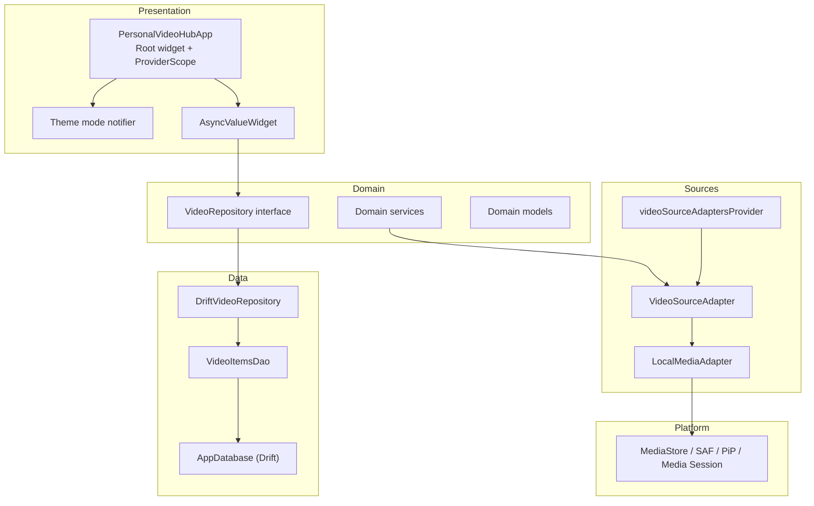
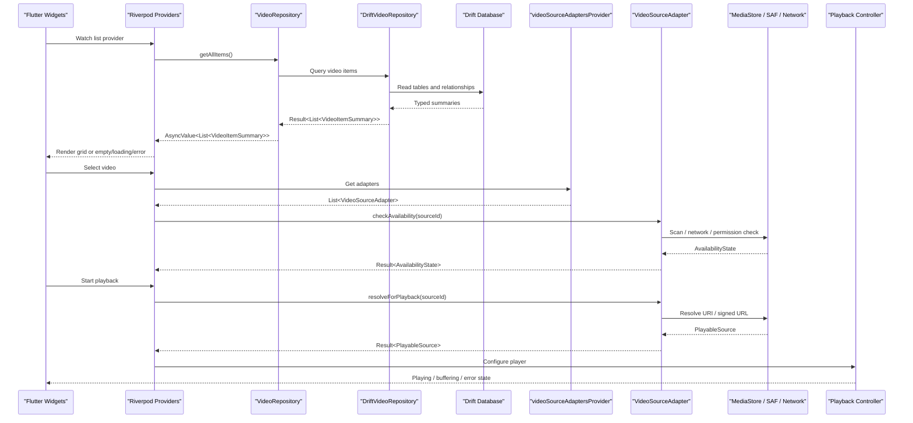
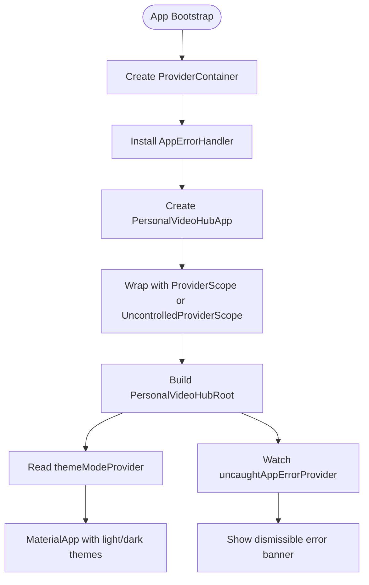
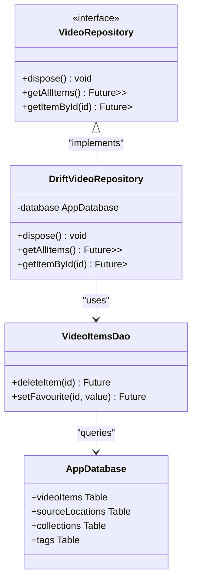
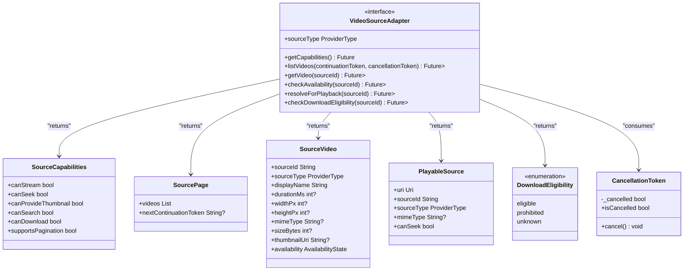
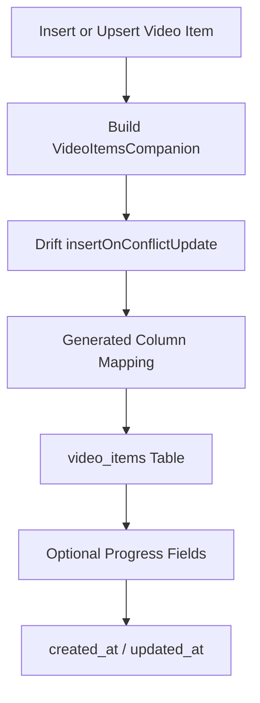
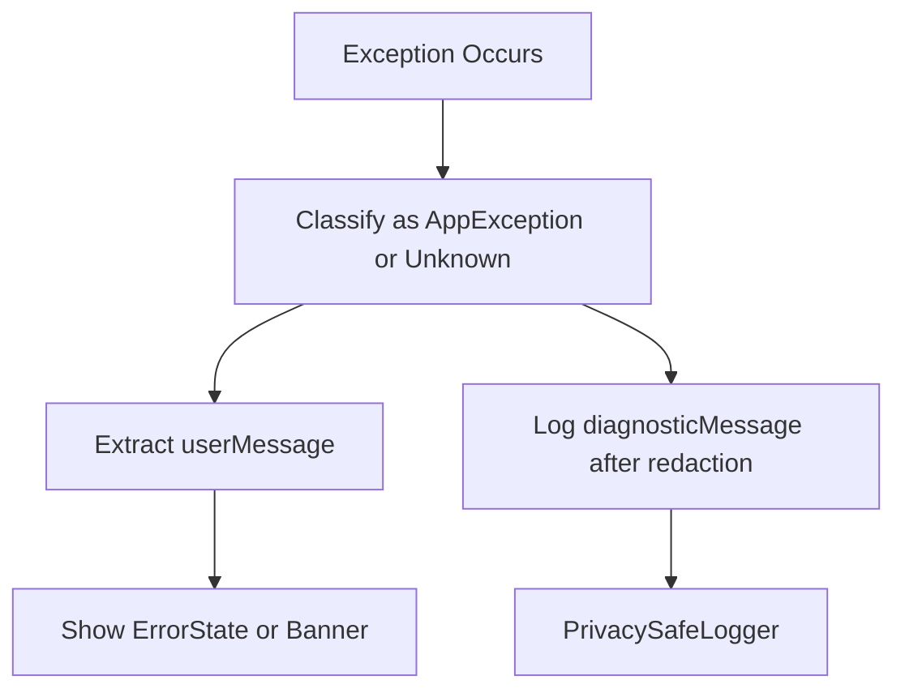
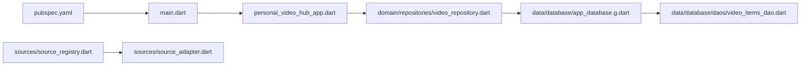

# Architecture Overview

<cite>
**Referenced Files in This Document**
- [ARCHITECTURE.md](file://ARCHITECTURE.md)
- [DECISIONS.md](file://DECISIONS.md)
- [pubspec.yaml](file://pubspec.yaml)
- [lib/main.dart](file://lib/main.dart)
- [lib/app/personal_video_hub_app.dart](file://lib/app/personal_video_hub_app.dart)
- [lib/core/errors/app_exception.dart](file://lib/core/errors/app_exception.dart)
- [lib/core/ui/async_value_widget.dart](file://lib/core/ui/async_value_widget.dart)
- [lib/domain/repositories/video_repository.dart](file://lib/domain/repositories/video_repository.dart)
- [lib/data/database/app_database.g.dart](file://lib/data/database/app_database.g.dart)
- [lib/data/database/daos/video_items_dao.dart](file://lib/data/database/daos/video_items_dao.dart)
- [lib/sources/source_adapter.dart](file://lib/sources/source_adapter.dart)
- [lib/sources/source_registry.dart](file://lib/sources/source_registry.dart)
- [test/widget/state_widgets_test.dart](file://test/widget/state_widgets_test.dart)
- [test/unit/database/drift_video_repository_test.dart](file://test/unit/database/drift_video_repository_test.dart)
</cite>

## Table of Contents
1. [Introduction](#introduction)
2. [Project Structure](#project-structure)
3. [Core Components](#core-components)
4. [Architecture Overview](#architecture-overview)
5. [Detailed Component Analysis](#detailed-component-analysis)
6. [Dependency Analysis](#dependency-analysis)
7. [Performance Considerations](#performance-considerations)
8. [Troubleshooting Guide](#troubleshooting-guide)
9. [Conclusion](#conclusion)

## Introduction
MyTube is a local-first Flutter application for Android that organizes, indexes, and plays videos from multiple sources such as device storage, selected folders, direct URLs, and cloud providers. The codebase follows clean architecture principles with explicit separation between presentation, domain, data, source adapters, playback, and platform bridges. State management uses Riverpod, persistence uses Drift with SQLite, and the video engine is backed by the official `video_player` package on top of Media3 ExoPlayer.

The system boundary includes:
- Presentation layer: Flutter widgets, routing, theme, and Riverpod state.
- Domain layer: models, repositories, services, and policies.
- Data layer: Drift database, DAOs, repository implementations, and mappers.
- Source adapters: pluggable provider-specific adapters for listing, metadata, availability, and playback resolution.
- Playback layer: app-owned controller wrapping the player engine.
- Platform bridges: Android integrations such as MediaStore, Storage Access Framework, thumbnails, PiP, and media session.

**Section sources**
- [ARCHITECTURE.md:3-11](file://ARCHITECTURE.md#L3-L11)
- [ARCHITECTURE.md:55-93](file://ARCHITECTURE.md#L55-L93)
- [DECISIONS.md:48-84](file://DECISIONS.md#L48-L84)
- [DECISIONS.md:86-126](file://DECISIONS.md#L86-L126)

## Project Structure
The project layout separates responsibilities into clear directories:
- `lib/app`: App shell, routing, navigation, theme, and root widget wiring.
- `lib/core`: Cross-cutting concerns including errors, result types, logging, and shared UI helpers.
- `lib/domain`: Framework-light models, repository interfaces, services, and policies.
- `lib/data`: Drift database schema, DAOs, migrations, repository implementations, and mappers.
- `lib/features`: Feature modules such as library, discover, reels, saved, settings, downloads, backup.
- `lib/sources`: Pluggable video source adapters and registry.
- `lib/playback`: App-owned playback service/controller interfaces.
- `lib/platform`: Narrow interfaces for MediaStore, SAF, thumbnails, PiP, and media session.

**Diagram sources**
- [lib/app/personal_video_hub_app.dart:10-26](file://lib/app/personal_video_hub_app.dart#L10-L26)
- [lib/core/ui/async_value_widget.dart:8-28](file://lib/core/ui/async_value_widget.dart#L8-L28)
- [lib/domain/repositories/video_repository.dart:5-13](file://lib/domain/repositories/video_repository.dart#L5-L13)
- [lib/data/database/app_database.g.dart:92-140](file://lib/data/database/app_database.g.dart#L92-L140)
- [lib/data/database/daos/video_items_dao.dart:66-78](file://lib/data/database/daos/video_items_dao.dart#L66-L78)
- [lib/sources/source_adapter.dart:23-57](file://lib/sources/source_adapter.dart#L23-L57)
- [lib/sources/source_registry.dart:5-11](file://lib/sources/source_registry.dart#L5-L11)

**Section sources**
- [ARCHITECTURE.md:13-50](file://ARCHITECTURE.md#L13-L50)
- [ARCHITECTURE.md:55-93](file://ARCHITECTURE.md#L55-L93)

## Core Components
This section documents the core architectural components and their roles.

### Presentation Layer
- Root application widget wraps the app in a single Riverpod scope and provides Material theming.
- Theme mode is read through a Riverpod notifier; uncaught errors are surfaced via an error banner.
- `AsyncValueWidget` maps Riverpod `AsyncValue` to loading, empty, error, and data states while hiding internal diagnostics from users.

Key behaviors:
- One `ProviderContainer` is created at bootstrap so tests and production share the same dependency graph.
- Widgets do not directly query databases or call provider networking.
- Error messages shown to users come from typed exceptions rather than raw stack traces.

**Section sources**
- [lib/main.dart:12-32](file://lib/main.dart#L12-L32)
- [lib/app/personal_video_hub_app.dart:10-26](file://lib/app/personal_video_hub_app.dart#L10-L26)
- [lib/app/personal_video_hub_app.dart:29-59](file://lib/app/personal_video_hub_app.dart#L29-L59)
- [lib/core/ui/async_value_widget.dart:8-28](file://lib/core/ui/async_value_widget.dart#L8-L28)
- [lib/core/ui/async_value_widget.dart:62-81](file://lib/core/ui/async_value_widget.dart#L62-L81)

### Domain Layer
- Repository interfaces define framework-light contracts for video item operations.
- Domain services implement business logic such as refresh coordination, duplicate matching, recommendation scoring, and availability transitions.
- Domain models represent logical video items, source locations, tags, collections, watch progress, and preferences.

Design rules:
- Interfaces have no Flutter or Drift imports.
- Methods return typed results so callers handle success and failure without try-catch.
- Domain does not own global favorites/history/collections when those belong to higher-level orchestration.

**Section sources**
- [lib/domain/repositories/video_repository.dart:5-13](file://lib/domain/repositories/video_repository.dart#L5-L13)
- [ARCHITECTURE.md:63-74](file://ARCHITECTURE.md#L63-L74)

### Data Layer
- Drift manages SQLite schema, migrations, and type-safe queries.
- DAOs encapsulate table operations such as inserts, updates, deletes, and progress tracking.
- Repository implementations wrap DAOs and map database rows to domain models.

Schema highlights:
- `video_items` stores logical video records with identifiers, metadata, favorite state, watch progress, and timestamps.
- Generated Drift classes provide columns, companions, serialization, and integrity validation.

**Section sources**
- [lib/data/database/app_database.g.dart:92-140](file://lib/data/database/app_database.g.dart#L92-L140)
- [lib/data/database/app_database.g.dart:370-403](file://lib/data/database/app_database.g.dart#L370-L403)
- [lib/data/database/app_database.g.dart:566-592](file://lib/data/database/app_database.g.dart#L566-L592)
- [lib/data/database/daos/video_items_dao.dart:66-78](file://lib/data/database/daos/video_items_dao.dart#L66-L78)
- [test/unit/database/drift_video_repository_test.dart:49-73](file://test/unit/database/drift_video_repository_test.dart#L49-L73)

### Source Adapters
- `VideoSourceAdapter` defines a common contract for every video source provider.
- Adapters handle listing, metadata retrieval, availability checks, playable-source resolution, and download eligibility.
- Capabilities declare optional features like streaming, seeking, thumbnails, search, pagination, and downloads.
- The adapter registry exposes all available adapters in priority order.

Implementation guidance:
- Local MediaStore and selected-folder adapters come first.
- Direct URL, OneDrive, Google Drive, and Cloudflare R2 follow in documented order.
- Token handling, signed URL expiry, and capability discovery belong inside adapters, not widgets.

**Section sources**
- [lib/sources/source_adapter.dart:5-22](file://lib/sources/source_adapter.dart#L5-L22)
- [lib/sources/source_adapter.dart:23-57](file://lib/sources/source_adapter.dart#L23-L57)
- [lib/sources/source_adapter.dart:63-80](file://lib/sources/source_adapter.dart#L63-L80)
- [lib/sources/source_adapter.dart:82-117](file://lib/sources/source_adapter.dart#L82-L117)
- [lib/sources/source_adapter.dart:119-137](file://lib/sources/source_adapter.dart#L119-L137)
- [lib/sources/source_adapter.dart:139-164](file://lib/sources/source_adapter.dart#L139-L164)
- [lib/sources/source_registry.dart:5-11](file://lib/sources/source_registry.dart#L5-L11)

### Playback and Platform Bridges
- Playback is wrapped behind an app-owned controller so widgets see stable states such as loading, playing, paused, buffering, position, duration, completion, and error.
- Platform bridges isolate Android-specific behavior such as MediaStore scanning, SAF folder access, thumbnails, picture-in-picture, and media session notifications.
- The chosen player engine is `video_player`, which uses Jetpack Media3 ExoPlayer on Android.

**Section sources**
- [ARCHITECTURE.md:83-93](file://ARCHITECTURE.md#L83-L93)
- [DECISIONS.md:86-126](file://DECISIONS.md#L86-L126)

## Architecture Overview
The system enforces layered boundaries and clear data flow from platform APIs through source adapters to the UI.

**Diagram sources**
- [lib/core/ui/async_value_widget.dart:8-28](file://lib/core/ui/async_value_widget.dart#L8-L28)
- [lib/domain/repositories/video_repository.dart:20-26](file://lib/domain/repositories/video_repository.dart#L20-L26)
- [lib/data/database/app_database.g.dart:92-140](file://lib/data/database/app_database.g.dart#L92-L140)
- [lib/sources/source_registry.dart:5-11](file://lib/sources/source_registry.dart#L5-L11)
- [lib/sources/source_adapter.dart:23-57](file://lib/sources/source_adapter.dart#L23-L57)
- [ARCHITECTURE.md:171-186](file://ARCHITECTURE.md#L171-L186)

## Detailed Component Analysis

### Riverpod-Based State Management
Riverpod is used consistently across the app:
- A single `ProviderContainer` is created at bootstrap and passed into the root app widget.
- The root widget wraps content in `ProviderScope` or `UncontrolledProviderScope` depending on whether an external container is provided.
- Theme mode and uncaught errors are observed through Riverpod providers.
- `AsyncValueWidget` centralizes async state rendering and hides sensitive diagnostic details from users.

**Diagram sources**
- [lib/main.dart:12-32](file://lib/main.dart#L12-L32)
- [lib/app/personal_video_hub_app.dart:10-26](file://lib/app/personal_video_hub_app.dart#L10-L26)
- [lib/app/personal_video_hub_app.dart:29-59](file://lib/app/personal_video_hub_app.dart#L29-L59)

**Section sources**
- [DECISIONS.md:48-84](file://DECISIONS.md#L48-L84)
- [lib/main.dart:12-32](file://lib/main.dart#L12-L32)
- [lib/app/personal_video_hub_app.dart:10-26](file://lib/app/personal_video_hub_app.dart#L10-L26)
- [lib/app/personal_video_hub_app.dart:29-59](file://lib/app/personal_video_hub_app.dart#L29-L59)

### Repository Pattern for Data Abstraction
The repository pattern isolates persistence and domain logic from UI:
- `VideoRepository` defines abstract methods for listing, fetching, updating, and deleting video items.
- Drift-based implementation wraps DAOs and returns typed `Result` values.
- Tests verify repository behavior against an in-memory database and assert ordering and semantics.

**Diagram sources**
- [lib/domain/repositories/video_repository.dart:5-13](file://lib/domain/repositories/video_repository.dart#L5-L13)
- [lib/data/database/daos/video_items_dao.dart:66-78](file://lib/data/database/daos/video_items_dao.dart#L66-L78)
- [lib/data/database/app_database.g.dart:92-140](file://lib/data/database/app_database.g.dart#L92-L140)

**Section sources**
- [lib/domain/repositories/video_repository.dart:5-13](file://lib/domain/repositories/video_repository.dart#L5-L13)
- [test/unit/database/drift_video_repository_test.dart:49-73](file://test/unit/database/drift_video_repository_test.dart#L49-L73)

### Adapter Pattern for Pluggable Video Sources
The adapter pattern enables multiple video sources without coupling UI or domain logic to provider-specific details:
- `VideoSourceAdapter` declares capabilities and operations.
- `SourceCapabilities` expresses optional features.
- `SourcePage` supports paginated listings.
- `SourceVideo` represents provider metadata.
- `PlayableSource` represents ephemeral playback URIs.
- `DownloadEligibility` indicates whether offline downloads are allowed.
- `CancellationToken` ensures long-running scans can be cancelled safely.

**Diagram sources**
- [lib/sources/source_adapter.dart:23-57](file://lib/sources/source_adapter.dart#L23-L57)
- [lib/sources/source_adapter.dart:63-80](file://lib/sources/source_adapter.dart#L63-L80)
- [lib/sources/source_adapter.dart:82-117](file://lib/sources/source_adapter.dart#L82-L117)
- [lib/sources/source_adapter.dart:119-137](file://lib/sources/source_adapter.dart#L119-L137)
- [lib/sources/source_adapter.dart:139-164](file://lib/sources/source_adapter.dart#L139-L164)

**Section sources**
- [lib/sources/source_adapter.dart:5-22](file://lib/sources/source_adapter.dart#L5-L22)
- [lib/sources/source_adapter.dart:23-57](file://lib/sources/source_adapter.dart#L23-L57)
- [lib/sources/source_adapter.dart:63-164](file://lib/sources/source_adapter.dart#L63-L164)
- [ARCHITECTURE.md:144-169](file://ARCHITECTURE.md#L144-L169)

### Drift ORM and Database Operations
Drift provides type-safe database access:
- Generated model classes include column definitions, serialization, and companion builders.
- DAOs expose safe delete and update operations.
- Foreign key cascade rules protect referential integrity during deletion.
- Migrations evolve the schema without breaking existing data.

**Diagram sources**
- [lib/data/database/app_database.g.dart:370-403](file://lib/data/database/app_database.g.dart#L370-L403)
- [lib/data/database/app_database.g.dart:566-592](file://lib/data/database/app_database.g.dart#L566-L592)
- [lib/data/database/daos/video_items_dao.dart:66-78](file://lib/data/database/daos/video_items_dao.dart#L66-L78)

**Section sources**
- [lib/data/database/app_database.g.dart:92-140](file://lib/data/database/app_database.g.dart#L92-L140)
- [lib/data/database/app_database.g.dart:370-403](file://lib/data/database/app_database.g.dart#L370-L403)
- [lib/data/database/app_database.g.dart:566-592](file://lib/data/database/app_database.g.dart#L566-L592)
- [lib/data/database/daos/video_items_dao.dart:66-78](file://lib/data/database/daos/video_items_dao.dart#L66-L78)

### Error Handling and Logging
Error handling separates user-facing messages from privacy-safe diagnostics:
- `AppException` carries a safe user message and a diagnostic message suitable for logs after redaction.
- `AsyncValueWidget` converts errors into user-friendly UI and avoids exposing tokens or signed URL parameters.
- Uncaught app errors are reported through a Riverpod notifier and displayed as a dismissible banner.

**Diagram sources**
- [lib/core/errors/app_exception.dart:1-20](file://lib/core/errors/app_exception.dart#L1-L20)
- [lib/core/ui/async_value_widget.dart:62-81](file://lib/core/ui/async_value_widget.dart#L62-L81)
- [lib/app/personal_video_hub_app.dart:33-59](file://lib/app/personal_video_hub_app.dart#L33-L59)

**Section sources**
- [lib/core/errors/app_exception.dart:1-20](file://lib/core/errors/app_exception.dart#L1-L20)
- [lib/core/ui/async_value_widget.dart:62-81](file://lib/core/ui/async_value_widget.dart#L62-L81)
- [test/widget/state_widgets_test.dart:173-196](file://test/widget/state_widgets_test.dart#L173-L196)
- [test/widget/state_widgets_test.dart:198-217](file://test/widget/state_widgets_test.dart#L198-L217)

### Theme Management
Theme management is driven by a Riverpod notifier:
- The root app reads `themeModeProvider`.
- Light and dark themes are supplied to `MaterialApp`.
- System mode is supported, with a dark-first preference documented in the root widget comments.

**Section sources**
- [lib/app/personal_video_hub_app.dart:33-59](file://lib/app/personal_video_hub_app.dart#L33-L59)

## Dependency Analysis
The following diagram shows how dependencies flow between layers and technologies.

**Diagram sources**
- [pubspec.yaml:9-18](file://pubspec.yaml#L9-L18)
- [lib/main.dart:1-7](file://lib/main.dart#L1-L7)
- [lib/app/personal_video_hub_app.dart:1-9](file://lib/app/personal_video_hub_app.dart#L1-L9)
- [lib/domain/repositories/video_repository.dart:1-3](file://lib/domain/repositories/video_repository.dart#L1-L3)
- [lib/data/database/app_database.g.dart:92-140](file://lib/data/database/app_database.g.dart#L92-L140)
- [lib/data/database/daos/video_items_dao.dart:66-78](file://lib/data/database/daos/video_items_dao.dart#L66-L78)
- [lib/sources/source_adapter.dart:1-3](file://lib/sources/source_adapter.dart#L1-L3)
- [lib/sources/source_registry.dart:1-3](file://lib/sources/source_registry.dart#L1-L3)

**Section sources**
- [pubspec.yaml:9-18](file://pubspec.yaml#L9-L18)
- [lib/main.dart:1-7](file://lib/main.dart#L1-L7)
- [lib/app/personal_video_hub_app.dart:1-9](file://lib/app/personal_video_hub_app.dart#L1-L9)
- [lib/domain/repositories/video_repository.dart:1-3](file://lib/domain/repositories/video_repository.dart#L1-L3)
- [lib/sources/source_adapter.dart:1-3](file://lib/sources/source_adapter.dart#L1-L3)
- [lib/sources/source_registry.dart:1-3](file://lib/sources/source_registry.dart#L1-L3)

## Performance Considerations
- Avoid full library scans on every rebuild or tab switch; use incremental refresh where supported.
- Keep indexing cancellable and responsive using cancellation tokens.
- Throttle write operations for watch progress and avoid excessive database writes during playback.
- Preload only a small number of adjacent items in swipe-heavy flows such as Reels.
- Separate cache, downloads, and original files to prevent accidental cleanup of important data.
- Prefer deterministic, testable scoring for discovery rather than heavy ML pipelines.

[No sources needed since this section provides general guidance]

## Troubleshooting Guide
Common issues and recommended approaches:
- **Async state confusion**: Use `AsyncValueWidget` to render loading, error, and data states consistently.
- **Sensitive information exposure**: Ensure user-facing messages come from `AppException.userMessage`; never log tokens or signed URL parameters.
- **Repository behavior**: Verify repository tests cover empty lists, ordering, and error cases.
- **Database integrity**: Check generated Drift mappings and DAO operations when schema changes occur.
- **Source adapter failures**: Validate capabilities before calling unsupported operations; handle token expiry and signed URL refresh inside adapters.

**Section sources**
- [lib/core/ui/async_value_widget.dart:62-81](file://lib/core/ui/async_value_widget.dart#L62-L81)
- [lib/core/errors/app_exception.dart:1-20](file://lib/core/errors/app_exception.dart#L1-L20)
- [test/widget/state_widgets_test.dart:173-217](file://test/widget/state_widgets_test.dart#L173-L217)
- [test/unit/database/drift_video_repository_test.dart:49-73](file://test/unit/database/drift_video_repository_test.dart#L49-L73)
- [lib/sources/source_adapter.dart:48-57](file://lib/sources/source_adapter.dart#L48-L57)

## Conclusion
MyTube’s architecture cleanly separates presentation, domain, data, source adapters, playback, and platform concerns. Riverpod provides consistent state management, Drift provides type-safe persistence, and the adapter pattern enables pluggable video sources. The design emphasizes safety, testability, and maintainability while keeping the UI free from low-level infrastructure details. As new sources and features are added, they should follow the established boundaries, typed results, capability declarations, and privacy-safe error handling.

[No sources needed since this section summarizes without analyzing specific files]