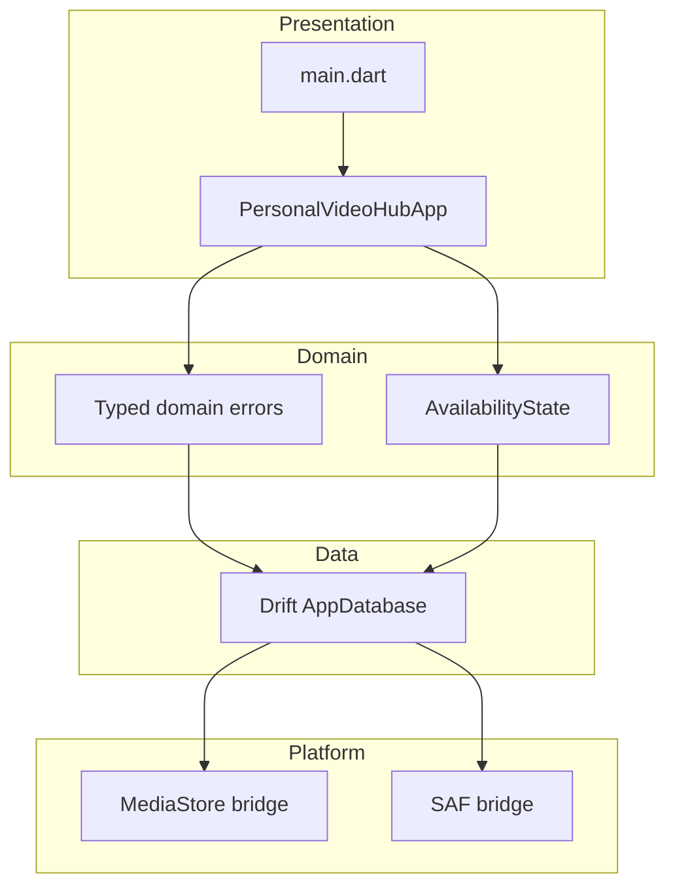
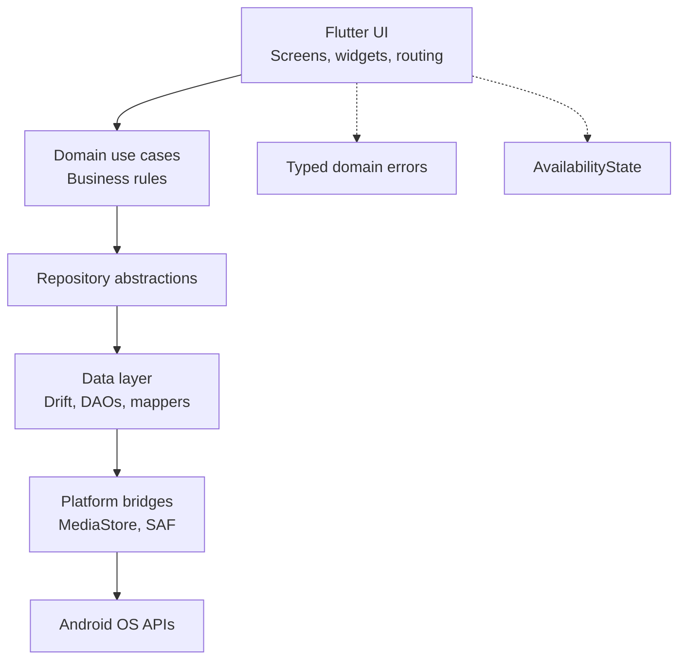
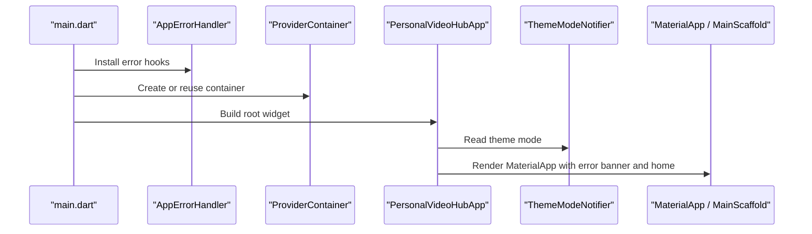
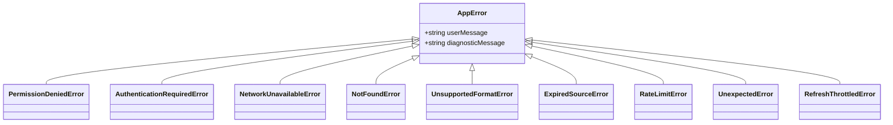
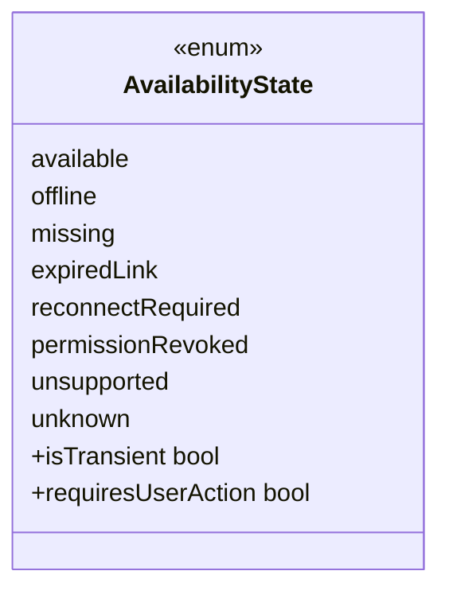
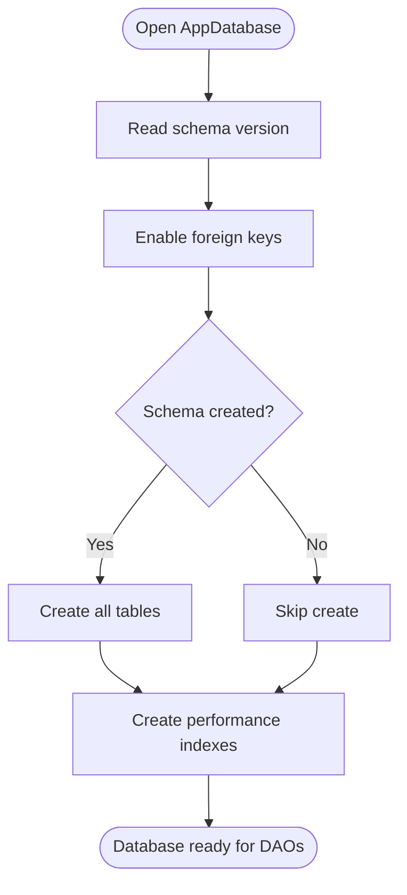
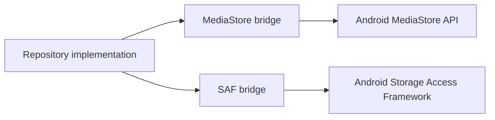
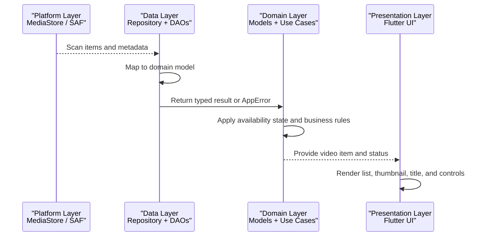
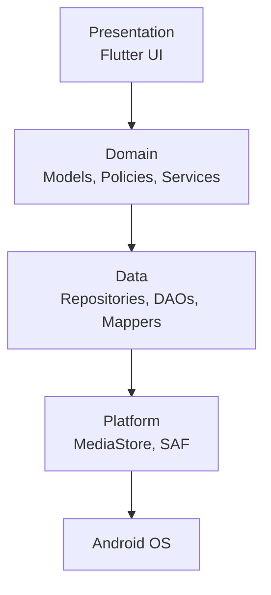

# Clean Architecture Layers

<cite>
**Referenced Files in This Document**
- [ARCHITECTURE.md](file://ARCHITECTURE.md)
- [main.dart](file://lib/main.dart)
- [personal_video_hub_app.dart](file://lib/app/personal_video_hub_app.dart)
- [app_error.dart](file://lib/domain/models/app_error.dart)
- [availability_state.dart](file://lib/domain/models/availability_state.dart)
- [app_database.dart](file://lib/data/database/app_database.dart)
- [media_store_bridge.dart](file://lib/platform/media_store_bridge.dart)
- [media_store_bridge_impl.dart](file://lib/platform/media_store_bridge_impl.dart)
- [saf_bridge.dart](file://lib/platform/saf_bridge.dart)
- [saf_bridge_impl.dart](file://lib/platform/saf_bridge_impl.dart)
</cite>

## Table of Contents
1. [Introduction](#introduction)
2. [Project Structure](#project-structure)
3. [Core Components](#core-components)
4. [Architecture Overview](#architecture-overview)
5. [Detailed Component Analysis](#detailed-component-analysis)
6. [Dependency Analysis](#dependency-analysis)
7. [Performance Considerations](#performance-considerations)
8. [Troubleshooting Guide](#troubleshooting-guide)
9. [Conclusion](#conclusion)

## Introduction
This document explains MyTube’s clean architecture layer implementation and how it keeps the app testable, maintainable, and safe. The system is organized into four main layers:

- Presentation: Flutter screens, widgets, routing, and view state.
- Domain: Business models, availability states, typed errors, and use-case-oriented logic.
- Data: Drift database, DAOs, migrations, repository implementations, and mappers.
- Platform: Android integrations such as MediaStore and Storage Access Framework (SAF).

The key rule is that UI components must not access the database or network directly. Instead, they consume domain models and repository abstractions. This separation makes unit testing straightforward, reduces coupling, and allows platform and data details to change without rewriting the UI.

**Section sources**
- [ARCHITECTURE.md:55-93](file://ARCHITECTURE.md#L55-L93)

## Project Structure
MyTube follows a layered layout under `lib`:

- `app`: App shell, routing, navigation, theme, error surfaces, and root widget wiring.
- `core`: Shared cross-cutting concerns such as logging, result types, and security utilities.
- `domain`: Framework-light models, policies, repositories interfaces, and services.
- `data`: Drift database, tables, DAOs, migrations, repository implementations, and mappers.
- `platform`: Narrow bridges for MediaStore, SAF, thumbnails, PiP, media session, and lifecycle.
- `playback`: App-owned playback controller/service interfaces.
- `sources`: Source adapters for local, direct URL, and cloud providers.

**Diagram sources**
- [main.dart:8-32](file://lib/main.dart#L8-L32)
- [personal_video_hub_app.dart:10-60](file://lib/app/personal_video_hub_app.dart#L10-L60)
- [app_error.dart:1-23](file://lib/domain/models/app_error.dart#L1-L23)
- [availability_state.dart:1-31](file://lib/domain/models/availability_state.dart#L1-L31)
- [app_database.dart:18-38](file://lib/data/database/app_database.dart#L18-L38)
- [media_store_bridge.dart:1-200](file://lib/platform/media_store_bridge.dart#L1-L200)
- [saf_bridge.dart:1-200](file://lib/platform/saf_bridge.dart#L1-L200)

**Section sources**
- [ARCHITECTURE.md:13-53](file://ARCHITECTURE.md#L13-L53)

## Core Components
This section summarizes the responsibilities and boundaries of each layer.

### Presentation Layer
- Responsibilities:
  - Root application setup, Riverpod container wiring, error hooks, theme mode, and Material app shell.
  - Screens, widgets, routing, and view state.
- Boundaries:
  - Widgets must not query SQLite directly.
  - Widgets must not implement OAuth or provider networking.
  - UI consumes domain models and repository abstractions through state management.

Key files:
- Application bootstrap and error hook installation.
- Root widget with theme, uncaught error banner, and home scaffold.

**Section sources**
- [main.dart:8-32](file://lib/main.dart#L8-L32)
- [personal_video_hub_app.dart:10-60](file://lib/app/personal_video_hub_app.dart#L10-L60)
- [ARCHITECTURE.md:57-61](file://ARCHITECTURE.md#L57-L61)

### Domain Layer
- Responsibilities:
  - Framework-light models and use cases for listing, search, filter, sort, favorites, tags, collections, watch progress, source selection, recommendation scoring, availability states, refresh coordination, and duplicate matching.
- Boundaries:
  - Encapsulates business rules independent of Flutter, Drift, and Android APIs.
  - Uses typed errors and availability states to represent expected failure modes and reachability.

Key models:
- Typed domain errors for permission denial, authentication required, network unavailable, not found, unsupported format, expired source, rate limit, unexpected failures, and refresh throttling.
- Availability state enum representing reachable, offline, missing, expired link, reconnect required, permission revoked, unsupported, and unknown conditions.

**Section sources**
- [ARCHITECTURE.md:63-68](file://ARCHITECTURE.md#L63-L68)
- [app_error.dart:1-108](file://lib/domain/models/app_error.dart#L1-L108)
- [availability_state.dart:1-44](file://lib/domain/models/availability_state.dart#L1-L44)

### Data Layer
- Responsibilities:
  - Drift database schema, DAOs, migrations, repository implementations, and mappings.
  - Converts between persistence models and domain models.
- Boundaries:
  - Does not expose raw database row types to widgets.
  - Returns typed results and errors.

Key file:
- Drift database definition with versioned migrations, indexes, and in-memory support for tests.

**Section sources**
- [ARCHITECTURE.md:70-74](file://ARCHITECTURE.md#L70-L74)
- [app_database.dart:18-110](file://lib/data/database/app_database.dart#L18-L110)

### Platform Layer
- Responsibilities:
  - Narrow interfaces around MediaStore, SAF, native thumbnails, PiP, media session, app lifecycle, and privacy-related behavior.
- Boundaries:
  - Keeps Android-specific details away from domain and presentation layers.
  - Exposes stable contracts so domain and data layers can be tested without real device permissions.

Key files:
- MediaStore bridge interface and implementation.
- SAF bridge interface and implementation.

**Section sources**
- [ARCHITECTURE.md:89-93](file://ARCHITECTURE.md#L89-L93)
- [media_store_bridge.dart:1-200](file://lib/platform/media_store_bridge.dart#L1-L200)
- [media_store_bridge_impl.dart:1-200](file://lib/platform/media_store_bridge_impl.dart#L1-L200)
- [saf_bridge.dart:1-200](file://lib/platform/saf_bridge.dart#L1-L200)
- [saf_bridge_impl.dart:1-200](file://lib/platform/saf_bridge_impl.dart#L1-L200)

## Architecture Overview
The clean architecture separates concerns so that UI remains thin, business logic is testable, persistence is encapsulated, and platform integrations are isolated.

**Diagram sources**
- [personal_video_hub_app.dart:10-60](file://lib/app/personal_video_hub_app.dart#L10-L60)
- [app_error.dart:1-23](file://lib/domain/models/app_error.dart#L1-L23)
- [availability_state.dart:1-31](file://lib/domain/models/availability_state.dart#L1-L31)
- [app_database.dart:18-38](file://lib/data/database/app_database.dart#L18-L38)
- [media_store_bridge.dart:1-200](file://lib/platform/media_store_bridge.dart#L1-L200)
- [saf_bridge.dart:1-200](file://lib/platform/saf_bridge.dart#L1-L200)

## Detailed Component Analysis

### Presentation Layer: App Bootstrap and Root Widget
The presentation layer starts at `main.dart`, which wires error handling, a single Riverpod container, and the app shell. `PersonalVideoHubApp` provides the root widget, theme mode, uncaught error banner, and home scaffold.

**Diagram sources**
- [main.dart:8-32](file://lib/main.dart#L8-L32)
- [personal_video_hub_app.dart:10-60](file://lib/app/personal_video_hub_app.dart#L10-L60)

**Section sources**
- [main.dart:8-32](file://lib/main.dart#L8-L32)
- [personal_video_hub_app.dart:10-60](file://lib/app/personal_video_hub_app.dart#L10-L60)

### Domain Layer: Typed Errors and Availability States
Domain models define expected failure modes and source reachability. They keep user-facing messages separate from diagnostic logs and provide clear semantics for UI actions.

**Diagram sources**
- [app_error.dart:1-108](file://lib/domain/models/app_error.dart#L1-L108)

**Diagram sources**
- [availability_state.dart:1-44](file://lib/domain/models/availability_state.dart#L1-L44)

**Section sources**
- [app_error.dart:1-108](file://lib/domain/models/app_error.dart#L1-L108)
- [availability_state.dart:1-44](file://lib/domain/models/availability_state.dart#L1-L44)

### Data Layer: Drift Database and Migrations
The data layer owns persistence. It defines tables, DAOs, migrations, indexes, and in-memory databases for tests. It does not leak row types to the UI; instead, repositories return domain-friendly models and typed results.

**Diagram sources**
- [app_database.dart:18-110](file://lib/data/database/app_database.dart#L18-L110)

**Section sources**
- [app_database.dart:18-110](file://lib/data/database/app_database.dart#L18-L110)

### Platform Layer: MediaStore and SAF Bridges
The platform layer isolates Android-specific integrations behind narrow interfaces. MediaStore and SAF bridges abstract scanning, permissions, and storage access so higher layers do not depend on Android APIs directly.

**Diagram sources**
- [media_store_bridge.dart:1-200](file://lib/platform/media_store_bridge.dart#L1-L200)
- [media_store_bridge_impl.dart:1-200](file://lib/platform/media_store_bridge_impl.dart#L1-L200)
- [saf_bridge.dart:1-200](file://lib/platform/saf_bridge.dart#L1-L200)
- [saf_bridge_impl.dart:1-200](file://lib/platform/saf_bridge_impl.dart#L1-L200)

**Section sources**
- [ARCHITECTURE.md:89-93](file://ARCHITECTURE.md#L89-L93)
- [media_store_bridge.dart:1-200](file://lib/platform/media_store_bridge.dart#L1-L200)
- [saf_bridge.dart:1-200](file://lib/platform/saf_bridge.dart#L1-L200)

### End-to-End Flow: Video Item from Platform API to UI Display
This sequence shows how a video item moves through the layers while respecting clean architecture boundaries.

**Diagram sources**
- [media_store_bridge.dart:1-200](file://lib/platform/media_store_bridge.dart#L1-L200)
- [saf_bridge.dart:1-200](file://lib/platform/saf_bridge.dart#L1-L200)
- [app_database.dart:18-110](file://lib/data/database/app_database.dart#L18-L110)
- [app_error.dart:1-108](file://lib/domain/models/app_error.dart#L1-L108)
- [availability_state.dart:1-44](file://lib/domain/models/availability_state.dart#L1-L44)
- [personal_video_hub_app.dart:10-60](file://lib/app/personal_video_hub_app.dart#L10-L60)

**Section sources**
- [ARCHITECTURE.md:144-183](file://ARCHITECTURE.md#L144-L183)

## Dependency Analysis
The following diagram shows how layers depend on each other and where external integrations enter the system.

**Diagram sources**
- [personal_video_hub_app.dart:10-60](file://lib/app/personal_video_hub_app.dart#L10-L60)
- [app_error.dart:1-108](file://lib/domain/models/app_error.dart#L1-L108)
- [app_database.dart:18-110](file://lib/data/database/app_database.dart#L18-L110)
- [media_store_bridge.dart:1-200](file://lib/platform/media_store_bridge.dart#L1-L200)
- [saf_bridge.dart:1-200](file://lib/platform/saf_bridge.dart#L1-L200)

**Section sources**
- [ARCHITECTURE.md:55-93](file://ARCHITECTURE.md#L55-L93)

## Performance Considerations
- Avoid full scans on every rebuild or tab switch.
- Use incremental refresh when supported and store scan timestamps.
- Keep indexing cancellable and UI responsive.
- Prefer small queues and preloading only adjacent items during rapid interactions.
- Throttle writes for watch progress and avoid blocking the UI thread.
- Use indexes for common joins and recent-play queries.

[No sources needed since this section provides general guidance]

## Troubleshooting Guide
Use typed domain errors and availability states to guide recovery actions:

- Permission denied: Prompt the user to grant access and retry.
- Authentication required: Reconnect the provider or sign in again.
- Network unavailable: Retry after connectivity returns.
- Not found: Treat as missing and offer removal or re-scan.
- Unsupported format: Show an error and suggest another source if available.
- Expired link: Re-authenticate or refresh the signed URL inside adapters.
- Rate limited: Back off and retry later.
- Unexpected: Log diagnostics safely and show a generic user message.

For availability transitions:
- Offline and unknown are transient; do not ask the user to act immediately.
- Reconnect required, permission revoked, and expired link require explicit user action.
- Missing and unsupported require corrective steps or alternative sources.

**Section sources**
- [app_error.dart:1-108](file://lib/domain/models/app_error.dart#L1-L108)
- [availability_state.dart:1-44](file://lib/domain/models/availability_state.dart#L1-L44)
- [ARCHITECTURE.md:242-250](file://ARCHITECTURE.md#L242-L250)

## Conclusion
MyTube’s clean architecture separates UI, business logic, persistence, and platform integrations. This separation ensures:

- Testability: Domain rules and repositories can be unit-tested without Flutter or Android dependencies.
- Maintainability: Changes to Drift, MediaStore, or SAF do not force UI rewrites.
- Safety: User-facing messages are separated from diagnostics, and sensitive data stays out of logs and UI.
- Predictability: Availability states and typed errors make failure paths explicit and actionable.

By keeping UI components free from direct database access and network calls, MyTube remains easier to extend, test, and evolve as new sources and features are added.

[No sources needed since this section summarizes without analyzing specific files]