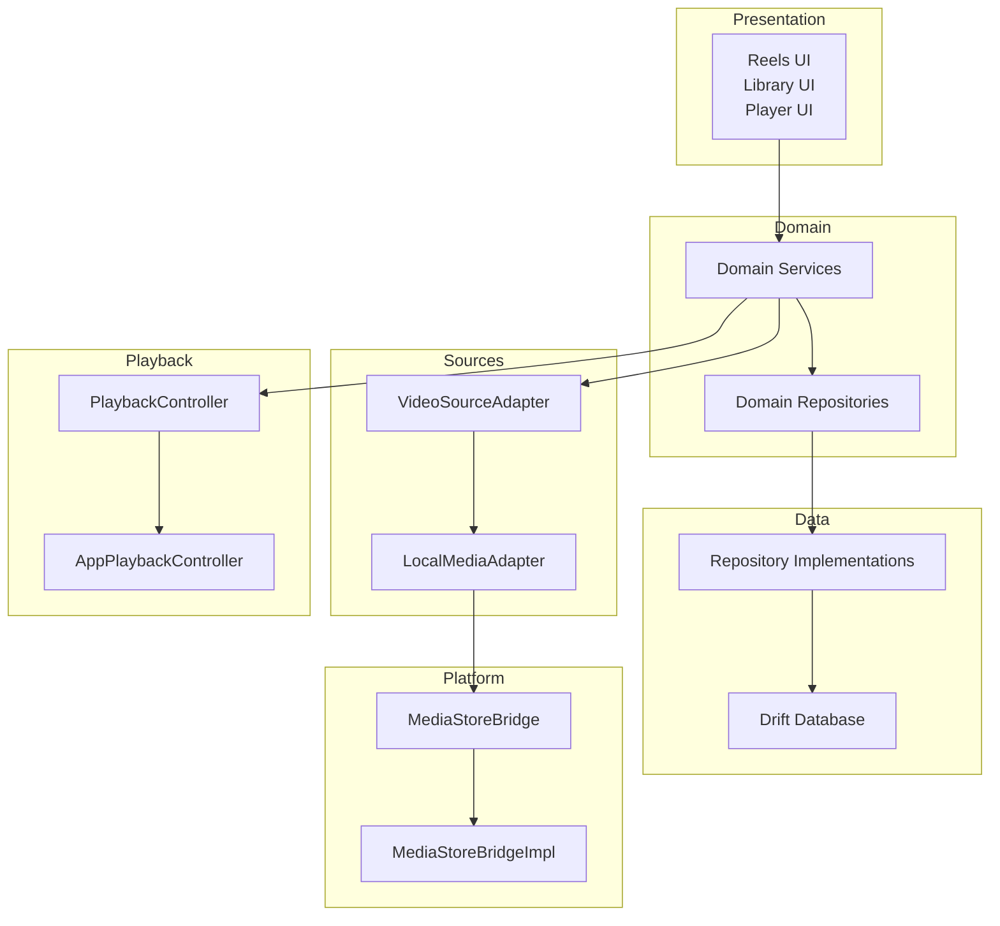
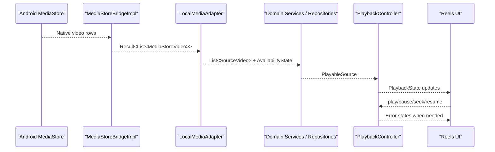
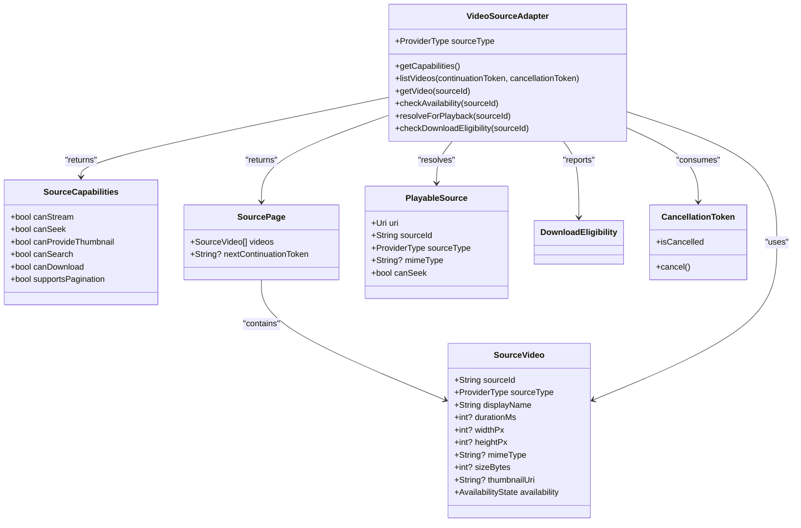
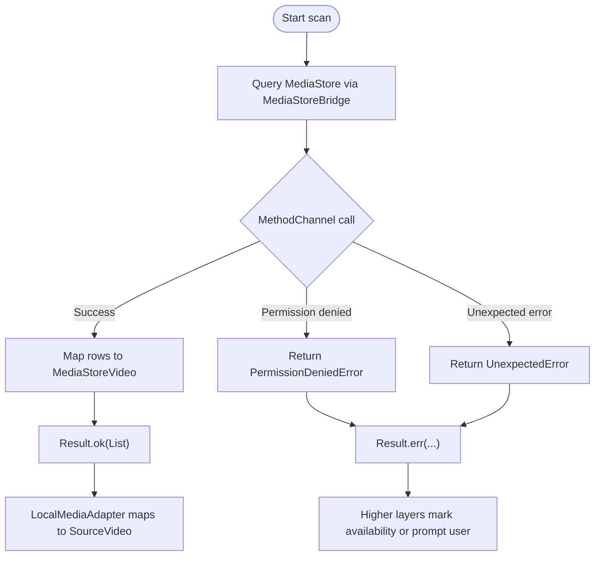
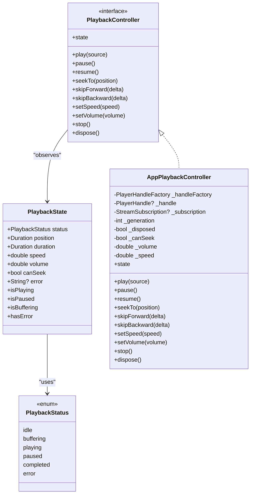
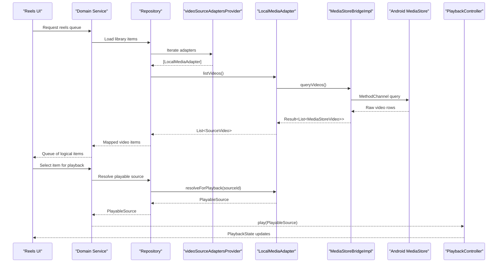
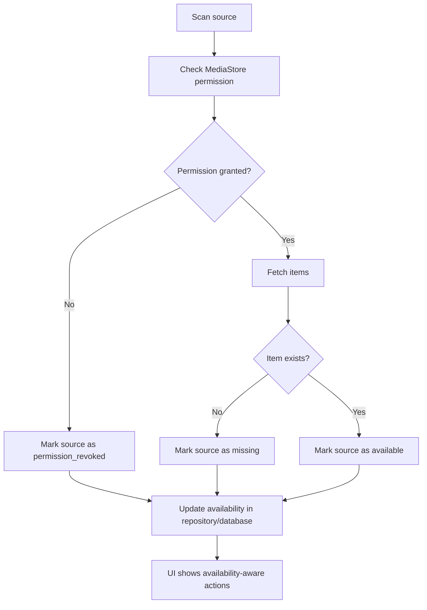
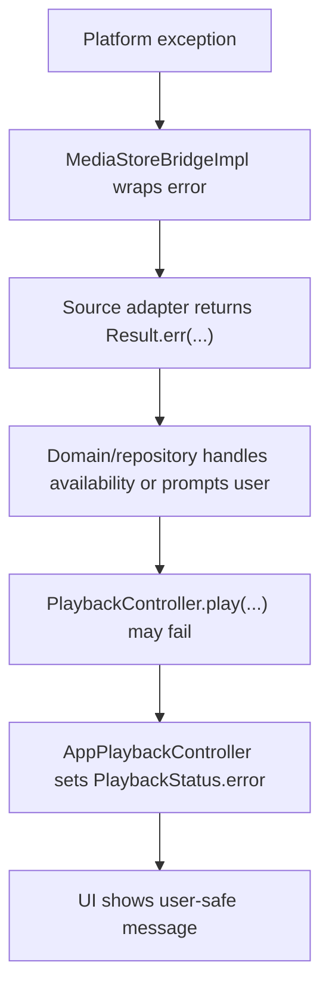
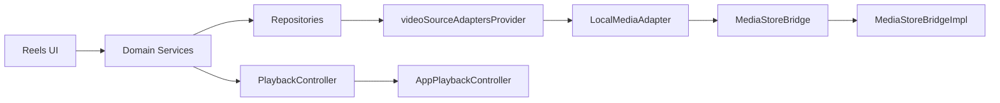

# Component Relationships and Data Flow

<cite>
**Referenced Files in This Document**
- [ARCHITECTURE.md](file://ARCHITECTURE.md)
- [README.md](file://README.md)
- [source_adapter.dart](file://lib/sources/source_adapter.dart)
- [source_registry.dart](file://lib/sources/source_registry.dart)
- [local_media_adapter.dart](file://lib/sources/local/local_media_adapter.dart)
- [media_store_bridge.dart](file://lib/platform/media_store_bridge.dart)
- [media_store_bridge_impl.dart](file://lib/platform/media_store_bridge_impl.dart)
- [playback_controller.dart](file://lib/playback/playback_controller.dart)
- [app_playback_controller.dart](file://lib/playback/app_playback_controller.dart)
</cite>

## Table of Contents
1. [Introduction](#introduction)
2. [Project Structure](#project-structure)
3. [Core Components](#core-components)
4. [Architecture Overview](#architecture-overview)
5. [Detailed Component Analysis](#detailed-component-analysis)
6. [Dependency Analysis](#dependency-analysis)
7. [Performance Considerations](#performance-considerations)
8. [Troubleshooting Guide](#troubleshooting-guide)
9. [Conclusion](#conclusion)

## Introduction
This document explains how MyTube’s components relate to each other and how data flows from Android MediaStore through the local source adapter into the Reels feature UI. It focuses on:

- How UI components interact with domain services, repositories, and source adapters.
- How LocalMediaAdapter bridges Android MediaStore into the app’s source model.
- How VideoSourceAdapter implementations, PlaybackController, and the database layer cooperate.
- How availability states propagate through the system.
- How errors are handled at each layer without leaking sensitive details.
- How changes in one component affect others through stable contracts.

The project is a Flutter application organized by layers: presentation, domain, data, sources, playback, and platform integrations. The architecture emphasizes local-first behavior, clear boundaries, testability, and provider extensibility.

**Section sources**
- [ARCHITECTURE.md:1-12](file://ARCHITECTURE.md#L1-L12)
- [README.md:1-4](file://README.md#L1-L4)

## Project Structure
MyTube follows a layered layout that separates responsibilities:

- Presentation: screens, widgets, routing, and view state.
- Domain: models, repositories, services, and policies.
- Data: Drift database, DAOs, migrations, repository implementations, and mappers.
- Sources: abstract video source contract and concrete providers.
- Playback: app-owned controller and player handle abstraction.
- Platform: MediaStore, Storage Access Framework, and other Android integrations.

**Diagram sources**
- [ARCHITECTURE.md:13-50](file://ARCHITECTURE.md#L13-L50)
- [source_adapter.dart:23-57](file://lib/sources/source_adapter.dart#L23-L57)
- [media_store_bridge.dart:5-32](file://lib/platform/media_store_bridge.dart#L5-L32)
- [playback_controller.dart:4-14](file://lib/playback/playback_controller.dart#L4-L14)

**Section sources**
- [ARCHITECTURE.md:13-50](file://ARCHITECTURE.md#L13-L50)

## Core Components
This section summarizes the core building blocks used across the data flow.

- VideoSourceAdapter: Defines the contract for listing videos, checking availability, resolving playable sources, and reporting capabilities. It also defines shared value types such as SourceVideo, PlayableSource, SourceCapabilities, and CancellationToken.
- LocalMediaAdapter: A concrete adapter that reads from Android MediaStore via MediaStoreBridge and adapts results into SourceVideo entries.
- MediaStoreBridge and MediaStoreBridgeImpl: Platform abstraction over Android MediaStore queries and permission checks.
- PlaybackController and AppPlaybackController: App-owned playback interface and implementation that manage loading, playing, pausing, seeking, speed/volume, completion, and error states without exposing plugin-specific APIs.
- Source registry: Central list of registered adapters in priority order, currently including the local media adapter.

Key responsibilities:

- Adapters must not own global favorites, history, or collections.
- Token handling and signed URL expiry belong to adapters, not UI.
- Playback controller surfaces user-safe messages and never leaks raw engine diagnostics.
- Availability states are typed and propagated through the system.

**Section sources**
- [source_adapter.dart:23-57](file://lib/sources/source_adapter.dart#L23-L57)
- [source_adapter.dart:63-165](file://lib/sources/source_adapter.dart#L63-L165)
- [media_store_bridge.dart:5-32](file://lib/platform/media_store_bridge.dart#L5-L32)
- [media_store_bridge.dart:38-93](file://lib/platform/media_store_bridge.dart#L38-L93)
- [playback_controller.dart:4-67](file://lib/playback/playback_controller.dart#L4-L67)
- [playback_controller.dart:73-149](file://lib/playback/playback_controller.dart#L73-L149)
- [source_registry.dart:5-11](file://lib/sources/source_registry.dart#L5-L11)

## Architecture Overview
The complete flow from Android MediaStore to Reels UI involves these steps:

1. LocalMediaAdapter uses MediaStoreBridge to query accessible videos.
2. MediaStoreBridgeImpl calls the Android method channel and returns structured results wrapped in Result.
3. LocalMediaAdapter maps MediaStoreVideo rows into SourceVideo entries and reports availability.
4. Domain services and repositories use VideoSourceAdapter to discover, check availability, and resolve playable sources.
5. PlaybackController receives a PlayableSource and manages playback state.
6. Reels UI observes playback state and item queue, looping items until swipe navigation.

**Diagram sources**
- [media_store_bridge_impl.dart:13-55](file://lib/platform/media_store_bridge_impl.dart#L13-L55)
- [source_adapter.dart:30-57](file://lib/sources/source_adapter.dart#L30-L57)
- [playback_controller.dart:19-29](file://lib/playback/playback_controller.dart#L19-L29)
- [ARCHITECTURE.md:171-186](file://ARCHITECTURE.md#L171-L186)

## Detailed Component Analysis

### VideoSourceAdapter Contract and Value Types
VideoSourceAdapter is the central abstraction for all video sources. It exposes:

- Source type identification.
- Capability declaration so higher layers know what operations are supported.
- Paginated listing with cancellation support.
- Single-item metadata retrieval.
- Availability checking.
- Ephemeral playable source resolution.
- Download eligibility reporting.

Shared value types include SourceCapabilities, SourcePage, SourceVideo, PlayableSource, DownloadEligibility, and CancellationToken. These types ensure consistent data shapes between adapters, domain services, repositories, and playback.

**Diagram sources**
- [source_adapter.dart:23-57](file://lib/sources/source_adapter.dart#L23-L57)
- [source_adapter.dart:63-165](file://lib/sources/source_adapter.dart#L63-L165)

**Section sources**
- [source_adapter.dart:23-57](file://lib/sources/source_adapter.dart#L23-L57)
- [source_adapter.dart:63-165](file://lib/sources/source_adapter.dart#L63-L165)

### LocalMediaAdapter and Android MediaStore Integration
LocalMediaAdapter implements VideoSourceAdapter for local device videos. It relies on MediaStoreBridge to:

- Query accessible videos.
- Check current permission status.
- Request permissions when needed.

MediaStoreBridgeImpl communicates with the Android side via MethodChannel, mapping native results into MediaStoreVideo objects and wrapping errors in Result. Permission-related failures are represented as PermissionDeniedError, while unexpected platform errors become UnexpectedError.

**Diagram sources**
- [media_store_bridge.dart:13-32](file://lib/platform/media_store_bridge.dart#L13-L32)
- [media_store_bridge_impl.dart:13-55](file://lib/platform/media_store_bridge_impl.dart#L13-L55)

**Section sources**
- [media_store_bridge.dart:5-32](file://lib/platform/media_store_bridge.dart#L5-L32)
- [media_store_bridge.dart:38-93](file://lib/platform/media_store_bridge.dart#L38-L93)
- [media_store_bridge_impl.dart:7-55](file://lib/platform/media_store_bridge_impl.dart#L7-L55)

### PlaybackController and AppPlaybackController
PlaybackController defines an app-owned interface for controlling playback without leaking player package details. It exposes:

- State observation through PlaybackState.
- Commands such as play, pause, resume, seekTo, skipForward, skipBackward, setSpeed, setVolume, stop, and dispose.
- User-safe error messaging and lifecycle management.

AppPlaybackController implements this interface using a PlayerHandleFactory. It manages generation counters to discard stale work, applies user preferences across sources, reduces engine snapshots into PlaybackState, and converts engine failures into safe error states.

**Diagram sources**
- [playback_controller.dart:4-67](file://lib/playback/playback_controller.dart#L4-L67)
- [playback_controller.dart:73-149](file://lib/playback/playback_controller.dart#L73-L149)
- [app_playback_controller.dart:8-23](file://lib/playback/app_playback_controller.dart#L8-L23)
- [app_playback_controller.dart:23-49](file://lib/playback/app_playback_controller.dart#L23-L49)
- [app_playback_controller.dart:57-135](file://lib/playback/app_playback_controller.dart#L57-L135)
- [app_playback_controller.dart:145-205](file://lib/playback/app_playback_controller.dart#L145-L205)
- [app_playback_controller.dart:370-420](file://lib/playback/app_playback_controller.dart#L370-L420)

**Section sources**
- [playback_controller.dart:4-67](file://lib/playback/playback_controller.dart#L4-L67)
- [playback_controller.dart:73-149](file://lib/playback/playback_controller.dart#L73-L149)
- [app_playback_controller.dart:8-23](file://lib/playback/app_playback_controller.dart#L8-L23)
- [app_playback_controller.dart:57-135](file://lib/playback/app_playback_controller.dart#L57-L135)
- [app_playback_controller.dart:145-205](file://lib/playback/app_playback_controller.dart#L145-L205)
- [app_playback_controller.dart:370-420](file://lib/playback/app_playback_controller.dart#L370-L420)

### Complete Data Flow: Android MediaStore to Reels UI
The end-to-end flow combines scanning, adaptation, domain processing, playback selection, and UI rendering.

**Diagram sources**
- [source_registry.dart:5-11](file://lib/sources/source_registry.dart#L5-L11)
- [source_adapter.dart:30-57](file://lib/sources/source_adapter.dart#L30-L57)
- [media_store_bridge_impl.dart:13-55](file://lib/platform/media_store_bridge_impl.dart#L13-L55)
- [playback_controller.dart:19-29](file://lib/playback/playback_controller.dart#L19-L29)
- [ARCHITECTURE.md:171-186](file://ARCHITECTURE.md#L171-L186)

**Section sources**
- [source_registry.dart:5-11](file://lib/sources/source_registry.dart#L5-L11)
- [source_adapter.dart:30-57](file://lib/sources/source_adapter.dart#L30-L57)
- [media_store_bridge_impl.dart:13-55](file://lib/platform/media_store_bridge_impl.dart#L13-L55)
- [playback_controller.dart:19-29](file://lib/playback/playback_controller.dart#L19-L29)
- [ARCHITECTURE.md:171-186](file://ARCHITECTURE.md#L171-L186)

### Availability State Propagation
Availability states describe whether a source is reachable and usable. Suggested states include available, offline, missing, expired_link, reconnect_required, permission_revoked, unsupported, and unknown.

Propagation pattern:

- MediaStoreBridge returns permission-related errors when access is denied.
- LocalMediaAdapter maps those errors into availability information for SourceVideo.
- Domain services and repositories treat revoked access or missing items as availability updates rather than destructive deletions.
- UI renders actionable feedback based on availability and error states.

**Diagram sources**
- [ARCHITECTURE.md:242-250](file://ARCHITECTURE.md#L242-L250)
- [media_store_bridge.dart:13-32](file://lib/platform/media_store_bridge.dart#L13-L32)
- [media_store_bridge_impl.dart:32-55](file://lib/platform/media_store_bridge_impl.dart#L32-L55)

**Section sources**
- [ARCHITECTURE.md:242-250](file://ARCHITECTURE.md#L242-L250)
- [media_store_bridge.dart:13-32](file://lib/platform/media_store_bridge.dart#L13-L32)
- [media_store_bridge_impl.dart:32-55](file://lib/platform/media_store_bridge_impl.dart#L32-L55)

### Error Handling Across Layers
Errors are handled consistently to avoid leaking sensitive details and to provide actionable UI feedback.

- Platform layer: MediaStoreBridgeImpl wraps platform exceptions into typed errors such as PermissionDeniedError and UnexpectedError.
- Source layer: VideoSourceAdapter methods return Result-wrapped values; adapters do not throw to callers.
- Playback layer: AppPlaybackController converts engine failures into PlaybackStatus.error with user-safe messages.
- UI layer: Widgets observe PlaybackState and display actionable errors without exposing tokens, signed URLs, or diagnostic internals.

**Diagram sources**
- [media_store_bridge_impl.dart:32-55](file://lib/platform/media_store_bridge_impl.dart#L32-L55)
- [source_adapter.dart:30-57](file://lib/sources/source_adapter.dart#L30-L57)
- [playback_controller.dart:24-29](file://lib/playback/playback_controller.dart#L24-L29)
- [app_playback_controller.dart:29-34](file://lib/playback/app_playback_controller.dart#L29-L34)
- [app_playback_controller.dart:372-400](file://lib/playback/app_playback_controller.dart#L372-L400)

**Section sources**
- [media_store_bridge_impl.dart:32-55](file://lib/platform/media_store_bridge_impl.dart#L32-L55)
- [source_adapter.dart:30-57](file://lib/sources/source_adapter.dart#L30-L57)
- [playback_controller.dart:24-29](file://lib/playback/playback_controller.dart#L24-L29)
- [app_playback_controller.dart:29-34](file://lib/playback/app_playback_controller.dart#L29-L34)
- [app_playback_controller.dart:372-400](file://lib/playback/app_playback_controller.dart#L372-L400)

### Communication Patterns and Change Impact
Communication patterns:

- Interfaces define contracts: VideoSourceAdapter, PlaybackController, and MediaStoreBridge isolate implementation details.
- Providers register adapters: videoSourceAdaptersProvider provides a prioritized list of adapters.
- Streams and listeners: AppPlaybackController subscribes to PlayerHandle changes and reduces them into PlaybackState.
- Cancellation: CancellationToken allows long-running adapter operations to abort safely.

Impact of changes:

- Adding a new VideoSourceAdapter requires registering it in the source registry and ensuring it adheres to the adapter contract.
- Changing MediaStoreBridge affects LocalMediaAdapter but not UI or playback directly.
- Changing PlaybackController affects all consumers, including Reels UI and any other player-facing features.
- Availability state changes should be treated as non-destructive updates to repository records.

**Section sources**
- [source_registry.dart:5-11](file://lib/sources/source_registry.dart#L5-L11)
- [source_adapter.dart:152-165](file://lib/sources/source_adapter.dart#L152-L165)
- [app_playback_controller.dart:94-143](file://lib/playback/app_playback_controller.dart#L94-L143)
- [ARCHITECTURE.md:208-217](file://ARCHITECTURE.md#L208-L217)

## Dependency Analysis
The following diagram shows key dependencies among components analyzed in this document.

**Diagram sources**
- [source_registry.dart:5-11](file://lib/sources/source_registry.dart#L5-L11)
- [media_store_bridge.dart:5-32](file://lib/platform/media_store_bridge.dart#L5-L32)
- [media_store_bridge_impl.dart:7-10](file://lib/platform/media_store_bridge_impl.dart#L7-L10)
- [playback_controller.dart:4-14](file://lib/playback/playback_controller.dart#L4-L14)
- [app_playback_controller.dart:8-23](file://lib/playback/app_playback_controller.dart#L8-L23)

**Section sources**
- [source_registry.dart:5-11](file://lib/sources/source_registry.dart#L5-L11)
- [media_store_bridge.dart:5-32](file://lib/platform/media_store_bridge.dart#L5-L32)
- [media_store_bridge_impl.dart:7-10](file://lib/platform/media_store_bridge_impl.dart#L7-L10)
- [playback_controller.dart:4-14](file://lib/playback/playback_controller.dart#L4-L14)
- [app_playback_controller.dart:8-23](file://lib/playback/app_playback_controller.dart#L8-L23)

## Performance Considerations
- Avoid full scans on every rebuild or tab switch; prefer incremental refresh and cancellable indexing.
- Keep Reels preloading limited to a small number of adjacent items and cancel stale work during rapid swipes.
- Throttle progress writes and persist periodically on pause, stop, or lifecycle changes.
- Use capability declarations to avoid calling unsupported operations.
- Ensure adapter listing respects cancellation tokens to keep UI responsive.

[No sources needed since this section provides general guidance]

## Troubleshooting Guide
Common issues and where to investigate:

- Permission denied when scanning local videos:
  - Check MediaStoreBridgeImpl error mapping and permission status parsing.
  - Verify that higher layers mark affected sources as permission_revoked instead of deleting them.
- Playback fails immediately:
  - Inspect AppPlaybackController error state creation and user-safe messages.
  - Confirm that unsupported schemes are rejected before touching the engine.
- Stale playback after rapid navigation:
  - Verify generation counter logic discards old handle completions.
- Availability remains unavailable after file restoration:
  - Trigger availability re-check through domain services and update repository records.

**Section sources**
- [media_store_bridge_impl.dart:32-55](file://lib/platform/media_store_bridge_impl.dart#L32-L55)
- [media_store_bridge_impl.dart:77-84](file://lib/platform/media_store_bridge_impl.dart#L77-L84)
- [app_playback_controller.dart:63-70](file://lib/playback/app_playback_controller.dart#L63-L70)
- [app_playback_controller.dart:372-400](file://lib/playback/app_playback_controller.dart#L372-L400)
- [ARCHITECTURE.md:208-217](file://ARCHITECTURE.md#L208-L217)

## Conclusion
MyTube’s architecture separates concerns cleanly:

- UI observes domain state and playback state without touching platform or database details.
- Domain services coordinate repositories, source adapters, and playback.
- Source adapters encapsulate provider-specific logic, including MediaStore integration.
- PlaybackController abstracts player behavior and ensures safe, user-friendly error reporting.
- Availability states and typed errors propagate consistently, enabling robust UI feedback.

This design makes it straightforward to add new sources, improve scanning performance, and evolve playback behavior without destabilizing the UI or platform layer.

[No sources needed since this section summarizes without analyzing specific files]