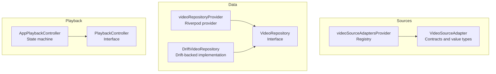
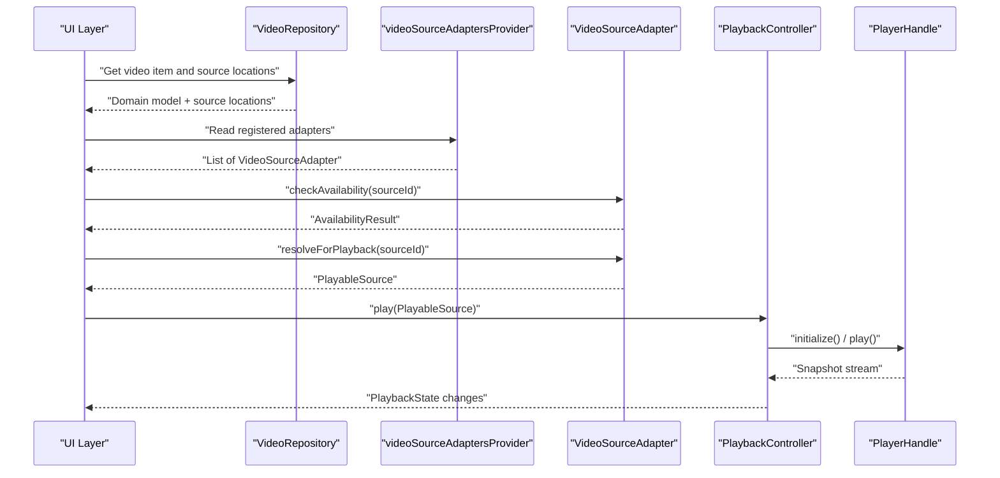
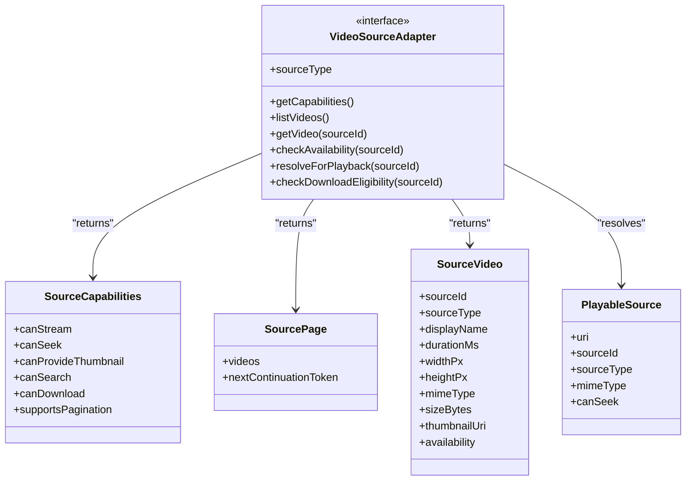
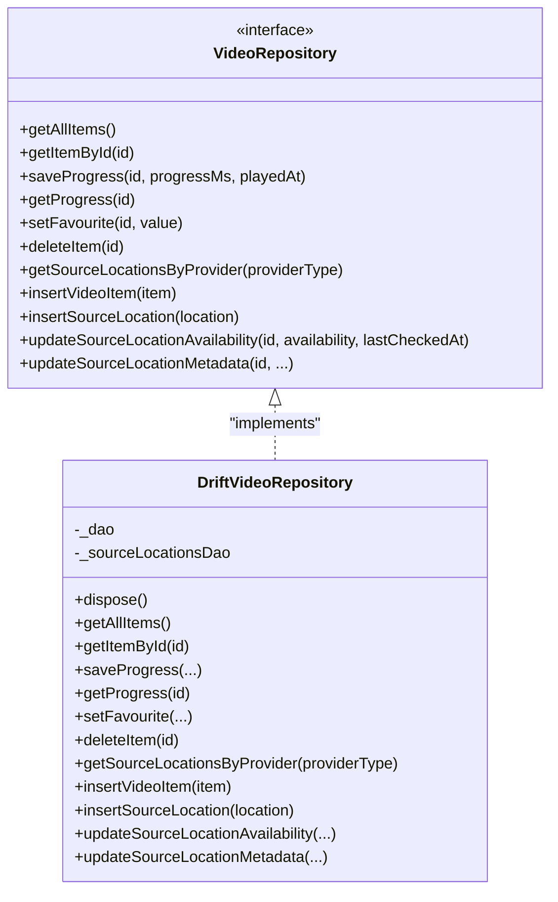
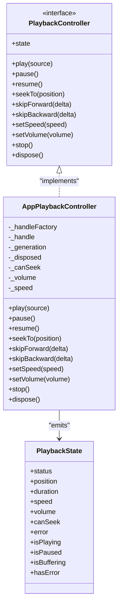
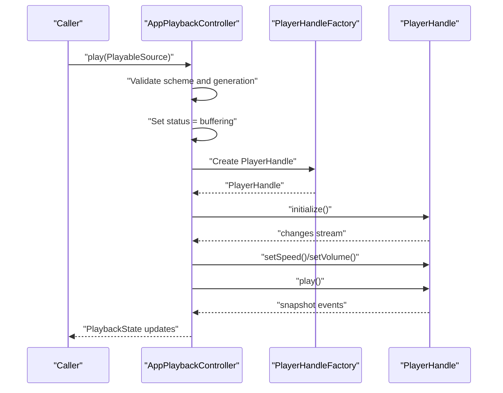
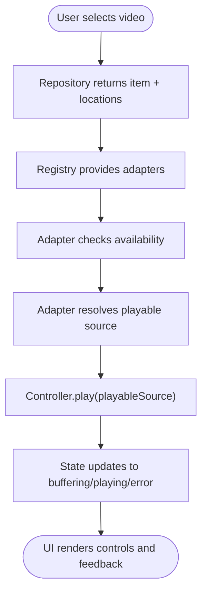
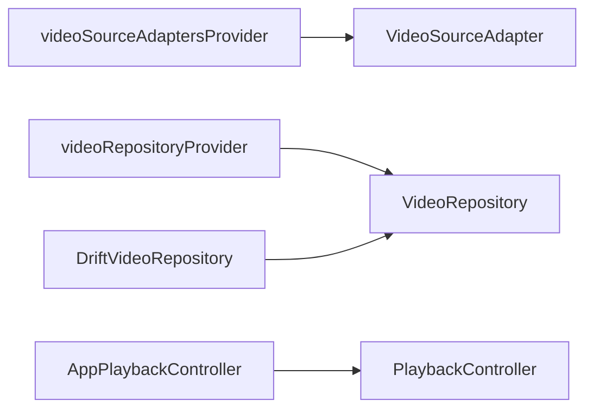

# Design Patterns

<cite>
**Referenced Files in This Document**
- [ARCHITECTURE.md](file://ARCHITECTURE.md)
- [source_adapter.dart](file://lib/sources/source_adapter.dart)
- [source_registry.dart](file://lib/sources/source_registry.dart)
- [drift_video_repository.dart](file://lib/data/repositories/drift_video_repository.dart)
- [repository_providers.dart](file://lib/data/repositories/repository_providers.dart)
- [playback_controller.dart](file://lib/playback/playback_controller.dart)
- [app_playback_controller.dart](file://lib/playback/app_playback_controller.dart)
</cite>

## Table of Contents
1. [Introduction](#introduction)
2. [Project Structure](#project-structure)
3. [Core Components](#core-components)
4. [Architecture Overview](#architecture-overview)
5. [Detailed Component Analysis](#detailed-component-analysis)
6. [Dependency Analysis](#dependency-analysis)
7. [Performance Considerations](#performance-considerations)
8. [Troubleshooting Guide](#troubleshooting-guide)
9. [Conclusion](#conclusion)

## Introduction
This document explains the key design patterns used in MyTube and how they make the app extensible, testable, and safe to evolve:

- Adapter Pattern for pluggable video sources through `VideoSourceAdapter`.
- Repository Pattern for data abstraction separating business logic from Drift-backed persistence.
- Controller Pattern for playback state management through `PlaybackController` and `AppPlaybackController`.

The goal is to show how these patterns work together across source selection, availability checking, playback resolution, and UI-safe state updates.

## Project Structure
MyTube organizes code into clear layers:

- `sources/`: adapter contracts and registry for video providers.
- `data/`: database access, DAOs, repository implementations, and dependency providers.
- `playback/`: controller interface and implementation wrapping a player handle.
- `domain/` and `core/`: shared models, errors, results, and cross-cutting types.

**Diagram sources**
- [source_adapter.dart:23-57](file://lib/sources/source_adapter.dart#L23-L57)
- [source_registry.dart:5-11](file://lib/sources/source_registry.dart#L5-L11)
- [drift_video_repository.dart:10-23](file://lib/data/repositories/drift_video_repository.dart#L10-L23)
- [repository_providers.dart:6-24](file://lib/data/repositories/repository_providers.dart#L6-L24)
- [playback_controller.dart:4-15](file://lib/playback/playback_controller.dart#L4-L15)
- [app_playback_controller.dart:8-27](file://lib/playback/app_playback_controller.dart#L8-L27)

**Section sources**
- [ARCHITECTURE.md:13-50](file://ARCHITECTURE.md#L13-L50)
- [ARCHITECTURE.md:55-93](file://ARCHITECTURE.md#L55-L93)

## Core Components
This section introduces the three core pattern components and their responsibilities.

- VideoSourceAdapter (Adapter Pattern): Defines a uniform contract for listing videos, checking availability, resolving playable URIs, and reporting capabilities. It isolates provider-specific networking, authentication, and token handling behind a stable interface.
- VideoRepository (Repository Pattern): Abstracts data operations such as listing items, saving watch progress, managing favorites, and maintaining source locations. The Drift-backed implementation encapsulates database queries and maps rows to domain models.
- PlaybackController (Controller Pattern): Exposes a clean API for play, pause, resume, seek, speed, volume, stop, and dispose. `AppPlaybackController` implements the state machine while hiding engine details behind `PlayerHandleFactory`.

Benefits:
- Extensibility: New sources are added by implementing `VideoSourceAdapter`; new storage backends implement `VideoRepository`; new players can be integrated via `PlayerHandleFactory`.
- Testability: Adapters, repositories, and controllers can be unit-tested with fakes or in-memory databases without touching the UI or native platform.
- Safety: Errors are wrapped in typed results; playback errors are user-safe; ephemeral playable URIs are not persisted as durable identities.

**Section sources**
- [source_adapter.dart:5-22](file://lib/sources/source_adapter.dart#L5-L22)
- [drift_video_repository.dart:10-23](file://lib/data/repositories/drift_video_repository.dart#L10-L23)
- [playback_controller.dart:4-15](file://lib/playback/playback_controller.dart#L4-L15)

## Architecture Overview
The following diagram shows how the patterns collaborate during a typical playback flow:

**Diagram sources**
- [source_registry.dart:5-11](file://lib/sources/source_registry.dart#L5-L11)
- [source_adapter.dart:30-56](file://lib/sources/source_adapter.dart#L30-L56)
- [playback_controller.dart:19-29](file://lib/playback/playback_controller.dart#L19-L29)
- [app_playback_controller.dart:57-135](file://lib/playback/app_playback_controller.dart#L57-L135)

## Detailed Component Analysis

### Adapter Pattern: Pluggable Video Sources
The Adapter Pattern is implemented through `VideoSourceAdapter`, which standardizes how different providers expose video metadata, availability, and playable URIs.

Key responsibilities:
- Capability declaration so higher layers know what operations are supported.
- Paginated listing with cancellation support.
- Availability checks and ephemeral playable-source resolution.
- Download eligibility decisions per provider terms.

**Diagram sources**
- [source_adapter.dart:23-57](file://lib/sources/source_adapter.dart#L23-L57)
- [source_adapter.dart:63-137](file://lib/sources/source_adapter.dart#L63-L137)

Concrete usage examples (by reference):
- Listing with pagination and cancellation: see `listVideos` parameters and comments.
- Resolving an ephemeral playable URI: see `resolveForPlayback` and `PlayableSource`.
- Declaring capabilities: see `SourceCapabilities`.

Benefits:
- Adding a new provider requires only one adapter implementation.
- UI and domain code remain unchanged when swapping providers.
- Cancellation tokens prevent wasted work during rapid navigation.

Testability:
- Each adapter can be tested independently with fake network responses and cancellation scenarios.

**Section sources**
- [source_adapter.dart:5-22](file://lib/sources/source_adapter.dart#L5-L22)
- [source_adapter.dart:30-56](file://lib/sources/source_adapter.dart#L30-L56)
- [source_adapter.dart:63-137](file://lib/sources/source_adapter.dart#L63-L137)
- [source_adapter.dart:152-164](file://lib/sources/source_adapter.dart#L152-L164)

### Repository Pattern: Data Abstraction
The Repository Pattern abstracts persistence behind `VideoRepository`. `DriftVideoRepository` implements this interface using Drift DAOs and maps database rows to domain models.

Key responsibilities:
- Querying video summaries and single items.
- Saving and reading watch progress.
- Managing favorites and deletion.
- Inserting and updating source locations and their availability.

**Diagram sources**
- [drift_video_repository.dart:10-23](file://lib/data/repositories/drift_video_repository.dart#L10-L23)
- [drift_video_repository.dart:34-145](file://lib/data/repositories/drift_video_repository.dart#L34-L145)
- [drift_video_repository.dart:147-290](file://lib/data/repositories/drift_video_repository.dart#L147-L290)

Error handling and safety:
- All public methods wrap database calls in try/catch and return `Result` values.
- Unexpected exceptions become `UnexpectedError`, keeping widgets free of raw exception handling.

Dependency injection:
- `videoRepositoryProvider` constructs `DriftVideoRepository` with the current database instance and disposes it when the container shuts down.
- Tests can override the database provider to use an in-memory database.

Benefits:
- Business logic depends on stable interfaces, not Drift internals.
- Persistence strategy can change without affecting callers.
- Clear separation between domain models and database rows.

**Section sources**
- [drift_video_repository.dart:10-23](file://lib/data/repositories/drift_video_repository.dart#L10-L23)
- [drift_video_repository.dart:34-145](file://lib/data/repositories/drift_video_repository.dart#L34-L145)
- [drift_video_repository.dart:147-290](file://lib/data/repositories/drift_video_repository.dart#L147-L290)
- [repository_providers.dart:6-24](file://lib/data/repositories/repository_providers.dart#L6-L24)

### Controller Pattern: Playback State Management
The Controller Pattern is implemented through `PlaybackController` and `AppPlaybackController`. The interface defines commands and state; the implementation owns the state machine and hides engine specifics behind `PlayerHandleFactory`.

Responsibilities:
- Loading and playing a `PlayableSource`.
- Managing buffering, playing, paused, completed, and error states.
- Applying user preferences like speed and volume across sources.
- Discarding stale loads when rapid successive plays occur.
- Converting engine failures into user-safe error messages.

**Diagram sources**
- [playback_controller.dart:4-67](file://lib/playback/playback_controller.dart#L4-L67)
- [playback_controller.dart:73-149](file://lib/playback/playback_controller.dart#L73-L149)
- [app_playback_controller.dart:8-49](file://lib/playback/app_playback_controller.dart#L8-L49)
- [app_playback_controller.dart:57-135](file://lib/playback/app_playback_controller.dart#L57-L135)

Playback lifecycle sequence:

**Diagram sources**
- [app_playback_controller.dart:57-135](file://lib/playback/app_playback_controller.dart#L57-L135)

Benefits:
- UI observes immutable `PlaybackState` snapshots rather than mutating shared state.
- Rapid play calls are safe because each load increments a generation counter and discards stale completions.
- Engine errors are normalized into user-safe messages; sensitive diagnostics never enter state or logs.
- Tests can inject a fake `PlayerHandleFactory` to validate state transitions without a real player plugin.

**Section sources**
- [playback_controller.dart:4-67](file://lib/playback/playback_controller.dart#L4-L67)
- [playback_controller.dart:73-149](file://lib/playback/playback_controller.dart#L73-L149)
- [app_playback_controller.dart:8-49](file://lib/playback/app_playback_controller.dart#L8-L49)
- [app_playback_controller.dart:57-135](file://lib/playback/app_playback_controller.dart#L57-L135)
- [app_playback_controller.dart:137-205](file://lib/playback/app_playback_controller.dart#L137-L205)
- [app_playback_controller.dart:211-353](file://lib/playback/app_playback_controller.dart#L211-L353)
- [app_playback_controller.dart:370-420](file://lib/playback/app_playback_controller.dart#L370-L420)

### How the Patterns Work Together
A typical flow connects all three patterns:

1. UI asks the repository for a logical video item and its source locations.
2. UI reads the adapter registry to discover available sources.
3. UI asks the selected adapter to check availability and resolve a playable source.
4. UI passes the playable source to the playback controller.
5. The controller manages state and delegates to the underlying player handle.

**Diagram sources**
- [source_registry.dart:5-11](file://lib/sources/source_registry.dart#L5-L11)
- [source_adapter.dart:30-56](file://lib/sources/source_adapter.dart#L30-L56)
- [playback_controller.dart:19-29](file://lib/playback/playback_controller.dart#L19-L29)
- [app_playback_controller.dart:57-135](file://lib/playback/app_playback_controller.dart#L57-L135)

## Dependency Analysis
The main dependencies among pattern components are:

- `videoSourceAdaptersProvider` exposes a list of `VideoSourceAdapter` instances.
- `DriftVideoRepository` implements `VideoRepository` and depends on Drift DAOs.
- `videoRepositoryProvider` wires `DriftVideoRepository` with the database.
- `AppPlaybackController` implements `PlaybackController` and depends on `PlayerHandleFactory`.

**Diagram sources**
- [source_registry.dart:5-11](file://lib/sources/source_registry.dart#L5-L11)
- [repository_providers.dart:6-24](file://lib/data/repositories/repository_providers.dart#L6-L24)
- [drift_video_repository.dart:10-23](file://lib/data/repositories/drift_video_repository.dart#L10-L23)
- [playback_controller.dart:4-15](file://lib/playback/playback_controller.dart#L4-L15)
- [app_playback_controller.dart:8-27](file://lib/playback/app_playback_controller.dart#L8-L27)

**Section sources**
- [source_registry.dart:5-11](file://lib/sources/source_registry.dart#L5-L11)
- [repository_providers.dart:6-24](file://lib/data/repositories/repository_providers.dart#L6-L24)
- [drift_video_repository.dart:10-23](file://lib/data/repositories/drift_video_repository.dart#L10-L23)
- [playback_controller.dart:4-15](file://lib/playback/playback_controller.dart#L4-L15)
- [app_playback_controller.dart:8-27](file://lib/playback/app_playback_controller.dart#L8-L27)

## Performance Considerations
- Adapter listing uses pagination and cancellation tokens to avoid unnecessary work and keep UI responsive.
- Playback controller uses a generation counter to discard stale loads after rapid successive play calls.
- Repository methods wrap database operations and map results efficiently, avoiding leaking raw exceptions to callers.
- Ephemeral playable URIs are not persisted as durable identities, reducing storage risk and simplifying refresh flows.

[No sources needed since this section provides general guidance]

## Troubleshooting Guide
Common issues and where to look:

- Unsupported source schemes:
  - The controller rejects unsupported schemes before initializing the engine and surfaces a user-safe error message.
  - Check playback kind validation and error state creation.

- Engine initialization or playback failures:
  - Failures are converted to `PlaybackStatus.error` with generic messages; diagnostic details are not exposed to state or logs.
  - Inspect `_runCommand` and error state helpers.

- Stale loads and disposal races:
  - Generation counters and disposal flags ensure old handles do not update state after a newer load or disposal.
  - Review `_isStale`, `_teardownHandle`, and `_disposeQuietly`.

- Database errors:
  - Repository methods catch unexpected exceptions and return `UnexpectedError`.
  - Verify method wrappers around DAO calls.

**Section sources**
- [app_playback_controller.dart:57-135](file://lib/playback/app_playback_controller.dart#L57-L135)
- [app_playback_controller.dart:370-420](file://lib/playback/app_playback_controller.dart#L370-L420)
- [drift_video_repository.dart:34-145](file://lib/data/repositories/drift_video_repository.dart#L34-L145)

## Conclusion
MyTube’s architecture relies on three complementary patterns:

- Adapter Pattern (`VideoSourceAdapter`) makes video sources pluggable and capability-aware.
- Repository Pattern (`VideoRepository` and `DriftVideoRepository`) separates business logic from persistence and normalizes errors.
- Controller Pattern (`PlaybackController` and `AppPlaybackController`) centralizes playback state, hides engine details, and guarantees safe, testable behavior.

Together, these patterns improve extensibility, testability, and safety while keeping the UI focused on presentation and user experience.

[No sources needed since this section summarizes without analyzing specific files]