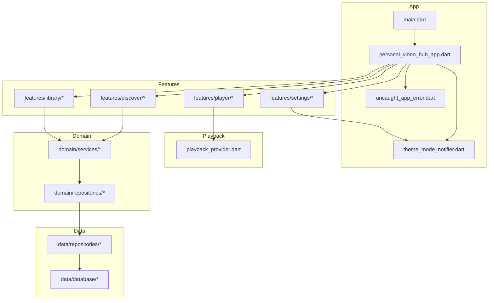
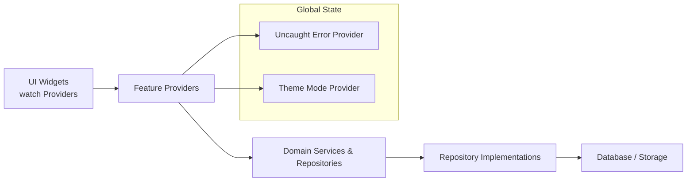
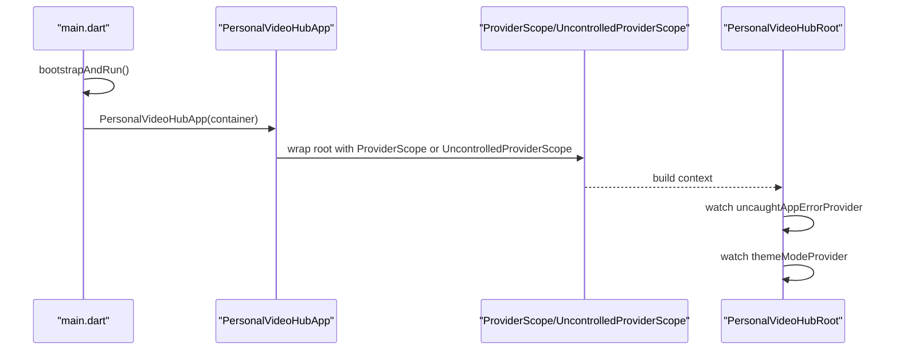
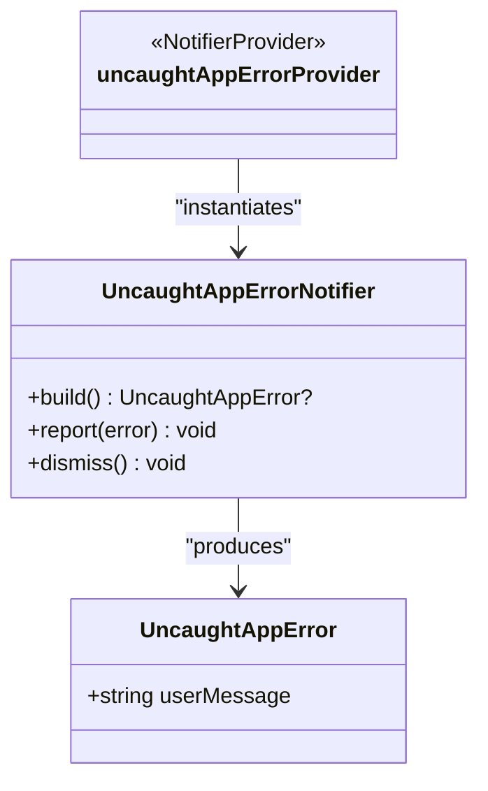
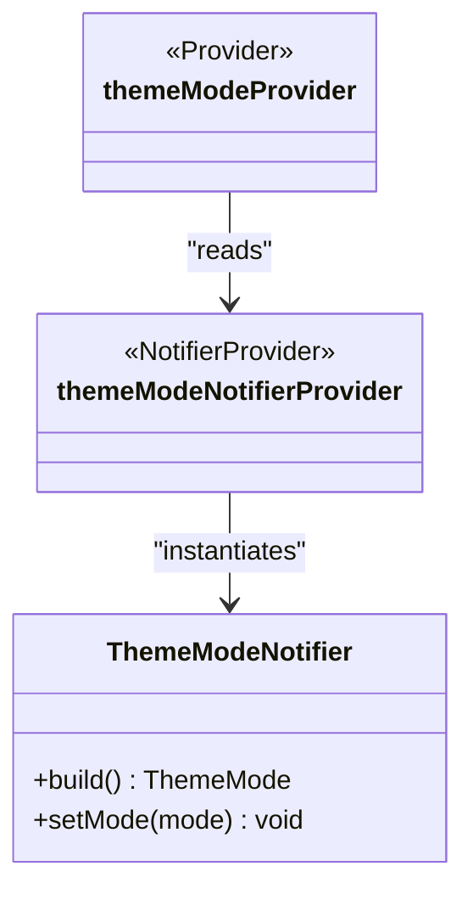
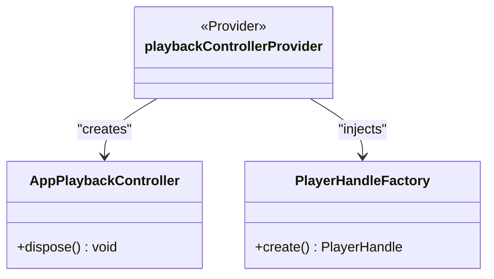
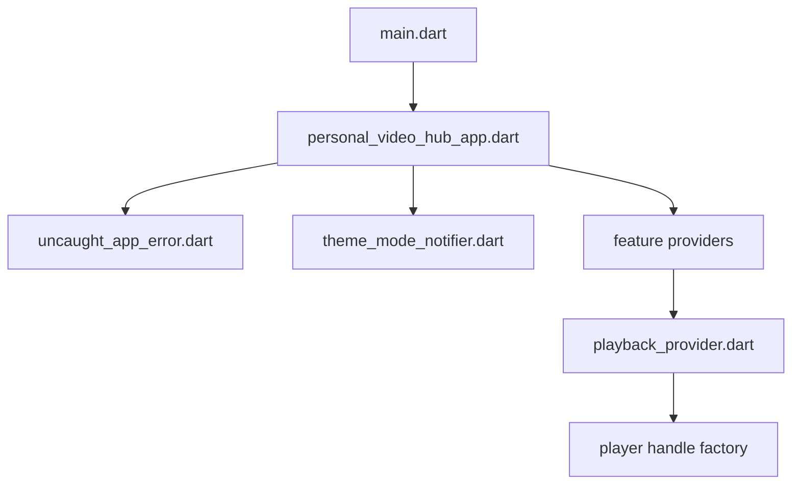

# State Management with Riverpod

<cite>
**Referenced Files in This Document**
- [main.dart](file://lib/main.dart)
- [personal_video_hub_app.dart](file://lib/app/personal_video_hub_app.dart)
- [uncaught_app_error.dart](file://lib/app/uncaught_app_error.dart)
- [theme_mode_notifier.dart](file://lib/app/theme/theme_mode_notifier.dart)
- [playback_provider.dart](file://lib/playback/playback_provider.dart)
</cite>

## Table of Contents
1. [Introduction](#introduction)
2. [Project Structure](#project-structure)
3. [Core Components](#core-components)
4. [Architecture Overview](#architecture-overview)
5. [Detailed Component Analysis](#detailed-component-analysis)
6. [Dependency Analysis](#dependency-analysis)
7. [Performance Considerations](#performance-considerations)
8. [Troubleshooting Guide](#troubleshooting-guide)
9. [Conclusion](#conclusion)

## Introduction
This document explains how MyTube uses Riverpod for state management and dependency injection. It covers the provider container setup, the separation between UI state and business logic state, and how providers interact with domain services and repositories. It also provides guidance on organizing providers per feature, handling errors within providers, and optimizing reactive updates. Examples include patterns for video lists, playback state, and user preferences.

## Project Structure
MyTube organizes code by layers and features:
- app: application shell, global error handling, theme state
- core: shared utilities, logging, result types, UI helpers
- data: database, mappers, repository implementations
- domain: models, policies, repository interfaces, services
- features: feature-specific UI and state (discover, library, player, reels, saved, settings)
- playback: playback controller and engine handle abstraction
- platform: platform-specific integrations
- sources: source adapters (e.g., local media)

**Diagram sources**
- [main.dart:8-32](file://lib/main.dart#L8-L32)
- [personal_video_hub_app.dart:10-60](file://lib/app/personal_video_hub_app.dart#L10-L60)
- [theme_mode_notifier.dart:14-41](file://lib/app/theme/theme_mode_notifier.dart#L14-L41)
- [uncaught_app_error.dart:11-34](file://lib/app/uncaught_app_error.dart#L11-L34)
- [playback_provider.dart:7-27](file://lib/playback/playback_provider.dart#L7-L27)

**Section sources**
- [main.dart:8-32](file://lib/main.dart#L8-L32)
- [personal_video_hub_app.dart:10-60](file://lib/app/personal_video_hub_app.dart#L10-L60)

## Core Components
- ProviderContainer and ProviderScope: The app bootstraps a single ProviderContainer and wraps the widget tree with ProviderScope (or UncontrolledProviderScope when an external container is provided). This ensures one dependency graph for the entire app lifecycle.
- Global error state: An uncaught error notifier exposes a user-facing message that the root UI can display and dismiss.
- Theme mode state: A Notifier holds the current ThemeMode; a read-only Provider exposes it to widgets.
- Playback controller: A Provider owns a long-lived PlaybackController instance and injects a PlayerHandleFactory for testability.

Key responsibilities:
- main.dart wires error hooks, creates the container, installs error reporting, and starts the app.
- personal_video_hub_app.dart sets up ProviderScope and reads global state (errors, theme).
- uncaught_app_error.dart manages uncaught error state.
- theme_mode_notifier.dart manages theme mode state.
- playback_provider.dart owns the playback controller and its dependencies.

**Section sources**
- [main.dart:12-32](file://lib/main.dart#L12-L32)
- [personal_video_hub_app.dart:10-60](file://lib/app/personal_video_hub_app.dart#L10-L60)
- [uncaught_app_error.dart:11-34](file://lib/app/uncaught_app_error.dart#L11-L34)
- [theme_mode_notifier.dart:14-41](file://lib/app/theme/theme_mode_notifier.dart#L14-L41)
- [playback_provider.dart:7-27](file://lib/playback/playback_provider.dart#L7-L27)

## Architecture Overview
The app follows a layered architecture with Riverpod as the DI and state layer:
- UI layer (widgets) watches Providers for reactive state.
- Feature layer contains feature-specific Providers and UI.
- Domain layer defines services and repository interfaces.
- Data layer implements repositories and persists data.

Riverpod decouples UI from implementation details:
- Widgets depend on abstractions (domain services, repositories).
- Providers resolve concrete implementations and manage lifetimes.
- Error and theme states are centralized at the app level.

[No sources needed since this diagram shows conceptual workflow, not actual code structure]

## Detailed Component Analysis

### Application Bootstrap and Container Setup
- A single ProviderContainer is created at startup and passed into the root app.
- The root widget chooses between controlled and uncontrolled ProviderScope based on whether an external container was supplied.
- Error reporting is installed early so any uncaught exceptions update global error state.

**Diagram sources**
- [main.dart:12-32](file://lib/main.dart#L12-L32)
- [personal_video_hub_app.dart:10-60](file://lib/app/personal_video_hub_app.dart#L10-L60)

**Section sources**
- [main.dart:12-32](file://lib/main.dart#L12-L32)
- [personal_video_hub_app.dart:10-60](file://lib/app/personal_video_hub_app.dart#L10-L60)

### Global Error Handling Provider
- UncaughtAppErrorNotifier maintains optional error state.
- report() converts AppException instances to user-friendly messages; otherwise uses a fallback message.
- dismiss() clears the error banner.
- The root UI displays the banner and allows dismissal via the notifier.

**Diagram sources**
- [uncaught_app_error.dart:5-34](file://lib/app/uncaught_app_error.dart#L5-L34)

**Section sources**
- [uncaught_app_error.dart:11-34](file://lib/app/uncaught_app_error.dart#L11-L34)
- [personal_video_hub_app.dart:33-57](file://lib/app/personal_video_hub_app.dart#L33-L57)

### Theme Mode Provider
- ThemeModeNotifier holds the active ThemeMode with a dark default.
- setMode() updates the state; future persistence is out of scope here.
- themeModeProvider is a read-only alias for widgets that only need to observe the mode.

**Diagram sources**
- [theme_mode_notifier.dart:14-41](file://lib/app/theme/theme_mode_notifier.dart#L14-L41)

**Section sources**
- [theme_mode_notifier.dart:14-41](file://lib/app/theme/theme_mode_notifier.dart#L14-L41)

### Playback Controller Provider
- playbackControllerProvider owns a long-lived PlaybackController instance.
- It injects a PlayerHandleFactory via another Provider to allow test overrides.
- The controller is disposed automatically when the provider is disposed.

**Diagram sources**
- [playback_provider.dart:7-27](file://lib/playback/playback_provider.dart#L7-L27)

**Section sources**
- [playback_provider.dart:7-27](file://lib/playback/playback_provider.dart#L7-L27)

### Example Patterns for Video Lists, Playback State, and User Preferences
Note: These are recommended patterns aligned with existing code. They illustrate how to organize providers without duplicating specific implementations.

- Video list provider (feature-scoped)
  - Use a family/provider that depends on a domain service/repository to fetch videos.
  - Return AsyncValue<List<Video>> and expose a refresh method via a NotifierProvider if needed.
  - Keep UI-only filters/sorting in a separate UI state provider to avoid recomputing network calls.

- Playback state provider (app-scoped)
  - Mirror the pattern in playback_provider.dart: own a long-lived controller and expose state through a Provider.
  - Expose commands (play, pause, seek) via a NotifierProvider and let UI call them.
  - Inject engine handles via a factory Provider for testability.

- User preferences provider (feature-scoped)
  - Use a NotifierProvider to hold typed preferences (e.g., theme, autoplay).
  - Persist changes asynchronously and surface loading/error states using AsyncValue or explicit fields.
  - Provide a read-only Provider for consumers that only observe preferences.

[No sources needed since this section provides general guidance]

### Separation Between UI State and Business Logic State
- UI state (e.g., selected tab, search query, pagination cursor) should live in small, feature-local providers close to the UI.
- Business logic state (e.g., playback controller, fetched collections, user preferences) should live in domain/data-layer providers.
- Prefer read-only Providers for derived values (e.g., filtered lists) computed from base state.

[No sources needed since this section provides general guidance]

## Dependency Analysis
Riverpod providers form a directed dependency graph:
- main.dart initializes the container and error hooks.
- personal_video_hub_app.dart sets up ProviderScope and consumes global providers.
- uncaught_app_error.dart and theme_mode_notifier.dart provide global state.
- playback_provider.dart owns playback controller and injects engine handles.

**Diagram sources**
- [main.dart:12-32](file://lib/main.dart#L12-L32)
- [personal_video_hub_app.dart:10-60](file://lib/app/personal_video_hub_app.dart#L10-L60)
- [uncaught_app_error.dart:11-34](file://lib/app/uncaught_app_error.dart#L11-L34)
- [theme_mode_notifier.dart:14-41](file://lib/app/theme/theme_mode_notifier.dart#L14-L41)
- [playback_provider.dart:7-27](file://lib/playback/playback_provider.dart#L7-L27)

**Section sources**
- [main.dart:12-32](file://lib/main.dart#L12-L32)
- [personal_video_hub_app.dart:10-60](file://lib/app/personal_video_hub_app.dart#L10-L60)
- [playback_provider.dart:7-27](file://lib/playback/playback_provider.dart#L7-L27)

## Performance Considerations
- Prefer Provider over NotifierProvider when state is immutable and only observed.
- Split large state objects into smaller providers to minimize rebuilds.
- Use ref.watch sparingly in hot paths; prefer ref.read for one-time access inside event handlers.
- Debounce or throttle expensive computations; cache results in providers where appropriate.
- Avoid rebuilding heavy assets by separating UI-only state from data-heavy state.
- For async data, use AsyncValue and invalidate only when necessary to prevent unnecessary refetches.

[No sources needed since this section provides general guidance]

## Troubleshooting Guide
Common issues and resolutions:
- Uncaught errors not displayed
  - Ensure error hooks are installed before runApp and that the root UI watches the uncaught error provider.
  - Verify that dismiss() clears the banner and that the notifier is accessible from the root context.

- Theme not updating
  - Confirm that themeModeProvider is watched in the MaterialApp configuration.
  - When changing mode programmatically, use themeModeNotifierProvider and call setMode().

- Playback controller not disposing
  - Ensure the controller is created inside a Provider and disposed via ref.onDispose.

- Tests failing due to missing providers
  - Override providers in tests using overrideWith or create a dedicated ProviderContainer for tests.

**Section sources**
- [main.dart:23-28](file://lib/main.dart#L23-L28)
- [personal_video_hub_app.dart:33-57](file://lib/app/personal_video_hub_app.dart#L33-L57)
- [uncaught_app_error.dart:19-28](file://lib/app/uncaught_app_error.dart#L19-L28)
- [theme_mode_notifier.dart:25-27](file://lib/app/theme/theme_mode_notifier.dart#L25-L27)
- [playback_provider.dart:21-26](file://lib/playback/playback_provider.dart#L21-L26)

## Conclusion
MyTube’s Riverpod setup centers around a single ProviderContainer, global providers for cross-cutting concerns (errors, theme), and feature-scoped providers for domain logic. The approach cleanly separates UI state from business logic, supports testable dependencies through factory providers, and provides clear extension points for adding new features while maintaining performance and maintainability.