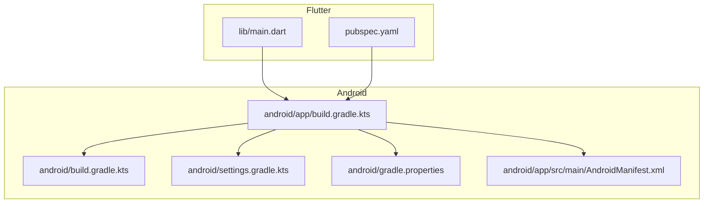
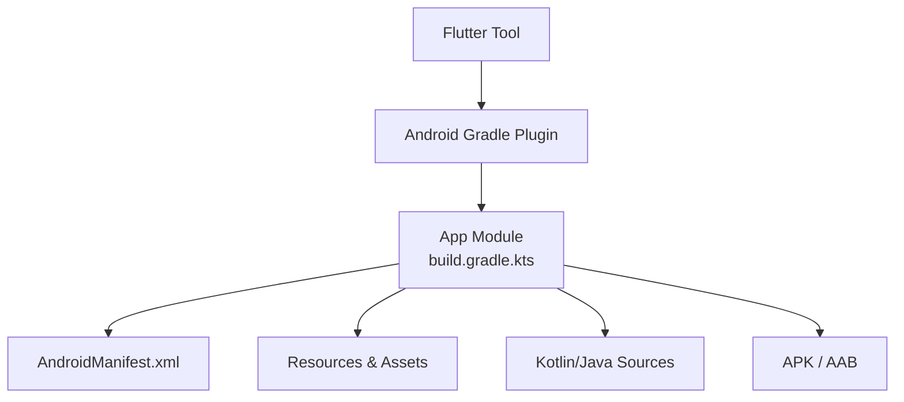
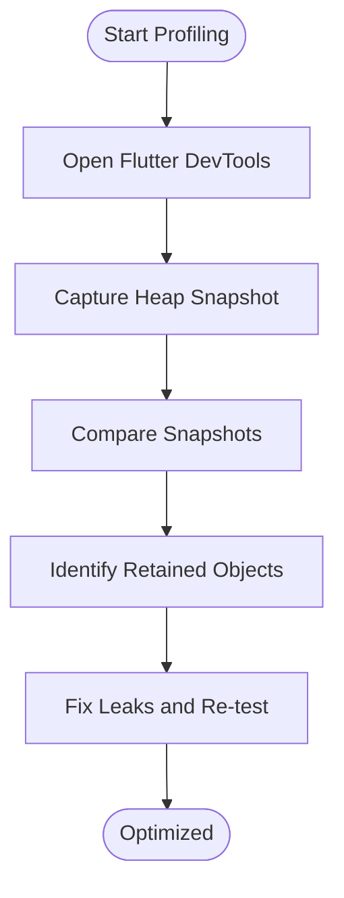
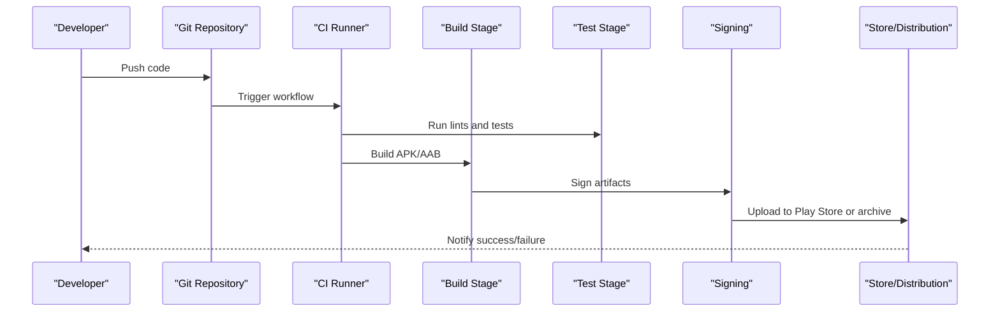
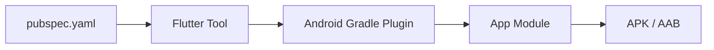

# Build and Deployment

<cite>
**Referenced Files in This Document**
- [README.md](file://README.md)
- [pubspec.yaml](file://pubspec.yaml)
- [main.dart](file://lib/main.dart)
- [android/build.gradle.kts](file://android/build.gradle.kts)
- [android/settings.gradle.kts](file://android/settings.gradle.kts)
- [android/app/build.gradle.kts](file://android/app/build.gradle.kts)
- [android/gradle.properties](file://android/gradle.properties)
- [android/app/src/main/AndroidManifest.xml](file://android/app/src/main/AndroidManifest.xml)
</cite>

## Table of Contents
1. Introduction
2. Project Structure
3. Core Components
4. Architecture Overview
5. Detailed Component Analysis
6. Dependency Analysis
7. Performance Considerations
8. Troubleshooting Guide
9. Conclusion

## Introduction
This document provides comprehensive build and deployment guidance for MyTube, a Flutter-based Android application focused on local video management. It covers:
- Android Gradle configuration and signing setup
- Flutter build pipeline and asset management
- Debug and release build procedures
- APK/AAB generation and distribution steps
- Performance profiling, memory leak detection, and battery optimization
- CI/CD recommendations, automated testing, and deployment automation
- Troubleshooting common build issues and performance bottlenecks

The project is a new Flutter app with Kotlin/Gradle integration for Android. The Android module uses the Flutter Gradle plugin and standard Android tooling.

**Section sources**
- [README.md:1-4](file://README.md#L1-L4)

## Project Structure
At a high level:
- Flutter application code under lib/, entry point main.dart
- Android native module under android/ with Gradle build scripts
- pubspec.yaml defines Dart dependencies and Flutter settings

**Diagram sources**
- [main.dart:1-33](file://lib/main.dart#L1-L33)
- [pubspec.yaml:1-29](file://pubspec.yaml#L1-L29)
- [android/app/build.gradle.kts:1-51](file://android/app/build.gradle.kts#L1-L51)
- [android/build.gradle.kts:1-25](file://android/build.gradle.kts#L1-L25)
- [android/settings.gradle.kts:1-27](file://android/settings.gradle.kts#L1-L27)
- [android/gradle.properties:1-7](file://android/gradle.properties#L1-L7)
- [android/app/src/main/AndroidManifest.xml:1-53](file://android/app/src/main/AndroidManifest.xml#L1-L53)

**Section sources**
- [pubspec.yaml:1-29](file://pubspec.yaml#L1-L29)
- [android/app/build.gradle.kts:1-51](file://android/app/build.gradle.kts#L1-L51)
- [android/build.gradle.kts:1-25](file://android/build.gradle.kts#L1-L25)
- [android/settings.gradle.kts:1-27](file://android/settings.gradle.kts#L1-L27)
- [android/gradle.properties:1-7](file://android/gradle.properties#L1-L7)
- [android/app/src/main/AndroidManifest.xml:1-53](file://android/app/src/main/AndroidManifest.xml#L1-L53)

## Core Components
- Flutter app bootstrap: initializes widgets binding, error handling, provider container, and runs the app.
- Android Gradle module: applies Android and Flutter plugins, configures compile/target SDKs, Java/Kotlin versions, and build types.
- Android manifest: declares permissions (internet, media storage), activity configuration, and Flutter embedding metadata.
- Pubspec: declares Dart SDK constraints, runtime dependencies, dev dependencies, and Flutter flags.

Key responsibilities:
- Build orchestration via Gradle and Flutter toolchain
- Platform integration through Android manifest and Gradle
- Application lifecycle and error wiring at startup

**Section sources**
- [main.dart:8-32](file://lib/main.dart#L8-L32)
- [android/app/build.gradle.kts:7-35](file://android/app/build.gradle.kts#L7-L35)
- [android/app/src/main/AndroidManifest.xml:1-53](file://android/app/src/main/AndroidManifest.xml#L1-L53)
- [pubspec.yaml:1-29](file://pubspec.yaml#L1-L29)

## Architecture Overview
The build system integrates Flutter and Android Gradle:
- Flutter tool invokes the Android Gradle plugin to produce Android artifacts
- Android Gradle compiles Kotlin/Java and packages assets/resources
- Manifest and Gradle configurations define platform behavior and capabilities

**Diagram sources**
- [android/app/build.gradle.kts:1-51](file://android/app/build.gradle.kts#L1-L51)
- [android/app/src/main/AndroidManifest.xml:1-53](file://android/app/src/main/AndroidManifest.xml#L1-L53)

## Detailed Component Analysis

### Android Build Configuration
- Plugins: Android application plugin and Flutter Gradle plugin are applied.
- Compile options: Java 17 source/target; Kotlin JVM target set to 17.
- DefaultConfig:
  - Application ID and namespace configured
  - minSdk = 24, targetSdk = 36
  - versionCode/versionName sourced from Flutter
- Build Types:
  - release currently uses debug signing config as a placeholder
- Dependencies:
  - AndroidX DocumentFile and Kotlin coroutines added

Operational notes:
- Ensure NDK version aligns with Flutter’s expected version
- Update release signing configuration before production builds
- Keep compileSdk/targetSdk aligned with your support policy

**Section sources**
- [android/app/build.gradle.kts:1-51](file://android/app/build.gradle.kts#L1-L51)

### Signing Configuration and Release Artifacts
Current state:
- Release build type references the debug signing config by default.

Recommended steps:
- Create a keystore file outside the repository
- Define a signingConfig block with storeFile, storePassword, keyAlias, keyPassword
- Apply the signingConfig to the release buildType
- Generate:
  - APK: flutter build apk --release
  - App Bundle: flutter build appbundle --release
- Verify signatures using Android Studio or apksigner

Distribution:
- For Play Store: upload the generated AAB
- For direct distribution: sign and distribute the APK

**Section sources**
- [android/app/build.gradle.kts:28-34](file://android/app/build.gradle.kts#L28-L34)

### Flutter Build Pipeline and Asset Management
- Entry point: main.dart bootstraps the app, wires error handling, and runs the widget tree.
- Dependencies: defined in pubspec.yaml; includes video_player and Riverpod.
- Flutter-specific settings: Material Design usage enabled.

Asset management:
- Add images, fonts, and other assets under an assets directory and declare them in pubspec.yaml under flutter.assets
- Use package:assets_audio_player or similar if audio assets are needed
- Ensure large media files are not bundled; prefer streaming or external storage access

Build commands:
- Debug: flutter build apk --debug or flutter build appbundle --debug
- Release: flutter build apk --release or flutter build appbundle --release
- Profile: flutter build apk --profile or flutter build appbundle --profile

**Section sources**
- [main.dart:8-32](file://lib/main.dart#L8-L32)
- [pubspec.yaml:1-29](file://pubspec.yaml#L1-L29)

### Android Manifest and Permissions
- Internet permission declared for network streams
- Storage/media permissions declared for reading local videos across API levels
- Activity configuration sets theme, launch mode, hardware acceleration, and soft input behavior
- Flutter embedding metadata included

Best practices:
- Request runtime permissions where required (e.g., READ_MEDIA_VIDEO on newer APIs)
- Keep permissions minimal and scoped to actual needs

**Section sources**
- [android/app/src/main/AndroidManifest.xml:1-53](file://android/app/src/main/AndroidManifest.xml#L1-L53)

### Gradle Settings and Global Properties
- settings.gradle.kts:
  - Includes Flutter tools gradle build
  - Declares Android and Kotlin plugin versions
  - Includes :app module
- build.gradle.kts (root):
  - Repositories: Google and Maven Central
  - Customizes build directories for consistent output locations
- gradle.properties:
  - JVM args for Gradle daemon memory tuning
  - AndroidX enabled
  - DSL flags retained from template

Recommendations:
- Pin plugin versions centrally
- Configure caching and parallel execution for faster builds
- Align Kotlin and Java versions consistently

**Section sources**
- [android/settings.gradle.kts:1-27](file://android/settings.gradle.kts#L1-L27)
- [android/build.gradle.kts:1-25](file://android/build.gradle.kts#L1-L25)
- [android/gradle.properties:1-7](file://android/gradle.properties#L1-L7)

### Step-by-Step Build and Distribution Guides

#### Creating a Debug Build
- Prerequisites: Flutter SDK installed, Android SDK/NDK configured, device/emulator ready
- Commands:
  - flutter clean
  - flutter pub get
  - flutter build apk --debug
  - flutter build appbundle --debug
- Install:
  - flutter install (for connected device)
  - adb install path/to/debug.apk

#### Creating a Release Build
- Prepare signing:
  - Generate a keystore and record alias/passwords
  - Configure signingConfig in app/build.gradle.kts
- Commands:
  - flutter build apk --release
  - flutter build appbundle --release
- Verify:
  - apksigner verify --verbose app-release.apk
  - Check bundle size and symbols

#### Distributing the Application
- Google Play Store:
  - Upload signed AAB
  - Complete store listing and internal testing tracks
- Direct distribution:
  - Sign APK with your keystore
  - Host APK on secure server or distribute via email/messaging
  - Enable “Install from unknown sources” on devices if necessary

**Section sources**
- [android/app/build.gradle.kts:28-34](file://android/app/build.gradle.kts#L28-L34)

### Performance Profiling, Memory Leak Detection, and Battery Optimization

#### Profiling Tools
- Flutter DevTools:
  - CPU profiler, memory snapshots, timeline events
  - Network inspector for stream diagnostics
- Android Studio:
  - CPU Profiler, Memory Profiler, Battery Historian
  - Logcat filtering for app tags

#### Memory Leak Detection
- Use DevTools memory tab to capture heap snapshots and compare allocations
- Analyze retained objects and identify long-lived listeners or caches
- Validate that video player instances are disposed properly

#### Battery Usage Optimization
- Prefer hardware-accelerated playback when available
- Avoid unnecessary wake locks; rely on system media session controls
- Throttle background tasks and use WorkManager for periodic jobs
- Minimize network requests and cache responses appropriately

[No sources needed since this diagram shows conceptual workflow, not actual code structure]

### CI/CD Pipeline Setup Recommendations

#### Recommended Stages
- Setup:
  - Cache Flutter SDK and Gradle dependencies
  - Install Android SDK components (platform-tools, build-tools, platforms)
- Lint and Test:
  - dart analyze
  - flutter test
  - android unit tests (if any)
- Build:
  - flutter build apk --release
  - flutter build appbundle --release
- Sign:
  - Use environment variables for keystore and passwords
  - Sign artifacts securely
- Publish:
  - Upload AAB to Play Store via fastlane or Google Play CLI
  - Archive APKs for internal distribution

#### Automated Testing Integration
- Unit tests: flutter test
- Widget tests: flutter test test/widget
- Integration tests: flutter drive or use integration_test package
- Code coverage: flutter test --coverage and upload to CI dashboard

#### Deployment Automation Strategies
- GitHub Actions/GitLab CI:
  - Matrix builds for multiple architectures
  - Artifact retention policies
- Fastlane:
  - Automate signing, versioning, and store uploads
- Secrets management:
  - Use CI secret stores for keystore and credentials

[No sources needed since this diagram shows conceptual workflow, not actual code structure]

## Dependency Analysis
Flutter and Android modules interact through the Flutter Gradle plugin:
- Flutter tool orchestrates compilation and packaging
- Android Gradle plugin compiles native code and resources
- pubspec.yaml drives Dart dependency resolution

**Diagram sources**
- [pubspec.yaml:1-29](file://pubspec.yaml#L1-L29)
- [android/app/build.gradle.kts:1-51](file://android/app/build.gradle.kts#L1-L51)

**Section sources**
- [pubspec.yaml:1-29](file://pubspec.yaml#L1-L29)
- [android/app/build.gradle.kts:1-51](file://android/app/build.gradle.kts#L1-L51)

## Performance Considerations
- Keep minSdk and targetSdk aligned with supported devices while minimizing overhead
- Use hardware acceleration for video playback
- Avoid heavy synchronous operations on the UI thread
- Optimize image/video assets and avoid bundling large files
- Use efficient logging and disable verbose logs in release builds

[No sources needed since this section provides general guidance]

## Troubleshooting Guide

### Common Build Issues
- Gradle out-of-memory errors:
  - Increase org.gradle.jvmargs in gradle.properties
  - Enable parallel builds and configure Gradle daemon
- NDK mismatch:
  - Ensure ndkVersion matches Flutter’s expected version
- Plugin version conflicts:
  - Align Android and Kotlin plugin versions in settings.gradle.kts
- Missing Flutter SDK path:
  - Ensure local.properties contains flutter.sdk

### Runtime Permission Issues
- Media read permissions:
  - Confirm correct permissions per API level
  - Request runtime permissions where required

### Performance Bottlenecks
- High memory usage:
  - Profile with DevTools and Android Studio Memory Profiler
  - Dispose video players and clear caches
- Excessive battery drain:
  - Reduce background work and network calls
  - Use efficient codecs and avoid unnecessary decoding

**Section sources**
- [android/gradle.properties:1-7](file://android/gradle.properties#L1-L7)
- [android/settings.gradle.kts:1-27](file://android/settings.gradle.kts#L1-L27)
- [android/app/src/main/AndroidManifest.xml:1-53](file://android/app/src/main/AndroidManifest.xml#L1-L53)

## Conclusion
MyTube’s build system combines Flutter and Android Gradle to produce optimized Android artifacts. By configuring proper signing, optimizing Gradle properties, and integrating CI/CD pipelines, you can streamline development, ensure reliable releases, and maintain strong performance and battery efficiency. Follow the step-by-step guides for building and distributing apps, and use the troubleshooting tips to resolve common issues quickly.

[No sources needed since this section summarizes without analyzing specific files]