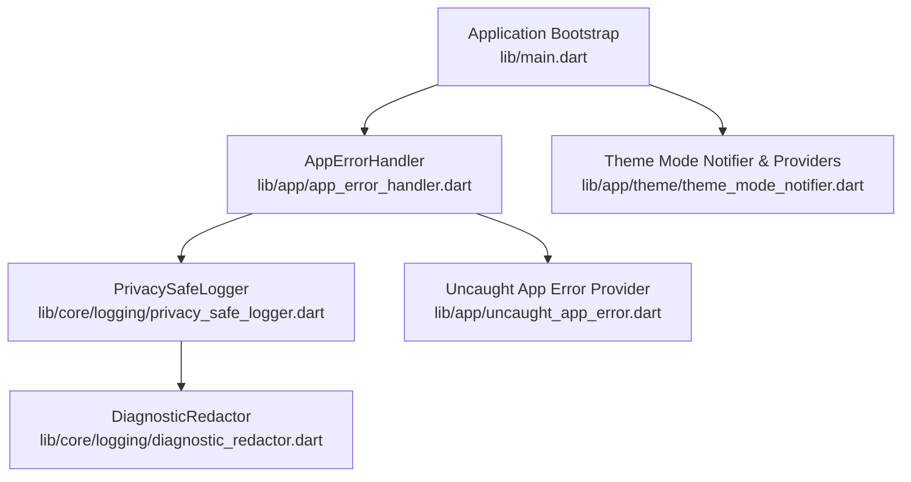
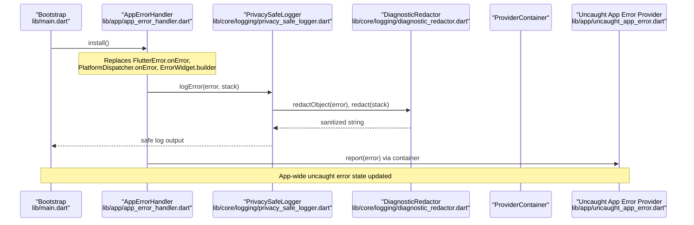
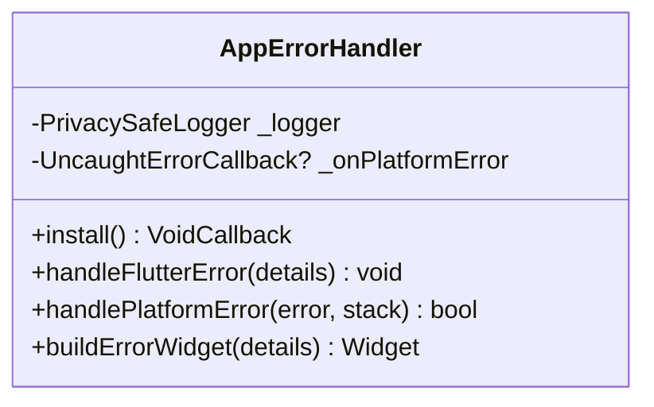
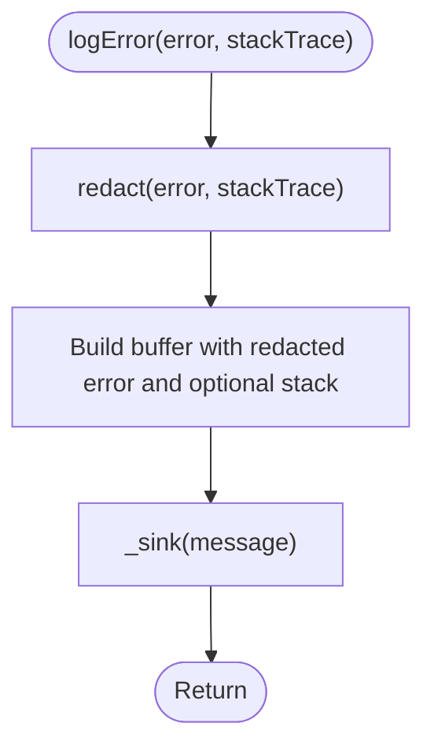
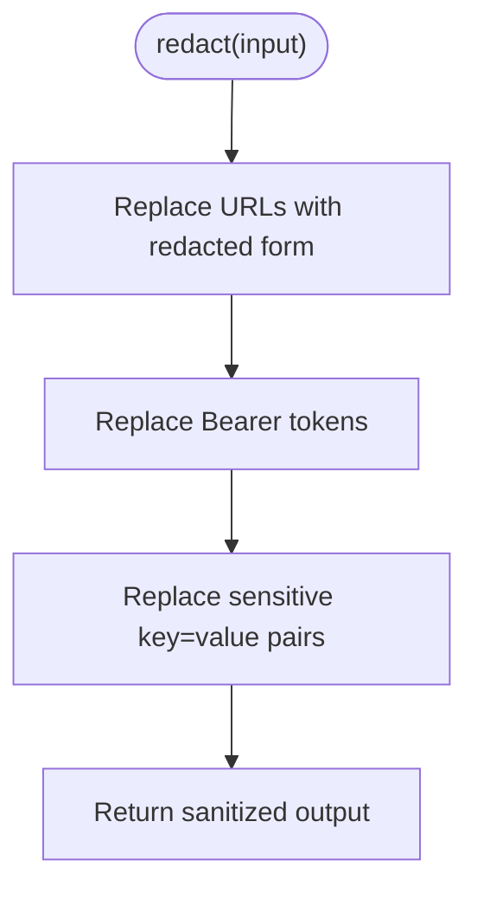
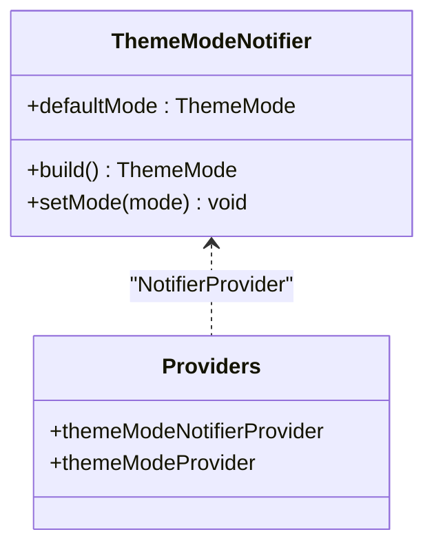
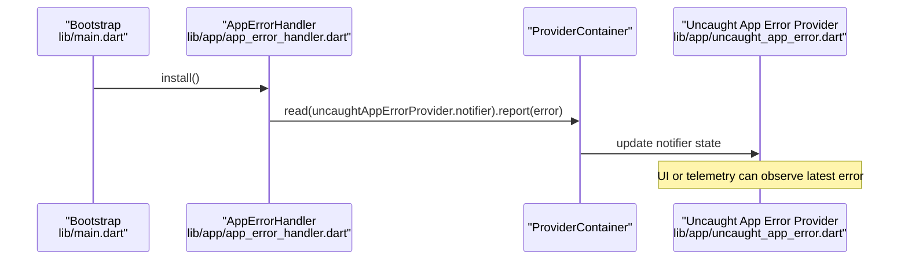
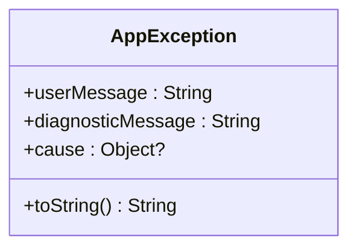
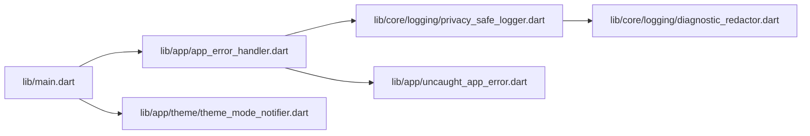

# Core Infrastructure

<cite>
**Referenced Files in This Document**
- [main.dart](file://lib/main.dart)
- [app_error_handler.dart](file://lib/app/app_error_handler.dart)
- [privacy_safe_logger.dart](file://lib/core/logging/privacy_safe_logger.dart)
- [diagnostic_redactor.dart](file://lib/core/logging/diagnostic_redactor.dart)
- [app_exception.dart](file://lib/core/errors/app_exception.dart)
- [theme_mode_notifier.dart](file://lib/app/theme/theme_mode_notifier.dart)
- [uncaught_app_error.dart](file://lib/app/uncaught_app_error.dart)
</cite>

## Table of Contents
1. [Introduction](#introduction)
2. [Project Structure](#project-structure)
3. [Core Components](#core-components)
4. [Architecture Overview](#architecture-overview)
5. [Detailed Component Analysis](#detailed-component-analysis)
6. [Dependency Analysis](#dependency-analysis)
7. [Performance Considerations](#performance-considerations)
8. [Troubleshooting Guide](#troubleshooting-guide)
9. [Conclusion](#conclusion)
10. [Appendices](#appendices)

## Introduction
This document explains the core infrastructure that powers error handling, privacy-safe logging, diagnostic redaction, theme management, and dependency injection across the application. It focuses on how errors are captured consistently, how sensitive information is protected in logs and crash reports, and how shared utilities and providers are wired at startup.

## Project Structure
The core infrastructure spans a small set of focused modules:
- Application bootstrap wires global error hooks and a single provider container.
- Error handling centralizes Flutter and platform error capture with a consistent UI surface.
- Logging is privacy-first, using a redactor to scrub secrets from diagnostics.
- Theme state is managed via Riverpod notifiers and providers.
- A dedicated uncaught error provider integrates with the error handler for app-wide reporting.

**Diagram sources**
- [main.dart:8-32](file://lib/main.dart#L8-L32)
- [app_error_handler.dart:9-49](file://lib/app/app_error_handler.dart#L9-L49)
- [privacy_safe_logger.dart:10-37](file://lib/core/logging/privacy_safe_logger.dart#L10-L37)
- [diagnostic_redactor.dart:5-57](file://lib/core/logging/diagnostic_redactor.dart#L5-L57)
- [uncaught_app_error.dart:1-32](file://lib/app/uncaught_app_error.dart#L1-L32)
- [theme_mode_notifier.dart:14-41](file://lib/app/theme/theme_mode_notifier.dart#L14-L41)

**Section sources**
- [main.dart:8-32](file://lib/main.dart#L8-L32)

## Core Components
- Centralized error handling: Installs Flutter and platform error hooks, logs via a privacy-safe logger, and renders a consistent error surface.
- Privacy-safe logging: Ensures no raw exceptions or secrets reach sinks; all diagnostics are redacted before output.
- Diagnostic redaction: Scrubs URLs, bearer tokens, and key-value secrets from strings and objects.
- Theme management: Provides a dark-first theme mode with Riverpod-based state and read-only accessors.
- Dependency injection: Uses a single ProviderContainer and exposes services through Riverpod providers.

Key responsibilities:
- AppErrorHandler: Global error interception and recovery strategy.
- PrivacySafeLogger: Secure log sink wrapper with redaction.
- DiagnosticRedactor: Regex-based scrubbing of sensitive data.
- ThemeModeNotifier: Theme state holder and provider wiring.
- Uncaught App Error Provider: Stores and exposes the latest uncaught error for UI/reporting.

**Section sources**
- [app_error_handler.dart:9-49](file://lib/app/app_error_handler.dart#L9-L49)
- [privacy_safe_logger.dart:10-37](file://lib/core/logging/privacy_safe_logger.dart#L10-L37)
- [diagnostic_redactor.dart:5-57](file://lib/core/logging/diagnostic_redactor.dart#L5-L57)
- [theme_mode_notifier.dart:14-41](file://lib/app/theme/theme_mode_notifier.dart#L14-L41)
- [uncaught_app_error.dart:1-32](file://lib/app/uncaught_app_error.dart#L1-L32)

## Architecture Overview
At runtime, the application bootstraps once, installs error hooks, and runs the app with a shared provider container. Errors flow into the centralized handler, which logs them safely and optionally forwards them to an uncaught error provider for UI display or telemetry.

**Diagram sources**
- [main.dart:18-31](file://lib/main.dart#L18-L31)
- [app_error_handler.dart:17-41](file://lib/app/app_error_handler.dart#L17-L41)
- [privacy_safe_logger.dart:25-37](file://lib/core/logging/privacy_safe_logger.dart#L25-L37)
- [diagnostic_redactor.dart:21-35](file://lib/core/logging/diagnostic_redactor.dart#L21-L35)
- [uncaught_app_error.dart:1-32](file://lib/app/uncaught_app_error.dart#L1-L32)

## Detailed Component Analysis

### Centralized Error Handling (AppErrorHandler)
AppErrorHandler replaces global error hooks to ensure every Flutter and platform error is logged securely and surfaced consistently. It also provides a custom error widget builder for a uniform failure experience.

- install(): Swaps in custom handlers and returns a function to restore previous hooks (useful in tests).
- handleFlutterError(): Logs Flutter errors via the privacy-safe logger.
- handlePlatformError(): Logs platform errors, invokes optional callback, and prevents isolate termination by returning true.
- buildErrorWidget(): Renders a consistent error surface.

**Diagram sources**
- [app_error_handler.dart:9-49](file://lib/app/app_error_handler.dart#L9-L49)

**Section sources**
- [app_error_handler.dart:9-49](file://lib/app/app_error_handler.dart#L9-L49)

### Privacy-Safe Logging (PrivacySafeLogger)
PrivacySafeLogger ensures that no raw exception text or secrets reach any log sink. It delegates to DiagnosticRedactor to sanitize both the error object and its stack trace before writing to the configured sink.

- redact(): Combines redacted error and stack trace into a single message.
- logError(): Delegates to redact and writes to the sink.
- Default sink: Uses Dart’s developer.log with a stable log name.

**Diagram sources**
- [privacy_safe_logger.dart:25-37](file://lib/core/logging/privacy_safe_logger.dart#L25-L37)

**Section sources**
- [privacy_safe_logger.dart:10-37](file://lib/core/logging/privacy_safe_logger.dart#L10-L37)

### Diagnostic Redaction (DiagnosticRedactor)
DiagnosticRedactor strips credentials and signed URL query parameters from diagnostic text to satisfy security requirements even when exceptions contain playback URLs or tokens.

- redact(): Applies three passes:
  - URL redaction: Removes userinfo, query, and fragment; preserves scheme/host/port/path.
  - Bearer token redaction: Replaces entire bearer header value.
  - Sensitive assignment redaction: Masks values for keys like token, password, api_key, authorization, etc.
- redactObject(): Converts objects to strings then applies redaction.

**Diagram sources**
- [diagnostic_redactor.dart:21-35](file://lib/core/logging/diagnostic_redactor.dart#L21-L35)
- [diagnostic_redactor.dart:37-57](file://lib/core/logging/diagnostic_redactor.dart#L37-L57)

**Section sources**
- [diagnostic_redactor.dart:5-57](file://lib/core/logging/diagnostic_redactor.dart#L5-L57)

### Theme Management (ThemeModeNotifier and Providers)
ThemeModeNotifier holds the current ThemeMode and exposes it via Riverpod. The default is dark-first. Consumers can read the mode via a read-only provider or update it via the notifier provider.

- ThemeModeNotifier.build(): Returns the default dark mode.
- setMode(): Updates the active theme mode.
- themeModeNotifierProvider: Exposes the notifier for write access.
- themeModeProvider: Read-only convenience provider for consumers.

**Diagram sources**
- [theme_mode_notifier.dart:14-41](file://lib/app/theme/theme_mode_notifier.dart#L14-L41)

**Section sources**
- [theme_mode_notifier.dart:14-41](file://lib/app/theme/theme_mode_notifier.dart#L14-L41)

### Uncaught App Error Integration
The bootstrap process installs AppErrorHandler and wires an onPlatformError callback that reports errors to a Riverpod provider. This enables app-wide visibility of uncaught errors without leaking sensitive details.

**Diagram sources**
- [main.dart:23-28](file://lib/main.dart#L23-L28)
- [app_error_handler.dart:37-41](file://lib/app/app_error_handler.dart#L37-L41)
- [uncaught_app_error.dart:1-32](file://lib/app/uncaught_app_error.dart#L1-L32)

**Section sources**
- [main.dart:23-28](file://lib/main.dart#L23-L28)
- [app_error_handler.dart:37-41](file://lib/app/app_error_handler.dart#L37-L41)
- [uncaught_app_error.dart:1-32](file://lib/app/uncaught_app_error.dart#L1-L32)

### Application Exception Model
AppException separates user-facing messages from diagnostic messages. User messages must never include secrets; diagnostics may include sensitive details but are always redacted before logging.

- userMessage: Safe for UI display.
- diagnosticMessage: For internal logs after redaction.
- cause: Optional underlying exception.

**Diagram sources**
- [app_exception.dart:3-19](file://lib/core/errors/app_exception.dart#L3-L19)

**Section sources**
- [app_exception.dart:3-19](file://lib/core/errors/app_exception.dart#L3-L19)

## Dependency Analysis
The following diagram shows how core components depend on each other and on Riverpod for dependency injection.

**Diagram sources**
- [main.dart:8-32](file://lib/main.dart#L8-L32)
- [app_error_handler.dart:9-49](file://lib/app/app_error_handler.dart#L9-L49)
- [privacy_safe_logger.dart:10-37](file://lib/core/logging/privacy_safe_logger.dart#L10-L37)
- [diagnostic_redactor.dart:5-57](file://lib/core/logging/diagnostic_redactor.dart#L5-L57)
- [theme_mode_notifier.dart:14-41](file://lib/app/theme/theme_mode_notifier.dart#L14-L41)
- [uncaught_app_error.dart:1-32](file://lib/app/uncaught_app_error.dart#L1-L32)

**Section sources**
- [main.dart:8-32](file://lib/main.dart#L8-L32)
- [app_error_handler.dart:9-49](file://lib/app/app_error_handler.dart#L9-L49)
- [privacy_safe_logger.dart:10-37](file://lib/core/logging/privacy_safe_logger.dart#L10-L37)
- [diagnostic_redactor.dart:5-57](file://lib/core/logging/diagnostic_redactor.dart#L5-L57)
- [theme_mode_notifier.dart:14-41](file://lib/app/theme/theme_mode_notifier.dart#L14-L41)
- [uncaught_app_error.dart:1-32](file://lib/app/uncaught_app_error.dart#L1-L32)

## Performance Considerations
- Error hook installation occurs once during bootstrap; subsequent error handling is lightweight.
- Redaction uses regex replacements; keep patterns minimal and avoid excessive allocations in hot paths.
- Prefer read-only theme providers in widgets to minimize rebuilds; only use the notifier where updates are necessary.
- Avoid logging large payloads; rely on redaction and selective logging to reduce I/O overhead.

[No sources needed since this section provides general guidance]

## Troubleshooting Guide
- If errors do not appear in logs:
  - Verify that AppErrorHandler.install() was called during bootstrap.
  - Ensure the default sink is enabled and not overridden unintentionally.
- If secrets still appear in logs:
  - Confirm that all error paths go through PrivacySafeLogger.logError().
  - Validate that DiagnosticRedactor patterns cover new secret formats.
- If the app crashes silently on platform errors:
  - Check that handlePlatformError returns true to prevent isolate termination.
  - Inspect the uncaught error provider state to confirm reporting.

**Section sources**
- [app_error_handler.dart:17-41](file://lib/app/app_error_handler.dart#L17-L41)
- [privacy_safe_logger.dart:25-37](file://lib/core/logging/privacy_safe_logger.dart#L25-L37)
- [diagnostic_redactor.dart:21-35](file://lib/core/logging/diagnostic_redactor.dart#L21-L35)

## Conclusion
The core infrastructure establishes a secure, consistent foundation for error handling, logging, and theme state. By centralizing error capture, enforcing privacy-safe diagnostics, and leveraging Riverpod for dependency injection, the application maintains robustness and safety while remaining extensible for future features.

[No sources needed since this section summarizes without analyzing specific files]

## Appendices

### Extending Core Functionality
- Add a new error category:
  - Create a typed exception extending AppException with a safe userMessage and detailed diagnosticMessage.
  - Surface the exception through existing error paths so it is automatically redacted and logged.
- Integrate a third-party logging backend:
  - Provide a custom LogSink to PrivacySafeLogger to forward redacted messages to your service.
- Extend theme capabilities:
  - Add additional modes or persistence in ThemeModeNotifier and expose new providers.

[No sources needed since this section provides general guidance]