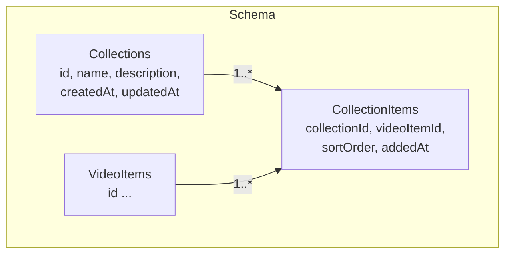
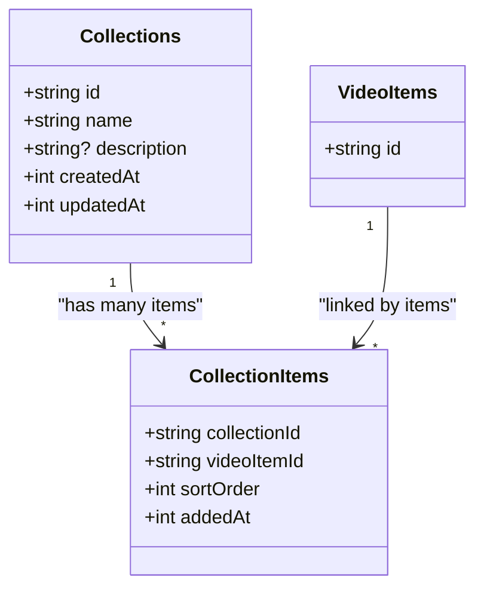
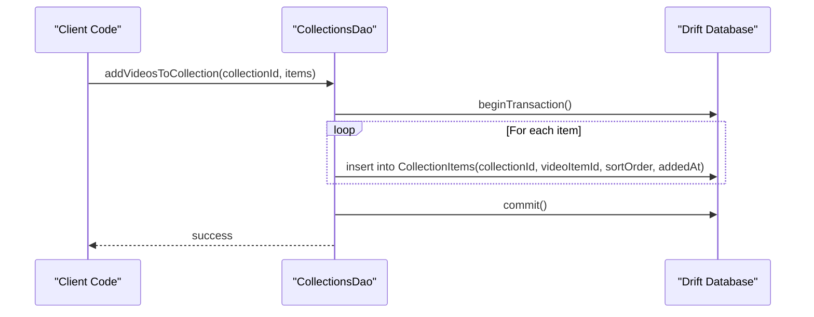
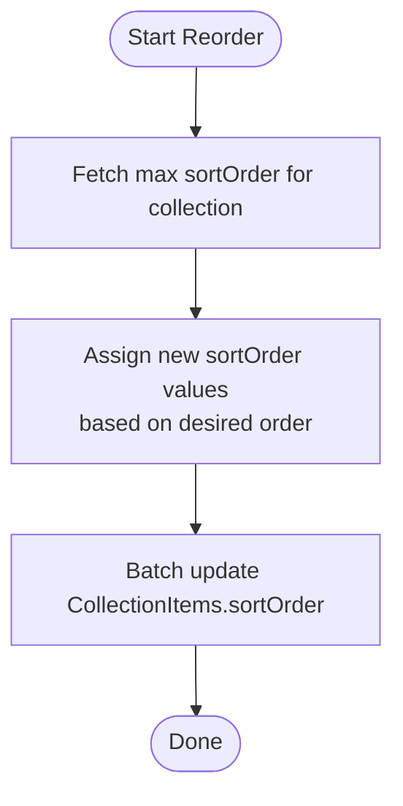
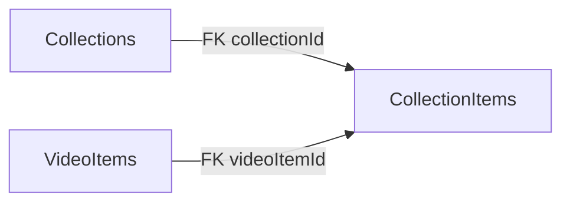

# CollectionsDao

<cite>
**Referenced Files in This Document**
- [collections_table.dart](file://lib/data/database/tables/collections_table.dart)
- [collection_items_table.dart](file://lib/data/database/tables/collection_items_table.dart)
- [app_database.g.dart](file://lib/data/database/app_database.g.dart)
</cite>

## Table of Contents
1. [Introduction](#introduction)
2. [Project Structure](#project-structure)
3. [Core Components](#core-components)
4. [Architecture Overview](#architecture-overview)
5. [Detailed Component Analysis](#detailed-component-analysis)
6. [Dependency Analysis](#dependency-analysis)
7. [Performance Considerations](#performance-considerations)
8. [Troubleshooting Guide](#troubleshooting-guide)
9. [Conclusion](#conclusion)

## Introduction
This document provides comprehensive documentation for the Collections data layer that manages video collections and their relationships to videos. It focuses on the schema, cascade behavior, and recommended DAO operations for creating, reading, updating, deleting collections, as well as managing the many-to-many relationship between collections and videos through the CollectionItems junction table. It also includes examples of common workflows such as adding videos to collections, retrieving all collections containing a specific video, and organizing videos across multiple collections.

## Project Structure
The collections feature is implemented using Drift tables and generated database classes:
- Collections table defines the collection metadata (id, name, description, timestamps).
- CollectionItems table defines the many-to-many link between collections and videos with ordering and timestamps.
- Generated app_database.g.dart contains model classes, companions, and helper managers used by DAOs.

**Diagram sources**
- [collections_table.dart:9-27](file://lib/data/database/tables/collections_table.dart#L9-L27)
- [collection_items_table.dart:15-35](file://lib/data/database/tables/collection_items_table.dart#L15-L35)

**Section sources**
- [collections_table.dart:1-28](file://lib/data/database/tables/collections_table.dart#L1-L28)
- [collection_items_table.dart:1-36](file://lib/data/database/tables/collection_items_table.dart#L1-L36)

## Core Components
- Collections table: Represents user-created playlists or collections with stable UUID ids and optional descriptions. Timestamps track creation and last update.
- CollectionItems table: Junction table linking collections to videos. It supports explicit ordering via sortOrder and records when an item was added via addedAt. Both foreign keys cascade on delete.

Key responsibilities:
- Provide a stable identity for collections (id).
- Maintain ordered membership of videos within a collection.
- Enforce referential integrity and automatic cleanup via cascading deletes.

**Section sources**
- [collections_table.dart:9-27](file://lib/data/database/tables/collections_table.dart#L9-L27)
- [collection_items_table.dart:6-35](file://lib/data/database/tables/collection_items_table.dart#L6-L35)

## Architecture Overview
The data access layer uses Drift’s generated types and companion objects to perform CRUD operations and manage relationships. The DAO should operate over:
- Collections table for collection lifecycle management.
- CollectionItems table for membership management and ordering.

**Diagram sources**
- [collections_table.dart:9-27](file://lib/data/database/tables/collections_table.dart#L9-L27)
- [collection_items_table.dart:15-35](file://lib/data/database/tables/collection_items_table.dart#L15-L35)

## Detailed Component Analysis

### Collections CRUD Operations
Recommended DAO methods:
- createCollection(id, name, description): Insert a new collection row with createdAt and updatedAt set to current time.
- getCollectionById(id): Retrieve a single collection by its stable id.
- getAllCollections(): Return all collections, optionally ordered by createdAt or updatedAt.
- updateCollection(id, updates): Update fields like name or description; refresh updatedAt.
- deleteCollection(id): Delete a collection; due to cascade, related CollectionItems rows are automatically removed.

Implementation notes:
- Use the generated Companion object for safe inserts/updates.
- Ensure id uniqueness at the application level before insertion.
- For bulk operations, prefer transactions to maintain consistency.

Example workflow (create collection):
1. Validate inputs (non-empty name).
2. Generate a unique id.
3. Set createdAt and updatedAt to current timestamp.
4. Insert via CollectionsCompanion.insert(...).
5. Return the created collection.

Example workflow (delete collection with cascade):
1. Verify collection exists.
2. Delete the collection row.
3. Database automatically removes associated CollectionItems rows.

**Section sources**
- [collections_table.dart:9-27](file://lib/data/database/tables/collections_table.dart#L9-L27)
- [app_database.g.dart:2073-2107](file://lib/data/database/app_database.g.dart#L2073-L2107)
- [app_database.g.dart:2185-2283](file://lib/data/database/app_database.g.dart#L2185-L2283)

### Many-to-Many Relationship Management (CollectionItems)
The CollectionItems table links collections to videos and preserves order and addition time.

Membership operations:
- addVideoToCollection(collectionId, videoItemId, sortOrder, addedAt): Insert a new join row.
- removeVideoFromCollection(collectionId, videoItemId): Delete the join row.
- reorderCollectionItems(collectionId, orderedVideoItemIds): Update sortOrder values to reflect new order.
- getVideosInCollection(collectionId, orderBy): Query joined items with ordering.
- getCollectionsContainingVideo(videoItemId): Find all collections that include a given video.

Bulk operations:
- addVideosToCollection(collectionId, videoItemsWithSortOrder): Batch insert multiple join rows within a transaction.
- removeVideosFromCollection(collectionId, videoItemIds): Batch delete multiple join rows.

Ordering semantics:
- sortOrder is ascending; lower values appear first.
- When sortOrder ties exist, break ties by addedAt to ensure deterministic ordering.

Cascade deletion:
- Deleting a collection removes all its CollectionItems entries.
- Deleting a video removes all its references from any collection.

Example workflow (add videos to a collection):
1. Compute sortOrder for each new item (e.g., append after existing max sortOrder).
2. Record addedAt as current timestamp.
3. Insert all join rows in a single transaction.

Example workflow (retrieve all collections containing a video):
1. Query CollectionItems filtered by videoItemId.
2. Join with Collections to return collection metadata.
3. Optionally sort by createdAt or updatedAt.

**Diagram sources**
- [collection_items_table.dart:15-35](file://lib/data/database/tables/collection_items_table.dart#L15-L35)
- [app_database.g.dart:2542-2628](file://lib/data/database/app_database.g.dart#L2542-L2628)

**Section sources**
- [collection_items_table.dart:6-35](file://lib/data/database/tables/collection_items_table.dart#L6-L35)
- [app_database.g.dart:2542-2628](file://lib/data/database/app_database.g.dart#L2542-L2628)

### Collection Organization Features
- Explicit ordering: Use sortOrder to allow users to rearrange items without renumbering every row.
- Stable tie-breaking: Use addedAt to resolve ties in sortOrder for consistent display.
- Multi-collection membership: A video can belong to multiple collections simultaneously.
- Bulk reordering: Accept a list of video item ids in desired order and update sortOrder accordingly.

**Diagram sources**
- [collection_items_table.dart:24-31](file://lib/data/database/tables/collection_items_table.dart#L24-L31)

**Section sources**
- [collection_items_table.dart:24-31](file://lib/data/database/tables/collection_items_table.dart#L24-L31)

## Dependency Analysis
Collections and CollectionItems are tightly coupled through foreign keys with cascade deletes. The generated database classes provide model and companion types used by DAOs.

**Diagram sources**
- [collection_items_table.dart:17-22](file://lib/data/database/tables/collection_items_table.dart#L17-L22)

**Section sources**
- [collection_items_table.dart:17-22](file://lib/data/database/tables/collection_items_table.dart#L17-L22)

## Performance Considerations
For large collection datasets:
- Use transactions for batch inserts/deletes to reduce overhead and ensure atomicity.
- Prefer indexed queries:
  - Index CollectionItems(collectionId, sortOrder) to optimize listing items in a collection.
  - Index CollectionItems(videoItemId) to efficiently find all collections containing a video.
- Avoid N+1 queries:
  - When fetching collections with their items, use joins or preloading strategies provided by Drift.
- Minimize round trips:
  - Combine multiple membership changes into a single transaction.
- Pagination:
  - Implement cursor-based or offset pagination for listing collections and their items.
- Ordering efficiency:
  - Keep sortOrder monotonically increasing per collection to simplify appending and reduce reindexing.

[No sources needed since this section provides general guidance]

## Troubleshooting Guide
Common issues and resolutions:
- Duplicate join entries:
  - Ensure uniqueness constraints are enforced at the application level or via database constraints.
  - Use upsert patterns if duplicates are possible during bulk imports.
- Cascade delete surprises:
  - Deleting a collection removes all its items; deleting a video removes all its references. Plan UI accordingly.
- Ordering anomalies:
  - If sortOrder ties cause inconsistent ordering, rely on addedAt as a secondary sort key.
- Stale timestamps:
  - Always set createdAt and updatedAt appropriately on collection mutations.

Operational checks:
- Verify foreign key integrity after migrations.
- Validate that sortOrder values remain non-negative and monotonic where applicable.

**Section sources**
- [collection_items_table.dart:11-12](file://lib/data/database/tables/collection_items_table.dart#L11-L12)
- [collections_table.dart:19-23](file://lib/data/database/tables/collections_table.dart#L19-L23)

## Conclusion
The Collections data layer provides a robust foundation for managing video collections and their relationships to videos. With explicit ordering, cascade deletion, and clear separation of concerns between collections and their membership, it supports both simple and complex organization scenarios. By following the recommended DAO patterns and performance strategies outlined here, applications can efficiently handle large-scale collection operations while maintaining data integrity and predictable user experiences.