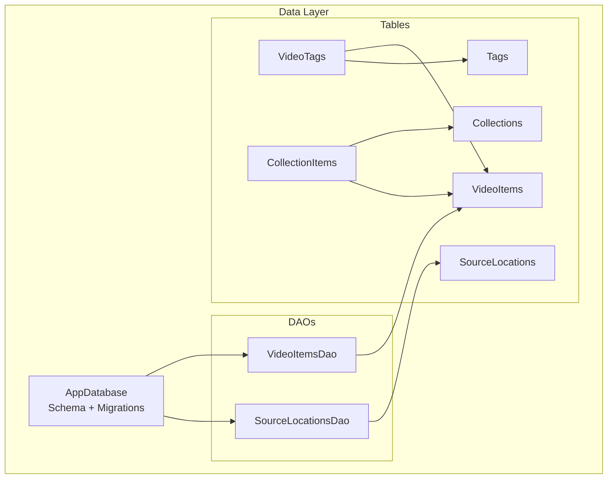
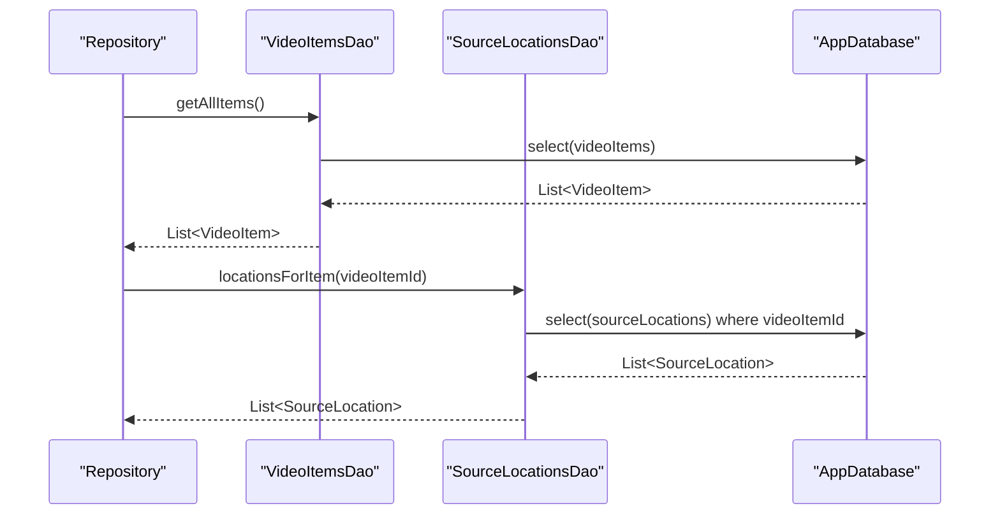
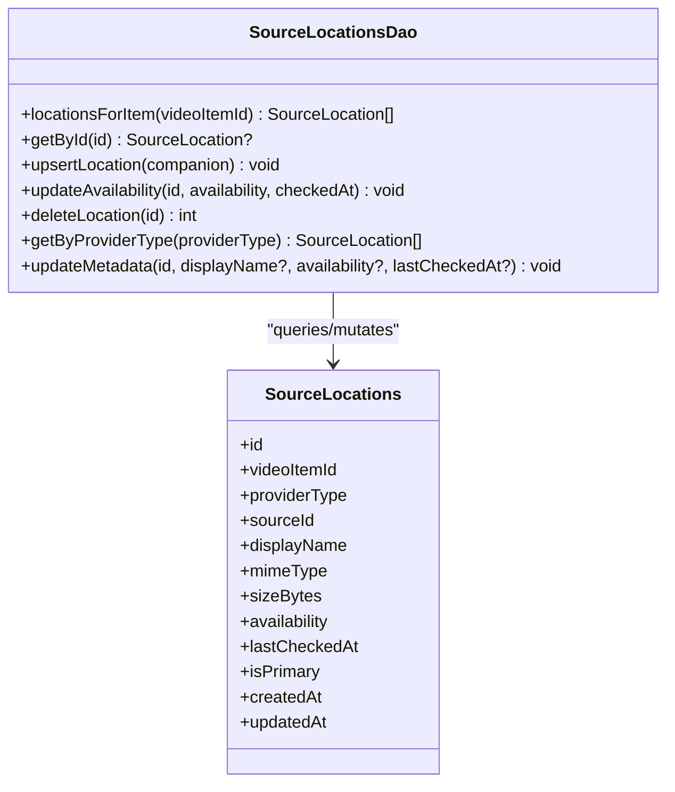
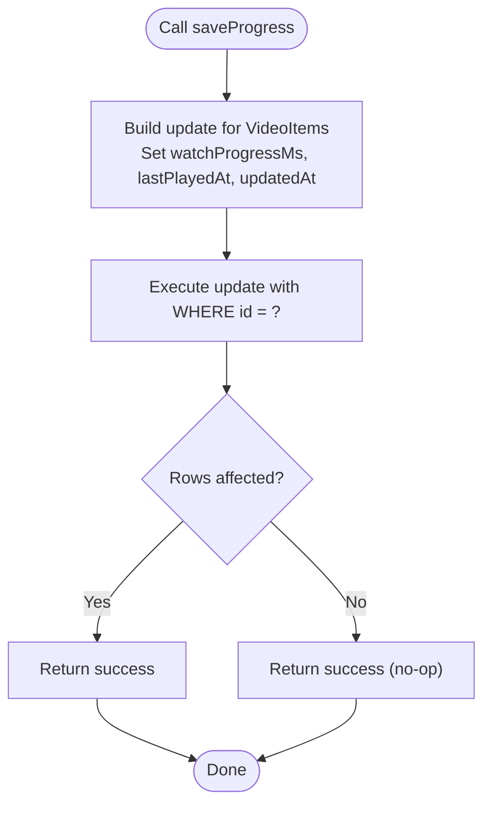
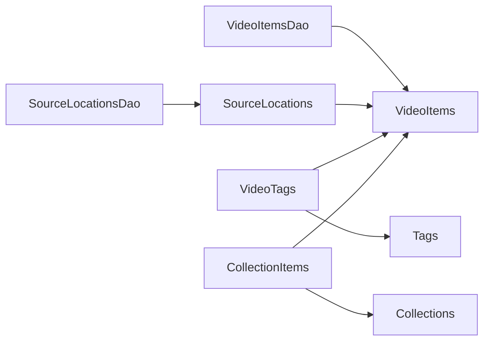

# Data Access Objects (DAOs)

<cite>
**Referenced Files in This Document**
- [pubspec.yaml](file://pubspec.yaml)
- [app_database.dart](file://lib/data/database/app_database.dart)
- [video_items_dao.dart](file://lib/data/database/daos/video_items_dao.dart)
- [source_locations_dao.dart](file://lib/data/database/daos/source_locations_dao.dart)
- [video_items_table.dart](file://lib/data/database/tables/video_items_table.dart)
- [source_locations_table.dart](file://lib/data/database/tables/source_locations_table.dart)
- [tags_table.dart](file://lib/data/database/tables/tags_table.dart)
- [collections_table.dart](file://lib/data/database/tables/collections_table.dart)
- [video_tags_table.dart](file://lib/data/database/tables/video_tags_table.dart)
- [collection_items_table.dart](file://lib/data/database/tables/collection_items_table.dart)
- [drift_video_repository_test.dart](file://test/unit/database/drift_video_repository_test.dart)
</cite>

## Table of Contents
1. [Introduction](#introduction)
2. [Project Structure](#project-structure)
3. [Core Components](#core-components)
4. [Architecture Overview](#architecture-overview)
5. [Detailed Component Analysis](#detailed-component-analysis)
6. [Dependency Analysis](#dependency-analysis)
7. [Performance Considerations](#performance-considerations)
8. [Troubleshooting Guide](#troubleshooting-guide)
9. [Conclusion](#conclusion)
10. [Appendices](#appendices)

## Introduction
This document explains the Data Access Object (DAO) layer implemented with Drift ORM for type-safe database operations. It focuses on how DAOs encapsulate SQL logic, enforce schema constraints, and provide a stable API to higher layers such as repositories and UI. The repository includes DAOs for video items and source locations, and tables for tags, collections, and their junctions. While TagsDao and CollectionsDao are not yet implemented, this guide documents their intended design and shows how to add them consistently.

The project uses Drift 2.x with drift_flutter for SQLite access, and build_runner + drift_dev for code generation.

**Section sources**
- [pubspec.yaml:9-25](file://pubspec.yaml#L9-L25)

## Project Structure
The data layer is organized under lib/data/database with clear separation between schema definitions, DAOs, and the central database class.



**Diagram sources**
- [app_database.dart:25-36](file://lib/data/database/app_database.dart#L25-L36)
- [video_items_dao.dart:12-14](file://lib/data/database/daos/video_items_dao.dart#L12-L14)
- [source_locations_dao.dart:9-11](file://lib/data/database/daos/source_locations_dao.dart#L9-L11)
- [video_items_table.dart:11-45](file://lib/data/database/tables/video_items_table.dart#L11-L45)
- [source_locations_table.dart:16-66](file://lib/data/database/tables/source_locations_table.dart#L16-L66)
- [tags_table.dart:9-22](file://lib/data/database/tables/tags_table.dart#L9-L22)
- [collections_table.dart:9-27](file://lib/data/database/tables/collections_table.dart#L9-L27)
- [video_tags_table.dart:12-23](file://lib/data/database/tables/video_tags_table.dart#L12-L23)
- [collection_items_table.dart:15-35](file://lib/data/database/tables/collection_items_table.dart#L15-L35)

**Section sources**
- [app_database.dart:18-36](file://lib/data/database/app_database.dart#L18-L36)

## Core Components
- AppDatabase: Central Drift database definition, migration strategy, index creation, and test helpers.
- VideoItemsDao: CRUD and progress persistence for logical video items.
- SourceLocationsDao: CRUD and metadata updates for physical source locations linked to video items.
- Tables: VideoItems, SourceLocations, Tags, VideoTags, Collections, CollectionItems define the schema and relationships.

Key responsibilities:
- Type safety via Drift-generated models and companions.
- Declarative schema with foreign keys and cascade deletes.
- Indexes for common queries.
- In-memory database support for tests.

**Section sources**
- [app_database.dart:18-109](file://lib/data/database/app_database.dart#L18-L109)
- [video_items_dao.dart:8-78](file://lib/data/database/daos/video_items_dao.dart#L8-L78)
- [source_locations_dao.dart:8-79](file://lib/data/database/daos/source_locations_dao.dart#L8-L79)

## Architecture Overview
The DAO pattern abstracts SQL from business logic. Repositories call DAO methods that operate on typed tables. Drift generates mixins and companion classes to ensure compile-time correctness.



**Diagram sources**
- [video_items_dao.dart:19-26](file://lib/data/database/daos/video_items_dao.dart#L19-L26)
- [source_locations_dao.dart:14-22](file://lib/data/database/daos/source_locations_dao.dart#L14-L22)
- [app_database.dart:37-38](file://lib/data/database/app_database.dart#L37-L38)

## Detailed Component Analysis

### VideoItemsDao
Purpose:
- Provide type-safe access to VideoItems for listing, fetching by id, streaming single rows, saving watch progress, toggling favorites, inserting idempotently, and deleting.

Key methods and behavior:
- getAllItems(): Returns all items ordered by most-recently-added first.
- getItemById(id): Returns a single item or null.
- watchItemById(id): Streams changes for a single item.
- saveProgress(id, progressMs, playedAt): Updates watch progress and timestamps; also bumps updatedAt so recency-based lists reflect playback.
- getProgress(id): Returns a tuple-like result with progressMs and lastPlayedAt or null if missing.
- insertItemOrIgnore(companion): Inserts or ignores duplicates; user-owned fields are never overwritten by later inserts with the same id.
- deleteItem(id): Deletes an item; child rows are cascaded by foreign keys.
- setFavourite(id, value): Toggles favorite flag.

Error handling patterns:
- Null returns for optional reads (e.g., getItemById, getProgress).
- Delete returns row count; callers treat zero matches as success.
- Idempotent insert avoids overwriting user data.

Complexity considerations:
- All queries use indexed columns where applicable (createdAt, lastPlayedAt).
- Streaming reduces polling overhead for UI.

Example usage references:
- Repository tests exercise getAllItems, getItemById, saveProgress/getProgress round-trip, setFavourite, deleteItem, and idempotent insert behavior.

```mermaid
classDiagram
class VideoItemsDao {
+getAllItems() VideoItem[]
+getItemById(id) VideoItem?
+watchItemById(id) Stream~VideoItem?~
+saveProgress(id, progressMs, playedAt) void
+getProgress(id) ({progressMs, lastPlayedAt})?
+insertItemOrIgnore(companion) void
+deleteItem(id) int
+setFavourite(id, value) void
}
class VideoItems {
+id
+title
+durationMs
+widthPx
+heightPx
+isFavourite
+watchProgressMs
+lastPlayedAt
+createdAt
+updatedAt
}
VideoItemsDao --> VideoItems : "queries/mutates"
```

**Diagram sources**
- [video_items_dao.dart:12-78](file://lib/data/database/daos/video_items_dao.dart#L12-L78)
- [video_items_table.dart:11-45](file://lib/data/database/tables/video_items_table.dart#L11-L45)

**Section sources**
- [video_items_dao.dart:8-78](file://lib/data/database/daos/video_items_dao.dart#L8-L78)
- [video_items_table.dart:11-45](file://lib/data/database/tables/video_items_table.dart#L11-L45)
- [drift_video_repository_test.dart:49-188](file://test/unit/database/drift_video_repository_test.dart#L49-L188)

### SourceLocationsDao
Purpose:
- Manage physical source locations tied to a logical VideoItems row. Supports querying by parent item, provider type, upserting, availability tracking, and partial metadata updates.

Key methods and behavior:
- locationsForItem(videoItemId): Lists all locations for a given video item.
- getById(id): Fetches a location by id or null.
- upsertLocation(companion): Insert or update on conflict.
- updateAvailability(id, availability, checkedAt): Updates availability status and timestamp.
- deleteLocation(id): Deletes a location.
- getByProviderType(providerType): Lists locations by provider type string.
- updateMetadata(id, displayName?, availability?, lastCheckedAt?): Partial update; only provided values are written; updatedAt is always refreshed.

Error handling patterns:
- Optional returns for lookups.
- Partial updates avoid overwriting absent fields.

Indexing and performance:
- Common join path video_items → source_locations is optimized by an index on source_locations.video_item_id.



**Diagram sources**
- [source_locations_dao.dart:9-79](file://lib/data/database/daos/source_locations_dao.dart#L9-L79)
- [source_locations_table.dart:16-66](file://lib/data/database/tables/source_locations_table.dart#L16-L66)

**Section sources**
- [source_locations_dao.dart:8-79](file://lib/data/database/daos/source_locations_dao.dart#L8-L79)
- [source_locations_table.dart:16-66](file://lib/data/database/tables/source_locations_table.dart#L16-L66)
- [app_database.dart:78-99](file://lib/data/database/app_database.dart#L78-L99)

### TagsDao (Planned)
Intent:
- Provide CRUD for Tags and many-to-many linking via VideoTags.

Suggested interface:
- createTag(name): Create a tag with normalized name; return created id or error if duplicate.
- getTagByName(name): Lookup by normalized name.
- getAllTags(): List all tags.
- deleteTag(id): Remove tag and associated links (cascade).
- assignTagToVideo(tagId, videoItemId): Link a tag to a video item.
- removeTagFromVideo(tagId, videoItemId): Unlink.
- getTagsForVideo(videoItemId): List tags for a video.
- getVideosForTag(tagId): List videos for a tag.

Notes:
- Use Tags.name unique constraint to prevent duplicates.
- Use VideoTags composite primary key to prevent duplicate links.
- Consider indexes on video_tags.video_item_id and video_tags.tag_id for frequent joins.

[No sources needed since this section describes planned functionality]

### CollectionsDao (Planned)
Intent:
- Provide CRUD for Collections and managed ordering of items within a collection via CollectionItems.

Suggested interface:
- createCollection(name, description?): Create a collection.
- updateCollection(id, name?, description?): Partial update.
- deleteCollection(id): Delete collection and its items (cascade).
- listCollections(): List all collections.
- addItemToCollection(collectionId, videoItemId, sortOrder?, addedAt?): Add item with explicit order.
- reorderItems(collectionId, mapping): Update sortOrder for multiple items atomically.
- removeItemFromCollection(collectionId, videoItemId): Remove link.
- getItemsInCollection(collectionId): Ordered list of video items.

Notes:
- CollectionItems.sortOrder allows stable reordering without renumbering.
- Cascade deletes keep junction table consistent.

[No sources needed since this section describes planned functionality]

### Query Flow Example: Save Watch Progress


**Diagram sources**
- [video_items_dao.dart:38-48](file://lib/data/database/daos/video_items_dao.dart#L38-L48)

**Section sources**
- [video_items_dao.dart:32-48](file://lib/data/database/daos/video_items_dao.dart#L32-L48)

## Dependency Analysis
The DAOs depend on Drift-generated mixins and the AppDatabase executor. Tables define relationships enforced at the database level.



**Diagram sources**
- [video_items_dao.dart:12-14](file://lib/data/database/daos/video_items_dao.dart#L12-L14)
- [source_locations_dao.dart:9-11](file://lib/data/database/daos/source_locations_dao.dart#L9-L11)
- [video_items_table.dart:11-45](file://lib/data/database/tables/video_items_table.dart#L11-L45)
- [source_locations_table.dart:16-66](file://lib/data/database/tables/source_locations_table.dart#L16-L66)
- [tags_table.dart:9-22](file://lib/data/database/tables/tags_table.dart#L9-L22)
- [collections_table.dart:9-27](file://lib/data/database/tables/collections_table.dart#L9-L27)
- [video_tags_table.dart:12-23](file://lib/data/database/tables/video_tags_table.dart#L12-L23)
- [collection_items_table.dart:15-35](file://lib/data/database/tables/collection_items_table.dart#L15-L35)

**Section sources**
- [app_database.dart:25-36](file://lib/data/database/app_database.dart#L25-L36)

## Performance Considerations
- Indexes:
  - idx_source_locations_video_item_id optimizes joins from VideoItems to SourceLocations.
  - idx_video_tags_video_item_id optimizes tag queries per video.
  - idx_collection_items_collection_id optimizes collection membership queries.
  - idx_video_items_last_played_at optimizes recent-play sorting and progress queries.
- Foreign Keys:
  - Enforced via PRAGMA foreign_keys = ON at connection open.
  - Cascade deletes maintain referential integrity automatically.
- Query Patterns:
  - Prefer streaming watchSingleOrNull for UI-bound entities to reduce polling.
  - Use insertOrIgnore for idempotent imports to protect user-owned fields.
  - Use partial updates (Value.absent) to avoid overwriting unrelated fields.
- Batch Operations:
  - For bulk inserts, consider transactional batches to reduce commit overhead.
  - For bulk updates (e.g., reorder), wrap multiple writes in a single transaction.

**Section sources**
- [app_database.dart:43-99](file://lib/data/database/app_database.dart#L43-L99)
- [video_items_dao.dart:60-77](file://lib/data/database/daos/video_items_dao.dart#L60-L77)
- [source_locations_dao.dart:52-78](file://lib/data/database/daos/source_locations_dao.dart#L52-L78)

## Troubleshooting Guide
Common issues and resolutions:
- Missing rows after delete:
  - Ensure foreign_keys = ON; the database enables it on beforeOpen.
  - Verify cascade rules on junction tables.
- Duplicate tags:
  - Tags.name is unique; normalize names before insert.
- Unexpected overwrite of user data:
  - Use insertItemOrIgnore for imports; do not overwrite user-owned fields.
- Slow queries:
  - Confirm relevant indexes exist; check _createIndexes runs during migrations.
- Tests failing due to schema:
  - Use AppDatabase.inMemory() for isolated tests; verify migrations run correctly.

Testing strategies:
- Use in-memory database for unit tests.
- Assert both success paths and edge cases (missing ids, no-op deletes).
- Validate repository-level behaviors that rely on DAOs (e.g., idempotent inserts, progress round-trips).

**Section sources**
- [app_database.dart:43-109](file://lib/data/database/app_database.dart#L43-L109)
- [drift_video_repository_test.dart:49-188](file://test/unit/database/drift_video_repository_test.dart#L49-L188)

## Conclusion
The DAO layer provides a clean, type-safe abstraction over SQLite using Drift. VideoItemsDao and SourceLocationsDao implement essential CRUD and domain-specific operations with careful attention to indexing, foreign keys, and idempotency. Planned TagsDao and CollectionsDao will extend this pattern to cover tagging and collections. Following the guidelines here ensures consistency, performance, and testability across the data access layer.

## Appendices

### Adding a New DAO: Checklist
- Define or reuse tables and declare them in AppDatabase.
- Create a new @DriftAccessor class extending DatabaseAccessor<AppDatabase>.
- Implement typed methods returning Drift models or companions.
- Add indexes if you introduce new query patterns.
- Register the DAO in AppDatabase.daos.
- Write unit tests against AppDatabase.inMemory().
- Keep naming conventions consistent: singular nouns for tables, pluralized DAO methods for collections.

[No sources needed since this section provides general guidance]

### Testing Strategies for DAO Methods
- Use in-memory databases to isolate tests.
- Seed minimal data required for each scenario.
- Assert both successful outcomes and null/error conditions.
- Validate side effects like timestamps and cascade deletions.
- Exercise transactions for multi-step operations.

**Section sources**
- [drift_video_repository_test.dart:40-47](file://test/unit/database/drift_video_repository_test.dart#L40-L47)
- [drift_video_repository_test.dart:49-188](file://test/unit/database/drift_video_repository_test.dart#L49-L188)