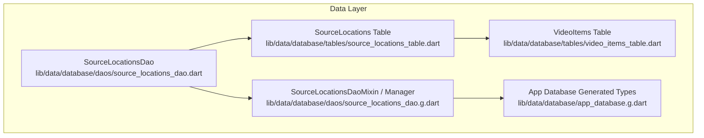
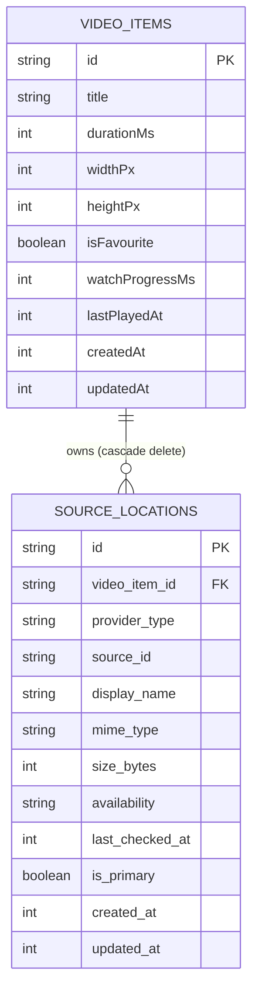
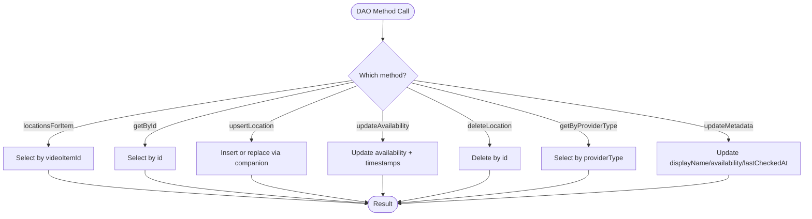
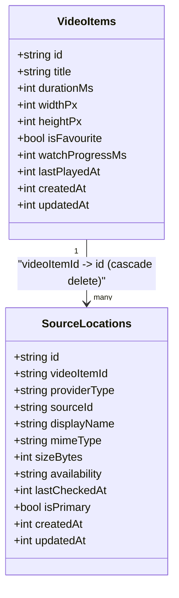
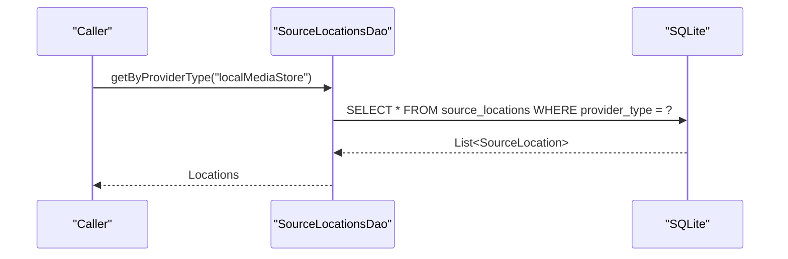
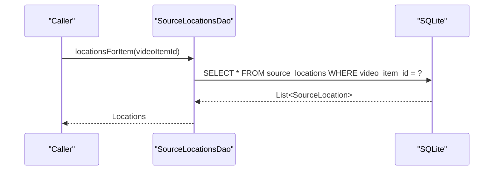
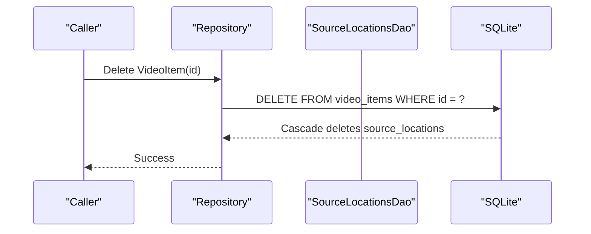
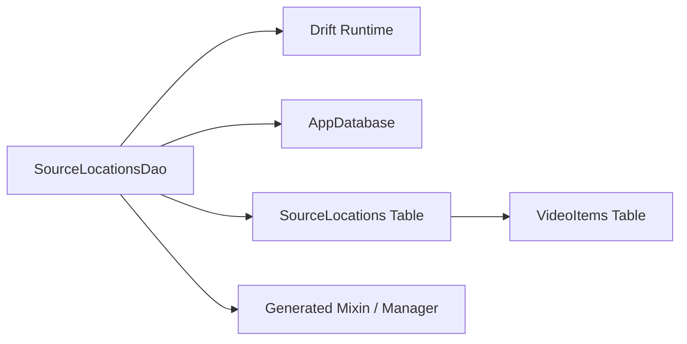

# SourceLocationsDao

<cite>
**Referenced Files in This Document**   
- [source_locations_dao.dart](file://lib/data/database/daos/source_locations_dao.dart)
- [source_locations_dao.g.dart](file://lib/data/database/daos/source_locations_dao.g.dart)
- [source_locations_table.dart](file://lib/data/database/tables/source_locations_table.dart)
- [video_items_table.dart](file://lib/data/database/tables/video_items_table.dart)
- [app_database.g.dart](file://lib/data/database/app_database.g.dart)
- [schema_test.dart](file://test/unit/database/schema_test.dart)
</cite>

## Table of Contents
1. [Introduction](#introduction)
2. [Project Structure](#project-structure)
3. [Core Components](#core-components)
4. [Architecture Overview](#architecture-overview)
5. [Detailed Component Analysis](#detailed-component-analysis)
6. [Dependency Analysis](#dependency-analysis)
7. [Performance Considerations](#performance-considerations)
8. [Troubleshooting Guide](#troubleshooting-guide)
9. [Conclusion](#conclusion)

## Introduction
This document explains the `SourceLocationsDao` class, which is the data-access layer for tracking video source locations and their relationships to logical video items. It covers how the DAO manages insertion, retrieval, updates, and deletion of source location records, how it maps video items to physical or logical sources such as MediaStore URIs, SAF paths, direct URLs, and cloud identifiers, and how foreign key constraints and cascade behavior keep the database consistent. It also provides practical examples for querying by provider type, listing all locations for a video, and cleaning up orphaned or missing source records, along with performance considerations for large-scale video libraries.

## Project Structure
The `SourceLocationsDao` lives under the Drift-based data layer and works with generated Drift types and table definitions:

**Diagram sources**
- [source_locations_dao.dart:8-12](file://lib/data/database/daos/source_locations_dao.dart#L8-L12)
- [source_locations_dao.g.dart:6-22](file://lib/data/database/daos/source_locations_dao.g.dart#L6-L22)
- [source_locations_table.dart:16-66](file://lib/data/database/tables/source_locations_table.dart#L16-L66)
- [video_items_table.dart:11-45](file://lib/data/database/tables/video_items_table.dart#L11-L45)
- [app_database.g.dart:3553-3577](file://lib/data/database/app_database.g.dart#L3553-L3577)

**Section sources**
- [source_locations_dao.dart:1-12](file://lib/data/database/daos/source_locations_dao.dart#L1-L12)
- [source_locations_dao.g.dart:1-22](file://lib/data/database/daos/source_locations_dao.g.dart#L1-L22)
- [source_locations_table.dart:1-66](file://lib/data/database/tables/source_locations_table.dart#L1-L66)
- [video_items_table.dart:1-45](file://lib/data/database/tables/video_items_table.dart#L1-L45)
- [app_database.g.dart:3553-3577](file://lib/data/database/app_database.g.dart#L3553-L3577)

## Core Components
`SourceLocationsDao` is a Drift accessor that exposes typed methods over the `SourceLocations` table. Its responsibilities include:

- Retrieving all source locations for a given video item.
- Fetching a single source location by its stable UUID.
- Inserting or replacing a source location row using an upsert operation.
- Updating availability status and last-checked timestamp.
- Deleting a specific source location.
- Querying all source locations by provider type (e.g., local MediaStore, direct URL, cloud).
- Updating mutable metadata fields like display name, availability, and last-checked timestamp.

Key behaviors:
- The DAO uses Drift’s query builder to construct SQL safely and return strongly-typed `SourceLocation` objects.
- Upsert operations use conflict resolution to avoid duplicate rows when the same identity is inserted again.
- Availability updates are atomic and update both the availability text and timestamps consistently.

**Section sources**
- [source_locations_dao.dart:8-79](file://lib/data/database/daos/source_locations_dao.dart#L8-L79)

## Architecture Overview
At the schema level, `SourceLocations` represents one durable source for a logical video item. A single `VideoItems` row can have multiple `SourceLocations`, such as a local file plus a cloud copy. Exactly one location is marked as primary for playback resolution.

**Diagram sources**
- [video_items_table.dart:11-45](file://lib/data/database/tables/video_items_table.dart#L11-L45)
- [source_locations_table.dart:16-66](file://lib/data/database/tables/source_locations_table.dart#L16-L66)

Foreign key relationship:
- `SourceLocations.videoItemId` references `VideoItems.id`.
- Deletion of a parent `VideoItems` row cascades to child `SourceLocations` rows, ensuring no orphaned source records remain after a video item is removed.

**Section sources**
- [source_locations_table.dart:20-22](file://lib/data/database/tables/source_locations_table.dart#L20-L22)
- [app_database.g.dart:3952-3960](file://lib/data/database/app_database.g.dart#L3952-L3960)

## Detailed Component Analysis

### SourceLocationsDao Methods

#### Retrieval Methods
- `locationsForItem(videoItemId)`
  - Returns all source locations associated with a specific video item.
  - Useful for displaying alternative sources for a video or selecting the primary source.
- `getById(id)`
  - Returns a single source location by its stable UUID, or null if not found.
  - Safe for optional lookups where the caller must handle absence.

#### Mutation Methods
- `upsertLocation(companion)`
  - Inserts or replaces a source location row based on conflict resolution.
  - Ideal for idempotent writes during scans or sync processes.
- `updateAvailability(id, availability, checkedAt)`
  - Updates availability state and last-checked timestamp atomically.
  - Also sets the updated-at timestamp to reflect the change time.
- `deleteLocation(id)`
  - Deletes a specific source location row.
  - Returns the number of affected rows.
- `updateMetadata(id, displayName?, availability?, lastCheckedAt?)`
  - Updates mutable metadata fields without touching unrelated columns.
  - Only non-null arguments are written; `updatedAt` is always refreshed.
  - Intentionally does not write `durationMs`, which belongs to `VideoItems`.

#### Provider-Based Queries
- `getByProviderType(providerType)`
  - Returns all source locations matching a provider type string (e.g., `"localMediaStore"`).
  - Supports scanning and maintenance tasks scoped to a single provider.

**Diagram sources**
- [source_locations_dao.dart:14-79](file://lib/data/database/daos/source_locations_dao.dart#L14-L79)

**Section sources**
- [source_locations_dao.dart:14-79](file://lib/data/database/daos/source_locations_dao.dart#L14-L79)

### Data Model and Relationships

#### SourceLocations Table
- `id`: Stable app-assigned UUID primary key.
- `videoItemId`: Foreign key to `VideoItems.id` with cascade delete.
- `providerType`: Serialized provider enum name (e.g., `"localMediaStore"`).
- `sourceId`: Durable identity within the provider:
  - Local file → absolute path
  - MediaStore → content URI string
  - Direct URL → URL itself
  - Cloud → provider-assigned item ID
- `displayName`: Human-readable label, nullable.
- `mimeType`: MIME type reported by the source, nullable.
- `sizeBytes`: File size in bytes, nullable.
- `availability`: Serialized availability state, default `"unknown"`.
- `lastCheckedAt`: Timestamp of last availability check, nullable.
- `isPrimary`: Whether this location is preferred for playback resolution.
- `createdAt` / `updatedAt`: Wall-clock timestamps.

**Diagram sources**
- [source_locations_table.dart:16-66](file://lib/data/database/tables/source_locations_table.dart#L16-L66)
- [video_items_table.dart:11-45](file://lib/data/database/tables/video_items_table.dart#L11-L45)

**Section sources**
- [source_locations_table.dart:16-66](file://lib/data/database/tables/source_locations_table.dart#L16-L66)
- [video_items_table.dart:11-45](file://lib/data/database/tables/video_items_table.dart#L11-L45)

### Example Workflows

#### Query Videos by Source Type
Use `getByProviderType` to retrieve all source locations for a given provider type. This supports tasks such as:
- Listing all MediaStore-backed videos.
- Scanning direct URLs.
- Checking cloud provider sources.

**Diagram sources**
- [source_locations_dao.dart:45-50](file://lib/data/database/daos/source_locations_dao.dart#L45-L50)

#### Find All Locations for a Video
Use `locationsForItem` to list every source location tied to a video item. This enables:
- Displaying alternate sources.
- Selecting the primary source for playback.
- Validating presence of expected providers.

**Diagram sources**
- [source_locations_dao.dart:14-17](file://lib/data/database/daos/source_locations_dao.dart#L14-L17)

#### Clean Up Orphaned Source Records
Orphaned source records should not exist due to the cascade delete on `videoItemId`. When a `VideoItems` row is deleted, SQLite automatically removes related `SourceLocations` rows. Tests verify this behavior.

**Diagram sources**
- [source_locations_table.dart:20-22](file://lib/data/database/tables/source_locations_table.dart#L20-L22)
- [schema_test.dart:128-146](file://test/unit/database/schema_test.dart#L128-L146)

**Section sources**
- [source_locations_dao.dart:14-50](file://lib/data/database/daos/source_locations_dao.dart#L14-L50)
- [schema_test.dart:108-146](file://test/unit/database/schema_test.dart#L108-L146)

## Dependency Analysis
`SourceLocationsDao` depends on:
- Drift runtime (`package:drift/drift.dart`).
- `AppDatabase` accessor context.
- `SourceLocations` table definition.
- Generated Drift code providing mixins and managers.

**Diagram sources**
- [source_locations_dao.dart:1-12](file://lib/data/database/daos/source_locations_dao.dart#L1-L12)
- [source_locations_dao.g.dart:6-22](file://lib/data/database/daos/source_locations_dao.g.dart#L6-L22)
- [source_locations_table.dart:1-6](file://lib/data/database/tables/source_locations_table.dart#L1-L6)
- [video_items_table.dart:1-4](file://lib/data/database/tables/video_items_table.dart#L1-L4)

Coupling and cohesion:
- The DAO is cohesive around source location CRUD and metadata updates.
- Coupling to `VideoItems` is through the foreign key column and Drift-generated references.
- No circular dependencies are present between DAO and table definitions.

**Section sources**
- [source_locations_dao.dart:1-12](file://lib/data/database/daos/source_locations_dao.dart#L1-L12)
- [source_locations_dao.g.dart:6-22](file://lib/data/database/daos/source_locations_dao.g.dart#L6-L22)
- [source_locations_table.dart:1-6](file://lib/data/database/tables/source_locations_table.dart#L1-L6)
- [video_items_table.dart:1-4](file://lib/data/database/tables/video_items_table.dart#L1-L4)

## Performance Considerations
For large-scale video libraries, consider the following strategies:

- Indexing strategy
  - Add indexes on frequently filtered columns:
    - `videoItemId` for fast per-video lookups.
    - `providerType` for provider-scoped queries.
    - `availability` for maintenance tasks targeting missing or unavailable sources.
    - Composite index `(videoItemId, isPrimary)` to quickly resolve the preferred source per video.
  - These indexes reduce full-table scans and improve query performance for common access patterns.

- Query design
  - Prefer targeted queries:
    - Use `locationsForItem` instead of loading all source locations when only one video’s sources are needed.
    - Use `getByProviderType` for batch operations scoped to a provider.
  - Avoid unnecessary joins unless you need to enrich results with `VideoItems` metadata.

- Batch operations
  - Use upserts for idempotent inserts during scans to minimize redundant writes.
  - Group availability updates into transactions where possible to reduce commit overhead.

- Concurrency
  - Ensure callers serialize heavy scan/maintenance operations to avoid contention on hot tables.
  - Use read-only queries where feasible to reduce lock contention.

- Monitoring
  - Track slow queries and adjust indexes based on actual usage patterns.
  - Monitor the growth of `source_locations` relative to `video_items` to ensure normalization remains efficient.

[No sources needed since this section provides general guidance]

## Troubleshooting Guide
Common issues and resolutions:

- Missing source location lookup returns null
  - Cause: The requested `id` does not exist.
  - Resolution: Verify the UUID passed to `getById`; ensure the record was inserted or upserted successfully.

- Availability not updating
  - Cause: Incorrect `id` or transactional rollback.
  - Resolution: Confirm the `id` exists; wrap updates in a transaction if multiple fields are changed together.

- Orphaned source records after video deletion
  - Cause: Expectation that manual cleanup is required.
  - Resolution: Rely on cascade delete; tests confirm that deleting a `VideoItems` row removes related `SourceLocations`.

- Metadata not applied
  - Cause: Passing unsupported fields (e.g., `durationMs`) to `updateMetadata`.
  - Resolution: Only pass fields defined on `SourceLocations`; `durationMs` belongs to `VideoItems`.

- Duplicate source locations
  - Cause: Multiple inserts without conflict handling.
  - Resolution: Use `upsertLocation` to make inserts idempotent.

**Section sources**
- [source_locations_dao.dart:19-43](file://lib/data/database/daos/source_locations_dao.dart#L19-L43)
- [source_locations_dao.dart:52-79](file://lib/data/database/daos/source_locations_dao.dart#L52-L79)
- [schema_test.dart:128-146](file://test/unit/database/schema_test.dart#L128-L146)

## Conclusion
`SourceLocationsDao` provides a focused, typed interface for managing video source locations and their relationships to logical video items. It supports robust CRUD operations, provider-based queries, and metadata updates while relying on Drift’s generated types and SQLite’s foreign key constraints for consistency. For large libraries, proper indexing and query design are essential to maintain performance. The cascade delete ensures referential integrity, eliminating orphaned source records when parent video items are removed.

[No sources needed since this section summarizes without analyzing specific files]