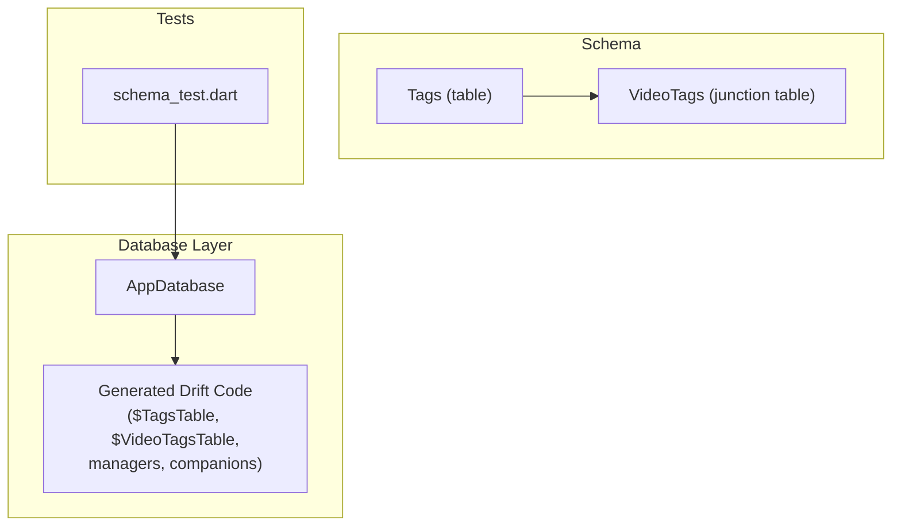
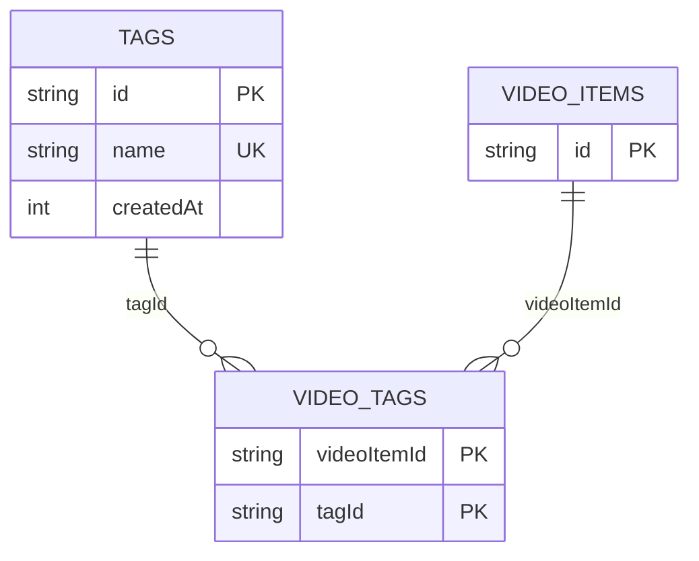
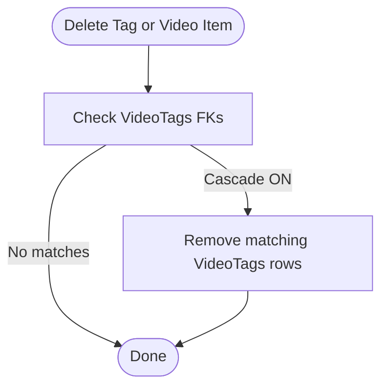
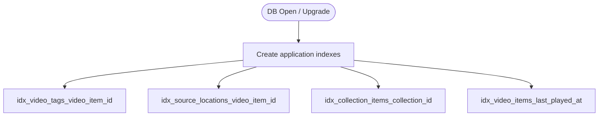
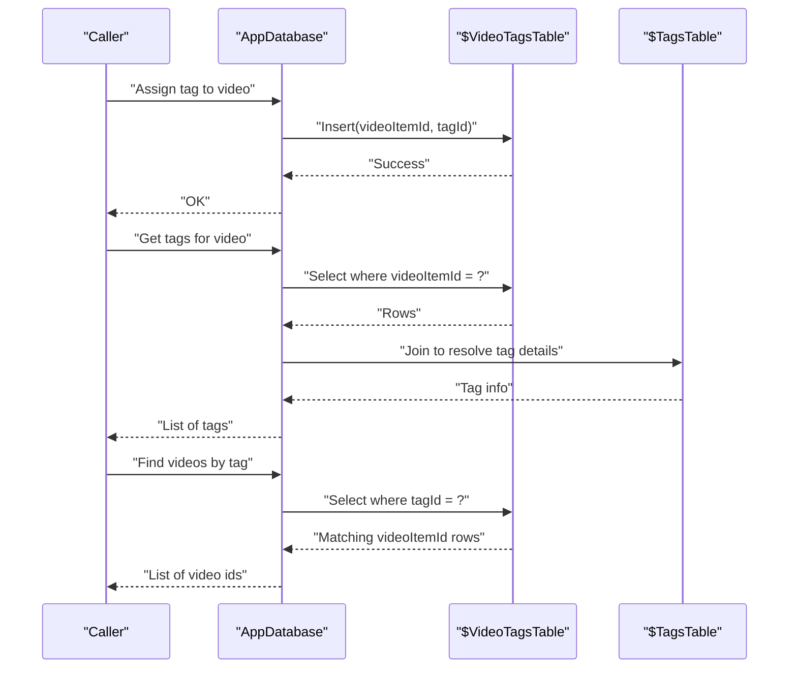
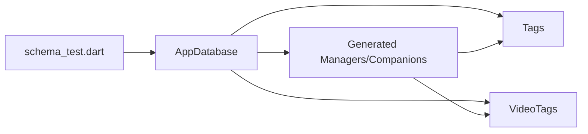

# TagsDao

<cite>
**Referenced Files in This Document**
- [app_database.dart](file://lib/data/database/app_database.dart)
- [tags_table.dart](file://lib/data/database/tables/tags_table.dart)
- [video_tags_table.dart](file://lib/data/database/tables/video_tags_table.dart)
- [app_database.g.dart](file://lib/data/database/app_database.g.dart)
- [schema_test.dart](file://test/unit/database/schema_test.dart)
</cite>

## Table of Contents
1. [Introduction](#introduction)
2. [Project Structure](#project-structure)
3. [Core Components](#core-components)
4. [Architecture Overview](#architecture-overview)
5. [Detailed Component Analysis](#detailed-component-analysis)
6. [Dependency Analysis](#dependency-analysis)
7. [Performance Considerations](#performance-considerations)
8. [Troubleshooting Guide](#troubleshooting-guide)
9. [Conclusion](#conclusion)

## Introduction
This document provides detailed documentation for the tagging subsystem that manages video tags and their many-to-many relationship with video items. It explains the database schema, cascade deletion behavior, indexing strategy, and how to perform tag CRUD operations and manage associations between videos and tags. Where a dedicated TagsDao is not present, this guide shows how to implement and use the required operations using the existing Drift-generated data access layer.

## Project Structure
The tagging feature spans three primary layers:
- Schema definitions for tags and the junction table
- Database configuration and migration/index setup
- Generated Drift code providing typed accessors and managers



**Diagram sources**
- [tags_table.dart:1-23](file://lib/data/database/tables/tags_table.dart#L1-L23)
- [video_tags_table.dart:1-24](file://lib/data/database/tables/video_tags_table.dart#L1-L24)
- [app_database.dart:25-36](file://lib/data/database/app_database.dart#L25-L36)
- [app_database.g.dart:1421-1462](file://lib/data/database/app_database.g.dart#L1421-L1462)
- [app_database.g.dart:1681-1719](file://lib/data/database/app_database.g.dart#L1681-L1719)
- [schema_test.dart:183-206](file://test/unit/database/schema_test.dart#L183-L206)

**Section sources**
- [app_database.dart:25-36](file://lib/data/database/app_database.dart#L25-L36)
- [tags_table.dart:1-23](file://lib/data/database/tables/tags_table.dart#L1-L23)
- [video_tags_table.dart:1-24](file://lib/data/database/tables/video_tags_table.dart#L1-L24)

## Core Components
- Tags table: stores unique tag labels and metadata.
- VideoTags junction table: links video items to tags with cascade deletes on both sides.
- AppDatabase: registers tables, enables foreign keys, creates indexes, and exposes generated managers/companions for typed queries.

Key responsibilities:
- Tag creation, retrieval, listing, and deletion
- Managing many-to-many relationships via VideoTags
- Efficient querying through indexes and cascade constraints

**Section sources**
- [tags_table.dart:1-23](file://lib/data/database/tables/tags_table.dart#L1-L23)
- [video_tags_table.dart:1-24](file://lib/data/database/tables/video_tags_table.dart#L1-L24)
- [app_database.dart:43-99](file://lib/data/database/app_database.dart#L43-L99)

## Architecture Overview
The tagging architecture uses Drift’s generated data access layer. While there is no explicit TagsDao class in the repository, all tag operations are performed through the generated tables and managers exposed by AppDatabase.

```mermaid
classDiagram
class AppDatabase {
+schemaVersion
+migration
-_createIndexes()
}
class Tags {
+id
+name
+createdAt
}
class VideoTags {
+videoItemId
+tagId
}
class $TagsTable {
+id
+name
+createdAt
}
class $VideoTagsTable {
+videoItemId
+tagId
}
AppDatabase --> Tags : "declares"
AppDatabase --> VideoTags : "declares"
AppDatabase --> $TagsTable : "generates"
AppDatabase --> $VideoTagsTable : "generates"
VideoTags --> Tags : "FK tagId"
VideoTags --> VideoItems : "FK videoItemId"
```

**Diagram sources**
- [app_database.dart:25-36](file://lib/data/database/app_database.dart#L25-L36)
- [tags_table.dart:1-23](file://lib/data/database/tables/tags_table.dart#L1-L23)
- [video_tags_table.dart:1-24](file://lib/data/database/tables/video_tags_table.dart#L1-L24)
- [app_database.g.dart:1421-1462](file://lib/data/database/app_database.g.dart#L1421-L1462)
- [app_database.g.dart:1681-1719](file://lib/data/database/app_database.g.dart#L1681-L1719)

## Detailed Component Analysis

### Database Schema Design
- Tags
  - id: stable UUID primary key
  - name: unique tag label
  - createdAt: insertion timestamp
- VideoTags
  - videoItemId: FK to VideoItems.id with cascade delete
  - tagId: FK to Tags.id with cascade delete
  - Composite primary key: (videoItemId, tagId)



**Diagram sources**
- [tags_table.dart:1-23](file://lib/data/database/tables/tags_table.dart#L1-L23)
- [video_tags_table.dart:1-24](file://lib/data/database/tables/video_tags_table.dart#L1-L24)

**Section sources**
- [tags_table.dart:1-23](file://lib/data/database/tables/tags_table.dart#L1-L23)
- [video_tags_table.dart:1-24](file://lib/data/database/tables/video_tags_table.dart#L1-L24)

### Cascade Deletion Behavior
Both foreign keys in VideoTags are configured with cascade delete. Removing a tag or a video item automatically removes related join rows.



**Diagram sources**
- [video_tags_table.dart:12-22](file://lib/data/database/tables/video_tags_table.dart#L12-L22)
- [app_database.g.dart:1691-1711](file://lib/data/database/app_database.g.dart#L1691-L1711)

**Section sources**
- [video_tags_table.dart:12-22](file://lib/data/database/tables/video_tags_table.dart#L12-L22)
- [schema_test.dart:197-206](file://test/unit/database/schema_test.dart#L197-L206)

### Indexing Strategy
Indexes are created to optimize common joins and lookups:
- idx_video_tags_video_item_id: speeds up retrieving tags per video
- Other indexes support source locations, collections, and recent playback queries



**Diagram sources**
- [app_database.dart:78-99](file://lib/data/database/app_database.dart#L78-L99)

**Section sources**
- [app_database.dart:78-99](file://lib/data/database/app_database.dart#L78-L99)

### Tag CRUD Operations
Although there is no explicit TagsDao, you can perform tag operations using the generated Drift accessors from AppDatabase.

- createTag(): Insert a new tag into the Tags table.
  - Use the generated companion for Tags to insert id, name, createdAt.
  - Ensure name uniqueness; duplicates will be rejected by the UNIQUE constraint.

- getTagById(id): Retrieve a single tag by its id.
  - Query the generated $TagsTable manager filtered by id.

- getAllTags(): List all tags.
  - Select all rows from $TagsTable.

- deleteTag(id): Delete a tag by id.
  - Delete from $TagsTable where id equals the target id.
  - Related VideoTags rows are removed automatically due to cascade.

Example usage patterns (conceptual):
- Add a tag: insert a row into Tags with a unique id and normalized name.
- Get a tag: query Tags by id.
- List tags: select all from Tags.
- Remove a tag: delete from Tags by id; cascade cleans VideoTags.

**Section sources**
- [app_database.g.dart:1421-1462](file://lib/data/database/app_database.g.dart#L1421-L1462)
- [app_database.g.dart:1604-1679](file://lib/data/database/app_database.g.dart#L1604-L1679)

### Many-to-Many Relationship Management (Video ↔ Tag)
Use the VideoTags junction table to associate tags with videos.

- Assign a tag to a video:
  - Insert a row into VideoTags with videoItemId and tagId.
  - Both columns are FKs; referential integrity ensures valid references.

- Remove a tag from a video:
  - Delete the specific VideoTags row by videoItemId and tagId.

- Bulk assign/remove:
  - Batch insert multiple VideoTags rows for bulk assignment.
  - Delete multiple VideoTags rows for bulk removal.

- Find videos by tag:
  - Join VideoTags with VideoItems on videoItemId and filter by tagId.
  - The index on video_tags.video_item_id helps performance.

- Retrieve all tags for a video:
  - Select VideoTags rows where videoItemId equals the target id.
  - Optionally join with Tags to fetch tag names.



**Diagram sources**
- [app_database.g.dart:1681-1719](file://lib/data/database/app_database.g.dart#L1681-L1719)
- [app_database.g.dart:4460-4495](file://lib/data/database/app_database.g.dart#L4460-L4495)

**Section sources**
- [video_tags_table.dart:12-22](file://lib/data/database/tables/video_tags_table.dart#L12-L22)
- [app_database.g.dart:1681-1719](file://lib/data/database/app_database.g.dart#L1681-L1719)
- [app_database.g.dart:4460-4495](file://lib/data/database/app_database.g.dart#L4460-L4495)

### Tag Search Capabilities
- By id: direct lookup on Tags.id.
- By name: exact match on Tags.name (UNIQUE).
- Partial search: apply LIKE filters on Tags.name if needed.
- Videos by tag: filter VideoTags.tagId and join to VideoItems.

Note: For efficient partial searches, consider adding additional indexes on Tags.name if frequent prefix searches are required.

**Section sources**
- [tags_table.dart:13-15](file://lib/data/database/tables/tags_table.dart#L13-L15)
- [app_database.g.dart:1421-1462](file://lib/data/database/app_database.g.dart#L1421-L1462)

## Dependency Analysis
- AppDatabase declares and wires together Tags and VideoTags tables.
- Generated Drift code provides typed tables ($TagsTable, $VideoTagsTable), companions, and managers used to execute queries.
- Tests validate the many-to-many linkage and cascade behavior.



**Diagram sources**
- [app_database.dart:25-36](file://lib/data/database/app_database.dart#L25-L36)
- [app_database.g.dart:1421-1462](file://lib/data/database/app_database.g.dart#L1421-L1462)
- [app_database.g.dart:1681-1719](file://lib/data/database/app_database.g.dart#L1681-L1719)
- [schema_test.dart:183-206](file://test/unit/database/schema_test.dart#L183-L206)

**Section sources**
- [app_database.dart:25-36](file://lib/data/database/app_database.dart#L25-L36)
- [schema_test.dart:183-206](file://test/unit/database/schema_test.dart#L183-L206)

## Performance Considerations
- Use the existing index on video_tags.video_item_id for fast tag retrieval per video.
- Prefer batch inserts for bulk tag assignments to reduce transaction overhead.
- Keep tag names normalized (lowercased, trimmed) to avoid duplicate entries and improve search consistency.
- If frequent partial tag name searches are introduced, add an index on Tags.name to speed up LIKE queries.

[No sources needed since this section provides general guidance]

## Troubleshooting Guide
- Unique constraint violations on Tags.name:
  - Cause: attempting to insert duplicate tag names.
  - Resolution: normalize input and check existence before insert, or handle the error gracefully.

- Foreign key constraint failures on VideoTags:
  - Cause: referencing non-existent videoItemId or tagId.
  - Resolution: ensure referenced entities exist before inserting into VideoTags.

- Unexpected empty results when deleting tags:
  - Expected behavior: cascade deletes remove related VideoTags rows.
  - Verify cascade configuration and test coverage.

**Section sources**
- [tags_table.dart:13-15](file://lib/data/database/tables/tags_table.dart#L13-L15)
- [video_tags_table.dart:12-22](file://lib/data/database/tables/video_tags_table.dart#L12-L22)
- [schema_test.dart:197-206](file://test/unit/database/schema_test.dart#L197-L206)

## Conclusion
The tagging subsystem is implemented using Drift’s generated data access layer rather than a custom TagsDao. The schema defines a robust many-to-many relationship between videos and tags with cascade deletion and targeted indexing for performance. All tag CRUD operations and association management can be performed through the generated tables and managers exposed by AppDatabase, ensuring type safety and maintainability.

[No sources needed since this section summarizes without analyzing specific files]