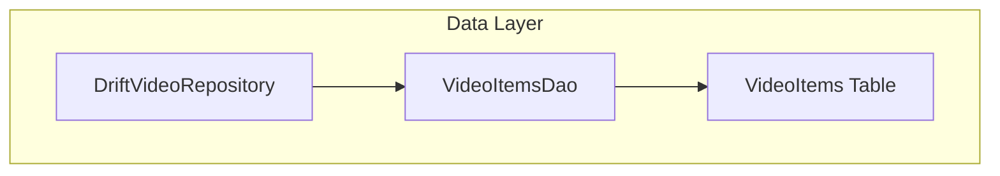
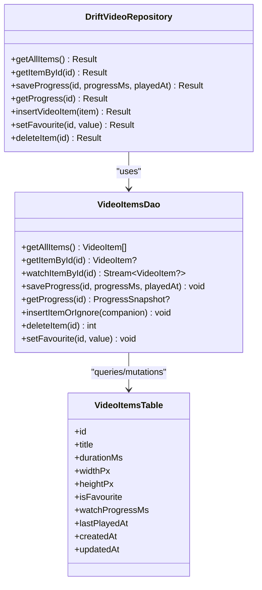
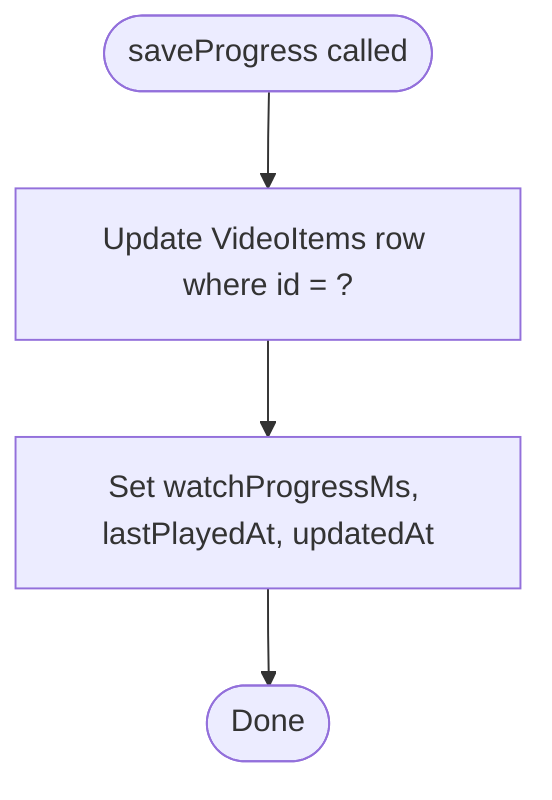
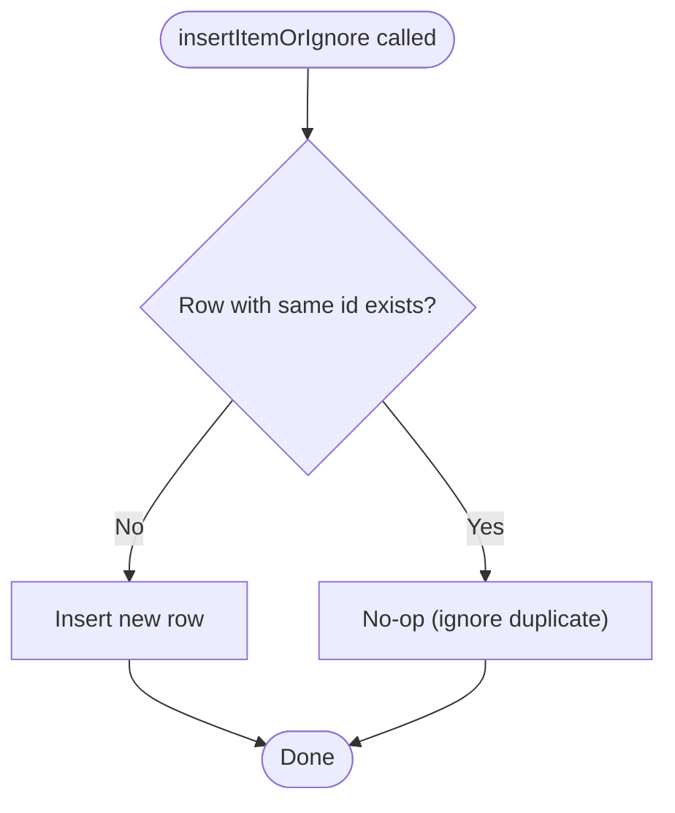
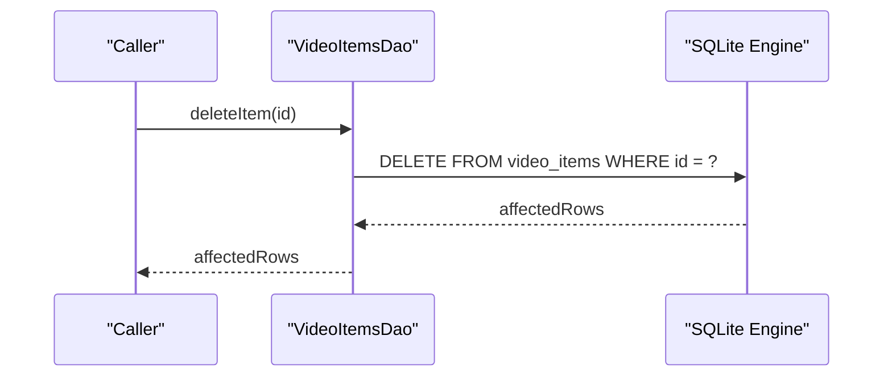
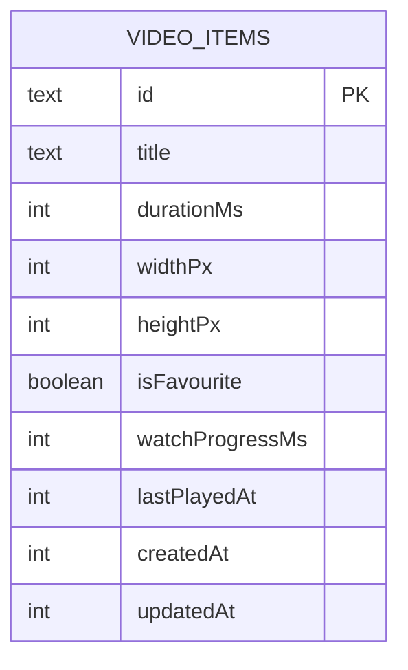
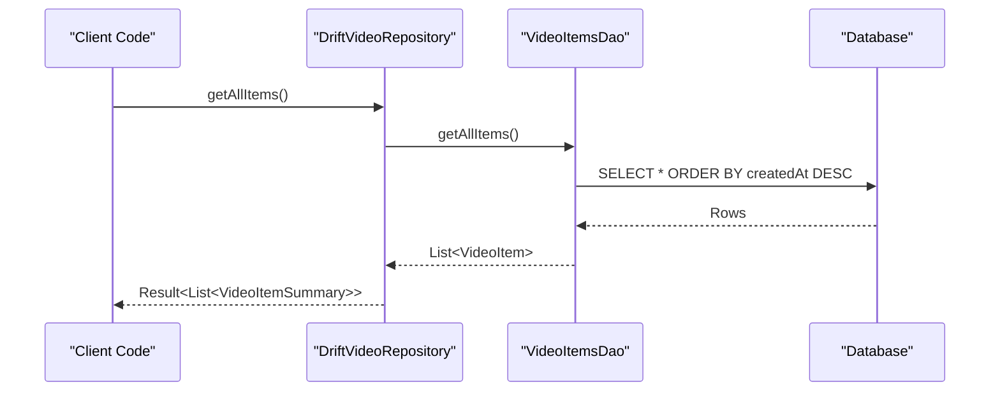
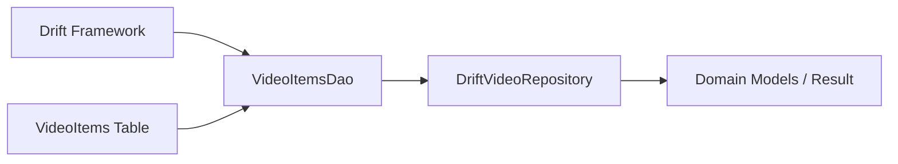

# VideoItemsDao

<cite>
**Referenced Files in This Document**
- [video_items_dao.dart](file://lib/data/database/daos/video_items_dao.dart)
- [video_items_table.dart](file://lib/data/database/tables/video_items_table.dart)
- [drift_video_repository.dart](file://lib/data/repositories/drift_video_repository.dart)
- [watch_progress_test.dart](file://test/unit/database/watch_progress_test.dart)
- [drift_video_repository_test.dart](file://test/unit/database/drift_video_repository_test.dart)
- [app_database.g.dart](file://lib/data/database/app_database.g.dart)
</cite>

## Table of Contents
1. [Introduction](#introduction)
2. [Project Structure](#project-structure)
3. [Core Components](#core-components)
4. [Architecture Overview](#architecture-overview)
5. [Detailed Component Analysis](#detailed-component-analysis)
6. [Dependency Analysis](#dependency-analysis)
7. [Performance Considerations](#performance-considerations)
8. [Troubleshooting Guide](#troubleshooting-guide)
9. [Conclusion](#conclusion)

## Introduction
VideoItemsDao is the primary data access object for video metadata and watch progress tracking. It encapsulates all read, write, and reactive stream operations against the VideoItems table and exposes a focused API used by DriftVideoRepository. Its responsibilities include:
- Listing and retrieving video items
- Tracking user watch progress (position and last-played timestamp)
- Managing favourite flags
- Performing safe insert-or-ignore semantics to preserve user-owned fields
- Deleting video items with cascade propagation to related tables

The DAO is designed around Drift’s typed queries, companions, and stream-based updates so that UI layers can react to changes without polling.

## Project Structure
VideoItemsDao lives under the data layer’s database access objects and works with the VideoItems table schema. DriftVideoRepository consumes VideoItemsDao through dependency injection. Tests validate both DAO behavior and repository integration.

**Diagram sources**
- [drift_video_repository.dart:17-23](file://lib/data/repositories/drift_video_repository.dart#L17-L23)
- [video_items_dao.dart:12-15](file://lib/data/database/daos/video_items_dao.dart#L12-L15)
- [video_items_table.dart:11-45](file://lib/data/database/tables/video_items_table.dart#L11-L45)

**Section sources**
- [video_items_dao.dart:1-79](file://lib/data/database/daos/video_items_dao.dart#L1-L79)
- [video_items_table.dart:1-46](file://lib/data/database/tables/video_items_table.dart#L1-L46)
- [drift_video_repository.dart:1-319](file://lib/data/repositories/drift_video_repository.dart#L1-L319)

## Core Components
- VideoItemsDao: Drift accessor providing query, mutation, and stream APIs for VideoItems.
- VideoItems table: Schema defining video metadata, favourite flag, watch progress, and timestamps.
- DriftVideoRepository: Repository layer wrapping DAO calls with Result-based error handling and domain model mapping.

Key responsibilities:
- getAllItems(): ordered listing of videos
- getItemById(id): single-item lookup
- watchItemById(id): reactive stream for a single item
- saveProgress(id, progressMs, playedAt): persist playback position and last-played time
- getProgress(id): read progress snapshot
- insertItemOrIgnore(companion): idempotent insert preserving user-owned fields
- deleteItem(id): remove item and cascade children
- setFavourite(id, value): toggle favourite flag

**Section sources**
- [video_items_dao.dart:17-77](file://lib/data/database/daos/video_items_dao.dart#L17-L77)
- [video_items_table.dart:11-45](file://lib/data/database/tables/video_items_table.dart#L11-L45)
- [drift_video_repository.dart:34-145](file://lib/data/repositories/drift_video_repository.dart#L34-L145)

## Architecture Overview
VideoItemsDao is a Drift @DriftAccessor over the VideoItems table. Drift generates a mixin and manager classes to expose table accessors and managers. The repository composes VideoItemsDao and SourceLocationsDao, translating DAO rows into domain models and wrapping exceptions in Result types.

**Diagram sources**
- [video_items_dao.dart:12-77](file://lib/data/database/daos/video_items_dao.dart#L12-L77)
- [video_items_table.dart:11-45](file://lib/data/database/tables/video_items_table.dart#L11-L45)
- [drift_video_repository.dart:17-145](file://lib/data/repositories/drift_video_repository.dart#L17-L145)

## Detailed Component Analysis

### VideoItemsDao Methods

#### getAllItems()
- Purpose: Return all video items ordered by most-recently-added first.
- Query pattern: Select all rows from VideoItems and order by createdAt descending.
- Complexity: O(n) scan with ordering; typical library sizes are small enough for this approach.
- Usage example: DriftVideoRepository.getAllItems maps DAO rows to domain summaries.

**Section sources**
- [video_items_dao.dart:19-22](file://lib/data/database/daos/video_items_dao.dart#L19-L22)
- [drift_video_repository.dart:34-44](file://lib/data/repositories/drift_video_repository.dart#L34-L44)

#### getItemById(String id)
- Purpose: Retrieve a single video item by its stable id; returns null if not found.
- Query pattern: Filter by id and use getSingleOrNull.
- Error handling: Repository converts null to NotFoundError.

**Section sources**
- [video_items_dao.dart:24-26](file://lib/data/database/daos/video_items_dao.dart#L24-L26)
- [drift_video_repository.dart:46-64](file://lib/data/repositories/drift_video_repository.dart#L46-L64)

#### watchItemById(String id)
- Purpose: Provide a reactive stream of a single video item row.
- Pattern: Uses watchSingleOrNull on a filtered select.
- Use case: UI can subscribe to observe changes to title, favourite flag, or progress without polling.

**Section sources**
- [video_items_dao.dart:28-30](file://lib/data/database/daos/video_items_dao.dart#L28-L30)

#### saveProgress({id, progressMs, playedAt})
- Purpose: Persist watch progress and last-played timestamp for a video.
- Behavior: Updates watchProgressMs, lastPlayedAt, and updatedAt to the same playedAt timestamp.
- Effect: Ensures recency-aware ordering reflects recent plays.

**Diagram sources**
- [video_items_dao.dart:34-48](file://lib/data/database/daos/video_items_dao.dart#L34-L48)

**Section sources**
- [video_items_dao.dart:34-48](file://lib/data/database/daos/video_items_dao.dart#L34-L48)
- [watch_progress_test.dart:45-89](file://test/unit/database/watch_progress_test.dart#L45-L89)

#### getProgress(String id)
- Purpose: Read current progress snapshot for a video.
- Returns: A record containing progressMs and lastPlayedAt, or null if the item does not exist.
- Implementation: Delegates to getItemById and projects relevant fields.

**Section sources**
- [video_items_dao.dart:50-56](file://lib/data/database/daos/video_items_dao.dart#L50-L56)
- [watch_progress_test.dart:32-43](file://test/unit/database/watch_progress_test.dart#L32-L43)

#### insertItemOrIgnore(VideoItemsCompanion companion)
- Purpose: Insert a new video item row; if a row with the same id already exists, do nothing.
- Strategy: Uses InsertMode.insertOrIgnore to avoid overwriting existing rows.
- Preservation: User-owned fields such as title, isFavourite, watchProgressMs, and lastPlayedAt are preserved because duplicates are ignored rather than updated.

**Diagram sources**
- [video_items_dao.dart:60-64](file://lib/data/database/daos/video_items_dao.dart#L60-L64)

**Section sources**
- [video_items_dao.dart:60-64](file://lib/data/database/daos/video_items_dao.dart#L60-L64)
- [drift_video_repository_test.dart:147-188](file://test/unit/database/drift_video_repository_test.dart#L147-L188)

#### deleteItem(String id)
- Purpose: Delete the video item by id.
- Cascade rules: Related rows in SourceLocations, VideoTags, and CollectionItems are automatically removed when foreign_keys = ON.
- Return: Number of affected rows.

**Diagram sources**
- [video_items_dao.dart:66-71](file://lib/data/database/daos/video_items_dao.dart#L66-L71)

**Section sources**
- [video_items_dao.dart:66-71](file://lib/data/database/daos/video_items_dao.dart#L66-L71)
- [app_database.g.dart:2876-2912](file://lib/data/database/app_database.g.dart#L2876-L2912)

#### setFavourite({id, value})
- Purpose: Toggle the favourite flag for a video.
- Behavior: Updates only isFavourite for the matching id.

**Section sources**
- [video_items_dao.dart:73-77](file://lib/data/database/daos/video_items_dao.dart#L73-L77)
- [watch_progress_test.dart:91-100](file://test/unit/database/watch_progress_test.dart#L91-L100)

### VideoItems Table Schema
The VideoItems table defines the canonical record for a logical video item. Key columns:
- id: Primary key, app-assigned UUID
- title: User-facing title
- durationMs, widthPx, heightPx: Optional media dimensions
- isFavourite: Boolean default false
- watchProgressMs: Playback position in milliseconds
- lastPlayedAt: Last play timestamp (nullable)
- createdAt, updatedAt: Timestamps for insertion and last update

**Diagram sources**
- [video_items_table.dart:11-45](file://lib/data/database/tables/video_items_table.dart#L11-L45)

**Section sources**
- [video_items_table.dart:1-46](file://lib/data/database/tables/video_items_table.dart#L1-L46)

### Relationship with DriftVideoRepository
DriftVideoRepository wraps DAO calls with Result-based error handling and maps DAO rows to domain models. Examples:
- getAllItems: Calls DAO, maps rows to summaries, catches unexpected errors.
- getItemById: Converts null to NotFoundError, otherwise maps to summary.
- saveProgress/getProgress: Forwards parameters and wraps results.
- insertVideoItem: Builds VideoItemsCompanion and uses insertItemOrIgnore.
- setFavourite/deleteItem: Forward DAO mutations with error wrapping.

**Diagram sources**
- [drift_video_repository.dart:34-44](file://lib/data/repositories/drift_video_repository.dart#L34-L44)
- [video_items_dao.dart:19-22](file://lib/data/database/daos/video_items_dao.dart#L19-L22)

**Section sources**
- [drift_video_repository.dart:34-145](file://lib/data/repositories/drift_video_repository.dart#L34-L145)

### Watch Progress Persistence
Watch progress persistence tracks user viewing habits by storing:
- watchProgressMs: Current playback position
- lastPlayedAt: Wall-clock timestamp of last play
- updatedAt: Updated to reflect recent activity, influencing recency ordering

Tests verify:
- Null result for unknown ids
- Zero progress and null lastPlayedAt for never-played items
- Overwrite behavior on repeated saves
- Bumping updatedAt on saveProgress

**Section sources**
- [video_items_dao.dart:34-56](file://lib/data/database/daos/video_items_dao.dart#L34-L56)
- [watch_progress_test.dart:32-89](file://test/unit/database/watch_progress_test.dart#L32-L89)

### CRUD Operations and Query Patterns
- Create: insertItemOrIgnore ensures idempotency and preserves user-owned fields.
- Read: getAllItems and getItemById provide list and single-item reads.
- Update: saveProgress and setFavourite perform targeted updates.
- Delete: deleteItem removes rows and cascades to related tables.

Reactive updates:
- watchItemById provides a stream for real-time UI updates when a specific item changes.

**Section sources**
- [video_items_dao.dart:19-77](file://lib/data/database/daos/video_items_dao.dart#L19-L77)
- [drift_video_repository.dart:34-145](file://lib/data/repositories/drift_video_repository.dart#L34-L145)

### Cascade Deletion Rules
Deleting a VideoItems row triggers cascade deletion to:
- SourceLocations
- VideoTags
- CollectionItems

This is enforced via foreign keys and reflected in Drift’s stream update rules.

**Section sources**
- [video_items_dao.dart:66-71](file://lib/data/database/daos/video_items_dao.dart#L66-L71)
- [app_database.g.dart:2876-2912](file://lib/data/database/app_database.g.dart#L2876-L2912)

## Dependency Analysis
VideoItemsDao depends on:
- Drift framework for typed queries and companions
- AppDatabase accessor context
- VideoItems table definition

DriftVideoRepository depends on:
- VideoItemsDao for video metadata operations
- SourceLocationsDao for source location operations
- Domain models and Result type for error handling

**Diagram sources**
- [video_items_dao.dart:1-6](file://lib/data/database/daos/video_items_dao.dart#L1-L6)
- [drift_video_repository.dart:1-9](file://lib/data/repositories/drift_video_repository.dart#L1-L9)

**Section sources**
- [video_items_dao.dart:1-79](file://lib/data/database/daos/video_items_dao.dart#L1-L79)
- [drift_video_repository.dart:1-319](file://lib/data/repositories/drift_video_repository.dart#L1-L319)

## Performance Considerations
- getAllItems orders by createdAt descending; suitable for moderate library sizes.
- saveProgress performs a targeted update on a single row; efficient for frequent progress writes.
- watchItemById leverages Drift streams to avoid polling; reduces overhead compared to periodic queries.
- insertItemOrIgnore avoids unnecessary updates by ignoring duplicates; beneficial during index merges or resyncs.

[No sources needed since this section provides general guidance]

## Troubleshooting Guide
Common issues and patterns:
- Missing item: getItemById returns null; repository surfaces NotFoundError.
- Unexpected database errors: Repository wraps exceptions in UnexpectedError with diagnostic messages.
- Duplicate inserts: insertItemOrIgnore ignores duplicates; ensure upstream logic does not rely on insert returning an error for conflicts.
- Cascade deletes: Deleting a video removes related rows; verify application logic handles missing references gracefully.

**Section sources**
- [drift_video_repository.dart:34-145](file://lib/data/repositories/drift_video_repository.dart#L34-L145)
- [drift_video_repository_test.dart:86-89](file://test/unit/database/drift_video_repository_test.dart#L86-L89)
- [drift_video_repository_test.dart:139-143](file://test/unit/database/drift_video_repository_test.dart#L139-L143)

## Conclusion
VideoItemsDao provides a clean, typed interface for managing video metadata and watch progress. It integrates seamlessly with DriftVideoRepository, which adds Result-based error handling and domain model mapping. The DAO’s design emphasizes:
- Reactive updates via streams
- Idempotent inserts preserving user-owned fields
- Robust watch progress persistence
- Safe cascade deletions

These characteristics make it well-suited for building responsive video libraries with reliable state management.

[No sources needed since this section summarizes without analyzing specific files]