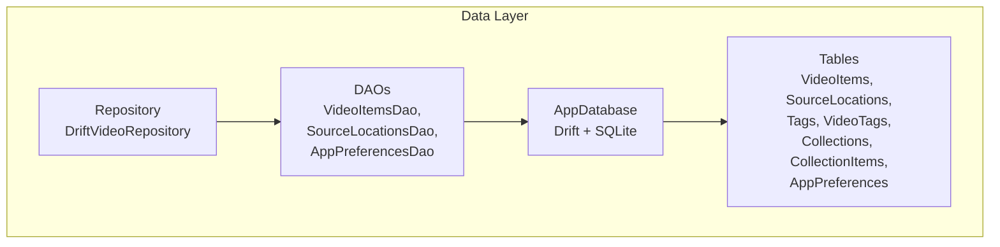
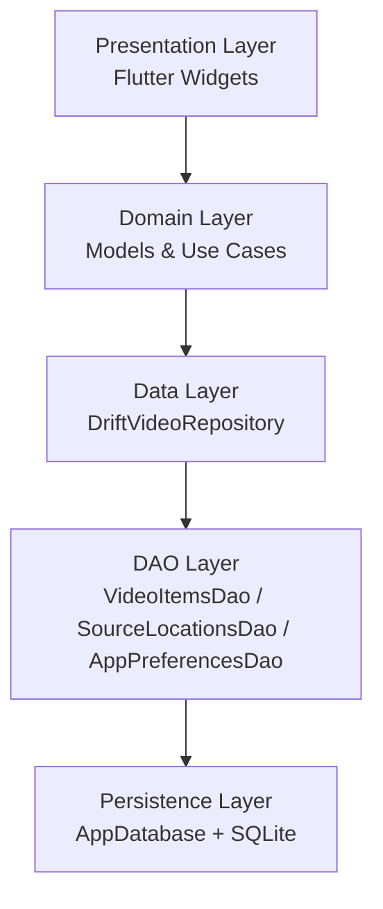
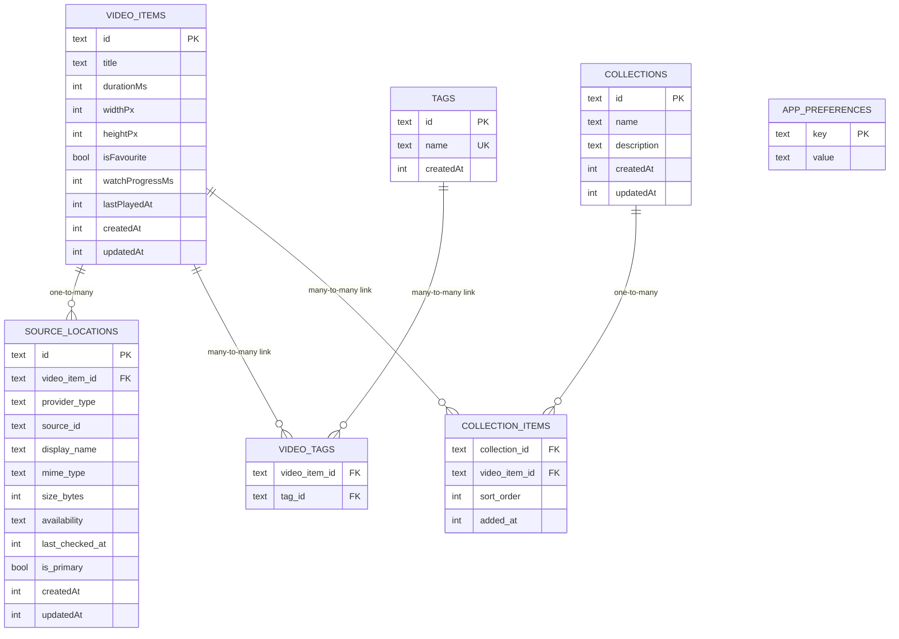
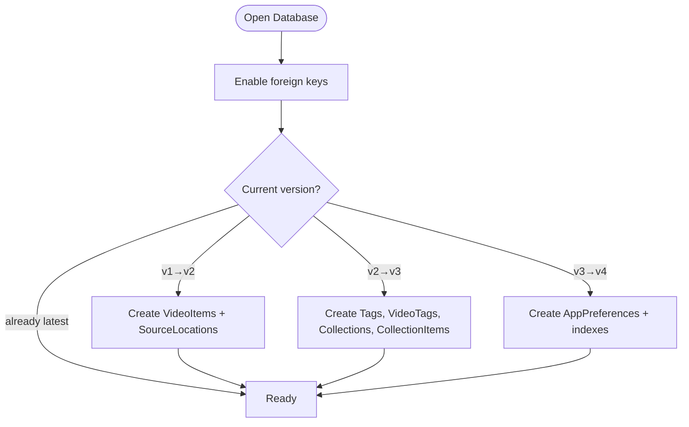
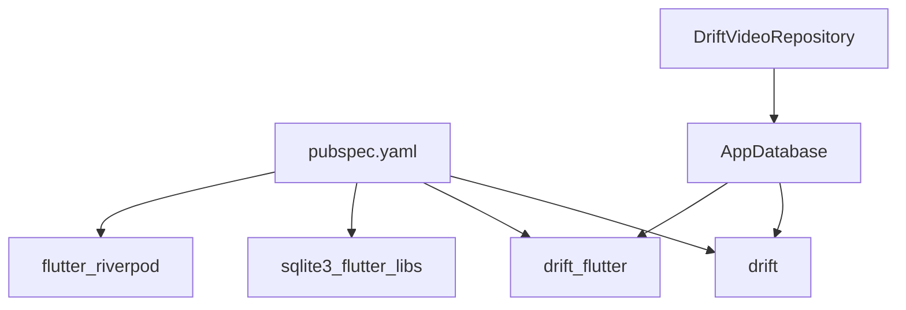

# Data Layer

<cite>
**Referenced Files in This Document**
- [pubspec.yaml](file://pubspec.yaml)
- [ARCHITECTURE.md](file://ARCHITECTURE.md)
- [app_database.dart](file://lib/data/database/app_database.dart)
- [database_provider.dart](file://lib/data/database/database_provider.dart)
- [video_items_table.dart](file://lib/data/database/tables/video_items_table.dart)
- [source_locations_table.dart](file://lib/data/database/tables/source_locations_table.dart)
- [tags_table.dart](file://lib/data/database/tables/tags_table.dart)
- [video_tags_table.dart](file://lib/data/database/tables/video_tags_table.dart)
- [collections_table.dart](file://lib/data/database/tables/collections_table.dart)
- [collection_items_table.dart](file://lib/data/database/tables/collection_items_table.dart)
- [app_preferences_table.dart](file://lib/data/database/tables/app_preferences_table.dart)
- [drift_video_repository.dart](file://lib/data/repositories/drift_video_repository.dart)
</cite>

## Table of Contents
1. [Introduction](#introduction)
2. [Project Structure](#project-structure)
3. [Core Components](#core-components)
4. [Architecture Overview](#architecture-overview)
5. [Detailed Component Analysis](#detailed-component-analysis)
6. [Dependency Analysis](#dependency-analysis)
7. [Performance Considerations](#performance-considerations)
8. [Troubleshooting Guide](#troubleshooting-guide)
9. [Conclusion](#conclusion)

## Introduction
This document explains the data layer architecture for a local-first video library application. The persistence layer uses Drift with SQLite to store logical video items, their physical source locations, tags, collections, and typed app preferences. It documents the schema design, DAO-based type-safe operations, repository abstraction, migration strategy, caching and indexing choices, consistency guarantees, and guidance for extending the data model.

The data layer is intentionally decoupled from UI and domain logic: widgets call repository interfaces, repositories use DAOs, and DAOs operate on Drift-generated types backed by SQLite tables.

**Section sources**
- [ARCHITECTURE.md:55-74](file://ARCHITECTURE.md#L55-L74)

## Project Structure
The data layer lives under `lib/data` and follows a layered organization:
- `data/database`: Drift database definition, table schemas, DAOs, migrations, and database provider.
- `data/repositories`: Repository implementations that abstract data sources and expose clean interfaces to the domain layer.
- `data/mappers`: Mapping utilities between domain models and database rows (currently empty but reserved).

**Diagram sources**
- [app_database.dart:25-35](file://lib/data/database/app_database.dart#L25-L35)
- [drift_video_repository.dart](file://lib/data/repositories/drift_video_repository.dart)

**Section sources**
- [ARCHITECTURE.md:20-27](file://ARCHITECTURE.md#L20-L27)
- [app_database.dart:25-35](file://lib/data/database/app_database.dart#L25-L35)

## Core Components
- Database entry point: `AppDatabase` defines the schema, versioning, migrations, indexes, and provides both on-disk and in-memory executors.
- Provider: `databaseProvider` exposes the database through Riverpod with lifecycle management.
- Tables: Typed Drift tables for videos, sources, tags, tag links, collections, collection links, and preferences.
- DAOs: Type-safe accessors for common operations on videos, sources, and preferences.
- Repository: `DriftVideoRepository` implements the repository pattern over DAOs.

Key responsibilities:
- Schema evolution and index creation are centralized in `AppDatabase`.
- Foreign key enforcement is enabled at connection time.
- Domain-facing APIs should not leak row types; repositories return domain-friendly results.

**Section sources**
- [app_database.dart:18-109](file://lib/data/database/app_database.dart#L18-L109)
- [database_provider.dart:1-18](file://lib/data/database/database_provider.dart#L1-L18)

## Architecture Overview
The data layer separates concerns across three layers:
- Domain layer: business rules and models.
- Data layer: Drift database, DAOs, repository implementation, and mappers.
- Presentation layer: Flutter UI that consumes repository interfaces.

**Diagram sources**
- [ARCHITECTURE.md:55-74](file://ARCHITECTURE.md#L55-L74)
- [app_database.dart:25-35](file://lib/data/database/app_database.dart#L25-L35)

## Detailed Component Analysis

### Database Schema Design
The schema centers around a logical video item with multiple physical source locations, plus optional user metadata such as tags and collections.

**Diagram sources**
- [video_items_table.dart:11-45](file://lib/data/database/tables/video_items_table.dart#L11-L45)
- [source_locations_table.dart:16-65](file://lib/data/database/tables/source_locations_table.dart#L16-L65)
- [tags_table.dart:9-21](file://lib/data/database/tables/tags_table.dart#L9-L21)
- [video_tags_table.dart:12-22](file://lib/data/database/tables/video_tags_table.dart#L12-L22)
- [collections_table.dart:9-26](file://lib/data/database/tables/collections_table.dart#L9-L26)
- [collection_items_table.dart:15-34](file://lib/data/database/tables/collection_items_table.dart#L15-L34)
- [app_preferences_table.dart:11-19](file://lib/data/database/tables/app_preferences_table.dart#L11-L19)

Design notes:
- Logical identity: `VIDEO_ITEMS.id` is a stable UUID used throughout the system rather than file paths or URLs.
- Source multiplicity: One video can have many `SOURCE_LOCATIONS`, enabling local files, direct URLs, and cloud providers to coexist.
- Availability tracking: `SOURCE_LOCATIONS.availability` stores enum names as text to survive future enum additions without migrations.
- Tagging: Many-to-many via `VIDEO_TAGS` with cascade deletes for safety.
- Collections: Ordered via `COLLECTION_ITEMS.sort_order`; ties broken by `addedAt`.
- Preferences: Simple key-value store with typed constants for keys.

**Section sources**
- [video_items_table.dart:1-46](file://lib/data/database/tables/video_items_table.dart#L1-L46)
- [source_locations_table.dart:1-67](file://lib/data/database/tables/source_locations_table.dart#L1-L67)
- [tags_table.dart:1-23](file://lib/data/database/tables/tags_table.dart#L1-L23)
- [video_tags_table.dart:1-24](file://lib/data/database/tables/video_tags_table.dart#L1-L24)
- [collections_table.dart:1-28](file://lib/data/database/tables/collections_table.dart#L1-L28)
- [collection_items_table.dart:1-36](file://lib/data/database/tables/collection_items_table.dart#L1-L36)
- [app_preferences_table.dart:1-36](file://lib/data/database/tables/app_preferences_table.dart#L1-L36)

### DAO Pattern Implementation
DAOs provide type-safe operations for:
- Video items: insert/update favorites, progress, timestamps, and queries for listing/search.
- Source locations: associate sources with video items, update availability, and select primary sources.
- App preferences: read/write typed preference values.

Benefits:
- Compile-time safety for SQL-like operations.
- Clear separation between persistence details and repository logic.
- Easier testing through mockable DAOs or in-memory databases.

Typical usage patterns:
- Repositories compose DAO calls into domain operations.
- DAOs encapsulate transaction boundaries where appropriate.
- Generated `.g.dart` files contain Drift-generated code based on table definitions.

**Section sources**
- [app_database.dart:25-35](file://lib/data/database/app_database.dart#L25-L35)

### Repository Pattern
`DriftVideoRepository` abstracts data sources behind a clean interface consumed by the domain layer. Responsibilities include:
- Coordinating video-item and source-location reads/writes.
- Managing availability updates and primary source selection.
- Exposing domain-friendly results and errors.

Guidelines:
- Do not expose Drift row types directly to domain/UI.
- Return typed results and handle errors consistently.
- Keep repository methods small and focused on orchestration.

**Section sources**
- [ARCHITECTURE.md:70-74](file://ARCHITECTURE.md#L70-L74)
- [drift_video_repository.dart](file://lib/data/repositories/drift_video_repository.dart)

### Migration Strategy and Version Management
Versioning and migration are centralized in `AppDatabase`:
- Current schema version is explicitly declared.
- `beforeOpen` enables foreign key enforcement.
- `onCreate` creates all tables and indexes.
- `onUpgrade` applies incremental changes per version.
- Indexes are created both on fresh installs and during upgrades.

Migration history:
- v1: Empty schema.
- v2: Added `VideoItems` and `SourceLocations`.
- v3: Added `Tags`, `VideoTags`, `Collections`, `CollectionItems`.
- v4: Added `AppPreferences` and performance indexes.

**Diagram sources**
- [app_database.dart:40-72](file://lib/data/database/app_database.dart#L40-L72)

Best practices:
- Always increment `schemaVersion` when adding new tables or altering existing ones.
- Add corresponding `onUpgrade` branches for each transition.
- Prefer additive changes (new tables/columns) when possible.
- Use `CREATE INDEX IF NOT EXISTS` for safe reapplication.

**Section sources**
- [app_database.dart:40-99](file://lib/data/database/app_database.dart#L40-L99)

### Caching, Query Optimization, and Performance
Indexes improve query performance for frequent joins and filters:
- `idx_source_locations_video_item_id` speeds up listing sources per video.
- `idx_video_tags_video_item_id` speeds up tag lookups per video.
- `idx_collection_items_collection_id` speeds up collection membership queries.
- `idx_video_items_last_played_at` optimizes recent-played and progress queries.

Recommendations:
- Use indexed columns for filtering and sorting in hot paths.
- Avoid full-table scans by leveraging WHERE clauses on indexed fields.
- Batch writes where possible to reduce transaction overhead.
- For large libraries, prefer pagination and cursor-based loading.

**Section sources**
- [app_database.dart:74-99](file://lib/data/database/app_database.dart#L74-L99)

### Data Consistency, Transactions, and Error Handling
Consistency guarantees:
- Foreign key constraints are enforced at runtime via PRAGMA.
- Cascade deletes keep related rows consistent when parents are removed.
- Unique constraints prevent duplicate tags and join duplicates.

Error handling:
- Use typed errors for permission denials, missing sources, network issues, and unexpected failures.
- Keep user-facing messages separate from privacy-safe diagnostics.
- Treat revoked permissions or missing items as availability updates rather than destructive deletions.

Transaction management:
- Wrap multi-step updates (e.g., creating a video item and its sources) in transactions to ensure atomicity.
- Ensure repository methods commit only after all dependent DAO calls succeed.

**Section sources**
- [app_database.dart:44-48](file://lib/data/database/app_database.dart#L44-L48)
- [source_locations_table.dart:21-22](file://lib/data/database/tables/source_locations_table.dart#L21-L22)
- [video_tags_table.dart:14-19](file://lib/data/database/tables/video_tags_table.dart#L14-L19)
- [collection_items_table.dart:17-22](file://lib/data/database/tables/collection_items_table.dart#L17-L22)
- [tags_table.dart:14-15](file://lib/data/database/tables/tags_table.dart#L14-L15)
- [ARCHITECTURE.md:242-250](file://ARCHITECTURE.md#L242-L250)

### Adding New Entities
To add a new entity:
1. Define a new Drift table under `data/database/tables`.
2. Register the table in `AppDatabase.tables`.
3. Add a corresponding DAO under `data/database/daos` if needed.
4. Register the DAO in `AppDatabase.daos`.
5. Update `schemaVersion` and implement the migration branch in `onUpgrade`.
6. Create indexes if the entity will be queried frequently.
7. Expose operations through the repository interface.

Example checklist:
- Primary key strategy: use stable UUIDs for logical entities.
- Foreign keys: reference parent IDs with cascade behavior where appropriate.
- Enum storage: store enums as TEXT to avoid migrations for new values.
- Timestamps: include `createdAt` and `updatedAt` for auditability.

**Section sources**
- [app_database.dart:25-35](file://lib/data/database/app_database.dart#L25-L35)
- [app_database.dart:40-72](file://lib/data/database/app_database.dart#L40-L72)

### Writing Queries
Guidelines:
- Use DAO methods for common operations instead of raw SQL.
- When writing custom queries, leverage indexed columns for performance.
- Prefer parameterized queries to avoid injection risks.
- Return domain models from repositories, not Drift row types.

Common patterns:
- List videos with associated sources using joins exposed by DAOs.
- Filter by favorite status, availability, or last played timestamp.
- Paginate results for large libraries.

**Section sources**
- [app_database.dart:74-99](file://lib/data/database/app_database.dart#L74-L99)

### Data Synchronization Strategies
For syncing external sources (MediaStore, SAF, cloud providers):
- Map provider-specific items to `VideoItems` and `SourceLocations`.
- Preserve user-owned metadata (favorites, tags, collections, progress) during merges.
- Treat missing or revoked sources as availability updates rather than deletions.
- Use incremental refresh where supported and record scan timestamps.
- Keep indexing cancellable and responsive to user actions.

Duplicate grouping:
- Group duplicates into one `VideoItems` row with multiple `SourceLocations`.
- Match by stable provider ID, then by signals like size, duration, dimensions, and normalized metadata.
- Avoid merging solely on filename.

**Section sources**
- [ARCHITECTURE.md:129-142](file://ARCHITECTURE.md#L129-L142)
- [ARCHITECTURE.md:208-218](file://ARCHITECTURE.md#L208-L218)

## Dependency Analysis
External dependencies relevant to the data layer:
- Drift and Drift Flutter for SQLite ORM and platform integration.
- SQLite native backend via drift_flutter.
- Riverpod for dependency injection of the database instance.

**Diagram sources**
- [pubspec.yaml:9-18](file://pubspec.yaml#L9-L18)
- [app_database.dart:1-4](file://lib/data/database/app_database.dart#L1-L4)
- [database_provider.dart:1-2](file://lib/data/database/database_provider.dart#L1-L2)

**Section sources**
- [pubspec.yaml:9-18](file://pubspec.yaml#L9-L18)
- [app_database.dart:1-4](file://lib/data/database/app_database.dart#L1-L4)
- [database_provider.dart:1-18](file://lib/data/database/database_provider.dart#L1-L18)

## Performance Considerations
- Use indexed columns for frequent filters and sorts.
- Avoid full scans by leveraging WHERE clauses on indexed fields.
- Batch writes and minimize round-trips to SQLite.
- For large libraries, paginate results and load progressively.
- Separate cache directories from downloads and original files to avoid unnecessary cleanup.

[No sources needed since this section provides general guidance]

## Troubleshooting Guide
Common issues and resolutions:
- Foreign key violations: ensure referenced parent rows exist before inserts; verify cascade behavior matches intended deletion semantics.
- Missing indexes: confirm indexes are created in both `onCreate` and relevant `onUpgrade` branches.
- Slow queries: inspect query plans and add targeted indexes on filtered/sorted columns.
- Availability inconsistencies: treat missing or revoked sources as availability updates rather than deleting records.
- Preference corruption: validate encoded values when reading from `AppPreferences`.

Operational tips:
- Use in-memory databases for tests to isolate state.
- Log privacy-safe diagnostics and avoid logging credentials or signed URLs.
- Provide clear error types for permission denial, authentication required, network unavailable, not found, unsupported format, expired source, rate limits, and unexpected failures.

**Section sources**
- [app_database.dart:44-48](file://lib/data/database/app_database.dart#L44-L48)
- [app_database.dart:74-99](file://lib/data/database/app_database.dart#L74-L99)
- [ARCHITECTURE.md:242-250](file://ARCHITECTURE.md#L242-L250)

## Conclusion
The data layer provides a robust, type-safe foundation for managing a local-first video library. Drift tables define a clear schema for videos, sources, tags, collections, and preferences. DAOs offer safe access patterns, while the repository abstracts data sources and enforces domain-friendly contracts. Centralized migrations and indexes support schema evolution and performance. Following the guidelines here ensures consistency, scalability, and maintainability as the library grows.

[No sources needed since this section summarizes without analyzing specific files]