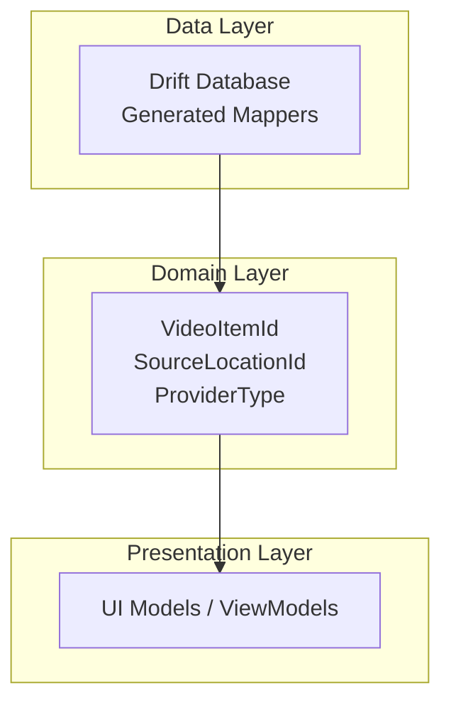
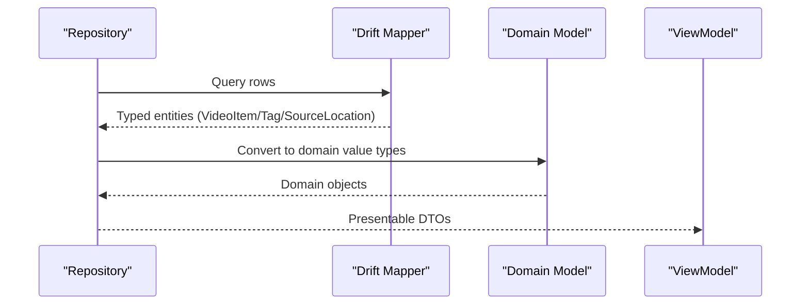
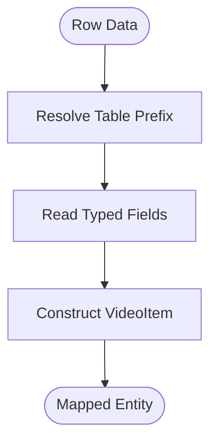
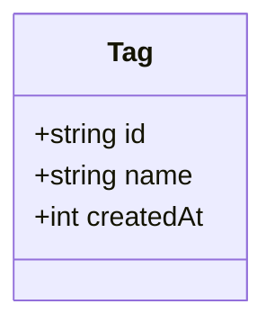
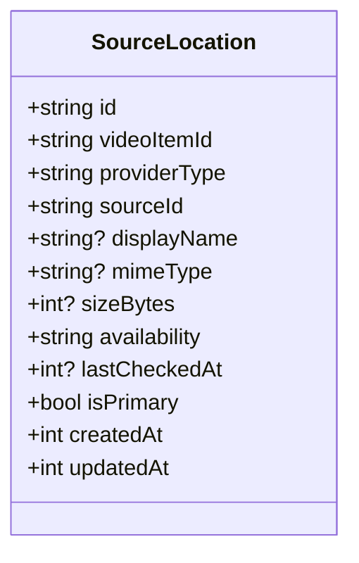
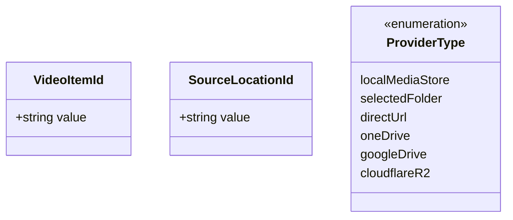
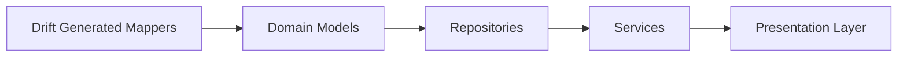

# Data Mappers and Transformers

<cite>
**Referenced Files in This Document**
- [app_database.g.dart](file://lib/data/database/app_database.g.dart)
- [video_repository.dart](file://lib/domain/repositories/video_repository.dart)
</cite>

## Table of Contents
1. [Introduction](#introduction)
2. [Project Structure](#project-structure)
3. [Core Components](#core-components)
4. [Architecture Overview](#architecture-overview)
5. [Detailed Component Analysis](#detailed-component-analysis)
6. [Dependency Analysis](#dependency-analysis)
7. [Performance Considerations](#performance-considerations)
8. [Troubleshooting Guide](#troubleshooting-guide)
9. [Conclusion](#conclusion)

## Introduction
This document explains the data mapping and transformation layer that bridges database entities, domain models, and presentation models. It focuses on how mappers convert between persistence types (generated by Drift), domain value types, and UI-facing representations. It also covers validation, error handling, one-way and bidirectional mappings, complex object transformations, collection mappings, separation of concerns, performance strategies for large datasets, lazy loading, testing approaches, and mock data generation techniques.

## Project Structure
The mapping layer is primarily implemented through generated Drift mappers and domain-level type definitions:
- Generated Drift mappers live under lib/data/database and provide row-to-entity conversions with typed accessors.
- Domain model identifiers and enums are defined under lib/domain to keep business logic decoupled from persistence details.

[No sources needed since this diagram shows conceptual workflow, not actual code structure]

## Core Components
- VideoItemMapper: Converts database rows into VideoItem entities using typed column readers. It ensures correct type casting and nullability semantics for fields such as id, title, durationMs, widthPx, heightPx, isFavourite, watchProgressMs, lastPlayedAt, createdAt, and updatedAt.
- TagMapper: Converts database rows into Tag entities, including id, name, and createdAt.
- SourceLocationMapper: Converts database rows into SourceLocation entities, including id, videoItemId, providerType, sourceId, displayName, mimeType, sizeBytes, availability, lastCheckedAt, isPrimary, createdAt, and updatedAt.

These mappers encapsulate all persistence-specific details (column names, type mapping, table prefixes) so that higher layers operate on clean domain objects.

Key responsibilities:
- Type-safe conversion from Map<String, dynamic> to strongly-typed entities.
- Handling optional fields and defaulting behavior.
- Applying table prefix resolution for joined queries.

**Section sources**
- [app_database.g.dart:225-271](file://lib/data/database/app_database.g.dart#L225-L271)
- [app_database.g.dart:1494-1513](file://lib/data/database/app_database.g.dart#L1494-L1513)
- [app_database.g.dart:1070-1092](file://lib/data/database/app_database.g.dart#L1070-L1092)
- [app_database.g.dart:1134-1207](file://lib/data/database/app_database.g.dart#L1134-L1207)

## Architecture Overview
The mapping architecture separates concerns across layers:
- Persistence layer: Drift-generated mappers handle raw row data and typed conversions.
- Domain layer: Value types and enums define stable identities and provider types without persistence coupling.
- Presentation layer: UI models consume domain objects and may apply additional formatting or aggregation.

**Diagram sources**
- [app_database.g.dart:225-271](file://lib/data/database/app_database.g.dart#L225-L271)
- [app_database.g.dart:1494-1513](file://lib/data/database/app_database.g.dart#L1494-L1513)
- [app_database.g.dart:1070-1092](file://lib/data/database/app_database.g.dart#L1070-L1092)
- [video_repository.dart:103-117](file://lib/domain/repositories/video_repository.dart#L103-L117)

## Detailed Component Analysis

### VideoItemMapper
Purpose:
- Maps a database row to a VideoItem entity with strict typing and null safety.
- Applies table prefix resolution for joined queries.

Transformation logic:
- Reads each column via typed accessors to ensure correct Dart types.
- Handles nullable fields like lastPlayedAt and optional metadata.

Validation and error handling:
- Relies on Drift’s typeMapping.read to enforce schema contracts; invalid values will surface as runtime errors during mapping.

Complex object transformations:
- Preserves numeric dimensions and durations as integers, ensuring consistent units across layers.

Collection mappings:
- Typically used within repositories to map lists of rows to lists of VideoItem entities.

**Diagram sources**
- [app_database.g.dart:225-271](file://lib/data/database/app_database.g.dart#L225-L271)

**Section sources**
- [app_database.g.dart:225-271](file://lib/data/database/app_database.g.dart#L225-L271)

### TagMapper
Purpose:
- Maps database rows to Tag entities, preserving id, name, and createdAt.

Transformation logic:
- Uses typed column readers to ensure string and integer types are correctly assigned.

Validation and error handling:
- Enforces non-null constraints where applicable; relies on Drift’s type system for correctness.

Bidirectional mapping:
- Tag entities can be converted back to insert/update companions for persistence operations.

**Diagram sources**
- [app_database.g.dart:1494-1513](file://lib/data/database/app_database.g.dart#L1494-L1513)

**Section sources**
- [app_database.g.dart:1494-1513](file://lib/data/database/app_database.g.dart#L1494-L1513)

### SourceLocationMapper
Purpose:
- Maps database rows to SourceLocation entities, including provider metadata and availability state.

Transformation logic:
- Reads providerType, sourceId, displayName, mimeType, sizeBytes, availability, lastCheckedAt, isPrimary, and timestamps.
- Supports optional fields via Value.absent patterns in companion objects.

Validation and error handling:
- Ensures required fields like id, videoItemId, providerType, sourceId, availability, isPrimary, createdAt, and updatedAt are present.
- Optional fields are handled gracefully when absent.

Bidirectional mapping:
- Provides toCompanion and copyWith methods to transform entities back into update-friendly structures.

One-way vs. bidirectional:
- Row-to-entity mapping is one-way; entity-to-companion mapping supports updates.

**Diagram sources**
- [app_database.g.dart:1070-1092](file://lib/data/database/app_database.g.dart#L1070-L1092)
- [app_database.g.dart:1134-1207](file://lib/data/database/app_database.g.dart#L1134-L1207)

**Section sources**
- [app_database.g.dart:1070-1092](file://lib/data/database/app_database.g.dart#L1070-L1092)
- [app_database.g.dart:1134-1207](file://lib/data/database/app_database.g.dart#L1134-L1207)

### Domain Identity Types and Enums
Purpose:
- Provide stable identity wrappers and provider type enumeration to decouple domain logic from persistence details.

Key elements:
- VideoItemId: Thin wrapper around a string identifier for logical video items.
- SourceLocationId: Thin wrapper around a string identifier for source locations.
- ProviderType: Enumerates supported providers (localMediaStore, selectedFolder, directUrl, oneDrive, googleDrive, cloudflareR2).

Usage:
- Repositories and services use these types to maintain clear boundaries between domain and data layers.

**Diagram sources**
- [video_repository.dart:103-117](file://lib/domain/repositories/video_repository.dart#L103-L117)

**Section sources**
- [video_repository.dart:103-117](file://lib/domain/repositories/video_repository.dart#L103-L117)

## Dependency Analysis
Mappers depend on Drift’s generated code for schema-aware conversions. Domain types are independent of persistence and serve as stable contracts for repositories and services.

**Diagram sources**
- [app_database.g.dart:225-271](file://lib/data/database/app_database.g.dart#L225-L271)
- [video_repository.dart:103-117](file://lib/domain/repositories/video_repository.dart#L103-L117)

**Section sources**
- [app_database.g.dart:225-271](file://lib/data/database/app_database.g.dart#L225-L271)
- [video_repository.dart:103-117](file://lib/domain/repositories/video_repository.dart#L103-L117)

## Performance Considerations
- Batch mapping: Map collections in bulk rather than item-by-item to reduce overhead.
- Lazy loading: Defer loading of heavy associations (e.g., thumbnails, extended metadata) until needed.
- Projection: Select only necessary columns to minimize memory usage and parsing time.
- Caching: Cache frequently accessed domain objects to avoid repeated mapping and database reads.
- Pagination: Use cursor-based pagination to limit dataset sizes per operation.
- Avoid unnecessary conversions: Keep domain objects immutable and reuse them across layers when safe.

[No sources needed since this section provides general guidance]

## Troubleshooting Guide
Common issues and resolutions:
- Type mismatch errors during mapping: Ensure Drift schema matches Dart types; verify nullable fields are handled appropriately.
- Missing columns: Confirm table prefixes are applied correctly in joined queries.
- Null pointer exceptions: Validate optional fields before accessing; use safe navigation or default values.
- Performance regressions: Profile mapping throughput; consider batching and projection optimizations.

Testing approaches:
- Unit tests for mappers: Assert field-by-field equality between mapped entities and expected values.
- Mock data generation: Create deterministic fixtures for VideoItem, Tag, and SourceLocation to cover edge cases (nulls, empty strings, extreme values).
- Integration tests: Verify repository methods that rely on mappers against an in-memory database.

Error handling strategies:
- Wrap mapper calls in try/catch blocks to capture and log type mapping failures.
- Return Result types from repositories to propagate mapping errors up the stack.

**Section sources**
- [app_database.g.dart:225-271](file://lib/data/database/app_database.g.dart#L225-L271)
- [app_database.g.dart:1494-1513](file://lib/data/database/app_database.g.dart#L1494-L1513)
- [app_database.g.dart:1070-1092](file://lib/data/database/app_database.g.dart#L1070-L1092)

## Conclusion
The mapping layer cleanly separates persistence concerns from domain logic through Drift-generated mappers and domain identity types. VideoItemMapper, TagMapper, and SourceLocationMapper provide robust, type-safe conversions that support both one-way and bidirectional transformations. By applying validation, careful error handling, and performance best practices, the application maintains clarity, reliability, and scalability across large datasets.