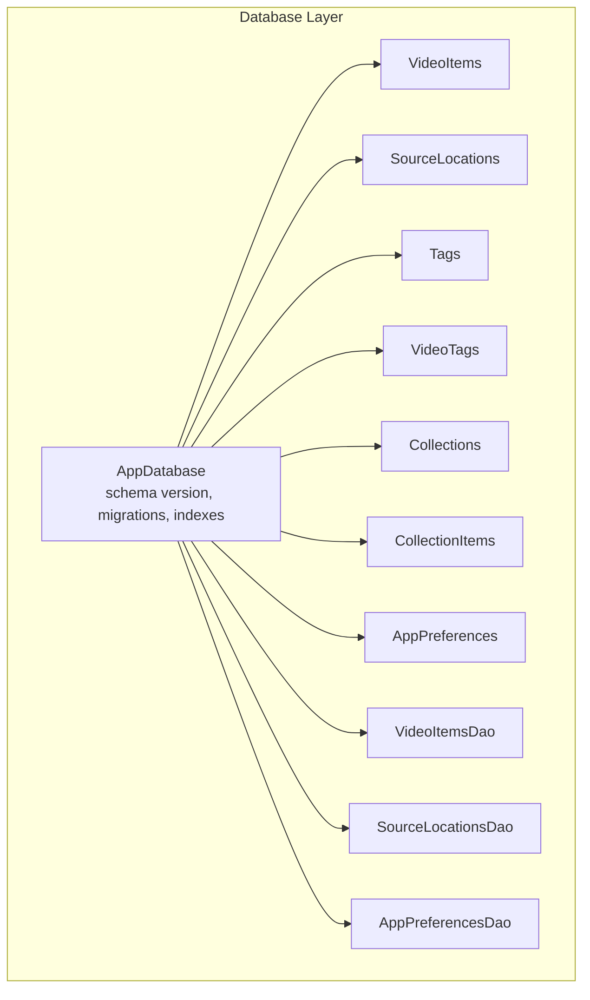
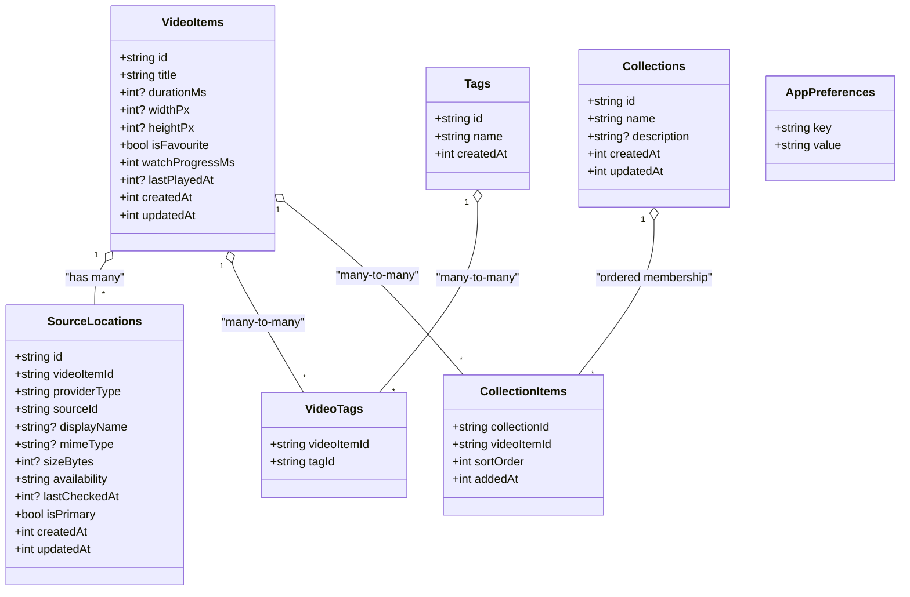
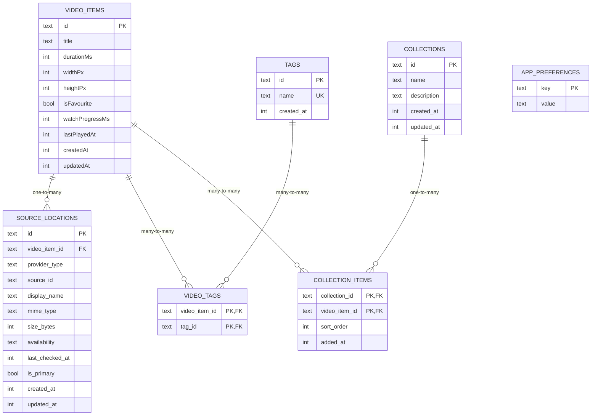
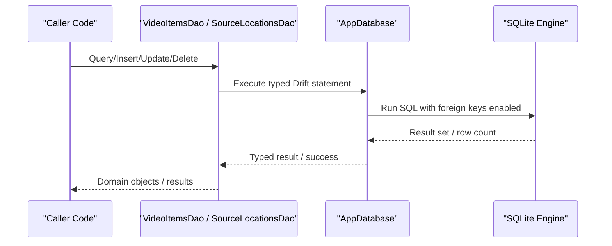
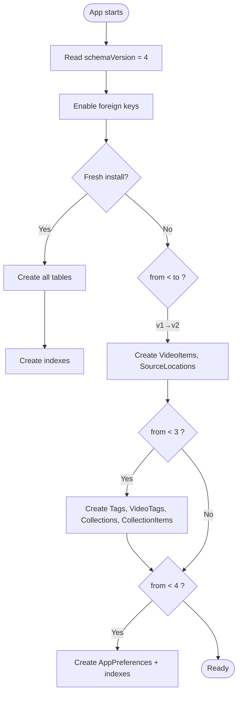
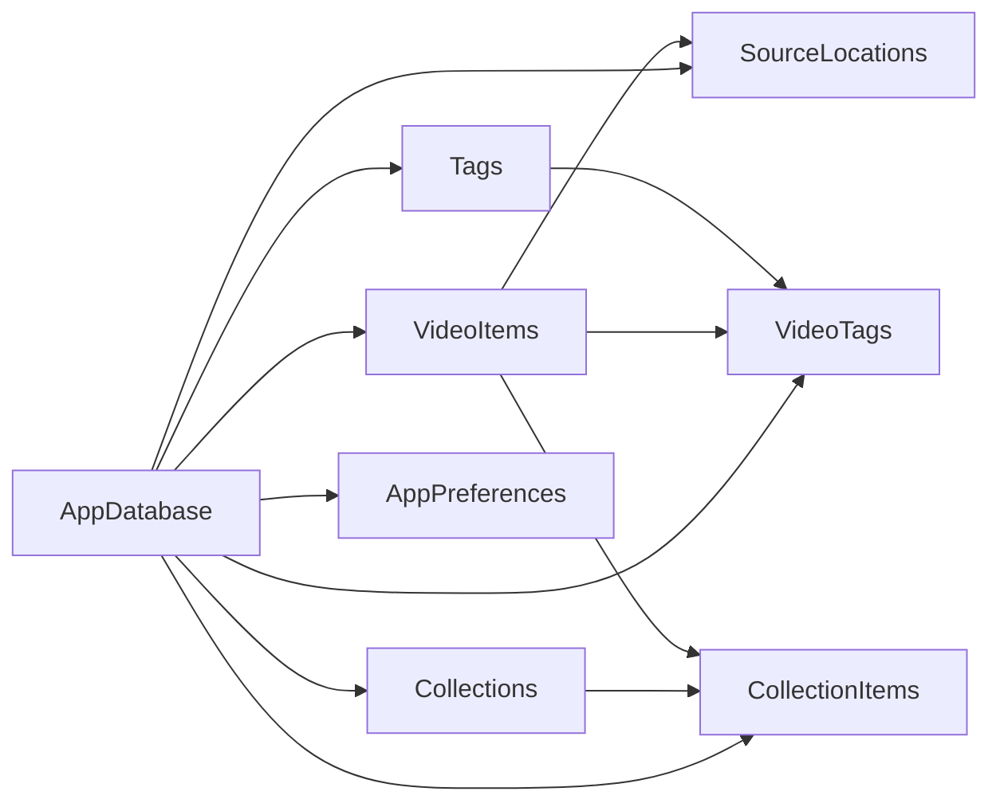

# Database Schema Design

<cite>
**Referenced Files in This Document**
- [app_database.dart](file://lib/data/database/app_database.dart)
- [video_items_table.dart](file://lib/data/database/tables/video_items_table.dart)
- [source_locations_table.dart](file://lib/data/database/tables/source_locations_table.dart)
- [tags_table.dart](file://lib/data/database/tables/tags_table.dart)
- [video_tags_table.dart](file://lib/data/database/tables/video_tags_table.dart)
- [collections_table.dart](file://lib/data/database/tables/collections_table.dart)
- [collection_items_table.dart](file://lib/data/database/tables/collection_items_table.dart)
- [app_preferences_table.dart](file://lib/data/database/tables/app_preferences_table.dart)
- [video_items_dao.dart](file://lib/data/database/daos/video_items_dao.dart)
- [source_locations_dao.dart](file://lib/data/database/daos/source_locations_dao.dart)
- [app_preferences_dao.dart](file://lib/data/database/daos/app_preferences_dao.dart)
</cite>

## Table of Contents
1. Introduction
2. Project Structure
3. Core Components
4. Architecture Overview
5. Detailed Component Analysis
6. Dependency Analysis
7. Performance Considerations
8. Troubleshooting Guide
9. Conclusion
10. Appendices

## Introduction
This document describes the MyTube database schema and its Drift ORM implementation. It covers entity relationships between videos, source locations, tags, collections, and preferences; table structures, field definitions, data types, primary and foreign keys, indexes, and constraints; migration strategy and version management; validation rules and referential integrity; example queries and joins; and performance considerations for large video libraries.

## Project Structure
The database layer is implemented with Drift (SQLite). The central database class declares tables, DAOs, schema versioning, and migrations. Each table is defined in its own file under the tables directory. DAOs are generated by Drift and live under daos.

**Diagram sources**
- [app_database.dart:25-36](file://lib/data/database/app_database.dart#L25-L36)

**Section sources**
- [app_database.dart:1-111](file://lib/data/database/app_database.dart#L1-L111)

## Core Components
- VideoItems: Canonical video entry with user metadata and playback progress.
- SourceLocations: Physical or logical locations for a video item (local files, URLs, cloud items), with one marked as primary.
- Tags: User-defined labels for categorization.
- VideoTags: Many-to-many link between videos and tags.
- Collections: Named playlists with ordering support.
- CollectionItems: Ordered membership of videos in collections.
- AppPreferences: Typed key-value store for app settings.

Key design patterns:
- UUID-based stable identifiers for all entities.
- Text columns for enum-like values to avoid migrations on new values.
- Foreign keys with cascade deletes for clean removal of related rows.
- Explicit timestamps for auditability and sorting.

**Section sources**
- [video_items_table.dart:1-46](file://lib/data/database/tables/video_items_table.dart#L1-L46)
- [source_locations_table.dart:1-67](file://lib/data/database/tables/source_locations_table.dart#L1-L67)
- [tags_table.dart:1-23](file://lib/data/database/tables/tags_table.dart#L1-L23)
- [video_tags_table.dart:1-24](file://lib/data/database/tables/video_tags_table.dart#L1-L24)
- [collections_table.dart:1-28](file://lib/data/database/tables/collections_table.dart#L1-L28)
- [collection_items_table.dart:1-36](file://lib/data/database/tables/collection_items_table.dart#L1-L36)
- [app_preferences_table.dart:1-36](file://lib/data/database/tables/app_preferences_table.dart#L1-L36)

## Architecture Overview
The database enforces referential integrity via SQLite foreign keys and uses Drift’s type-safe APIs for reads/writes. Indexes accelerate common joins and time-based queries. Migrations add tables and indexes incrementally across versions.

**Diagram sources**
- [video_items_table.dart:11-45](file://lib/data/database/tables/video_items_table.dart#L11-L45)
- [source_locations_table.dart:16-66](file://lib/data/database/tables/source_locations_table.dart#L16-L66)
- [tags_table.dart:9-22](file://lib/data/database/tables/tags_table.dart#L9-L22)
- [video_tags_table.dart:12-23](file://lib/data/database/tables/video_tags_table.dart#L12-L23)
- [collections_table.dart:9-27](file://lib/data/database/tables/collections_table.dart#L9-L27)
- [collection_items_table.dart:15-35](file://lib/data/database/tables/collection_items_table.dart#L15-L35)
- [app_preferences_table.dart:11-20](file://lib/data/database/tables/app_preferences_table.dart#L11-L20)

## Detailed Component Analysis

### Entity Relationships and Data Model
- One VideoItem can have multiple SourceLocations; exactly one may be primary for playback resolution.
- Videos and Tags are linked through VideoTags (many-to-many).
- Collections contain ordered VideoItems via CollectionItems; a video can belong to multiple collections.
- AppPreferences stores typed settings as string key-value pairs.

**Diagram sources**
- [video_items_table.dart:11-45](file://lib/data/database/tables/video_items_table.dart#L11-L45)
- [source_locations_table.dart:16-66](file://lib/data/database/tables/source_locations_table.dart#L16-L66)
- [tags_table.dart:9-22](file://lib/data/database/tables/tags_table.dart#L9-L22)
- [video_tags_table.dart:12-23](file://lib/data/database/tables/video_tags_table.dart#L12-L23)
- [collections_table.dart:9-27](file://lib/data/database/tables/collections_table.dart#L9-L27)
- [collection_items_table.dart:15-35](file://lib/data/database/tables/collection_items_table.dart#L15-L35)
- [app_preferences_table.dart:11-20](file://lib/data/database/tables/app_preferences_table.dart#L11-L20)

### Table Structures, Fields, Types, Keys, Constraints, and Indexes
- VideoItems
  - Primary key: id (TEXT)
  - Notable fields: title, durationMs, widthPx, heightPx, isFavourite, watchProgressMs, lastPlayedAt, createdAt, updatedAt
  - Constraints: default false for isFavourite; defaults for timestamps
- SourceLocations
  - Primary key: id (TEXT)
  - Foreign key: video_item_id → VideoItems.id (ON DELETE CASCADE)
  - Enum-like fields stored as TEXT: providerType, availability
  - Flags: isPrimary (default false)
  - Timestamps: createdAt, updatedAt
- Tags
  - Primary key: id (TEXT)
  - Constraint: name UNIQUE
  - Timestamp: createdAt
- VideoTags
  - Composite primary key: (video_item_id, tag_id)
  - Foreign keys: video_item_id → VideoItems.id (CASCADE), tag_id → Tags.id (CASCADE)
- Collections
  - Primary key: id (TEXT)
  - Timestamps: createdAt, updatedAt
- CollectionItems
  - Composite primary key: (collection_id, video_item_id)
  - Foreign keys: collection_id → Collections.id (CASCADE), video_item_id → VideoItems.id (CASCADE)
  - Ordering: sortOrder (ascending), addedAt for tie-breaking
- AppPreferences
  - Primary key: key (TEXT)
  - Value: value (TEXT); callers encode/decode typed values

Indexes (created at v4):
- idx_source_locations_video_item_id ON source_locations(video_item_id)
- idx_video_tags_video_item_id ON video_tags(video_item_id)
- idx_collection_items_collection_id ON collection_items(collection_id)
- idx_video_items_last_played_at ON video_items(last_played_at)

**Section sources**
- [video_items_table.dart:11-45](file://lib/data/database/tables/video_items_table.dart#L11-L45)
- [source_locations_table.dart:16-66](file://lib/data/database/tables/source_locations_table.dart#L16-L66)
- [tags_table.dart:9-22](file://lib/data/database/tables/tags_table.dart#L9-L22)
- [video_tags_table.dart:12-23](file://lib/data/database/tables/video_tags_table.dart#L12-L23)
- [collections_table.dart:9-27](file://lib/data/database/tables/collections_table.dart#L9-L27)
- [collection_items_table.dart:15-35](file://lib/data/database/tables/collection_items_table.dart#L15-L35)
- [app_preferences_table.dart:11-20](file://lib/data/database/tables/app_preferences_table.dart#L11-L20)
- [app_database.dart:74-99](file://lib/data/database/app_database.dart#L74-L99)

### Drift ORM Implementation Patterns
- Declarative schema via Drift annotations and Table classes.
- Generated models and DAOs via part 'app_database.g.dart'.
- Type-safe queries using Drift’s query builder and DAO methods.
- Foreign-key enforcement enabled per connection via PRAGMA.
- DAOs provided for VideoItems, SourceLocations, and AppPreferences.

**Diagram sources**
- [app_database.dart:37-48](file://lib/data/database/app_database.dart#L37-L48)
- [video_items_dao.dart](file://lib/data/database/daos/video_items_dao.dart)
- [source_locations_dao.dart](file://lib/data/database/daos/source_locations_dao.dart)

**Section sources**
- [app_database.dart:1-111](file://lib/data/database/app_database.dart#L1-L111)
- [video_items_dao.dart](file://lib/data/database/daos/video_items_dao.dart)
- [source_locations_dao.dart](file://lib/data/database/daos/source_locations_dao.dart)
- [app_preferences_dao.dart](file://lib/data/database/daos/app_preferences_dao.dart)

### Migration Strategy, Version Management, and Schema Evolution
- Current schemaVersion: 4
- Migration phases:
  - v1 → v2: Create VideoItems and SourceLocations
  - v2 → v3: Create Tags, VideoTags, Collections, CollectionItems
  - v3 → v4: Create AppPreferences and application-wide indexes
- onCreate creates all tables and then applies indexes.
- beforeOpen enables foreign keys per connection.

**Diagram sources**
- [app_database.dart:40-72](file://lib/data/database/app_database.dart#L40-L72)

**Section sources**
- [app_database.dart:40-72](file://lib/data/database/app_database.dart#L40-L72)

### Validation Rules, Business Constraints, and Referential Integrity
- Stable UUIDs for all entities ensure consistent references across providers and devices.
- Enum-like fields (providerType, availability) are stored as TEXT to allow extension without migrations.
- Unique constraint on Tag.name prevents duplicate labels.
- Foreign keys with cascade deletes keep related rows consistent when parents are removed.
- isPrimary flag on SourceLocations indicates preferred location for playback.
- CollectionItems.sortOrder provides explicit ordering; addedAt breaks ties.
- AppPreferences requires callers to serialize/deserialize typed values consistently.

**Section sources**
- [source_locations_table.dart:12-14](file://lib/data/database/tables/source_locations_table.dart#L12-L14)
- [tags_table.dart:5-8](file://lib/data/database/tables/tags_table.dart#L5-L8)
- [video_tags_table.dart:6-11](file://lib/data/database/tables/video_tags_table.dart#L6-L11)
- [collection_items_table.dart:6-14](file://lib/data/database/tables/collection_items_table.dart#L6-L14)
- [app_preferences_table.dart:3-8](file://lib/data/database/tables/app_preferences_table.dart#L3-L8)

### Example Queries, Joins, and Complex Operations
Note: Use Drift’s type-safe API via DAOs and the database instance. The following describe intent rather than code.

- List source locations for a video item
  - Join SourceLocations to VideoItems on video_item_id
  - Filter by video_item_id and order by isPrimary desc
  - Use index idx_source_locations_video_item_id

- Recently played videos
  - Select from VideoItems where lastPlayedAt is not null
  - Order by lastPlayedAt desc
  - Use index idx_video_items_last_played_at

- All tags for a video
  - Join VideoTags to Tags on tag_id
  - Filter by video_item_id

- Videos in a collection with order
  - Join CollectionItems to Collections and VideoItems
  - Filter by collection_id
  - Order by sortOrder asc, addedAt asc

- Mark a video as favourite and update progress
  - Update VideoItems.isFavourite and watchProgressMs
  - Optionally update lastPlayedAt timestamp

- Add a video to a collection
  - Insert into CollectionItems with sortOrder and addedAt
  - Ensure uniqueness via composite primary key

**Section sources**
- [app_database.dart:74-99](file://lib/data/database/app_database.dart#L74-L99)
- [video_items_table.dart:11-45](file://lib/data/database/tables/video_items_table.dart#L11-L45)
- [source_locations_table.dart:16-66](file://lib/data/database/tables/source_locations_table.dart#L16-L66)
- [video_tags_table.dart:12-23](file://lib/data/database/tables/video_tags_table.dart#L12-L23)
- [collection_items_table.dart:15-35](file://lib/data/database/tables/collection_items_table.dart#L15-L35)

## Dependency Analysis
The database depends on Drift and drift_flutter for SQLite access. Tables define their own dependencies via foreign keys. DAOs depend on the database and generated models.

**Diagram sources**
- [app_database.dart:25-36](file://lib/data/database/app_database.dart#L25-L36)
- [video_items_table.dart:11-45](file://lib/data/database/tables/video_items_table.dart#L11-L45)
- [source_locations_table.dart:16-66](file://lib/data/database/tables/source_locations_table.dart#L16-L66)
- [tags_table.dart:9-22](file://lib/data/database/tables/tags_table.dart#L9-L22)
- [video_tags_table.dart:12-23](file://lib/data/database/tables/video_tags_table.dart#L12-L23)
- [collections_table.dart:9-27](file://lib/data/database/tables/collections_table.dart#L9-L27)
- [collection_items_table.dart:15-35](file://lib/data/database/tables/collection_items_table.dart#L15-L35)
- [app_preferences_table.dart:11-20](file://lib/data/database/tables/app_preferences_table.dart#L11-L20)

**Section sources**
- [app_database.dart:25-36](file://lib/data/database/app_database.dart#L25-L36)

## Performance Considerations
- Index usage
  - idx_source_locations_video_item_id accelerates listing locations per video.
  - idx_video_tags_video_item_id speeds up tag lookups per video.
  - idx_collection_items_collection_id optimizes collection membership queries.
  - idx_video_items_last_played_at improves “recently played” lists.
- Avoid storing ephemeral signed URLs in SourceLocations.sourceId; persist durable identifiers only.
- Prefer selecting only needed columns for large result sets.
- Batch writes for bulk imports (e.g., scanning library) to reduce transaction overhead.
- Use transactions for multi-step operations that must succeed atomically.
- Keep isPrimary updates minimal; prefer setting it once during import unless explicitly changed.

[No sources needed since this section provides general guidance]

## Troubleshooting Guide
- Foreign key violations
  - Cause: Deleting a parent without cascading child rows.
  - Resolution: Ensure cascade delete is configured (already set for most relations) or remove children first.
- Missing indexes after upgrade
  - Cause: Running older app versions without v4 indexes.
  - Resolution: The v3→v4 migration creates indexes; verify schemaVersion and run upgrades.
- Duplicate tag names
  - Cause: Attempting to insert a tag with an existing name.
  - Resolution: Normalize tag names (lowercase, trim) before insert; rely on unique constraint.
- Incorrect enum values
  - Cause: Using unsupported strings for providerType or availability.
  - Resolution: Validate against known enum names; extend only via safe migration if needed.
- Preferences serialization errors
  - Cause: Mismatch between expected Dart type and stored string.
  - Resolution: Use AppPreferenceKeys and consistent encoding/decoding logic.

**Section sources**
- [app_database.dart:44-48](file://lib/data/database/app_database.dart#L44-L48)
- [app_database.dart:66-72](file://lib/data/database/app_database.dart#L66-L72)
- [tags_table.dart:5-8](file://lib/data/database/tables/tags_table.dart#L5-L8)
- [source_locations_table.dart:12-14](file://lib/data/database/tables/source_locations_table.dart#L12-L14)
- [app_preferences_table.dart:3-8](file://lib/data/database/tables/app_preferences_table.dart#L3-L8)

## Conclusion
MyTube’s database model cleanly separates logical video entries from their physical sources, supports flexible tagging and ordered collections, and persists app preferences. Drift provides type safety, while explicit indexes and cascade foreign keys deliver correctness and performance. The migration strategy ensures smooth evolution from an empty schema to a fully featured library system.

[No sources needed since this section summarizes without analyzing specific files]

## Appendices

### Appendix A: Field Reference Summary
- VideoItems
  - id: TEXT PK
  - title: TEXT
  - durationMs: INTEGER?
  - widthPx: INTEGER?
  - heightPx: INTEGER?
  - isFavourite: BOOLEAN DEFAULT FALSE
  - watchProgressMs: INTEGER DEFAULT 0
  - lastPlayedAt: INTEGER?
  - createdAt: INTEGER
  - updatedAt: INTEGER
- SourceLocations
  - id: TEXT PK
  - video_item_id: TEXT FK → VideoItems.id (CASCADE)
  - provider_type: TEXT
  - source_id: TEXT
  - display_name: TEXT?
  - mime_type: TEXT?
  - size_bytes: INTEGER?
  - availability: TEXT DEFAULT 'unknown'
  - last_checked_at: INTEGER?
  - is_primary: BOOLEAN DEFAULT FALSE
  - created_at: INTEGER
  - updated_at: INTEGER
- Tags
  - id: TEXT PK
  - name: TEXT UNIQUE
  - created_at: INTEGER
- VideoTags
  - video_item_id: TEXT FK → VideoItems.id (CASCADE)
  - tag_id: TEXT FK → Tags.id (CASCADE)
  - Composite PK: (video_item_id, tag_id)
- Collections
  - id: TEXT PK
  - name: TEXT
  - description: TEXT?
  - created_at: INTEGER
  - updated_at: INTEGER
- CollectionItems
  - collection_id: TEXT FK → Collections.id (CASCADE)
  - video_item_id: TEXT FK → VideoItems.id (CASCADE)
  - sort_order: INTEGER DEFAULT 0
  - added_at: INTEGER
  - Composite PK: (collection_id, video_item_id)
- AppPreferences
  - key: TEXT PK
  - value: TEXT

**Section sources**
- [video_items_table.dart:11-45](file://lib/data/database/tables/video_items_table.dart#L11-L45)
- [source_locations_table.dart:16-66](file://lib/data/database/tables/source_locations_table.dart#L16-L66)
- [tags_table.dart:9-22](file://lib/data/database/tables/tags_table.dart#L9-L22)
- [video_tags_table.dart:12-23](file://lib/data/database/tables/video_tags_table.dart#L12-L23)
- [collections_table.dart:9-27](file://lib/data/database/tables/collections_table.dart#L9-L27)
- [collection_items_table.dart:15-35](file://lib/data/database/tables/collection_items_table.dart#L15-L35)
- [app_preferences_table.dart:11-20](file://lib/data/database/tables/app_preferences_table.dart#L11-L20)