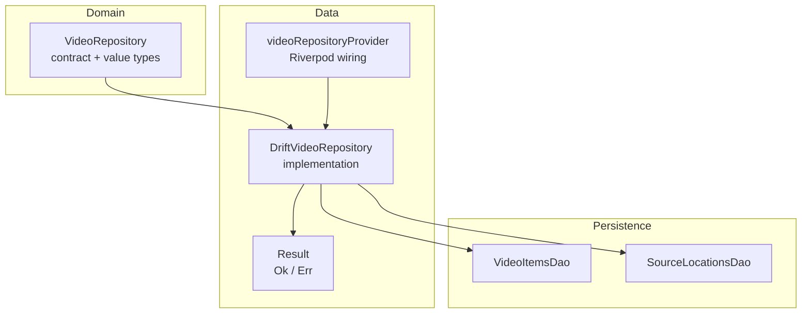
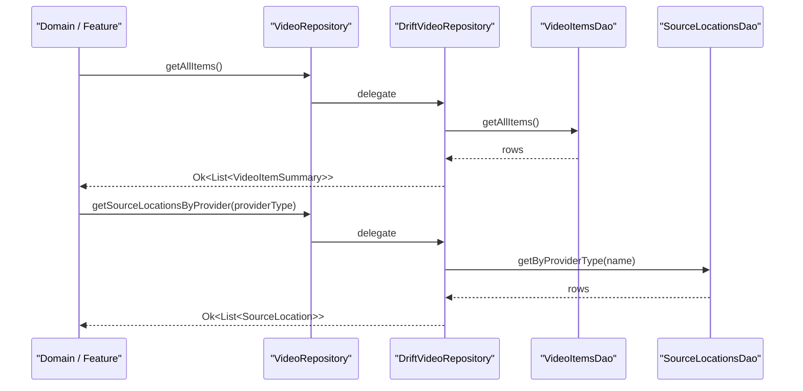
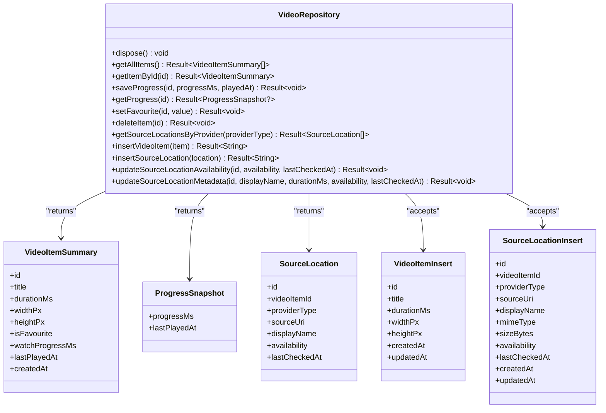
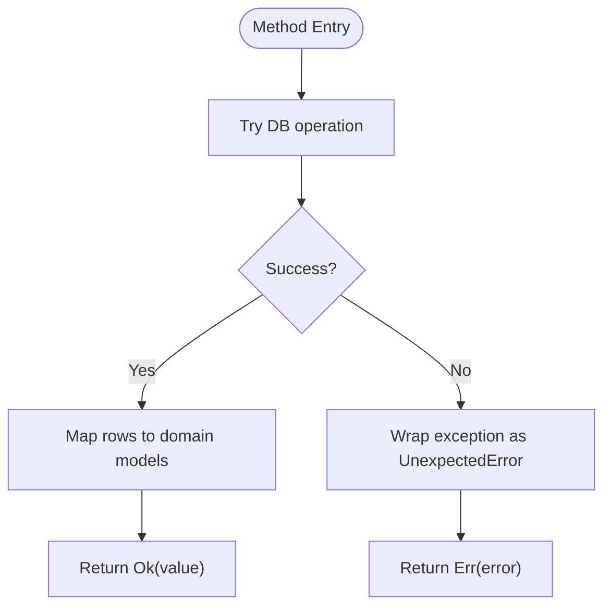
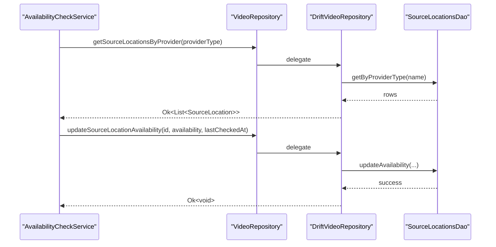
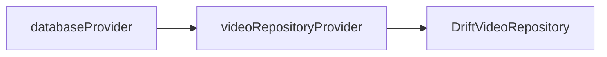
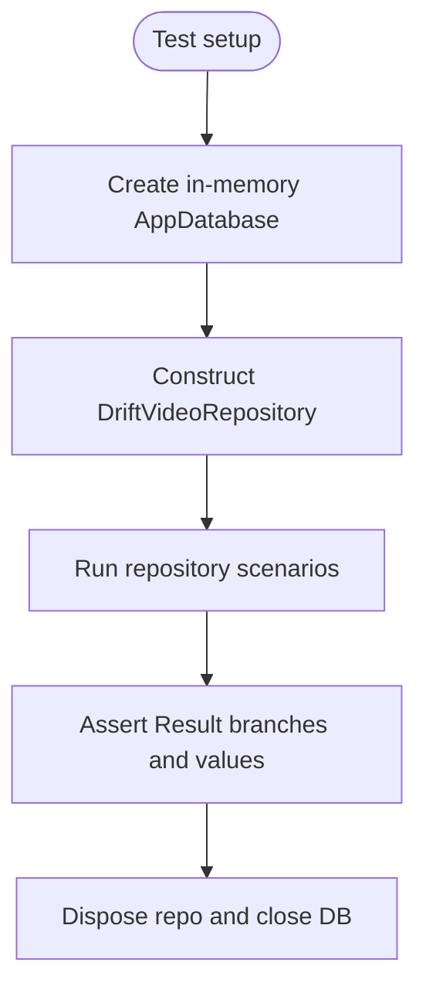
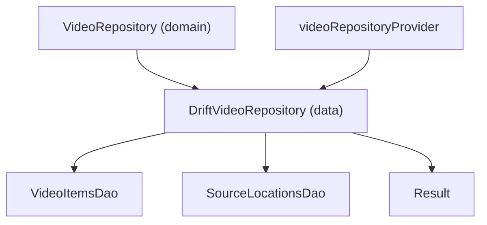

# Repository Pattern Implementation

<cite>
**Referenced Files in This Document**
- [ARCHITECTURE.md](file://ARCHITECTURE.md)
- [video_repository.dart](file://lib/domain/repositories/video_repository.dart)
- [drift_video_repository.dart](file://lib/data/repositories/drift_video_repository.dart)
- [repository_providers.dart](file://lib/data/repositories/repository_providers.dart)
- [result.dart](file://lib/core/result.dart)
- [availability_check_service.dart](file://lib/domain/services/availability_check_service.dart)
- [drift_video_repository_test.dart](file://test/unit/database/drift_video_repository_test.dart)
- [source_locations_dao.g.dart](file://lib/data/database/daos/source_locations_dao.g.dart)
</cite>

## Table of Contents
1. [Introduction](#introduction)
2. [Project Structure](#project-structure)
3. [Core Components](#core-components)
4. [Architecture Overview](#architecture-overview)
5. [Detailed Component Analysis](#detailed-component-analysis)
6. [Dependency Analysis](#dependency-analysis)
7. [Performance Considerations](#performance-considerations)
8. [Troubleshooting Guide](#troubleshooting-guide)
9. [Conclusion](#conclusion)

## Introduction
This document explains the repository pattern implementation in the data layer and how it abstracts data sources behind clean domain interfaces. It focuses on:
- The `VideoRepository` contract and its Drift-backed implementation.
- Source location handling through `SourceLocation` and related insert/update operations.
- Error handling with typed results.
- Dependency injection via Riverpod.
- Testing patterns for repositories and DAOs.
- Caching, synchronization, offline-first considerations, and multi-source coordination.

The design follows a layered architecture where the domain layer defines contracts and models, while the data layer implements persistence and mapping without leaking framework or database types to callers.

**Section sources**
- [ARCHITECTURE.md:55-74](file://ARCHITECTURE.md#L55-L74)
- [video_repository.dart:5-13](file://lib/domain/repositories/video_repository.dart#L5-L13)

## Project Structure
The repository pattern is implemented across three main areas:
- Domain contract and value types: `lib/domain/repositories/video_repository.dart`.
- Data-layer implementation and DI wiring: `lib/data/repositories/drift_video_repository.dart` and `lib/data/repositories/repository_providers.dart`.
- Typed result abstraction used by repositories: `lib/core/result.dart`.

**Diagram sources**
- [video_repository.dart:14-97](file://lib/domain/repositories/video_repository.dart#L14-L97)
- [drift_video_repository.dart:17-23](file://lib/data/repositories/drift_video_repository.dart#L17-L23)
- [repository_providers.dart:19-24](file://lib/data/repositories/repository_providers.dart#L19-L24)
- [result.dart:16-60](file://lib/core/result.dart#L16-L60)

**Section sources**
- [video_repository.dart:14-97](file://lib/domain/repositories/video_repository.dart#L14-L97)
- [drift_video_repository.dart:17-23](file://lib/data/repositories/drift_video_repository.dart#L17-L23)
- [repository_providers.dart:1-24](file://lib/data/repositories/repository_providers.dart#L1-L24)
- [result.dart:1-60](file://lib/core/result.dart#L1-L60)

## Core Components
- VideoRepository: Abstract interface defining queries, mutations, progress tracking, and source-location operations. It returns `Result<T>` to avoid exceptions in UI code.
- DriftVideoRepository: Concrete implementation backed by Drift DAOs. It maps database rows to domain models and wraps all failures as `UnexpectedError`.
- Result<T>: A discriminated union (`Ok`/`Err`) used consistently across repositories and adapters.
- videoRepositoryProvider: Riverpod provider that constructs `DriftVideoRepository` from the injected `AppDatabase`, enabling test overrides.

Key responsibilities:
- Querying video summaries and single items.
- Persisting watch progress snapshots.
- Managing favorite flags and safe deletion of app records only.
- Inserting/upserting video items and source locations.
- Updating source availability and metadata.

**Section sources**
- [video_repository.dart:14-97](file://lib/domain/repositories/video_repository.dart#L14-L97)
- [drift_video_repository.dart:17-31](file://lib/data/repositories/drift_video_repository.dart#L17-L31)
- [result.dart:1-60](file://lib/core/result.dart#L1-L60)
- [repository_providers.dart:1-24](file://lib/data/repositories/repository_providers.dart#L1-L24)

## Architecture Overview
The repository sits between the domain layer and persistence. It hides Drift details and exposes stable domain models. Source locations represent multiple ways to access the same logical video item, supporting local, direct URL, and cloud providers.

**Diagram sources**
- [video_repository.dart:22-26](file://lib/domain/repositories/video_repository.dart#L22-L26)
- [video_repository.dart:63-65](file://lib/domain/repositories/video_repository.dart#L63-L65)
- [drift_video_repository.dart:35-44](file://lib/data/repositories/drift_video_repository.dart#L35-L44)
- [drift_video_repository.dart:150-167](file://lib/data/repositories/drift_video_repository.dart#L150-L167)

## Detailed Component Analysis

### VideoRepository Contract
Responsibilities:
- Lifecycle management via `dispose`.
- Queries: list all items and fetch by ID.
- Watch progress: save and retrieve progress snapshots.
- Mutations: set favorites and delete items safely.
- Source locations: query by provider type, insert primitives, update availability and metadata.

Value types:
- `VideoItemId`, `SourceLocationId`, `ProviderType`.
- `VideoItemSummary`: lightweight projection for lists.
- `ProgressSnapshot`: persisted playback position and last-played timestamp.
- `SourceLocation`: read model for a source row.
- `VideoItemInsert`, `SourceLocationInsert`: input models for inserts.

Design notes:
- No Flutter or Drift imports in the domain contract.
- All methods return `Result<T>` for explicit error handling.

**Section sources**
- [video_repository.dart:14-97](file://lib/domain/repositories/video_repository.dart#L14-L97)
- [video_repository.dart:103-252](file://lib/domain/repositories/video_repository.dart#L103-L252)

#### Class Diagram

**Diagram sources**
- [video_repository.dart:14-97](file://lib/domain/repositories/video_repository.dart#L14-L97)
- [video_repository.dart:119-252](file://lib/domain/repositories/video_repository.dart#L119-L252)

### DriftVideoRepository Implementation
Responsibilities:
- Implements `VideoRepository`.
- Delegates to `VideoItemsDao` and `SourceLocationsDao`.
- Maps Drift rows to domain models using private helpers.
- Wraps all unexpected errors as `UnexpectedError`.

Key behaviors:
- `getAllItems` returns summaries ordered newest-first.
- `getItemById` returns `NotFoundError` when absent.
- `saveProgress`/`getProgress` persist and retrieve playback state.
- `setFavourite` toggles favorite status.
- `deleteItem` removes the app record only (safe deletion).
- Source-location operations support upsert semantics and availability updates.

Error handling strategy:
- Every public method uses try/catch and returns `Result.err(UnexpectedError(...))` for unexpected failures.
- Domain-level not-found cases are represented explicitly (e.g., `NotFoundError`).

Data transformation:
- `_toSummary` converts Drift rows to `VideoItemSummary`.
- `_toSourceLocation` converts Drift rows to `SourceLocation`, including enum parsing and timestamp conversion.

**Diagram sources**
- [drift_video_repository.dart:35-44](file://lib/data/repositories/drift_video_repository.dart#L35-L44)
- [drift_video_repository.dart:47-64](file://lib/data/repositories/drift_video_repository.dart#L47-L64)
- [drift_video_repository.dart:294-317](file://lib/data/repositories/drift_video_repository.dart#L294-L317)

**Section sources**
- [drift_video_repository.dart:17-31](file://lib/data/repositories/drift_video_repository.dart#L17-L31)
- [drift_video_repository.dart:35-145](file://lib/data/repositories/drift_video_repository.dart#L35-L145)
- [drift_video_repository.dart:150-290](file://lib/data/repositories/drift_video_repository.dart#L150-L290)
- [drift_video_repository.dart:294-317](file://lib/data/repositories/drift_video_repository.dart#L294-L317)

### Source Locations Handling
The repository exposes both read and write capabilities for source locations:
- Query by provider type: `getSourceLocationsByProvider`.
- Insert primitives: `insertVideoItem`, `insertSourceLocation`.
- Update availability: `updateSourceLocationAvailability`.
- Update metadata: `updateSourceLocationMetadata`.

These operations enable:
- Multiple access paths per logical video item.
- Availability checks and refresh workflows.
- Safe merging during indexing and duplicate grouping.

**Diagram sources**
- [availability_check_service.dart:87-129](file://lib/domain/services/availability_check_service.dart#L87-L129)
- [drift_video_repository.dart:150-167](file://lib/data/repositories/drift_video_repository.dart#L150-L167)
- [drift_video_repository.dart:244-264](file://lib/data/repositories/drift_video_repository.dart#L244-L264)

**Section sources**
- [video_repository.dart:59-96](file://lib/domain/repositories/video_repository.dart#L59-L96)
- [drift_video_repository.dart:150-290](file://lib/data/repositories/drift_video_repository.dart#L150-L290)
- [availability_check_service.dart:87-129](file://lib/domain/services/availability_check_service.dart#L87-L129)

### Dependency Injection Setup
The Riverpod provider wires `DriftVideoRepository` to the application database:
- Reads `databaseProvider` to obtain an `AppDatabase`.
- Constructs `DriftVideoRepository(db)`.
- Registers disposal via `ref.onDispose(repo.dispose)`.

Tests can override `databaseProvider` with an in-memory database to isolate repository behavior.

**Diagram sources**
- [repository_providers.dart:19-24](file://lib/data/repositories/repository_providers.dart#L19-L24)

**Section sources**
- [repository_providers.dart:1-24](file://lib/data/repositories/repository_providers.dart#L1-L24)

### Testing Approaches
Repository tests cover:
- Empty and ordered listing.
- Single-item retrieval and not-found behavior.
- Progress round-trip.
- Favorite toggling.
- Safe deletion semantics.
- Idempotent insertion behavior for existing user fields.
- Provider wiring with in-memory database.

**Diagram sources**
- [drift_video_repository_test.dart:35-47](file://test/unit/database/drift_video_repository_test.dart#L35-L47)
- [drift_video_repository_test.dart:49-188](file://test/unit/database/drift_video_repository_test.dart#L49-L188)
- [drift_video_repository_test.dart:191-211](file://test/unit/database/drift_video_repository_test.dart#L191-L211)

**Section sources**
- [drift_video_repository_test.dart:35-211](file://test/unit/database/drift_video_repository_test.dart#L35-L211)

## Dependency Analysis
The repository depends on:
- Domain models and error types.
- Drift DAOs for `video_items` and `source_locations`.
- Riverpod for dependency injection.

**Diagram sources**
- [video_repository.dart:14-97](file://lib/domain/repositories/video_repository.dart#L14-L97)
- [drift_video_repository.dart:17-23](file://lib/data/repositories/drift_video_repository.dart#L17-L23)
- [repository_providers.dart:19-24](file://lib/data/repositories/repository_providers.dart#L19-L24)
- [result.dart:16-60](file://lib/core/result.dart#L16-L60)

**Section sources**
- [video_repository.dart:14-97](file://lib/domain/repositories/video_repository.dart#L14-L97)
- [drift_video_repository.dart:17-23](file://lib/data/repositories/drift_video_repository.dart#L17-L23)
- [repository_providers.dart:1-24](file://lib/data/repositories/repository_providers.dart#L1-L24)
- [result.dart:1-60](file://lib/core/result.dart#L1-L60)

## Performance Considerations
- Query composition: Use DAO-provided queries to minimize in-memory filtering; map rows to domain models only after retrieval.
- Projection: Prefer `VideoItemSummary` for list views to avoid loading full entities unnecessarily.
- Write batching: Group related insertions (e.g., scan merge) into transactions at the DAO/database level to reduce I/O overhead.
- Cancellation: Long-running operations should respect cancellation tokens to keep UI responsive.
- Avoid redundant scans: Do not trigger full library scans on every rebuild/tab switch; use incremental refresh and timestamps.

[No sources needed since this section provides general guidance]

## Troubleshooting Guide
Common issues and strategies:
- Unexpected database errors: Repositories wrap exceptions as `UnexpectedError`; inspect diagnostic messages and causes.
- Not found cases: `getItemById` returns `NotFoundError` when the item does not exist; handle gracefully in UI.
- Availability transitions: When availability checks fail non-fatally, treat them as unknown and continue processing other locations.
- Safe deletion: Deleting an item removes only the app record; original files or remote objects remain untouched.

Operational tips:
- Inspect `Result` branches rather than relying on exceptions.
- For source availability, log diagnostic messages without sensitive data.
- Ensure DAO-generated code is consistent if macros or generated queries change.

**Section sources**
- [drift_video_repository.dart:47-64](file://lib/data/repositories/drift_video_repository.dart#L47-L64)
- [availability_check_service.dart:117-127](file://lib/domain/services/availability_check_service.dart#L117-L127)
- [video_repository.dart:53-57](file://lib/domain/repositories/video_repository.dart#L53-L57)

## Conclusion
The repository pattern in this project cleanly separates domain concerns from persistence details. `VideoRepository` defines a stable, testable contract, while `DriftVideoRepository` implements it with robust error handling, clear data transformations, and support for multiple source locations. Riverpod-based dependency injection enables straightforward testing with in-memory databases. The design supports offline-first workflows, careful synchronization, and safe deletion semantics, aligning with the broader architectural goals.

[No sources needed since this section summarizes without analyzing specific files]