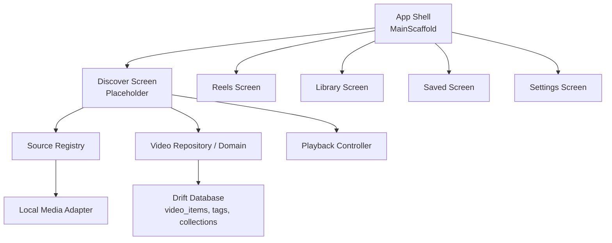
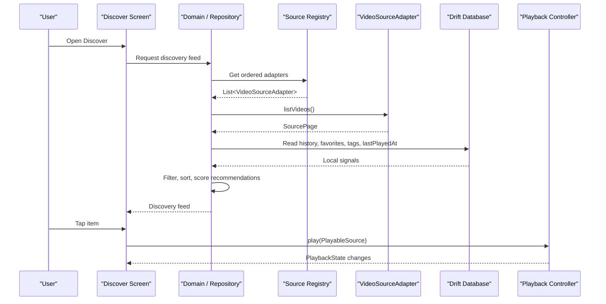
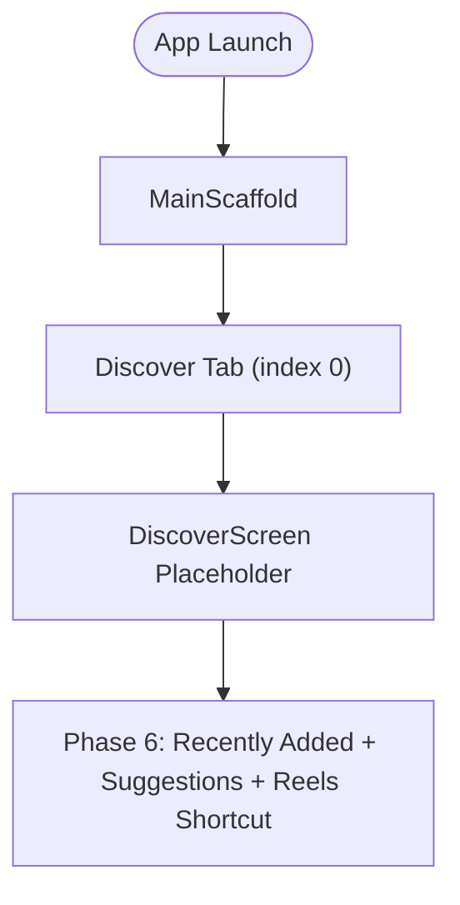
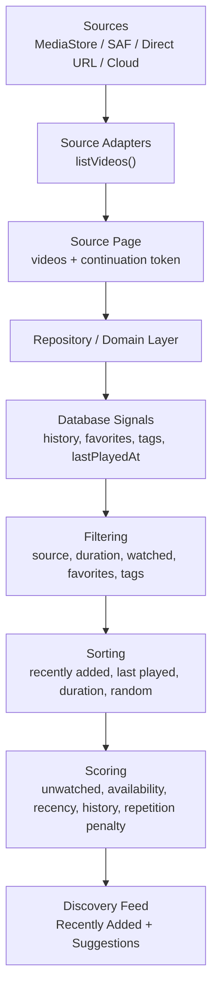
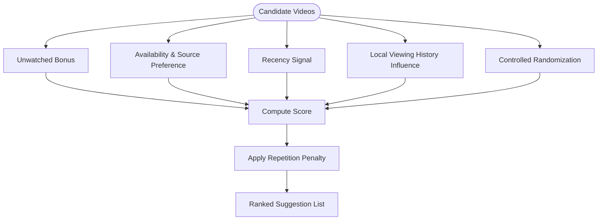
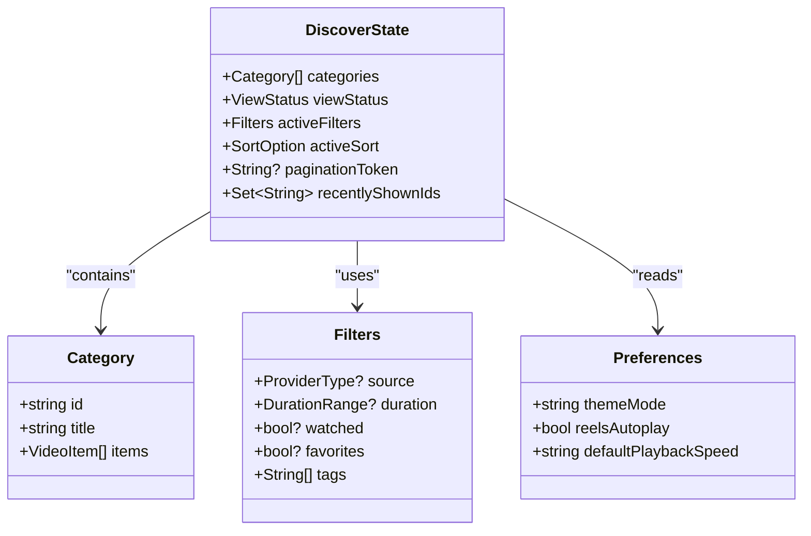
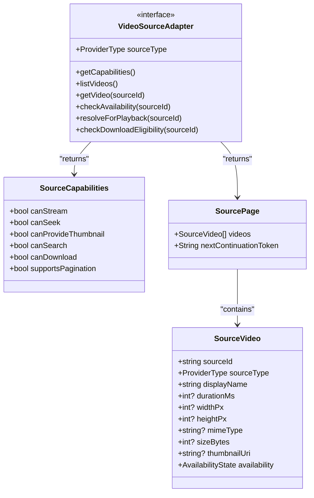
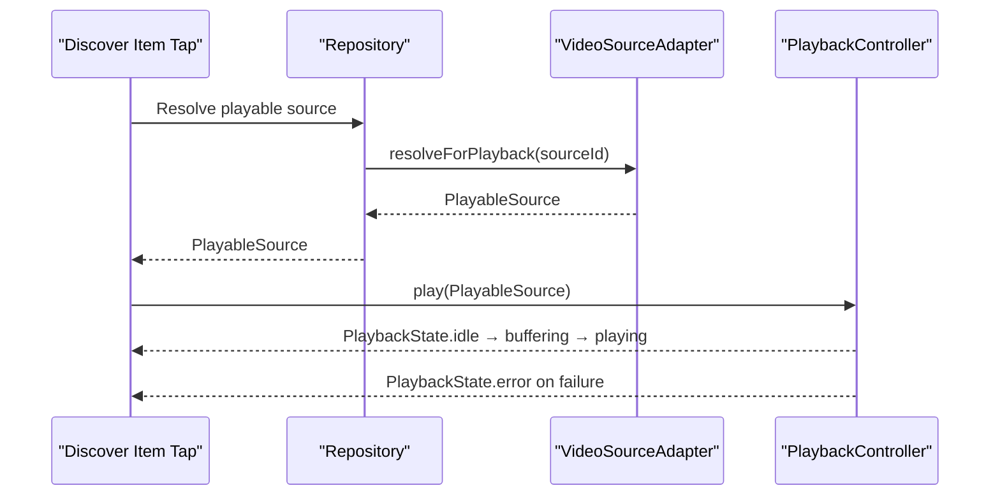
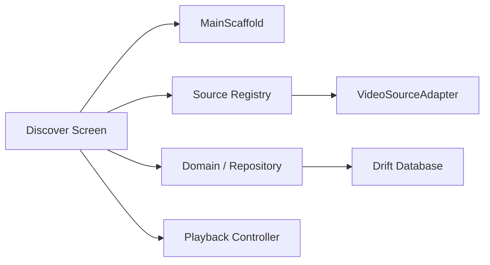

# Discover Feature

<cite>
**Referenced Files in This Document**
- [ARCHITECTURE.md](file://ARCHITECTURE.md)
- [REQUIREMENTS.md](file://REQUIREMENTS.md)
- [TASKS.md](file://TASKS.md)
- [main_scaffold.dart](file://lib/app/main_scaffold.dart)
- [discover_screen.dart](file://lib/features/discover/discover_screen.dart)
- [source_adapter.dart](file://lib/sources/source_adapter.dart)
- [source_registry.dart](file://lib/sources/source_registry.dart)
- [video_items_table.dart](file://lib/data/database/tables/video_items_table.dart)
- [app_preferences_table.dart](file://lib/data/database/tables/app_preferences_table.dart)
- [playback_controller.dart](file://lib/playback/playback_controller.dart)
- [app_playback_controller.dart](file://lib/playback/app_playback_controller.dart)
- [player_handle.dart](file://lib/playback/player_handle.dart)
- [playback_provider.dart](file://lib/playback/playback_provider.dart)
</cite>

## Table of Contents
1. [Introduction](#introduction)
2. [Project Structure](#project-structure)
3. [Core Components](#core-components)
4. [Architecture Overview](#architecture-overview)
5. [Detailed Component Analysis](#detailed-component-analysis)
6. [Dependency Analysis](#dependency-analysis)
7. [Performance Considerations](#performance-considerations)
8. [Troubleshooting Guide](#troubleshooting-guide)
9. [Conclusion](#conclusion)

## Introduction
This document defines the planned Discover feature for the video streaming app. Discover is the default launch tab and should showcase recently added videos, rule-based personalized suggestions, and quick access to Reels. The feature must remain local-first, deterministic, testable, and performant with large libraries. It integrates with the existing source adapter system, Drift-backed library data, and the app-owned playback controller without leaking platform or player-specific details into the UI.

The MVP explicitly avoids ML pipelines and server-side personalization. Recommendations are rule-based, transparent, and driven by local signals such as unwatched status, source availability, recency, viewing history, and repetition reduction.

**Section sources**
- [REQUIREMENTS.md:31-39](file://REQUIREMENTS.md#L31-L39)
- [REQUIREMENTS.md:176-185](file://REQUIREMENTS.md#L176-L185)
- [ARCHITECTURE.md:187-206](file://ARCHITECTURE.md#L187-L206)

## Project Structure
Discover lives under `lib/features/discover` and is currently a placeholder screen wired into the main bottom navigation. The broader architecture places Discover alongside Reels, Library, Saved, Settings, Sources, Playback, Platform bridges, Domain models, and Data persistence.

**Diagram sources**
- [main_scaffold.dart:8-16](file://lib/app/main_scaffold.dart#L8-L16)
- [discover_screen.dart:3-6](file://lib/features/discover/discover_screen.dart#L3-L6)
- [source_registry.dart:5-10](file://lib/sources/source_registry.dart#L5-L10)
- [video_items_table.dart:3-10](file://lib/data/database/tables/video_items_table.dart#L3-L10)
- [playback_controller.dart:4-14](file://lib/playback/playback_controller.dart#L4-L14)

**Section sources**
- [ARCHITECTURE.md:13-53](file://ARCHITECTURE.md#L13-L53)
- [main_scaffold.dart:8-16](file://lib/app/main_scaffold.dart#L8-L16)
- [discover_screen.dart:3-6](file://lib/features/discover/discover_screen.dart#L3-L6)

## Core Components
- Discover screen: Placeholder widget that will host recently added items, recommendation sections, and a Reels shortcut.
- Source adapters: Unified contract for listing, metadata, availability, and playable-source resolution across local, direct URL, and cloud providers.
- Source registry: Ordered list of active adapters used by scanning and discovery services.
- Domain and repository layer: Rule-based recommendation scoring, filtering, sorting, duplicate grouping, watch progress, favorites, tags, and collections.
- Drift database: Logical video items, source locations, tags, collections, preferences, and related tables.
- Playback controller: App-owned abstraction over the underlying player engine, exposing state and commands to UI.

Key responsibilities:
- Presentation: Widgets, routing, view state, and user interactions.
- Domain: Framework-light models and use cases for listing, search, filter, sort, recommendation scoring, availability states, refresh coordination, and duplicate matching.
- Data: Drift database, DAOs, migrations, repository implementations, and typed mappings.
- Sources: Provider-specific listing, metadata, availability, and playable-source resolution.
- Playback: Loading, playing, paused, buffering, position, duration, completion, and error states.

**Section sources**
- [ARCHITECTURE.md:55-93](file://ARCHITECTURE.md#L55-L93)
- [source_adapter.dart:5-22](file://lib/sources/source_adapter.dart#L5-L22)
- [source_registry.dart:5-10](file://lib/sources/source_registry.dart#L5-L10)
- [video_items_table.dart:3-10](file://lib/data/database/tables/video_items_table.dart#L3-L10)
- [playback_controller.dart:4-14](file://lib/playback/playback_controller.dart#L4-L14)

## Architecture Overview
The Discover flow connects UI, domain logic, sources, persistence, and playback through clear boundaries.

**Diagram sources**
- [discover_screen.dart:3-6](file://lib/features/discover/discover_screen.dart#L3-L6)
- [source_registry.dart:5-10](file://lib/sources/source_registry.dart#L5-L10)
- [source_adapter.dart:30-56](file://lib/sources/source_adapter.dart#L30-L56)
- [video_items_table.dart:11-44](file://lib/data/database/tables/video_items_table.dart#L11-L44)
- [playback_controller.dart:15-29](file://lib/playback/playback_controller.dart#L15-L29)

## Detailed Component Analysis

### Discover Screen and Navigation
Discover is the first tab and remains alive when switching tabs. It currently shows a placeholder title and body until Phase 6 wires real content.

**Diagram sources**
- [main_scaffold.dart:8-16](file://lib/app/main_scaffold.dart#L8-L16)
- [main_scaffold.dart:32-33](file://lib/app/main_scaffold.dart#L32-L33)
- [discover_screen.dart:3-17](file://lib/features/discover/discover_screen.dart#L3-L17)

**Section sources**
- [main_scaffold.dart:8-16](file://lib/app/main_scaffold.dart#L8-L16)
- [main_scaffold.dart:32-33](file://lib/app/main_scaffold.dart#L32-L33)
- [discover_screen.dart:3-17](file://lib/features/discover/discover_screen.dart#L3-L17)
- [TASKS.md:198-212](file://TASKS.md#L198-L212)

### Proposed UI Layout
Recommended layout for the completed Discover screen:
- Header: App bar with “Discover” title and optional quick actions such as Refresh and Reels shortcut.
- Primary section: Recently added videos displayed as a horizontal row or small grid using thumbnails, titles, durations, and source indicators.
- Secondary section: Personalized suggestions generated by rule-based scoring, shown as a scrollable list or grid.
- Empty and small-library states: Clear messaging when no videos exist, permissions are missing, or only a few items are available.
- Error states: Actionable messages for unavailable sources, permission revocation, network issues, and unsupported formats.

Thumbnail strategy:
- Prefer hybrid thumbnails: Android-generated local thumbnails, provider thumbnails, cached remote previews, and fallbacks.
- Thumbnail failure must not prevent a video from appearing.

Metadata display:
- Title, duration, dimensions where available, source type, favorite indicator, watched status, and last-played time.

Recommendation controls:
- Deterministic scoring parameters exposed to tests and settings rather than hidden ML weights.
- Options may include balancing randomness, unwatched preference, source availability, history influence, and repetition reduction.

[No sources needed since this section describes proposed UI design]

### Data Flow from Video Sources to Discovery Feed
The discovery feed is assembled from source listings merged with local signals and then filtered, sorted, and scored.

**Diagram sources**
- [source_adapter.dart:30-56](file://lib/sources/source_adapter.dart#L30-L56)
- [video_items_table.dart:11-44](file://lib/data/database/tables/video_items_table.dart#L11-L44)
- [ARCHITECTURE.md:187-206](file://ARCHITECTURE.md#L187-L206)
- [REQUIREMENTS.md:176-185](file://REQUIREMENTS.md#L176-L185)

**Section sources**
- [source_adapter.dart:30-56](file://lib/sources/source_adapter.dart#L30-L56)
- [video_items_table.dart:11-44](file://lib/data/database/tables/video_items_table.dart#L11-L44)
- [ARCHITECTURE.md:187-206](file://ARCHITECTURE.md#L187-L206)
- [REQUIREMENTS.md:176-185](file://REQUIREMENTS.md#L176-L185)

### Filtering and Sorting Mechanisms
Filters:
- Source type: local MediaStore, selected folder, direct URL, OneDrive, Google Drive, Cloudflare R2.
- Duration ranges.
- Watched status based on watch progress and last-played timestamp.
- Favorites.
- Tags.

Sorts:
- Recently added.
- Last played.
- Duration.
- Random.

These operations should be implemented in the domain/repository layer so they are testable and independent of UI state.

**Section sources**
- [REQUIREMENTS.md:118-133](file://REQUIREMENTS.md#L118-L133)
- [ARCHITECTURE.md:63-68](file://ARCHITECTURE.md#L63-L68)

### Recommendation Algorithm and Personalization
MVP rules:
- Positive weight for unwatched items.
- Source preference and availability.
- Recency of addition or last interaction.
- Controlled randomization.
- Penalty for recently shown items to reduce repetition.
- Modest influence from local viewing history.

Constraints:
- No ML pipeline in MVP.
- Keep recommendation history local.
- Avoid repeatedly showing the same small subset when more videos exist.
- Provide useful empty/small-library states.

Implementation guidance:
- Score each candidate item deterministically.
- Normalize scores per page or session.
- Apply repetition penalties against a short-term shown-item window.
- Allow testing with fixed seeds and controlled inputs.
- Expose scoring parameters through domain configuration or settings where appropriate.

**Diagram sources**
- [ARCHITECTURE.md:199-206](file://ARCHITECTURE.md#L199-L206)
- [REQUIREMENTS.md:176-185](file://REQUIREMENTS.md#L176-L185)

**Section sources**
- [ARCHITECTURE.md:199-206](file://ARCHITECTURE.md#L199-L206)
- [REQUIREMENTS.md:176-185](file://REQUIREMENTS.md#L176-L185)

### State Management Structure
Recommended state structure for Discover:
- Discovery categories:
  - Recently added
  - Personalized suggestions
  - Quick actions (e.g., open Reels)
- User preferences:
  - Theme mode
  - Reels autoplay
  - Default playback speed
  - Optional future flags for recommendation sensitivity
- View state:
  - Loading, empty, error, loaded
  - Active filters and sorts
  - Pagination tokens for large feeds
- Session state:
  - Recently shown items for repetition reduction
  - Temporary recommendation seed or randomized order

Persistence:
- Use Drift for library metadata, favorites, tags, collections, watch progress, and last-played timestamps.
- Use the key-value preferences table for user-facing settings.

**Diagram sources**
- [video_items_table.dart:11-44](file://lib/data/database/tables/video_items_table.dart#L11-L44)
- [app_preferences_table.dart:11-35](file://lib/data/database/tables/app_preferences_table.dart#L11-L35)

**Section sources**
- [video_items_table.dart:11-44](file://lib/data/database/tables/video_items_table.dart#L11-L44)
- [app_preferences_table.dart:11-35](file://lib/data/database/tables/app_preferences_table.dart#L11-L35)
- [ARCHITECTURE.md:95-128](file://ARCHITECTURE.md#L95-L128)

### Integration with Video Source System
Discover consumes the source adapter contract through the source registry. Adapters expose capabilities, list videos with pagination, fetch single items, check availability, resolve playable sources, and report download eligibility.

**Diagram sources**
- [source_adapter.dart:23-56](file://lib/sources/source_adapter.dart#L23-L56)
- [source_adapter.dart:63-117](file://lib/sources/source_adapter.dart#L63-L117)

**Section sources**
- [source_adapter.dart:5-22](file://lib/sources/source_adapter.dart#L5-L22)
- [source_adapter.dart:30-56](file://lib/sources/source_adapter.dart#L30-L56)
- [source_adapter.dart:63-117](file://lib/sources/source_adapter.dart#L63-L117)
- [source_registry.dart:5-10](file://lib/sources/source_registry.dart#L5-L10)

### Integration with Playback Controller
When a user selects an item from Discover, the app resolves a playable source and hands it to the playback controller. The controller manages loading, buffering, playing, pausing, seeking, and errors while exposing a stable `PlaybackState`.

**Diagram sources**
- [source_adapter.dart:48-52](file://lib/sources/source_adapter.dart#L48-L52)
- [playback_controller.dart:15-29](file://lib/playback/playback_controller.dart#L15-L29)
- [app_playback_controller.dart:8-23](file://lib/playback/app_playback_controller.dart#L8-L23)

**Section sources**
- [source_adapter.dart:48-52](file://lib/sources/source_adapter.dart#L48-L52)
- [playback_controller.dart:15-29](file://lib/playback/playback_controller.dart#L15-L29)
- [app_playback_controller.dart:8-23](file://lib/playback/app_playback_controller.dart#L8-L23)

## Dependency Analysis
Discover depends on:
- Main scaffold for navigation and tab lifecycle.
- Source registry for discovering available adapters.
- Source adapters for listing and resolving videos.
- Domain/repository for filtering, sorting, and scoring.
- Drift database for library metadata and user preferences.
- Playback controller for starting playback.

**Diagram sources**
- [main_scaffold.dart:8-16](file://lib/app/main_scaffold.dart#L8-L16)
- [source_registry.dart:5-10](file://lib/sources/source_registry.dart#L5-L10)
- [source_adapter.dart:23-56](file://lib/sources/source_adapter.dart#L23-L56)
- [video_items_table.dart:11-44](file://lib/data/database/tables/video_items_table.dart#L11-L44)
- [playback_controller.dart:15-29](file://lib/playback/playback_controller.dart#L15-L29)

**Section sources**
- [main_scaffold.dart:8-16](file://lib/app/main_scaffold.dart#L8-L16)
- [source_registry.dart:5-10](file://lib/sources/source_registry.dart#L5-L10)
- [source_adapter.dart:23-56](file://lib/sources/source_adapter.dart#L23-L56)
- [video_items_table.dart:11-44](file://lib/data/database/tables/video_items_table.dart#L11-L44)
- [playback_controller.dart:15-29](file://lib/playback/playback_controller.dart#L15-L29)

## Performance Considerations
- Lazy loading: Load pages of videos incrementally; do not scan all sources on every rebuild or tab switch.
- Indexing and refresh: Use lightweight foreground checks, manual refresh, incremental refresh where supported, and store scan timestamps.
- Cancellation: Long-running adapter operations must respect cancellation tokens and abort work without errors when cancelled.
- Thumbnails: Use hybrid thumbnails and cache them separately from downloads and originals.
- Cache budget: Evict least-recently-used cache entries under a configured limit; coordinate with active playback and thumbnail work.
- Memory pressure: Limit preloading and avoid holding large lists in memory longer than necessary.
- Non-blocking operations: Do not block UI during scans, thumbnails, database work, or network operations.

**Section sources**
- [ARCHITECTURE.md:208-228](file://ARCHITECTURE.md#L208-L228)
- [source_adapter.dart:152-164](file://lib/sources/source_adapter.dart#L152-L164)
- [REQUIREMENTS.md:187-209](file://REQUIREMENTS.md#L187-L209)
- [REQUIREMENTS.md:246-263](file://REQUIREMENTS.md#L246-L263)

## Troubleshooting Guide
Common issues and handling strategies:
- Empty or small library: Show helpful messages and encourage adding local folders or direct URLs.
- Permission revoked: Surface permission-related availability states and provide retry or re-grant paths.
- Missing or inaccessible files: Keep identifiable records with availability updates instead of destructive deletion.
- Unsupported or expired links: Report actionable errors and offer retry or alternative sources where available.
- Rapid navigation and swipes: Cancel stale preloading and playback work; ensure rapid successive loads are safe.
- Thumbnail failures: Display placeholders without blocking video visibility.
- Cache cleanup: Ensure clearing cache does not delete original videos, library metadata, or explicit downloads.

Error states and messages should be user-safe, with diagnostic details separated from privacy-safe logs.

**Section sources**
- [ARCHITECTURE.md:242-250](file://ARCHITECTURE.md#L242-L250)
- [ARCHITECTURE.md:187-206](file://ARCHITECTURE.md#L187-L206)
- [REQUIREMENTS.md:147-150](file://REQUIREMENTS.md#L147-L150)
- [REQUIREMENTS.md:187-209](file://REQUIREMENTS.md#L187-L209)

## Conclusion
The Discover feature should present recently added videos and deterministic, rule-based personalized suggestions while integrating cleanly with the source adapter system, Drift-backed library data, and the playback controller. Implementation priorities include lazy loading, cancellation, hybrid thumbnails, cache management, and robust error handling. Recommendation algorithms must remain local, transparent, and testable, avoiding ML complexity in MVP. Once wired, Discover becomes the primary entry point for exploring the user’s local and cloud video collection.

[No sources needed since this section summarizes without analyzing specific files]