# Feature Modules

<cite>
**Referenced Files in This Document**
- [main.dart](file://lib/main.dart)
- [ARCHITECTURE.md](file://ARCHITECTURE.md)
- [personal_video_hub_app.dart](file://lib/app/personal_video_hub_app.dart)
- [app_error_handler.dart](file://lib/app/app_error_handler.dart)
- [uncaught_app_error.dart](file://lib/app/uncaught_app_error.dart)
- [privacy_safe_logger.dart](file://lib/core/logging/privacy_safe_logger.dart)
- [reels_screen.dart](file://lib/features/reels/reels_screen.dart)
- [discover_screen.dart](file://lib/features/discover/discover_screen.dart)
- [library_screen.dart](file://lib/features/library/library_screen.dart)
- [saved_screen.dart](file://lib/features/saved/saved_screen.dart)
- [settings_screen.dart](file://lib/features/settings/settings_screen.dart)
</cite>

## Table of Contents
1. [Introduction](#introduction)
2. [Project Structure](#project-structure)
3. [Core Components](#core-components)
4. [Architecture Overview](#architecture-overview)
5. [Detailed Component Analysis](#detailed-component-analysis)
6. [Dependency Analysis](#dependency-analysis)
7. [Performance Considerations](#performance-considerations)
8. [Troubleshooting Guide](#troubleshooting-guide)
9. [Conclusion](#conclusion)
10. [Appendices](#appendices)

## Introduction
This document explains the feature modules architecture for a local-first Flutter video application. The project follows clean architecture principles: features encapsulate their own UI, business logic, and data dependencies while sharing cross-cutting infrastructure such as error handling, logging, theme, navigation, and playback abstractions.

At this stage, the feature layer contains placeholder screens for Reels, Discover, Library, Saved, and Settings. The Reels feature is designed for a vertical swipe-first playback interface, while other features are planned with clear responsibilities documented in the architecture guide.

The application bootstrap wires a single dependency container, installs global error handling, and starts the app shell that hosts the feature tabs.

**Section sources**
- [ARCHITECTURE.md:1-53](file://ARCHITECTURE.md#L1-L53)
- [main.dart:8-32](file://lib/main.dart#L8-L32)

## Project Structure
The repository organizes code into layers and feature folders:

- `lib/app`: App shell, routing, navigation, theme, and error surface wiring.
- `lib/core`: Shared utilities, errors, result types, logging, and common UI helpers.
- `lib/domain`: Framework-light models, repositories, services, and policies.
- `lib/data`: Database, DAOs, migrations, repository implementations, and mappers.
- `lib/features`: Feature modules, each owning its presentation and related concerns.
- `lib/sources`: Source adapters for different media providers.
- `lib/playback`: App-owned playback service and controller interfaces.
- `lib/platform`: Platform bridges for MediaStore, SAF, thumbnails, PiP, and media session.

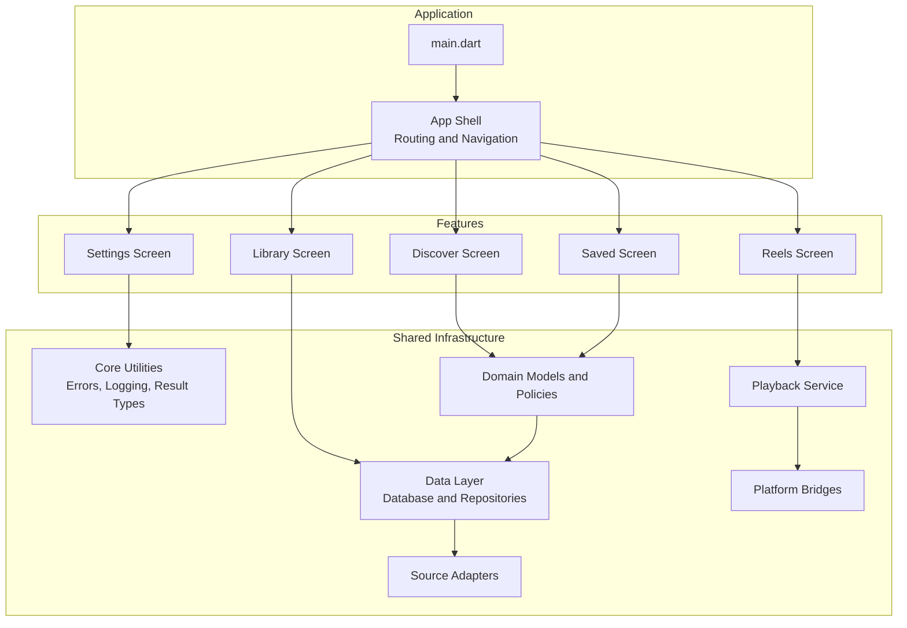

**Diagram sources**
- [main.dart:8-32](file://lib/main.dart#L8-L32)
- [ARCHITECTURE.md:13-53](file://ARCHITECTURE.md#L13-L53)

**Section sources**
- [ARCHITECTURE.md:13-53](file://ARCHITECTURE.md#L13-L53)

## Core Components
The core components supporting feature modules include:

- Application bootstrap and dependency container setup.
- Global error handling and uncaught error reporting.
- Privacy-safe logging used across features and infrastructure.
- Placeholder feature screens that define tab destinations and future integration points.

Key responsibilities:

- `main.dart` initializes Flutter bindings, creates or accepts a dependency container, installs error handling, and runs the app shell.
- `app_error_handler.dart` integrates platform error reporting with the container’s state.
- `uncaught_app_error.dart` exposes a provider for reporting and surfacing unhandled errors.
- `privacy_safe_logger.dart` provides structured, privacy-safe diagnostics without leaking sensitive information.

These components ensure that features can focus on user-facing behavior while relying on shared infrastructure for reliability and observability.

**Section sources**
- [main.dart:8-32](file://lib/main.dart#L8-L32)
- [app_error_handler.dart](file://lib/app/app_error_handler.dart)
- [uncaught_app_error.dart](file://lib/app/uncaught_app_error.dart)
- [privacy_safe_logger.dart](file://lib/core/logging/privacy_safe_logger.dart)

## Architecture Overview
The feature modules follow clean architecture boundaries:

- Presentation lives in `features`, containing screens and view state.
- Domain defines framework-light rules for listing, filtering, scoring, favorites, collections, watch progress, source selection, and availability transitions.
- Data implements persistence through Drift, repository implementations, and mappings.
- Source adapters encapsulate provider-specific behavior for listing, metadata, availability, and playable-source resolution.
- Playback wraps player packages behind stable interfaces.
- Platform bridges isolate native integrations.

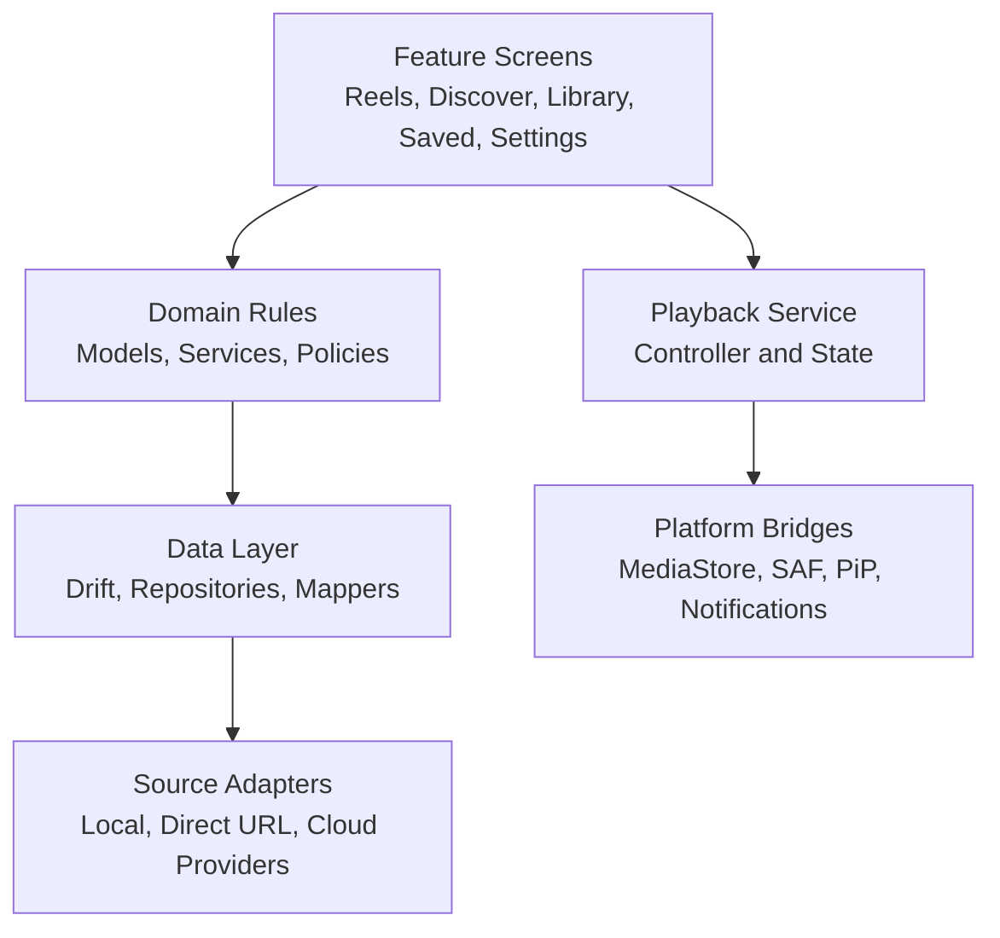

**Diagram sources**
- [ARCHITECTURE.md:55-93](file://ARCHITECTURE.md#L55-L93)
- [ARCHITECTURE.md:144-186](file://ARCHITECTURE.md#L144-L186)

**Section sources**
- [ARCHITECTURE.md:55-93](file://ARCHITECTURE.md#L55-L93)
- [ARCHITECTURE.md:144-186](file://ARCHITECTURE.md#L144-L186)

## Detailed Component Analysis

### Reels Feature
The Reels feature is intended to provide a full-screen, vertical swipe-first playback experience. The current implementation is a placeholder screen that will be wired to the playback pipeline in later phases.

Responsibilities:

- Present a swipeable queue of logical video items.
- Start playback when an item becomes active.
- Loop playback until the user swipes to another item.
- Preload adjacent items and cancel stale work during rapid swipes.
- Handle empty queues, inaccessible items, and disposal safely.

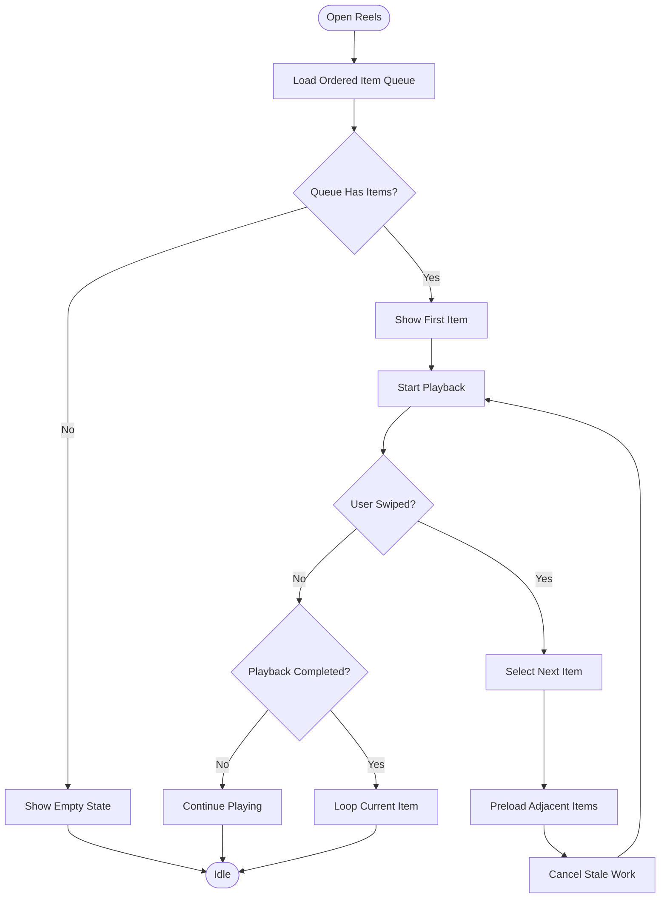

**Diagram sources**
- [ARCHITECTURE.md:187-198](file://ARCHITECTURE.md#L187-L198)

Current file status:

- `reels_screen.dart` is a placeholder scaffold for the Reels tab. It will later host the swipe-first player and minimal controls.

**Section sources**
- [reels_screen.dart:1-17](file://lib/features/reels/reels_screen.dart#L1-L17)
- [ARCHITECTURE.md:187-198](file://ARCHITECTURE.md#L187-L198)

### Discover Feature
The Discover feature should present recently added videos and rule-based suggestions, with quick access to Reels. Scoring should be deterministic and testable, using signals such as unwatched status, source preference, availability, recency, controlled randomization, penalties for recently shown items, and modest influence from local history.

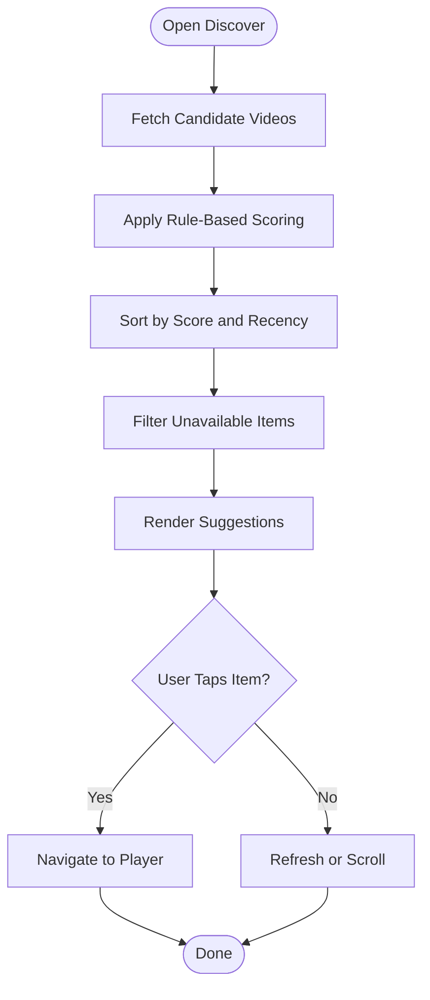

**Diagram sources**
- [ARCHITECTURE.md:199-206](file://ARCHITECTURE.md#L199-L206)

Current file status:

- `discover_screen.dart` is a placeholder scaffold for the Discover tab.

**Section sources**
- [discover_screen.dart:1-18](file://lib/features/discover/discover_screen.dart#L1-L18)
- [ARCHITECTURE.md:199-206](file://ARCHITECTURE.md#L199-L206)

### Library Feature
The Library feature should expose a searchable, filterable collection of videos. It interacts with domain rules for search, filters, sorts, and with data repositories for persistence.

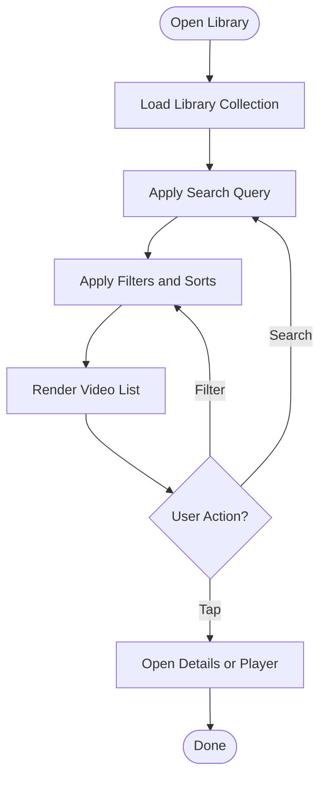

Current file status:

- `library_screen.dart` is a placeholder scaffold for the Library tab.

**Section sources**
- [library_screen.dart:1-17](file://lib/features/library/library_screen.dart#L1-L17)

### Saved Feature
The Saved feature manages favorites and custom collections. It should coordinate with domain services for favorites, collections, and ordering, and with data repositories for persistence.

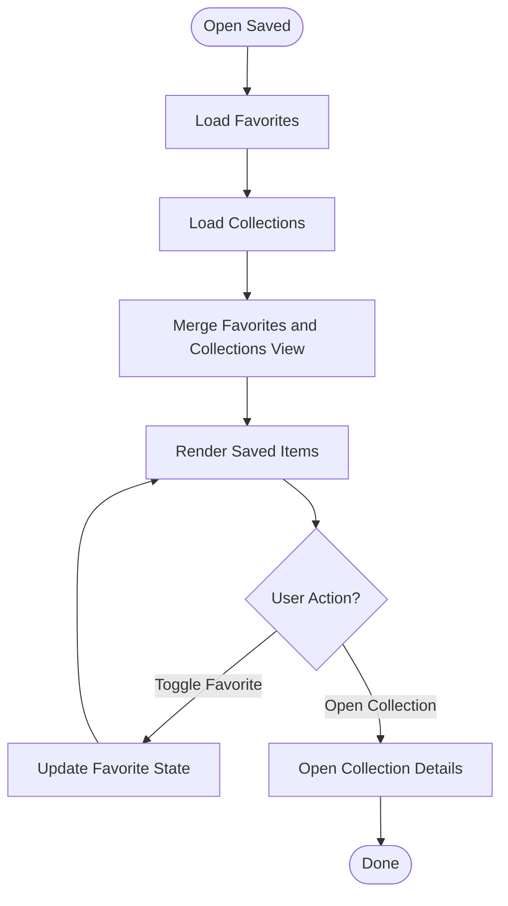

Current file status:

- `saved_screen.dart` is a placeholder scaffold for the Saved tab.

**Section sources**
- [saved_screen.dart:1-18](file://lib/features/saved/saved_screen.dart#L1-L18)

### Settings Feature
The Settings feature should manage providers, folders, playback preferences, downloads, cache, library controls, and theme selection. It reads and writes configuration through shared infrastructure and domain policies.

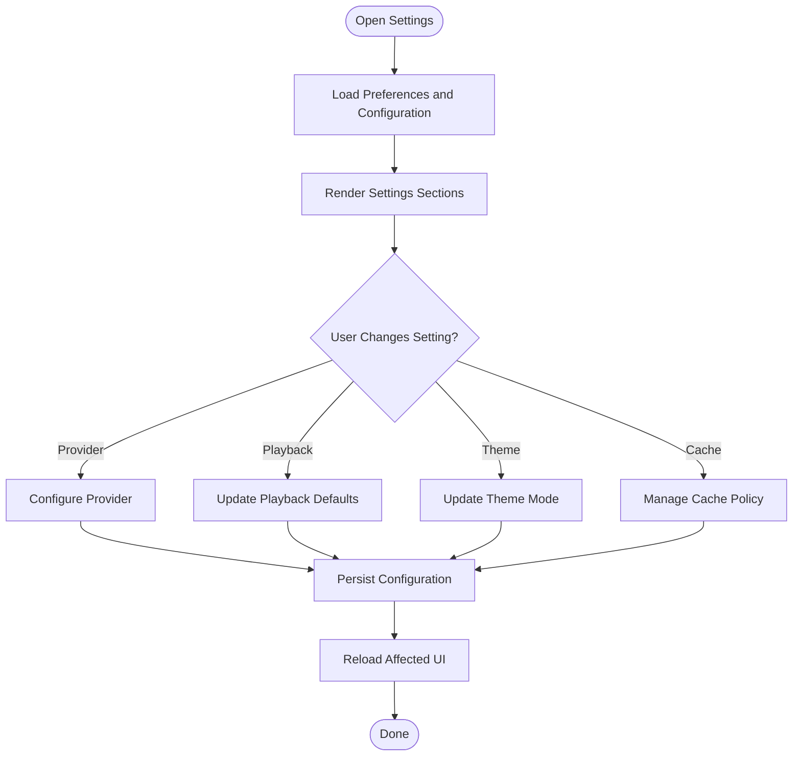

Current file status:

- `settings_screen.dart` is a placeholder scaffold for the Settings tab.

**Section sources**
- [settings_screen.dart:1-18](file://lib/features/settings/settings_screen.dart#L1-L18)

### Shared Components and State Management Patterns
Although the feature screens are currently placeholders, the architecture specifies consistent patterns:

- Use one state-management solution consistently across features.
- Keep widgets free of direct database queries or provider networking.
- Expose typed results and errors rather than raw exceptions.
- Share cross-cutting concerns through `core` and `app`.
- Use Riverpod containers for dependency injection, as indicated by the bootstrap.

Recommended patterns:

- Feature-scoped providers for view state.
- Shared providers for playback, logging, and error reporting.
- Repository abstractions for data access.
- Domain services for business rules.
- Clear separation between UI state and persistent state.

**Section sources**
- [ARCHITECTURE.md:55-74](file://ARCHITECTURE.md#L55-L74)
- [main.dart:18-31](file://lib/main.dart#L18-L31)

### Navigation Structure and Routing Configuration
The app shell is responsible for routing and navigation. The placeholder feature screens represent top-level tabs. Future routing should map each feature to a route and support deep links where appropriate.

Conceptual navigation flow:

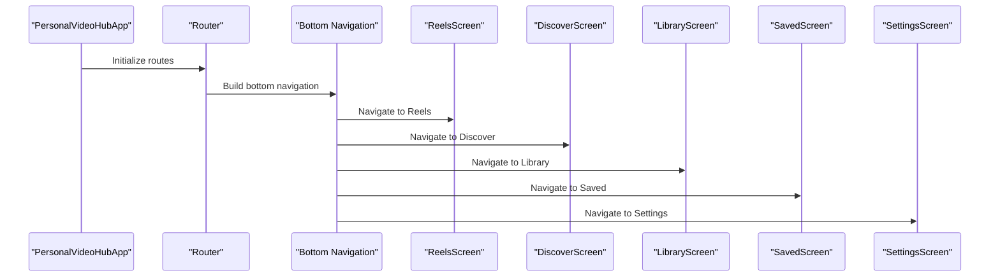

**Diagram sources**
- [personal_video_hub_app.dart](file://lib/app/personal_video_hub_app.dart)
- [reels_screen.dart:1-17](file://lib/features/reels/reels_screen.dart#L1-L17)
- [discover_screen.dart:1-18](file://lib/features/discover/discover_screen.dart#L1-L18)
- [library_screen.dart:1-17](file://lib/features/library/library_screen.dart#L1-L17)
- [saved_screen.dart:1-18](file://lib/features/saved/saved_screen.dart#L1-L18)
- [settings_screen.dart:1-18](file://lib/features/settings/settings_screen.dart#L1-L18)

**Section sources**
- [personal_video_hub_app.dart](file://lib/app/personal_video_hub_app.dart)

### Inter-Feature Communication Patterns
Inter-feature communication should remain minimal and explicit:

- Use shared domain services and repositories for state that multiple features need.
- Avoid direct widget-to-widget coupling.
- Use typed events or domain actions for cross-feature workflows.
- For playback-related interactions, use the playback service instead of feature-specific controllers.
- For settings changes, update shared configuration providers so affected features react accordingly.

**Section sources**
- [ARCHITECTURE.md:55-93](file://ARCHITECTURE.md#L55-L93)

### Feature Lifecycle and Initialization
Feature initialization should be lightweight:

- Defer heavy work until the feature is visible.
- Use cancellation tokens for long-running operations.
- Respect lifecycle changes such as pause, resume, and backgrounding.
- Persist progress and state at safe boundaries.
- Surface errors through the global error handler and privacy-safe logger.

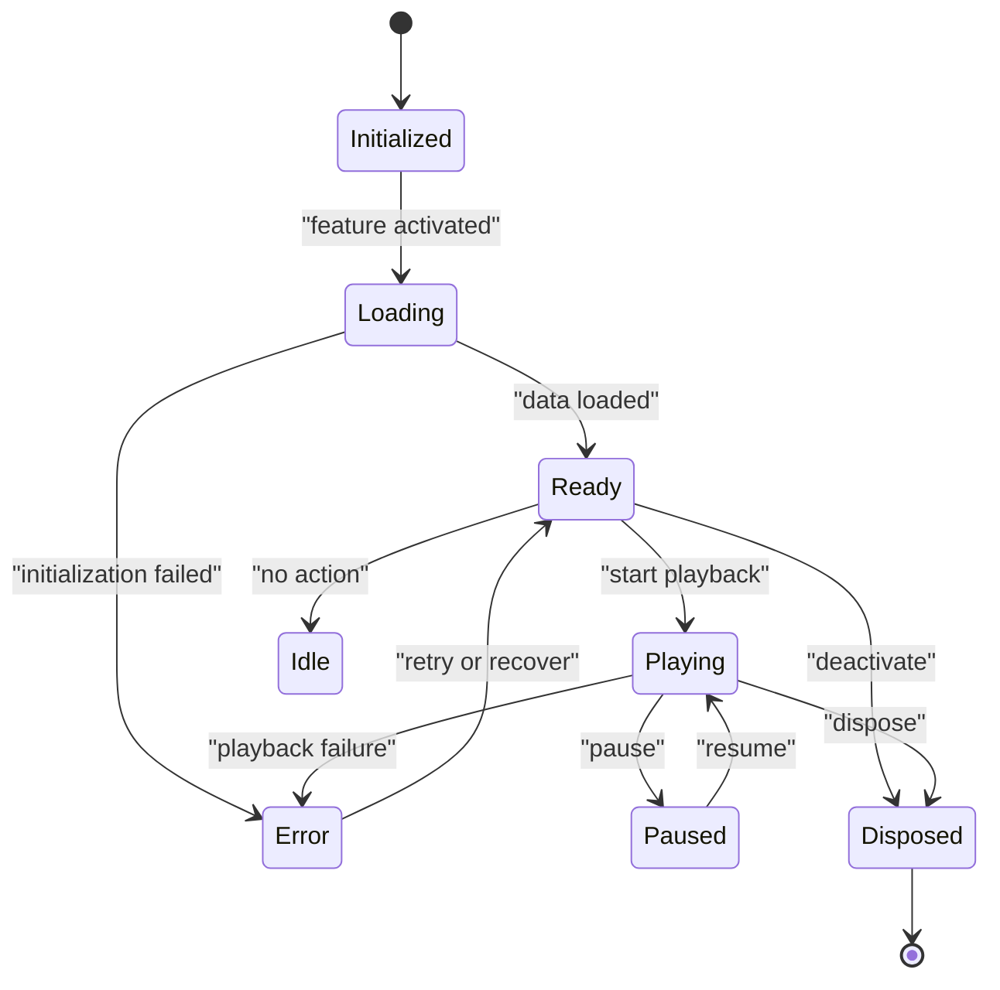

**Diagram sources**
- [ARCHITECTURE.md:171-186](file://ARCHITECTURE.md#L171-L186)

**Section sources**
- [ARCHITECTURE.md:171-186](file://ARCHITECTURE.md#L171-L186)

### Dependency Injection Setup
The bootstrap creates a single `ProviderContainer` and passes it to the app shell. This container owns providers for features, shared services, and cross-cutting concerns.

Key behaviors:

- Accept an optional container for testing or composition.
- Install global error handling before running the app.
- Report platform errors through the uncaught error provider.
- Use a privacy-safe logger for diagnostics.

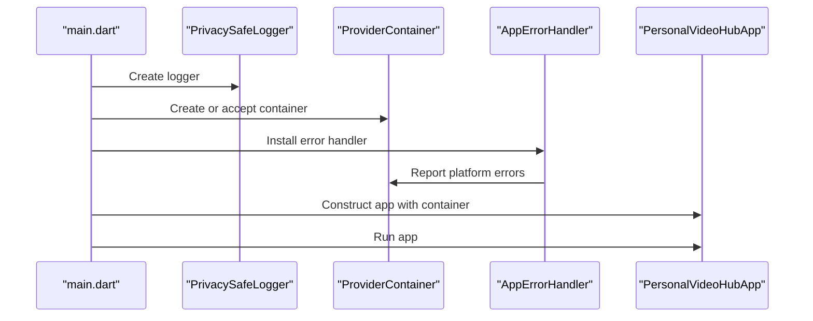

**Diagram sources**
- [main.dart:18-31](file://lib/main.dart#L18-L31)
- [app_error_handler.dart](file://lib/app/app_error_handler.dart)
- [uncaught_app_error.dart](file://lib/app/uncaught_app_error.dart)
- [privacy_safe_logger.dart](file://lib/core/logging/privacy_safe_logger.dart)

**Section sources**
- [main.dart:8-32](file://lib/main.dart#L8-L32)

### Feature Isolation Principles
Each feature should:

- Own its UI and view state.
- Depend on domain abstractions rather than concrete data implementations.
- Avoid importing sibling feature screens directly.
- Use shared infrastructure for logging, errors, theme, and navigation.
- Be independently testable with mocked repositories and services.

**Section sources**
- [ARCHITECTURE.md:55-93](file://ARCHITECTURE.md#L55-L93)

### Testing Strategies for Individual Features
Testing guidance per layer:

- Unit tests for domain rules, scoring, filtering, sorting, duplicate matching, availability transitions, and URL validation.
- Widget tests for navigation, empty/loading/error states, search/filter, favorites, collections, and controls.
- Integration tests for permissions, playback, provider flows, downloads, lifecycle, and background behavior.
- Security checks to verify no secrets in logs, fixtures, or backups.

For feature screens:

- Test navigation paths.
- Test loading, empty, and error states.
- Mock repositories and domain services.
- Verify user actions trigger expected domain calls.

**Section sources**
- [ARCHITECTURE.md:252-267](file://ARCHITECTURE.md#L252-L267)

### Guidelines for Adding New Features
When adding a new feature:

1. Create a folder under `lib/features/<feature_name>`.
2. Add a screen widget representing the feature entry point.
3. Define feature-scoped providers for view state.
4. Implement domain rules in `lib/domain` if needed.
5. Implement data access through repositories in `lib/data`.
6. Integrate with shared infrastructure: logging, errors, theme, and navigation.
7. Add unit and widget tests.
8. Wire routing in the app shell.
9. Avoid direct coupling to other features; communicate through shared services.

**Section sources**
- [ARCHITECTURE.md:13-53](file://ARCHITECTURE.md#L13-L53)

## Dependency Analysis
The current feature layer consists of placeholder screens. Their dependencies are intentionally minimal:

- Each feature imports only Flutter Material APIs.
- Real dependencies will be introduced through shared infrastructure and domain/data layers.
- The app shell and bootstrap connect features to the dependency container and error handling.

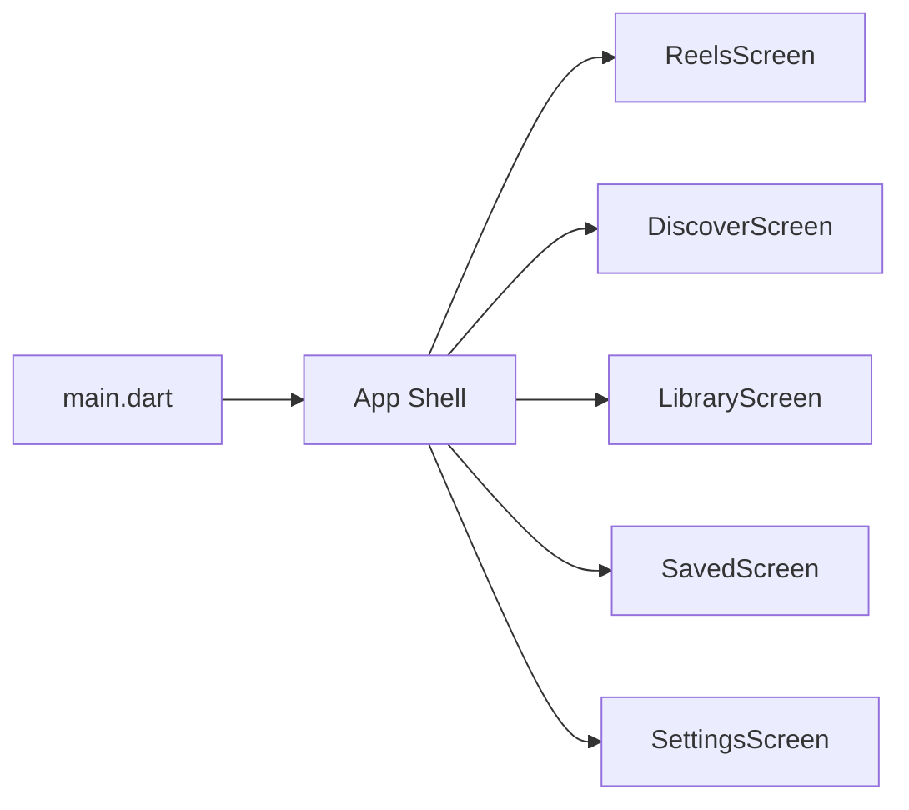

**Diagram sources**
- [main.dart:8-32](file://lib/main.dart#L8-L32)
- [reels_screen.dart:1-17](file://lib/features/reels/reels_screen.dart#L1-L17)
- [discover_screen.dart:1-18](file://lib/features/discover/discover_screen.dart#L1-L18)
- [library_screen.dart:1-17](file://lib/features/library/library_screen.dart#L1-L17)
- [saved_screen.dart:1-18](file://lib/features/saved/saved_screen.dart#L1-L18)
- [settings_screen.dart:1-18](file://lib/features/settings/settings_screen.dart#L1-L18)

**Section sources**
- [main.dart:8-32](file://lib/main.dart#L8-L32)
- [reels_screen.dart:1-17](file://lib/features/reels/reels_screen.dart#L1-L17)
- [discover_screen.dart:1-18](file://lib/features/discover/discover_screen.dart#L1-L18)
- [library_screen.dart:1-17](file://lib/features/library/library_screen.dart#L1-L17)
- [saved_screen.dart:1-18](file://lib/features/saved/saved_screen.dart#L1-L18)
- [settings_screen.dart:1-18](file://lib/features/settings/settings_screen.dart#L1-L18)

## Performance Considerations
Performance guidance for feature modules:

- Defer expensive initialization until features are visible.
- Use incremental refresh and avoid full scans on every rebuild.
- Preload a small number of adjacent items in Reels and cancel stale work during rapid swipes.
- Throttle progress writes and persist on safe boundaries.
- Separate cache, downloads, and original files to avoid unnecessary cleanup.
- Keep UI responsive by moving network and I/O off the main thread.

**Section sources**
- [ARCHITECTURE.md:187-228](file://ARCHITECTURE.md#L187-L228)

## Troubleshooting Guide
Common troubleshooting areas:

- Global errors: Use the installed error handler and uncaught error provider to capture and report issues.
- Logging: Use the privacy-safe logger to diagnose problems without exposing sensitive data.
- Availability and errors: Map user-visible messages to typed errors such as permission denial, authentication required, network unavailable, not found, unsupported format, expired source, rate limits, and unexpected failures.
- Playback failures: Offer retry or alternative sources where available.
- Settings and configuration: Validate that changes are persisted and reflected across features.

**Section sources**
- [main.dart:20-31](file://lib/main.dart#L20-L31)
- [ARCHITECTURE.md:230-250](file://ARCHITECTURE.md#L230-L250)

## Conclusion
The feature modules architecture separates concerns cleanly: features own their UI and workflow, domain rules stay framework-light, data access is centralized, source adapters isolate provider details, and playback and platform integrations are wrapped behind stable interfaces. At this stage, feature screens are placeholders ready to be wired to the playback pipeline, domain services, and data repositories. Following the isolation principles, testing strategies, and extension guidelines will keep the system maintainable, testable, and scalable as more features are implemented.

[No sources needed since this section summarizes without analyzing specific files]

## Appendices

### Feature Responsibilities Summary
- Reels: Vertical swipe-first playback, loop behavior, preload strategy, minimal controls.
- Discover: Rule-based suggestions, recent additions, quick access to Reels.
- Library: Searchable, filterable video collection.
- Saved: Favorites and custom collections.
- Settings: Providers, folders, playback preferences, downloads, cache, library controls, theme.

**Section sources**
- [reels_screen.dart:1-17](file://lib/features/reels/reels_screen.dart#L1-L17)
- [discover_screen.dart:1-18](file://lib/features/discover/discover_screen.dart#L1-L18)
- [library_screen.dart:1-17](file://lib/features/library/library_screen.dart#L1-L17)
- [saved_screen.dart:1-18](file://lib/features/saved/saved_screen.dart#L1-L18)
- [settings_screen.dart:1-18](file://lib/features/settings/settings_screen.dart#L1-L18)
- [ARCHITECTURE.md:187-228](file://ARCHITECTURE.md#L187-L228)