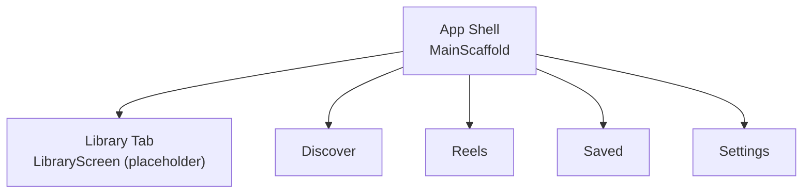
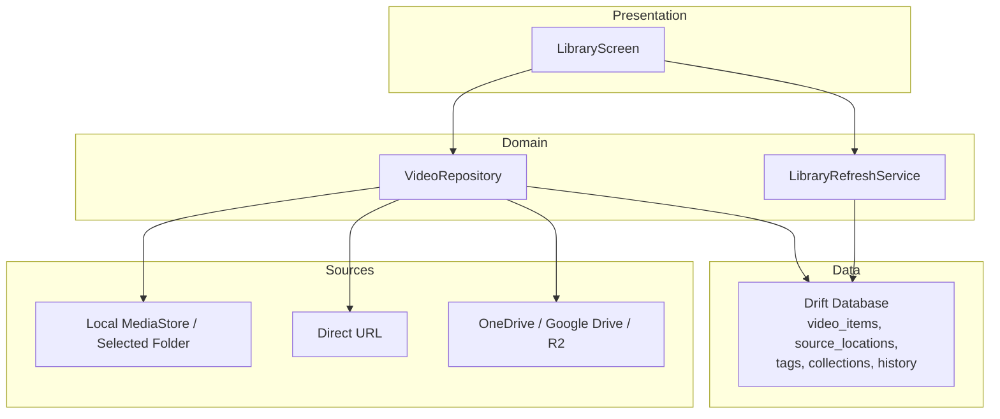
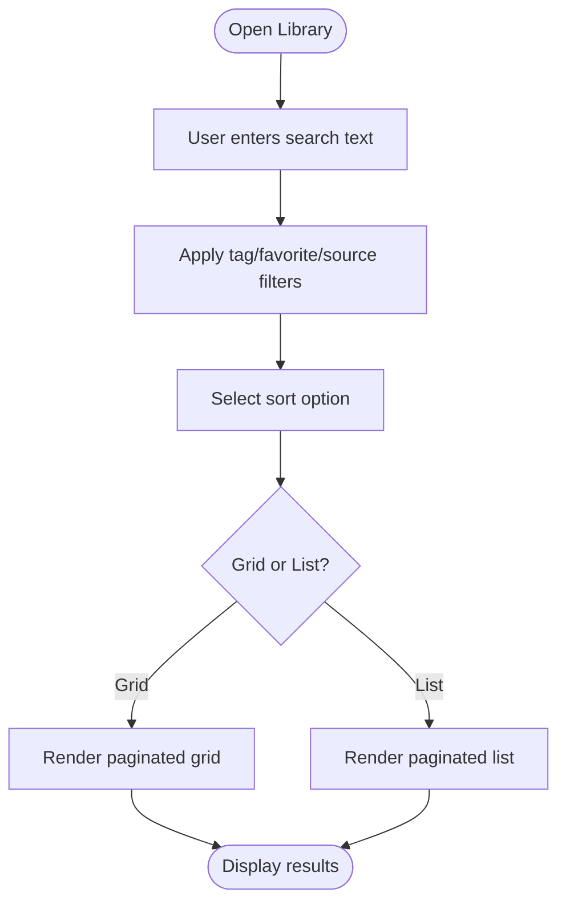
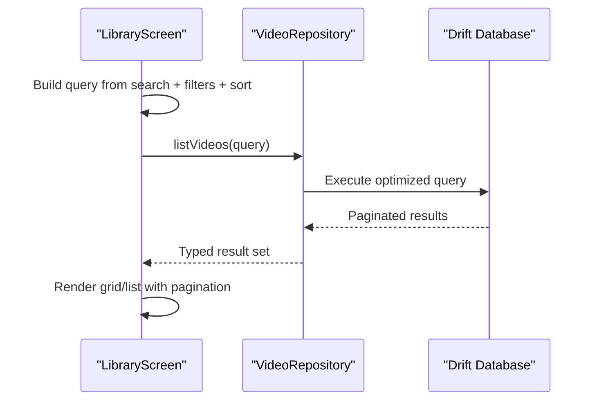
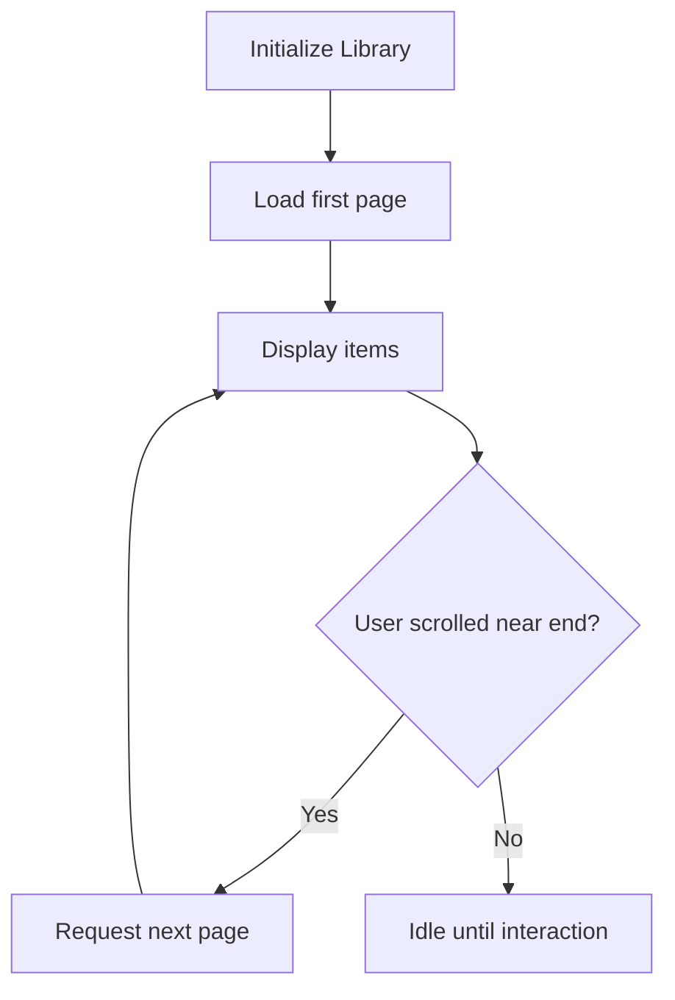
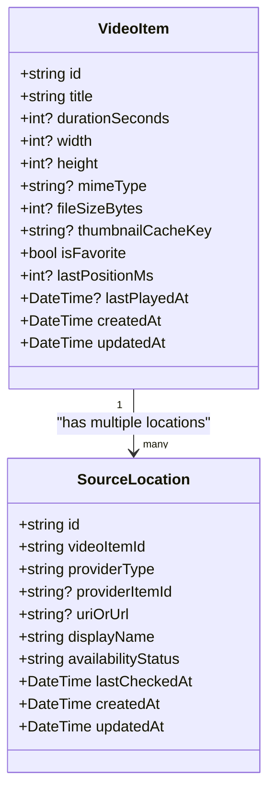
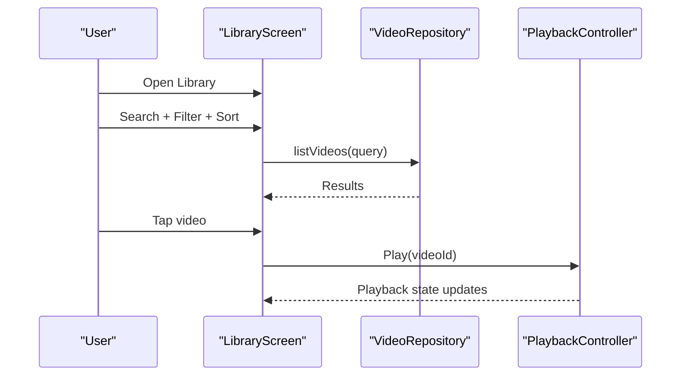
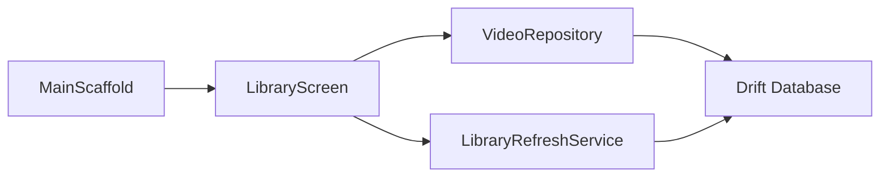

# Library Feature

<cite>
**Referenced Files in This Document**
- [ARCHITECTURE.md](file://ARCHITECTURE.md)
- [PROJECT_BRIEF.md](file://PROJECT_BRIEF.md)
- [main_scaffold.dart](file://lib/app/main_scaffold.dart)
- [library_screen.dart](file://lib/features/library/library_screen.dart)
- [video_repository.dart](file://lib/domain/repositories/video_repository.dart)
- [library_refresh_service_provider.dart](file://lib/domain/services/library_refresh_service_provider.dart)
</cite>

## Table of Contents
1. [Introduction](#introduction)
2. [Project Structure](#project-structure)
3. [Core Components](#core-components)
4. [Architecture Overview](#architecture-overview)
5. [Detailed Component Analysis](#detailed-component-analysis)
6. [Dependency Analysis](#dependency-analysis)
7. [Performance Considerations](#performance-considerations)
8. [Troubleshooting Guide](#troubleshooting-guide)
9. [Conclusion](#conclusion)
10. [Appendices](#appendices)

## Introduction
This document defines the planned Library feature for the personal video app. The Library is a searchable, filterable, and sortable collection of videos that integrates with local media sources, direct URLs, and cloud providers through source adapters. It persists metadata locally using Drift/SQLite and exposes a clean UI for browsing, selecting, organizing, and managing videos.

The current codebase contains:
- A placeholder Library tab integrated into the main navigation.
- Domain-level repository and refresh service abstractions.
- Architecture guidance for data models, indexing, duplicate grouping, caching, and performance.

The goal of this documentation is to specify how the Library will work once implemented, including search, filtering, sorting, grid/list views, pagination, database integration, user interaction patterns, and performance optimizations.

## Project Structure
The Library feature lives under `lib/features/library` and is wired into the app shell as one of five bottom tabs. The current implementation is a placeholder screen; real functionality will be added in later phases.

**Diagram sources**
- [main_scaffold.dart:1-105](file://lib/app/main_scaffold.dart#L1-L105)
- [library_screen.dart:1-17](file://lib/features/library/library_screen.dart#L1-L17)

**Section sources**
- [main_scaffold.dart:1-105](file://lib/app/main_scaffold.dart#L1-L105)
- [library_screen.dart:1-17](file://lib/features/library/library_screen.dart#L1-L17)

## Core Components
- Library Screen: Placeholder UI for the Library tab. Future implementation will include search input, filters, sort controls, view mode toggle, and a paginated list/grid of videos.
- Video Repository (Domain): Defines the contract for listing, searching, filtering, sorting, and removing library items.
- Library Refresh Service: Manages background or foreground scanning and merging of new/changed videos into the local database.
- Data Layer (Drift/SQLite): Persists logical video items, source locations, tags, collections, favorites, watch progress, and preferences.

Key responsibilities:
- Presentation: Search UI, filters, sorting, view switching, pagination.
- Domain: Query composition, duplicate handling, availability states, scoring/ranking rules.
- Data: Efficient SQL queries, indexing, migrations, DAOs, and typed results.

**Section sources**
- [library_screen.dart:1-17](file://lib/features/library/library_screen.dart#L1-L17)
- [video_repository.dart:53-53](file://lib/domain/repositories/video_repository.dart#L53-L53)
- [library_refresh_service_provider.dart:10-26](file://lib/domain/services/library_refresh_service_provider.dart#L10-L26)

## Architecture Overview
The Library follows the layered architecture described in the project:
- Presentation layer: Flutter widgets for search, filters, sorting, and display modes.
- Domain layer: Models, repositories, services, and policies for listing/search/filter/sort, favorites/tags/collections, watch progress, and duplicate matching.
- Data layer: Drift database, DAOs, migrations, repository implementations, and mappers.
- Source adapters: Local MediaStore, selected folder, direct URL, OneDrive, Google Drive, Cloudflare R2.
- Playback: App-owned playback controller/service.

**Diagram sources**
- [ARCHITECTURE.md:55-93](file://ARCHITECTURE.md#L55-L93)
- [ARCHITECTURE.md:95-128](file://ARCHITECTURE.md#L95-L128)
- [ARCHITECTURE.md:144-169](file://ARCHITECTURE.md#L144-L169)

## Detailed Component Analysis

### Library Screen (Placeholder)
Current state:
- Displays a simple Scaffold with an AppBar and centered text.
- Integrated into the main navigation at index 2.

Planned behavior:
- Search bar with text-based search across title and metadata.
- Filter chips for tags, favorites, availability, date ranges, duration ranges, and source type.
- Sort dropdown: relevance, newest, oldest, title, duration, size, last-played.
- View switcher between grid and list layouts.
- Pagination via scroll position and page size configuration.
- Empty/loading/error states consistent with shared UI components.

[No sources needed since this diagram shows conceptual workflow, not actual code structure]

**Section sources**
- [library_screen.dart:1-17](file://lib/features/library/library_screen.dart#L1-L17)
- [main_scaffold.dart:46-69](file://lib/app/main_scaffold.dart#L46-L69)

### Search, Filtering, and Sorting
Search:
- Text-based search over title and other searchable metadata fields.
- Case-insensitive, substring matching where appropriate.

Filtering:
- Tags: multi-select chip interface.
- Favorites: boolean toggle.
- Availability: available/offline/missing/expired_link/etc.
- Date range: created_at or updated_at.
- Duration range: short/medium/long or custom seconds.
- Source type: local_media_store, selected_folder, direct_url, onedrive, google_drive, cloudflare_r2.

Sorting:
- Relevance (search score), newest, oldest, title (A-Z/Z-A), duration (shortest/longest), size (smallest/largest), last-played.

Implementation approach:
- Compose domain query objects from UI inputs.
- Delegate to repository for efficient SQL generation and execution.
- Cache intermediate results when possible.

**Diagram sources**
- [video_repository.dart:53-53](file://lib/domain/repositories/video_repository.dart#L53-L53)

**Section sources**
- [ARCHITECTURE.md:63-74](file://ARCHITECTURE.md#L63-L74)

### Grid/List View Switching and Pagination
View switching:
- Toggle between grid and list modes.
- Persist preferred view mode in app preferences.

Pagination:
- Use scroll position and page size to request next pages.
- Avoid full scans on every rebuild/tab switch.
- Keep UI responsive during large dataset loads.

[No sources needed since this diagram shows conceptual workflow, not actual code structure]

**Section sources**
- [ARCHITECTURE.md:208-217](file://ARCHITECTURE.md#L208-L217)

### Database Integration and Caching
Data model highlights:
- video_items: logical video entries with stable IDs, display metadata, thumbnail cache key, favorite state, watch progress, timestamps, and search metadata.
- source_locations: multiple access points per logical video item with provider type, URI/URL, availability status, and timestamps.
- Organization: tags, video_tags, collections, collection_items, watch progress/history, downloads, app_preferences.

Caching:
- Thumbnails and remote previews are cached separately from downloads and original files.
- Cache cleanup respects active playback and configured limits.

Indexing and refresh:
- Lightweight foreground checks and manual refresh.
- Incremental refresh when supported; store scan timestamps.
- Merge source metadata without overwriting user edits (favorites, tags, collections, progress).

**Diagram sources**
- [ARCHITECTURE.md:95-128](file://ARCHITECTURE.md#L95-L128)

**Section sources**
- [ARCHITECTURE.md:95-128](file://ARCHITECTURE.md#L95-L128)
- [ARCHITECTURE.md:208-228](file://ARCHITECTURE.md#L208-L228)

### User Interaction Patterns
Browsing:
- Open Library tab from bottom navigation.
- Use search bar to find videos by title or metadata.
- Apply filters for tags, favorites, availability, date/duration ranges, and source types.
- Sort results by relevance, date, title, duration, size, or last-played.
- Switch between grid and list views.

Selecting:
- Tap a video to start playback via the playback controller.
- Playback selection resolves a playable source based on availability and policy.

Managing:
- Mark favorites, assign tags, add to collections.
- Remove items from the library without deleting original files.
- Handle unavailable sources with retry/reconnect actions.

**Diagram sources**
- [library_screen.dart:1-17](file://lib/features/library/library_screen.dart#L1-L17)
- [video_repository.dart:53-53](file://lib/domain/repositories/video_repository.dart#L53-L53)

**Section sources**
- [PROJECT_BRIEF.md:53-60](file://PROJECT_BRIEF.md#L53-L60)
- [ARCHITECTURE.md:171-186](file://ARCHITECTURE.md#L171-L186)

### Customizing Search Filters and Display Formats
Examples of customization:
- Add a new filter chip for “Source Type” with options like local, direct URL, OneDrive, Google Drive, R2.
- Extend sort options to include “Most watched” or “Recently updated”.
- Change grid density by adjusting tile size and aspect ratio.
- Customize list row layout to show additional metadata such as resolution or file size.

These customizations should be implemented in the presentation layer and mapped to domain query parameters before calling the repository.

[No sources needed since this section provides general guidance]

## Dependency Analysis
The Library depends on:
- Main scaffold for navigation entry.
- Domain repository for querying and managing library data.
- Refresh service for scanning and merging content.
- Data layer for persistence and efficient queries.

**Diagram sources**
- [main_scaffold.dart:1-105](file://lib/app/main_scaffold.dart#L1-L105)
- [library_screen.dart:1-17](file://lib/features/library/library_screen.dart#L1-L17)
- [video_repository.dart:53-53](file://lib/domain/repositories/video_repository.dart#L53-L53)
- [library_refresh_service_provider.dart:10-26](file://lib/domain/services/library_refresh_service_provider.dart#L10-L26)

**Section sources**
- [main_scaffold.dart:1-105](file://lib/app/main_scaffold.dart#L1-L105)
- [library_screen.dart:1-17](file://lib/features/library/library_screen.dart#L1-L17)
- [video_repository.dart:53-53](file://lib/domain/repositories/video_repository.dart#L53-L53)
- [library_refresh_service_provider.dart:10-26](file://lib/domain/services/library_refresh_service_provider.dart#L10-L26)

## Performance Considerations
- Avoid full scans on every rebuild or tab switch; use incremental refresh and cache scan timestamps.
- Keep indexing cancellable and UI responsive.
- Use pagination and virtualized lists/grids for large datasets.
- Separate cache directories for thumbnails/previews from downloads and originals.
- Implement efficient SQL queries with proper indexes on frequently filtered/sorted columns (e.g., title, created_at, availability_status).
- Throttle writes for watch progress and avoid blocking the UI thread.
- Cancel stale work during rapid interactions (e.g., fast scrolling or repeated searches).

[No sources needed since this section provides general guidance]

## Troubleshooting Guide
Common issues and resolutions:
- No results after search: verify query composition and ensure search metadata exists.
- Slow loading: check pagination settings, query complexity, and database indexes.
- Unavailable sources: surface availability states and offer retry/reconnect actions.
- Duplicate entries: rely on conservative duplicate matching; never merge solely on filename.
- Cache clearing side effects: ensure Clear Cache does not delete downloads, library metadata, or original files.

**Section sources**
- [ARCHITECTURE.md:129-142](file://ARCHITECTURE.md#L129-L142)
- [ARCHITECTURE.md:219-228](file://ARCHITECTURE.md#L219-L228)
- [ARCHITECTURE.md:242-250](file://ARCHITECTURE.md#L242-L250)

## Conclusion
The Library feature will provide a robust, searchable, and organized video collection experience. It integrates with local and cloud sources through adapters, persists metadata locally, and supports advanced search, filtering, sorting, and pagination. The design emphasizes performance, safety, and testability while keeping the UI accessible and customizable.

[No sources needed since this section summarizes without analyzing specific files]

## Appendices

### Navigation Entry Point
The Library tab is integrated into the main scaffold and appears as the third tab.

**Section sources**
- [main_scaffold.dart:10-26](file://lib/app/main_scaffold.dart#L10-L26)
- [main_scaffold.dart:46-69](file://lib/app/main_scaffold.dart#L46-L69)

### Current Library Screen Status
The Library screen is currently a placeholder and will be expanded in Phase 5.

**Section sources**
- [library_screen.dart:1-17](file://lib/features/library/library_screen.dart#L1-L17)