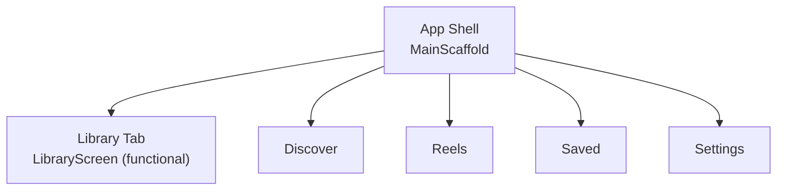
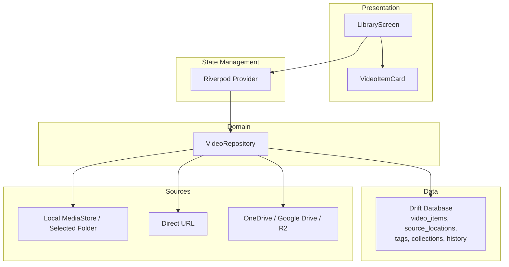
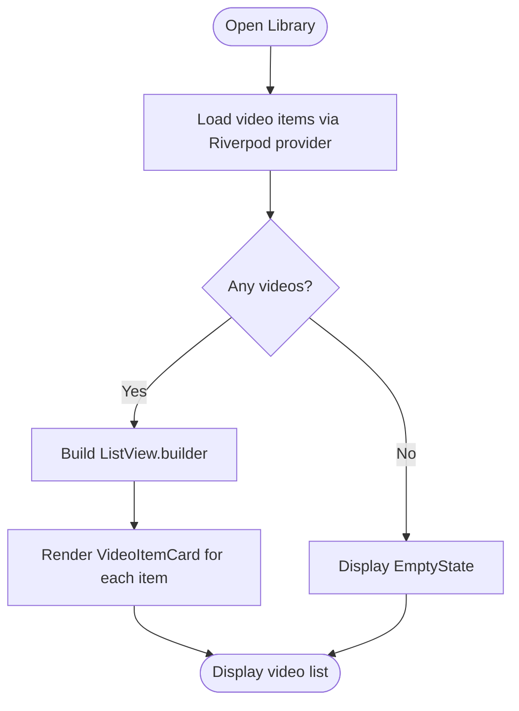
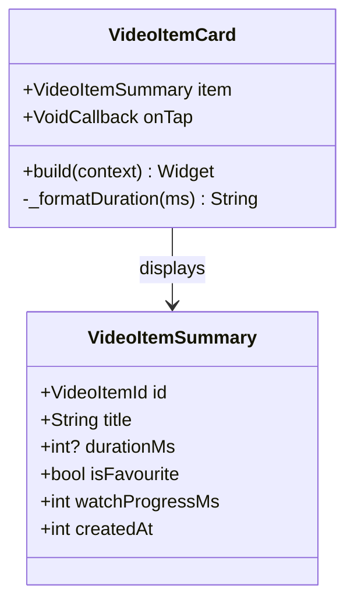
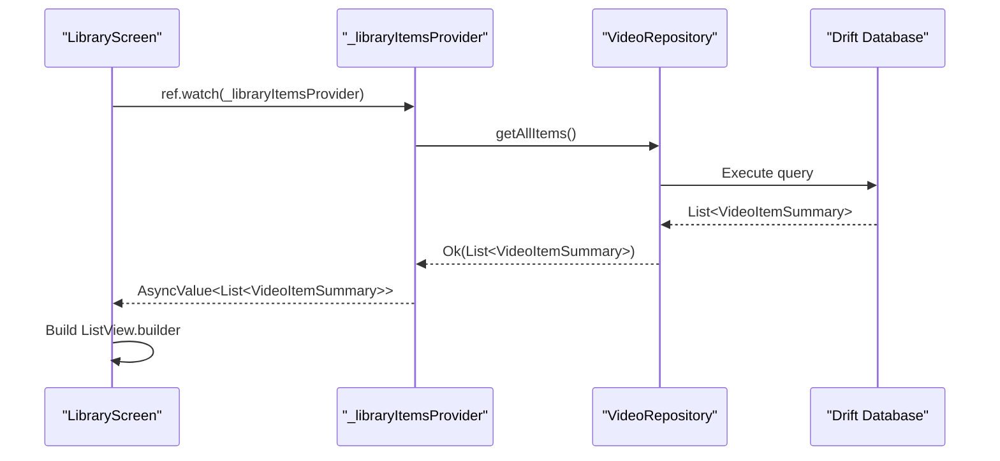
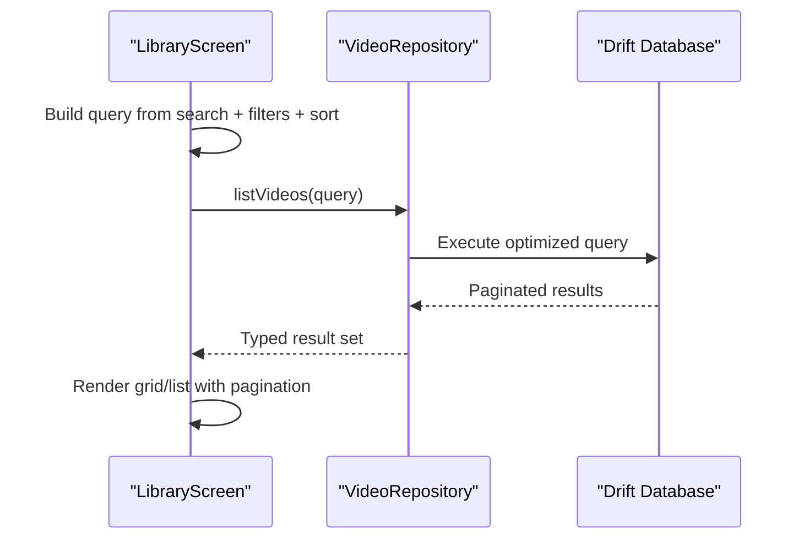
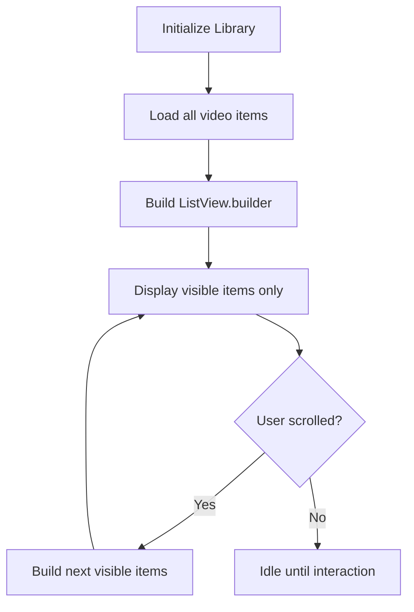
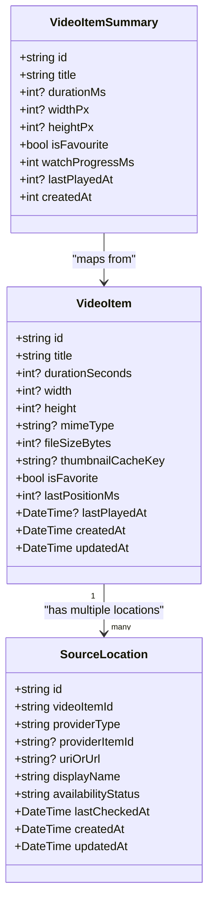
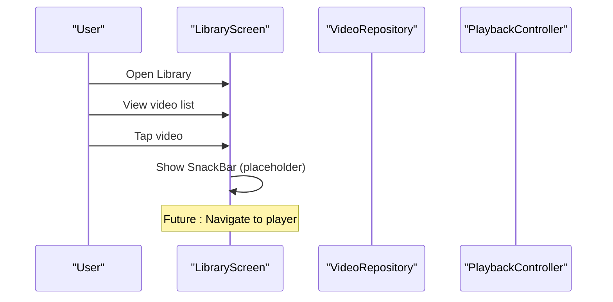
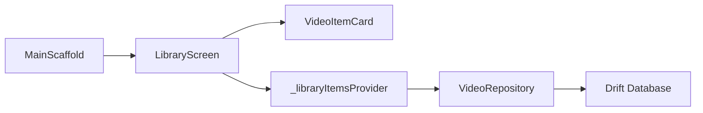

# Library Feature

<cite>
**Referenced Files in This Document**
- [ARCHITECTURE.md](file://ARCHITECTURE.md)
- [PROJECT_BRIEF.md](file://PROJECT_BRIEF.md)
- [main_scaffold.dart](file://lib/app/main_scaffold.dart)
- [library_screen.dart](file://lib/features/library/library_screen.dart)
- [video_item_card.dart](file://lib/features/library/video_item_card.dart)
- [video_repository.dart](file://lib/domain/repositories/video_repository.dart)
- [repository_providers.dart](file://lib/data/repositories/repository_providers.dart)
- [drift_video_repository.dart](file://lib/data/repositories/drift_video_repository.dart)
</cite>

## Update Summary
**Changes Made**
- Updated Library Screen section to reflect transformation from placeholder to fully functional implementation
- Added VideoItemCard component documentation
- Updated Riverpod provider integration details
- Enhanced performance considerations with lazy loading specifics
- Updated architecture diagrams to reflect actual implementation

## Table of Contents
1. [Introduction](#introduction)
2. [Project Structure](#project-structure)
3. [Core Components](#core-components)
4. [Architecture Overview](#architecture-overview)
5. [Detailed Component Analysis](#detailed-component-analysis)
6. [Dependency Analysis](#dependency-analysis)
7. [Performance Considerations](#performance-considerations)
8. [Troubleshooting Guide](#troubleshooting-guide)
9. [Conclusion](#conclusion)
10. [Appendices](#appendices)

## Introduction
This document defines the Library feature for the personal video app. The Library is now a fully functional, searchable, filterable, and sortable collection of videos that integrates with local media sources, direct URLs, and cloud providers through source adapters. It persists metadata locally using Drift/SQLite and exposes a clean UI for browsing, selecting, organizing, and managing videos.

The current codebase contains:
- A fully functional Library tab integrated into the main navigation with ListView.builder for lazy loading.
- VideoItemCard component for displaying individual video items.
- Riverpod provider integration for state management and data fetching.
- Domain-level repository and refresh service abstractions.
- Architecture guidance for data models, indexing, duplicate grouping, caching, and performance.

The goal of this documentation is to specify how the Library works with its current implementation, including search (placeholder), filtering (planned), sorting (planned), grid/list views (planned), pagination (lazy loading), database integration, user interaction patterns, and performance optimizations.

## Project Structure
The Library feature lives under `lib/features/library` and is wired into the app shell as one of five bottom tabs. The implementation now includes a fully functional screen with video listing capabilities.

**Diagram sources**
- [main_scaffold.dart:1-105](file://lib/app/main_scaffold.dart#L1-L105)
- [library_screen.dart:1-93](file://lib/features/library/library_screen.dart#L1-L93)

**Section sources**
- [main_scaffold.dart:1-105](file://lib/app/main_scaffold.dart#L1-L105)
- [library_screen.dart:1-93](file://lib/features/library/library_screen.dart#L1-L93)

## Core Components
- **Library Screen**: Fully functional UI for the Library tab with ListView.builder for lazy loading, Riverpod provider integration, and proper error handling.
- **VideoItemCard**: Reusable card component for displaying individual video items with title, duration, favorite indicator, and thumbnail placeholder.
- **Video Repository (Domain)**: Defines the contract for listing, searching, filtering, sorting, and removing library items.
- **Riverpod Providers**: State management layer providing reactive data access and caching.
- **Data Layer (Drift/SQLite)**: Persists logical video items, source locations, tags, collections, favorites, watch progress, and preferences.

Key responsibilities:
- **Presentation**: Lazy-loaded video list, interactive cards, error states, empty states.
- **Domain**: Query composition, duplicate handling, availability states, scoring/ranking rules.
- **Data**: Efficient SQL queries, indexing, migrations, DAOs, and typed results.

**Section sources**
- [library_screen.dart:1-93](file://lib/features/library/library_screen.dart#L1-L93)
- [video_item_card.dart:1-100](file://lib/features/library/video_item_card.dart#L1-L100)
- [video_repository.dart:1-253](file://lib/domain/repositories/video_repository.dart#L1-L253)
- [repository_providers.dart:1-25](file://lib/data/repositories/repository_providers.dart#L1-L25)

## Architecture Overview
The Library follows the layered architecture described in the project:
- **Presentation layer**: Flutter widgets for video listing, cards, and display modes.
- **Domain layer**: Models, repositories, services, and policies for listing/search/filter/sort, favorites/tags/collections, watch progress, and duplicate matching.
- **Data layer**: Drift database, DAOs, migrations, repository implementations, and mappers.
- **Source adapters**: Local MediaStore, selected folder, direct URL, OneDrive, Google Drive, Cloudflare R2.
- **Playback**: App-owned playback controller/service.

**Diagram sources**
- [ARCHITECTURE.md:55-93](file://ARCHITECTURE.md#L55-L93)
- [ARCHITECTURE.md:95-128](file://ARCHITECTURE.md#L95-L128)
- [ARCHITECTURE.md:144-169](file://ARCHITECTURE.md#L144-L169)

## Detailed Component Analysis

### Library Screen (Fully Functional Implementation)
**Updated** The Library screen has been transformed from a placeholder to a fully functional implementation.

Current state:
- Displays a Scaffold with AppBar containing search button (placeholder).
- Uses AsyncValueWidget for reactive state management with loading, error, and data states.
- Integrates with Riverpod provider for data fetching and caching.
- Implements ListView.builder for efficient lazy loading of video items.
- Shows EmptyState when no videos are available.
- Renders VideoItemCard components for each video item.

Planned behavior:
- Search bar with text-based search across title and metadata.
- Filter chips for tags, favorites, availability, date ranges, duration ranges, and source type.
- Sort dropdown: relevance, newest, oldest, title, duration, size, last-played.
- View switcher between grid and list layouts.
- Pagination via scroll position and page size configuration.

**Section sources**
- [library_screen.dart:1-93](file://lib/features/library/library_screen.dart#L1-L93)
- [main_scaffold.dart:46-69](file://lib/app/main_scaffold.dart#L46-L69)

### VideoItemCard Component
**New** The VideoItemCard component provides reusable video item display functionality.

Features:
- Displays video title with truncation support.
- Shows duration in formatted format (m:ss or h:mm:ss).
- Indicates favorite status with heart icon.
- Includes thumbnail placeholder area (for future Phase 7 thumbnails).
- Handles tap interactions for video selection.
- Responsive layout with proper spacing and styling.

Implementation details:
- Stateless widget for optimal performance.
- Uses Material Design Card and InkWell for consistent styling.
- Formats duration using helper method.
- Supports theme-aware colors and typography.

**Diagram sources**
- [video_item_card.dart:1-100](file://lib/features/library/video_item_card.dart#L1-L100)
- [video_repository.dart:122-144](file://lib/domain/repositories/video_repository.dart#L122-L144)

**Section sources**
- [video_item_card.dart:1-100](file://lib/features/library/video_item_card.dart#L1-L100)

### Riverpod Provider Integration
**Updated** The Library screen now uses Riverpod for state management and data fetching.

Provider structure:
- `_libraryItemsProvider`: FutureProvider that fetches all video items from the repository.
- Automatic caching and error handling through Riverpod's built-in mechanisms.
- Integration with `videoRepositoryProvider` for dependency injection.
- Support for manual refresh via provider invalidation.

Data flow:
- Provider watches repository for video items.
- Repository returns Result<List<VideoItemSummary>>.
- Provider handles success/error cases.
- UI reacts to state changes automatically.

**Diagram sources**
- [library_screen.dart:84-93](file://lib/features/library/library_screen.dart#L84-L93)
- [repository_providers.dart:19-24](file://lib/data/repositories/repository_providers.dart#L19-L24)

**Section sources**
- [library_screen.dart:84-93](file://lib/features/library/library_screen.dart#L84-L93)
- [repository_providers.dart:1-25](file://lib/data/repositories/repository_providers.dart#L1-L25)

### Search, Filtering, and Sorting
**Updated** Search functionality is currently a placeholder; filtering and sorting are planned for future phases.

Current state:
- Search button exists in AppBar but is not implemented (TODO comment).
- All video items are displayed without filtering or sorting.

Planned implementation:
- Text-based search over title and other searchable metadata fields.
- Case-insensitive, substring matching where appropriate.
- Multi-select chip interface for tags, favorites, availability filters.
- Date range and duration range selectors.
- Source type filtering.
- Multiple sort options: relevance, newest, oldest, title, duration, size, last-played.

Implementation approach:
- Compose domain query objects from UI inputs.
- Delegate to repository for efficient SQL generation and execution.
- Cache intermediate results when possible.

**Section sources**
- [ARCHITECTURE.md:63-74](file://ARCHITECTURE.md#L63-L74)

### Grid/List View Switching and Pagination
**Updated** Current implementation uses ListView.builder for native lazy loading; grid view switching is planned.

Current implementation:
- ListView.builder provides natural lazy loading - only visible items are built and rendered.
- No explicit pagination control; relies on Flutter's built-in virtualization.
- Single list view mode; grid view switching will be added in future phases.

Planned enhancements:
- Toggle between grid and list modes.
- Persist preferred view mode in app preferences.
- Custom pagination controls if needed beyond Flutter's built-in virtualization.
- Grid density customization and aspect ratio adjustments.

**Section sources**
- [ARCHITECTURE.md:208-217](file://ARCHITECTURE.md#L208-L217)

### Database Integration and Caching
**Updated** Data model and caching strategies remain consistent with the original design.

Data model highlights:
- VideoItemSummary: lightweight read model for UI consumption.
- VideoItem: full database entity with all metadata.
- SourceLocation: multiple access points per logical video item.
- Organization: tags, video_tags, collections, collection_items, watch progress/history, downloads, app_preferences.

Caching strategies:
- Riverpod provider caching for video lists.
- Thumbnails and remote previews cached separately from downloads and original files.
- Cache cleanup respects active playback and configured limits.

Indexing and refresh:
- Lightweight foreground checks and manual refresh.
- Incremental refresh when supported; store scan timestamps.
- Merge source metadata without overwriting user edits (favorites, tags, collections, progress).

**Diagram sources**
- [ARCHITECTURE.md:95-128](file://ARCHITECTURE.md#L95-L128)
- [video_repository.dart:122-144](file://lib/domain/repositories/video_repository.dart#L122-L144)

**Section sources**
- [ARCHITECTURE.md:95-128](file://ARCHITECTURE.md#L95-L128)
- [ARCHITECTURE.md:208-228](file://ARCHITECTURE.md#L208-L228)

### User Interaction Patterns
**Updated** Current interactions focus on video listing and basic selection; advanced features are planned.

Current interactions:
- Open Library tab from bottom navigation.
- View all video items in a scrollable list.
- Tap a video to trigger placeholder action (SnackBar showing video title).
- Manual refresh via pull-to-refresh or provider invalidation.

Planned interactions:
- Use search bar to find videos by title or metadata.
- Apply filters for tags, favorites, availability, date/duration ranges, and source types.
- Sort results by relevance, date, title, duration, size, or last-played.
- Switch between grid and list views.
- Mark favorites, assign tags, add to collections.
- Remove items from the library without deleting original files.
- Handle unavailable sources with retry/reconnect actions.

**Diagram sources**
- [library_screen.dart:68-74](file://lib/features/library/library_screen.dart#L68-L74)

**Section sources**
- [PROJECT_BRIEF.md:53-60](file://PROJECT_BRIEF.md#L53-L60)
- [ARCHITECTURE.md:171-186](file://ARCHITECTURE.md#L171-L186)

### Customizing Search Filters and Display Formats
**Updated** Examples now reflect the current implementation and planned enhancements.

Examples of customization:
- Add a new filter chip for "Source Type" with options like local, direct URL, OneDrive, Google Drive, R2.
- Extend sort options to include "Most watched" or "Recently updated".
- Change grid density by adjusting tile size and aspect ratio.
- Customize list row layout to show additional metadata such as resolution or file size.
- Modify VideoItemCard to display different information or styling.
- Add custom Riverpod providers for specialized data fetching scenarios.

These customizations should be implemented in the presentation layer and mapped to domain query parameters before calling the repository.

[No sources needed since this section provides general guidance]

## Dependency Analysis
**Updated** The Library now has more complex dependencies due to Riverpod integration and VideoItemCard component.

The Library depends on:
- Main scaffold for navigation entry.
- VideoItemCard component for displaying individual items.
- Riverpod providers for state management and data fetching.
- Domain repository for querying and managing library data.
- Refresh service for scanning and merging content.
- Data layer for persistence and efficient queries.

**Diagram sources**
- [main_scaffold.dart:1-105](file://lib/app/main_scaffold.dart#L1-L105)
- [library_screen.dart:1-93](file://lib/features/library/library_screen.dart#L1-L93)
- [video_item_card.dart:1-100](file://lib/features/library/video_item_card.dart#L1-L100)
- [repository_providers.dart:1-25](file://lib/data/repositories/repository_providers.dart#L1-L25)

**Section sources**
- [main_scaffold.dart:1-105](file://lib/app/main_scaffold.dart#L1-L105)
- [library_screen.dart:1-93](file://lib/features/library/library_screen.dart#L1-L93)
- [video_item_card.dart:1-100](file://lib/features/library/video_item_card.dart#L1-L100)
- [repository_providers.dart:1-25](file://lib/data/repositories/repository_providers.dart#L1-L25)

## Performance Considerations
**Updated** Performance considerations now include specific details about the current lazy loading implementation.

Current optimizations:
- **ListView.builder**: Provides native lazy loading - only visible items are built and rendered, reducing memory usage and improving scroll performance.
- **Riverpod caching**: Automatically caches provider results, avoiding redundant network/database calls.
- **Stateless VideoItemCard**: Optimized for repeated rendering without unnecessary rebuilds.
- **Efficient data mapping**: VideoItemSummary provides lightweight read model for UI consumption.

Additional considerations:
- Avoid full scans on every rebuild or tab switch; use incremental refresh and cache scan timestamps.
- Keep indexing cancellable and UI responsive.
- Separate cache directories for thumbnails/previews from downloads and originals.
- Implement efficient SQL queries with proper indexes on frequently filtered/sorted columns (e.g., title, created_at, availability_status).
- Throttle writes for watch progress and avoid blocking the UI thread.
- Cancel stale work during rapid interactions (e.g., fast scrolling or repeated searches).

[No sources needed since this section provides general guidance]

## Troubleshooting Guide
**Updated** Troubleshooting guide now includes issues specific to the current implementation.

Common issues and resolutions:
- **No results after search**: Verify query composition and ensure search metadata exists.
- **Slow loading**: Check pagination settings, query complexity, and database indexes.
- **Unavailable sources**: Surface availability states and offer retry/reconnect actions.
- **Duplicate entries**: Rely on conservative duplicate matching; never merge solely on filename.
- **Cache clearing side effects**: Ensure Clear Cache does not delete downloads, library metadata, or original files.
- **Riverpod provider errors**: Check repository implementation and database connectivity.
- **Memory issues with large lists**: Verify ListView.builder is being used and VideoItemCard is properly optimized.
- **VideoItemCard not displaying**: Ensure VideoItemSummary data is properly populated and null-safe.

**Section sources**
- [ARCHITECTURE.md:129-142](file://ARCHITECTURE.md#L129-L142)
- [ARCHITECTURE.md:219-228](file://ARCHITECTURE.md#L219-L228)
- [ARCHITECTURE.md:242-250](file://ARCHITECTURE.md#L242-L250)

## Conclusion
The Library feature has evolved from a placeholder to a fully functional video listing experience. It now provides efficient lazy loading through ListView.builder, proper state management with Riverpod, and a reusable VideoItemCard component. The foundation is solid for adding advanced features like search, filtering, sorting, and grid views in future phases. The design emphasizes performance, safety, and testability while keeping the UI accessible and customizable.

[No sources needed since this section summarizes without analyzing specific files]

## Appendices

### Navigation Entry Point
The Library tab is integrated into the main scaffold and appears as the third tab.

**Section sources**
- [main_scaffold.dart:10-26](file://lib/app/main_scaffold.dart#L10-L26)
- [main_scaffold.dart:46-69](file://lib/app/main_scaffold.dart#L46-L69)

### Current Library Screen Status
**Updated** The Library screen is now fully functional with video listing capabilities.

Current implementation:
- Fully functional video listing with lazy loading.
- Riverpod provider integration for state management.
- VideoItemCard component for displaying individual items.
- Proper error handling and empty states.
- Placeholder search functionality ready for enhancement.

**Section sources**
- [library_screen.dart:1-93](file://lib/features/library/library_screen.dart#L1-L93)
- [video_item_card.dart:1-100](file://lib/features/library/video_item_card.dart#L1-L100)

### VideoItemSummary Model
**New** The VideoItemSummary model provides a lightweight representation for UI consumption.

Properties:
- id: Unique identifier for the video item.
- title: Display title of the video.
- durationMs: Optional duration in milliseconds.
- widthPx, heightPx: Optional video dimensions.
- isFavourite: Favorite status flag.
- watchProgressMs: Playback progress in milliseconds.
- lastPlayedAt: Optional timestamp of last play.
- createdAt: Creation timestamp.

**Section sources**
- [video_repository.dart:122-144](file://lib/domain/repositories/video_repository.dart#L122-L144)