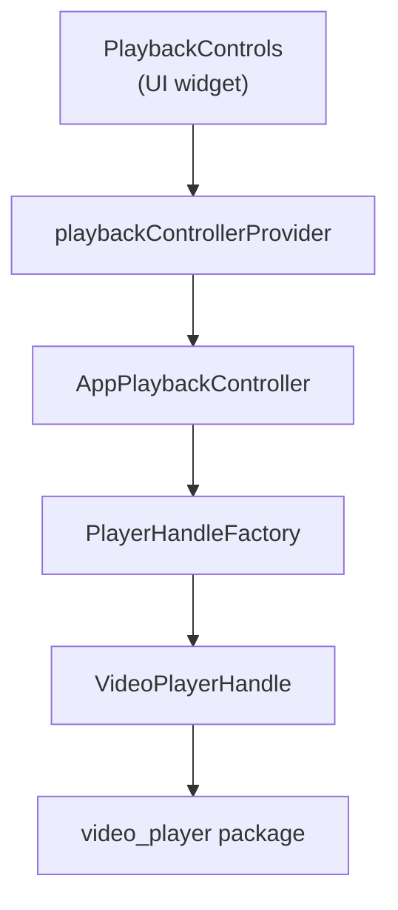
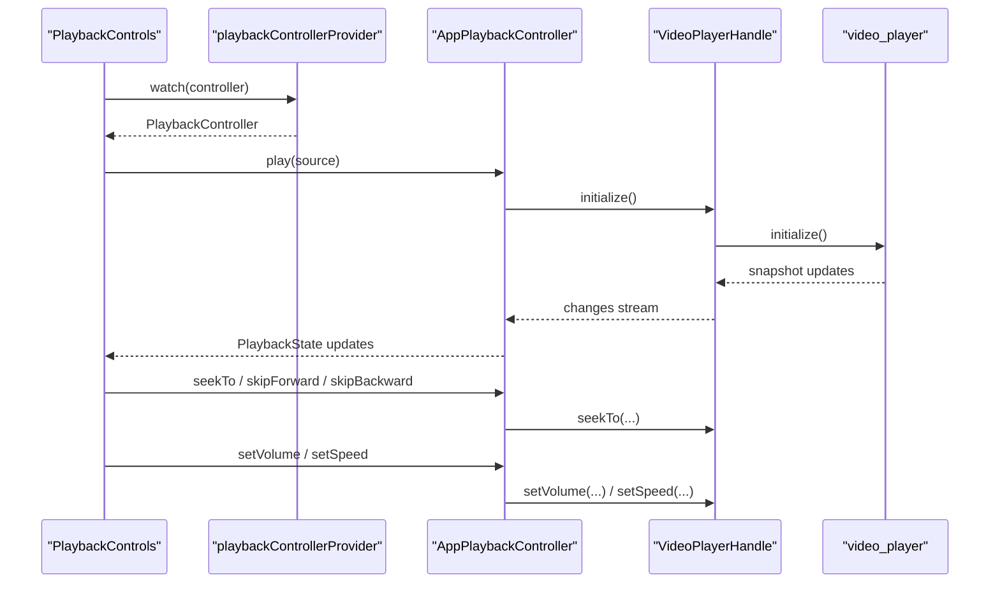
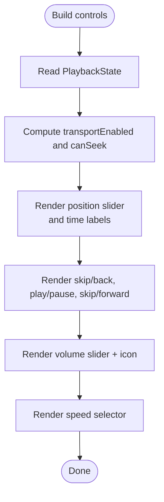
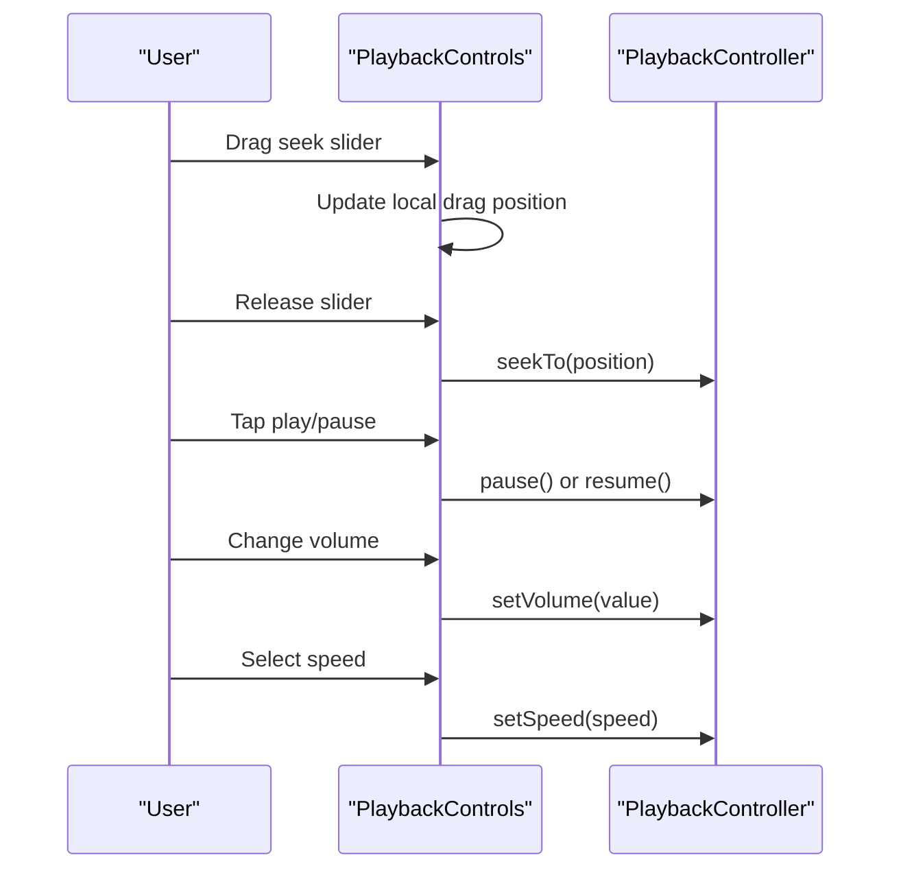
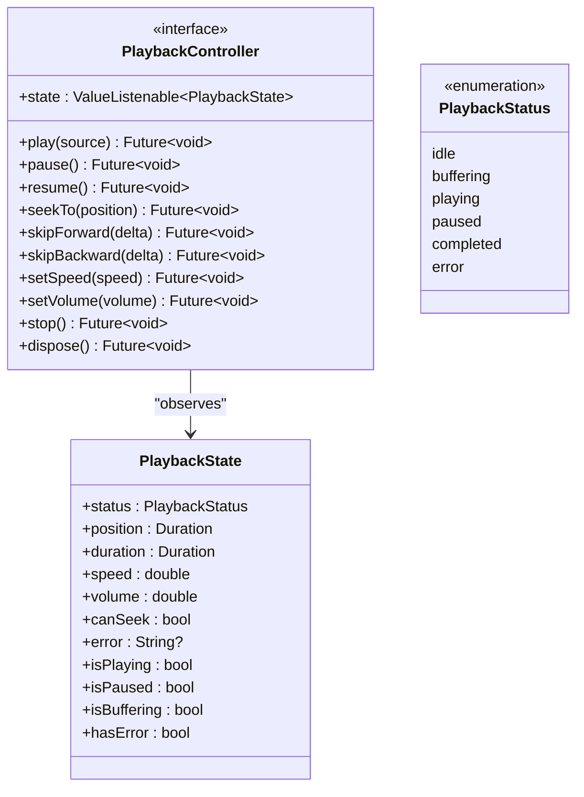
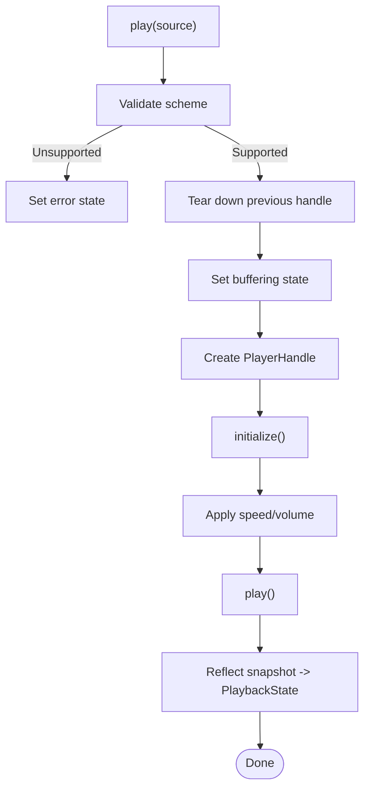
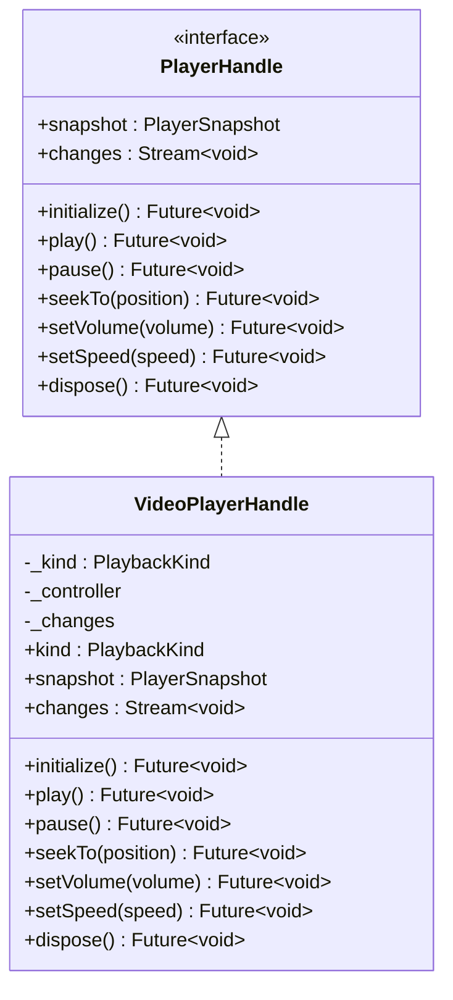
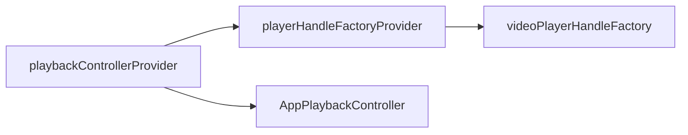
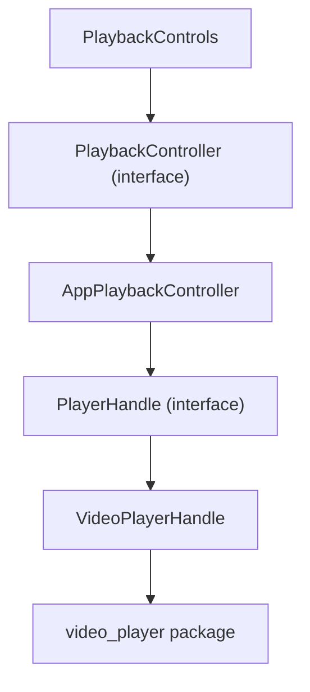

# Playback Controls UI

<cite>
**Referenced Files in This Document**
- [playback_controls.dart](file://lib/features/player/playback_controls.dart)
- [playback_controller.dart](file://lib/playback/playback_controller.dart)
- [app_playback_controller.dart](file://lib/playback/app_playback_controller.dart)
- [video_player_handle.dart](file://lib/playback/video_player_handle.dart)
- [playback_provider.dart](file://lib/playback/playback_provider.dart)
- [playback_controls_test.dart](file://test/widget/playback_controls_test.dart)
</cite>

## Table of Contents
1. [Introduction](#introduction)
2. [Project Structure](#project-structure)
3. [Core Components](#core-components)
4. [Architecture Overview](#architecture-overview)
5. [Detailed Component Analysis](#detailed-component-analysis)
6. [Dependency Analysis](#dependency-analysis)
7. [Performance Considerations](#performance-considerations)
8. [Troubleshooting Guide](#troubleshooting-guide)
9. [Conclusion](#conclusion)

## Introduction
This document explains the Playback Controls UI for the player screen and how it integrates with the app’s playback controller and engine abstraction. The controls render play/pause, a seek slider with position/duration labels, ±10 second skip buttons, a volume slider, and a speed selector. All interactions go through an app-owned `PlaybackController`, keeping the UI free of platform or plugin-specific types.

## Project Structure
The playback-related code is split into:
- UI layer: `features/player/playback_controls.dart`
- Controller interface and state model: `playback/playback_controller.dart`
- Controller implementation: `playback/app_playback_controller.dart`
- Engine handle (video_player): `playback/video_player_handle.dart`
- Dependency injection provider: `playback/playback_provider.dart`
- Widget tests: `test/widget/playback_controls_test.dart`

**Diagram sources**
- [playback_controls.dart:1-20](file://lib/features/player/playback_controls.dart#L1-L20)
- [playback_provider.dart:16-27](file://lib/playback/playback_provider.dart#L16-L27)
- [app_playback_controller.dart:8-13](file://lib/playback/app_playback_controller.dart#L8-L13)
- [video_player_handle.dart:8-18](file://lib/playback/video_player_handle.dart#L8-L18)

**Section sources**
- [playback_controls.dart:1-20](file://lib/features/player/playback_controls.dart#L1-L20)
- [playback_provider.dart:1-27](file://lib/playback/playback_provider.dart#L1-L27)

## Core Components
- PlaybackControls: A Riverpod-aware Flutter widget that renders transport controls, seek slider, skip buttons, volume slider, and speed selector. It reads the current `PlaybackState` and dispatches commands to `PlaybackController`.
- PlaybackController: Abstract interface defining playback commands and a reactive `state` stream.
- AppPlaybackController: State machine implementation that owns lifecycle, applies user preferences (speed/volume), maps engine snapshots to `PlaybackState`, and surfaces safe error messages.
- PlayerHandle / VideoPlayerHandle: Abstraction over the underlying video engine; only `VideoPlayerHandle` imports the video player package.
- playbackControllerProvider: Creates and disposes the single app-wide controller instance.

Key responsibilities:
- UI observes immutable `PlaybackState` snapshots and disables controls according to status and `canSeek`.
- Controller clamps and validates commands, never throws to callers, and converts failures to user-safe errors.
- Engine changes are observed via a stream and reduced into stable `PlaybackState`.

**Section sources**
- [playback_controls.dart:6-19](file://lib/features/player/playback_controls.dart#L6-L19)
- [playback_controller.dart:4-14](file://lib/playback/playback_controller.dart#L4-L14)
- [app_playback_controller.dart:8-23](file://lib/playback/app_playback_controller.dart#L8-L23)
- [video_player_handle.dart:8-18](file://lib/playback/video_player_handle.dart#L8-L18)
- [playback_provider.dart:16-27](file://lib/playback/playback_provider.dart#L16-L27)

## Architecture Overview
The UI does not import any player plugin type. It consumes `PlaybackController.state` and calls command methods. The controller owns the state machine and delegates to a `PlayerHandle`, which wraps the real engine.

**Diagram sources**
- [playback_controls.dart:42-48](file://lib/features/player/playback_controls.dart#L42-L48)
- [playback_provider.dart:21-27](file://lib/playback/playback_provider.dart#L21-L27)
- [app_playback_controller.dart:58-135](file://lib/playback/app_playback_controller.dart#L58-L135)
- [video_player_handle.dart:77-93](file://lib/playback/video_player_handle.dart#L77-L93)

## Detailed Component Analysis

### PlaybackControls UI
Responsibilities:
- Reads `PlaybackController` from Riverpod and listens to `PlaybackState`.
- Computes whether transport and seeking are enabled based on `status` and `canSeek`.
- Renders:
  - Position slider with live position label and duration label.
  - Skip backward/forward by 10 seconds.
  - Play/Pause button with state-aware icon and tooltip.
  - Volume slider with dynamic icon.
  - Speed selector popup with presets.

Behavior highlights:
- While dragging the seek slider, the UI shows the dragged thumb position instead of engine ticks to avoid visual conflict.
- Seek operations are gated by `canSeek`; the controller also re-checks before executing.
- Play/Pause toggles: pause when playing/buffering; resume when paused/completed; disabled in idle/error.
- Error message is displayed above controls when present.

**Diagram sources**
- [playback_controls.dart:51-191](file://lib/features/player/playback_controls.dart#L51-L191)

User interaction flow:

**Diagram sources**
- [playback_controls.dart:97-115](file://lib/features/player/playback_controls.dart#L97-L115)
- [playback_controls.dart:117-149](file://lib/features/player/playback_controls.dart#L117-L149)
- [playback_controls.dart:150-189](file://lib/features/player/playback_controls.dart#L150-L189)
- [playback_controls.dart:197-206](file://lib/features/player/playback_controls.dart#L197-L206)

**Section sources**
- [playback_controls.dart:20-33](file://lib/features/player/playback_controls.dart#L20-L33)
- [playback_controls.dart:35-49](file://lib/features/player/playback_controls.dart#L35-L49)
- [playback_controls.dart:51-191](file://lib/features/player/playback_controls.dart#L51-L191)
- [playback_controls.dart:194-222](file://lib/features/player/playback_controls.dart#L194-L222)

### PlaybackController Interface and State
Interface:
- Commands: `play`, `pause`, `resume`, `seekTo`, `skipForward`, `skipBackward`, `setSpeed`, `setVolume`, `stop`, `dispose`.
- Reactive state: `ValueListenable<PlaybackState> state`.

State model:
- Immutable `PlaybackState` with fields: `status`, `position`, `duration`, `speed`, `volume`, `canSeek`, `error`.
- Convenience getters: `isPlaying`, `isPaused`, `isBuffering`, `hasError`.
- Status enum: `idle`, `buffering`, `playing`, `paused`, `completed`, `error`.

Design notes:
- UI compares state by value; every meaningful change produces a new instance.
- `canSeek` gates seek affordances in the UI and is enforced by the controller.

**Diagram sources**
- [playback_controller.dart:4-67](file://lib/playback/playback_controller.dart#L4-L67)
- [playback_controller.dart:73-128](file://lib/playback/playback_controller.dart#L73-L128)
- [playback_controller.dart:130-149](file://lib/playback/playback_controller.dart#L130-L149)

**Section sources**
- [playback_controller.dart:4-67](file://lib/playback/playback_controller.dart#L4-L67)
- [playback_controller.dart:73-149](file://lib/playback/playback_controller.dart#L73-L149)

### AppPlaybackController Implementation
Responsibilities:
- Owns the playback state machine and lifecycle.
- Applies user preferences (`speed`, `volume`) across sources.
- Handles rapid successive `play()` calls safely using a generation counter.
- Maps engine snapshots to `PlaybackState` via `_reduce`.
- Converts engine failures to user-safe error states without leaking diagnostics.

Key behaviors:
- `play()`: validates source kind, tears down previous handle, sets buffering state, initializes handle, applies speed/volume, starts playback, and reflects final snapshot immediately.
- `resume()`: replays from zero if completed; otherwise resumes from paused.
- `seekTo()`: ignored when not seekable or in idle/error.
- `skipForward/Backward()`: clamp to duration bounds before seeking.
- `setSpeed/setVolume()`: update state immediately and apply to engine if available.
- `stop()`: releases handle and returns to idle while preserving preferences.

**Diagram sources**
- [app_playback_controller.dart:58-135](file://lib/playback/app_playback_controller.dart#L58-L135)

**Section sources**
- [app_playback_controller.dart:8-49](file://lib/playback/app_playback_controller.dart#L8-L49)
- [app_playback_controller.dart:58-135](file://lib/playback/app_playback_controller.dart#L58-L135)
- [app_playback_controller.dart:137-205](file://lib/playback/app_playback_controller.dart#L137-L205)
- [app_playback_controller.dart:211-338](file://lib/playback/app_playback_controller.dart#L211-L338)
- [app_playback_controller.dart:340-421](file://lib/playback/app_playback_controller.dart#L340-L421)

### VideoPlayerHandle and Engine Integration
Responsibilities:
- Bridges `PlayableSource` schemes to the `video_player` engine.
- Exposes `PlayerSnapshot` and a `changes` stream.
- Only file allowed to import the video player package.

Scheme routing:
- Content URIs and SAF documents use content-based initialization.
- File URIs map to file controllers.
- Network URIs map to network URL controllers.

**Diagram sources**
- [video_player_handle.dart:19-45](file://lib/playback/video_player_handle.dart#L19-L45)
- [video_player_handle.dart:52-93](file://lib/playback/video_player_handle.dart#L52-L93)
- [video_player_handle.dart:96-109](file://lib/playback/video_player_handle.dart#L96-L109)

**Section sources**
- [video_player_handle.dart:8-18](file://lib/playback/video_player_handle.dart#L8-L18)
- [video_player_handle.dart:19-45](file://lib/playback/video_player_handle.dart#L19-L45)
- [video_player_handle.dart:52-93](file://lib/playback/video_player_handle.dart#L52-L93)
- [video_player_handle.dart:96-109](file://lib/playback/video_player_handle.dart#L96-L109)

### Dependency Injection
- `playerHandleFactoryProvider` provides the default `videoPlayerHandleFactory`.
- `playbackControllerProvider` creates `AppPlaybackController` with the injected factory and disposes it when the container is disposed.

**Diagram sources**
- [playback_provider.dart:7-14](file://lib/playback/playback_provider.dart#L7-L14)
- [playback_provider.dart:16-27](file://lib/playback/playback_provider.dart#L16-L27)

**Section sources**
- [playback_provider.dart:1-27](file://lib/playback/playback_provider.dart#L1-L27)

## Dependency Analysis
High-level dependencies:
- `PlaybackControls` depends on `PlaybackController` and `playbackControllerProvider`.
- `AppPlaybackController` depends on `PlayerHandleFactory` and emits `PlaybackState`.
- `VideoPlayerHandle` depends on the `video_player` package and implements `PlayerHandle`.

**Diagram sources**
- [playback_controls.dart:1-4](file://lib/features/player/playback_controls.dart#L1-L4)
- [playback_controller.dart:4-14](file://lib/playback/playback_controller.dart#L4-L14)
- [app_playback_controller.dart:3-6](file://lib/playback/app_playback_controller.dart#L3-L6)
- [video_player_handle.dart:4-6](file://lib/playback/video_player_handle.dart#L4-L6)

**Section sources**
- [playback_controls.dart:1-4](file://lib/features/player/playback_controls.dart#L1-L4)
- [playback_controller.dart:4-14](file://lib/playback/playback_controller.dart#L4-L14)
- [app_playback_controller.dart:3-6](file://lib/playback/app_playback_controller.dart#L3-L6)
- [video_player_handle.dart:4-6](file://lib/playback/video_player_handle.dart#L4-L6)

## Performance Considerations
- UI rebuilds are driven by immutable `PlaybackState` snapshots, enabling efficient diffing.
- Slider dragging uses a local `_dragMs` value to prevent engine ticks from fighting the thumb during scrubbing.
- Rapid `play()` calls are safe due to a generation counter that discards stale completions and disposes old handles quietly.
- Volume and speed changes update UI state immediately and then apply to the engine asynchronously.

[No sources needed since this section provides general guidance]

## Troubleshooting Guide
Common issues and signals:
- Idle or error states disable transport controls:
  - Idle: no source loaded.
  - Error: unrecoverable error surfaced as a user-safe message.
- Seek slider and skip buttons disabled when `canSeek` is false or duration is zero.
- Error messages are generic and do not expose tokens or signed URLs.

Verification via tests:
- Idle state disables transport and seek.
- Playing state shows correct position/duration labels and pause control.
- Hour-long media formats as `h:mm:ss`.
- Error state displays a fixed message and disables controls.
- Slider drag updates local position and seeks on release.
- Non-seekable sources disable seek affordances but keep transport.
- Skip buttons clamp to duration bounds.
- Volume and speed changes reach the engine and update UI.

**Section sources**
- [playback_controls_test.dart:183-241](file://test/widget/playback_controls_test.dart#L183-L241)
- [playback_controls_test.dart:243-295](file://test/widget/playback_controls_test.dart#L243-L295)
- [playback_controls_test.dart:297-362](file://test/widget/playback_controls_test.dart#L297-L362)
- [playback_controls_test.dart:364-394](file://test/widget/playback_controls_test.dart#L364-L394)

## Conclusion
The Playback Controls UI cleanly separates presentation from playback logic. It observes immutable state, gates interactions by controller contracts, and delegates all media operations to `AppPlaybackController`, which in turn uses a pluggable `PlayerHandle`. This design keeps the UI testable, avoids leaking engine types, and ensures robust error handling and resource management.