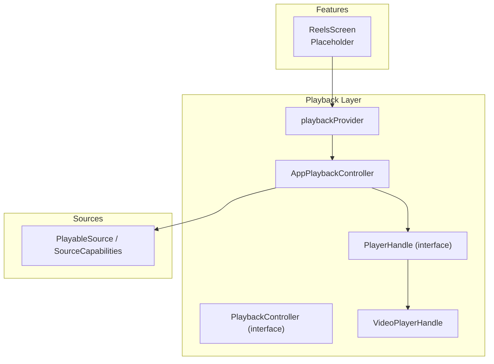
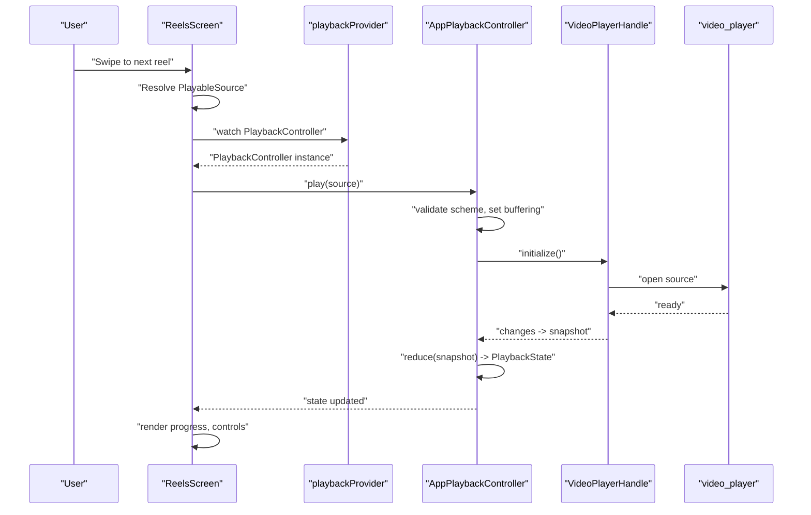
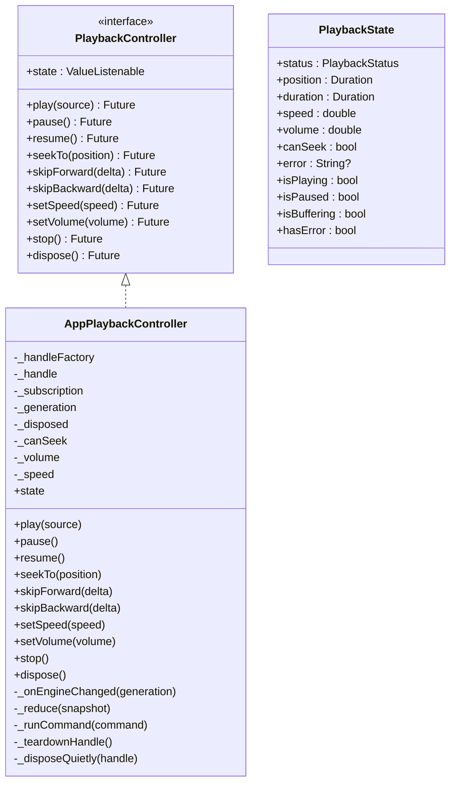
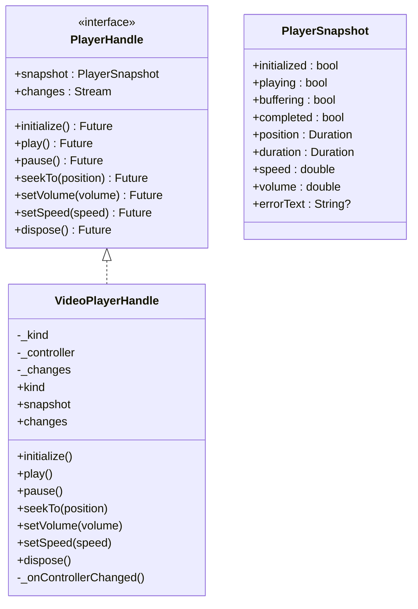
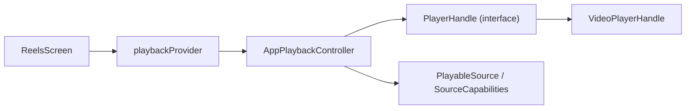

# Reels Feature

<cite>
**Referenced Files in This Document**
- [reels_screen.dart](file://lib/features/reels/reels_screen.dart)
- [playback_controller.dart](file://lib/playback/playback_controller.dart)
- [app_playback_controller.dart](file://lib/playback/app_playback_controller.dart)
- [player_handle.dart](file://lib/playback/player_handle.dart)
- [video_player_handle.dart](file://lib/playback/video_player_handle.dart)
- [playback_provider.dart](file://lib/playback/playback_provider.dart)
- [source_adapter.dart](file://lib/sources/source_adapter.dart)
</cite>

## Table of Contents
1. [Introduction](#introduction)
2. [Project Structure](#project-structure)
3. [Core Components](#core-components)
4. [Architecture Overview](#architecture-overview)
5. [Detailed Component Analysis](#detailed-component-analysis)
6. [Dependency Analysis](#dependency-analysis)
7. [Performance Considerations](#performance-considerations)
8. [Troubleshooting Guide](#troubleshooting-guide)
9. [Conclusion](#conclusion)
10. [Appendices](#appendices)

## Introduction
This document explains the Reels feature and its integration with the PlaybackController for seamless vertical swipe-first video playback. The current Reels screen is a placeholder that will be wired to the app’s playback system during Phase 6. The documentation covers:
- Vertical swipe-first interaction model and gesture handling strategy
- Integration with PlaybackController for smooth transitions between reels
- UI components, loading optimization, and progress tracking
- State management using Riverpod providers for navigation and playback state
- Performance optimizations for scrolling and preloading
- Error handling for failed loads and network issues
- Customization and extension points for future implementation

## Project Structure
The Reels feature lives under `lib/features/reels` and integrates with the shared playback layer under `lib/playback`. The source contract used by the player is defined in `lib/sources`.

**Diagram sources**
- [reels_screen.dart:1-17](file://lib/features/reels/reels_screen.dart#L1-L17)
- [playback_controller.dart:1-150](file://lib/playback/playback_controller.dart#L1-L150)
- [app_playback_controller.dart:1-422](file://lib/playback/app_playback_controller.dart#L1-L422)
- [player_handle.dart:1-115](file://lib/playback/player_handle.dart#L1-L115)
- [video_player_handle.dart:1-110](file://lib/playback/video_player_handle.dart#L1-L110)
- [playback_provider.dart:1-27](file://lib/playback/playback_provider.dart#L1-L27)
- [source_adapter.dart:1-165](file://lib/sources/source_adapter.dart#L1-L165)

**Section sources**
- [reels_screen.dart:1-17](file://lib/features/reels/reels_screen.dart#L1-L17)
- [playback_provider.dart:1-27](file://lib/playback/playback_provider.dart#L1-L27)

## Core Components
- ReelsScreen: Placeholder widget declaring the Reels tab intent and layout shell. It will host the full-screen vertical swipe list once wired.
- PlaybackController: App-owned interface abstracting the underlying player engine. UI watches PlaybackState and calls commands; it never imports engine-specific types.
- AppPlaybackController: Implements PlaybackController, owns the state machine, lifecycle, error mapping, and preference carry-over (speed/volume).
- PlayerHandle: Engine seam exposing snapshot, changes stream, and commands. VideoPlayerHandle implements this for the official video_player engine.
- playbackProvider: Riverpod provider that creates and disposes the single PlaybackController instance for the app.
- PlayableSource and SourceCapabilities: Contracts describing playable URIs and capabilities such as seeking.

Key responsibilities:
- ReelsScreen: Hosts the swipe list and overlays (progress, controls).
- PlaybackController/AppPlaybackController: Manages play/pause/seek/speed/volume, maps engine errors to user-safe messages, and emits immutable PlaybackState snapshots.
- PlayerHandle/VideoPlayerHandle: Bridges to the platform player and translates engine events into PlayerSnapshot.
- playbackProvider: Ensures one controller per container and proper disposal.

**Section sources**
- [reels_screen.dart:1-17](file://lib/features/reels/reels_screen.dart#L1-L17)
- [playback_controller.dart:1-150](file://lib/playback/playback_controller.dart#L1-L150)
- [app_playback_controller.dart:1-422](file://lib/playback/app_playback_controller.dart#L1-L422)
- [player_handle.dart:1-115](file://lib/playback/player_handle.dart#L1-L115)
- [video_player_handle.dart:1-110](file://lib/playback/video_player_handle.dart#L1-L110)
- [playback_provider.dart:1-27](file://lib/playback/playback_provider.dart#L1-L27)
- [source_adapter.dart:1-165](file://lib/sources/source_adapter.dart#L1-L165)

## Architecture Overview
The Reels feature will use a vertical, snap-based list where each page is a reel. When the user swipes to the next or previous reel, the ReelsScreen resolves a PlayableSource and asks the PlaybackController to play it. The controller updates PlaybackState, which drives UI elements like progress, buffering indicator, and error surface.

**Diagram sources**
- [reels_screen.dart:1-17](file://lib/features/reels/reels_screen.dart#L1-L17)
- [playback_provider.dart:1-27](file://lib/playback/playback_provider.dart#L1-L27)
- [app_playback_controller.dart:57-135](file://lib/playback/app_playback_controller.dart#L57-L135)
- [video_player_handle.dart:20-41](file://lib/playback/video_player_handle.dart#L20-L41)
- [video_player_handle.dart:52-66](file://lib/playback/video_player_handle.dart#L52-L66)

## Detailed Component Analysis

### ReelsScreen Placeholder
Current status:
- Declares the Reels tab with an AppBar and placeholder body.
- Intended to become a full-screen vertical swipe-first list with overlay controls and progress.

Implementation guidance for Phase 6:
- Use a PageView.builder with physics set to snap and drag disabled when media is playing.
- Maintain a viewport index and resolve the corresponding PlayableSource from your data layer.
- On page change, call PlaybackController.play(newSource).
- Render progress via PlaybackState.position/duration and show buffering/error states.

**Section sources**
- [reels_screen.dart:1-17](file://lib/features/reels/reels_screen.dart#L1-L17)

### PlaybackController and AppPlaybackController
Responsibilities:
- Define a clean interface for playback operations and expose PlaybackState.
- Manage lifecycle, generation counters to discard stale loads, and safe teardown.
- Map engine errors to user-safe messages without leaking sensitive details.
- Carry speed and volume preferences across sources.

Key behaviors:
- play(source): validates scheme, sets buffering, initializes handle, applies speed/volume, starts playback, reduces snapshot to state.
- pause/resume/seekTo/skipForward/skipBackward/setSpeed/setVolume/stop/dispose: command methods with state guards and error wrapping.
- _reduce: pure mapping from PlayerSnapshot to PlaybackState.

Error handling:
- Unsupported schemes produce a fixed message.
- Load and playback failures are surfaced as PlaybackStatus.error with user-safe messages.
- Engine disposal failures are swallowed to avoid surfacing internal diagnostics.

**Diagram sources**
- [playback_controller.dart:1-150](file://lib/playback/playback_controller.dart#L1-L150)
- [app_playback_controller.dart:1-422](file://lib/playback/app_playback_controller.dart#L1-L422)

**Section sources**
- [playback_controller.dart:1-150](file://lib/playback/playback_controller.dart#L1-L150)
- [app_playback_controller.dart:1-422](file://lib/playback/app_playback_controller.dart#L1-L422)

### PlayerHandle and VideoPlayerHandle
Responsibilities:
- PlayerHandle defines the engine seam: snapshot, changes stream, initialize, play, pause, seekTo, setVolume, setSpeed, dispose.
- VideoPlayerHandle implements this seam using the official video_player package, routing content/file/network URIs appropriately.

Data flow:
- VideoPlayerController emits value changes; VideoPlayerHandle forwards them through a broadcast Stream.
- AppPlaybackController subscribes to changes and reduces snapshots to PlaybackState.

**Diagram sources**
- [player_handle.dart:1-115](file://lib/playback/player_handle.dart#L1-L115)
- [video_player_handle.dart:1-110](file://lib/playback/video_player_handle.dart#L1-L110)

**Section sources**
- [player_handle.dart:1-115](file://lib/playback/player_handle.dart#L1-L115)
- [video_player_handle.dart:1-110](file://lib/playback/video_player_handle.dart#L1-L110)

### Riverpod Provider for Playback
The playbackProvider creates a single PlaybackController instance for the app lifetime and disposes it when the container is disposed. Widgets watch this provider to get the controller and PlaybackState.

Usage pattern:
- Watch playbackProvider to obtain PlaybackController.
- Listen to controller.state for UI updates.
- Call controller.play(source) when navigating to a new reel.

**Section sources**
- [playback_provider.dart:1-27](file://lib/playback/playback_provider.dart#L1-L27)

### Source Contract and Capabilities
PlayableSource carries the immediate URI and metadata needed for playback. SourceCapabilities describes whether a source supports streaming, seeking, thumbnails, search, downloads, and pagination. These contracts ensure the UI and playback layers remain decoupled from specific providers.

For Reels:
- Resolve a PlayableSource for the target reel.
- Use canSeek to enable/disable seek controls.
- Optionally use thumbnailUri for placeholders while loading.

**Section sources**
- [source_adapter.dart:1-165](file://lib/sources/source_adapter.dart#L1-L165)

## Dependency Analysis
High-level dependencies:
- ReelsScreen depends on playbackProvider to access PlaybackController.
- PlaybackController is implemented by AppPlaybackController.
- AppPlaybackController depends on PlayerHandleFactory and uses PlayerHandle abstraction.
- VideoPlayerHandle depends on video_player but is isolated to the playback layer.
- PlayableSource and SourceCapabilities define the source contract consumed by both UI and playback.

**Diagram sources**
- [reels_screen.dart:1-17](file://lib/features/reels/reels_screen.dart#L1-L17)
- [playback_provider.dart:1-27](file://lib/playback/playback_provider.dart#L1-L27)
- [app_playback_controller.dart:1-422](file://lib/playback/app_playback_controller.dart#L1-L422)
- [player_handle.dart:1-115](file://lib/playback/player_handle.dart#L1-L115)
- [video_player_handle.dart:1-110](file://lib/playback/video_player_handle.dart#L1-L110)
- [source_adapter.dart:1-165](file://lib/sources/source_adapter.dart#L1-L165)

**Section sources**
- [playback_provider.dart:1-27](file://lib/playback/playback_provider.dart#L1-L27)
- [app_playback_controller.dart:1-422](file://lib/playback/app_playback_controller.dart#L1-L422)
- [player_handle.dart:1-115](file://lib/playback/player_handle.dart#L1-L115)
- [video_player_handle.dart:1-110](file://lib/playback/video_player_handle.dart#L1-L110)
- [source_adapter.dart:1-165](file://lib/sources/source_adapter.dart#L1-L165)

## Performance Considerations
- Preload next reel: Resolve and initialize the next PlayableSource just before the user reaches it (e.g., when the current page is near the edge). Keep only a small window of preloaded handles to bound memory.
- Debounce rapid swipes: Coalesce multiple page changes within a short window to avoid tearing down and reinitializing the same source repeatedly.
- Use buffering state: Show a subtle loader while PlaybackState.isBuffering is true; hide controls to reduce jank.
- Seek safety: Disable seek controls when PlaybackState.canSeek is false to avoid unnecessary work.
- Volume/speed persistence: Apply saved preferences immediately so UI reflects user settings even before a source is loaded.
- Dispose promptly: Ensure handles are disposed when a reel leaves the viewport or when the controller stops to free resources.

[No sources needed since this section provides general guidance]

## Troubleshooting Guide
Common issues and resolutions:
- Unsupported source scheme:
  - Symptom: PlaybackState.status becomes error with a generic message.
  - Cause: The URI scheme is not supported (only content, file, http, https).
  - Resolution: Validate the source type before calling play; route to appropriate handler or show a friendly message.
- Load failure:
  - Symptom: PlaybackState.status becomes error after initialization.
  - Cause: Network unreachable, invalid URL, DRM restrictions, or engine initialization failure.
  - Resolution: Retry with backoff, show retry action, and avoid logging raw URLs or tokens.
- Playback failure:
  - Symptom: PlaybackState.status becomes error after starting playback.
  - Cause: Engine cannot start decoding or rendering.
  - Resolution: Reset to idle, allow restart, and present a non-sensitive error message.
- Seeking disabled:
  - Symptom: Skip buttons or seek bar are inactive.
  - Cause: PlaybackState.canSeek is false (e.g., live streams or unsupported sources).
  - Resolution: Hide seek controls and inform the user.

Error mapping and safety:
- AppPlaybackController converts engine errors to user-safe messages and never exposes raw diagnostics in PlaybackState.error.
- Disposal failures are suppressed to prevent secondary crashes.

**Section sources**
- [app_playback_controller.dart:29-34](file://lib/playback/app_playback_controller.dart#L29-L34)
- [app_playback_controller.dart:57-135](file://lib/playback/app_playback_controller.dart#L57-L135)
- [app_playback_controller.dart:372-420](file://lib/playback/app_playback_controller.dart#L372-L420)
- [playback_controller.dart:73-128](file://lib/playback/playback_controller.dart#L73-L128)

## Conclusion
The Reels feature is designed around a vertical swipe-first playback experience integrated with a robust PlaybackController. The current ReelsScreen is a placeholder ready to be wired to the playback layer. By following the provided architecture, you can implement smooth transitions, efficient preloading, clear progress tracking, and resilient error handling while keeping the UI decoupled from engine specifics.

[No sources needed since this section summarizes without analyzing specific files]

## Appendices

### A. Swipe Gesture Handling and Interaction Patterns
- Use a PageView with snap physics and disable dragging while media is playing to prevent accidental navigation.
- Detect page boundaries to trigger preload of adjacent reels.
- Overlay minimal controls: play/pause, progress bar, skip forward/backward, and volume.
- Pause playback when a reel leaves the viewport; resume when it returns.

[No sources needed since this section doesn't analyze specific files]

### B. Video Loading Optimization
- Resolve PlayableSource early and initialize the next handle off the critical path.
- Cancel stale initializations if the user swipes quickly.
- Cache thumbnails for faster perceived load time.
- Respect canSeek to avoid expensive seeks on unsupported sources.

[No sources needed since this section doesn't analyze specific files]

### C. Progress Tracking
- Update progress UI from PlaybackState.position and duration.
- Show buffering indicator when PlaybackState.isBuffering is true.
- Disable seek controls when PlaybackState.canSeek is false.

**Section sources**
- [playback_controller.dart:73-128](file://lib/playback/playback_controller.dart#L73-L128)

### D. State Management with Riverpod
- Provide a single PlaybackController via playbackProvider.
- Watch PlaybackController.state in ReelsScreen to render UI reactively.
- Inject custom PlayerHandleFactory in tests to verify behavior without a device.

**Section sources**
- [playback_provider.dart:1-27](file://lib/playback/playback_provider.dart#L1-L27)

### E. Customizing the Reels Interface
- Replace the placeholder body in ReelsScreen with a PageView-based layout.
- Bind page changes to PlaybackController.play(resolvedSource).
- Customize overlays for progress, captions, and interactions.
- Extend playback behaviors by implementing additional PlayerHandle implementations behind the PlayerHandleFactory seam.

**Section sources**
- [reels_screen.dart:1-17](file://lib/features/reels/reels_screen.dart#L1-L17)
- [player_handle.dart:77-115](file://lib/playback/player_handle.dart#L77-L115)