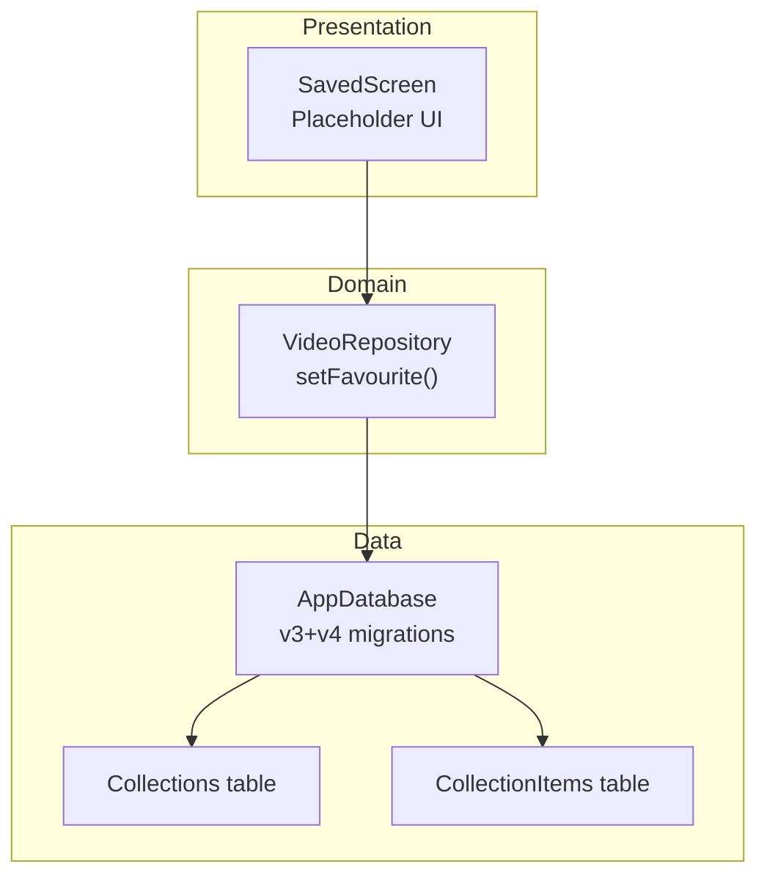
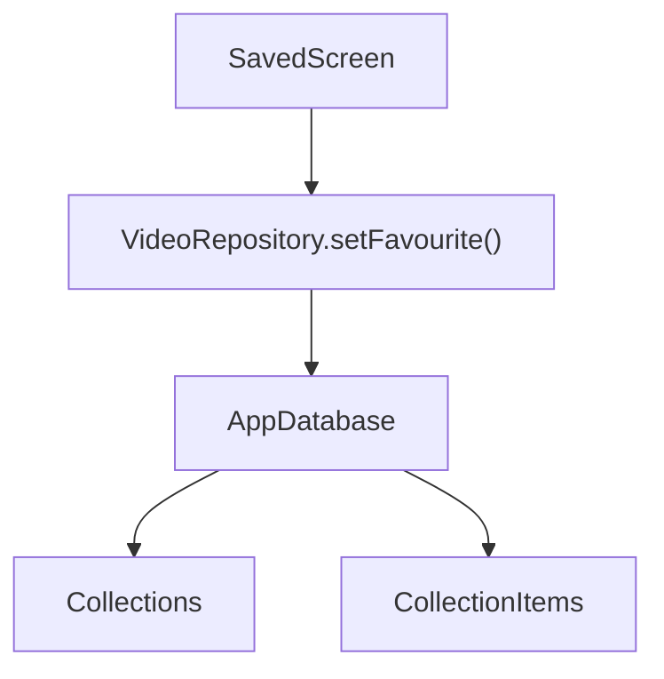
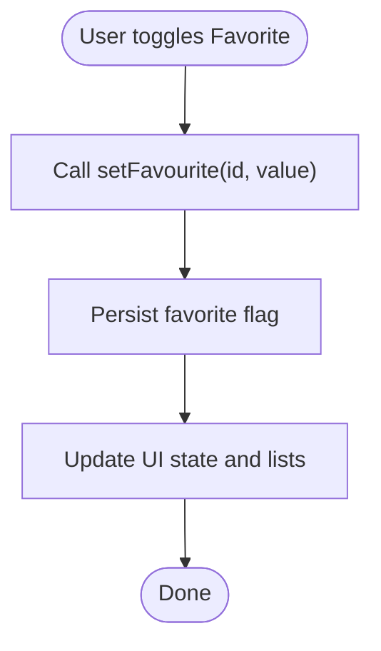
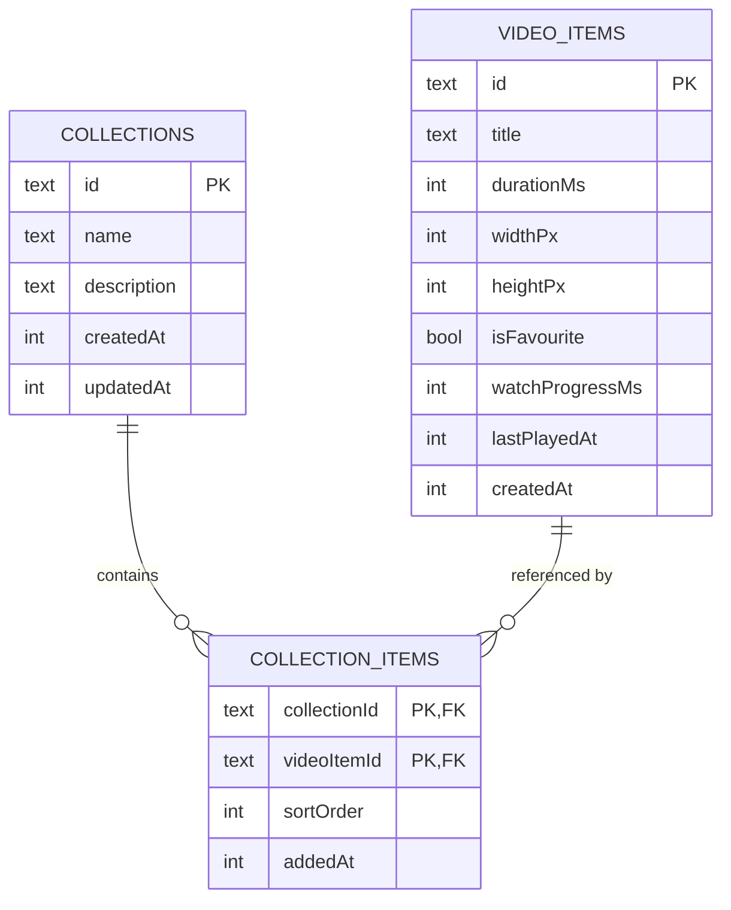
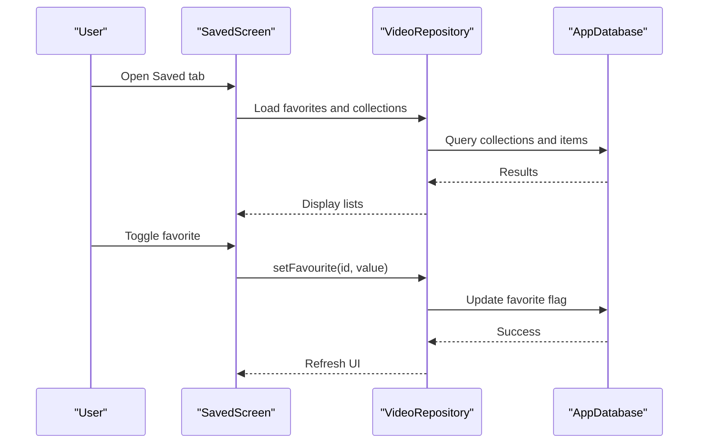
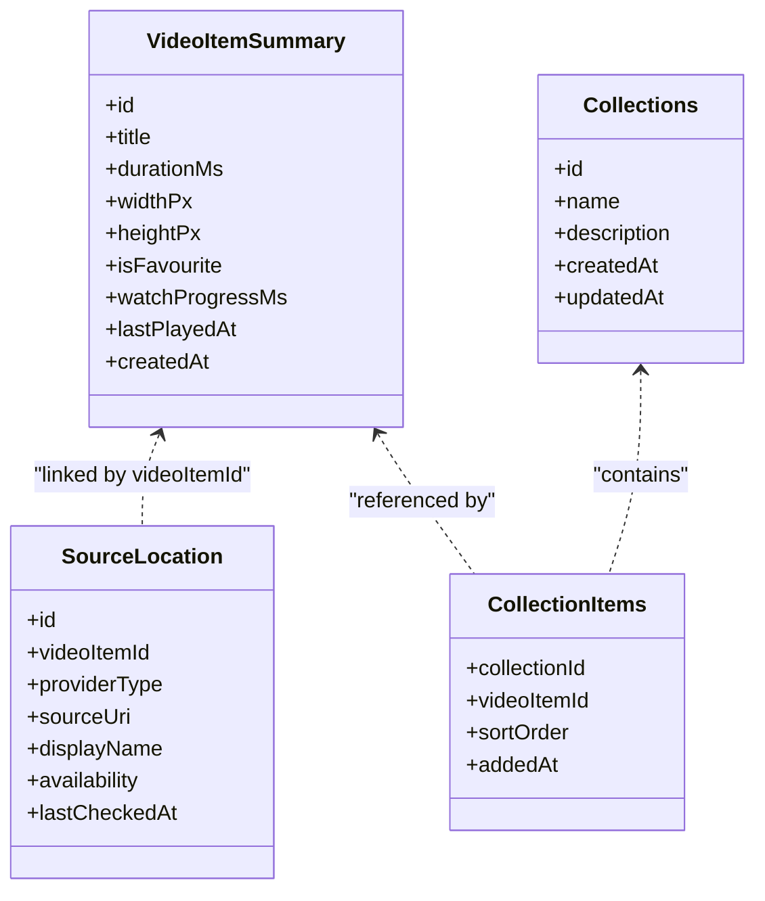
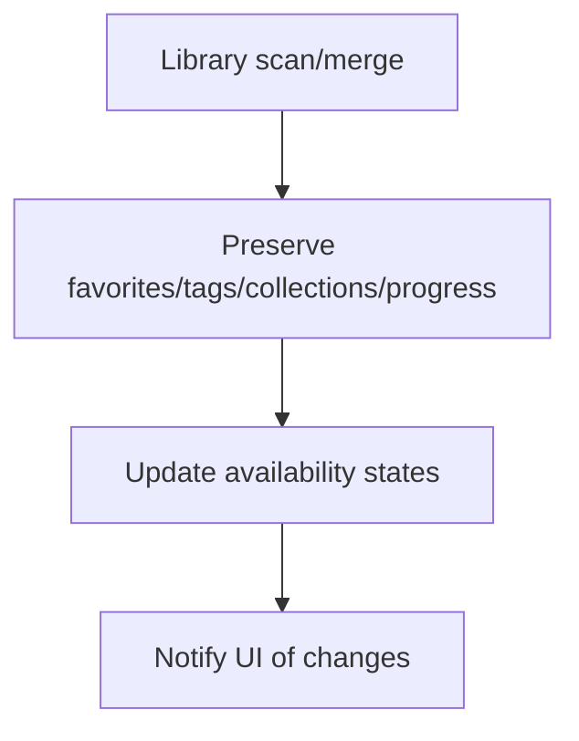
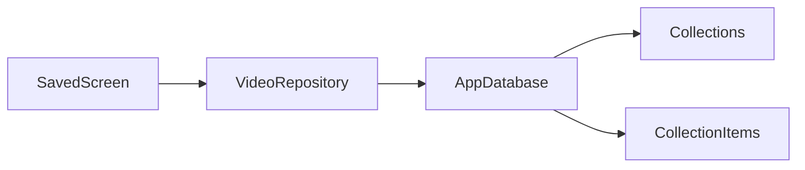

# Saved Feature

<cite>
**Referenced Files in This Document**
- [ARCHITECTURE.md](file://ARCHITECTURE.md)
- [saved_screen.dart](file://lib/features/saved/saved_screen.dart)
- [video_repository.dart](file://lib/domain/repositories/video_repository.dart)
- [app_database.dart](file://lib/data/database/app_database.dart)
- [collections_table.dart](file://lib/data/database/tables/collections_table.dart)
- [collection_items_table.dart](file://lib/data/database/tables/collection_items_table.dart)
</cite>

## Table of Contents
1. [Introduction](#introduction)
2. [Project Structure](#project-structure)
3. [Core Components](#core-components)
4. [Architecture Overview](#architecture-overview)
5. [Detailed Component Analysis](#detailed-component-analysis)
6. [Dependency Analysis](#dependency-analysis)
7. [Performance Considerations](#performance-considerations)
8. [Troubleshooting Guide](#troubleshooting-guide)
9. [Conclusion](#conclusion)
10. [Appendices](#appendices)

## Introduction
This document defines the planned Saved feature for organizing preferred videos through favorites and collections. It explains how users will create, edit, and manage video collections and playlists; how saved items relate to the main video library; how state is managed during user interactions; and how synchronization, import/export, and advanced organization features such as smart collections and automated tagging should be implemented. The design follows the repository’s local-first architecture, domain-driven boundaries, and Drift-backed persistence model.

## Project Structure
The Saved feature spans presentation, domain, and data layers:

- Presentation: a placeholder Saved tab that will host favorites and collections UI.
- Domain: repository contract exposing favorite toggling and item operations.
- Data: Drift schema with `Collections` and `CollectionItems`, plus indexes for efficient queries.

**Diagram sources**
- [saved_screen.dart:3-17](file://lib/features/saved/saved_screen.dart#L3-L17)
- [video_repository.dart:47-51](file://lib/domain/repositories/video_repository.dart#L47-L51)
- [app_database.dart:25-35](file://lib/data/database/app_database.dart#L25-L35)
- [collections_table.dart:3-27](file://lib/data/database/tables/collections_table.dart#L3-L27)
- [collection_items_table.dart:6-35](file://lib/data/database/tables/collection_items_table.dart#L6-L35)

**Section sources**
- [saved_screen.dart:3-17](file://lib/features/saved/saved_screen.dart#L3-L17)
- [video_repository.dart:47-51](file://lib/domain/repositories/video_repository.dart#L47-L51)
- [app_database.dart:25-35](file://lib/data/database/app_database.dart#L25-L35)
- [collections_table.dart:3-27](file://lib/data/database/tables/collections_table.dart#L3-L27)
- [collection_items_table.dart:6-35](file://lib/data/database/tables/collection_items_table.dart#L6-L35)

## Core Components
- Saved screen placeholder: provides the entry point for favorites and collections.
- Video repository interface: exposes `setFavourite(id, value)` for marking or unmarking videos.
- Collections schema: supports named, ordered playlists with explicit sort order and timestamps.
- Collection items junction: links videos to collections with ordering and timestamps, enabling many-to-many relationships.

Key responsibilities:
- UI: present favorites list and collection management screens.
- Domain: encapsulate business rules for favorites and collection membership.
- Data: persist collections, items, and related metadata using Drift.

**Section sources**
- [saved_screen.dart:3-17](file://lib/features/saved/saved_screen.dart#L3-L17)
- [video_repository.dart:47-51](file://lib/domain/repositories/video_repository.dart#L47-L51)
- [collections_table.dart:3-27](file://lib/data/database/tables/collections_table.dart#L3-L27)
- [collection_items_table.dart:6-35](file://lib/data/database/tables/collection_items_table.dart#L6-L35)

## Architecture Overview
The Saved feature aligns with the project’s layered architecture:

- Presentation layer: Flutter widgets (SavedScreen) display favorites and collections.
- Domain layer: repository contracts define operations like setting favorites.
- Data layer: Drift database manages tables for collections and their items.

**Diagram sources**
- [saved_screen.dart:3-17](file://lib/features/saved/saved_screen.dart#L3-L17)
- [video_repository.dart:47-51](file://lib/domain/repositories/video_repository.dart#L47-L51)
- [app_database.dart:25-35](file://lib/data/database/app_database.dart#L25-L35)
- [collections_table.dart:3-27](file://lib/data/database/tables/collections_table.dart#L3-L27)
- [collection_items_table.dart:6-35](file://lib/data/database/tables/collection_items_table.dart#L6-L35)

## Detailed Component Analysis

### Favorites Management
- Purpose: allow users to mark/unmark videos as favorites.
- State surface: `isFavourite` on video summaries drives UI toggles and filtering.
- Repository operation: `setFavourite(id, value)` updates favorite status without touching original files.

Implementation notes:
- UI should call repository methods rather than write directly to storage.
- Errors should be handled via typed results returned by the repository.

**Diagram sources**
- [video_repository.dart:47-51](file://lib/domain/repositories/video_repository.dart#L47-L51)

**Section sources**
- [video_repository.dart:47-51](file://lib/domain/repositories/video_repository.dart#L47-L51)

### Collections and Playlists
- Collections represent user-created playlists with names, optional descriptions, and timestamps.
- Items are linked via a junction table with explicit sort order and addition timestamps.
- Many-to-many relationship allows a video to belong to multiple collections.

**Diagram sources**
- [collections_table.dart:3-27](file://lib/data/database/tables/collections_table.dart#L3-L27)
- [collection_items_table.dart:6-35](file://lib/data/database/tables/collection_items_table.dart#L6-L35)
- [video_repository.dart:122-144](file://lib/domain/repositories/video_repository.dart#L122-L144)

**Section sources**
- [collections_table.dart:3-27](file://lib/data/database/tables/collections_table.dart#L3-L27)
- [collection_items_table.dart:6-35](file://lib/data/database/tables/collection_items_table.dart#L6-L35)

### User Interface for Saved
- Current state: placeholder Saved tab with title and body.
- Planned behavior:
  - Favorites list with toggle actions.
  - Collections list with create/edit/delete.
  - Collection detail view with reorderable item lists.
  - Navigation to playback from favorites or collections.

**Diagram sources**
- [saved_screen.dart:3-17](file://lib/features/saved/saved_screen.dart#L3-L17)
- [video_repository.dart:47-51](file://lib/domain/repositories/video_repository.dart#L47-L51)
- [app_database.dart:25-35](file://lib/data/database/app_database.dart#L25-L35)

**Section sources**
- [saved_screen.dart:3-17](file://lib/features/saved/saved_screen.dart#L3-L17)

### Data Model and Relationships
- Logical video items include favorite state, progress, and timestamps.
- Source locations provide multiple access paths per logical item.
- Collections and collection items enable flexible organization.

**Diagram sources**
- [video_repository.dart:122-144](file://lib/domain/repositories/video_repository.dart#L122-L144)
- [video_repository.dart:165-197](file://lib/domain/repositories/video_repository.dart#L165-L197)
- [collections_table.dart:3-27](file://lib/data/database/tables/collections_table.dart#L3-L27)
- [collection_items_table.dart:6-35](file://lib/data/database/tables/collection_items_table.dart#L6-L35)

**Section sources**
- [video_repository.dart:122-144](file://lib/domain/repositories/video_repository.dart#L122-L144)
- [video_repository.dart:165-197](file://lib/domain/repositories/video_repository.dart#L165-L197)
- [collections_table.dart:3-27](file://lib/data/database/tables/collections_table.dart#L3-L27)
- [collection_items_table.dart:6-35](file://lib/data/database/tables/collection_items_table.dart#L6-L35)

### State Management Approach
- Use a single source of truth for favorites and collections within the repository/state manager.
- UI subscribes to changes and reflects updates after repository operations complete.
- Avoid direct database writes from widgets; route all mutations through repository methods.
- For optimistic UI, apply local state changes immediately and reconcile with persistence on success.

Guidelines:
- Track selection state (selected video, active collection) in presentation state.
- Track modification state (creating/editing/deleting collections) separately from read state.
- Debounce heavy operations (e.g., reordering large collections) to keep UI responsive.

[No sources needed since this section provides general guidance]

### Synchronization Between Saved Items and Main Library
- Favorites and collections are metadata attached to logical video items.
- Indexing and refresh processes must preserve user-owned fields (favorites, tags, collections, progress).
- Availability changes should not delete records; they should update availability states.

**Diagram sources**
- [ARCHITECTURE.md:208-217](file://ARCHITECTURE.md#L208-L217)

**Section sources**
- [ARCHITECTURE.md:208-217](file://ARCHITECTURE.md#L208-L217)

### Import/Export Functionality
- Export collections and favorites as structured data for sharing and backup.
- Import merges into existing data while preserving user-owned metadata.
- Exclude credentials and original video bytes from exports/backups.

Recommended export format:
- JSON containing collections, items, and favorite flags.
- Optional metadata such as descriptions and sort orders.

Import behavior:
- Merge mode: add missing collections/items; update existing where safe.
- Replace mode: replace current collections/favorites with imported data (explicit user confirmation required).

Security considerations:
- Treat exports as sensitive data.
- Validate input schemas before applying changes.

[No sources needed since this section provides general guidance]

### Advanced Organization Features
Smart collections:
- Rule-based collections defined by conditions (e.g., recently added, unwatched, specific tags).
- Evaluate rules incrementally and cache results to avoid full scans.

Automated tagging:
- Apply tags based on heuristics (metadata patterns, provider hints).
- Allow user overrides and manual corrections.

Implementation guidelines:
- Keep rule evaluation deterministic and testable.
- Provide UI to view and edit rules and auto-applied tags.
- Ensure performance by batching evaluations and indexing relevant fields.

[No sources needed since this section provides general guidance]

## Dependency Analysis
The Saved feature depends on:
- Presentation: SavedScreen placeholder.
- Domain: VideoRepository for favorite operations.
- Data: AppDatabase with Collections and CollectionItems tables and indexes.

**Diagram sources**
- [saved_screen.dart:3-17](file://lib/features/saved/saved_screen.dart#L3-L17)
- [video_repository.dart:47-51](file://lib/domain/repositories/video_repository.dart#L47-L51)
- [app_database.dart:25-35](file://lib/data/database/app_database.dart#L25-L35)
- [collections_table.dart:3-27](file://lib/data/database/tables/collections_table.dart#L3-L27)
- [collection_items_table.dart:6-35](file://lib/data/database/tables/collection_items_table.dart#L6-L35)

**Section sources**
- [saved_screen.dart:3-17](file://lib/features/saved/saved_screen.dart#L3-L17)
- [video_repository.dart:47-51](file://lib/domain/repositories/video_repository.dart#L47-L51)
- [app_database.dart:25-35](file://lib/data/database/app_database.dart#L25-L35)
- [collections_table.dart:3-27](file://lib/data/database/tables/collections_table.dart#L3-L27)
- [collection_items_table.dart:6-35](file://lib/data/database/tables/collection_items_table.dart#L6-L35)

## Performance Considerations
- Use indexes on collection items and recent play fields to speed up common queries.
- Avoid full scans on every rebuild/tab switch; prefer incremental updates.
- Throttle writes for progress and frequent UI-triggered mutations.
- Cache computed views (e.g., smart collections) and invalidate on relevant changes.

**Section sources**
- [app_database.dart:78-98](file://lib/data/database/app_database.dart#L78-L98)
- [ARCHITECTURE.md:208-217](file://ARCHITECTURE.md#L208-L217)

## Troubleshooting Guide
Common issues and resolutions:
- Missing collections or items after migration: verify v2→v3 migration created tables and indexes.
- Slow listing of collection items: ensure index on `collection_id` exists.
- Incorrect favorite state: confirm repository calls `setFavourite` and UI reads updated summaries.
- Orphaned join rows: rely on cascade deletes; validate foreign key enforcement is enabled.

Operational checks:
- Confirm foreign keys are enforced at connection open.
- Validate schema version and migration steps.
- Inspect indexes for collection items and recent play fields.

**Section sources**
- [app_database.dart:44-71](file://lib/data/database/app_database.dart#L44-L71)
- [app_database.dart:78-98](file://lib/data/database/app_database.dart#L78-L98)

## Conclusion
The Saved feature introduces favorites and collections to help users organize preferred videos. The current codebase provides a placeholder UI, a repository method for favorites, and a robust Drift schema for collections and their items. Future implementation should focus on wiring the Saved screen to repository operations, ensuring safe synchronization with the main library, and adding import/export and advanced organization capabilities while maintaining performance and data integrity.

[No sources needed since this section summarizes without analyzing specific files]

## Appendices

### Database Schema Notes
- Collections: stable ID, name, description, timestamps.
- Collection items: composite primary key, sort order, addition timestamp, cascade deletes.
- Indexes: collection items by collection, recent play fields.

**Section sources**
- [collections_table.dart:3-27](file://lib/data/database/tables/collections_table.dart#L3-L27)
- [collection_items_table.dart:6-35](file://lib/data/database/tables/collection_items_table.dart#L6-L35)
- [app_database.dart:78-98](file://lib/data/database/app_database.dart#L78-L98)