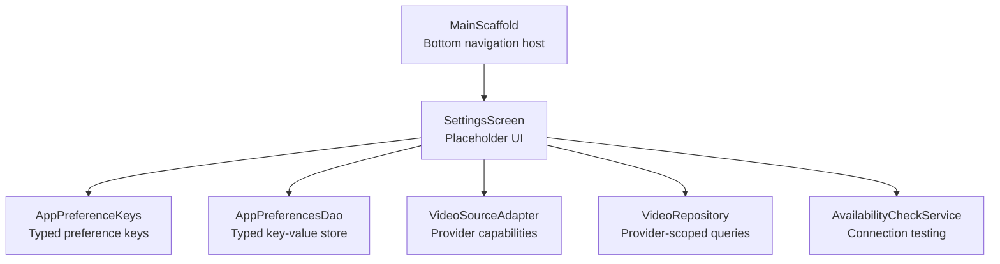
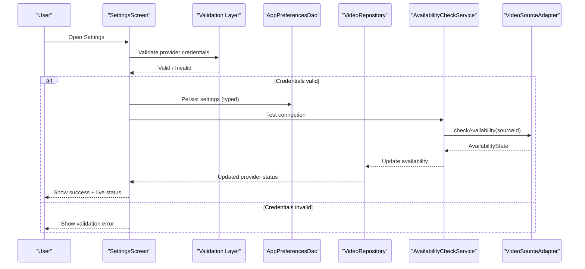
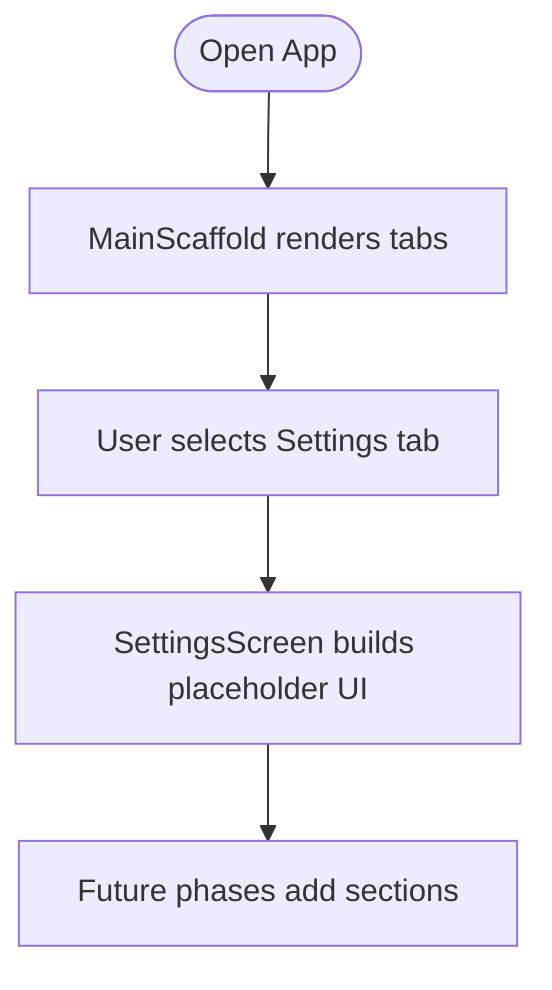
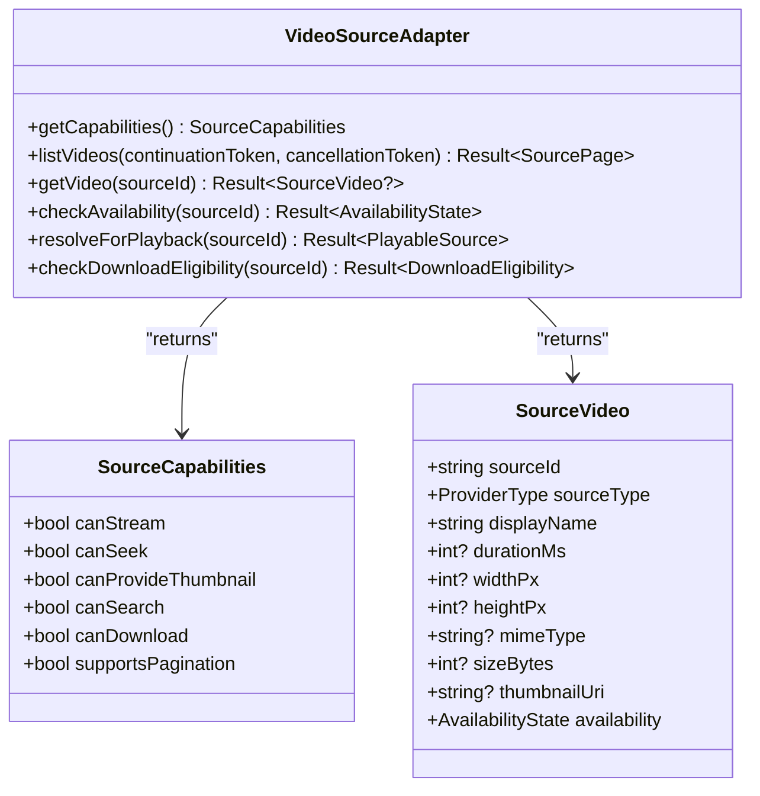
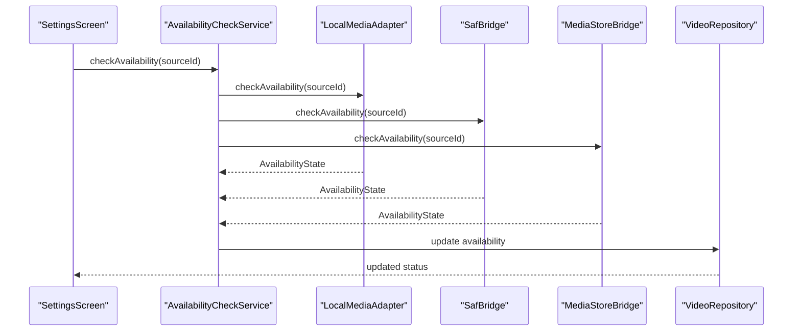
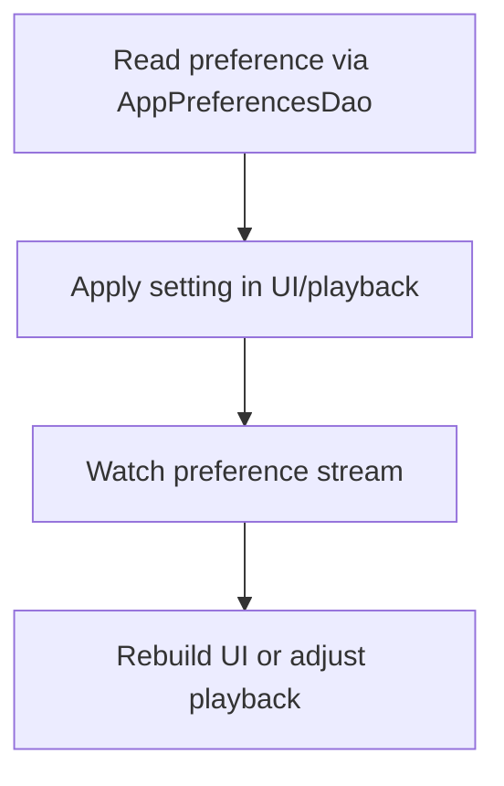
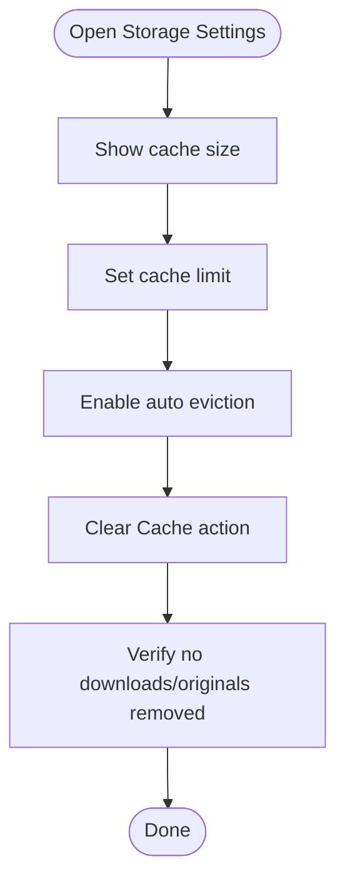
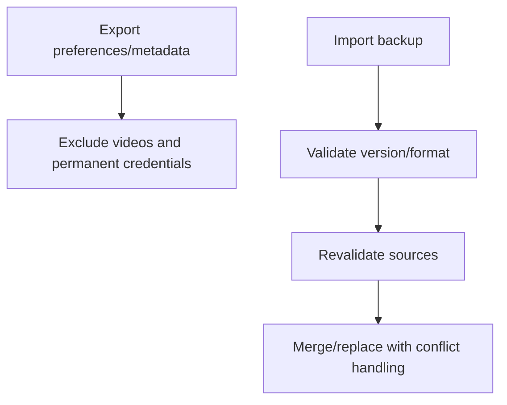
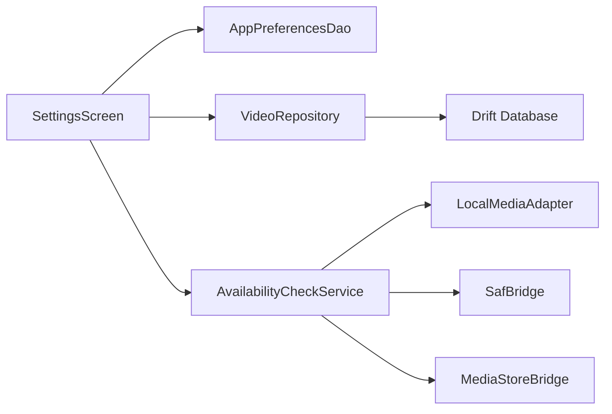

# Settings Feature

<cite>
**Referenced Files in This Document**
- [main_scaffold.dart](file://lib/app/main_scaffold.dart)
- [settings_screen.dart](file://lib/features/settings/settings_screen.dart)
- [app_preferences_table.dart](file://lib/data/database/tables/app_preferences_table.dart)
- [app_preferences_dao.dart](file://lib/data/database/daos/app_preferences_dao.dart)
- [app_database.dart](file://lib/data/database/app_database.dart)
- [source_adapter.dart](file://lib/sources/source_adapter.dart)
- [video_repository.dart](file://lib/domain/repositories/video_repository.dart)
- [availability_check_service.dart](file://lib/domain/services/availability_check_service.dart)
- [availability_check_service_provider.dart](file://lib/domain/services/availability_check_service_provider.dart)
- [drift_video_repository.dart](file://lib/data/repositories/drift_video_repository.dart)
- [local_media_adapter_provider.dart](file://lib/sources/local/local_media_adapter_provider.dart)
- [media_store_bridge.dart](file://lib/platform/media_store_bridge.dart)
- [theme_mode_notifier.dart](file://lib/app/theme/theme_mode_notifier.dart)
- [REQUIREMENTS.md](file://REQUIREMENTS.md)
- [TASKS.md](file://TASKS.md)
</cite>

## Table of Contents
1. [Introduction](#introduction)
2. [Project Structure](#project-structure)
3. [Core Components](#core-components)
4. [Architecture Overview](#architecture-overview)
5. [Detailed Component Analysis](#detailed-component-analysis)
6. [Dependency Analysis](#dependency-analysis)
7. [Performance Considerations](#performance-considerations)
8. [Troubleshooting Guide](#troubleshooting-guide)
9. [Conclusion](#conclusion)
10. [Appendices](#appendices)

## Introduction
This document specifies the planned Settings feature for the application. It defines how users will configure video providers, manage app preferences, and customize behavior such as playback speed, autoplay, and theme selection. The design builds on existing navigation scaffolding, a typed key-value preference store, provider adapter abstractions, and availability checking services.

The Settings feature is currently represented by a placeholder screen wired into the main bottom navigation. The persistence layer already supports typed preferences with streaming updates, which can be extended to support provider configuration, storage management, and privacy controls.

## Project Structure
Settings is exposed as a top-level tab alongside Discover, Reels, Library, and Saved. The placeholder Settings screen is integrated via the main scaffold.

**Diagram sources**
- [main_scaffold.dart:1-105](file://lib/app/main_scaffold.dart#L1-L105)
- [settings_screen.dart:1-18](file://lib/features/settings/settings_screen.dart#L1-L18)
- [app_preferences_table.dart:1-36](file://lib/data/database/tables/app_preferences_table.dart#L1-L36)
- [app_preferences_dao.dart:1-75](file://lib/data/database/daos/app_preferences_dao.dart#L1-L75)
- [source_adapter.dart:27-117](file://lib/sources/source_adapter.dart#L27-L117)
- [video_repository.dart:110-241](file://lib/domain/repositories/video_repository.dart#L110-L241)
- [availability_check_service.dart:33-50](file://lib/domain/services/availability_check_service.dart#L33-L50)

**Section sources**
- [main_scaffold.dart:1-105](file://lib/app/main_scaffold.dart#L1-L105)
- [settings_screen.dart:1-18](file://lib/features/settings/settings_screen.dart#L1-L18)

## Core Components
- Settings screen entry point: A placeholder widget that will host provider configuration, playback preferences, storage management, and privacy controls.
- Preference persistence: A typed key-value store backed by Drift, exposing string, bool, and double helpers plus change streams.
- Provider abstraction: An adapter interface defining capabilities (streaming, seeking, thumbnails, search, download, pagination), listing, metadata retrieval, availability checks, and playback resolution.
- Availability service: Orchestrates connectivity checks across local adapters and platform bridges, updating repository state.
- Repository integration: Queries and filters data by provider type; used to validate and display provider status.

Key responsibilities:
- UI: Present settings categories and collect user input.
- Validation: Validate provider credentials and test connections before saving.
- Persistence: Save validated settings using AppPreferencesDao.
- Real-time updates: Observe preference changes and apply them immediately.
- Security: Avoid persisting sensitive tokens directly; prefer secure storage or encrypted references.

**Section sources**
- [settings_screen.dart:1-18](file://lib/features/settings/settings_screen.dart#L1-L18)
- [app_preferences_table.dart:1-36](file://lib/data/database/tables/app_preferences_table.dart#L1-L36)
- [app_preferences_dao.dart:1-75](file://lib/data/database/daos/app_preferences_dao.dart#L1-L75)
- [source_adapter.dart:27-117](file://lib/sources/source_adapter.dart#L27-L117)
- [availability_check_service.dart:33-50](file://lib/domain/services/availability_check_service.dart#L33-L50)

## Architecture Overview
The Settings feature integrates UI, validation, persistence, and provider services through well-defined boundaries.

**Diagram sources**
- [settings_screen.dart:1-18](file://lib/features/settings/settings_screen.dart#L1-L18)
- [app_preferences_dao.dart:1-75](file://lib/data/database/daos/app_preferences_dao.dart#L1-L75)
- [video_repository.dart:110-241](file://lib/domain/repositories/video_repository.dart#L110-L241)
- [availability_check_service.dart:33-50](file://lib/domain/services/availability_check_service.dart#L33-L50)
- [source_adapter.dart:27-117](file://lib/sources/source_adapter.dart#L27-L117)

## Detailed Component Analysis

### Settings Screen and Navigation Integration
- The Settings tab is registered in the main scaffold and rendered as an IndexedStack page.
- The current implementation is a placeholder; future phases will wire sections for providers, folders, playback preferences, downloads, cache, library controls, and theme selection.

**Diagram sources**
- [main_scaffold.dart:1-105](file://lib/app/main_scaffold.dart#L1-L105)
- [settings_screen.dart:1-18](file://lib/features/settings/settings_screen.dart#L1-L18)

**Section sources**
- [main_scaffold.dart:1-105](file://lib/app/main_scaffold.dart#L1-L105)
- [settings_screen.dart:1-18](file://lib/features/settings/settings_screen.dart#L1-L18)

### Preferences Storage Model and DAO
- AppPreferences is a simple key-value table where keys are constants defined in AppPreferenceKeys and values are stored as text.
- AppPreferencesDao provides typed getters/setters for strings, booleans, and doubles, plus a stream watcher for real-time updates.
- Existing keys include theme mode, reels autoplay, and default playback speed.

```mermaid
classDiagram
class AppPreferences {
+string key
+string value
+primaryKey(key)
}
class AppPreferenceKeys {
+string themeMode
+string reelsAutoplay
+string defaultPlaybackSpeed
}
class AppPreferencesDao {
+getString(key) String?
+setString(key, value) void
+remove(key) void
+getBool(key, defaultValue) bool
+setBool(key, value) void
+getDouble(key, defaultValue) double
+setDouble(key, value) void
+watchString(key) Stream~String?~
}
AppPreferencesDao --> AppPreferences : "persists"
AppPreferenceKeys <.. AppPreferences : "keys"
```

**Diagram sources**
- [app_preferences_table.dart:1-36](file://lib/data/database/tables/app_preferences_table.dart#L1-L36)
- [app_preferences_dao.dart:1-75](file://lib/data/database/daos/app_preferences_dao.dart#L1-L75)

**Section sources**
- [app_preferences_table.dart:1-36](file://lib/data/database/tables/app_preferences_table.dart#L1-L36)
- [app_preferences_dao.dart:1-75](file://lib/data/database/daos/app_preferences_dao.dart#L1-L75)

### Provider Configuration and Capabilities
- Providers implement VideoSourceAdapter, declaring capabilities such as streaming, seeking, thumbnails, search, downloads, and pagination.
- The repository exposes provider-scoped operations and uses ProviderType to distinguish sources.
- Settings should allow configuring provider-specific options (e.g., account selection, folder paths, API endpoints) and then validate them via capability checks and availability tests.

**Diagram sources**
- [source_adapter.dart:27-117](file://lib/sources/source_adapter.dart#L27-L117)

**Section sources**
- [source_adapter.dart:27-117](file://lib/sources/source_adapter.dart#L27-L117)
- [video_repository.dart:110-241](file://lib/domain/repositories/video_repository.dart#L110-L241)

### Connection Testing and Availability Updates
- AvailabilityCheckService coordinates checks across local adapters and platform bridges, updating repository state without aborting on transient errors.
- Settings can trigger connection tests per provider and reflect results in the UI.

**Diagram sources**
- [availability_check_service.dart:33-50](file://lib/domain/services/availability_check_service.dart#L33-L50)
- [availability_check_service_provider.dart:1-19](file://lib/domain/services/availability_check_service_provider.dart#L1-L19)
- [local_media_adapter_provider.dart:1-12](file://lib/sources/local/local_media_adapter_provider.dart#L1-L12)
- [media_store_bridge.dart:97-97](file://lib/platform/media_store_bridge.dart#L97-L97)
- [drift_video_repository.dart:151-154](file://lib/data/repositories/drift_video_repository.dart#L151-L154)

**Section sources**
- [availability_check_service.dart:33-50](file://lib/domain/services/availability_check_service.dart#L33-L50)
- [availability_check_service_provider.dart:1-19](file://lib/domain/services/availability_check_service_provider.dart#L1-L19)

### Playback Preferences and Theme Mode
- Existing preference keys cover theme mode, reels autoplay, and default playback speed.
- Theme mode is also surfaced via a notifier intended for use from Settings when changing the theme.

**Diagram sources**
- [app_preferences_table.dart:22-35](file://lib/data/database/tables/app_preferences_table.dart#L22-L35)
- [app_preferences_dao.dart:69-73](file://lib/data/database/daos/app_preferences_dao.dart#L69-L73)
- [theme_mode_notifier.dart:8-32](file://lib/app/theme/theme_mode_notifier.dart#L8-L32)

**Section sources**
- [app_preferences_table.dart:22-35](file://lib/data/database/tables/app_preferences_table.dart#L22-L35)
- [app_preferences_dao.dart:69-73](file://lib/data/database/daos/app_preferences_dao.dart#L69-L73)
- [theme_mode_notifier.dart:8-32](file://lib/app/theme/theme_mode_notifier.dart#L8-L32)

### Storage Management and Cache Controls
- Requirements define cache reporting, configurable limits, automatic cleanup, and Clear Cache actions.
- Tasks specify separating cache from downloads and ensuring Clear Cache does not remove originals or explicit downloads.

**Diagram sources**
- [REQUIREMENTS.md:187-224](file://REQUIREMENTS.md#L187-L224)
- [TASKS.md:214-239](file://TASKS.md#L214-L239)

**Section sources**
- [REQUIREMENTS.md:187-224](file://REQUIREMENTS.md#L187-L224)
- [TASKS.md:214-239](file://TASKS.md#L214-L239)

### Privacy Controls and Backup/Restore
- Backup/export includes metadata, favorites, tags, collections, watch history, and relevant preferences; excludes original video bytes and permanent cloud credentials.
- Restore validates version/format and revalidates restored sources.

**Diagram sources**
- [REQUIREMENTS.md:211-224](file://REQUIREMENTS.md#L211-L224)

**Section sources**
- [REQUIREMENTS.md:211-224](file://REQUIREMENTS.md#L211-L224)

## Dependency Analysis
Settings depends on multiple layers:
- UI: SettingsScreen and MainScaffold.
- Persistence: AppPreferencesDao and AppPreferences table.
- Domain: VideoRepository, AvailabilityCheckService, and provider adapters.
- Platform: SafBridge and MediaStoreBridge.

**Diagram sources**
- [settings_screen.dart:1-18](file://lib/features/settings/settings_screen.dart#L1-L18)
- [app_preferences_dao.dart:1-75](file://lib/data/database/daos/app_preferences_dao.dart#L1-L75)
- [drift_video_repository.dart:151-154](file://lib/data/repositories/drift_video_repository.dart#L151-L154)
- [availability_check_service.dart:33-50](file://lib/domain/services/availability_check_service.dart#L33-L50)
- [local_media_adapter_provider.dart:1-12](file://lib/sources/local/local_media_adapter_provider.dart#L1-L12)
- [media_store_bridge.dart:97-97](file://lib/platform/media_store_bridge.dart#L97-L97)

**Section sources**
- [settings_screen.dart:1-18](file://lib/features/settings/settings_screen.dart#L1-L18)
- [app_preferences_dao.dart:1-75](file://lib/data/database/daos/app_preferences_dao.dart#L1-L75)
- [drift_video_repository.dart:151-154](file://lib/data/repositories/drift_video_repository.dart#L151-L154)
- [availability_check_service.dart:33-50](file://lib/domain/services/availability_check_service.dart#L33-L50)
- [local_media_adapter_provider.dart:1-12](file://lib/sources/local/local_media_adapter_provider.dart#L1-L12)
- [media_store_bridge.dart:97-97](file://lib/platform/media_store_bridge.dart#L97-L97)

## Performance Considerations
- Use AppPreferencesDao.watchString to reactively update UI without polling.
- Defer expensive provider scans until explicitly triggered from Settings.
- Batch availability checks and avoid redundant network calls.
- Separate cache and downloads to prevent accidental large deletions during cleanup.

[No sources needed since this section provides general guidance]

## Troubleshooting Guide
Common issues and resolutions:
- Invalid provider credentials:
  - Validate inputs before saving.
  - Run connection tests via AvailabilityCheckService and surface errors.
- Unavailable sources:
  - Check platform permissions (SAF/MediaStore).
  - Re-run availability checks after permission restoration.
- Preference not applied:
  - Ensure the correct key is used (AppPreferenceKeys).
  - Confirm DAO write succeeded and stream emits updated value.
- Cache clearing removes unexpected data:
  - Verify Clear Cache logic excludes downloads and originals.

**Section sources**
- [availability_check_service.dart:33-50](file://lib/domain/services/availability_check_service.dart#L33-L50)
- [app_preferences_table.dart:22-35](file://lib/data/database/tables/app_preferences_table.dart#L22-L35)
- [REQUIREMENTS.md:187-224](file://REQUIREMENTS.md#L187-L224)

## Conclusion
The Settings feature will provide a centralized place to configure providers, manage playback preferences, control storage/cache, and enforce privacy. It leverages existing typed preferences, provider adapters, and availability services to deliver a robust, extensible, and secure configuration experience. Future phases should expand the placeholder UI, integrate validation flows, and implement storage controls aligned with requirements and tasks.

[No sources needed since this section summarizes without analyzing specific files]

## Appendices

### Settings Categories and Example Keys
- Provider configuration:
  - Add keys like provider_account_id, provider_folder_path, provider_api_endpoint.
  - Validate format and test connection before saving.
- Playback preferences:
  - Use existing keys: theme_mode, reels_autoplay, default_playback_speed.
- Storage management:
  - Cache limit, auto-eviction toggle, clear cache action.
- Privacy controls:
  - Enable/disable telemetry, export/restore preferences.

[No sources needed since this section provides general guidance]

### Adding a New Setting Category
Steps:
1. Define new keys in AppPreferenceKeys.
2. Add typed helpers in AppPreferencesDao if needed.
3. Wire UI controls in SettingsScreen.
4. Validate inputs and run connection tests where applicable.
5. Persist via DAO and observe changes with watchString.
6. Apply changes in relevant components (playback, UI, storage).

**Section sources**
- [app_preferences_table.dart:22-35](file://lib/data/database/tables/app_preferences_table.dart#L22-L35)
- [app_preferences_dao.dart:24-73](file://lib/data/database/daos/app_preferences_dao.dart#L24-L73)
- [settings_screen.dart:1-18](file://lib/features/settings/settings_screen.dart#L1-L18)

### Validation Mechanisms and Connection Testing
- Input validation:
  - Enforce non-empty fields, URL formats, enum constraints.
- Credential validation:
  - Store only safe identifiers; avoid persisting raw tokens.
- Connection testing:
  - Trigger AvailabilityCheckService.checkAvailability for each provider.
  - Surface results to the user and disable unsafe configurations.

**Section sources**
- [source_adapter.dart:45-56](file://lib/sources/source_adapter.dart#L45-L56)
- [availability_check_service.dart:33-50](file://lib/domain/services/availability_check_service.dart#L33-L50)

### Persistence Strategy
- Use AppPreferencesDao for all user preferences.
- Prefer typed methods (getBool, setBool, getDouble, setDouble) to avoid parsing drift.
- Use watchString to apply changes in real time.

**Section sources**
- [app_preferences_dao.dart:24-73](file://lib/data/database/daos/app_preferences_dao.dart#L24-L73)

### Real-Time Application and Notifications
- Observe preference streams to rebuild UI or adjust playback immediately.
- Notify users of successful configuration changes and failures.

**Section sources**
- [app_preferences_dao.dart:69-73](file://lib/data/database/daos/app_preferences_dao.dart#L69-L73)

### Security Considerations
- Do not persist sensitive provider credentials in plain text.
- Use secure storage or encrypted references for tokens.
- Exclude permanent credentials from backups.

**Section sources**
- [REQUIREMENTS.md:211-224](file://REQUIREMENTS.md#L211-L224)