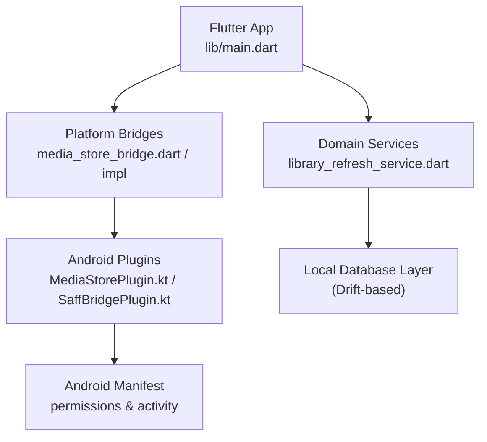
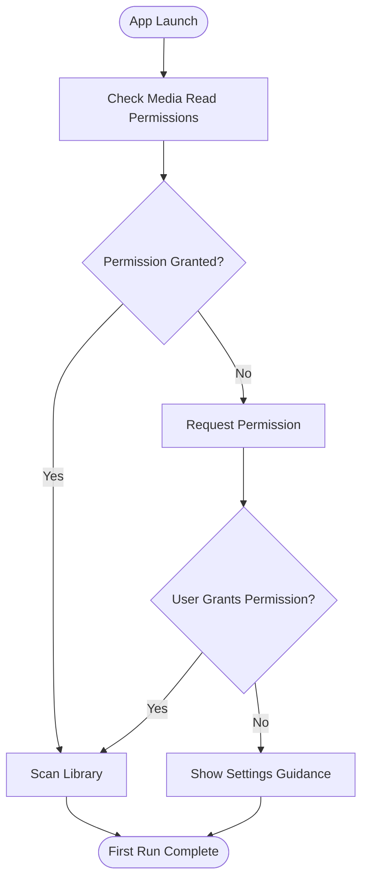
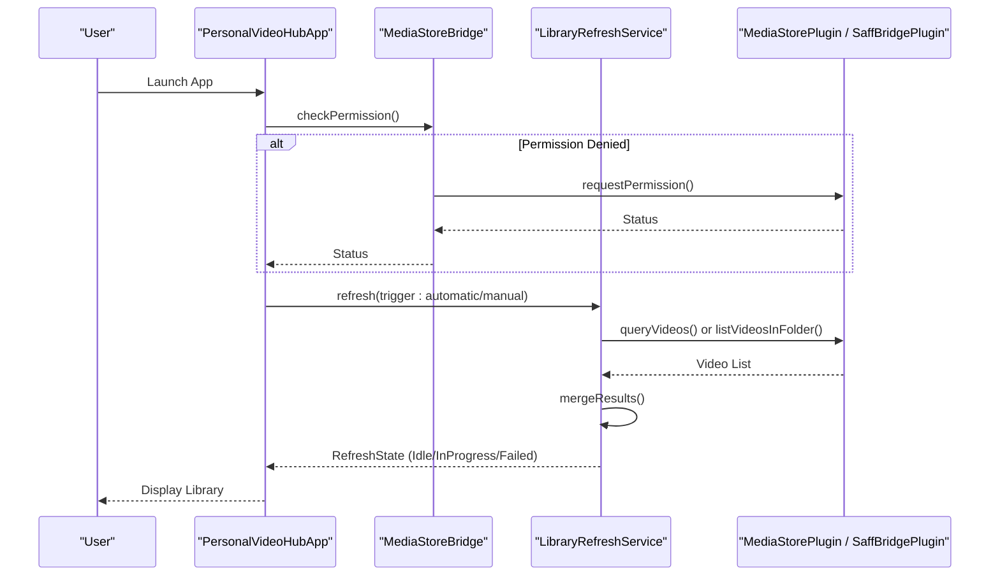
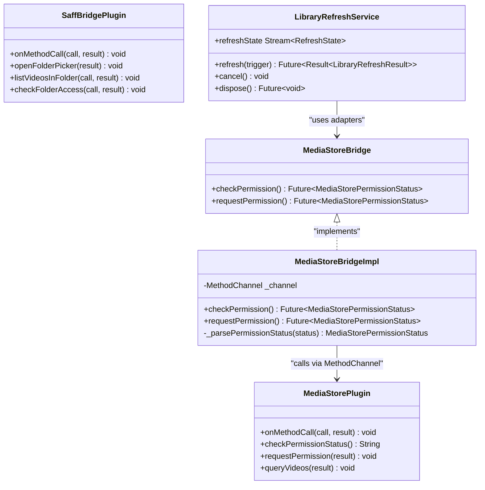
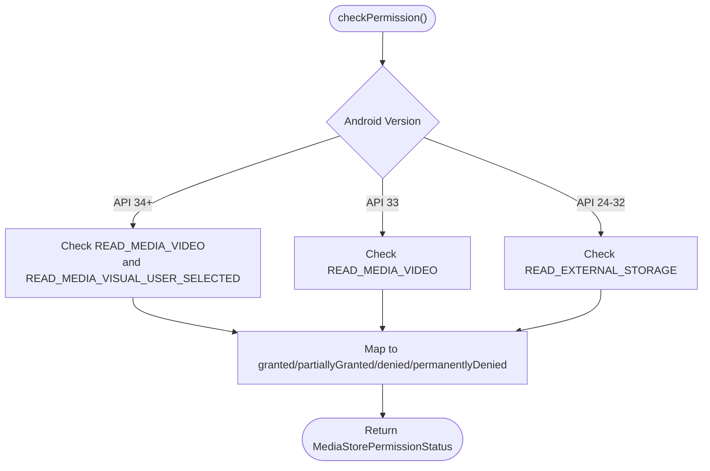
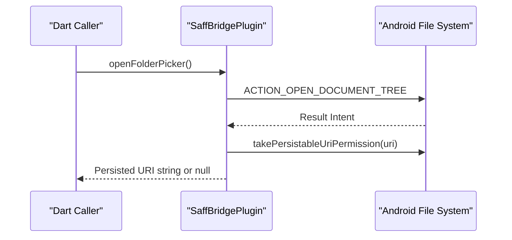
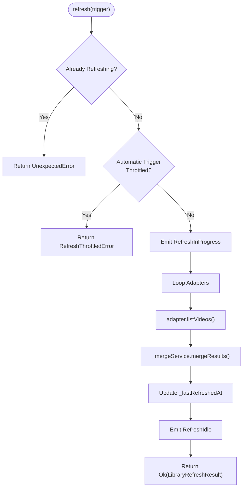

# Getting Started

<cite>
**Referenced Files in This Document**
- [README.md](file://README.md)
- [pubspec.yaml](file://pubspec.yaml)
- [android/settings.gradle.kts](file://android/settings.gradle.kts)
- [android/gradle.properties](file://android/gradle.properties)
- [android/local.properties](file://android/local.properties)
- [android/app/src/main/AndroidManifest.xml](file://android/app/src/main/AndroidManifest.xml)
- [lib/main.dart](file://lib/main.dart)
- [lib/platform/media_store_bridge.dart](file://lib/platform/media_store_bridge.dart)
- [lib/platform/media_store_bridge_impl.dart](file://lib/platform/media_store_bridge_impl.dart)
- [android/app/src/main/kotlin/com/example/mytube/MediaStorePlugin.kt](file://android/app/src/main/kotlin/com/example/mytube/MediaStorePlugin.kt)
- [android/app/src/main/kotlin/com/example/mytube/SaffBridgePlugin.kt](file://android/app/src/main/kotlin/com/example/mytube/SaffBridgePlugin.kt)
- [lib/domain/services/library_refresh_service.dart](file://lib/domain/services/library_refresh_service.dart)
- [lib/domain/models/app_error.dart](file://lib/domain/models/app_error.dart)
</cite>

## Table of Contents
1. [Introduction](#introduction)
2. [Project Structure](#project-structure)
3. [Development Environment Setup](#development-environment-setup)
4. [Installation and Build](#installation-and-build)
5. [Initial Device Setup](#initial-device-setup)
6. [First-Run Experience Walkthrough](#first-run-experience-walkthrough)
7. [Architecture Overview](#architecture-overview)
8. [Detailed Component Analysis](#detailed-component-analysis)
9. [Troubleshooting Guide](#troubleshooting-guide)
10. [Conclusion](#conclusion)

## Introduction
MyTube is a personal, local-first Android video library app built with Flutter. On first run, it scans the device for videos through MediaStore or a user-selected Storage Access Framework folder, stores metadata locally, and presents the scanned library to the user.

This guide explains how to set up the development environment, install dependencies, build the Android application, configure permissions, and understand the initial scanning and navigation experience.

**Section sources**
- [README.md:1-4](file://README.md#L1-L4)

## Project Structure
At a high level, MyTube follows a layered Flutter structure:
- `lib/` contains Dart application code, including platform bridges, domain services, and UI.
- `android/` contains the Android Gradle project, Kotlin plugins for MediaStore and SAF access, and Android manifest configuration.
- `test/` contains unit and widget tests.
- Configuration files such as `pubspec.yaml`, `android/settings.gradle.kts`, and `android/gradle.properties` define SDK versions, dependencies, and build settings.

**Diagram sources**
- [lib/main.dart:1-33](file://lib/main.dart#L1-L33)
- [lib/platform/media_store_bridge.dart:34-97](file://lib/platform/media_store_bridge.dart#L34-L97)
- [lib/platform/media_store_bridge_impl.dart:57-90](file://lib/platform/media_store_bridge_impl.dart#L57-L90)
- [android/app/src/main/kotlin/com/example/mytube/MediaStorePlugin.kt:16-78](file://android/app/src/main/kotlin/com/example/mytube/MediaStorePlugin.kt#L16-L78)
- [android/app/src/main/kotlin/com/example/mytube/SaffBridgePlugin.kt:20-95](file://android/app/src/main/kotlin/com/example/mytube/SaffBridgePlugin.kt#L20-L95)
- [android/app/src/main/AndroidManifest.xml:1-53](file://android/app/src/main/AndroidManifest.xml#L1-L53)

**Section sources**
- [pubspec.yaml:1-29](file://pubspec.yaml#L1-L29)
- [android/settings.gradle.kts:1-26](file://android/settings.gradle.kts#L1-L26)

## Development Environment Setup
To develop MyTube, you need the following tools and configurations:

- **Flutter SDK**: The project requires Dart SDK version `^3.12.2`. Ensure your Flutter installation satisfies this constraint.
- **Android Studio**: Install Android Studio with the Flutter and Dart plugins enabled.
- **Kotlin Support**: The Android layer uses Kotlin; ensure Kotlin support is installed via Android Studio’s plugin manager.
- **Android SDK and Emulator**: Configure an Android emulator or physical device targeting API levels supported by the app (the app declares permissions for older storage APIs and newer media permissions).
- **Gradle and Java Toolchain**: The Android build uses Gradle with Kotlin Android plugin version `2.3.20` and Android Gradle Plugin `9.0.1`.

Key configuration references:
- Dart SDK constraint: `sdk: ^3.12.2`
- Kotlin Android plugin: `org.jetbrains.kotlin.android` version `2.3.20`
- Android Gradle plugin: `com.android.application` version `9.0.1`
- Gradle JVM arguments and AndroidX flags are configured in `android/gradle.properties`
- Local paths for Flutter SDK and Android SDK are stored in `android/local.properties`

**Section sources**
- [pubspec.yaml:6-8](file://pubspec.yaml#L6-L8)
- [android/settings.gradle.kts:20-24](file://android/settings.gradle.kts#L20-L24)
- [android/gradle.properties:1-6](file://android/gradle.properties#L1-L6)
- [android/local.properties:1-5](file://android/local.properties#L1-L5)

## Installation and Build
Follow these steps to clone, install dependencies, and build the Android application:

1. **Clone the repository**
   - Clone the MyTube repository into your preferred development directory.

2. **Install dependencies**
   - Run the standard Flutter dependency installation command from the project root.
   - This installs Dart packages defined in `pubspec.yaml`, including Riverpod, Drift, SQLite libraries, UUID, and video player dependencies.

3. **Verify environment**
   - Run the Flutter analyzer to check for issues.
   - Optionally run tests to validate the current state of the codebase.

4. **Build the Android application**
   - Use the Flutter tool to build the debug APK for an attached device or emulator.
   - Ensure your Android SDK path and Flutter SDK path are correctly set in `android/local.properties`.

5. **Run on device/emulator**
   - Launch the app on a connected Android device or running emulator.
   - If using a device, enable developer options and USB debugging.

Common commands used during development:
- Dependency installation
- Analyzer execution
- Test execution
- Debug build and run

**Section sources**
- [pubspec.yaml:9-25](file://pubspec.yaml#L9-L25)
- [android/local.properties:1-5](file://android/local.properties#L1-L5)

## Initial Device Setup
Before using MyTube, grant the required permissions so the app can scan local videos.

### Permissions Declared
The app declares the following permissions in the Android manifest:
- Internet access for URL streams and provider APIs.
- Legacy external storage read permission for older Android versions.
- New media permissions for Android 13+ and Android 14+.

**Diagram sources**
- [android/app/src/main/AndroidManifest.xml:1-12](file://android/app/src/main/AndroidManifest.xml#L1-L12)
- [lib/platform/media_store_bridge.dart:78-93](file://lib/platform/media_store_bridge.dart#L78-L93)
- [lib/platform/media_store_bridge_impl.dart:57-84](file://lib/platform/media_store_bridge_impl.dart#L57-L84)
- [android/app/src/main/kotlin/com/example/mytube/MediaStorePlugin.kt:95-169](file://android/app/src/main/kotlin/com/example/mytube/MediaStorePlugin.kt#L95-L169)

### Permission States
The app models four permission states:
- `granted`: Full access granted.
- `partiallyGranted`: Partial access granted on Android 14+ when the user selects specific items.
- `denied`: Permission denied but can be requested again.
- `permanentlyDenied`: User chose “Don’t ask again”; open Settings to grant manually.

### Storage Access Framework (SAF)
If broad media permissions are not available, the app supports selecting a folder via SAF. The SAF bridge opens a folder picker, persists URI permissions, lists videos recursively, and checks folder access.

**Section sources**
- [android/app/src/main/AndroidManifest.xml:1-12](file://android/app/src/main/AndroidManifest.xml#L1-L12)
- [lib/platform/media_store_bridge.dart:78-93](file://lib/platform/media_store_bridge.dart#L78-L93)
- [android/app/src/main/kotlin/com/example/mytube/SaffBridgePlugin.kt:101-148](file://android/app/src/main/kotlin/com/example/mytube/SaffBridgePlugin.kt#L101-L148)

## First-Run Experience Walkthrough
When you launch MyTube for the first time, expect the following flow:

1. **App bootstrap**
   - The app initializes Flutter bindings, sets up error handling, creates a single provider container, and runs the main app widget.

2. **Permission prompt**
   - The app checks whether it has permission to read videos.
   - If not, it requests the appropriate permission based on the Android version.
   - If the user denies permanently, the app guides them to Settings.

3. **Initial video scanning**
   - Once permissions are granted, the app triggers a library refresh.
   - The refresh service orchestrates scanning across registered source adapters.
   - For local media, the app queries MediaStore or traverses a SAF-selected folder.
   - Results are merged into the local database, tracking added, updated, and missing entries.

4. **Basic navigation**
   - After scanning completes, the app displays the scanned library.
   - Users can browse videos, play content, and interact with the UI provided by the app shell.

**Diagram sources**
- [lib/main.dart:8-32](file://lib/main.dart#L8-L32)
- [lib/platform/media_store_bridge_impl.dart:57-84](file://lib/platform/media_store_bridge_impl.dart#L57-L84)
- [lib/domain/services/library_refresh_service.dart:209-321](file://lib/domain/services/library_refresh_service.dart#L209-L321)
- [android/app/src/main/kotlin/com/example/mytube/MediaStorePlugin.kt:214-283](file://android/app/src/main/kotlin/com/example/mytube/MediaStorePlugin.kt#L214-L283)
- [android/app/src/main/kotlin/com/example/mytube/SaffBridgePlugin.kt:172-234](file://android/app/src/main/kotlin/com/example/mytube/SaffBridgePlugin.kt#L172-L234)

**Section sources**
- [lib/main.dart:8-32](file://lib/main.dart#L8-L32)
- [lib/domain/services/library_refresh_service.dart:140-169](file://lib/domain/services/library_refresh_service.dart#L140-L169)

## Architecture Overview
MyTube’s architecture separates concerns between platform-specific logic and Dart domain logic:

- **Platform Bridges**: Dart-side interfaces that call native Android plugins via MethodChannel.
- **Android Plugins**: Kotlin implementations handling MediaStore queries and SAF operations.
- **Domain Services**: Pure Dart services orchestrating scanning, merging, and throttling.
- **UI Layer**: Flutter widgets driven by Riverpod providers and service state.

**Diagram sources**
- [lib/platform/media_store_bridge.dart:34-97](file://lib/platform/media_store_bridge.dart#L34-L97)
- [lib/platform/media_store_bridge_impl.dart:57-90](file://lib/platform/media_store_bridge_impl.dart#L57-L90)
- [android/app/src/main/kotlin/com/example/mytube/MediaStorePlugin.kt:16-78](file://android/app/src/main/kotlin/com/example/mytube/MediaStorePlugin.kt#L16-L78)
- [android/app/src/main/kotlin/com/example/mytube/SaffBridgePlugin.kt:20-95](file://android/app/src/main/kotlin/com/example/mytube/SaffBridgePlugin.kt#L20-L95)
- [lib/domain/services/library_refresh_service.dart:167-357](file://lib/domain/services/library_refresh_service.dart#L167-L357)

## Detailed Component Analysis

### MediaStore Permission Flow
The MediaStore permission flow handles different Android versions and maps native results to Dart enums.

**Diagram sources**
- [android/app/src/main/kotlin/com/example/mytube/MediaStorePlugin.kt:95-169](file://android/app/src/main/kotlin/com/example/mytube/MediaStorePlugin.kt#L95-L169)
- [lib/platform/media_store_bridge_impl.dart:77-84](file://lib/platform/media_store_bridge_impl.dart#L77-L84)

**Section sources**
- [lib/platform/media_store_bridge.dart:78-93](file://lib/platform/media_store_bridge.dart#L78-L93)
- [lib/platform/media_store_bridge_impl.dart:57-84](file://lib/platform/media_store_bridge_impl.dart#L57-L84)
- [android/app/src/main/kotlin/com/example/mytube/MediaStorePlugin.kt:95-169](file://android/app/src/main/kotlin/com/example/mytube/MediaStorePlugin.kt#L95-L169)

### SAF Folder Picker Flow
The SAF bridge allows users to select a folder and persist read permissions.

**Diagram sources**
- [android/app/src/main/kotlin/com/example/mytube/SaffBridgePlugin.kt:101-136](file://android/app/src/main/kotlin/com/example/mytube/SaffBridgePlugin.kt#L101-L136)

**Section sources**
- [android/app/src/main/kotlin/com/example/mytube/SaffBridgePlugin.kt:101-148](file://android/app/src/main/kotlin/com/example/mytube/SaffBridgePlugin.kt#L101-L148)

### Library Refresh Orchestration
The library refresh service coordinates scanning and merging across adapters, with throttling and cancellation support.

**Diagram sources**
- [lib/domain/services/library_refresh_service.dart:209-321](file://lib/domain/services/library_refresh_service.dart#L209-L321)

**Section sources**
- [lib/domain/services/library_refresh_service.dart:140-169](file://lib/domain/services/library_refresh_service.dart#L140-L169)
- [lib/domain/services/library_refresh_service.dart:209-321](file://lib/domain/services/library_refresh_service.dart#L209-L321)

## Troubleshooting Guide
Common setup and runtime issues:

- **Flutter SDK mismatch**
  - Symptom: Build fails due to Dart SDK constraints.
  - Resolution: Ensure your Flutter/Dart SDK satisfies `^3.12.2`.

- **Android SDK path not configured**
  - Symptom: Gradle cannot find Android SDK.
  - Resolution: Verify `android/local.properties` contains correct `sdk.dir` and `flutter.sdk`.

- **Missing Kotlin or Android Gradle Plugin**
  - Symptom: Build errors related to Kotlin or AGP versions.
  - Resolution: Ensure Android Studio has Kotlin support and the project’s Gradle configuration matches `settings.gradle.kts`.

- **Permission denied on first run**
  - Symptom: No videos appear after launch.
  - Resolution: Grant media permissions in system settings if previously denied permanently.

- **SAF folder access revoked**
  - Symptom: SAF folder listing fails.
  - Resolution: Re-select the folder via SAF to re-grant persistent URI permissions.

- **Library refresh throttled**
  - Symptom: Automatic refresh does not run immediately.
  - Resolution: Manual refresh bypasses throttling; automatic refresh is suppressed within the minimum interval.

**Section sources**
- [pubspec.yaml:6-8](file://pubspec.yaml#L6-L8)
- [android/local.properties:1-5](file://android/local.properties#L1-L5)
- [android/settings.gradle.kts:20-24](file://android/settings.gradle.kts#L20-L24)
- [lib/domain/services/library_refresh_service.dart:223-236](file://lib/domain/services/library_refresh_service.dart#L223-L236)
- [lib/domain/models/app_error.dart:25-33](file://lib/domain/models/app_error.dart#L25-L33)

## Conclusion
You now have the essential information to set up MyTube’s development environment, install dependencies, build the Android app, configure permissions, and understand the first-run scanning and navigation flow. If you encounter issues, consult the troubleshooting section and verify your environment against the referenced configuration files.