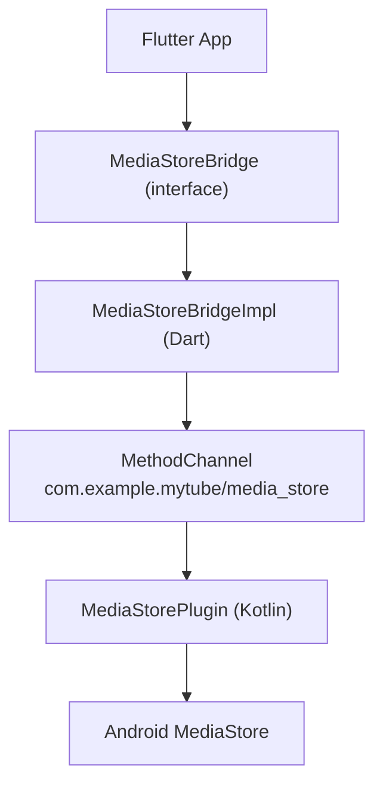
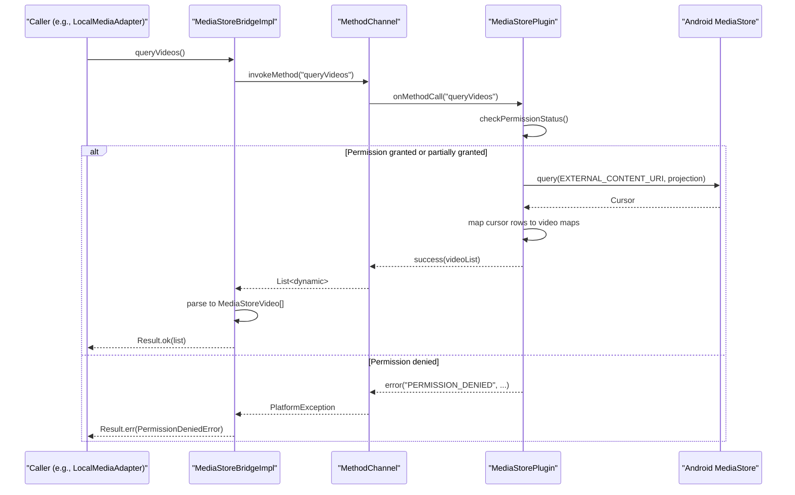
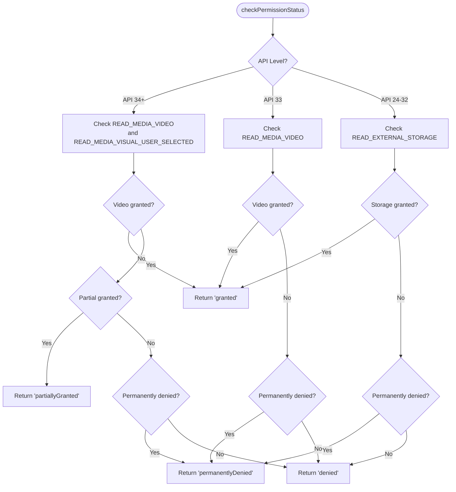
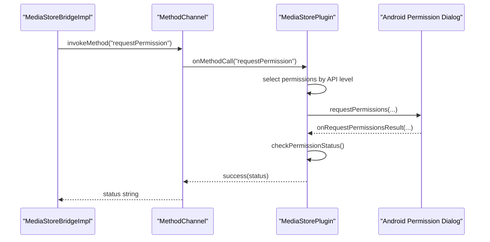
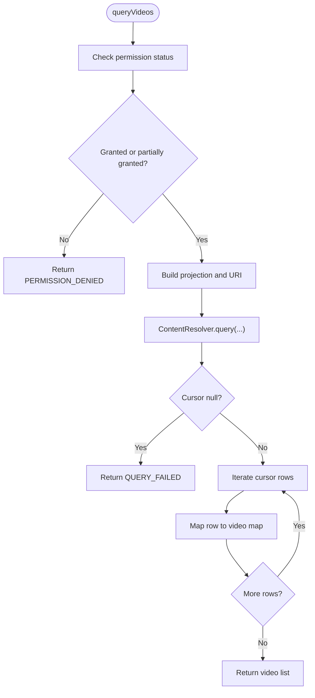
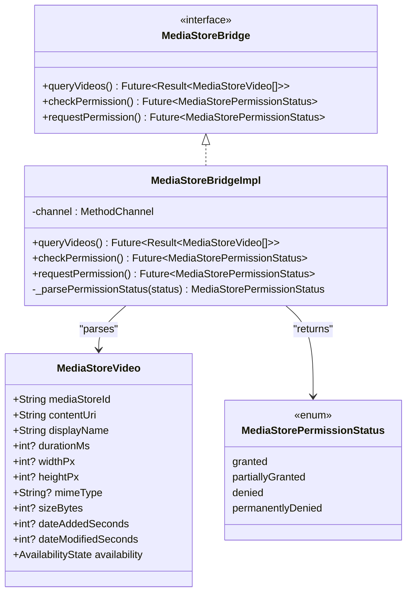
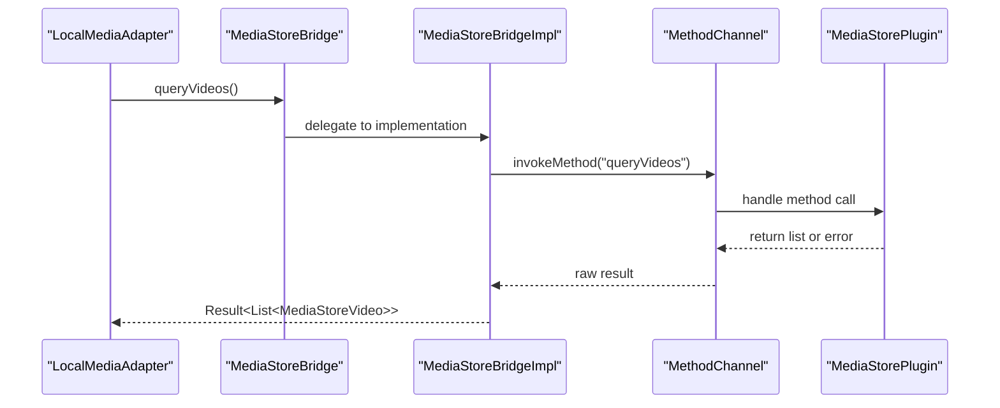
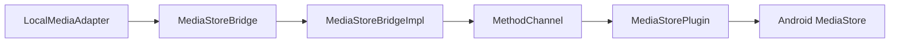

# MediaStore Integration

<cite>
**Referenced Files in This Document**
- [MediaStorePlugin.kt](file://android/app/src/main/kotlin/com/example/mytube/MediaStorePlugin.kt)
- [media_store_bridge.dart](file://lib/platform/media_store_bridge.dart)
- [media_store_bridge_impl.dart](file://lib/platform/media_store_bridge_impl.dart)
- [local_media_adapter.dart](file://lib/sources/local/local_media_adapter.dart)
- [media_store_bridge_impl_test.dart](file://test/unit/platform/media_store_bridge_impl_test.dart)
</cite>

## Table of Contents
1. [Introduction](#introduction)
2. [Project Structure](#project-structure)
3. [Core Components](#core-components)
4. [Architecture Overview](#architecture-overview)
5. [Detailed Component Analysis](#detailed-component-analysis)
6. [Dependency Analysis](#dependency-analysis)
7. [Performance Considerations](#performance-considerations)
8. [Troubleshooting Guide](#troubleshooting-guide)
9. [Conclusion](#conclusion)

## Introduction
This document explains the MediaStore integration used by the application to discover local Android video files and their metadata. It focuses on how the Kotlin `MediaStorePlugin` implements Android’s MediaStore API, how Flutter communicates with it through a MethodChannel, and how permission handling adapts across Android versions from API 24 through API 34+.

The integration is designed so that Flutter code calls into native Android logic only for platform-specific operations such as querying device storage. The Dart side exposes a clean interface (`MediaStoreBridge`) and a concrete implementation (`MediaStoreBridgeImpl`) that wraps the native channel calls and converts results into domain-friendly data structures.

## Project Structure
The MediaStore integration spans both the Android native layer and the Flutter platform layer:

- Android native layer:
  - `MediaStorePlugin.kt`: Registers a MethodChannel, handles method calls, manages permissions, and queries MediaStore.
- Flutter platform layer:
  - `media_store_bridge.dart`: Declares the `MediaStoreBridge` interface, the `MediaStoreVideo` model, and the `MediaStorePermissionStatus` enum.
  - `media_store_bridge_impl.dart`: Implements the bridge using a MethodChannel and maps native responses to Dart models.
- Consumers:
  - `local_media_adapter.dart`: Uses the bridge to populate local media sources.
- Tests:
  - `media_store_bridge_impl_test.dart`: Validates successful parsing, empty lists, and error mapping for `queryVideos`.

**Diagram sources**
- [media_store_bridge.dart:13-32](file://lib/platform/media_store_bridge.dart#L13-L32)
- [media_store_bridge_impl.dart:9-10](file://lib/platform/media_store_bridge_impl.dart#L9-L10)
- [MediaStorePlugin.kt:32-36](file://android/app/src/main/kotlin/com/example/mytube/MediaStorePlugin.kt#L32-L36)

**Section sources**
- [MediaStorePlugin.kt:16-20](file://android/app/src/main/kotlin/com/example/mytube/MediaStorePlugin.kt#L16-L20)
- [media_store_bridge.dart:5-12](file://lib/platform/media_store_bridge.dart#L5-L12)
- [media_store_bridge_impl.dart:7-10](file://lib/platform/media_store_bridge_impl.dart#L7-L10)

## Core Components
- `MediaStorePlugin` (Kotlin):
  - Implements `FlutterPlugin`, `MethodCallHandler`, `ActivityAware`, and `RequestPermissionsResultListener`.
  - Exposes three methods over the MethodChannel:
    - `queryVideos`: Queries MediaStore for accessible videos.
    - `checkPermission`: Returns current permission status without showing dialogs.
    - `requestPermission`: Requests the appropriate permission based on the Android version.
- `MediaStoreBridge` (Dart interface):
  - Defines the contract for querying videos and managing permissions.
  - Documents supported Android versions and expected behavior.
- `MediaStoreBridgeImpl` (Dart implementation):
  - Calls the native plugin via MethodChannel.
  - Parses returned maps into `MediaStoreVideo` objects.
  - Converts platform exceptions into typed errors.
- `MediaStoreVideo` (Dart model):
  - Represents a single video row from MediaStore, including identifiers, URI, display name, duration, dimensions, MIME type, size, and date fields.
- `MediaStorePermissionStatus` (Dart enum):
  - Represents `granted`, `partiallyGranted`, `denied`, and `permanentlyDenied`.

**Section sources**
- [MediaStorePlugin.kt:16-20](file://android/app/src/main/kotlin/com/example/mytube/MediaStorePlugin.kt#L16-L20)
- [media_store_bridge.dart:13-32](file://lib/platform/media_store_bridge.dart#L13-L32)
- [media_store_bridge.dart:38-76](file://lib/platform/media_store_bridge.dart#L38-L76)
- [media_store_bridge.dart:78-93](file://lib/platform/media_store_bridge.dart#L78-L93)
- [media_store_bridge_impl.dart:9-10](file://lib/platform/media_store_bridge_impl.dart#L9-L10)

## Architecture Overview
The integration follows a layered architecture:

- Flutter UI or services call `MediaStoreBridge.queryVideos()`.
- `MediaStoreBridgeImpl` invokes the `queryVideos` method on the MethodChannel.
- `MediaStorePlugin.onMethodCall` routes the call to the Kotlin query implementation.
- The plugin checks permissions, queries MediaStore, and returns a list of video metadata.
- Dart parses the response into `MediaStoreVideo` instances and wraps them in a `Result`.

**Diagram sources**
- [media_store_bridge_impl.dart:13-55](file://lib/platform/media_store_bridge_impl.dart#L13-L55)
- [MediaStorePlugin.kt:71-78](file://android/app/src/main/kotlin/com/example/mytube/MediaStorePlugin.kt#L71-L78)
- [MediaStorePlugin.kt:214-283](file://android/app/src/main/kotlin/com/example/mytube/MediaStorePlugin.kt#L214-L283)

## Detailed Component Analysis

### Kotlin MediaStorePlugin
`MediaStorePlugin` is the native entry point for MediaStore access. It registers a MethodChannel named `com.example.mytube/media_store` and handles three method names:

- `queryVideos`: Retrieves video metadata after verifying permissions.
- `checkPermission`: Returns a string-based permission status.
- `requestPermission`: Requests the correct permission set depending on the Android version.

#### Permission Handling Strategy
The plugin uses different permissions based on the Android API level:

- API 24–32:
  - Uses `READ_EXTERNAL_STORAGE`.
- API 33:
  - Uses `READ_MEDIA_VIDEO`.
- API 34+:
  - Uses `READ_MEDIA_VIDEO` plus `READ_MEDIA_VISUAL_USER_SELECTED`.

The permission status can be one of:

- `granted`: Full access.
- `partiallyGranted`: API 34+ partial access where the user selected specific items.
- `denied`: Permission not granted but can still be requested.
- `permanentlyDenied`: User chose “Don’t ask again”; requires opening Settings.

When checking whether a denial is permanent, the plugin uses `shouldShowRequestPermissionRationale` when an Activity is attached. If no Activity is attached, it falls back to `denied` because it cannot determine permanence.

**Diagram sources**
- [MediaStorePlugin.kt:95-169](file://android/app/src/main/kotlin/com/example/mytube/MediaStorePlugin.kt#L95-L169)

#### Requesting Permissions
When `requestPermission` is called:

- If no Activity is attached, it immediately returns an error.
- Otherwise, it selects the correct permission array based on the API level and requests permissions through the system dialog.
- The result is delivered asynchronously via `onRequestPermissionsResult`, which forwards the updated status to the pending Dart callback.

**Diagram sources**
- [MediaStorePlugin.kt:171-208](file://android/app/src/main/kotlin/com/example/mytube/MediaStorePlugin.kt#L171-L208)
- [media_store_bridge_impl.dart:67-75](file://lib/platform/media_store_bridge_impl.dart#L67-L75)

#### Querying Videos
The `queryVideos` method performs these steps:

1. Checks permission status; if neither `granted` nor `partiallyGranted`, returns `PERMISSION_DENIED`.
2. Builds a projection for required columns: ID, display name, duration, width, height, MIME type, size, added date, and modified date.
3. Queries `MediaStore.Video.Media.EXTERNAL_CONTENT_URI`.
4. Handles null cursor and query exceptions by returning `QUERY_FAILED`.
5. Iterates the cursor and builds a list of maps containing:
   - `mediaStoreId`
   - `contentUri`
   - `displayName`
   - `durationMs`
   - `widthPx`
   - `heightPx`
   - `mimeType`
   - `sizeBytes`
   - `dateAddedSeconds`
   - `dateModifiedSeconds`
6. Returns the list to Dart.

**Diagram sources**
- [MediaStorePlugin.kt:214-283](file://android/app/src/main/kotlin/com/example/mytube/MediaStorePlugin.kt#L214-L283)

**Section sources**
- [MediaStorePlugin.kt:71-78](file://android/app/src/main/kotlin/com/example/mytube/MediaStorePlugin.kt#L71-L78)
- [MediaStorePlugin.kt:95-169](file://android/app/src/main/kotlin/com/example/mytube/MediaStorePlugin.kt#L95-L169)
- [MediaStorePlugin.kt:171-208](file://android/app/src/main/kotlin/com/example/mytube/MediaStorePlugin.kt#L171-L208)
- [MediaStorePlugin.kt:214-283](file://android/app/src/main/kotlin/com/example/mytube/MediaStorePlugin.kt#L214-L283)

### Dart MediaStoreBridge Interface
The interface defines:

- `queryVideos`: Returns a `Result<List<MediaStoreVideo>>`.
- `checkPermission`: Returns `MediaStorePermissionStatus`.
- `requestPermission`: Returns `MediaStorePermissionStatus`.

It also documents the expected permission requirements per Android version and clarifies that callers should treat missing permissions as `PermissionDeniedError` rather than throwing.

**Section sources**
- [media_store_bridge.dart:5-12](file://lib/platform/media_store_bridge.dart#L5-L12)
- [media_store_bridge.dart:13-32](file://lib/platform/media_store_bridge.dart#L13-L32)

### Dart MediaStoreBridge Implementation
`MediaStoreBridgeImpl` is responsible for:

- Invoking `queryVideos`, `checkPermission`, and `requestPermission` on the MethodChannel.
- Parsing the raw list of dynamic maps into strongly typed `MediaStoreVideo` objects.
- Mapping `PlatformException` with code `PERMISSION_DENIED` to `PermissionDeniedError`.
- Wrapping other platform exceptions and unexpected errors in `UnexpectedError`.
- Converting the string-based permission status from Kotlin into the Dart enum `MediaStorePermissionStatus`.

**Diagram sources**
- [media_store_bridge.dart:13-32](file://lib/platform/media_store_bridge.dart#L13-L32)
- [media_store_bridge.dart:38-76](file://lib/platform/media_store_bridge.dart#L38-L76)
- [media_store_bridge.dart:78-93](file://lib/platform/media_store_bridge.dart#L78-L93)
- [media_store_bridge_impl.dart:9-84](file://lib/platform/media_store_bridge_impl.dart#L9-L84)

**Section sources**
- [media_store_bridge_impl.dart:13-55](file://lib/platform/media_store_bridge_impl.dart#L13-L55)
- [media_store_bridge_impl.dart:57-84](file://lib/platform/media_store_bridge_impl.dart#L57-L84)

### Flutter Usage Example
A typical Flutter consumer calls the bridge instead of calling the native plugin directly. For example, the local media adapter uses `_mediaStore.queryVideos()` to retrieve available videos and update its state.

**Diagram sources**
- [local_media_adapter.dart:63](file://lib/sources/local/local_media_adapter.dart#L63)
- [local_media_adapter.dart:133](file://lib/sources/local/local_media_adapter.dart#L133)
- [local_media_adapter.dart:186](file://lib/sources/local/local_media_adapter.dart#L186)
- [media_store_bridge_impl.dart:13-55](file://lib/platform/media_store_bridge_impl.dart#L13-L55)
- [MediaStorePlugin.kt:71-78](file://android/app/src/main/kotlin/com/example/mytube/MediaStorePlugin.kt#L71-L78)

**Section sources**
- [local_media_adapter.dart:63](file://lib/sources/local/local_media_adapter.dart#L63)
- [local_media_adapter.dart:133](file://lib/sources/local/local_media_adapter.dart#L133)
- [local_media_adapter.dart:186](file://lib/sources/local/local_media_adapter.dart#L186)

## Dependency Analysis
The following diagram shows how components depend on each other:

**Diagram sources**
- [local_media_adapter.dart:63](file://lib/sources/local/local_media_adapter.dart#L63)
- [media_store_bridge.dart:13-32](file://lib/platform/media_store_bridge.dart#L13-L32)
- [media_store_bridge_impl.dart:9-10](file://lib/platform/media_store_bridge_impl.dart#L9-L10)
- [MediaStorePlugin.kt:32-36](file://android/app/src/main/kotlin/com/example/mytube/MediaStorePlugin.kt#L32-L36)

**Section sources**
- [media_store_bridge.dart:13-32](file://lib/platform/media_store_bridge.dart#L13-L32)
- [media_store_bridge_impl.dart:9-10](file://lib/platform/media_store_bridge_impl.dart#L9-L10)
- [MediaStorePlugin.kt:32-36](file://android/app/src/main/kotlin/com/example/mytube/MediaStorePlugin.kt#L32-L36)

## Performance Considerations
- Cursor iteration: The plugin iterates all rows from the MediaStore cursor. For devices with large video libraries, this can be expensive. Consider pagination or filtering if future features require it.
- Projection selection: The current projection includes many columns. If only a subset is needed, reducing the projection can improve performance.
- Null handling: The implementation safely handles null values for optional fields like duration, dimensions, size, and dates. Callers should still guard against nulls when consuming `MediaStoreVideo`.
- Permission checks: Repeated permission checks are lightweight, but avoid triggering permission dialogs too frequently. Cache permission status at the app level when appropriate.

[No sources needed since this section provides general guidance]

## Troubleshooting Guide

### Common Errors and Their Meanings
- `PERMISSION_DENIED`:
  - Returned by the Kotlin plugin when the permission status is neither `granted` nor `partiallyGranted`.
  - On the Dart side, `MediaStoreBridgeImpl` converts this into `PermissionDeniedError`.
- `QUERY_FAILED`:
  - Returned when `ContentResolver.query` throws an exception or returns a null cursor.
  - On the Dart side, this becomes `UnexpectedError`.

### Permission States
- `granted`:
  - Full access to video metadata.
- `partiallyGranted`:
  - API 34+ partial access where the user selected specific items.
- `denied`:
  - Permission not granted; you may request it again.
- `permanentlyDenied`:
  - The user chose “Don’t ask again.” Direct users to app settings to grant the permission.

### Debugging Steps
1. Verify the current permission status using `checkPermission`.
2. If denied, call `requestPermission` and handle the resulting status.
3. If `queryVideos` fails:
   - Check whether the error code is `PERMISSION_DENIED`.
   - If it is `QUERY_FAILED`, inspect device storage permissions and MediaStore availability.
4. Use unit tests as a reference:
   - Successful parsing of video lists.
   - Empty list handling.
   - Mapping of `PERMISSION_DENIED` and other platform exceptions.

**Section sources**
- [MediaStorePlugin.kt:214-283](file://android/app/src/main/kotlin/com/example/mytube/MediaStorePlugin.kt#L214-L283)
- [media_store_bridge_impl.dart:13-55](file://lib/platform/media_store_bridge_impl.dart#L13-L55)
- [media_store_bridge_impl_test.dart:29-52](file://test/unit/platform/media_store_bridge_impl_test.dart#L29-L52)
- [media_store_bridge_impl_test.dart:71-82](file://test/unit/platform/media_store_bridge_impl_test.dart#L71-L82)
- [media_store_bridge_impl_test.dart:84-106](file://test/unit/platform/media_store_bridge_impl_test.dart#L84-L106)

## Conclusion
The MediaStore integration cleanly separates platform concerns from Flutter business logic. `MediaStorePlugin` encapsulates Android-specific permission handling and MediaStore queries, while `MediaStoreBridge` and `MediaStoreBridgeImpl` provide a stable Dart API. The design supports modern Android permission semantics, including partial access on API 34+, and returns well-typed results and errors to Flutter consumers.

[No sources needed since this section summarizes without analyzing specific files]