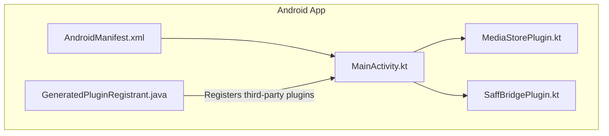
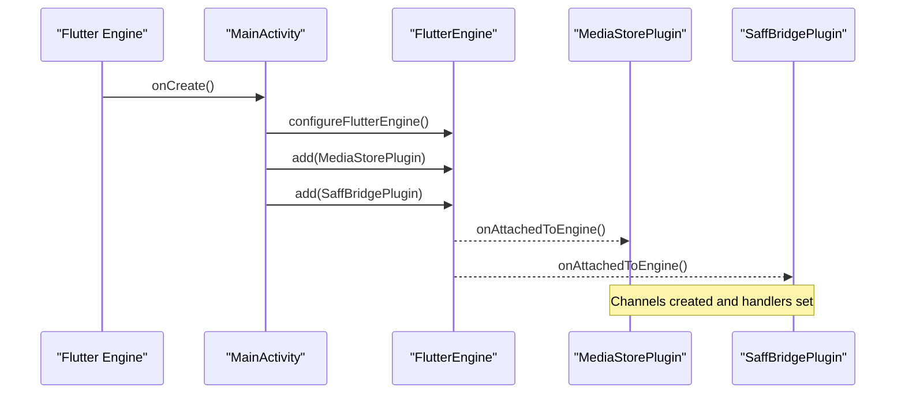
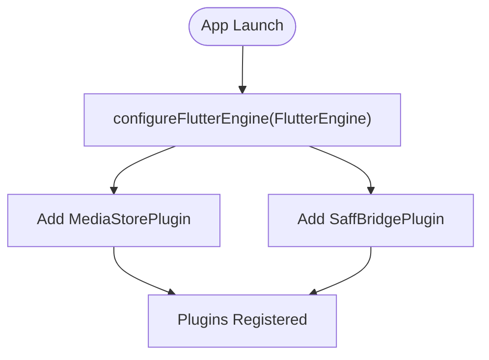
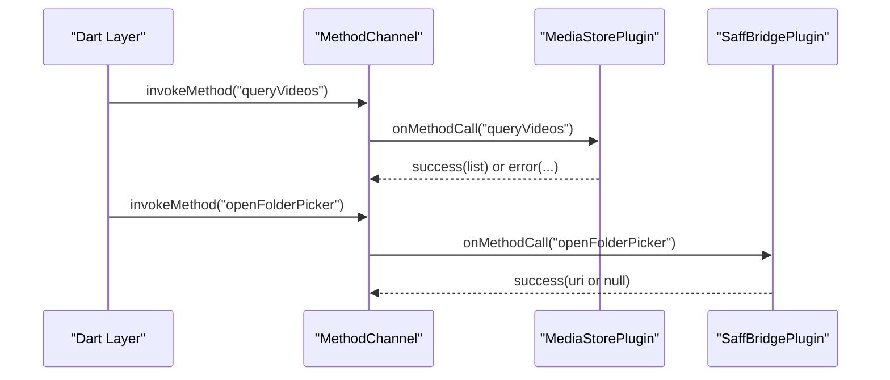
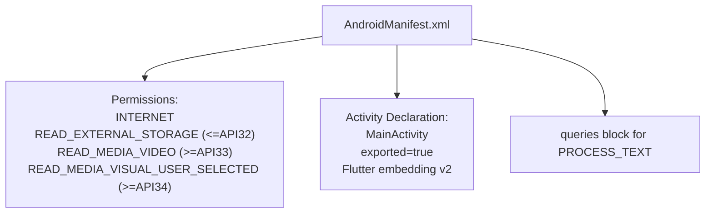
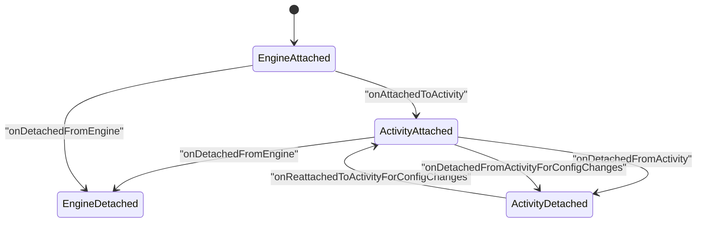
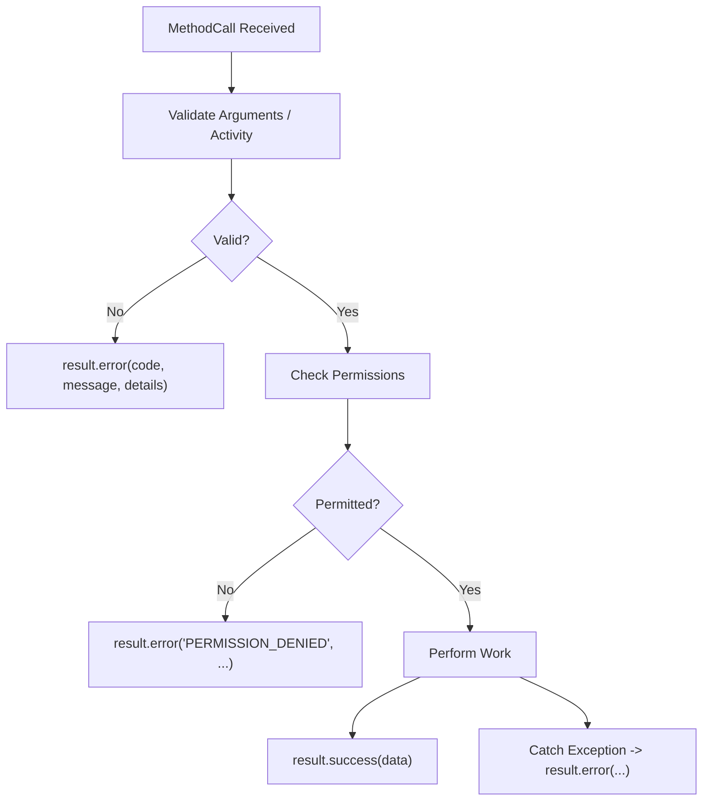
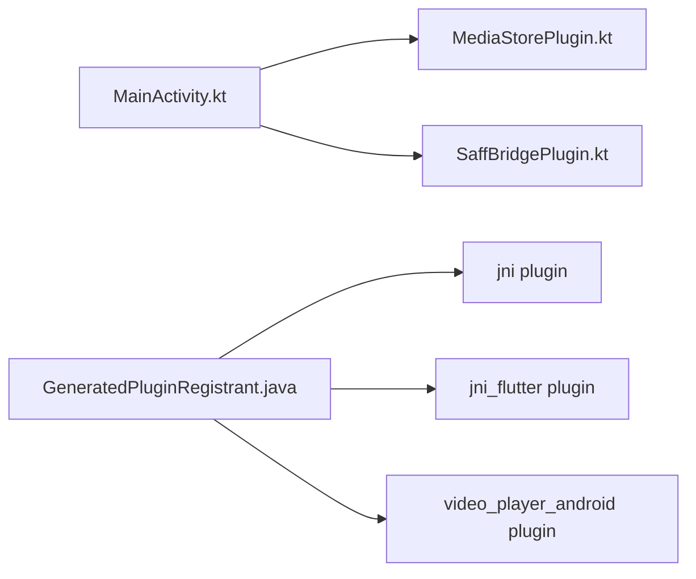

# Native Plugin Architecture

<cite>
**Referenced Files in This Document**
- [MainActivity.kt](file://android/app/src/main/kotlin/com/example/mytube/MainActivity.kt)
- [MediaStorePlugin.kt](file://android/app/src/main/kotlin/com/example/mytube/MediaStorePlugin.kt)
- [SaffBridgePlugin.kt](file://android/app/src/main/kotlin/com/example/mytube/SaffBridgePlugin.kt)
- [AndroidManifest.xml](file://android/app/src/main/AndroidManifest.xml)
- [GeneratedPluginRegistrant.java](file://android/app/src/main/java/io/flutter/plugins/GeneratedPluginRegistrant.java)
</cite>

## Table of Contents
1. [Introduction](#introduction)
2. [Project Structure](#project-structure)
3. [Core Components](#core-components)
4. [Architecture Overview](#architecture-overview)
5. [Detailed Component Analysis](#detailed-component-analysis)
6. [Dependency Analysis](#dependency-analysis)
7. [Performance Considerations](#performance-considerations)
8. [Troubleshooting Guide](#troubleshooting-guide)
9. [Conclusion](#conclusion)

## Introduction
This document explains the native plugin architecture and configuration for the Android side of the application. It focuses on how the main activity initializes and registers platform plugins, how MethodChannel is used for bidirectional communication between Flutter and Kotlin, and how AndroidManifest.xml is configured for permissions and activity declarations. It also covers plugin lifecycle management, guidance for creating custom platform plugins, error handling strategies, debugging techniques, and performance considerations when calling between Dart and Kotlin layers.

## Project Structure
The relevant Android native code resides under android/app/src/main:
- Kotlin source files define the app’s entry point and two custom platform plugins.
- AndroidManifest.xml declares permissions, the launcher activity, and Flutter embedding metadata.
- GeneratedPluginRegistrant.java is generated by Flutter to register third-party plugins.

**Diagram sources**
- [MainActivity.kt:6-15](file://android/app/src/main/kotlin/com/example/mytube/MainActivity.kt#L6-L15)
- [MediaStorePlugin.kt:16-20](file://android/app/src/main/kotlin/com/example/mytube/MediaStorePlugin.kt#L16-L20)
- [SaffBridgePlugin.kt:20-24](file://android/app/src/main/kotlin/com/example/mytube/SaffBridgePlugin.kt#L20-L24)
- [AndroidManifest.xml:9-39](file://android/app/src/main/AndroidManifest.xml#L9-L39)
- [GeneratedPluginRegistrant.java:17-33](file://android/app/src/main/java/io/flutter/plugins/GeneratedPluginRegistrant.java#L17-L33)

**Section sources**
- [MainActivity.kt:1-17](file://android/app/src/main/kotlin/com/example/mytube/MainActivity.kt#L1-L17)
- [AndroidManifest.xml:1-53](file://android/app/src/main/AndroidManifest.xml#L1-L53)
- [GeneratedPluginRegistrant.java:1-35](file://android/app/src/main/java/io/flutter/plugins/GeneratedPluginRegistrant.java#L1-L35)

## Core Components
- MainActivity: Extends FlutterActivity and registers custom plugins into the FlutterEngine during engine configuration.
- MediaStorePlugin: Implements FlutterPlugin, MethodCallHandler, ActivityAware, and a permission result listener to query device media via MediaStore with proper permission handling across API levels.
- SaffBridgePlugin: Implements FlutterPlugin, MethodCallHandler, ActivityAware, and an activity result listener to open folder pickers using SAF (Storage Access Framework), persist URIs, list videos recursively, and check access.

Key responsibilities:
- Channel setup and method routing.
- Permission checks and requests.
- Lifecycle-aware binding to activities.
- Background-safe operations for heavy I/O.

**Section sources**
- [MainActivity.kt:6-15](file://android/app/src/main/kotlin/com/example/mytube/MainActivity.kt#L6-L15)
- [MediaStorePlugin.kt:16-78](file://android/app/src/main/kotlin/com/example/mytube/MediaStorePlugin.kt#L16-L78)
- [SaffBridgePlugin.kt:20-95](file://android/app/src/main/kotlin/com/example/mytube/SaffBridgePlugin.kt#L20-L95)

## Architecture Overview
At runtime:
- The Flutter engine starts and creates a FlutterEngine.
- MainActivity.configureFlutterEngine adds custom plugins to the engine.
- Each plugin sets up a MethodChannel with a unique name and handles method calls from Dart.
- Plugins that need UI or user interaction implement ActivityAware and manage ActivityPluginBinding.
- Third-party plugins are registered automatically by GeneratedPluginRegistrant.

**Diagram sources**
- [MainActivity.kt:7-15](file://android/app/src/main/kotlin/com/example/mytube/MainActivity.kt#L7-L15)
- [MediaStorePlugin.kt:32-36](file://android/app/src/main/kotlin/com/example/mytube/MediaStorePlugin.kt#L32-L36)
- [SaffBridgePlugin.kt:45-50](file://android/app/src/main/kotlin/com/example/mytube/SaffBridgePlugin.kt#L45-L50)

## Detailed Component Analysis

### MainActivity Initialization and Plugin Registration
- Extends FlutterActivity and overrides configureFlutterEngine.
- Adds MediaStorePlugin and SaffBridgePlugin to flutterEngine.plugins.
- Ensures both plugins are available to the Flutter engine before any Dart code invokes them.

**Diagram sources**
- [MainActivity.kt:7-15](file://android/app/src/main/kotlin/com/example/mytube/MainActivity.kt#L7-L15)

**Section sources**
- [MainActivity.kt:6-15](file://android/app/src/main/kotlin/com/example/mytube/MainActivity.kt#L6-L15)

### MethodChannel Setup and Communication Protocol
Both custom plugins use MethodChannel for bidirectional communication:
- Channel names:
  - MediaStorePlugin: "com.example.mytube/media_store"
  - SaffBridgePlugin: "com.example.mytube/saf"
- Dart calls invoke methods on these channels; Kotlin routes them via onMethodCall.

MediaStorePlugin methods:
- queryVideos: Returns a list of video metadata from MediaStore after verifying permissions.
- checkPermission: Returns permission state string ("granted", "partiallyGranted", "denied", "permanentlyDenied").
- requestPermission: Requests necessary permissions and returns updated status.

SaffBridgePlugin methods:
- openFolderPicker: Opens ACTION_OPEN_DOCUMENT_TREE and persists URI permission if granted.
- getPersistedFolderUris: Lists persisted read-only folder URIs.
- releasePersistedUri: Releases a previously persisted URI permission.
- listVideosInFolder: Recursively lists video files within a SAF tree, bounded by depth and count limits.
- checkFolderAccess: Checks whether a given URI is accessible.

**Diagram sources**
- [MediaStorePlugin.kt:32-36](file://android/app/src/main/kotlin/com/example/mytube/MediaStorePlugin.kt#L32-L36)
- [MediaStorePlugin.kt:71-78](file://android/app/src/main/kotlin/com/example/mytube/MediaStorePlugin.kt#L71-L78)
- [SaffBridgePlugin.kt:45-50](file://android/app/src/main/kotlin/com/example/mytube/SaffBridgePlugin.kt#L45-L50)
- [SaffBridgePlugin.kt:86-95](file://android/app/src/main/kotlin/com/example/mytube/SaffBridgePlugin.kt#L86-L95)

**Section sources**
- [MediaStorePlugin.kt:32-78](file://android/app/src/main/kotlin/com/example/mytube/MediaStorePlugin.kt#L32-L78)
- [SaffBridgePlugin.kt:45-95](file://android/app/src/main/kotlin/com/example/mytube/SaffBridgePlugin.kt#L45-L95)

### AndroidManifest.xml Configuration
Permissions:
- INTERNET: Required for network streams.
- READ_EXTERNAL_STORAGE: For legacy storage access up to API 32.
- READ_MEDIA_VIDEO: For API 33+.
- READ_MEDIA_VISUAL_USER_SELECTED: For API 34+ partial access.

Activity declaration:
- MainActivity is declared as exported and configured with standard Flutter launch settings and meta-data for embedding version 2.

Queries block:
- Declares PROCESS_TEXT intent queries required by Flutter’s text processing plugin.

**Diagram sources**
- [AndroidManifest.xml:3-8](file://android/app/src/main/AndroidManifest.xml#L3-L8)
- [AndroidManifest.xml:13-39](file://android/app/src/main/AndroidManifest.xml#L13-L39)
- [AndroidManifest.xml:46-51](file://android/app/src/main/AndroidManifest.xml#L46-L51)

**Section sources**
- [AndroidManifest.xml:1-53](file://android/app/src/main/AndroidManifest.xml#L1-L53)

### Plugin Lifecycle Management
MediaStorePlugin:
- Implements FlutterPlugin and ActivityAware.
- onAttachedToEngine: Creates MethodChannel and sets handler.
- onDetachedFromEngine: Clears handler.
- onAttachedToActivity/onDetachedFromActivity/onReattachedToActivityForConfigChanges/onDetachedFromActivityForConfigChanges: Manages ActivityPluginBinding and RequestPermissionsResultListener registration.

SaffBridgePlugin:
- Implements FlutterPlugin and ActivityAware.
- onAttachedToEngine: Creates MethodChannel and sets handler; initializes coroutine scope.
- onDetachedFromEngine: Clears handler and cancels coroutine scope.
- Activity lifecycle callbacks: Registers/removes ActivityResultListener.

**Diagram sources**
- [MediaStorePlugin.kt:32-65](file://android/app/src/main/kotlin/com/example/mytube/MediaStorePlugin.kt#L32-L65)
- [SaffBridgePlugin.kt:45-80](file://android/app/src/main/kotlin/com/example/mytube/SaffBridgePlugin.kt#L45-L80)

**Section sources**
- [MediaStorePlugin.kt:32-65](file://android/app/src/main/kotlin/com/example/mytube/MediaStorePlugin.kt#L32-L65)
- [SaffBridgePlugin.kt:45-80](file://android/app/src/main/kotlin/com/example/mytube/SaffBridgePlugin.kt#L45-L80)

### Error Handling Strategies
- Missing activity: Both plugins return errors when no activity is attached for operations requiring UI.
- Permission denied: Methods return structured errors with codes like PERMISSION_DENIED or NO_ACTIVITY.
- Query failures: ContentResolver exceptions are caught and returned as errors with descriptive messages.
- SAF traversal: SecurityException and general exceptions are caught and mapped to appropriate error responses.

**Diagram sources**
- [MediaStorePlugin.kt:171-193](file://android/app/src/main/kotlin/com/example/mytube/MediaStorePlugin.kt#L171-L193)
- [MediaStorePlugin.kt:214-283](file://android/app/src/main/kotlin/com/example/mytube/MediaStorePlugin.kt#L214-L283)
- [SaffBridgePlugin.kt:101-110](file://android/app/src/main/kotlin/com/example/mytube/SaffBridgePlugin.kt#L101-L110)
- [SaffBridgePlugin.kt:172-200](file://android/app/src/main/kotlin/com/example/mytube/SaffBridgePlugin.kt#L172-L200)

**Section sources**
- [MediaStorePlugin.kt:171-283](file://android/app/src/main/kotlin/com/example/mytube/MediaStorePlugin.kt#L171-L283)
- [SaffBridgePlugin.kt:101-200](file://android/app/src/main/kotlin/com/example/mytube/SaffBridgePlugin.kt#L101-L200)

### Creating Custom Platform Plugins
Follow these patterns based on existing plugins:
- Implement FlutterPlugin and MethodChannel.MethodCallHandler.
- If you need UI or activity interactions, also implement ActivityAware and manage ActivityPluginBinding.
- In onAttachedToEngine, create a MethodChannel with a unique channel name and set the method call handler.
- Route method calls in onMethodCall using a switch-like structure and delegate to private functions.
- Handle permissions and activity availability defensively, returning structured errors when prerequisites are missing.
- Use background execution for long-running tasks and marshal results back to the main thread.

Recommended channel naming convention:
- Use a reverse domain-style prefix followed by a feature-specific suffix, e.g., "com.example.mytube/<feature>".

Example references:
- Channel creation and handler setup:
  - [MediaStorePlugin.kt:32-36](file://android/app/src/main/kotlin/com/example/mytube/MediaStorePlugin.kt#L32-L36)
  - [SaffBridgePlugin.kt:45-50](file://android/app/src/main/kotlin/com/example/mytube/SaffBridgePlugin.kt#L45-L50)
- Method routing:
  - [MediaStorePlugin.kt:71-78](file://android/app/src/main/kotlin/com/example/mytube/MediaStorePlugin.kt#L71-L78)
  - [SaffBridgePlugin.kt:86-95](file://android/app/src/main/kotlin/com/example/mytube/SaffBridgePlugin.kt#L86-L95)

**Section sources**
- [MediaStorePlugin.kt:32-78](file://android/app/src/main/kotlin/com/example/mytube/MediaStorePlugin.kt#L32-L78)
- [SaffBridgePlugin.kt:45-95](file://android/app/src/main/kotlin/com/example/mytube/SaffBridgePlugin.kt#L45-L95)

### Debugging Techniques for Native Code Issues
- Verify channel names match exactly between Dart and Kotlin.
- Log method calls and arguments in onMethodCall to trace invocation paths.
- Inspect permission states using checkPermissionStatus and ensure the correct manifest permissions are declared.
- Confirm activity attachment before invoking UI-related APIs; handle NO_ACTIVITY errors gracefully.
- For SAF issues, validate persisted URI permissions and test with small directory trees first.
- Use Android Studio debugger breakpoints in Kotlin methods and inspect MethodChannel.Result outcomes.

[No sources needed since this section provides general guidance]

## Dependency Analysis
- MainActivity depends on FlutterActivity and registers custom plugins.
- MediaStorePlugin depends on Android MediaStore APIs and permission utilities.
- SaffBridgePlugin depends on SAF APIs and Kotlin coroutines for background traversal.
- GeneratedPluginRegistrant registers third-party plugins such as jni, jni_flutter, and video_player_android.

**Diagram sources**
- [MainActivity.kt:9-14](file://android/app/src/main/kotlin/com/example/mytube/MainActivity.kt#L9-L14)
- [GeneratedPluginRegistrant.java:17-33](file://android/app/src/main/java/io/flutter/plugins/GeneratedPluginRegistrant.java#L17-L33)

**Section sources**
- [MainActivity.kt:6-15](file://android/app/src/main/kotlin/com/example/mytube/MainActivity.kt#L6-L15)
- [GeneratedPluginRegistrant.java:17-33](file://android/app/src/main/java/io/flutter/plugins/GeneratedPluginRegistrant.java#L17-L33)

## Performance Considerations
- Avoid blocking the main/channel thread:
  - MediaStorePlugin performs content resolver queries synchronously; consider moving heavy enumeration off the main thread if datasets grow large.
  - SaffBridgePlugin uses a CoroutineScope with Dispatchers.IO for recursive SAF traversal and marshals results back to the main thread, which is a good pattern.
- Limit recursion depth and result size:
  - SaffBridgePlugin enforces MAX_DEPTH and MAX_VIDEO_FILES to prevent excessive memory usage and long traversal times.
- Minimize cross-platform calls:
  - Batch data where possible to reduce MethodChannel overhead.
- Be mindful of permission checks:
  - Cache permission states appropriately and avoid repeated checks in tight loops.

[No sources needed since this section provides general guidance]

## Troubleshooting Guide
Common issues and resolutions:
- No activity attached:
  - Ensure the plugin is invoked after the activity is attached; otherwise, expect NO_ACTIVITY errors.
  - Reference: [SaffBridgePlugin.kt:101-110](file://android/app/src/main/kotlin/com/example/mytube/SaffBridgePlugin.kt#L101-L110)
- Permission denied:
  - Verify manifest permissions and call requestPermission before querying media or listing folders.
  - Reference: [MediaStorePlugin.kt:171-193](file://android/app/src/main/kotlin/com/example/mytube/MediaStorePlugin.kt#L171-L193)
- Query failures:
  - Catch and log exceptions from ContentResolver; return structured errors to Dart.
  - Reference: [MediaStorePlugin.kt:214-283](file://android/app/src/main/kotlin/com/example/mytube/MediaStorePlugin.kt#L214-L283)
- SAF access revoked:
  - Re-prompt the user to re-select the folder; handle SecurityException gracefully.
  - Reference: [SaffBridgePlugin.kt:172-200](file://android/app/src/main/kotlin/com/example/mytube/SaffBridgePlugin.kt#L172-L200)

**Section sources**
- [SaffBridgePlugin.kt:101-110](file://android/app/src/main/kotlin/com/example/mytube/SaffBridgePlugin.kt#L101-L110)
- [MediaStorePlugin.kt:171-193](file://android/app/src/main/kotlin/com/example/mytube/MediaStorePlugin.kt#L171-L193)
- [MediaStorePlugin.kt:214-283](file://android/app/src/main/kotlin/com/example/mytube/MediaStorePlugin.kt#L214-L283)
- [SaffBridgePlugin.kt:172-200](file://android/app/src/main/kotlin/com/example/mytube/SaffBridgePlugin.kt#L172-L200)

## Conclusion
The Android native layer follows a clear and robust plugin architecture:
- MainActivity registers custom plugins into the FlutterEngine.
- Plugins implement FlutterPlugin and MethodChannel.MethodCallHandler, with ActivityAware for UI-related operations.
- AndroidManifest.xml declares required permissions and activity configuration.
- Error handling is explicit and consistent, providing actionable feedback to Dart.
- Performance-sensitive operations are offloaded to background threads, with safeguards against deep recursion and large result sets.

By following the established patterns, developers can extend functionality with new platform plugins that integrate seamlessly with Flutter while maintaining reliability and performance.

[No sources needed since this section summarizes without analyzing specific files]