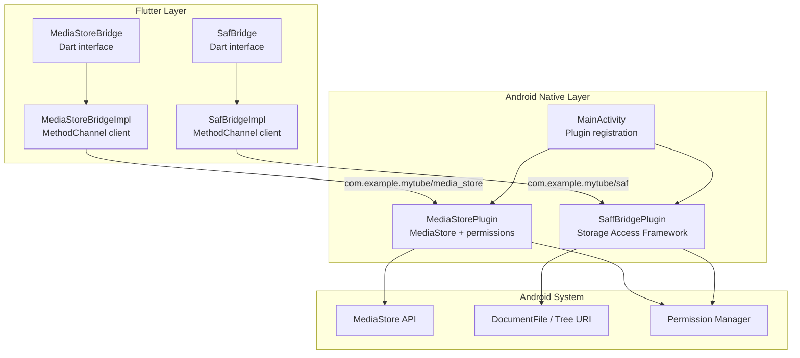
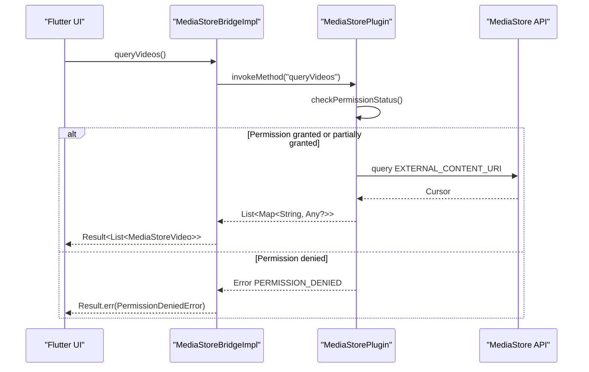
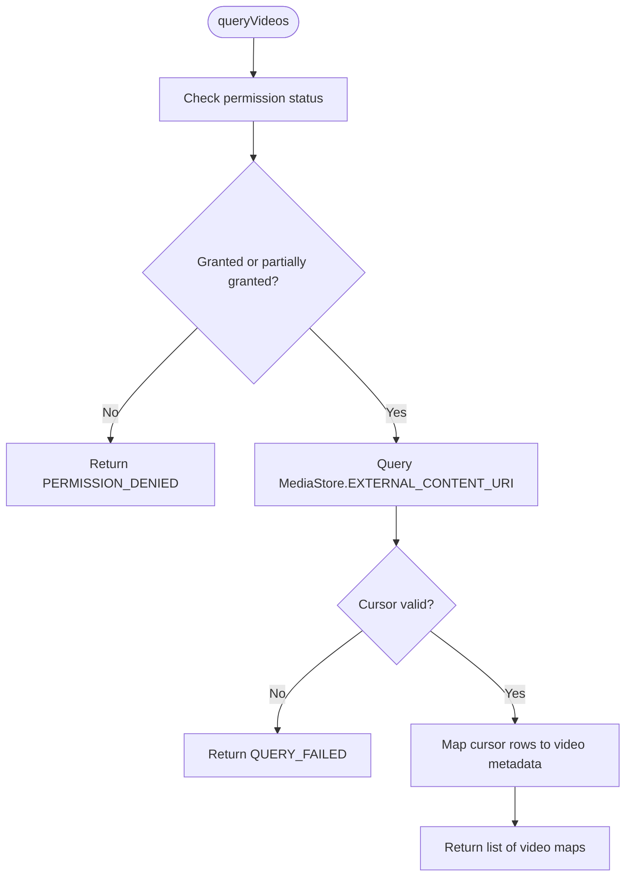
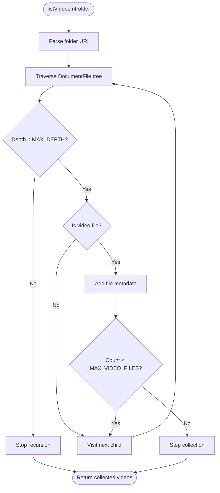
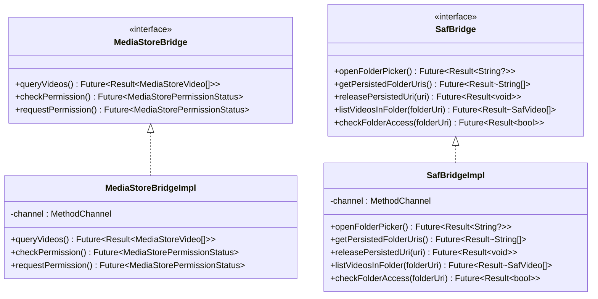
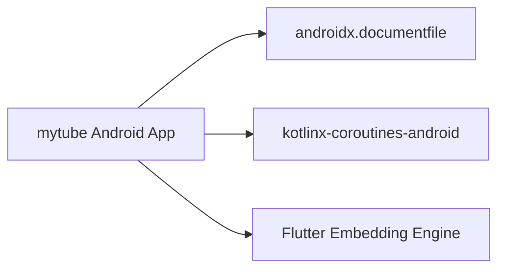

# Platform Integration

<cite>
**Referenced Files in This Document**
- [MainActivity.kt](file://android/app/src/main/kotlin/com/example/mytube/MainActivity.kt)
- [MediaStorePlugin.kt](file://android/app/src/main/kotlin/com/example/mytube/MediaStorePlugin.kt)
- [SaffBridgePlugin.kt](file://android/app/src/main/kotlin/com/example/mytube/SaffBridgePlugin.kt)
- [AndroidManifest.xml](file://android/app/src/main/AndroidManifest.xml)
- [build.gradle.kts](file://android/app/build.gradle.kts)
- [media_store_bridge.dart](file://lib/platform/media_store_bridge.dart)
- [media_store_bridge_impl.dart](file://lib/platform/media_store_bridge_impl.dart)
- [saf_bridge.dart](file://lib/platform/saf_bridge.dart)
- [saf_bridge_impl.dart](file://lib/platform/saf_bridge_impl.dart)
</cite>

## Table of Contents
1. [Introduction](#introduction)
2. [Project Structure](#project-structure)
3. [Core Components](#core-components)
4. [Architecture Overview](#architecture-overview)
5. [Detailed Component Analysis](#detailed-component-analysis)
6. [Dependency Analysis](#dependency-analysis)
7. [Performance Considerations](#performance-considerations)
8. [Troubleshooting Guide](#troubleshooting-guide)
9. [Conclusion](#conclusion)

## Introduction
This document explains the Android platform integration used by the application to access local video content and user-selected folders from Flutter code. The integration is implemented through Flutter’s native plugin architecture using Method Channels, with Kotlin plugins handling Android-specific APIs:

- **MediaStorePlugin**: Reads device-wide video metadata through Android’s MediaStore API and exposes permission-aware querying to Flutter.
- **SaffBridgePlugin**: Integrates with Android’s Storage Access Framework (SAF) so users can grant persistent read access to a folder tree. It lists videos inside that folder, persists URI permissions, and checks access.
- **MainActivity**: Registers both plugins with the Flutter engine.
- **Flutter bridges**: Dart interfaces and implementations map native method calls into typed domain models and error results.

The design separates platform concerns behind stable Dart interfaces, allowing higher layers to depend on contracts rather than Android implementation details.

## Project Structure
The Android integration lives under `android/app/src/main`, while the corresponding Dart contracts and implementations live under `lib/platform`.

**Diagram sources**
- [MainActivity.kt:6-15](file://android/app/src/main/kotlin/com/example/mytube/MainActivity.kt#L6-L15)
- [MediaStorePlugin.kt:32-36](file://android/app/src/main/kotlin/com/example/mytube/MediaStorePlugin.kt#L32-L36)
- [SaffBridgePlugin.kt:45-50](file://android/app/src/main/kotlin/com/example/mytube/SaffBridgePlugin.kt#L45-L50)
- [media_store_bridge.dart:13-32](file://lib/platform/media_store_bridge.dart#L13-L32)
- [media_store_bridge_impl.dart:7-10](file://lib/platform/media_store_bridge_impl.dart#L7-L10)
- [saf_bridge.dart:12-32](file://lib/platform/saf_bridge.dart#L12-L32)
- [saf_bridge_impl.dart:6-9](file://lib/platform/saf_bridge_impl.dart#L6-L9)

**Section sources**
- [MainActivity.kt:6-15](file://android/app/src/main/kotlin/com/example/mytube/MainActivity.kt#L6-L15)
- [media_store_bridge.dart:13-32](file://lib/platform/media_store_bridge.dart#L13-L32)
- [saf_bridge.dart:12-32](file://lib/platform/saf_bridge.dart#L12-L32)

## Core Components
This section summarizes the responsibilities of each component and how they interact.

### MainActivity
- Extends `FlutterActivity`.
- Overrides `configureFlutterEngine` to register `MediaStorePlugin` and `SaffBridgePlugin` with the Flutter engine.
- Ensures both plugins are available for Method Channel communication.

**Section sources**
- [MainActivity.kt:6-15](file://android/app/src/main/kotlin/com/example/mytube/MainActivity.kt#L6-L15)

### MediaStorePlugin
- Implements `FlutterPlugin`, `MethodCallHandler`, `ActivityAware`, and `RequestPermissionsResultListener`.
- Exposes channel methods:
  - `queryVideos`: Returns a list of video metadata rows from MediaStore when permission allows.
  - `checkPermission`: Returns a string status representing current permission state.
  - `requestPermission`: Requests the correct permission(s) based on Android version.
- Handles permission states:
  - `granted`
  - `partiallyGranted` (API 34+ partial media access)
  - `denied`
  - `permanentlyDenied`
- Builds a `content://media/external/video/media/<id>` URI per row for playback or thumbnail access.

**Section sources**
- [MediaStorePlugin.kt:16-20](file://android/app/src/main/kotlin/com/example/mytube/MediaStorePlugin.kt#L16-L20)
- [MediaStorePlugin.kt:71-78](file://android/app/src/main/kotlin/com/example/mytube/MediaStorePlugin.kt#L71-L78)
- [MediaStorePlugin.kt:95-169](file://android/app/src/main/kotlin/com/example/mytube/MediaStorePlugin.kt#L95-L169)
- [MediaStorePlugin.kt:171-193](file://android/app/src/main/kotlin/com/example/mytube/MediaStorePlugin.kt#L171-L193)
- [MediaStorePlugin.kt:214-283](file://android/app/src/main/kotlin/com/example/mytube/MediaStorePlugin.kt#L214-L283)

### SaffBridgePlugin
- Implements `FlutterPlugin`, `MethodCallHandler`, `ActivityAware`, and `ActivityResultListener`.
- Exposes channel methods:
  - `openFolderPicker`: Opens system folder picker (`ACTION_OPEN_DOCUMENT_TREE`).
  - `getPersistedFolderUris`: Lists persisted folder URIs with read permission.
  - `releasePersistedUri`: Releases a persisted URI permission; idempotent.
  - `listVideosInFolder`: Recursively lists video files under a selected folder via `DocumentFile`.
  - `checkFolderAccess`: Checks whether the app can currently access a given folder URI.
- Uses a coroutine scope on `Dispatchers.IO` for background traversal and returns results on the main thread.
- Enforces safety limits:
  - Maximum number of video files returned per call.
  - Maximum directory depth for recursion.

**Section sources**
- [SaffBridgePlugin.kt:20-24](file://android/app/src/main/kotlin/com/example/mytube/SaffBridgePlugin.kt#L20-L24)
- [SaffBridgePlugin.kt:86-95](file://android/app/src/main/kotlin/com/example/mytube/SaffBridgePlugin.kt#L86-L95)
- [SaffBridgePlugin.kt:101-110](file://android/app/src/main/kotlin/com/example/mytube/SaffBridgePlugin.kt#L101-L110)
- [SaffBridgePlugin.kt:116-136](file://android/app/src/main/kotlin/com/example/mytube/SaffBridgePlugin.kt#L116-L136)
- [SaffBridgePlugin.kt:142-166](file://android/app/src/main/kotlin/com/example/mytube/SaffBridgePlugin.kt#L142-L166)
- [SaffBridgePlugin.kt:172-200](file://android/app/src/main/kotlin/com/example/mytube/SaffBridgePlugin.kt#L172-L200)
- [SaffBridgePlugin.kt:202-234](file://android/app/src/main/kotlin/com/example/mytube/SaffBridgePlugin.kt#L202-L234)
- [SaffBridgePlugin.kt:240-253](file://android/app/src/main/kotlin/com/example/mytube/SaffBridgePlugin.kt#L240-L253)

### Flutter Bridges
- `MediaStoreBridge` defines the contract for querying videos and managing permissions.
- `MediaStoreBridgeImpl` communicates with `MediaStorePlugin` over `com.example.mytube/media_store`.
- `SafBridge` defines the contract for folder selection, persistence, listing, and access checks.
- `SafBridgeImpl` communicates with `SaffBridgePlugin` over `com.example.mytube/saf`.

Both Dart implementations convert native maps into typed domain objects and wrap errors using a `Result` type.

**Section sources**
- [media_store_bridge.dart:13-32](file://lib/platform/media_store_bridge.dart#L13-L32)
- [media_store_bridge.dart:38-93](file://lib/platform/media_store_bridge.dart#L38-L93)
- [media_store_bridge_impl.dart:7-10](file://lib/platform/media_store_bridge_impl.dart#L7-L10)
- [media_store_bridge_impl.dart:12-55](file://lib/platform/media_store_bridge_impl.dart#L12-L55)
- [media_store_bridge_impl.dart:57-84](file://lib/platform/media_store_bridge_impl.dart#L57-L84)
- [saf_bridge.dart:12-32](file://lib/platform/saf_bridge.dart#L12-L32)
- [saf_bridge.dart:34-57](file://lib/platform/saf_bridge.dart#L34-L57)
- [saf_bridge_impl.dart:6-9](file://lib/platform/saf_bridge_impl.dart#L6-L9)
- [saf_bridge_impl.dart:11-32](file://lib/platform/saf_bridge_impl.dart#L11-L32)
- [saf_bridge_impl.dart:83-124](file://lib/platform/saf_bridge_impl.dart#L83-L124)
- [saf_bridge_impl.dart:126-150](file://lib/platform/saf_bridge_impl.dart#L126-L150)

## Architecture Overview
The platform integration follows a layered approach:

1. **Flutter layer**: Dart interfaces define stable contracts. Implementations use Method Channels to call native code.
2. **Native layer**: Kotlin plugins handle Android APIs and lifecycle events.
3. **System layer**: Android provides MediaStore and Storage Access Framework.

**Diagram sources**
- [media_store_bridge_impl.dart:12-55](file://lib/platform/media_store_bridge_impl.dart#L12-L55)
- [MediaStorePlugin.kt:71-78](file://android/app/src/main/kotlin/com/example/mytube/MediaStorePlugin.kt#L71-L78)
- [MediaStorePlugin.kt:95-169](file://android/app/src/main/kotlin/com/example/mytube/MediaStorePlugin.kt#L95-L169)
- [MediaStorePlugin.kt:214-283](file://android/app/src/main/kotlin/com/example/mytube/MediaStorePlugin.kt#L214-L283)

## Detailed Component Analysis

### MediaStorePlugin: Video Metadata and Permissions
MediaStorePlugin is responsible for:
- Creating and owning a Method Channel named `com.example.mytube/media_store`.
- Handling permission checks and requests across Android versions.
- Querying MediaStore and returning structured video metadata.

#### Permission Strategy
The plugin distinguishes four permission states:
- `granted`: Full video read access.
- `partiallyGranted`: API 34+ partial access where only selected items are accessible.
- `denied`: Permission not granted but can be requested again.
- `permanentlyDenied`: User chose “Don’t ask again”; callers should guide users to Settings.

Version-specific behavior:
- API 34+: Requires `READ_MEDIA_VIDEO` and optionally `READ_MEDIA_VISUAL_USER_SELECTED`.
- API 33: Requires `READ_MEDIA_VIDEO`.
- API 24–32: Requires `READ_EXTERNAL_STORAGE`.

When no Activity is attached, `permanentlyDenied` cannot be reliably detected; the plugin falls back to `denied`.

#### Video Query Flow
- Validates permission before querying.
- Queries `MediaStore.Video.Media.EXTERNAL_CONTENT_URI`.
- Projects fields such as ID, display name, duration, dimensions, MIME type, size, and timestamps.
- Converts cursor rows into a list of maps containing:
  - `mediaStoreId`
  - `contentUri`
  - `displayName`
  - `durationMs`
  - `widthPx`
  - `heightPx`
  - `mimeType`
  - `sizeBytes`
  - `dateAddedSeconds`
  - `dateModifiedSeconds`

Errors:
- `PERMISSION_DENIED` when permission is insufficient.
- `QUERY_FAILED` when ContentResolver throws or returns null.

**Diagram sources**
- [MediaStorePlugin.kt:214-283](file://android/app/src/main/kotlin/com/example/mytube/MediaStorePlugin.kt#L214-L283)

**Section sources**
- [MediaStorePlugin.kt:32-36](file://android/app/src/main/kotlin/com/example/mytube/MediaStorePlugin.kt#L32-L36)
- [MediaStorePlugin.kt:71-78](file://android/app/src/main/kotlin/com/example/mytube/MediaStorePlugin.kt#L71-L78)
- [MediaStorePlugin.kt:95-169](file://android/app/src/main/kotlin/com/example/mytube/MediaStorePlugin.kt#L95-L169)
- [MediaStorePlugin.kt:171-193](file://android/app/src/main/kotlin/com/example/mytube/MediaStorePlugin.kt#L171-L193)
- [MediaStorePlugin.kt:214-283](file://android/app/src/main/kotlin/com/example/mytube/MediaStorePlugin.kt#L214-L283)

### SaffBridgePlugin: Storage Access Framework Integration
SaffBridgePlugin enables users to select a folder and grants the app persistent read access to that folder tree.

#### Folder Picker Flow
- `openFolderPicker` starts `ACTION_OPEN_DOCUMENT_TREE`.
- On success, the plugin attempts to persist the URI permission using `takePersistableUriPermission`.
- If persistence fails due to security restrictions, it returns `null` so the caller can retry or inform the user.

#### Persisted Folder URIs
- `getPersistedFolderUris` returns all persisted folder URIs with read permission.
- `releasePersistedUri` releases a specific URI permission; it is idempotent and treats already-released URIs as success.

#### Recursive Video Listing
- `listVideosInFolder` runs off the main thread using a coroutine scope.
- Traverses directories recursively up to a maximum depth.
- Stops early if the result list reaches a maximum file count.
- Filters files by MIME type or extension to identify videos.
- Returns structured maps containing:
  - `uri`
  - `displayName`
  - `mimeType`
  - `sizeBytes`
  - `lastModifiedMs`

**Diagram sources**
- [SaffBridgePlugin.kt:172-200](file://android/app/src/main/kotlin/com/example/mytube/SaffBridgePlugin.kt#L172-L200)
- [SaffBridgePlugin.kt:202-234](file://android/app/src/main/kotlin/com/example/mytube/SaffBridgePlugin.kt#L202-L234)

#### Access Check
- `checkFolderAccess` attempts to resolve the folder URI and determine whether it exists.
- Catches `SecurityException` and returns `false` instead of throwing.

**Section sources**
- [SaffBridgePlugin.kt:101-110](file://android/app/src/main/kotlin/com/example/mytube/SaffBridgePlugin.kt#L101-L110)
- [SaffBridgePlugin.kt:116-136](file://android/app/src/main/kotlin/com/example/mytube/SaffBridgePlugin.kt#L116-L136)
- [SaffBridgePlugin.kt:142-166](file://android/app/src/main/kotlin/com/example/mytube/SaffBridgePlugin.kt#L142-L166)
- [SaffBridgePlugin.kt:172-200](file://android/app/src/main/kotlin/com/example/mytube/SaffBridgePlugin.kt#L172-L200)
- [SaffBridgePlugin.kt:202-234](file://android/app/src/main/kotlin/com/example/mytube/SaffBridgePlugin.kt#L202-L234)
- [SaffBridgePlugin.kt:240-253](file://android/app/src/main/kotlin/com/example/mytube/SaffBridgePlugin.kt#L240-L253)

### Flutter Bridge Contracts and Implementations
The Dart side defines clear contracts and converts native payloads into typed models.

#### MediaStoreBridge Contract
- `queryVideos`: Returns `Result<List<MediaStoreVideo>>`.
- `checkPermission`: Returns `MediaStorePermissionStatus`.
- `requestPermission`: Returns `MediaStorePermissionStatus`.

Supported status values:
- `granted`
- `partiallyGranted`
- `denied`
- `permanentlyDenied`

#### SafBridge Contract
- `openFolderPicker`: Returns `Result<String?>`.
- `getPersistedFolderUris`: Returns `Result<List<String>>`.
- `releasePersistedUri`: Returns `Result<void>`.
- `listVideosInFolder`: Returns `Result<List<SafVideo>>`.
- `checkFolderAccess`: Returns `Result<bool>`.

#### Error Mapping
Both bridge implementations catch `PlatformException` and map known codes like `PERMISSION_DENIED` to domain-appropriate errors. Unknown errors are wrapped as unexpected errors.

**Diagram sources**
- [media_store_bridge.dart:13-32](file://lib/platform/media_store_bridge.dart#L13-L32)
- [media_store_bridge_impl.dart:7-10](file://lib/platform/media_store_bridge_impl.dart#L7-L10)
- [saf_bridge.dart:12-32](file://lib/platform/saf_bridge.dart#L12-L32)
- [saf_bridge_impl.dart:6-9](file://lib/platform/saf_bridge_impl.dart#L6-L9)

**Section sources**
- [media_store_bridge.dart:13-32](file://lib/platform/media_store_bridge.dart#L13-L32)
- [media_store_bridge.dart:38-93](file://lib/platform/media_store_bridge.dart#L38-L93)
- [media_store_bridge_impl.dart:12-55](file://lib/platform/media_store_bridge_impl.dart#L12-L55)
- [media_store_bridge_impl.dart:57-84](file://lib/platform/media_store_bridge_impl.dart#L57-L84)
- [saf_bridge.dart:12-32](file://lib/platform/saf_bridge.dart#L12-L32)
- [saf_bridge.dart:34-57](file://lib/platform/saf_bridge.dart#L34-L57)
- [saf_bridge_impl.dart:11-32](file://lib/platform/saf_bridge_impl.dart#L11-L32)
- [saf_bridge_impl.dart:83-124](file://lib/platform/saf_bridge_impl.dart#L83-L124)
- [saf_bridge_impl.dart:126-150](file://lib/platform/saf_bridge_impl.dart#L126-L150)

## Dependency Analysis
The Android build configuration declares dependencies required by the native plugins.

- `androidx.documentfile:documentfile:1.0.1` is used by `SaffBridgePlugin` for SAF traversal.
- `org.jetbrains.kotlinx:kotlinx-coroutines-android:1.7.3` is used for background traversal in `SaffBridgePlugin`.
- The app targets SDK 36, compiles with Java 17, and supports devices from API 24.

**Diagram sources**
- [build.gradle.kts:47-50](file://android/app/build.gradle.kts#L47-L50)
- [build.gradle.kts:7-26](file://android/app/build.gradle.kts#L7-L26)

**Section sources**
- [build.gradle.kts:7-26](file://android/app/build.gradle.kts#L7-L26)
- [build.gradle.kts:47-50](file://android/app/build.gradle.kts#L47-L50)

## Performance Considerations
- **Background processing**: `SaffBridgePlugin.listVideosInFolder` uses a coroutine scope on `Dispatchers.IO` to avoid blocking the main thread during recursive directory traversal. Results are posted back to the main thread before calling `result.success`.
- **Traversal limits**:
  - Maximum number of video files per call prevents unbounded memory growth.
  - Maximum directory depth prevents extremely deep trees from causing long-running operations.
- **Cursor handling**: `MediaStorePlugin.queryVideos` uses `cursor.use` to ensure proper resource cleanup after reading.
- **Large file operations**: Neither plugin reads raw file bytes directly; they return metadata and URIs. Playback and thumbnail loading should be handled by dedicated components that manage streaming and memory.
- **Memory management**:
  - Avoid holding large lists of video metadata longer than necessary.
  - Prefer pagination or incremental loading when scanning very large libraries.
  - Release persisted URI permissions when folders are no longer needed.

[No sources needed since this section provides general guidance]

## Troubleshooting Guide

### Permission Issues
- **Symptoms**: `PERMISSION_DENIED` errors when querying videos or listing folder contents.
- **Causes**:
  - Missing runtime permission on older Android versions.
  - Partial or revoked SAF folder permission.
  - Calling permission checks without an attached Activity.
- **Resolution**:
  - Use `checkPermission` and `requestPermission` for MediaStore.
  - For SAF, open the folder picker and persist the URI permission.
  - Handle `permanentlyDenied` by guiding users to Settings.

**Section sources**
- [MediaStorePlugin.kt:95-169](file://android/app/src/main/kotlin/com/example/mytube/MediaStorePlugin.kt#L95-L169)
- [MediaStorePlugin.kt:171-193](file://android/app/src/main/kotlin/com/example/mytube/MediaStorePlugin.kt#L171-L193)
- [SaffBridgePlugin.kt:116-136](file://android/app/src/main/kotlin/com/example/mytube/SaffBridgePlugin.kt#L116-L136)
- [SaffBridgePlugin.kt:240-253](file://android/app/src/main/kotlin/com/example/mytube/SaffBridgePlugin.kt#L240-L253)

### No Activity Attached
- **Symptoms**: Errors indicating no activity is attached when requesting permissions or opening the folder picker.
- **Cause**: Plugin methods invoked before `onAttachedToActivity`.
- **Resolution**: Ensure permission requests and folder picker actions occur while a foreground Activity is attached.

**Section sources**
- [MediaStorePlugin.kt:171-176](file://android/app/src/main/kotlin/com/example/mytube/MediaStorePlugin.kt#L171-L176)
- [SaffBridgePlugin.kt:101-106](file://android/app/src/main/kotlin/com/example/mytube/SaffBridgePlugin.kt#L101-L106)

### Query Failures
- **Symptoms**: `QUERY_FAILED` errors from MediaStore queries.
- **Causes**:
  - ContentResolver throws an exception.
  - ContentResolver returns a null cursor.
- **Resolution**: Verify permissions and device storage availability; log diagnostic messages.

**Section sources**
- [MediaStorePlugin.kt:235-245](file://android/app/src/main/kotlin/com/example/mytube/MediaStorePlugin.kt#L235-L245)
- [MediaStorePlugin.kt:280-282](file://android/app/src/main/kotlin/com/example/mytube/MediaStorePlugin.kt#L280-L282)

### SAF Access Revoked
- **Symptoms**: `PERMISSION_DENIED` when listing videos in a previously selected folder.
- **Cause**: The persisted URI permission was revoked by the user or system.
- **Resolution**: Prompt the user to reselect the folder using `openFolderPicker`.

**Section sources**
- [SaffBridgePlugin.kt:190-198](file://android/app/src/main/kotlin/com/example/mytube/SaffBridgePlugin.kt#L190-L198)

### Debugging Native Code
- Use Android Studio to attach a debugger to the running Flutter process.
- Log permission states and channel method names to understand flow.
- Validate manifest permissions and target SDK settings.
- Test on multiple Android versions to confirm permission behavior differences.

**Section sources**
- [AndroidManifest.xml:4-8](file://android/app/src/main/AndroidManifest.xml#L4-L8)
- [build.gradle.kts:7-26](file://android/app/build.gradle.kts#L7-L26)

## Conclusion
The Android platform integration cleanly separates Flutter contracts from native implementation details. `MediaStorePlugin` provides permission-aware video metadata access, while `SaffBridgePlugin` enables durable folder-level access through SAF. Both plugins handle lifecycle events, permissions, and background work appropriately. The Flutter bridges translate native responses into typed models and errors, making the platform layer safe and testable.

For production usage:
- Always check and request permissions before accessing media.
- Use SAF for user-controlled folder access and persist URI permissions carefully.
- Apply pagination and limits when scanning large libraries.
- Handle `permanentlyDenied` by directing users to Settings.
- Keep native work off the main thread and release resources promptly.

[No sources needed since this section summarizes without analyzing specific files]