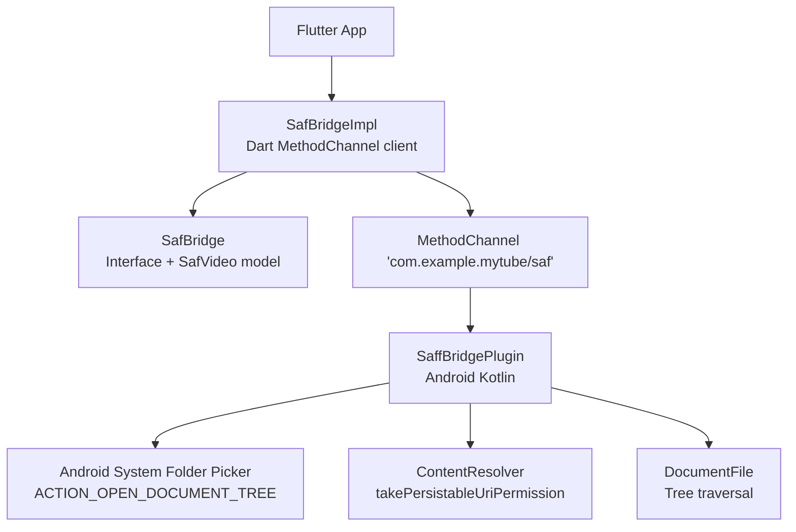
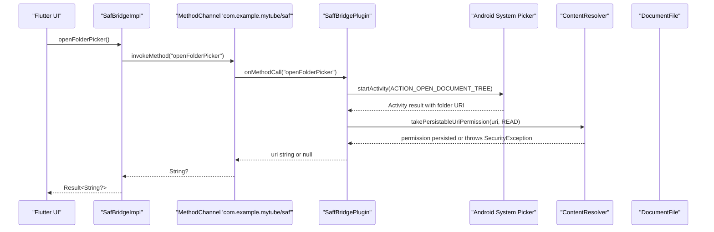
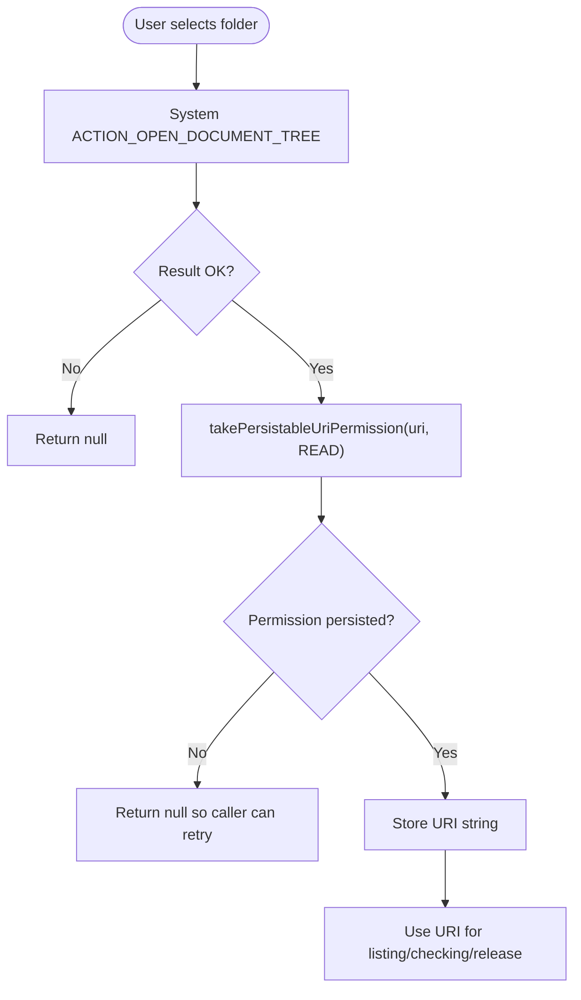
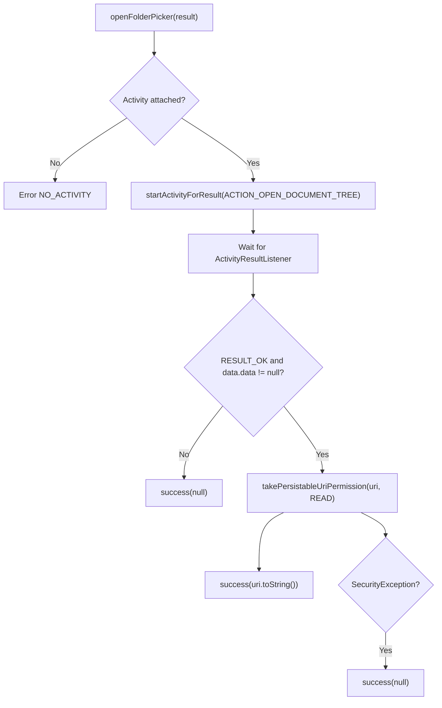
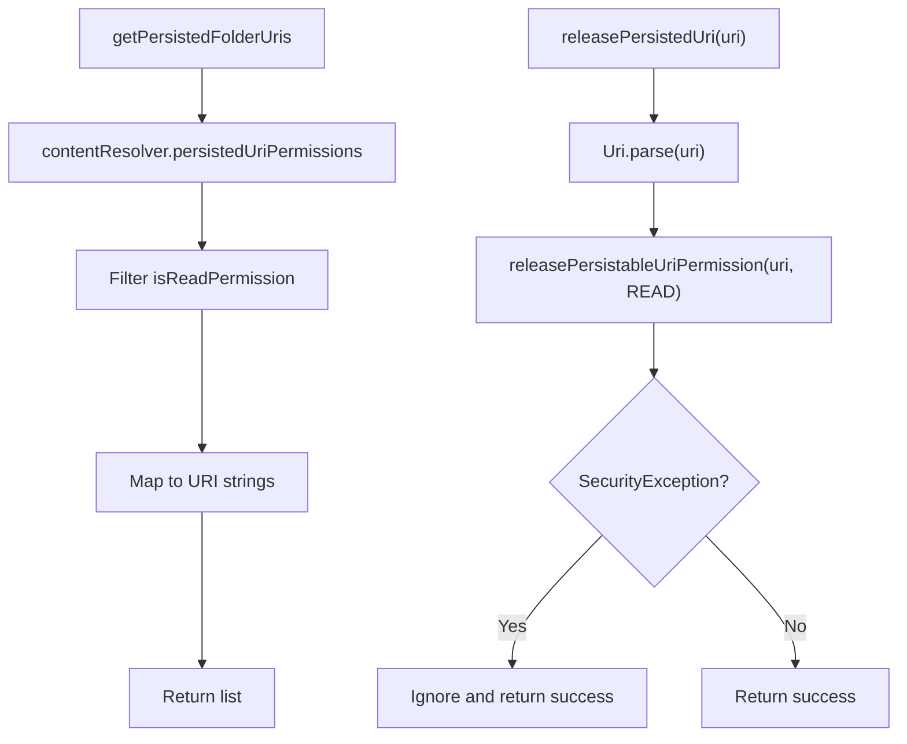
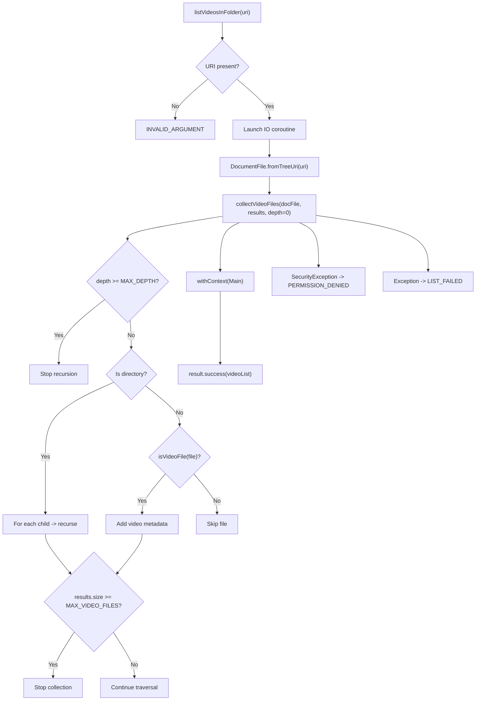
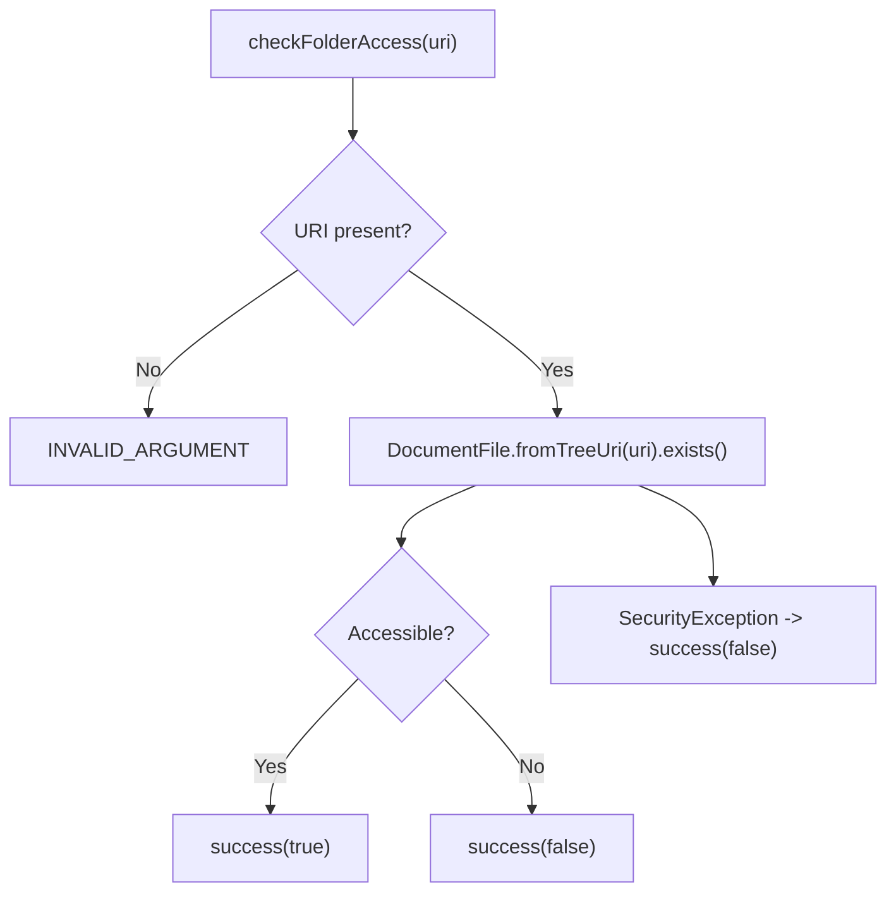
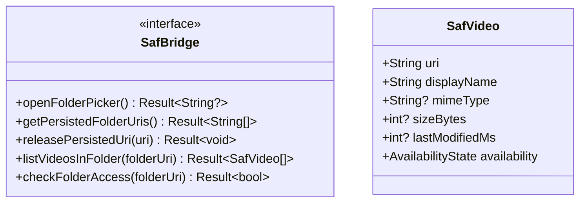
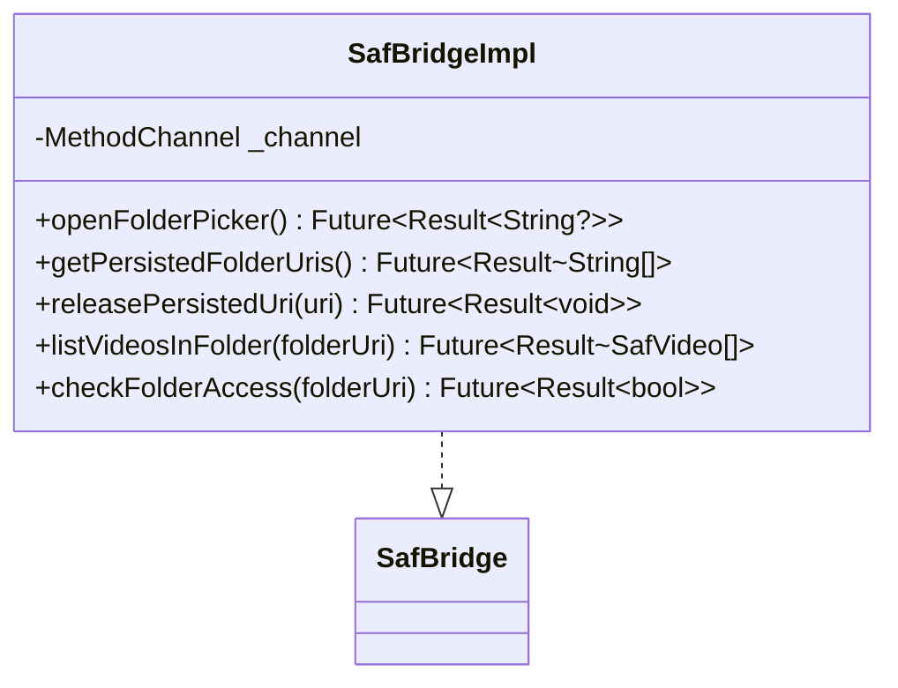
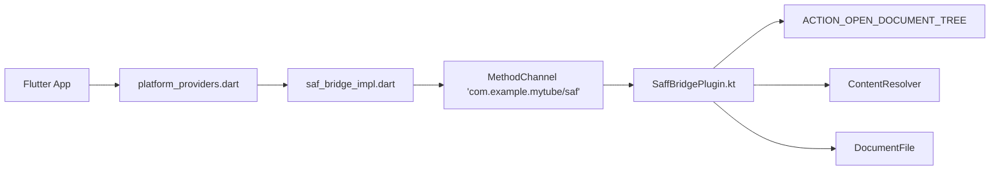

# Storage Access Framework

<cite>
**Referenced Files in This Document**
- [SaffBridgePlugin.kt](file://android/app/src/main/kotlin/com/example/mytube/SaffBridgePlugin.kt)
- [saf_bridge.dart](file://lib/platform/saf_bridge.dart)
- [saf_bridge_impl.dart](file://lib/platform/saf_bridge_impl.dart)
- [platform_providers.dart](file://lib/platform/platform_providers.dart)
- [saf_bridge_impl_test.dart](file://test/unit/platform/saf_bridge_impl_test.dart)
</cite>

## Table of Contents
1. [Introduction](#introduction)
2. [Project Structure](#project-structure)
3. [Core Components](#core-components)
4. [Architecture Overview](#architecture-overview)
5. [Detailed Component Analysis](#detailed-component-analysis)
6. [Dependency Analysis](#dependency-analysis)
7. [Performance Considerations](#performance-considerations)
8. [Troubleshooting Guide](#troubleshooting-guide)
9. [Conclusion](#conclusion)

## Introduction
This document explains how the app integrates Android’s Storage Access Framework (SAF) through `SaffBridgePlugin`. It focuses on enabling users to grant folder-specific, persistent read access to directories using Android’s system picker dialogs and URI-based permission tokens. The implementation exposes a Dart-side bridge so Flutter code can:

- Open the system folder picker.
- Persist the selected directory URI for future sessions.
- List video files inside the granted directory.
- Check whether a previously selected directory is still accessible.
- Release persisted permissions when no longer needed.

SAF differs from traditional storage permissions by giving users granular control over specific folders rather than granting broad filesystem access. This improves privacy while still allowing the app to scan and play media stored under user-selected locations.

## Project Structure
The SAF integration spans three layers:

| Layer | Responsibility | Key Files |
|---|---|---|
| Android native layer | Launches the system folder picker, persists URI permissions, traverses documents via `DocumentFile`, and returns structured metadata. | [SaffBridgePlugin.kt](file://android/app/src/main/kotlin/com/example/mytube/SaffBridgePlugin.kt) |
| Dart interface layer | Defines the contract for SAF operations and the video metadata model. | [saf_bridge.dart](file://lib/platform/saf_bridge.dart) |
| Dart platform bridge | Calls the native channel, maps results into typed values, and wraps errors. | [saf_bridge_impl.dart](file://lib/platform/saf_bridge_impl.dart) |
| Dependency injection | Provides the concrete SAF bridge to the rest of the app. | [platform_providers.dart](file://lib/platform/platform_providers.dart) |
| Tests | Validate Dart bridge behavior against mocked method channels. | [saf_bridge_impl_test.dart](file://test/unit/platform/saf_bridge_impl_test.dart) |

**Diagram sources**
- [saf_bridge_impl.dart:8-10](file://lib/platform/saf_bridge_impl.dart#L8-L10)
- [saf_bridge.dart:12-32](file://lib/platform/saf_bridge.dart#L12-L32)
- [SaffBridgePlugin.kt:45-50](file://android/app/src/main/kotlin/com/example/mytube/SaffBridgePlugin.kt#L45-L50)
- [SaffBridgePlugin.kt:101-110](file://android/app/src/main/kotlin/com/example/mytube/SaffBridgePlugin.kt#L101-L110)
- [SaffBridgePlugin.kt:121-131](file://android/app/src/main/kotlin/com/example/mytube/SaffBridgePlugin.kt#L121-L131)
- [SaffBridgePlugin.kt:184-186](file://android/app/src/main/kotlin/com/example/mytube/SaffBridgePlugin.kt#L184-L186)

**Section sources**
- [SaffBridgePlugin.kt:20-50](file://android/app/src/main/kotlin/com/example/mytube/SaffBridgePlugin.kt#L20-L50)
- [saf_bridge.dart:1-32](file://lib/platform/saf_bridge.dart#L1-L32)
- [saf_bridge_impl.dart:1-10](file://lib/platform/saf_bridge_impl.dart#L1-L10)
- [platform_providers.dart:15-19](file://lib/platform/platform_providers.dart#L15-L19)

## Core Components
The SAF integration is centered around these components:

| Component | Purpose | Important Behavior |
|---|---|---|
| `SaffBridgePlugin` | Android-side handler for SAF operations. | Opens the folder picker, persists URI permissions, lists videos recursively, checks access, and releases grants. |
| `SafBridge` | Dart-side abstraction for SAF. | Declares methods for opening the picker, listing persisted URIs, releasing URIs, listing videos, and checking access. |
| `SafBridgeImpl` | Dart-side implementation using `MethodChannel`. | Wraps platform calls with `Result`, converts exceptions into domain errors, and forwards arguments/results. |
| `SafVideo` | Typed representation of a discovered video file. | Holds URI, display name, MIME type, size, last modified time, and availability state. |
| Riverpod provider | Supplies `SafBridge` to the app. | Returns `SafBridgeImpl` in production; can be overridden in tests. |

Key responsibilities:

- **Folder selection:** The plugin launches `ACTION_OPEN_DOCUMENT_TREE` and waits for the result.
- **Permission persistence:** On success, it calls `takePersistableUriPermission` so the app retains read access across restarts.
- **Directory scanning:** It uses `DocumentFile.fromTreeUri` and recursively collects video files up to a depth limit and file count limit.
- **Access validation:** It attempts to resolve the tree URI and check existence; if access is revoked, it reports failure.
- **Permission cleanup:** It supports releasing persisted URI permissions idempotently.

**Section sources**
- [SaffBridgePlugin.kt:86-95](file://android/app/src/main/kotlin/com/example/mytube/SaffBridgePlugin.kt#L86-L95)
- [SaffBridgePlugin.kt:101-131](file://android/app/src/main/kotlin/com/example/mytube/SaffBridgePlugin.kt#L101-L131)
- [SaffBridgePlugin.kt:142-166](file://android/app/src/main/kotlin/com/example/mytube/SaffBridgePlugin.kt#L142-L166)
- [SaffBridgePlugin.kt:172-200](file://android/app/src/main/kotlin/com/example/mytube/SaffBridgePlugin.kt#L172-L200)
- [SaffBridgePlugin.kt:240-253](file://android/app/src/main/kotlin/com/example/mytube/SaffBridgePlugin.kt#L240-L253)
- [saf_bridge.dart:12-57](file://lib/platform/saf_bridge.dart#L12-L57)
- [saf_bridge_impl.dart:8-151](file://lib/platform/saf_bridge_impl.dart#L8-L151)
- [platform_providers.dart:15-19](file://lib/platform/platform_providers.dart#L15-L19)

## Architecture Overview
The SAF flow connects Flutter UI logic to Android’s system picker and content provider through a clean separation between Dart and Kotlin.

**Diagram sources**
- [saf_bridge_impl.dart:11-32](file://lib/platform/saf_bridge_impl.dart#L11-L32)
- [SaffBridgePlugin.kt:101-131](file://android/app/src/main/kotlin/com/example/mytube/SaffBridgePlugin.kt#L101-L131)

### URI-Based Permission Model
SAF does not rely on broad filesystem permissions for folder-scoped access. Instead, the app receives a `content://.../tree/...` URI representing the selected directory. The plugin persists this URI using `takePersistableUriPermission`, which allows the app to access that subtree without requesting general storage permissions.

Important characteristics:

- The returned value is a URI string, not a path.
- The URI represents a tree grant, not a single file.
- Read access is persisted through `persistedUriPermissions`.
- The same URI can be used later to list or read files under the selected folder.
- If the user revokes access, subsequent operations fail with a permission-related error.

**Diagram sources**
- [SaffBridgePlugin.kt:101-131](file://android/app/src/main/kotlin/com/example/mytube/SaffBridgePlugin.kt#L101-L131)

**Section sources**
- [SaffBridgePlugin.kt:101-131](file://android/app/src/main/kotlin/com/example/mytube/SaffBridgePlugin.kt#L101-L131)
- [SaffBridgePlugin.kt:142-148](file://android/app/src/main/kotlin/com/example/mytube/SaffBridgePlugin.kt#L142-L148)
- [saf_bridge.dart:12-32](file://lib/platform/saf_bridge.dart#L12-L32)

## Detailed Component Analysis

### SaffBridgePlugin
`SaffBridgePlugin` is the Android entry point for SAF operations. It implements:

- `FlutterPlugin`: Registers the method channel.
- `ActivityAware`: Tracks the current activity for launching the picker.
- `PluginRegistry.ActivityResultListener`: Receives the system picker result.
- `MethodChannel.MethodCallHandler`: Dispatches Dart calls to native functions.

#### Lifecycle and Channel Registration
The plugin registers the channel `com.example.mytube/saf` when attached to the Flutter engine and cancels its coroutine scope when detached.

**Section sources**
- [SaffBridgePlugin.kt:45-55](file://android/app/src/main/kotlin/com/example/mytube/SaffBridgePlugin.kt#L45-L55)

#### Folder Picker Flow
When `openFolderPicker` is called:

1. The plugin verifies an activity is attached.
2. It stores the pending Dart result.
3. It starts `ACTION_OPEN_DOCUMENT_TREE`.
4. When the system returns a result, it tries to persist the URI permission.
5. If persistence fails due to `SecurityException`, it returns `null` so the caller can retry.
6. Otherwise, it returns the URI string.

**Diagram sources**
- [SaffBridgePlugin.kt:101-131](file://android/app/src/main/kotlin/com/example/mytube/SaffBridgePlugin.kt#L101-L131)

**Section sources**
- [SaffBridgePlugin.kt:101-131](file://android/app/src/main/kotlin/com/example/mytube/SaffBridgePlugin.kt#L101-L131)

#### Persisted URI Management
The plugin exposes two related operations:

- `getPersistedFolderUris`: Reads `persistedUriPermissions`, filters entries with read permission, and returns their URI strings.
- `releasePersistedUri`: Accepts a URI string argument, parses it, and calls `releasePersistableUriPermission`. It treats `SecurityException` as idempotent success.

**Diagram sources**
- [SaffBridgePlugin.kt:142-166](file://android/app/src/main/kotlin/com/example/mytube/SaffBridgePlugin.kt#L142-L166)

**Section sources**
- [SaffBridgePlugin.kt:142-166](file://android/app/src/main/kotlin/com/example/mytube/SaffBridgePlugin.kt#L142-L166)

#### Video Listing via SAF Tree Traversal
`listVideosInFolder` performs recursive traversal of the selected directory:

- It validates the URI argument.
- It runs traversal off the main thread using a coroutine scope.
- It resolves the root document via `DocumentFile.fromTreeUri`.
- It recursively collects video files up to a maximum count and depth.
- It maps each video to a map containing URI, display name, MIME type, size, and last modified timestamp.
- It handles `SecurityException` as permission revocation and other exceptions as generic failures.

**Diagram sources**
- [SaffBridgePlugin.kt:172-200](file://android/app/src/main/kotlin/com/example/mytube/SaffBridgePlugin.kt#L172-L200)
- [SaffBridgePlugin.kt:202-234](file://android/app/src/main/kotlin/com/example/mytube/SaffBridgePlugin.kt#L202-L234)

**Section sources**
- [SaffBridgePlugin.kt:172-234](file://android/app/src/main/kotlin/com/example/mytube/SaffBridgePlugin.kt#L172-L234)

#### Folder Access Check
`checkFolderAccess` validates whether the app can currently access a given folder URI:

- It parses the URI.
- It attempts to resolve the tree document.
- It returns `true` if the document exists.
- It catches `SecurityException` and returns `false`.

**Diagram sources**
- [SaffBridgePlugin.kt:240-253](file://android/app/src/main/kotlin/com/example/mytube/SaffBridgePlugin.kt#L240-L253)

**Section sources**
- [SaffBridgePlugin.kt:240-253](file://android/app/src/main/kotlin/com/example/mytube/SaffBridgePlugin.kt#L240-L253)

### SafBridge Interface
`SafBridge` defines the contract that Flutter code should use instead of calling the platform directly. It includes:

- Opening the folder picker.
- Listing persisted folder URIs.
- Releasing a persisted URI.
- Listing videos in a folder.
- Checking folder access.

It also defines `SafVideo`, which models the metadata returned by the native layer.

**Diagram sources**
- [saf_bridge.dart:12-57](file://lib/platform/saf_bridge.dart#L12-L57)

**Section sources**
- [saf_bridge.dart:1-57](file://lib/platform/saf_bridge.dart#L1-L57)

### SafBridgeImpl
`SafBridgeImpl` is the Dart implementation that communicates with `SaffBridgePlugin` through the `com.example.mytube/saf` method channel. It:

- Invokes native methods.
- Converts platform exceptions into `UnexpectedError`.
- Wraps all results in `Result`.
- Passes URI strings and receives either URI strings, lists, booleans, or null.

**Diagram sources**
- [saf_bridge_impl.dart:8-151](file://lib/platform/saf_bridge_impl.dart#L8-L151)
- [saf_bridge.dart:12-32](file://lib/platform/saf_bridge.dart#L12-L32)

**Section sources**
- [saf_bridge_impl.dart:1-151](file://lib/platform/saf_bridge_impl.dart#L1-L151)

### Riverpod Provider
The app exposes `safBridgeProvider` so features can depend on `SafBridge` without knowing about `SafBridgeImpl`.

**Section sources**
- [platform_providers.dart:15-19](file://lib/platform/platform_providers.dart#L15-L19)

### Test Coverage
The test file validates:

- Successful folder picker responses.
- Empty persisted URI lists.
- URI release calls.
- Platform exception handling.
- Folder access checks.

These tests confirm that the Dart bridge correctly forwards arguments and wraps platform responses.

**Section sources**
- [saf_bridge_impl_test.dart:81-160](file://test/unit/platform/saf_bridge_impl_test.dart#L81-L160)
- [saf_bridge_impl_test.dart:289-328](file://test/unit/platform/saf_bridge_impl_test.dart#L289-L328)

## Dependency Analysis
The SAF integration has clear boundaries between Dart and Kotlin:

| Dependency | Direction | Notes |
|---|---|---|
| `SafBridgeImpl` → `MethodChannel` | Dart → Android | Uses channel name `com.example.mytube/saf`. |
| `SaffBridgePlugin` → `Intent.ACTION_OPEN_DOCUMENT_TREE` | Android → System | Opens the folder picker. |
| `SaffBridgePlugin` → `ContentResolver` | Android → Android | Persists and releases URI permissions. |
| `SaffBridgePlugin` → `DocumentFile` | Android → Android | Traverses the selected directory tree. |
| `platform_providers.dart` → `SafBridgeImpl` | Dart DI | Supplies the bridge to the app. |

**Diagram sources**
- [platform_providers.dart:15-19](file://lib/platform/platform_providers.dart#L15-L19)
- [saf_bridge_impl.dart:8-10](file://lib/platform/saf_bridge_impl.dart#L8-L10)
- [SaffBridgePlugin.kt:45-50](file://android/app/src/main/kotlin/com/example/mytube/SaffBridgePlugin.kt#L45-L50)
- [SaffBridgePlugin.kt:108-109](file://android/app/src/main/kotlin/com/example/mytube/SaffBridgePlugin.kt#L108-L109)
- [SaffBridgePlugin.kt:121-131](file://android/app/src/main/kotlin/com/example/mytube/SaffBridgePlugin.kt#L121-L131)
- [SaffBridgePlugin.kt:184-186](file://android/app/src/main/kotlin/com/example/mytube/SaffBridgePlugin.kt#L184-L186)

**Section sources**
- [platform_providers.dart:15-19](file://lib/platform/platform_providers.dart#L15-L19)
- [saf_bridge_impl.dart:8-10](file://lib/platform/saf_bridge_impl.dart#L8-L10)
- [SaffBridgePlugin.kt:45-50](file://android/app/src/main/kotlin/com/example/mytube/SaffBridgePlugin.kt#L45-L50)

## Performance Considerations
The implementation includes several safeguards for large or deeply nested directories:

- **Background traversal:** Video listing runs on `Dispatchers.IO` to avoid blocking the main thread.
- **Maximum file count:** Collection stops after `MAX_VIDEO_FILES` to prevent unbounded memory growth.
- **Maximum depth:** Recursive traversal stops at `MAX_DEPTH` to avoid extremely deep trees.
- **MIME-type filtering:** Only files with `video/*` MIME types are collected; fallback extension matching is used when MIME type is unavailable.
- **Idempotent permission release:** Releasing a URI that is already released does not fail.

Recommendations for callers:

- Avoid repeatedly scanning very large directories without caching.
- Use `checkFolderAccess` before expensive scans to detect revoked permissions early.
- Treat `null` from the folder picker as a cancellation, not necessarily an error.
- Handle `PERMISSION_DENIED` gracefully by prompting the user to reselect the folder.

[No sources needed since this section provides general guidance]

## Troubleshooting Guide

### Common Issues

| Issue | Symptom | Cause | Resolution |
|---|---|---|---|
| URI expiration | Listing videos fails after app restart or device reboot. | The persisted URI permission was lost or invalidated by the system. | Call `checkFolderAccess`; if false, prompt the user to run `openFolderPicker` again. |
| Permission revocation | `SecurityException` during listing or access check. | User revoked access in system settings or the OS removed the grant. | Catch permission-denied errors and ask the user to reselect the folder. |
| No activity attached | Error when opening the picker. | The plugin is invoked without an attached Flutter activity. | Ensure the picker is opened from a foreground activity lifecycle. |
| Empty persisted URIs | `getPersistedFolderUris` returns an empty list. | No folder has been selected yet, or all grants were released. | Prompt the user to select a folder. |
| Large directory scan hangs | UI freezes or slow response. | Deep or large directory trees require traversal. | Rely on background traversal limits; consider pagination or incremental scanning. |

### Error Codes and Responses
The native layer surfaces structured errors:

| Error Code | Meaning | Typical Caller Response |
|---|---|---|
| `NO_ACTIVITY` | No activity available for picker. | Retry from a valid activity context. |
| `INVALID_ARGUMENT` | Missing or invalid URI argument. | Validate input before calling. |
| `PERMISSION_DENIED` | Folder access revoked. | Ask user to reselect folder. |
| `LIST_FAILED` | Unexpected traversal or I/O error. | Log diagnostic message and fall back to cached data or error UI. |

**Section sources**
- [SaffBridgePlugin.kt:101-109](file://android/app/src/main/kotlin/com/example/mytube/SaffBridgePlugin.kt#L101-L109)
- [SaffBridgePlugin.kt:150-166](file://android/app/src/main/kotlin/com/example/mytube/SaffBridgePlugin.kt#L150-L166)
- [SaffBridgePlugin.kt:172-199](file://android/app/src/main/kotlin/com/example/mytube/SaffBridgePlugin.kt#L172-L199)
- [SaffBridgePlugin.kt:240-253](file://android/app/src/main/kotlin/com/example/mytube/SaffBridgePlugin.kt#L240-L253)

### SAF vs Traditional Storage Permissions
Traditional storage permissions request broad access to external storage. SAF instead asks the user to pick a specific folder and grants the app a tokenized URI for that location. This means:

- Users retain control over which folders are accessible.
- The app does not need blanket filesystem permissions for folder-scoped access.
- Permissions can be revoked per folder.
- The app must handle cases where the selected folder becomes inaccessible.

This model aligns with modern Android privacy expectations and reduces the risk of unnecessary data exposure.

[No sources needed since this section provides conceptual comparison]

## Conclusion
`SaffBridgePlugin` provides a robust SAF integration that lets users grant folder-specific read access through Android’s system picker. The Dart-side `SafBridge` and `SafBridgeImpl` expose a clean API for opening the picker, persisting URIs, listing videos, checking access, and releasing permissions. The implementation protects performance with background traversal, depth limits, and file-count caps, and it handles common SAF edge cases such as permission revocation and missing activities.

For maintainers, the recommended workflow is:

1. Use `openFolderPicker` to let users select a folder.
2. Persist the returned URI string.
3. Use `checkFolderAccess` before scanning.
4. Use `listVideosInFolder` to populate the library.
5. Use `getPersistedFolderUris` to restore known folders.
6. Use `releasePersistedUri` when removing user-granted folders.

[No sources needed since this section summarizes without analyzing specific files]