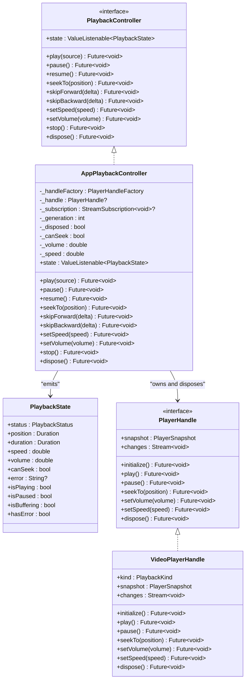
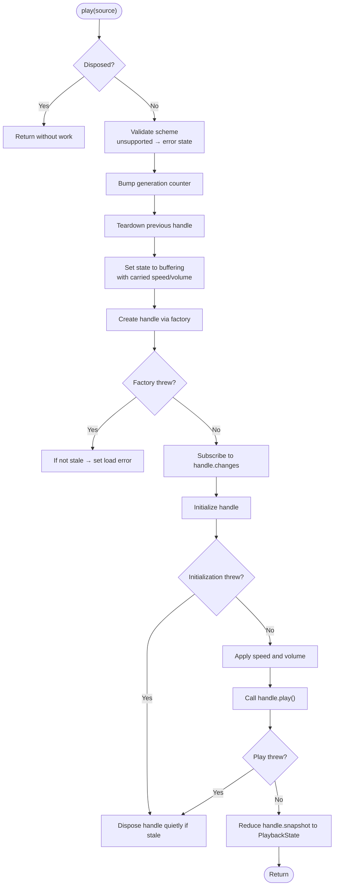
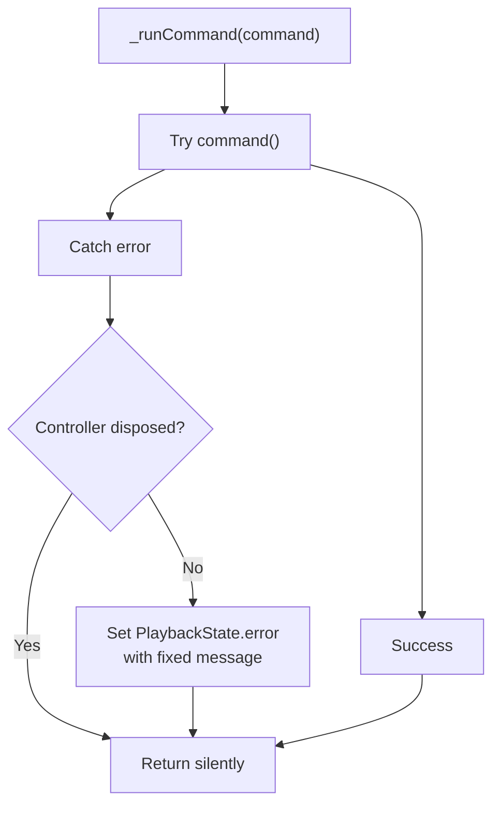
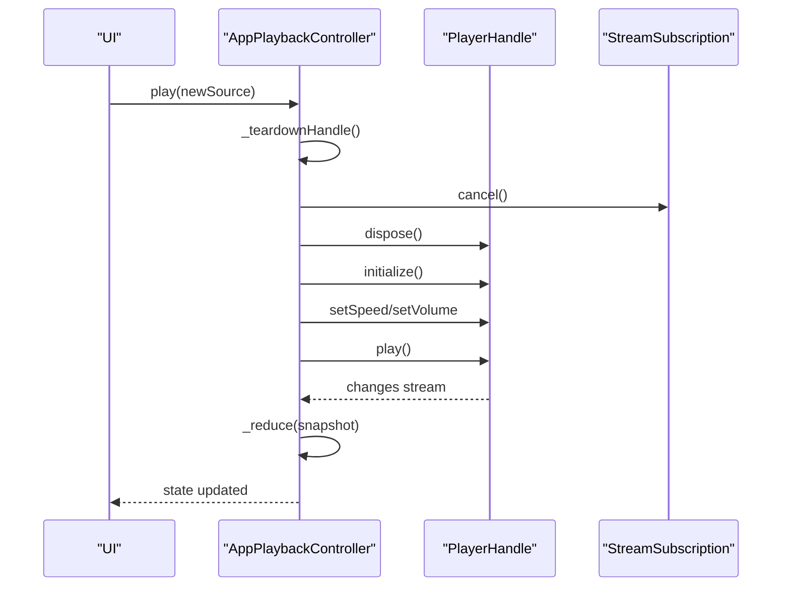
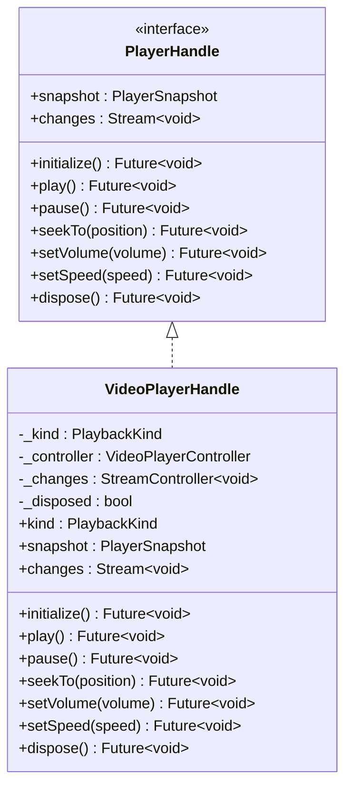
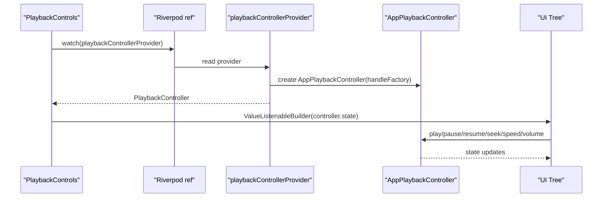
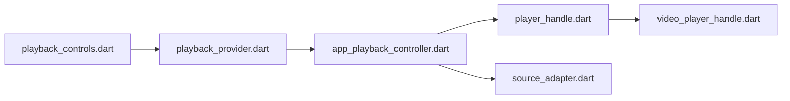

# App Playback Controller Implementation

<cite>
**Referenced Files in This Document**
- [app_playback_controller.dart](file://lib/playback/app_playback_controller.dart)
- [playback_controller.dart](file://lib/playback/playback_controller.dart)
- [player_handle.dart](file://lib/playback/player_handle.dart)
- [video_player_handle.dart](file://lib/playback/video_player_handle.dart)
- [playback_provider.dart](file://lib/playback/playback_provider.dart)
- [source_adapter.dart](file://lib/sources/source_adapter.dart)
- [playback_controls.dart](file://lib/features/player/playback_controls.dart)
- [app_playback_controller_test.dart](file://test/unit/playback/app_playback_controller_test.dart)
</cite>

## Table of Contents
1. [Introduction](#introduction)
2. [Project Structure](#project-structure)
3. [Core Components](#core-components)
4. [Architecture Overview](#architecture-overview)
5. [Detailed Component Analysis](#detailed-component-analysis)
6. [Dependency Analysis](#dependency-analysis)
7. [Performance Considerations](#performance-considerations)
8. [Troubleshooting Guide](#troubleshooting-guide)
9. [Conclusion](#conclusion)

## Introduction
This document explains the `AppPlaybackController` implementation that coordinates multiple player instances and manages application-wide playback state. It shows how the controller implements the `PlaybackController` interface, handles source switching, resource cleanup, and state synchronization, and integrates with Riverpod providers. It also documents the `VideoPlayerHandle` abstraction that wraps the underlying `video_player` engine, lifecycle management strategies, memory optimization techniques, and error recovery mechanisms.

The goal is to make this architecture understandable for both developers integrating playback into UI features and maintainers extending or replacing the underlying player engine.

## Project Structure
The playback subsystem lives under `lib/playback`, with a thin integration point into the feature layer through `lib/features/player`. The key files are:

- `playback_controller.dart`: Defines the app-owned `PlaybackController` interface and immutable `PlaybackState` value type.
- `app_playback_controller.dart`: Implements the state machine, command routing, lifecycle, and safety guarantees.
- `player_handle.dart`: Declares the engine seam (`PlayerHandle`, `PlayerSnapshot`, `PlaybackKind`) and factory typedef.
- `video_player_handle.dart`: Concrete `PlayerHandle` backed by `video_player`.
- `playback_provider.dart`: Riverpod providers wiring the controller and handle factory.
- `source_adapter.dart`: Shared `PlayableSource` model used by the controller.
- `playback_controls.dart`: Example UI integration using the provider and controller.

```mermaid
graph TB
subgraph "Playback Layer"
PC["PlaybackController<br/>interface"]
APC["AppPlaybackController<br/>state machine"]
PH["PlayerHandle<br/>engine seam"]
VPH["VideoPlayerHandle<br/>video_player wrapper"]
PP["playback_provider.dart<br/>Riverpod providers"]
end
subgraph "Sources"
SA["PlayableSource<br/>source_adapter.dart"]
end
subgraph "UI"
UI["PlaybackControls<br/>playback_controls.dart"]
end
UI --> PP
PP --> APC
APC --> PH
PH --> VPH
APC --> SA
```

**Diagram sources**
- [playback_controller.dart:15-67](file://lib/playback/playback_controller.dart#L15-L67)
- [app_playback_controller.dart:23-48](file://lib/playback/app_playback_controller.dart#L23-L48)
- [player_handle.dart:77-114](file://lib/playback/player_handle.dart#L77-L114)
- [video_player_handle.dart:19-40](file://lib/playback/video_player_handle.dart#L19-L40)
- [playback_provider.dart:12-27](file://lib/playback/playback_provider.dart#L12-L27)
- [source_adapter.dart:123-137](file://lib/sources/source_adapter.dart#L123-L137)
- [playback_controls.dart:43-48](file://lib/features/player/playback_controls.dart#L43-L48)

**Section sources**
- [playback_controller.dart:1-67](file://lib/playback/playback_controller.dart#L1-L67)
- [app_playback_controller.dart:1-48](file://lib/playback/app_playback_controller.dart#L1-L48)
- [player_handle.dart:1-114](file://lib/playback/player_handle.dart#L1-L114)
- [video_player_handle.dart:1-40](file://lib/playback/video_player_handle.dart#L1-L40)
- [playback_provider.dart:1-27](file://lib/playback/playback_provider.dart#L1-L27)
- [source_adapter.dart:119-137](file://lib/sources/source_adapter.dart#L119-L137)
- [playback_controls.dart:1-48](file://lib/features/player/playback_controls.dart#L1-L48)

## Core Components
- `PlaybackController`: The public API for playback. It exposes an immutable `PlaybackState` and commands such as `play`, `pause`, `resume`, `seekTo`, `skipForward`, `skipBackward`, `setSpeed`, `setVolume`, `stop`, and `dispose`. Failures never throw; they surface as `PlaybackStatus.error` with user-safe messages.
- `PlaybackState`: An immutable snapshot including status, position, duration, speed, volume, seekability, and optional error message. Equality and hash are implemented so widgets rebuild efficiently on value changes.
- `AppPlaybackController`: The app-owned implementation. It owns the state machine, carries user preferences across sources, validates schemes, creates and disposes player handles, subscribes to engine change events, and maps engine snapshots to `PlaybackState`.
- `PlayerHandle` and `PlayerSnapshot`: Engine abstraction. `PlayerHandle` encapsulates initialization, playback control, and disposal; `PlayerSnapshot` is the engine’s current state view.
- `VideoPlayerHandle`: Concrete implementation wrapping `video_player`. It routes content/file/network URIs to appropriate constructors and translates engine callbacks into `PlayerSnapshot`.
- Riverpod Providers: `playerHandleFactoryProvider` supplies the handle factory, and `playbackControllerProvider` creates one `AppPlaybackController` for the app lifetime, disposing it when the container shuts down.

**Section sources**
- [playback_controller.dart:15-150](file://lib/playback/playback_controller.dart#L15-L150)
- [app_playback_controller.dart:23-48](file://lib/playback/app_playback_controller.dart#L23-L48)
- [player_handle.dart:36-114](file://lib/playback/player_handle.dart#L36-L114)
- [video_player_handle.dart:19-109](file://lib/playback/video_player_handle.dart#L19-L109)
- [playback_provider.dart:12-27](file://lib/playback/playback_provider.dart#L12-L27)

## Architecture Overview
The architecture separates concerns clearly:

- UI depends only on `PlaybackController` and `PlaybackState`.
- `AppPlaybackController` owns the state machine and lifecycle.
- `PlayerHandle` isolates engine-specific code behind a narrow seam.
- `VideoPlayerHandle` is the only file allowed to import `video_player`.
- Riverpod provides the controller and handle factory at runtime.



**Diagram sources**
- [playback_controller.dart:15-150](file://lib/playback/playback_controller.dart#L15-L150)
- [app_playback_controller.dart:23-48](file://lib/playback/app_playback_controller.dart#L23-L48)
- [player_handle.dart:77-114](file://lib/playback/player_handle.dart#L77-L114)
- [video_player_handle.dart:19-109](file://lib/playback/video_player_handle.dart#L19-L109)

## Detailed Component Analysis

### PlaybackController Interface and State Model
`PlaybackController` defines the contract for all playback operations. Its documentation emphasizes that:

- The UI watches `state` and calls command methods.
- No plugin-specific types leak into the UI.
- Rapid successive `play()` calls are safe; only the newest source wins.
- Failures surface as `PlaybackStatus.error` with user-safe messages.

`PlaybackState` is immutable and compared by value. It includes:

- Status: idle, buffering, playing, paused, completed, error.
- Position and duration.
- Speed and volume (volume is carried across sources).
- Seekability flag.
- Optional error message.

This design ensures predictable widget rebuilds and clear state transitions.

**Section sources**
- [playback_controller.dart:15-67](file://lib/playback/playback_controller.dart#L15-L67)
- [playback_controller.dart:77-150](file://lib/playback/playback_controller.dart#L77-L150)

### AppPlaybackController: State Machine, Source Switching, and Cleanup
`AppPlaybackController` extends `ValueNotifier<PlaybackState>` and implements `PlaybackController`. Key responsibilities include:

- Validating source schemes before touching the engine.
- Tearing down previous sources before loading new ones.
- Transitioning from idle to buffering to playing.
- Carrying user preferences (speed, volume) across sources.
- Discarding stale load completions via a generation counter.
- Mapping engine snapshots to `PlaybackState`.
- Converting engine failures into user-safe error states.
- Managing subscriptions and disposing handles safely.

#### Play Lifecycle Flow


**Diagram sources**
- [app_playback_controller.dart:57-135](file://lib/playback/app_playback_controller.dart#L57-L135)

#### Error Handling and Recovery
- Unsupported schemes produce a fixed, user-safe message before any engine call.
- Factory creation errors and initialization errors map to a generic load failure message.
- Command errors (play, pause, seek, speed, volume) are wrapped by `_runCommand`, which sets an error state instead of throwing.
- Engine error text is never surfaced verbatim; the controller replaces it with a user-safe message.
- Disposal failures are swallowed to avoid surfacing teardown diagnostics as playback errors.



**Diagram sources**
- [app_playback_controller.dart:386-400](file://lib/playback/app_playback_controller.dart#L386-L400)

#### Resource Cleanup and Memory Optimization
- `_teardownHandle` cancels the engine change subscription, clears the active handle, resets seekability, and disposes the handle.
- `_disposeQuietly` catches disposal exceptions so teardown does not crash the app or pollute logs.
- Generation counter prevents stale loads from overwriting newer state.
- Preferences are stored in the controller and applied to fresh handles, avoiding repeated expensive setup.
- The controller itself is long-lived and disposed by Riverpod, preventing frequent recreation.



**Diagram sources**
- [app_playback_controller.dart:402-420](file://lib/playback/app_playback_controller.dart#L402-L420)
- [app_playback_controller.dart:57-135](file://lib/playback/app_playback_controller.dart#L57-L135)

**Section sources**
- [app_playback_controller.dart:23-48](file://lib/playback/app_playback_controller.dart#L23-L48)
- [app_playback_controller.dart:57-135](file://lib/playback/app_playback_controller.dart#L57-L135)
- [app_playback_controller.dart:137-205](file://lib/playback/app_playback_controller.dart#L137-L205)
- [app_playback_controller.dart:211-364](file://lib/playback/app_playback_controller.dart#L211-L364)
- [app_playback_controller.dart:370-420](file://lib/playback/app_playback_controller.dart#L370-L420)

### PlayerHandle Abstraction and VideoPlayerHandle
`PlayerHandle` is the narrow seam between the app-owned controller and the concrete player engine. It exposes:

- A snapshot of engine state.
- A stream of changes.
- Commands: initialize, play, pause, seekTo, setVolume, setSpeed, dispose.

`VideoPlayerHandle` is the only file allowed to import `video_player`. It:

- Routes URIs by scheme: content, file, network.
- Creates the appropriate `VideoPlayerController`.
- Listens to controller changes and emits them through a broadcast stream.
- Maps controller values to `PlayerSnapshot`.
- Disposes the controller and stream cleanly.



**Diagram sources**
- [player_handle.dart:77-114](file://lib/playback/player_handle.dart#L77-L114)
- [video_player_handle.dart:19-109](file://lib/playback/video_player_handle.dart#L19-L109)

**Section sources**
- [player_handle.dart:36-114](file://lib/playback/player_handle.dart#L36-L114)
- [video_player_handle.dart:1-109](file://lib/playback/video_player_handle.dart#L1-109)

### Riverpod Integration and Usage Patterns
The Riverpod layer provides:

- `playerHandleFactoryProvider`: Supplies the default `videoPlayerHandleFactory`. Tests can override this to inject fake handles.
- `playbackControllerProvider`: Creates one `AppPlaybackController` for the app lifetime, injecting the handle factory and disposing it when the container disposes.

UI usage pattern:

- Watch `playbackControllerProvider` to obtain `PlaybackController`.
- Use `ValueListenableBuilder` on `controller.state` to rebuild controls.
- Call command methods like `play`, `pause`, `resume`, `seekTo`, `skipForward`, `skipBackward`, `setSpeed`, `setVolume`.
- Disable seek affordances based on `PlaybackState.canSeek`.
- Show error messages from `PlaybackState.error`.



**Diagram sources**
- [playback_provider.dart:12-27](file://lib/playback/playback_provider.dart#L12-L27)
- [playback_controls.dart:43-48](file://lib/features/player/playback_controls.dart#L43-L48)

**Section sources**
- [playback_provider.dart:1-27](file://lib/playback/playback_provider.dart#L1-L27)
- [playback_controls.dart:1-48](file://lib/features/player/playback_controls.dart#L1-L48)
- [playback_controls.dart:51-212](file://lib/features/player/playback_controls.dart#L51-L212)

### Source Switching and Preference Carryover
When `play` is called:

- The controller rejects unsupported schemes early.
- It tears down the previous handle and sets the state to buffering.
- It creates a new handle, subscribes to its changes, initializes it, applies speed and volume, and starts playback.
- If a newer `play` call arrives while an older load is still pending, the generation counter discards the stale completion and disposes the old handle.
- User preferences (speed, volume) are carried across sources, so changing volume before loading a source immediately updates the UI and is applied to the next engine.

Tests verify:

- Rapid successive `play` calls do not let stale sources win.
- Volume and seekability are reflected correctly in state.
- Preferences carry over to the next source.

**Section sources**
- [app_playback_controller.dart:57-135](file://lib/playback/app_playback_controller.dart#L57-L135)
- [app_playback_controller.dart:294-338](file://lib/playback/app_playback_controller.dart#L294-L338)
- [app_playback_controller_test.dart:319-335](file://test/unit/playback/app_playback_controller_test.dart#L319-L335)
- [app_playback_controller_test.dart:504-537](file://test/unit/playback/app_playback_controller_test.dart#L504-L537)

## Dependency Analysis
The playback layer has clear boundaries:

- UI depends on `PlaybackController` and `PlaybackState`.
- `AppPlaybackController` depends on `PlayerHandleFactory`, `PlayableSource`, and Flutter’s `ValueNotifier`.
- `VideoPlayerHandle` depends on `video_player` and `PlayableSource`.
- Riverpod providers depend on both the controller and the handle factory.



**Diagram sources**
- [playback_controls.dart:1-48](file://lib/features/player/playback_controls.dart#L1-L48)
- [playback_provider.dart:1-27](file://lib/playback/playback_provider.dart#L1-L27)
- [app_playback_controller.dart:1-6](file://lib/playback/app_playback_controller.dart#L1-L6)
- [player_handle.dart:1-114](file://lib/playback/player_handle.dart#L1-L114)
- [video_player_handle.dart:1-6](file://lib/playback/video_player_handle.dart#L1-L6)
- [source_adapter.dart:119-137](file://lib/sources/source_adapter.dart#L119-L137)

**Section sources**
- [playback_provider.dart:1-27](file://lib/playback/playback_provider.dart#L1-L27)
- [app_playback_controller.dart:1-6](file://lib/playback/app_playback_controller.dart#L1-L6)
- [player_handle.dart:1-114](file://lib/playback/player_handle.dart#L1-L114)
- [video_player_handle.dart:1-6](file://lib/playback/video_player_handle.dart#L1-L6)
- [source_adapter.dart:119-137](file://lib/sources/source_adapter.dart#L119-L137)

## Performance Considerations
- Immutable state: `PlaybackState` equality avoids unnecessary widget rebuilds.
- Single long-lived controller: Riverpod creates one controller for the app lifetime, reducing allocation churn.
- Generation counter: Prevents stale async work from updating state, avoiding redundant renders.
- Subscription management: Cancelling the engine change stream and disposing handles prevents memory leaks.
- Quiet disposal: Swallowing disposal exceptions avoids noisy logs and crashes during teardown.
- Preference caching: Speed and volume are cached in the controller and applied once per source, minimizing repeated engine calls.

[No sources needed since this section provides general guidance]

## Troubleshooting Guide
Common issues and their handling:

- Unsupported source scheme: The controller detects unsupported schemes and sets a user-safe error state without calling the engine.
- Load failures: Engine initialization errors are mapped to a generic load failure message.
- Playback failures: Errors from play, pause, seek, speed, or volume are converted to a fixed error state.
- Stale loads: If a newer `play` call occurs, older loads are discarded and their handles disposed.
- Disposal errors: Engine disposal failures are caught and ignored to keep teardown safe.
- Seeking disabled: When `canSeek` is false, seek commands are ignored; UI disables seek affordances accordingly.

Recommended debugging steps:

- Inspect `PlaybackState.status` and `PlaybackState.error` in the UI.
- Verify that `PlaybackState.canSeek` matches the source capabilities.
- Check whether rapid `play` calls are occurring and ensure the latest source is expected.
- Confirm that Riverpod disposes the controller when the app exits.
- Replace the handle factory with a fake implementation to isolate engine behavior.

**Section sources**
- [app_playback_controller.dart:29-34](file://lib/playback/app_playback_controller.dart#L29-L34)
- [app_playback_controller.dart:57-135](file://lib/playback/app_playback_controller.dart#L57-L135)
- [app_playback_controller.dart:386-420](file://lib/playback/app_playback_controller.dart#L386-L420)
- [playback_controls.dart:64-67](file://lib/features/player/playback_controls.dart#L64-L67)

## Conclusion
`AppPlaybackController` is the central coordinator for playback in the application. It implements `PlaybackController`, owns the state machine, manages lifecycle and resources, and maps engine snapshots to a stable, immutable `PlaybackState`. The `PlayerHandle` abstraction isolates engine specifics, with `VideoPlayerHandle` wrapping `video_player`. Riverpod provides a single long-lived controller and allows tests to inject fake handles. The design supports safe source switching, preference carryover, robust error handling, and clean resource cleanup, making it suitable for complex applications with multiple playback scenarios.

[No sources needed since this section summarizes without analyzing specific files]