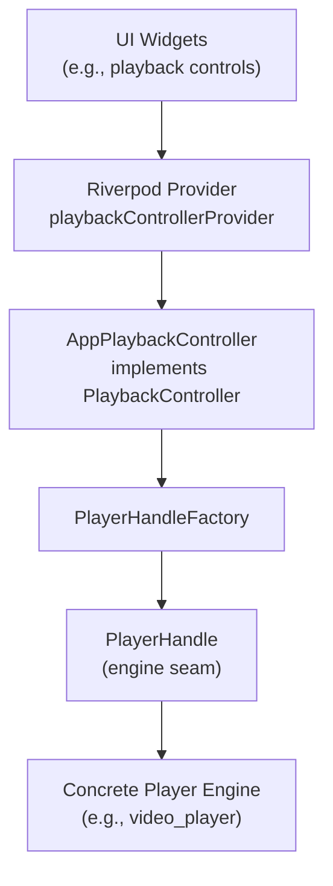
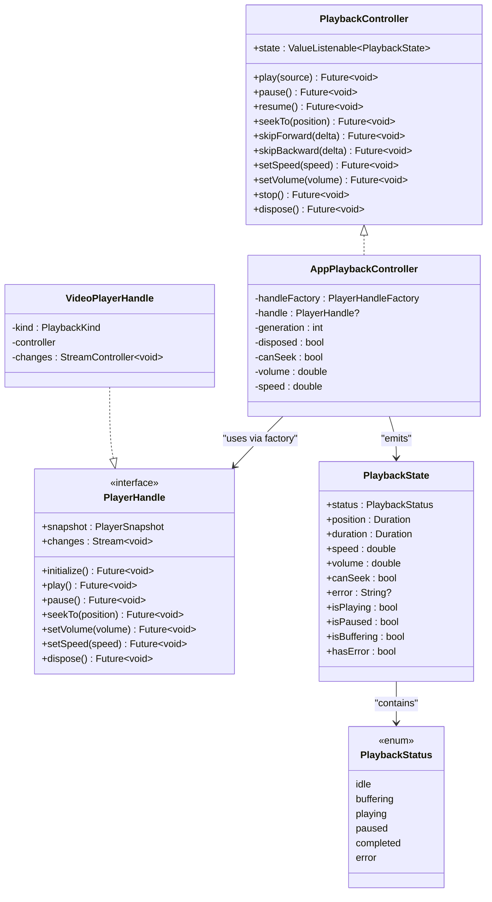
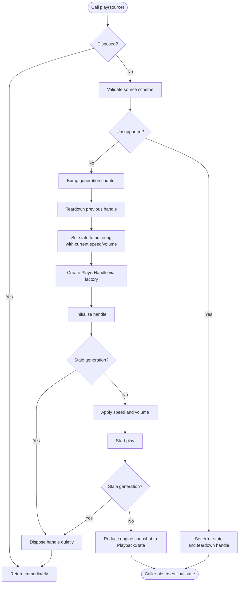
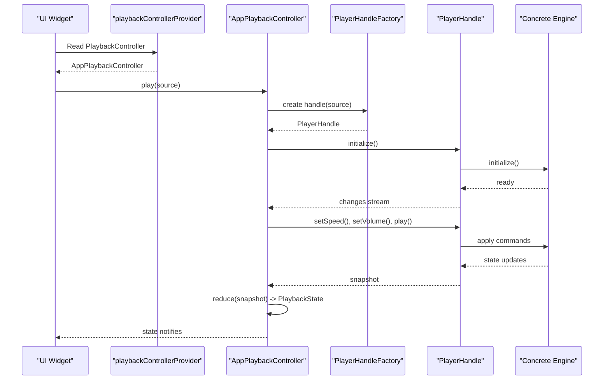
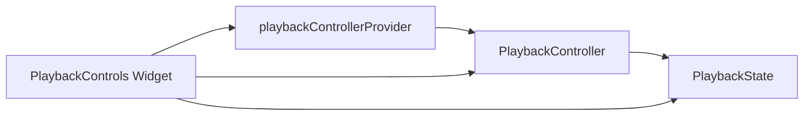
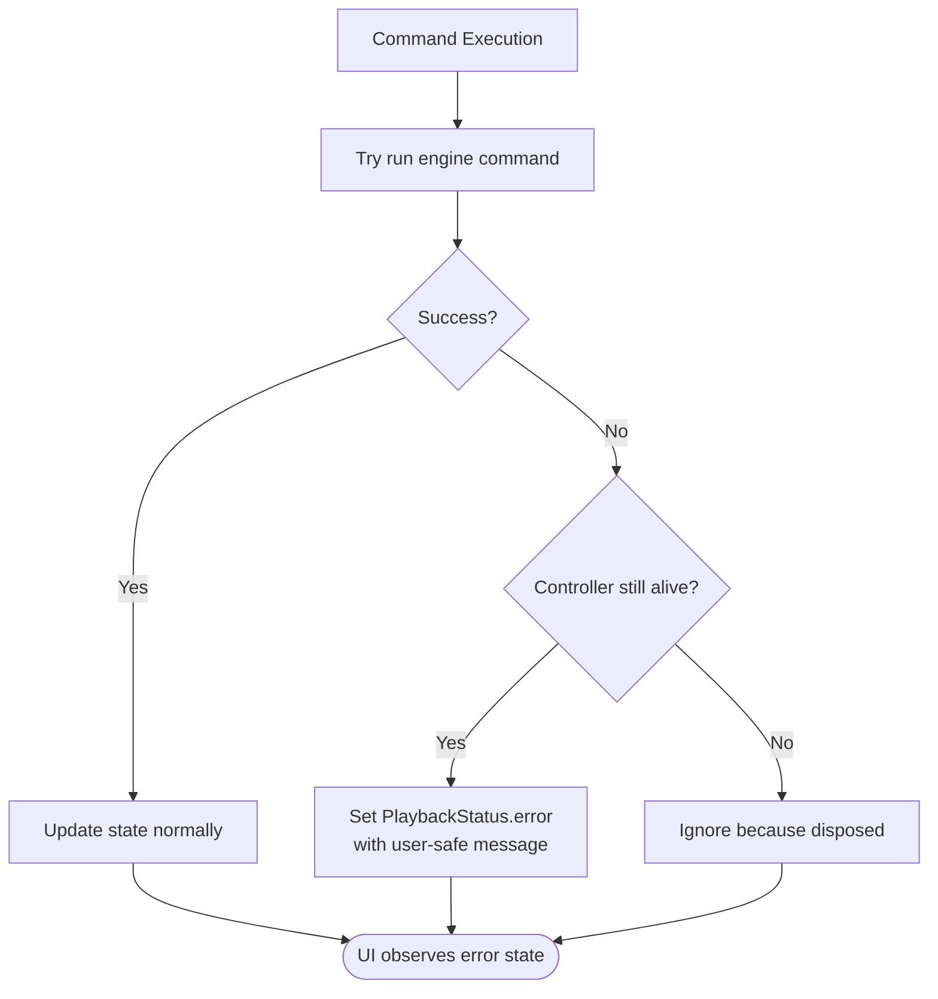
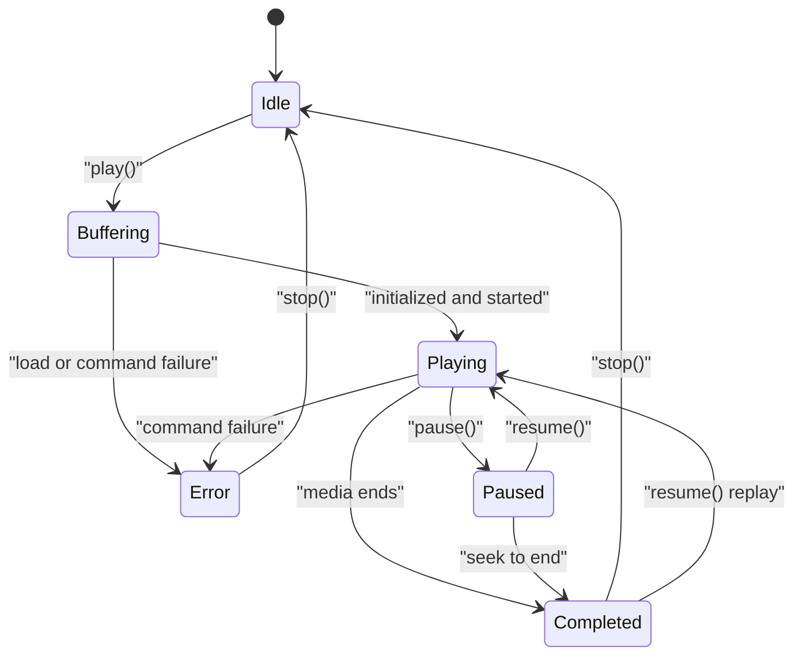
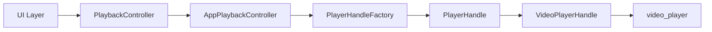

# Playback Controller Interface

<cite>
**Referenced Files in This Document**
- [playback_controller.dart](file://lib/playback/playback_controller.dart)
- [app_playback_controller.dart](file://lib/playback/app_playback_controller.dart)
- [player_handle.dart](file://lib/playback/player_handle.dart)
- [video_player_handle.dart](file://lib/playback/video_player_handle.dart)
- [playback_provider.dart](file://lib/playback/playback_provider.dart)
- [playback_controls.dart](file://lib/features/player/playback_controls.dart)
</cite>

## Table of Contents
1. [Introduction](#introduction)
2. [Project Structure](#project-structure)
3. [Core Components](#core-components)
4. [Architecture Overview](#architecture-overview)
5. [Detailed Component Analysis](#detailed-component-analysis)
6. [Dependency Analysis](#dependency-analysis)
7. [Performance Considerations](#performance-considerations)
8. [Troubleshooting Guide](#troubleshooting-guide)
9. [Conclusion](#conclusion)

## Introduction
This document explains the `PlaybackController` interface and its surrounding playback architecture. The interface defines a stable, UI-facing contract for video playback operations while keeping player-engine details isolated behind an engine seam. It documents every public method, return behavior, parameter constraints, error-handling guarantees, and state management through the immutable `PlaybackState` value type. It also shows how the design prevents plugin-specific types from leaking into the UI layer and provides guidance for implementing custom playback controllers and integrating different player engines.

## Project Structure
The playback subsystem is organized around a small set of focused files:

| File | Responsibility |
| --- | --- |
| `playback_controller.dart` | Declares `PlaybackController`, `PlaybackState`, and `PlaybackStatus`. |
| `app_playback_controller.dart` | Implements the controller’s state machine and command logic. |
| `player_handle.dart` | Declares the engine seam (`PlayerHandle`, `PlayerSnapshot`, `PlaybackKind`). |
| `video_player_handle.dart` | Implements the default engine adapter using `video_player`. |
| `playback_provider.dart` | Provides the controller and handle factory through Riverpod. |
| `playback_controls.dart` | Example UI consumer that interacts only with `PlaybackController`. |

**Diagram sources**
- [playback_provider.dart:12-27](file://lib/playback/playback_provider.dart#L12-L27)
- [app_playback_controller.dart:23-27](file://lib/playback/app_playback_controller.dart#L23-L27)
- [player_handle.dart:77-114](file://lib/playback/player_handle.dart#L77-L114)
- [video_player_handle.dart:19-109](file://lib/playback/video_player_handle.dart#L19-L109)

**Section sources**
- [playback_controller.dart:1-150](file://lib/playback/playback_controller.dart#L1-L150)
- [playback_provider.dart:1-27](file://lib/playback/playback_provider.dart#L1-L27)

## Core Components
The core of the playback system is the `PlaybackController` interface. It exposes:

- A reactive `state` property typed as `ValueListenable<PlaybackState>`.
- Command methods for loading media and controlling playback.
- Lifecycle methods for stopping and disposing resources.

The interface deliberately uses application-level types such as `PlayableSource`, `PlaybackState`, and `PlaybackStatus`. It never references a concrete player package, so the UI can observe and control playback without importing engine-specific code.

Key responsibilities:
- State observation: UI subscribes to `state`.
- Command surface: UI calls `play`, `pause`, `resume`, `seekTo`, `skipForward`, `skipBackward`, `setSpeed`, `setVolume`, `stop`, and `dispose`.
- Error isolation: failures are surfaced as user-safe messages inside `PlaybackState.error`, not thrown to callers.

**Section sources**
- [playback_controller.dart:4-67](file://lib/playback/playback_controller.dart#L4-L67)

## Architecture Overview
The architecture separates three layers:

1. **UI Layer**: Watches `PlaybackController.state` and invokes commands.
2. **Controller Layer**: Owns the playback state machine, validates inputs, applies preferences, and coordinates lifecycle.
3. **Engine Seam**: `PlayerHandle` abstracts the underlying player; `VideoPlayerHandle` implements it for the default engine.

**Diagram sources**
- [playback_controller.dart:15-149](file://lib/playback/playback_controller.dart#L15-L149)
- [app_playback_controller.dart:23-48](file://lib/playback/app_playback_controller.dart#L23-L48)
- [player_handle.dart:42-114](file://lib/playback/player_handle.dart#L42-L114)
- [video_player_handle.dart:19-109](file://lib/playback/video_player_handle.dart#L19-L109)

## Detailed Component Analysis

### PlaybackController Interface Contract
`PlaybackController` is the single source of truth for playback operations. Its contract includes:

| Method | Parameters | Return Type | Behavioral Contract |
| --- | --- | --- | --- |
| `play` | `source` of type `PlayableSource` | `Future<void>` | Loads and begins playback. Stops any previously loaded source before starting the new one. Rapid successive calls are safe; only the newest load remains active. Failures do not throw; they become `PlaybackStatus.error` with a user-safe message. |
| `pause` | None | `Future<void>` | Pauses playback. No-op when already paused or idle. Also no-op in terminal states such as completed or error. |
| `resume` | None | `Future<void>` | Resumes from a paused position. If the previous playback completed, it replays from the start. No-op when already playing. |
| `seekTo` | `position` of type `Duration` | `Future<void>` | Seeks to the requested position. Ignored when the source does not support seeking. |
| `skipForward` | `delta` of type `Duration` | `Future<void>` | Skips forward by `delta`, clamped to the stream duration. |
| `skipBackward` | `delta` of type `Duration` | `Future<void>` | Skips backward by `delta`, clamped to zero. |
| `setSpeed` | `speed` of type `double` | `Future<void>` | Sets playback speed. Zero or negative values are ignored. Typical range is approximately 0.25–2.0. |
| `setVolume` | `volume` of type `double` | `Future<void>` | Sets audio volume in the 0.0–1.0 range. Out-of-range values are clamped. Volume preference carries across sources. |
| `stop` | None | `Future<void>` | Stops playback and releases the current player resource. The controller remains usable for later `play` calls. |
| `dispose` | None | `Future<void>` | Releases all resources held by this controller. Terminal: the controller must not be used after disposal. |

Important guarantees:
- `state` is a `ValueListenable<PlaybackState>` that notifies listeners on every meaningful change.
- Errors are represented by `PlaybackStatus.error` and a user-safe `PlaybackState.error` message. Raw engine diagnostics and sensitive source details are never written into the state.
- Commands are asynchronous but generally do not throw to callers; errors are normalized into state.

**Section sources**
- [playback_controller.dart:15-67](file://lib/playback/playback_controller.dart#L15-L67)

### PlaybackState and PlaybackStatus
`PlaybackState` is an immutable snapshot representing the controller at a point in time. Every meaningful change produces a new instance, enabling value-based comparison in widgets.

| Field | Type | Meaning |
| --- | --- | --- |
| `status` | `PlaybackStatus` | Current lifecycle phase. |
| `position` | `Duration` | Current playback position. |
| `duration` | `Duration` | Media duration when available. |
| `speed` | `double` | Current playback speed. |
| `volume` | `double` | Current volume (0.0–1.0), carried across sources. |
| `canSeek` | `bool` | Whether the loaded source supports seeking. |
| `error` | `String?` | User-safe error message when `status` is `error`. |

Convenience getters include `isPlaying`, `isPaused`, `isBuffering`, and `hasError`. Equality and hash code compare all fields, making it suitable for widget rebuild optimization.

`PlaybackStatus` enumerates the lifecycle phases:

| Status | Meaning |
| --- | --- |
| `idle` | No source loaded. |
| `buffering` | Source is loading or buffering. |
| `playing` | Actively playing. |
| `paused` | Paused by user or external event. |
| `completed` | Reached the end of the media. |
| `error` | An unrecoverable error stopped playback. |

**Section sources**
- [playback_controller.dart:73-149](file://lib/playback/playback_controller.dart#L73-L149)

### AppPlaybackController Implementation
`AppPlaybackController` implements `PlaybackController` and owns the playback state machine. It:

- Validates the source scheme before touching the engine.
- Tears down the previous handle before loading a new source.
- Transitions through `idle → buffering → playing` during normal playback.
- Applies persisted user preferences (`speed`, `volume`) to the new engine.
- Uses a generation counter to discard stale completions from rapid `play()` calls.
- Converts engine errors into user-safe `PlaybackStatus.error` messages.
- Exposes `state` as a `ValueNotifier<PlaybackState>`.

**Diagram sources**
- [app_playback_controller.dart:57-135](file://lib/playback/app_playback_controller.dart#L57-L135)
- [app_playback_controller.dart:137-205](file://lib/playback/app_playback_controller.dart#L137-L205)

**Section sources**
- [app_playback_controller.dart:8-48](file://lib/playback/app_playback_controller.dart#L8-L48)
- [app_playback_controller.dart:57-135](file://lib/playback/app_playback_controller.dart#L57-L135)
- [app_playback_controller.dart:137-205](file://lib/playback/app_playback_controller.dart#L137-L205)

### Engine Seam: PlayerHandle and VideoPlayerHandle
`PlayerHandle` is the narrow seam between the app-owned controller and a concrete player engine. It exposes:

- `snapshot`: an immutable `PlayerSnapshot` describing engine state.
- `changes`: a stream emitting whenever engine state may have changed.
- Lifecycle and control methods: `initialize`, `play`, `pause`, `seekTo`, `setVolume`, `setSpeed`, `dispose`.

`VideoPlayerHandle` implements `PlayerHandle` for the default `video_player` engine. It routes schemes (`content`, `file`, `network`) to appropriate engine constructors and translates engine callbacks into `PlayerSnapshot` updates. Only this file imports the player package, preserving the boundary.

**Diagram sources**
- [playback_provider.dart:21-27](file://lib/playback/playback_provider.dart#L21-L27)
- [app_playback_controller.dart:82-135](file://lib/playback/app_playback_controller.dart#L82-L135)
- [player_handle.dart:77-114](file://lib/playback/player_handle.dart#L77-L114)
- [video_player_handle.dart:19-109](file://lib/playback/video_player_handle.dart#L19-L109)

**Section sources**
- [player_handle.dart:3-34](file://lib/playback/player_handle.dart#L3-L34)
- [player_handle.dart:36-114](file://lib/playback/player_handle.dart#L36-L114)
- [video_player_handle.dart:8-18](file://lib/playback/video_player_handle.dart#L8-L18)
- [video_player_handle.dart:19-109](file://lib/playback/video_player_handle.dart#L19-L109)

### UI Integration and Plugin Isolation
The UI consumes `PlaybackController` through a provider. It watches `state` and calls command methods. It never imports the player package directly. This separation ensures that changing the underlying engine requires no UI changes.

**Diagram sources**
- [playback_provider.dart:16-27](file://lib/playback/playback_provider.dart#L16-L27)
- [playback_controls.dart:10-11](file://lib/features/player/playback_controls.dart#L10-L11)
- [playback_controls.dart:43-53](file://lib/features/player/playback_controls.dart#L43-L53)

**Section sources**
- [playback_provider.dart:16-27](file://lib/playback/playback_provider.dart#L16-L27)
- [playback_controls.dart:10-11](file://lib/features/player/playback_controls.dart#L10-L11)
- [playback_controls.dart:43-53](file://lib/features/player/playback_controls.dart#L43-L53)

### Method-by-Method Behavior and Edge Cases

#### play(source)
- Validates the source scheme before creating a handle.
- Rejects unsupported schemes with a user-safe error state.
- Tears down the previous handle and transitions to buffering.
- Creates a handle, initializes it, applies speed and volume, then starts playback.
- Reduces the engine snapshot to `PlaybackState`.
- Ignores stale generations caused by rapid successive calls.

**Section sources**
- [app_playback_controller.dart:57-135](file://lib/playback/app_playback_controller.dart#L57-L135)
- [player_handle.dart:21-34](file://lib/playback/player_handle.dart#L21-L34)

#### pause()
- No-op when disposed or no handle exists.
- No-op in terminal states: idle, paused, completed, error.
- Calls the engine’s pause when in buffering or playing.

**Section sources**
- [app_playback_controller.dart:211-229](file://lib/playback/app_playback_controller.dart#L211-L229)

#### resume()
- No-op when disposed or no handle exists.
- If completed, seeks to zero and plays again (replay).
- Otherwise, resumes only when exactly paused.

**Section sources**
- [app_playback_controller.dart:231-248](file://lib/playback/app_playback_controller.dart#L231-L248)

#### seekTo(position)
- No-op when disposed, no handle, or source does not support seeking.
- No-op in idle or error states.
- Delegates to the engine in buffering, playing, paused, or completed states.

**Section sources**
- [app_playback_controller.dart:250-268](file://lib/playback/app_playback_controller.dart#L250-L268)

#### skipForward(delta)
- Ignores non-positive deltas.
- Clamps target position to the stream duration.
- Delegates to `seekTo`.

**Section sources**
- [app_playback_controller.dart:270-280](file://lib/playback/app_playback_controller.dart#L270-L280)

#### skipBackward(delta)
- Ignores non-positive deltas.
- Clamps target position to zero.
- Delegates to `seekTo`.

**Section sources**
- [app_playback_controller.dart:282-292](file://lib/playback/app_playback_controller.dart#L282-L292)

#### setSpeed(speed)
- Ignores disposed controllers and non-positive speeds.
- Updates internal speed preference and publishes a new `PlaybackState`.
- Applies the speed to the engine if a handle exists.

**Section sources**
- [app_playback_controller.dart:294-315](file://lib/playback/app_playback_controller.dart#L294-L315)

#### setVolume(volume)
- Ignores disposed controllers.
- Clamps volume to 0.0–1.0.
- Publishes a new `PlaybackState` immediately so UI reflects the preference even before a source loads.
- Applies the volume to the engine if a handle exists.

**Section sources**
- [app_playback_controller.dart:317-338](file://lib/playback/app_playback_controller.dart#L317-L338)

#### stop()
- Increments generation and tears down the handle.
- Resets seeking capability.
- Returns to idle while preserving speed and volume preferences.

**Section sources**
- [app_playback_controller.dart:340-353](file://lib/playback/app_playback_controller.dart#L340-L353)

#### dispose()
- Marks the controller disposed.
- Increments generation and tears down the handle.
- Disposes the underlying notifier.

**Section sources**
- [app_playback_controller.dart:355-364](file://lib/playback/app_playback_controller.dart#L355-L364)

### Error Handling Patterns
Errors follow consistent rules:

- Unsupported source schemes are rejected early with a precise, user-safe message.
- Engine initialization and command failures are caught and converted into `PlaybackStatus.error`.
- Raw engine error text is kept separate from the UI-facing state.
- Disposal and teardown failures are handled quietly to avoid surfacing cleanup noise as playback errors.

**Diagram sources**
- [app_playback_controller.dart:386-400](file://lib/playback/app_playback_controller.dart#L386-L400)
- [app_playback_controller.dart:413-420](file://lib/playback/app_playback_controller.dart#L413-L420)

**Section sources**
- [app_playback_controller.dart:29-34](file://lib/playback/app_playback_controller.dart#L29-L34)
- [app_playback_controller.dart:372-420](file://lib/playback/app_playback_controller.dart#L372-L420)

### State Management Through PlaybackState
`PlaybackState` is the single source of truth for UI rendering:

- Immutable snapshots enable predictable diffing and rebuild behavior.
- Convenience booleans simplify conditional UI logic.
- `canSeek` drives whether seek controls are enabled.
- `error` is shown only when `hasError` is true.
- `volume` persists across sources, allowing global volume control.

**Diagram sources**
- [app_playback_controller.dart:76-80](file://lib/playback/app_playback_controller.dart#L76-L80)
- [app_playback_controller.dart:145-205](file://lib/playback/app_playback_controller.dart#L145-L205)
- [app_playback_controller.dart:340-353](file://lib/playback/app_playback_controller.dart#L340-L353)

**Section sources**
- [playback_controller.dart:73-128](file://lib/playback/playback_controller.dart#L73-L128)
- [app_playback_controller.dart:145-205](file://lib/playback/app_playback_controller.dart#L145-L205)

## Dependency Analysis
The playback layer has clear boundaries:

- `PlaybackController` depends only on Flutter foundation types and application-level source types.
- `AppPlaybackController` depends on `PlayerHandleFactory`, not on a specific engine.
- `VideoPlayerHandle` is the only file that imports the player package.
- The UI depends only on `PlaybackController` and `PlaybackState`.

**Diagram sources**
- [playback_controller.dart:1-15](file://lib/playback/playback_controller.dart#L1-L15)
- [app_playback_controller.dart:1-6](file://lib/playback/app_playback_controller.dart#L1-L6)
- [video_player_handle.dart:1-6](file://lib/playback/video_player_handle.dart#L1-L6)

**Section sources**
- [playback_controller.dart:1-15](file://lib/playback/playback_controller.dart#L1-L15)
- [video_player_handle.dart:8-18](file://lib/playback/video_player_handle.dart#L8-L18)

## Performance Considerations
- **Immutable state**: `PlaybackState` instances are compared by value, reducing unnecessary rebuilds.
- **Generation counter**: Prevents stale engine callbacks from overwriting newer state after rapid `play()` calls.
- **Immediate preference updates**: `setVolume` and `setSpeed` publish state immediately, improving perceived responsiveness.
- **Clamping and validation**: Input validation avoids expensive or invalid engine calls.
- **Quiet teardown**: Disposal and teardown failures are swallowed to avoid noisy logs and spurious error states.

[No sources needed since this section provides general guidance]

## Troubleshooting Guide
Common issues and their likely causes:

| Symptom | Likely Cause | Resolution |
| --- | --- | --- |
| `play()` fails immediately with an error state | Unsupported source scheme | Verify the URI scheme is supported (`content`, `file`, `http`, `https`). |
| Seeking is disabled | Source does not support seeking or controller is idle/error | Check `PlaybackState.canSeek`; ensure a valid source is loaded. |
| Skipping has no effect | Non-positive delta or unsupported seeking | Ensure delta is positive and `canSeek` is true. |
| Speed change has no effect | Non-positive speed value | Use a positive speed value within engine-supported range. |
| Volume slider jumps back | Volume not clamped or engine not applied | Ensure volume is in 0.0–1.0 and a handle exists. |
| UI shows generic error | Engine initialization or command failure | Inspect logs separately; do not display raw engine error text. |
| Stale state after rapid play calls | Generation mismatch | Rely on the controller’s built-in generation guard; avoid calling `play` too rapidly without user intent. |

**Section sources**
- [app_playback_controller.dart:29-34](file://lib/playback/app_playback_controller.dart#L29-L34)
- [app_playback_controller.dart:372-420](file://lib/playback/app_playback_controller.dart#L372-L420)

## Conclusion
The `PlaybackController` interface provides a clean, testable, and engine-agnostic contract for video playback. It isolates UI concerns from player implementation details, enforces safe error handling, and manages state through immutable snapshots. By routing engine interactions through `PlayerHandle`, the project can swap or extend player engines without affecting the UI. Implementers should focus on `PlaybackState` semantics, input validation, and user-safe error messages when building custom controllers or adapters.

[No sources needed since this section summarizes without analyzing specific files]