# Playback State Management

<cite>
**Referenced Files in This Document**
- [playback_controller.dart](file://lib/playback/playback_controller.dart)
- [app_playback_controller.dart](file://lib/playback/app_playback_controller.dart)
- [playback_controls.dart](file://lib/features/player/playback_controls.dart)
- [app_playback_controller_test.dart](file://test/unit/playback/app_playback_controller_test.dart)
</cite>

## Table of Contents
1. [Introduction](#introduction)
2. [Project Structure](#project-structure)
3. [Core Components](#core-components)
4. [Architecture Overview](#architecture-overview)
5. [Detailed Component Analysis](#detailed-component-analysis)
6. [Dependency Analysis](#dependency-analysis)
7. [Performance Considerations](#performance-considerations)
8. [Troubleshooting Guide](#troubleshooting-guide)
9. [Conclusion](#conclusion)

## Introduction
This document explains the playback state management system built around `PlaybackState` and `PlaybackStatus`. The design uses an immutable state pattern: every meaningful change produces a new `PlaybackState` instance, and UI components react to those changes through `ValueListenable`. The controller encapsulates the player lifecycle, maps engine snapshots into user-facing states, and guarantees that errors are surfaced as safe messages rather than exceptions.

The goal is to help both developers and reviewers understand:
- What playback states exist and how they transition.
- How immutability and value equality enable efficient Flutter rebuilds.
- How UI components consume playback state reactively.
- How error states are produced and displayed without leaking sensitive details.

## Project Structure
The playback subsystem lives under `lib/playback`, while the UI integration for controls lives under `lib/features/player`. Tests for the controller live under `test/unit/playback`.

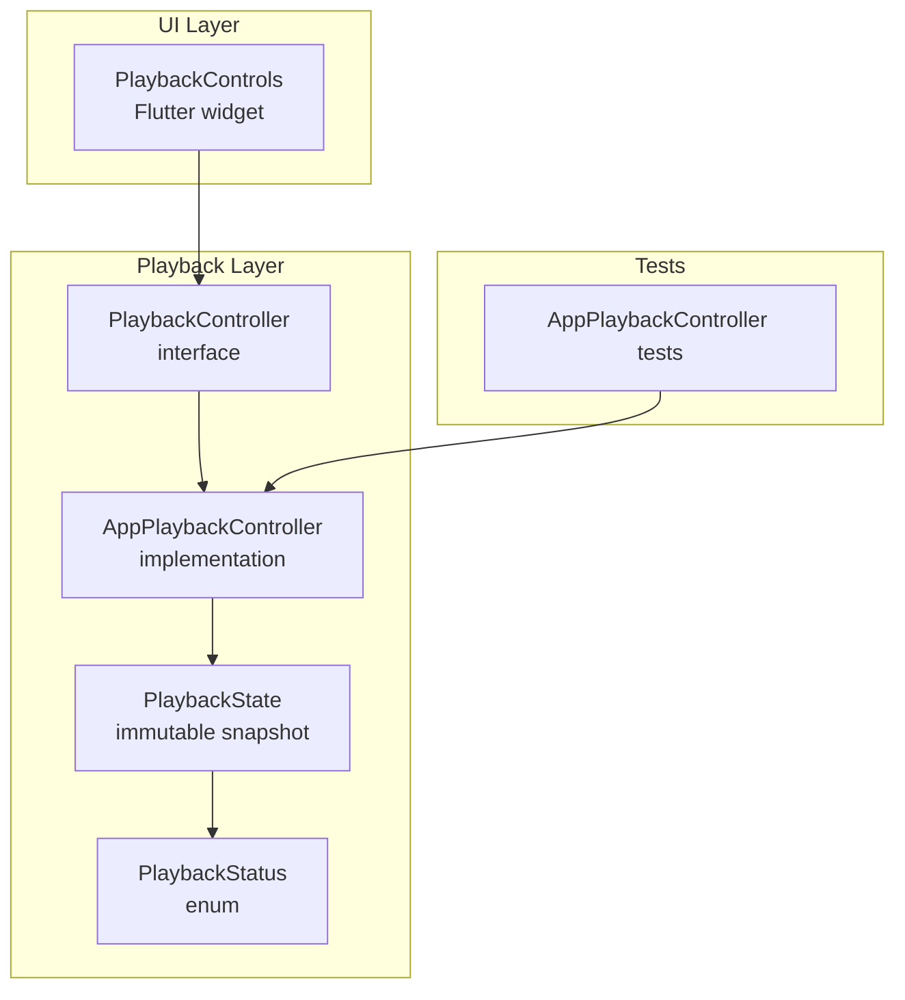

**Diagram sources**
- [playback_controller.dart:15-67](file://lib/playback/playback_controller.dart#L15-L67)
- [playback_controller.dart:77-149](file://lib/playback/playback_controller.dart#L77-L149)
- [app_playback_controller.dart:23-51](file://lib/playback/app_playback_controller.dart#L23-L51)
- [playback_controls.dart:20-48](file://lib/features/player/playback_controls.dart#L20-L48)
- [app_playback_controller_test.dart:247-289](file://test/unit/playback/app_playback_controller_test.dart#L247-L289)

**Section sources**
- [playback_controller.dart:1-149](file://lib/playback/playback_controller.dart#L1-L149)
- [app_playback_controller.dart:1-51](file://lib/playback/app_playback_controller.dart#L1-L51)
- [playback_controls.dart:1-48](file://lib/features/player/playback_controls.dart#L1-L48)
- [app_playback_controller_test.dart:247-289](file://test/unit/playback/app_playback_controller_test.dart#L247-L289)

## Core Components
- `PlaybackController`: App-owned interface that exposes reactive playback state and command methods such as play, pause, resume, seek, skip, set speed, set volume, stop, and dispose. It documents that failures never throw; they become `PlaybackStatus.error` with a user-safe message.
- `PlaybackState`: Immutable snapshot containing status, position, duration, speed, volume, canSeek, and optional error. It provides convenience getters like `isPlaying`, `isPaused`, `isBuffering`, and `hasError`. Equality and hash code compare all fields so widgets rebuild only when values change.
- `PlaybackStatus`: Enumerates the six lifecycle states: idle, buffering, playing, paused, completed, and error.
- `AppPlaybackController`: Concrete implementation backed by a `PlayerHandleFactory`. It owns the state machine, applies user preferences across sources, handles rapid successive loads safely, and maps engine snapshots to stable `PlaybackState` instances.

Key responsibilities:
- Expose `state` as a `ValueListenable<PlaybackState>` so UI can subscribe reactively.
- Convert engine events into new immutable `PlaybackState` objects.
- Keep error messages generic and safe for users.
- Preserve user preferences (speed, volume) across source changes.

**Section sources**
- [playback_controller.dart:15-67](file://lib/playback/playback_controller.dart#L15-L67)
- [playback_controller.dart:77-149](file://lib/playback/playback_controller.dart#L77-L149)
- [app_playback_controller.dart:8-51](file://lib/playback/app_playback_controller.dart#L8-L51)

## Architecture Overview
The architecture separates concerns between the app-owned controller and the underlying player engine:

- The UI layer consumes `PlaybackController.state` via `ValueListenableBuilder`.
- `AppPlaybackController` translates engine snapshots into `PlaybackState`.
- Engine-specific types stay behind `PlayerHandle`; no plugin types leak into the UI.
- Errors are normalized into user-safe messages before reaching the UI.

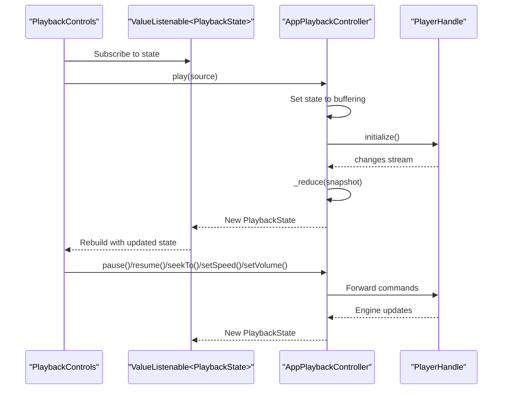

**Diagram sources**
- [playback_controls.dart:42-48](file://lib/features/player/playback_controls.dart#L42-L48)
- [app_playback_controller.dart:57-135](file://lib/playback/app_playback_controller.dart#L57-L135)
- [app_playback_controller.dart:137-205](file://lib/playback/app_playback_controller.dart#L137-L205)

## Detailed Component Analysis

### Immutable State Design Pattern
`PlaybackState` is designed as an immutable snapshot:
- All fields are final.
- Every meaningful change creates a new instance.
- Equality compares all fields, including status, position, duration, speed, volume, canSeek, and error.
- A static `idle` constant provides a default state.

This enables efficient widget rebuilds:
- Flutter compares old and new `PlaybackState` instances using `==`.
- If nothing changed, widgets do not rebuild unnecessarily.
- When any field changes, a new instance is created and listeners update.

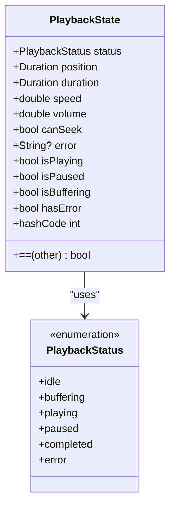

**Diagram sources**
- [playback_controller.dart:77-128](file://lib/playback/playback_controller.dart#L77-L128)
- [playback_controller.dart:131-149](file://lib/playback/playback_controller.dart#L131-L149)

**Section sources**
- [playback_controller.dart:77-128](file://lib/playback/playback_controller.dart#L77-L128)

### Playback States and Transitions
The six states represent the full lifecycle:

- idle: No source loaded.
- buffering: Source is loading or buffering.
- playing: Actively playing.
- paused: Paused by user or audio focus.
- completed: Reached the end of media.
- error: Unrecoverable error stopped playback.

Typical transitions:
- idle → buffering: When `play()` starts loading a source.
- buffering → playing: After initialization and successful start.
- playing → paused: User pauses or audio focus event.
- paused → playing: User resumes.
- playing → completed: Media finishes.
- Any state → error: Unsupported scheme, load failure, or engine command failure.

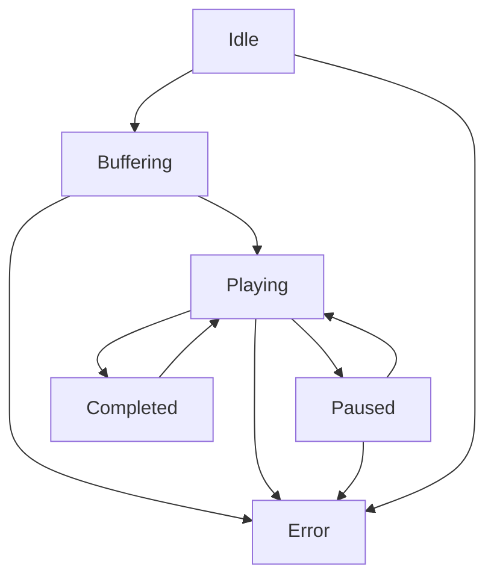

**Diagram sources**
- [app_playback_controller.dart:57-135](file://lib/playback/app_playback_controller.dart#L57-L135)
- [app_playback_controller.dart:211-248](file://lib/playback/app_playback_controller.dart#L211-L248)
- [app_playback_controller.dart:340-353](file://lib/playback/app_playback_controller.dart#L340-L353)

**Section sources**
- [playback_controller.dart:131-149](file://lib/playback/playback_controller.dart#L131-L149)
- [app_playback_controller.dart:57-135](file://lib/playback/app_playback_controller.dart#L57-L135)
- [app_playback_controller.dart:211-248](file://lib/playback/app_playback_controller.dart#L211-L248)
- [app_playback_controller.dart:340-353](file://lib/playback/app_playback_controller.dart#L340-L353)

### Reactive UI Updates with ValueListenable
The UI subscribes to `PlaybackController.state`, which is a `ValueListenable<PlaybackState>`. In `PlaybackControls`, `ValueListenableBuilder` rebuilds only when the state changes.

Key behaviors:
- Transport buttons are disabled in idle and error states.
- Seek slider and skip buttons are disabled unless `canSeek` is true and transport is enabled.
- While dragging the slider, local drag position is shown to avoid fighting engine ticks.
- Play/pause icon reflects `isPlaying` or `isBuffering`.
- Volume and speed sliders reflect current state and call controller commands.

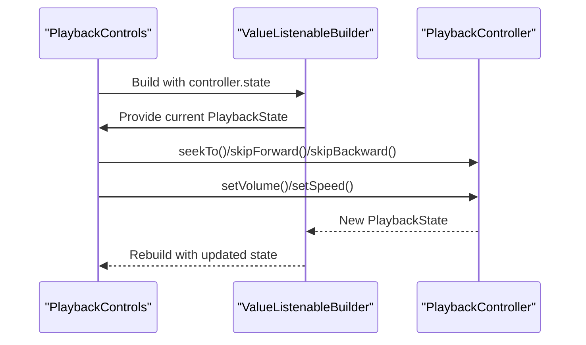

**Diagram sources**
- [playback_controls.dart:42-48](file://lib/features/player/playback_controls.dart#L42-L48)
- [playback_controls.dart:57-67](file://lib/features/player/playback_controls.dart#L57-L67)
- [playback_controls.dart:100-116](file://lib/features/player/playback_controls.dart#L100-L116)
- [playback_controls.dart:130-142](file://lib/features/player/playback_controls.dart#L130-L142)
- [playback_controls.dart:154-195](file://lib/features/player/playback_controls.dart#L154-L195)

**Section sources**
- [playback_controls.dart:42-48](file://lib/features/player/playback_controls.dart#L42-L48)
- [playback_controls.dart:57-67](file://lib/features/player/playback_controls.dart#L57-L67)
- [playback_controls.dart:100-116](file://lib/features/player/playback_controls.dart#L100-L116)
- [playback_controls.dart:130-142](file://lib/features/player/playback_controls.dart#L130-L142)
- [playback_controls.dart:154-195](file://lib/features/player/playback_controls.dart#L154-L195)

### State Comparison Logic and Equality Checking
`PlaybackState` overrides equality and hash code to compare all fields:
- Status
- Position
- Duration
- Speed
- Volume
- CanSeek
- Error

This ensures:
- Widgets rebuild only when relevant data changes.
- Idle state reuse works efficiently because the static `idle` instance is compared by identity first.
- Error messages are included in equality so changing from one error to another triggers a rebuild.

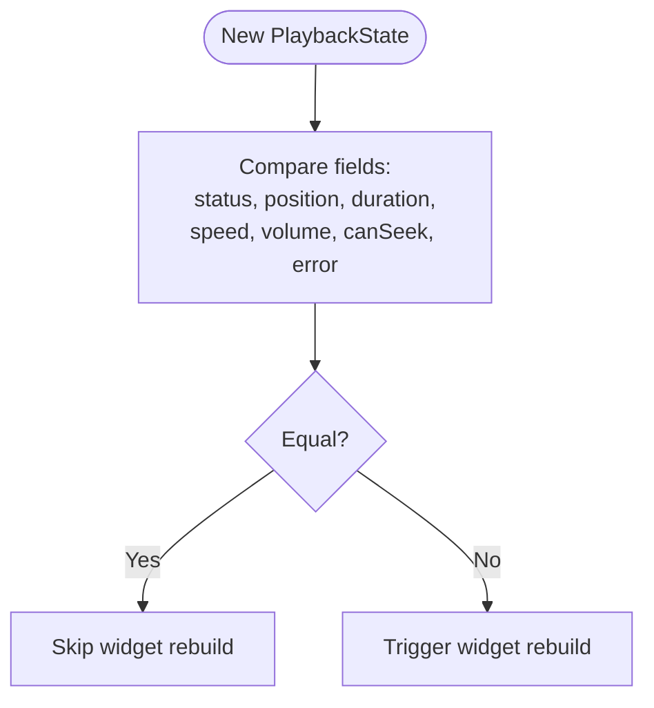

**Diagram sources**
- [playback_controller.dart:113-127](file://lib/playback/playback_controller.dart#L113-L127)

**Section sources**
- [playback_controller.dart:113-127](file://lib/playback/playback_controller.dart#L113-L127)

### Consuming Playback State in UI Components
`PlaybackControls` demonstrates best practices:
- Read `controller.state` through `ValueListenableBuilder`.
- Gate transport actions based on `state.status`.
- Disable seeking when `!state.canSeek`.
- Display `state.error` as a user-friendly message.
- Use `state.isPlaying`, `state.isBuffering`, and `state.volume` to render icons and sliders.
- Call controller commands instead of manipulating player internals.

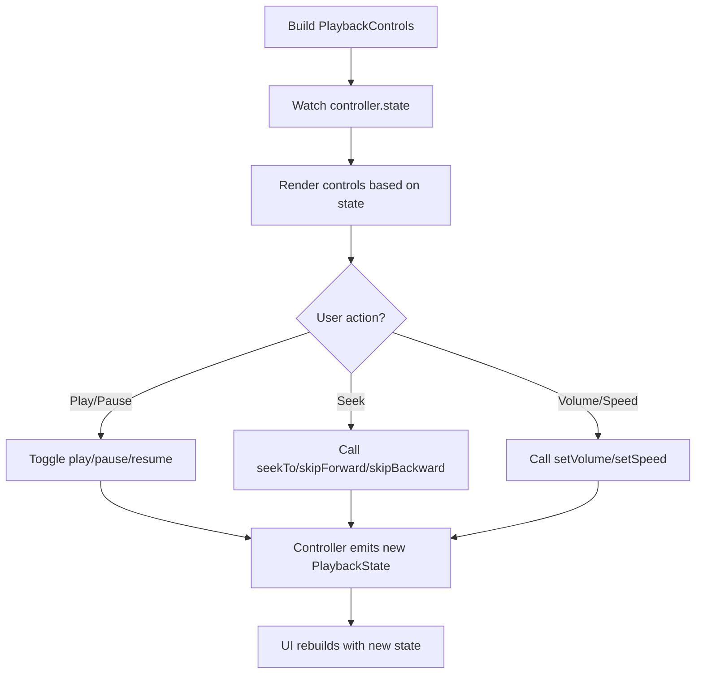

**Diagram sources**
- [playback_controls.dart:42-48](file://lib/features/player/playback_controls.dart#L42-L48)
- [playback_controls.dart:57-67](file://lib/features/player/playback_controls.dart#L57-L67)
- [playback_controls.dart:87-95](file://lib/features/player/playback_controls.dart#L87-L95)
- [playback_controls.dart:100-116](file://lib/features/player/playback_controls.dart#L100-L116)
- [playback_controls.dart:130-142](file://lib/features/player/playback_controls.dart#L130-L142)
- [playback_controls.dart:154-195](file://lib/features/player/playback_controls.dart#L154-L195)

**Section sources**
- [playback_controls.dart:42-48](file://lib/features/player/playback_controls.dart#L42-L48)
- [playback_controls.dart:57-67](file://lib/features/player/playback_controls.dart#L57-L67)
- [playback_controls.dart:87-95](file://lib/features/player/playback_controls.dart#L87-L95)
- [playback_controls.dart:100-116](file://lib/features/player/playback_controls.dart#L100-L116)
- [playback_controls.dart:130-142](file://lib/features/player/playback_controls.dart#L130-L142)
- [playback_controls.dart:154-195](file://lib/features/player/playback_controls.dart#L154-L195)

### Error State Handling and Messaging Strategy
Errors are handled consistently:
- Unsupported schemes produce a specific but safe message.
- Load failures produce a generic “could not load” message.
- Playback command failures produce a generic “cannot be played” message.
- Engine error text is replaced with a fixed user-safe message.
- Raw engine diagnostics and source URIs never enter the state or logs.

The controller centralizes error creation through `_errorState`, ensuring:
- `PlaybackStatus.error` is always paired with a safe message.
- `canSeek` becomes false in error state.
- Position and duration are preserved where appropriate.

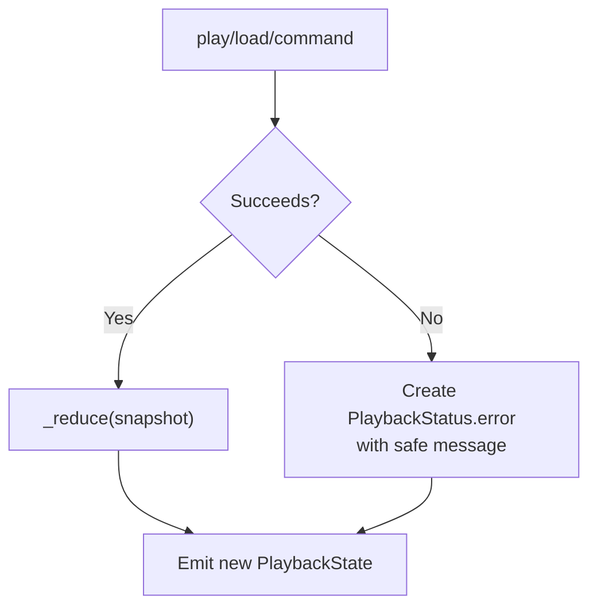

**Diagram sources**
- [app_playback_controller.dart:57-135](file://lib/playback/app_playback_controller.dart#L57-L135)
- [app_playback_controller.dart:145-205](file://lib/playback/app_playback_controller.dart#L145-L205)
- [app_playback_controller.dart:372-400](file://lib/playback/app_playback_controller.dart#L372-L400)

**Section sources**
- [app_playback_controller.dart:29-34](file://lib/playback/app_playback_controller.dart#L29-L34)
- [app_playback_controller.dart:57-135](file://lib/playback/app_playback_controller.dart#L57-L135)
- [app_playback_controller.dart:145-205](file://lib/playback/app_playback_controller.dart#L145-L205)
- [app_playback_controller.dart:372-400](file://lib/playback/app_playback_controller.dart#L372-L400)

### State Transition Flow for Key Operations

#### Play Lifecycle
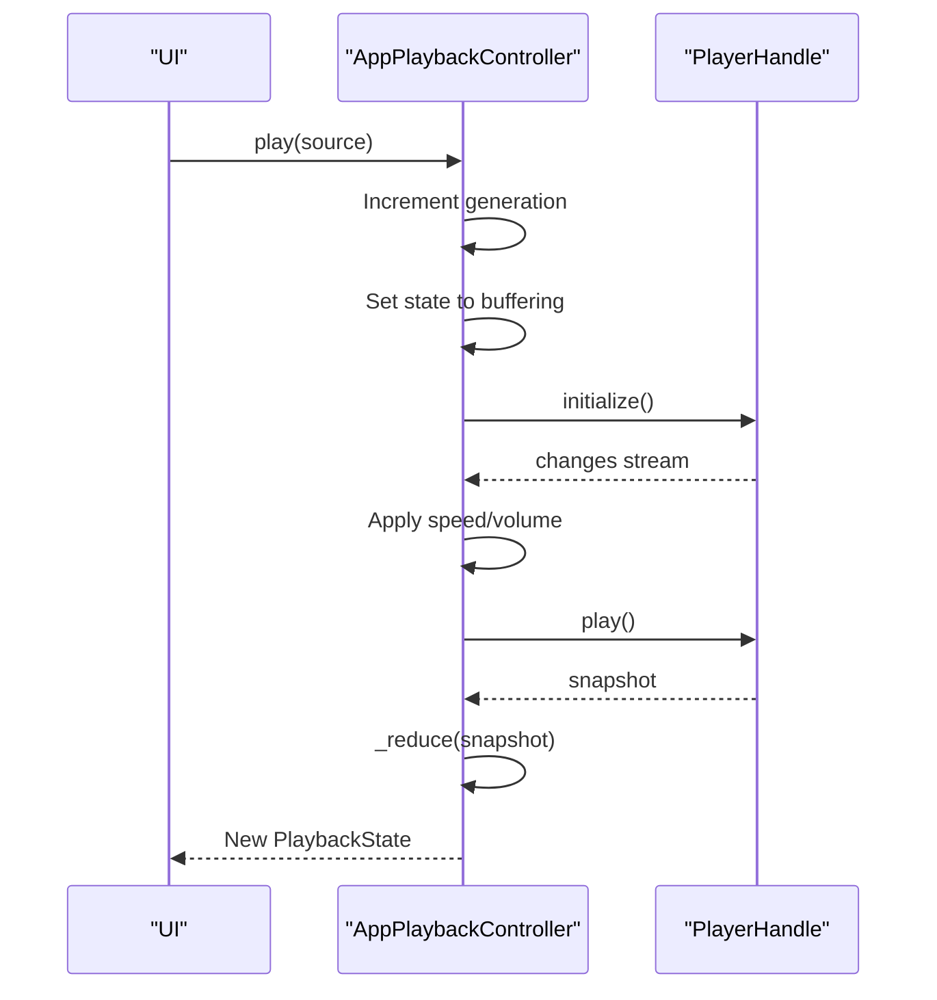

**Diagram sources**
- [app_playback_controller.dart:57-135](file://lib/playback/app_playback_controller.dart#L57-L135)
- [app_playback_controller.dart:137-205](file://lib/playback/app_playback_controller.dart#L137-L205)

#### Pause and Resume
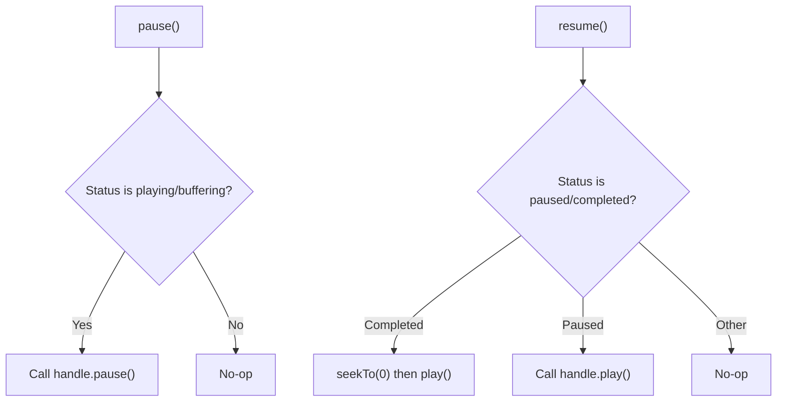

**Diagram sources**
- [app_playback_controller.dart:211-248](file://lib/playback/app_playback_controller.dart#L211-L248)

#### Seek and Skip
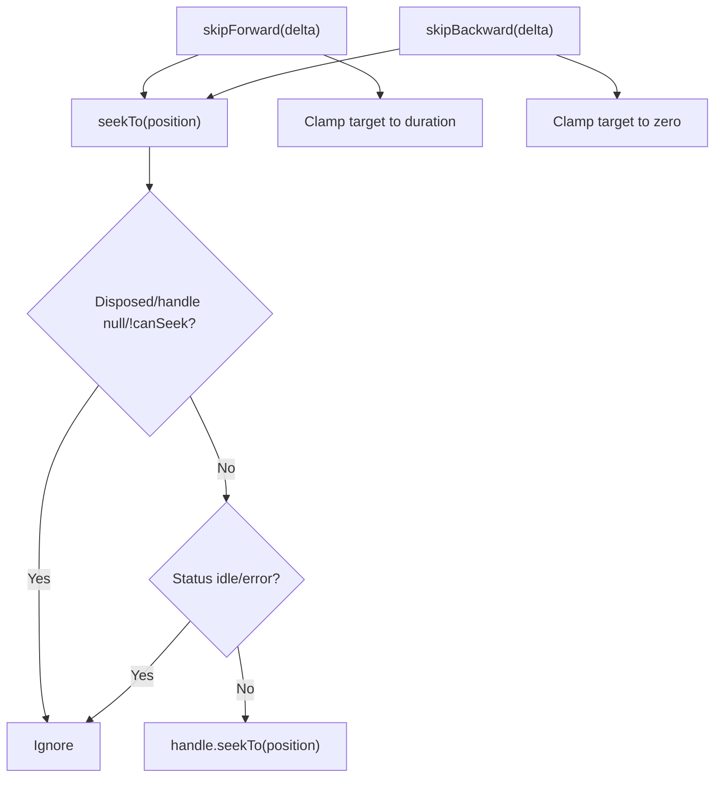

**Diagram sources**
- [app_playback_controller.dart:250-292](file://lib/playback/app_playback_controller.dart#L250-L292)

## Dependency Analysis
The playback layer depends on:
- Flutter foundation types (`ValueNotifier`, `ValueListenable`).
- Application source abstraction (`PlayableSource`, `PlaybackKind`).
- Player handle abstraction (`PlayerHandle`, `PlayerSnapshot`).

The UI layer depends on:
- `PlaybackController` interface.
- Riverpod provider for obtaining the controller.
- Flutter Material widgets for controls.

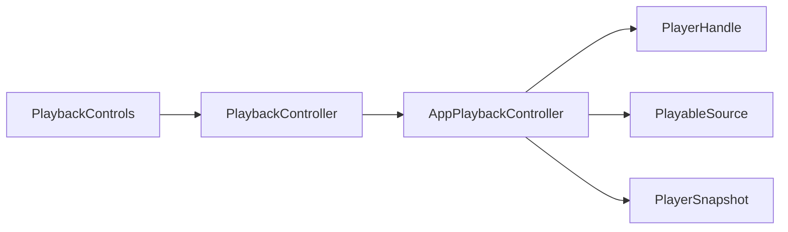

**Diagram sources**
- [playback_controller.dart:15-67](file://lib/playback/playback_controller.dart#L15-L67)
- [app_playback_controller.dart:1-6](file://lib/playback/app_playback_controller.dart#L1-L6)
- [playback_controls.dart:1-5](file://lib/features/player/playback_controls.dart#L1-L5)

**Section sources**
- [playback_controller.dart:15-67](file://lib/playback/playback_controller.dart#L15-L67)
- [app_playback_controller.dart:1-6](file://lib/playback/app_playback_controller.dart#L1-L6)
- [playback_controls.dart:1-5](file://lib/features/player/playback_controls.dart#L1-L5)

## Performance Considerations
- Immutability reduces unnecessary rebuilds because Flutter compares `PlaybackState` instances by value.
- Using `ValueListenableBuilder` scopes rebuilds to widgets that actually read `PlaybackState`.
- Avoid storing mutable player state in widgets; always derive UI from `PlaybackState`.
- Prefer controller commands over direct engine manipulation to keep state consistent.
- Rapid successive `play()` calls are safe due to generation counters; stale work is discarded.

[No sources needed since this section provides general guidance]

## Troubleshooting Guide
Common issues and resolutions:

- UI does not update after play():
  - Ensure the widget listens to `controller.state` via `ValueListenableBuilder`.
  - Verify that `play()` completes and `_reduce` emits a new `PlaybackState`.

- Seek slider does not respond:
  - Check `state.canSeek`; it is false while idle and after errors.
  - Confirm the source supports seeking.

- Error message appears unexpectedly:
  - Inspect unsupported schemes, initialization failures, or command failures.
  - Remember that raw engine errors are replaced with safe messages.

- Volume or speed changes do not persist:
  - The controller carries `_volume` and `_speed` across sources.
  - Ensure commands are called through the controller, not directly on the engine.

**Section sources**
- [playback_controls.dart:57-67](file://lib/features/player/playback_controls.dart#L57-L67)
- [playback_controls.dart:87-95](file://lib/features/player/playback_controls.dart#L87-L95)
- [app_playback_controller.dart:57-135](file://lib/playback/app_playback_controller.dart#L57-L135)
- [app_playback_controller.dart:250-292](file://lib/playback/app_playback_controller.dart#L250-L292)
- [app_playback_controller.dart:372-400](file://lib/playback/app_playback_controller.dart#L372-L400)

## Conclusion
The playback state management system uses an immutable `PlaybackState` model and a `PlaybackStatus` enum to represent a clear, testable lifecycle. `AppPlaybackController` centralizes state transitions, normalizes errors into user-safe messages, and exposes reactive state through `ValueListenable`. UI components like `PlaybackControls` consume this state efficiently, enabling responsive controls while keeping player internals hidden. This design promotes correctness, performance, and maintainability across the video playback feature.

[No sources needed since this section summarizes without analyzing specific files]