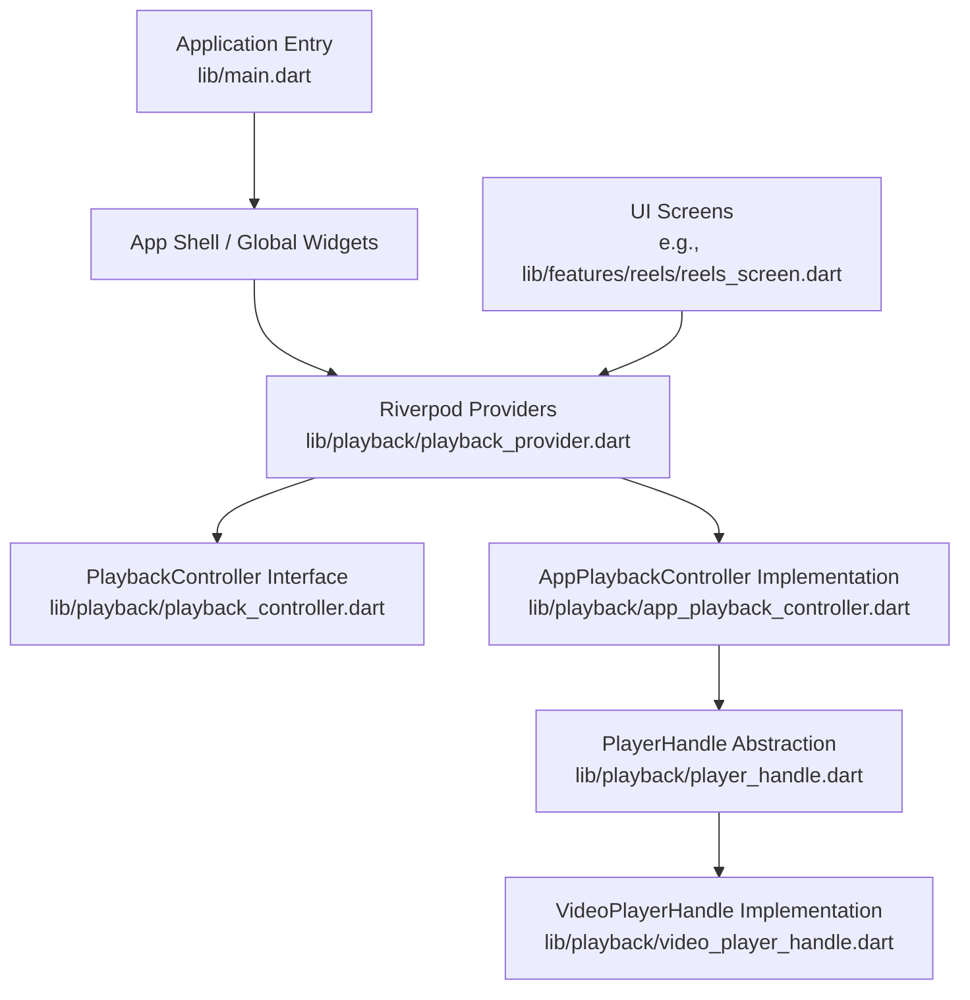
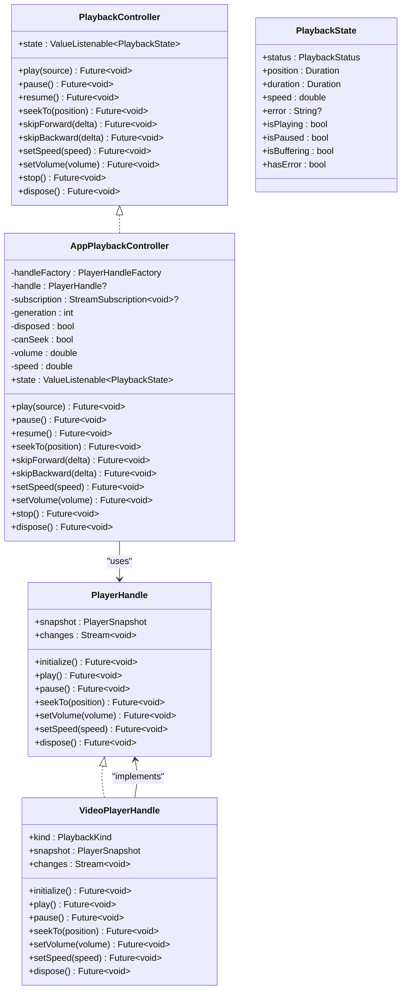
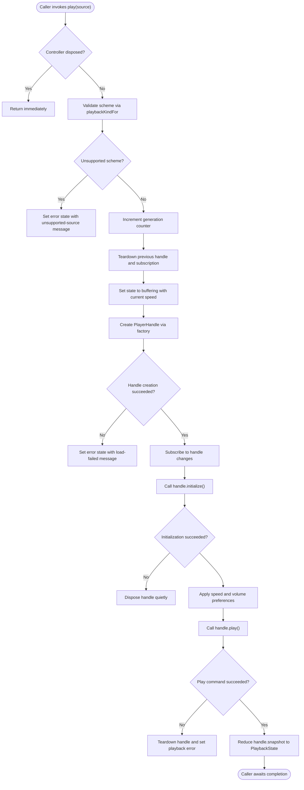
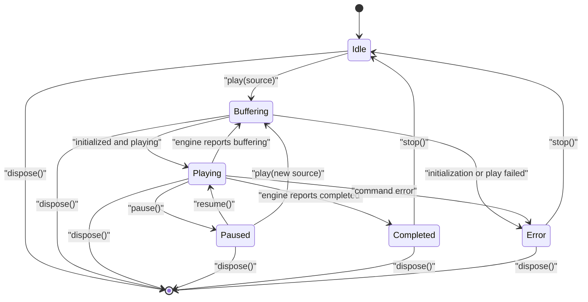
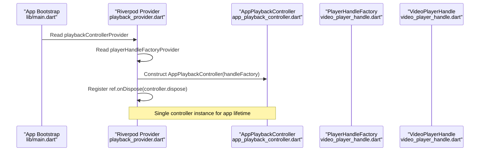
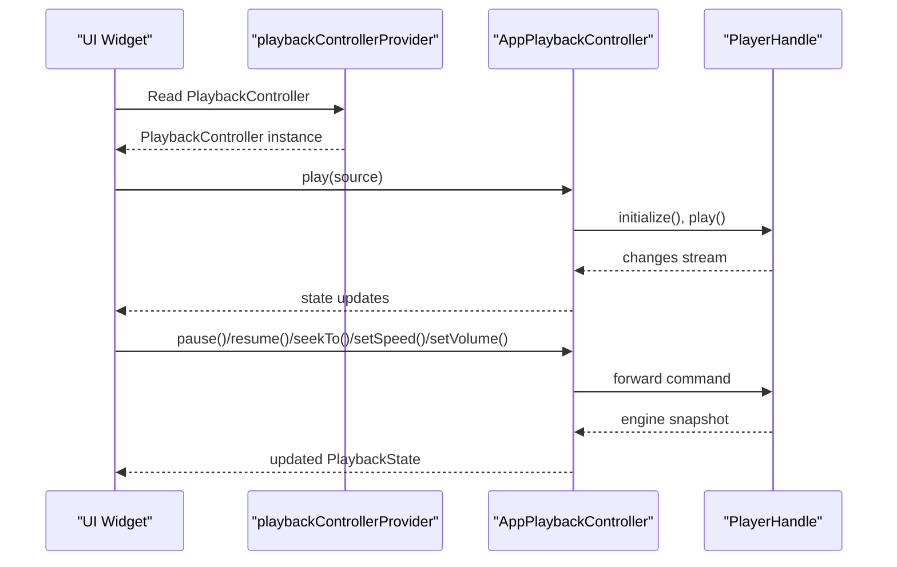
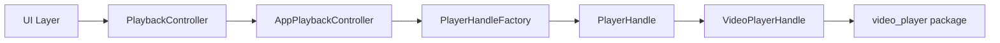

# Playback System

<cite>
**Referenced Files in This Document**
- [playback_controller.dart](file://lib/playback/playback_controller.dart)
- [app_playback_controller.dart](file://lib/playback/app_playback_controller.dart)
- [player_handle.dart](file://lib/playback/player_handle.dart)
- [video_player_handle.dart](file://lib/playback/video_player_handle.dart)
- [playback_provider.dart](file://lib/playback/playback_provider.dart)
- [main.dart](file://lib/main.dart)
- [reels_screen.dart](file://lib/features/reels/reels_screen.dart)
- [app_playback_controller_test.dart](file://test/unit/playback/app_playback_controller_test.dart)
- [video_player_handle_test.dart](file://test/unit/playback/video_player_handle_test.dart)
</cite>

## Table of Contents
1. [Introduction](#introduction)
2. [Project Structure](#project-structure)
3. [Core Components](#core-components)
4. [Architecture Overview](#architecture-overview)
5. [Detailed Component Analysis](#detailed-component-analysis)
6. [Dependency Analysis](#dependency-analysis)
7. [Performance Considerations](#performance-considerations)
8. [Troubleshooting Guide](#troubleshooting-guide)
9. [Conclusion](#conclusion)
10. [Appendices](#appendices)

## Introduction
This document explains the playback system architecture for the video streaming application. It focuses on how the app abstracts a native or plugin-based video player behind a stable interface, manages playback lifecycle and state, coordinates multiple sources safely, and integrates with UI components through dependency injection.

The system is designed so that:
- The UI never imports the underlying video player package directly.
- All engine-specific behavior is confined to a small abstraction layer.
- Playback errors are user-safe and never expose raw diagnostics or source URLs.
- Rapid user interactions (such as quickly switching videos) are handled without race conditions.
- Resources are cleaned up deterministically when controllers stop or dispose.

## Project Structure
The playback system lives under `lib/playback` and is wired into the app through Riverpod providers. The main entry point initializes error handling and runs the Flutter app; the playback controller is provided globally for UI layers to consume.

**Diagram sources**
- [main.dart:8-32](file://lib/main.dart#L8-L32)
- [playback_provider.dart:12-27](file://lib/playback/playback_provider.dart#L12-L27)
- [playback_controller.dart:15-66](file://lib/playback/playback_controller.dart#L15-L66)
- [app_playback_controller.dart:23-27](file://lib/playback/app_playback_controller.dart#L23-L27)
- [player_handle.dart:84-114](file://lib/playback/player_handle.dart#L84-L114)
- [video_player_handle.dart:19-41](file://lib/playback/video_player_handle.dart#L19-L41)
- [reels_screen.dart:1-16](file://lib/features/reels/reels_screen.dart#L1-L16)

**Section sources**
- [main.dart:8-32](file://lib/main.dart#L8-L32)
- [playback_provider.dart:12-27](file://lib/playback/playback_provider.dart#L12-L27)

## Core Components
The playback system is built around four core abstractions:

| Component | Responsibility | Key Contract |
|---|---|---|
| `PlaybackController` | Public API for playback commands and state observation | Commands like `play`, `pause`, `resume`, `seekTo`, `skipForward`, `skipBackward`, `setSpeed`, `setVolume`, `stop`, `dispose`; exposes `state` |
| `PlaybackState` | Immutable snapshot of playback status, position, duration, speed, and optional error message | Used by UI widgets to rebuild reactively |
| `PlayerHandle` | Narrow seam between the app-owned controller and a concrete player engine | Provides snapshots, change events, initialization, playback commands, and disposal |
| `VideoPlayerHandle` | Concrete implementation using the `video_player` package | Maps supported schemes (`content`, `file`, `http(s)`) to the underlying controller |

Additional supporting types:
- `PlaybackKind`: Classification of URI schemes used to select the correct engine constructor.
- `PlayerSnapshot`: Engine-level view of initialized, playing, buffering, completed, position, duration, speed, volume, and raw error text.
- `PlayerHandleFactory`: Factory function used to create a handle for a resolved playable source.

**Section sources**
- [playback_controller.dart:15-136](file://lib/playback/playback_controller.dart#L15-L136)
- [player_handle.dart:3-114](file://lib/playback/player_handle.dart#L3-L114)
- [video_player_handle.dart:19-109](file://lib/playback/video_player_handle.dart#L19-L109)

## Architecture Overview
The playback architecture separates concerns across three layers:

1. **UI Layer**: Observes `PlaybackController.state` and calls command methods. It does not import the video player package.
2. **Controller Layer**: `AppPlaybackController` owns the playback state machine, applies user preferences, handles rapid successive loads, and converts engine events into safe UI state.
3. **Engine Layer**: `PlayerHandle` abstracts the player engine; `VideoPlayerHandle` implements it using `video_player`.

**Diagram sources**
- [playback_controller.dart:15-136](file://lib/playback/playback_controller.dart#L15-L136)
- [app_playback_controller.dart:23-382](file://lib/playback/app_playback_controller.dart#L23-L382)
- [player_handle.dart:36-114](file://lib/playback/player_handle.dart#L36-L114)
- [video_player_handle.dart:19-109](file://lib/playback/video_player_handle.dart#L19-L109)

## Detailed Component Analysis

### PlaybackController Interface
`PlaybackController` is the single public contract for playback. It exposes:
- A reactive `state` property.
- Lifecycle and control commands.
- Guarantees that failures do not throw to callers but instead surface as an error state with a user-safe message.

Important behaviors:
- `play()` stops any previously loaded source before loading the new one.
- Rapid successive `play()` calls are safe; only the newest load remains active.
- Unsupported schemes are rejected early with a user-safe error.
- Volume and speed preferences are carried across sources.

**Diagram sources**
- [app_playback_controller.dart:57-131](file://lib/playback/app_playback_controller.dart#L57-L131)
- [player_handle.dart:21-34](file://lib/playback/player_handle.dart#L21-L34)

**Section sources**
- [playback_controller.dart:15-66](file://lib/playback/playback_controller.dart#L15-L66)
- [app_playback_controller.dart:57-131](file://lib/playback/app_playback_controller.dart#L57-L131)

### AppPlaybackController Implementation
`AppPlaybackController` is the app-owned implementation of `PlaybackController`. It:
- Owns the state machine and reduces engine snapshots into `PlaybackState`.
- Manages a single active `PlayerHandle` at a time.
- Uses a monotonic generation counter to discard stale completions from rapid `play()` calls.
- Carries user preferences for speed and volume across sources.
- Converts all engine errors into safe error states rather than throwing.

Key responsibilities:
- **Lifecycle management**: `play`, `stop`, `dispose`.
- **Command routing**: `pause`, `resume`, `seekTo`, `skipForward`, `skipBackward`, `setSpeed`, `setVolume`.
- **State reduction**: Mapping `PlayerSnapshot` fields to `PlaybackStatus`.
- **Error handling**: Replacing raw engine error text with fixed user-safe messages.
- **Resource cleanup**: Cancelling subscriptions, disposing handles, and preventing use after disposal.

**Diagram sources**
- [app_playback_controller.dart:141-191](file://lib/playback/app_playback_controller.dart#L141-L191)
- [app_playback_controller.dart:197-327](file://lib/playback/app_playback_controller.dart#L197-L327)

**Section sources**
- [app_playback_controller.dart:23-382](file://lib/playback/app_playback_controller.dart#L23-L382)

### PlayerHandle Abstraction
`PlayerHandle` defines the narrow seam between the controller and the actual player engine. It provides:
- A snapshot of engine state.
- A stream of engine change notifications.
- Initialization and playback commands.
- Deterministic disposal.

`PlayerSnapshot` is immutable and carries both useful metadata and raw engine error text. The controller replaces raw error text with a user-safe message before exposing it through `PlaybackState.error`.

`PlaybackKind` classifies URIs into content, file, network, or unsupported schemes. This classification is shared between validation logic and engine construction.

**Section sources**
- [player_handle.dart:3-114](file://lib/playback/player_handle.dart#L3-L114)

### VideoPlayerHandle Implementation
`VideoPlayerHandle` is the only file allowed to import the underlying `video_player` package. It:
- Selects the appropriate `VideoPlayerController` constructor based on `PlaybackKind`.
- Subscribes to controller value changes and broadcasts them through a `StreamController<void>`.
- Exposes a `PlayerSnapshot` derived from the underlying controller’s value.
- Implements idempotent disposal by removing listeners, disposing the controller, and closing the broadcast stream.

Supported schemes:
- `content://`: MediaStore and SAF document URIs.
- `file://`: Local filesystem files.
- `http(s)://`: Remote network streams.

Unsupported schemes should be rejected earlier by the controller; if they reach this handle, a defensive error is thrown.

**Section sources**
- [video_player_handle.dart:1-110](file://lib/playback/video_player_handle.dart#L1-L110)

### Provider Wiring and Dependency Injection
The Riverpod provider layer wires the playback controller into the app:
- `playerHandleFactoryProvider` produces the default `videoPlayerHandleFactory`.
- `playbackControllerProvider` creates a single `AppPlaybackController` for the app lifetime.
- The provider registers `controller.dispose` on container disposal.

This design keeps the UI free of engine dependencies and makes testing straightforward by replacing the factory with a fake implementation.

**Diagram sources**
- [main.dart:8-32](file://lib/main.dart#L8-L32)
- [playback_provider.dart:12-27](file://lib/playback/playback_provider.dart#L12-L27)
- [app_playback_controller.dart:23-27](file://lib/playback/app_playback_controller.dart#L23-L27)
- [video_player_handle.dart:107-109](file://lib/playback/video_player_handle.dart#L107-L109)

**Section sources**
- [playback_provider.dart:12-27](file://lib/playback/playback_provider.dart#L12-L27)

### Playback State Management
`PlaybackState` is immutable and compared by value. Its status transitions are driven by `AppPlaybackController._reduce`, which maps `PlayerSnapshot` fields to `PlaybackStatus`:
- If the engine reports an error, the controller sets `PlaybackStatus.error` with a user-safe message.
- If the engine is not initialized, the state is `buffering`.
- If the engine reports completion, the state is `completed`.
- If the engine reports buffering, the state is `buffering`.
- If the engine reports playing, the state is `playing`.
- Otherwise, the state is `paused`.

Position, duration, speed, and optional error are included in every state snapshot.

**Section sources**
- [playback_controller.dart:72-136](file://lib/playback/playback_controller.dart#L72-L136)
- [app_playback_controller.dart:141-191](file://lib/playback/app_playback_controller.dart#L141-L191)

### Error Handling Strategies
The playback system uses layered error handling:
1. **Scheme validation**: Unsupported schemes are rejected before touching the engine.
2. **Handle creation errors**: Caught and converted to a load-failed error state.
3. **Initialization errors**: Caught, handle disposed quietly, and converted to a load-failed error state.
4. **Playback command errors**: Wrapped by `_runCommand`, which converts exceptions into an error state.
5. **Engine snapshot errors**: Raw `errorText` is replaced with a fixed user-safe message.
6. **Disposal errors**: Disposal failures are swallowed silently because there is no safe recovery path.

User-facing messages are intentionally generic and never include raw engine diagnostics or source URLs.

**Section sources**
- [app_playback_controller.dart:29-34](file://lib/playback/app_playback_controller.dart#L29-L34)
- [app_playback_controller.dart:57-131](file://lib/playback/app_playback_controller.dart#L57-L131)
- [app_playback_controller.dart:335-381](file://lib/playback/app_playback_controller.dart#L335-L381)

### Resource Cleanup Patterns
Resource cleanup follows deterministic patterns:
- Each `play()` call increments a generation counter and tears down the previous handle and subscription.
- Stale completions are ignored using `_isStale(generation)`.
- `_teardownHandle` cancels subscriptions, clears the active handle, resets seek capability, and disposes the old handle.
- `_disposeQuietly` catches disposal errors so cleanup failures do not become playback errors.
- `VideoPlayerHandle.dispose` removes listener callbacks, disposes the underlying controller, and closes the broadcast stream.
- `AppPlaybackController.dispose` marks the controller disposed, increments generation, tears down the handle, and then disposes the notifier.

**Section sources**
- [app_playback_controller.dart:318-381](file://lib/playback/app_playback_controller.dart#L318-L381)
- [video_player_handle.dart:95-104](file://lib/playback/video_player_handle.dart#L95-L104)

### Relationship Between Playback Controller and UI Components
The UI consumes playback through the `PlaybackController` interface and its reactive `state`. According to the provider documentation, UI components such as Phase 4 controls and Phase 6 Reels watch `PlaybackController.state` and call command methods through the provider. They never import the underlying video player package.

In the current codebase, the Reels screen is a placeholder for future integration, but the intended pattern is:
- UI reads `provider.read(playbackControllerProvider).state`.
- UI calls `play`, `pause`, `resume`, `seekTo`, `skipForward`, `skipBackward`, `setSpeed`, `setVolume`, or `stop`.
- UI reacts to state changes without managing player lifecycle directly.

**Diagram sources**
- [playback_provider.dart:16-27](file://lib/playback/playback_provider.dart#L16-L27)
- [app_playback_controller.dart:57-131](file://lib/playback/app_playback_controller.dart#L57-L131)
- [app_playback_controller.dart:197-305](file://lib/playback/app_playback_controller.dart#L197-L305)

**Section sources**
- [playback_provider.dart:16-27](file://lib/playback/playback_provider.dart#L16-L27)
- [reels_screen.dart:1-16](file://lib/features/reels/reels_screen.dart#L1-L16)

## Dependency Analysis
The playback system has clear boundaries:
- `PlaybackController` depends only on `PlayableSource` and Flutter’s `ValueNotifier`.
- `AppPlaybackController` depends on `PlayerHandleFactory`, `PlayerHandle`, and `PlayableSource`.
- `VideoPlayerHandle` is the only component that depends on `video_player`.
- Providers depend on both the controller and the handle factory.

**Diagram sources**
- [playback_controller.dart:1-3](file://lib/playback/playback_controller.dart#L1-L3)
- [app_playback_controller.dart:1-6](file://lib/playback/app_playback_controller.dart#L1-L6)
- [video_player_handle.dart:1-6](file://lib/playback/video_player_handle.dart#L1-L6)
- [playback_provider.dart:1-5](file://lib/playback/playback_provider.dart#L1-L5)

**Section sources**
- [playback_controller.dart:1-3](file://lib/playback/playback_controller.dart#L1-L3)
- [app_playback_controller.dart:1-6](file://lib/playback/app_playback_controller.dart#L1-L6)
- [video_player_handle.dart:1-6](file://lib/playback/video_player_handle.dart#L1-L6)
- [playback_provider.dart:1-5](file://lib/playback/playback_provider.dart#L1-L5)

## Performance Considerations
Based on the implementation, the playback system already includes several performance-oriented patterns:

- **Single active handle**: Only one `PlayerHandle` is active at a time, reducing memory pressure from multiple players.
- **Generation counter**: Rapid `play()` calls are safe; older loads are discarded and disposed, preventing redundant work.
- **Immediate state reflection**: After successful initialization and play, the controller reduces the engine snapshot immediately so awaiting callers observe the resulting status without waiting for an engine tick.
- **Preference caching**: Speed and volume are cached in the controller and reapplied to new handles, avoiding repeated configuration overhead.
- **Idempotent disposal**: Both `VideoPlayerHandle.dispose` and `AppPlaybackController.dispose` guard against double disposal.
- **Broadcast stream safety**: The handle’s change stream is closed during disposal, preventing leaks.

Recommended additional optimizations for smooth streaming and efficient memory usage:
- Debounce rapid seek or skip operations to avoid excessive engine calls.
- Avoid rebuilding large UI trees on every position update; throttle position updates for progress bars.
- Use lazy loading for video lists and preload only visible items.
- Monitor memory usage and dispose controllers when screens are destroyed.
- Prefer hardware-accelerated codecs where available through the underlying engine.

[No sources needed since this section provides general guidance]

## Troubleshooting Guide
Common issues and their likely causes:

| Symptom | Likely Cause | Resolution |
|---|---|---|
| Unsupported source error immediately after calling `play` | URI scheme is not `content`, `file`, `http`, or `https` | Validate the source before calling `play`; ensure the URI scheme is supported. |
| Load failed error | Engine could not initialize the source | Check network connectivity, file permissions, or media format support. |
| Playback failed error | Engine threw during play or command execution | Inspect logs separately; the UI shows a user-safe message. Verify source validity and engine compatibility. |
| No state updates after initialization | Handle subscription was torn down or controller disposed | Ensure the controller is still alive and the UI is subscribed to `PlaybackController.state`. |
| Memory grows when switching videos rapidly | Stale handles not disposed | Confirm that each `play()` call tears down the previous handle and that tests verify disposal. |
| Volume or speed not applied | Invalid values or handle not yet created | Clamp volume to `0.0–1.0`; ignore non-positive speeds; apply preferences only after a valid handle exists. |

Testing references:
- Unit tests for `AppPlaybackController` validate play behavior, engine-driven transitions, and error handling.
- Unit tests for `VideoPlayerHandle` simulate engine events and verify command invocation and disposal.

**Section sources**
- [app_playback_controller.dart:29-34](file://lib/playback/app_playback_controller.dart#L29-L34)
- [app_playback_controller.dart:57-131](file://lib/playback/app_playback_controller.dart#L57-L131)
- [app_playback_controller.dart:335-381](file://lib/playback/app_playback_controller.dart#L335-L381)
- [app_playback_controller_test.dart:136-291](file://test/unit/playback/app_playback_controller_test.dart#L136-L291)
- [video_player_handle_test.dart:29-78](file://test/unit/playback/video_player_handle_test.dart#L29-L78)

## Conclusion
The playback system cleanly separates UI concerns from engine specifics. `PlaybackController` provides a stable, testable API; `AppPlaybackController` owns lifecycle and state; `PlayerHandle` abstracts the engine; and `VideoPlayerHandle` confines `video_player` usage to one file. Errors are user-safe, resources are deterministically cleaned up, and rapid user interactions are handled safely through generation tracking. The Riverpod provider wiring enables global access while keeping the UI free of platform dependencies.

Future extensions can add new engines by implementing `PlayerHandle`, inject custom factories through providers, and extend the controller with advanced features while preserving the existing contracts.

[No sources needed since this section summarizes without analyzing specific files]

## Appendices

### Extending the Controller for Advanced Features
To add advanced playback behaviors:
1. Extend `AppPlaybackController` or wrap it with a decorator that implements `PlaybackController`.
2. Introduce new state fields in `PlaybackState` if the UI needs richer information.
3. Add new commands to `PlaybackController` and implement them in `AppPlaybackController`.
4. If the engine requires new capabilities, extend `PlayerHandle` and implement them in `VideoPlayerHandle`.
5. Wire new factories through `playerHandleFactoryProvider` for testing or alternate engines.

Example extension points:
- Custom buffering policies.
- Adaptive bitrate selection.
- Picture-in-picture or multi-window support.
- Analytics hooks around play, pause, seek, and error events.
- Accessibility enhancements such as audio description tracks.

[No sources needed since this section provides general guidance]