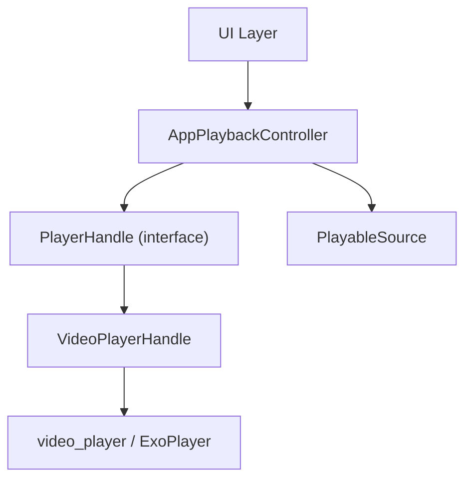
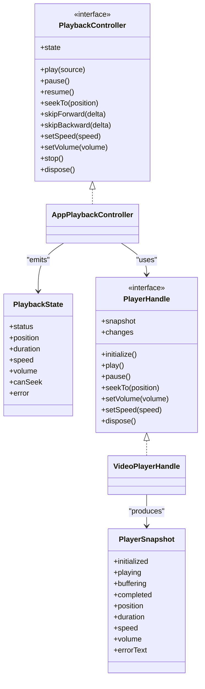
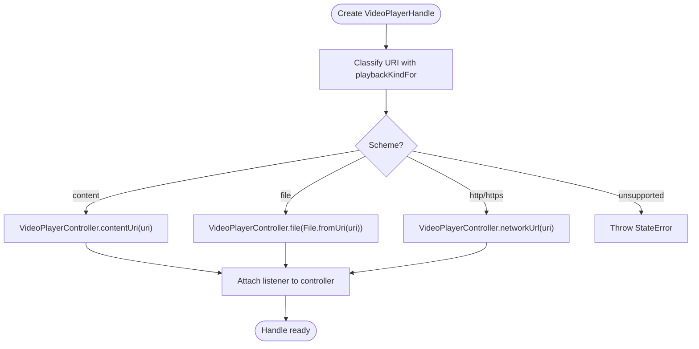
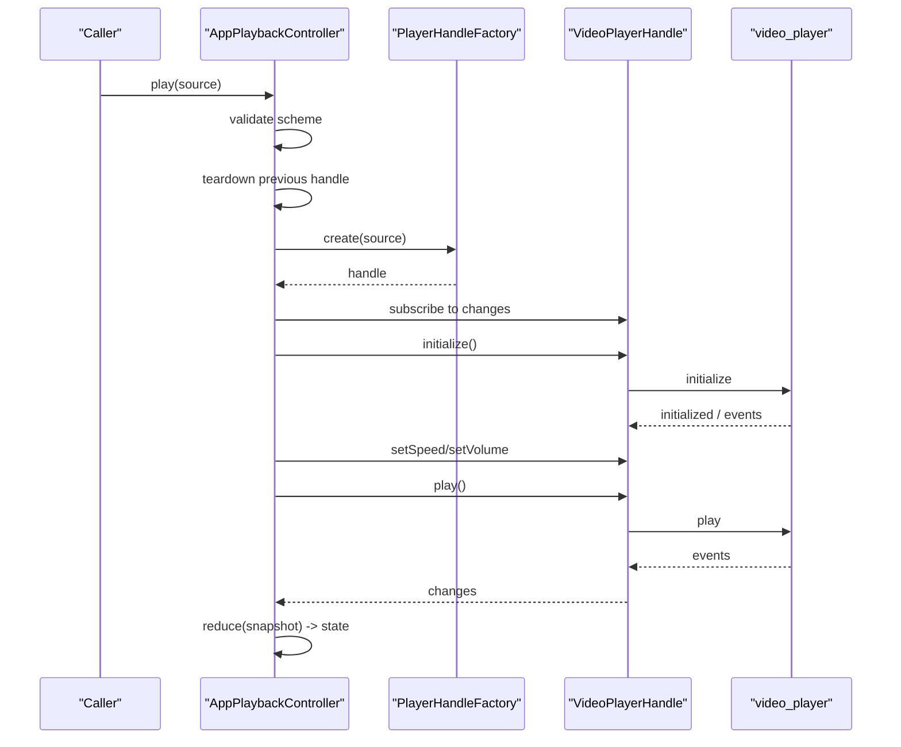
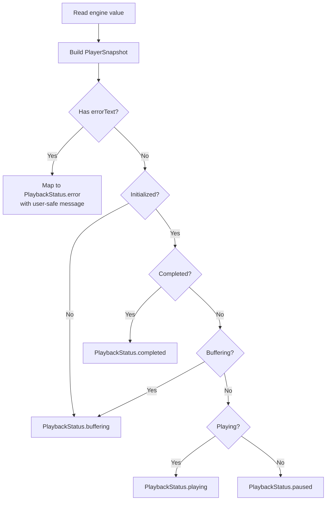
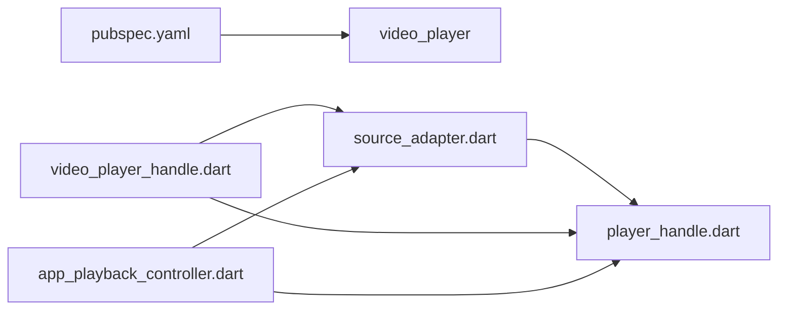

# Video Player Handle Abstraction

<cite>
**Referenced Files in This Document**
- [video_player_handle.dart](file://lib/playback/video_player_handle.dart)
- [player_handle.dart](file://lib/playback/player_handle.dart)
- [app_playback_controller.dart](file://lib/playback/app_playback_controller.dart)
- [playback_controller.dart](file://lib/playback/playback_controller.dart)
- [source_adapter.dart](file://lib/sources/source_adapter.dart)
- [pubspec.yaml](file://pubspec.yaml)
- [video_player_handle_test.dart](file://test/unit/playback/video_player_handle_test.dart)
</cite>

## Table of Contents
1. [Introduction](#introduction)
2. [Project Structure](#project-structure)
3. [Core Components](#core-components)
4. [Architecture Overview](#architecture-overview)
5. [Detailed Component Analysis](#detailed-component-analysis)
6. [Dependency Analysis](#dependency-analysis)
7. [Performance Considerations](#performance-considerations)
8. [Troubleshooting Guide](#troubleshooting-guide)
9. [Conclusion](#conclusion)

## Introduction
This document explains the `VideoPlayerHandle` abstraction that wraps the underlying video player engine (`video_player`, which uses Media3 ExoPlayer on Android). The abstraction provides a consistent interface for playback commands and state, isolating the rest of the application from engine-specific details. It also documents lifecycle management, resource allocation and cleanup, platform-specific scheme routing, performance considerations, extension points for new engines, debugging techniques, and troubleshooting guidance.

## Project Structure
The video playback layer is organized around a small set of focused files:
- `playback/player_handle.dart`: Defines the engine-agnostic `PlayerHandle` interface, `PlayerSnapshot`, and source classification helpers.
- `playback/video_player_handle.dart`: Implements `PlayerHandle` using the official `video_player` package.
- `playback/playback_controller.dart`: Declares the app-facing `PlaybackController` API and `PlaybackState`.
- `playback/app_playback_controller.dart`: Owns the playback state machine and coordinates with a `PlayerHandle`.
- `sources/source_adapter.dart`: Defines `PlayableSource`, the ephemeral playable URI/metadata passed to the handle.
- `pubspec.yaml`: Declares the `video_player` dependency and test-time platform interface used by tests.
- `test/unit/playback/video_player_handle_test.dart`: Validates scheme routing, snapshot mapping, command forwarding, and lifecycle behavior.

**Diagram sources**
- [app_playback_controller.dart:8-27](file://lib/playback/app_playback_controller.dart#L8-L27)
- [video_player_handle.dart:8-18](file://lib/playback/video_player_handle.dart#L8-L18)
- [player_handle.dart:77-109](file://lib/playback/player_handle.dart#L77-L109)

**Section sources**
- [video_player_handle.dart:1-109](file://lib/playback/video_player_handle.dart#L1-L109)
- [player_handle.dart:1-115](file://lib/playback/player_handle.dart#L1-L115)
- [app_playback_controller.dart:1-422](file://lib/playback/app_playback_controller.dart#L1-L422)
- [playback_controller.dart:1-150](file://lib/playback/playback_controller.dart#L1-L150)
- [source_adapter.dart:119-137](file://lib/sources/source_adapter.dart#L119-L137)
- [pubspec.yaml:9-18](file://pubspec.yaml#L9-L18)

## Core Components
- `PlayerHandle`: A narrow seam between the app-owned controller and a concrete player engine. It exposes current state via `snapshot`, change notifications via `changes`, and commands such as `initialize`, `play`, `pause`, `seekTo`, `setVolume`, `setSpeed`, and `dispose`.
- `PlayerSnapshot`: An immutable view of engine state at a point in time, including readiness, playing/buffering/completed flags, position/duration, speed, volume, and raw error text.
- `PlaybackKind` and `playbackKindFor`: Pure classification of URIs into supported schemes (`content`, `file`, `network`) or unsupported schemes.
- `VideoPlayerHandle`: Concrete implementation of `PlayerHandle` backed by `video_player`. It routes schemes to the appropriate controller constructor and maps engine events to `PlayerSnapshot`.
- `AppPlaybackController`: App-owned state machine that owns lifecycle, applies user preferences, handles rapid play calls safely, and surfaces user-safe errors.

Key responsibilities:
- `VideoPlayerHandle`: Engine binding, scheme routing, event-to-snapshot mapping, resource disposal.
- `AppPlaybackController`: State transitions, preference carryover, generation-based stale-load protection, safe error messaging.

**Section sources**
- [player_handle.dart:3-34](file://lib/playback/player_handle.dart#L3-L34)
- [player_handle.dart:36-75](file://lib/playback/player_handle.dart#L36-L75)
- [player_handle.dart:77-115](file://lib/playback/player_handle.dart#L77-L115)
- [video_player_handle.dart:19-109](file://lib/playback/video_player_handle.dart#L19-L109)
- [app_playback_controller.dart:8-27](file://lib/playback/app_playback_controller.dart#L8-L27)

## Architecture Overview
The architecture separates concerns across three layers:
- UI and app logic interact only with `PlaybackController` and `PlaybackState`.
- `AppPlaybackController` orchestrates lifecycle, state transitions, and user preferences.
- `PlayerHandle` abstracts the engine; `VideoPlayerHandle` implements it using `video_player`.

**Diagram sources**
- [playback_controller.dart:15-67](file://lib/playback/playback_controller.dart#L15-L67)
- [playback_controller.dart:77-128](file://lib/playback/playback_controller.dart#L77-L128)
- [player_handle.dart:77-109](file://lib/playback/player_handle.dart#L77-L109)
- [player_handle.dart:36-75](file://lib/playback/player_handle.dart#L36-L75)
- [app_playback_controller.dart:23-27](file://lib/playback/app_playback_controller.dart#L23-L27)
- [video_player_handle.dart:19-45](file://lib/playback/video_player_handle.dart#L19-L45)

## Detailed Component Analysis

### VideoPlayerHandle Implementation
`VideoPlayerHandle` is the only file in `lib/` that imports `package:video_player`. It:
- Classifies the source URI using `playbackKindFor`.
- Constructs the correct `VideoPlayerController` based on scheme:
  - `content://` → `VideoPlayerController.contentUri`
  - `file://` → `VideoPlayerController.file`
  - `http(s)://` → `VideoPlayerController.networkUrl`
  - Unsupported schemes throw early.
- Attaches a listener before initialization so the first state changes are observable through `changes`.
- Maps engine values to `PlayerSnapshot`, including readiness, playing/buffering/completed flags, position/duration, speed, volume, and raw error text.
- Forwards commands directly to the controller.
- Disposes idempotently: removes listener, disposes controller, closes stream.

**Diagram sources**
- [video_player_handle.dart:20-41](file://lib/playback/video_player_handle.dart#L20-L41)
- [player_handle.dart:21-34](file://lib/playback/player_handle.dart#L21-L34)

**Section sources**
- [video_player_handle.dart:19-45](file://lib/playback/video_player_handle.dart#L19-L45)
- [video_player_handle.dart:52-75](file://lib/playback/video_player_handle.dart#L52-L75)
- [video_player_handle.dart:77-104](file://lib/playback/video_player_handle.dart#L77-L104)

### Lifecycle and Resource Management
Lifecycle ownership:
- `AppPlaybackController.play`:
  - Rejects unsupported schemes early.
  - Tears down previous handle.
  - Creates a new handle via injected factory.
  - Subscribes to `handle.changes`.
  - Initializes the handle, applies speed/volume preferences, then plays.
  - Updates UI state from `handle.snapshot`.
- Stale load protection:
  - Uses a monotonic `_generation` counter to discard stale completions.
- Teardown:
  - Cancels subscription, clears handle reference, resets seeking capability, and disposes the handle quietly.

Resource cleanup:
- `VideoPlayerHandle.dispose`:
  - Idempotent guard prevents double disposal.
  - Removes listener, disposes controller, closes broadcast stream.

**Diagram sources**
- [app_playback_controller.dart:58-135](file://lib/playback/app_playback_controller.dart#L58-L135)
- [video_player_handle.dart:77-104](file://lib/playback/video_player_handle.dart#L77-L104)

**Section sources**
- [app_playback_controller.dart:58-135](file://lib/playback/app_playback_controller.dart#L58-L135)
- [app_playback_controller.dart:370-420](file://lib/playback/app_playback_controller.dart#L370-L420)
- [video_player_handle.dart:95-104](file://lib/playback/video_player_handle.dart#L95-L104)

### Snapshot Mapping and Error Handling
`VideoPlayerHandle.snapshot` reads the engine’s value and produces a `PlayerSnapshot`. Errors from the engine surface as `errorText` in the snapshot. `AppPlaybackController._reduce` converts snapshots to `PlaybackState`, replacing raw engine errors with user-safe messages and preserving position/duration where applicable.

**Diagram sources**
- [video_player_handle.dart:52-66](file://lib/playback/video_player_handle.dart#L52-L66)
- [app_playback_controller.dart:145-205](file://lib/playback/app_playback_controller.dart#L145-L205)

**Section sources**
- [video_player_handle.dart:52-66](file://lib/playback/video_player_handle.dart#L52-L66)
- [app_playback_controller.dart:145-205](file://lib/playback/app_playback_controller.dart#L145-L205)

### Platform-Specific Optimizations
- Android content URIs (`content://media/...` and SAF document URIs) are routed to the engine’s content resolver path, enabling efficient access to MediaStore and SAF-backed media without copying data.
- Local files use the engine’s file-based constructor, optimized for direct filesystem access.
- Network streams use the engine’s network URL constructor, leveraging platform networking stacks.

These choices minimize overhead and leverage platform capabilities exposed by the underlying engine.

**Section sources**
- [video_player_handle.dart:22-30](file://lib/playback/video_player_handle.dart#L22-L30)

### Extending the Abstraction to New Engines
To support a new player engine:
1. Implement `PlayerHandle` with your engine bindings.
2. Provide a `PlayerHandleFactory` that constructs your handle for a given `PlayableSource`.
3. Inject the factory into `AppPlaybackController`.

Guidelines:
- Keep scheme classification in `playbackKindFor`; do not duplicate scheme parsing logic.
- Map engine events to `PlayerSnapshot` consistently.
- Ensure `dispose` is idempotent and releases all resources.
- Forward commands faithfully and emit `changes` whenever engine state may have changed.

Example extension outline:
- Create `CustomPlayerHandle` implementing `PlayerHandle`.
- In `CustomPlayerHandle`, translate `PlayableSource.uri` to your engine’s data source type.
- Expose `customHandleFactory(source)` returning your handle.
- Wire `customHandleFactory` into `AppPlaybackController.handleFactory`.

[No sources needed since this section provides conceptual extension guidance]

## Dependency Analysis
The following diagram shows how components depend on each other:

**Diagram sources**
- [pubspec.yaml:9-18](file://pubspec.yaml#L9-L18)
- [source_adapter.dart:119-137](file://lib/sources/source_adapter.dart#L119-L137)
- [player_handle.dart:1-115](file://lib/playback/player_handle.dart#L1-L115)
- [video_player_handle.dart:1-109](file://lib/playback/video_player_handle.dart#L1-L109)
- [app_playback_controller.dart:1-422](file://lib/playback/app_playback_controller.dart#L1-L422)

**Section sources**
- [pubspec.yaml:9-18](file://pubspec.yaml#L9-L18)
- [source_adapter.dart:119-137](file://lib/sources/source_adapter.dart#L119-L137)
- [player_handle.dart:1-115](file://lib/playback/player_handle.dart#L1-L115)
- [video_player_handle.dart:1-109](file://lib/playback/video_player_handle.dart#L1-L109)
- [app_playback_controller.dart:1-422](file://lib/playback/app_playback_controller.dart#L1-L422)

## Performance Considerations
- Avoid unnecessary allocations: `PlayerSnapshot` is immutable and recreated per change; keep updates minimal.
- Prefer streaming state: listen to `handle.changes` and read `snapshot` rather than polling.
- Use platform-native paths: rely on `content://` and `file://` constructors to avoid data copies.
- Debounce UI updates: while the handle emits frequent changes, UI should coalesce updates if needed.
- Speed and volume: apply preferences once after initialization to avoid redundant engine calls.
- Generation-based stale handling: ensures rapid successive loads do not race or leak resources.

[No sources needed since this section provides general guidance]

## Troubleshooting Guide
Common issues and diagnostics:
- Unsupported scheme errors:
  - Cause: Passing URIs with schemes like `rtsp` or `ftp`.
  - Resolution: Validate schemes upstream using `playbackKindFor`; reject unsupported schemes before creating a handle.
- Engine initialization failures:
  - Symptoms: `initialize()` throws; snapshot contains `errorText`.
  - Resolution: Inspect `PlayerSnapshot.errorText` for diagnostic detail; wrap in user-safe messages in the controller.
- No state updates:
  - Check that the handle attached its listener before initialization and that `changes` is being listened to.
- Resource leaks:
  - Ensure `dispose()` is called exactly once per handle; verify idempotency.
- Seeking disabled:
  - `canSeek` is derived from source metadata; non-seekable sources will ignore seek commands.

Verification via tests:
- Scheme routing tests confirm correct constructor selection and rejection of unsupported schemes.
- Snapshot mapping tests verify buffering, playing, completed, and error states.
- Command forwarding tests assert that play/pause/seek/volume/speed reach the platform layer.
- Lifecycle tests ensure the `changes` stream closes and the engine is disposed exactly once.

**Section sources**
- [video_player_handle_test.dart:117-152](file://test/unit/playback/video_player_handle_test.dart#L117-L152)
- [video_player_handle_test.dart:154-212](file://test/unit/playback/video_player_handle_test.dart#L154-L212)
- [video_player_handle_test.dart:214-345](file://test/unit/playback/video_player_handle_test.dart#L214-L345)
- [video_player_handle_test.dart:347-424](file://test/unit/playback/video_player_handle_test.dart#L347-L424)

## Conclusion
`VideoPlayerHandle` cleanly abstracts the underlying video player engine behind a stable interface. It centralizes scheme routing, state mapping, and resource management while keeping the rest of the application engine-agnostic. `AppPlaybackController` adds robust lifecycle control, preference carryover, and safe error handling. With this design, adding new engines requires only implementing `PlayerHandle` and injecting a factory, while existing UI and domain code remain unchanged. Proper testing and careful attention to lifecycle and scheme validation ensure reliable playback across platforms.