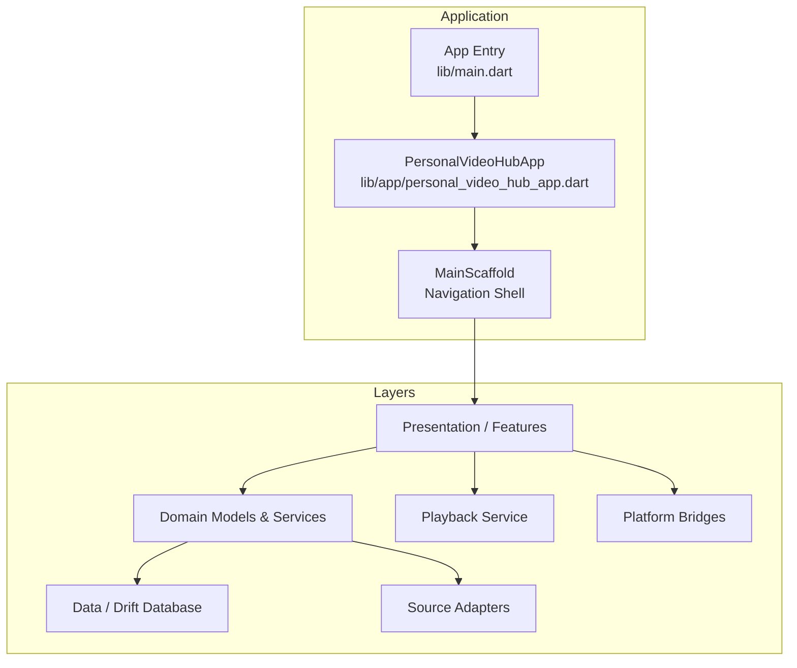
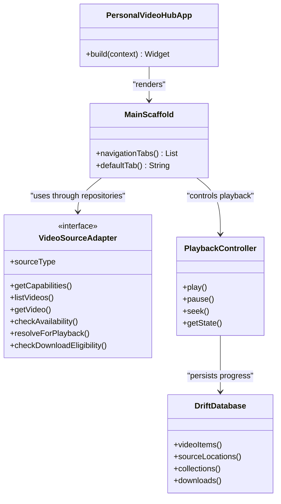
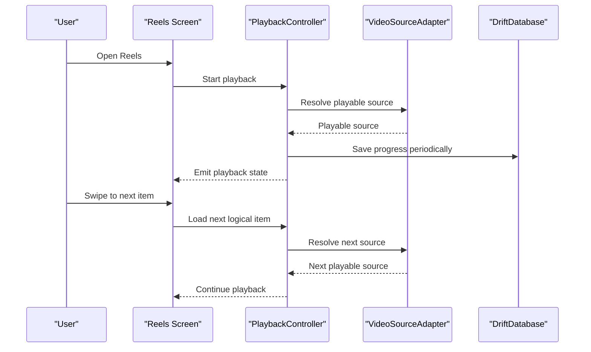
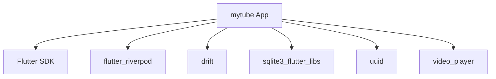

# Project Overview

<cite>
**Referenced Files in This Document**
- [README.md](file://README.md)
- [PROJECT_BRIEF.md](file://PROJECT_BRIEF.md)
- [ARCHITECTURE.md](file://ARCHITECTURE.md)
- [REQUIREMENTS.md](file://REQUIREMENTS.md)
- [pubspec.yaml](file://pubspec.yaml)
- [lib/main.dart](file://lib/main.dart)
- [lib/app/personal_video_hub_app.dart](file://lib/app/personal_video_hub_app.dart)
</cite>

## Table of Contents
1. [Introduction](#introduction)
2. [Project Structure](#project-structure)
3. [Core Components](#core-components)
4. [Architecture Overview](#architecture-overview)
5. [Detailed Component Analysis](#detailed-component-analysis)
6. [Dependency Analysis](#dependency-analysis)
7. [Performance Considerations](#performance-considerations)
8. [Troubleshooting Guide](#troubleshooting-guide)
9. [Conclusion](#conclusion)

## Introduction
MyTube is a personal-first video discovery and playback application designed to unify videos from multiple sources into an organized, locally managed library with a Reels-style playback experience. The app brings together local phone videos, user-selected folders, direct video URLs, and cloud storage providers behind a single interface. It emphasizes privacy-preserving local metadata, streaming-focused playback, and transparent rule-based discovery rather than opaque social or machine-learning-driven recommendations.

The project’s mission is to give users control over their personal video content without requiring an app-owned account or backend. It supports Android first, uses Flutter for the UI and application logic, and keeps sensitive data on-device. The app positions itself as a focused personal video hub that complements existing media players and cloud apps by offering unified discovery, organization, and swipe-first Reels playback tailored to individual use cases.

Key value propositions include:
- Unified access to local, direct URL, and cloud video sources.
- A Reels-style vertical swipe experience optimized for personal video consumption.
- Local-first metadata, favorites, tags, collections, watch progress, and history.
- Privacy-preserving design with no mandatory cloud upload or app-level authentication.
- Streaming-first playback with optional future support for app-managed downloads.

**Section sources**
- [PROJECT_BRIEF.md:9-27](file://PROJECT_BRIEF.md#L9-L27)
- [PROJECT_BRIEF.md:93-110](file://PROJECT_BRIEF.md#L93-L110)
- [REQUIREMENTS.md:3-14](file://REQUIREMENTS.md#L3-L14)
- [REQUIREMENTS.md:226-244](file://REQUIREMENTS.md#L226-L244)

## Project Structure
At a high level, MyTube follows a clean architecture layout with clear boundaries between presentation, domain, data, source adapters, playback, and platform integrations. The repository includes:
- `lib/`: Application code organized by layers and features.
- `android/`: Android-specific configuration, Kotlin bridges, and native integrations.
- `test/`: Unit and widget tests covering database, domain services, platform bridges, playback, sources, and UI components.
- Documentation files such as `PROJECT_BRIEF.md`, `ARCHITECTURE.md`, and `REQUIREMENTS.md` defining goals, architecture, and acceptance criteria.

**Diagram sources**
- [lib/main.dart:8-32](file://lib/main.dart#L8-L32)
- [lib/app/personal_video_hub_app.dart:10-58](file://lib/app/personal_video_hub_app.dart#L10-L58)
- [ARCHITECTURE.md:13-50](file://ARCHITECTURE.md#L13-L50)

**Section sources**
- [ARCHITECTURE.md:13-50](file://ARCHITECTURE.md#L13-L50)
- [REQUIREMENTS.md:16-27](file://REQUIREMENTS.md#L16-L27)

## Core Components
MyTube’s core product capabilities are centered around five primary tabs and supporting infrastructure:

- Discover tab: Default launch screen showing recently added videos, rule-based suggestions, and quick access to Reels.
- Reels playback: Vertical, swipe-first playback with minimal controls, looping behavior, and background audio/PiP where supported.
- Library management: Searchable and filterable collection with sorting, favorites, tags, collections, and watch progress.
- Saved collections: Favorites and custom collections persisted locally.
- Settings: Provider connections, folder management, playback preferences, downloads, cache, and library controls.

These features are backed by:
- Source adapters for local MediaStore, selected folders, direct URLs, and cloud providers.
- A local-first persistence layer using SQLite via Drift.
- An app-owned playback service/controller wrapping a maintained player integration.
- Platform bridges for Android MediaStore, Storage Access Framework, thumbnails, PiP, and media session.

**Section sources**
- [PROJECT_BRIEF.md:53-60](file://PROJECT_BRIEF.md#L53-L60)
- [REQUIREMENTS.md:29-39](file://REQUIREMENTS.md#L29-L39)
- [REQUIREMENTS.md:118-175](file://REQUIREMENTS.md#L118-L175)
- [ARCHITECTURE.md:76-93](file://ARCHITECTURE.md#L76-L93)

## Architecture Overview
MyTube implements clean architecture principles to separate concerns and improve testability:

- Presentation: Flutter screens, widgets, routing, and view state. Widgets do not query SQLite directly or implement provider networking.
- Domain: Framework-light models and use cases for listing/search/filter/sort, favorites/tags/collections, watch progress, source selection, recommendation scoring, availability states, refresh coordination, and duplicate matching.
- Data: Drift database, DAOs, migrations, repository implementations, and mappers. Typed results and errors are exposed instead of raw database rows.
- Source adapters: Each adapter handles provider-specific listing, metadata, availability, and playable-source resolution while declaring capabilities like streaming, seeking, thumbnails, search, and download eligibility.
- Playback: An app-owned service/controller wraps the selected player package and exposes loading, playing, paused, buffering, position, duration, completion, and error states.
- Platform bridges: Narrow interfaces encapsulate MediaStore, SAF, native thumbnails, PiP, Android media session/notification, lifecycle, and app-switcher privacy.

**Diagram sources**
- [lib/app/personal_video_hub_app.dart:10-58](file://lib/app/personal_video_hub_app.dart#L10-L58)
- [ARCHITECTURE.md:55-93](file://ARCHITECTURE.md#L55-L93)
- [ARCHITECTURE.md:144-165](file://ARCHITECTURE.md#L144-L165)

**Section sources**
- [ARCHITECTURE.md:55-93](file://ARCHITECTURE.md#L55-L93)
- [ARCHITECTURE.md:144-186](file://ARCHITECTURE.md#L144-L186)

## Detailed Component Analysis

### Target Audience and Positioning
MyTube targets individuals who want a personal video hub that unifies content across local storage, direct URLs, and cloud providers without introducing social features or mandatory accounts. It is especially useful for users who prefer:
- Swipe-first Reels-style playback for personal videos.
- Transparent, rule-based discovery rather than opaque algorithms.
- Local-first metadata and privacy-preserving workflows.
- A familiar navigation model with Discover, Reels, Library, Saved, and Settings.

Compared to existing solutions, MyTube differentiates itself by focusing on personal video management, streaming-first playback, and local metadata storage. It avoids uploading library metadata and does not require a backend in the MVP.

**Section sources**
- [PROJECT_BRIEF.md:9-27](file://PROJECT_BRIEF.md#L9-L27)
- [PROJECT_BRIEF.md:93-110](file://PROJECT_BRIEF.md#L93-L110)
- [REQUIREMENTS.md:265-274](file://REQUIREMENTS.md#L265-L274)

### Key Features

#### Discover Tab
- Default launch screen.
- Recently added videos and rule-based suggestions.
- Quick access to Reels.
- Deterministic, testable recommendation scoring balancing randomization, unwatched status, preferred sources, viewing history, and repetition reduction.

**Section sources**
- [PROJECT_BRIEF.md:53-60](file://PROJECT_BRIEF.md#L53-L60)
- [REQUIREMENTS.md:29-39](file://REQUIREMENTS.md#L29-L39)
- [ARCHITECTURE.md:199-206](file://ARCHITECTURE.md#L199-L206)

#### Reels Playback
- Vertical, swipe-first playback.
- Autoplay and loop until swiped away.
- Minimal overlay controls available on demand.
- Playback controls include play/pause, seek, skip forward/backward, speed, volume, display mode, orientation, and fullscreen.
- Background audio, media notification controls, and Picture-in-Picture where supported.

**Diagram sources**
- [REQUIREMENTS.md:152-175](file://REQUIREMENTS.md#L152-L175)
- [ARCHITECTURE.md:171-186](file://ARCHITECTURE.md#L171-L186)

**Section sources**
- [PROJECT_BRIEF.md:62-79](file://PROJECT_BRIEF.md#L62-L79)
- [REQUIREMENTS.md:152-175](file://REQUIREMENTS.md#L152-L175)

#### Library Management
- Search by title.
- Filter by source, duration, watched status, favorites, and tags.
- Sort by recently added, last played, duration, and random.
- Preserve user-owned organization during source refresh.
- Removing a library entry removes app references only, not originals.

**Section sources**
- [REQUIREMENTS.md:118-133](file://REQUIREMENTS.md#L118-L133)
- [ARCHITECTURE.md:95-128](file://ARCHITECTURE.md#L95-L128)

#### Saved Collections
- Favorites and custom collections persisted locally.
- Duplicate grouping under one logical item with multiple source locations.
- Ambiguous matches remain separate or request confirmation.

**Section sources**
- [REQUIREMENTS.md:118-133](file://REQUIREMENTS.md#L118-L133)
- [ARCHITECTURE.md:129-142](file://ARCHITECTURE.md#L129-L142)

#### Settings
- Provider connections and folder management.
- Playback preferences, downloads, cache, and library controls.
- Dark-first theme with follow-system option.
- Provider disconnection preserves library organization/history.

**Section sources**
- [PROJECT_BRIEF.md:53-60](file://PROJECT_BRIEF.md#L53-L60)
- [REQUIREMENTS.md:226-244](file://REQUIREMENTS.md#L226-L244)

### Technical Foundation

#### Flutter and Clean Architecture
- Flutter/Dart for UI and application logic.
- Clear boundaries between presentation, domain, data, source adapters, playback, and platform integrations.
- Testable business rules and safe data handling.
- Provider additions must not require rewriting the library UI or player.

**Section sources**
- [PROJECT_BRIEF.md:29-43](file://PROJECT_BRIEF.md#L29-L43)
- [ARCHITECTURE.md:1-11](file://ARCHITECTURE.md#L1-L11)

#### Multi-Source Video Access
- Local phone videos via MediaStore.
- Selected folders via Storage Access Framework.
- Direct video URLs with validation and capability checks.
- Cloud providers including OneDrive, Google Drive, and Cloudflare R2.
- Shared adapter contract with capability reporting.

**Section sources**
- [PROJECT_BRIEF.md:45-51](file://PROJECT_BRIEF.md#L45-L51)
- [REQUIREMENTS.md:41-117](file://REQUIREMENTS.md#L41-L117)
- [ARCHITECTURE.md:144-169](file://ARCHITECTURE.md#L144-L169)

#### Privacy-Preserving Local Metadata
- Metadata, favorites, tags, collections, history, progress, and preferences stored on-device.
- No app-owned account or backend in MVP.
- OAuth tokens stored in platform-secure storage; signed URLs redacted from logs.
- Backups exclude original video bytes and permanent credentials.

**Section sources**
- [PROJECT_BRIEF.md:100-110](file://PROJECT_BRIEF.md#L100-L110)
- [REQUIREMENTS.md:211-244](file://REQUIREMENTS.md#L211-L244)

#### Streaming-Focused Playback
- Stream by default with optional app-managed offline downloads where permissions allow.
- App-owned playback controller exposing standardized states.
- Background audio, media notifications, and PiP where supported.
- Graceful handling of unsupported codecs, DRM, and incompatible servers.

**Section sources**
- [PROJECT_BRIEF.md:21-27](file://PROJECT_BRIEF.md#L21-L27)
- [ARCHITECTURE.md:83-93](file://ARCHITECTURE.md#L83-L93)
- [REQUIREMENTS.md:152-175](file://REQUIREMENTS.md#L152-L175)

### Unique Value Proposition
MyTube stands out in the personal video management ecosystem by combining:
- Unified multi-source access behind a single library.
- Reels-style vertical swipe playback tailored for personal content.
- Transparent, rule-based discovery without ML or social networks.
- Local-first metadata and privacy-preserving workflows.
- Streaming-first playback with optional future downloads.

This positions MyTube as a focused personal video hub that prioritizes user control, privacy, and usability over social features or cloud dependency.

**Section sources**
- [PROJECT_BRIEF.md:9-27](file://PROJECT_BRIEF.md#L9-L27)
- [PROJECT_BRIEF.md:93-110](file://PROJECT_BRIEF.md#L93-L110)
- [REQUIREMENTS.md:265-274](file://REQUIREMENTS.md#L265-L274)

## Dependency Analysis
MyTube’s runtime dependencies include Flutter, Riverpod for state management, Drift for SQLite persistence, SQLite libraries for Android, UUID generation, and a video player package. These choices align with the project’s goals of local-first persistence, maintainable state management, and streaming-focused playback.

**Diagram sources**
- [pubspec.yaml:1-29](file://pubspec.yaml#L1-L29)

**Section sources**
- [pubspec.yaml:1-29](file://pubspec.yaml#L1-L29)

## Performance Considerations
- Avoid blocking UI during scans, thumbnails, database work, or network operations.
- Use lazy loading and indexes for large libraries.
- Keep indexing cancellable and UI responsive.
- Limit preloading in Reels to avoid excessive memory/network usage.
- Coordinate cache eviction with active playback and thumbnail work.

[No sources needed since this section provides general guidance]

## Troubleshooting Guide
Common issues and recovery paths include:
- Unavailable source entries remain visible with statuses and retry/reconnect actions.
- Revoked permissions should not crash the app or erase organization.
- Clear Cache must preserve downloads and originals.
- No permanent provider secrets should be committed or logged.
- Errors must be actionable; logs must be privacy-safe.

**Section sources**
- [PROJECT_BRIEF.md:82-91](file://PROJECT_BRIEF.md#L82-L91)
- [REQUIREMENTS.md:246-263](file://REQUIREMENTS.md#L246-L263)

## Conclusion
MyTube delivers a personal-first video discovery and playback experience that unifies local, direct URL, and cloud sources into a single organized library. Its Reels-style playback, transparent rule-based discovery, and privacy-preserving local metadata make it distinct from social or cloud-centric alternatives. Built with Flutter and clean architecture principles, the app is designed for testability, extensibility, and streaming-focused performance while keeping sensitive data on-device.

[No sources needed since this section summarizes without analyzing specific files]