# Testing Strategy

<cite>
**Referenced Files in This Document**   
- [pubspec.yaml](file://pubspec.yaml)
- [README.md](file://README.md)
- [device_testing_p3.md](file://docs/device_testing_p3.md)
- [app_database_test.dart](file://test/unit/database/app_database_test.dart)
- [drift_video_repository_test.dart](file://test/unit/database/drift_video_repository_test.dart)
- [availability_check_service_test.dart](file://test/unit/domain/availability_check_service_test.dart)
- [media_store_bridge_impl_test.dart](file://test/unit/platform/media_store_bridge_impl_test.dart)
- [local_media_adapter_test.dart](file://test/unit/sources/local_media_adapter_test.dart)
- [app_playback_controller_test.dart](file://test/unit/playback/app_playback_controller_test.dart)
- [video_player_handle_test.dart](file://test/unit/playback/video_player_handle_test.dart)
- [library_screen_test.dart](file://test/widget/library_screen_test.dart)
- [playback_controls_test.dart](file://test/widget/playback_controls_test.dart)
- [video_item_card_test.dart](file://test/widget/video_item_card_test.dart)
- [main_scaffold_test.dart](file://test/widget/main_scaffold_test.dart)
- [state_widgets_test.dart](file://test/widget/state_widgets_test.dart)
- [database_provider.dart](file://lib/data/database/database_provider.dart)
- [repository_providers.dart](file://lib/data/repositories/repository_providers.dart)
</cite>

## Update Summary
**Changes Made**   
- Added comprehensive coverage of playback controller unit tests (624 lines) demonstrating advanced testing techniques with fake player handles
- Added video player handle unit tests (426 lines) showing platform abstraction testing patterns
- Added widget tests for library screen (321 lines) with fake repository implementations
- Added widget tests for playback controls (396 lines) covering UI interactions and state management
- Added widget tests for video item cards (162 lines) validating display logic and user interactions
- Enhanced testing patterns section with new examples from playback and widget test suites

## Table of Contents
1. [Introduction](#introduction)
2. [Project Structure](#project-structure)
3. [Core Components](#core-components)
4. [Architecture Overview](#architecture-overview)
5. [Detailed Component Analysis](#detailed-component-analysis)
6. [Dependency Analysis](#dependency-analysis)
7. [Performance Considerations](#performance-considerations)
8. [Troubleshooting Guide](#troubleshooting-guide)
9. [Conclusion](#conclusion)
10. [Appendices](#appendices)

## Introduction
This document explains the testing strategy for MyTube, a Flutter application focused on local Android video library management and playback. The codebase uses a layered architecture with domain logic, Drift-backed data access, platform bridges for Android Media Store and SAF, Riverpod state management, and a video player abstraction.

The testing approach follows a clear pyramid:
- Unit tests validate domain logic, database operations, source adapters, platform bridge implementations, playback controllers, and video player handles.
- Widget tests validate UI components, navigation behavior, state-driven rendering, and user interactions.
- Integration testing is intentionally deferred until a device test harness is available; manual device checks cover scenarios that cannot be automated with in-memory databases and fake platform bridges.

The project's package manifest declares `flutter_test` as a development dependency, along with Drift tooling and the video player platform interface used by tests. The README is minimal and does not define additional testing conventions, so this document derives its guidance directly from the existing test files and production providers.

**Section sources**
- [pubspec.yaml:19-25](file://pubspec.yaml#L19-L25)
- [README.md:1-4](file://README.md#L1-L4)
- [device_testing_p3.md:101-107](file://docs/device_testing_p3.md#L101-L107)

## Project Structure
The test directory is organized by scope rather than by feature:
- `test/unit/`: Pure Dart unit tests grouped under `database`, `domain`, `platform`, `playback`, and `sources`.
- `test/widget/`: Flutter widget tests for app shell, theme, scaffold navigation, shared state widgets, library screen, playback controls, and video item cards.
- There is no `test/integration/` directory yet; integration testing is deferred per project documentation.

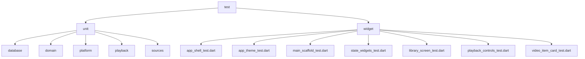

**Diagram sources**
- [app_database_test.dart:1-37](file://test/unit/database/app_database_test.dart#L1-L37)
- [main_scaffold_test.dart:1-123](file://test/widget/main_scaffold_test.dart#L1-L123)
- [state_widgets_test.dart:1-289](file://test/widget/state_widgets_test.dart#L1-L289)
- [library_screen_test.dart:1-321](file://test/widget/library_screen_test.dart#L1-L321)
- [playback_controls_test.dart:1-396](file://test/widget/playback_controls_test.dart#L1-L396)
- [video_item_card_test.dart:1-162](file://test/widget/video_item_card_test.dart#L1-L162)

**Section sources**
- [app_database_test.dart:1-37](file://test/unit/database/app_database_test.dart#L1-L37)
- [main_scaffold_test.dart:1-123](file://test/widget/main_scaffold_test.dart#L1-L123)
- [state_widgets_test.dart:1-289](file://test/widget/state_widgets_test.dart#L1-L289)
- [library_screen_test.dart:1-321](file://test/widget/library_screen_test.dart#L1-L321)
- [playback_controls_test.dart:1-396](file://test/widget/playback_controls_test.dart#L1-L396)
- [video_item_card_test.dart:1-162](file://test/widget/video_item_card_test.dart#L1-L162)
- [device_testing_p3.md:101-107](file://docs/device_testing_p3.md#L101-L107)

## Core Components
MyTube's test suite covers several core areas with comprehensive coverage:

| Area | Purpose | Representative Tests |
|---|---|---|
| Database | Validate Drift database opening, schema version, migrations, repository behavior, and watch progress persistence. | `app_database_test.dart`, `drift_video_repository_test.dart`, `migrations_test.dart`, `schema_test.dart`, `watch_progress_test.dart` |
| Domain | Validate availability checking across provider types, cancellation, user metadata preservation, and cross-provider isolation. | `availability_check_service_test.dart` |
| Platform Bridges | Validate MethodChannel communication, permission status mapping, and error handling for Android integrations. | `media_store_bridge_impl_test.dart`, `saf_bridge_impl_test.dart` |
| Source Adapters | Validate local media listing, deduplication, permission handling, availability checks, and playback resolution. | `local_media_adapter_test.dart` |
| Playback Controller | Validate engine lifecycle, state transitions, command idempotency, stale load handling, and Riverpod provider disposal. | `app_playback_controller_test.dart`, `video_player_handle_test.dart` |
| Video Player Handle | Test platform abstraction layer, scheme routing, snapshot mapping, and event handling. | `video_player_handle_test.dart` |
| Library Screen | Validate empty states, video list rendering, error handling, and search functionality. | `library_screen_test.dart` |
| Playback Controls | Test UI interactions, transport controls, seeking, volume/speed adjustments, and state-driven rendering. | `playback_controls_test.dart` |
| Video Item Cards | Validate title display, duration formatting, favorite icons, and tap interactions. | `video_item_card_test.dart` |
| Widgets | Validate navigation destinations, default tab behavior, IndexedStack behavior, and shared UI state widgets. | `main_scaffold_test.dart`, `state_widgets_test.dart`, `app_shell_test.dart`, `app_theme_test.dart` |

Key patterns observed:
- Manual fakes are preferred over external mocking libraries.
- Constructor injection isolates dependencies such as platform bridges and repositories.
- Riverpod overrides are used to inject in-memory databases and fake player handles.
- `TestDefaultBinaryMessengerBinding` mocks platform channels without requiring a real device.
- Fake repositories implement full interfaces for widget testing scenarios.

**Section sources**
- [app_database_test.dart:1-37](file://test/unit/database/app_database_test.dart#L1-L37)
- [drift_video_repository_test.dart:1-212](file://test/unit/database/drift_video_repository_test.dart#L1-L212)
- [availability_check_service_test.dart:1-469](file://test/unit/domain/availability_check_service_test.dart#L1-L469)
- [media_store_bridge_impl_test.dart:1-251](file://test/unit/platform/media_store_bridge_impl_test.dart#L1-L251)
- [local_media_adapter_test.dart:1-426](file://test/unit/sources/local_media_adapter_test.dart#L1-L426)
- [app_playback_controller_test.dart:1-624](file://test/unit/playback/app_playback_controller_test.dart#L1-L624)
- [video_player_handle_test.dart:1-426](file://test/unit/playback/video_player_handle_test.dart#L1-L426)
- [library_screen_test.dart:1-321](file://test/widget/library_screen_test.dart#L1-L321)
- [playback_controls_test.dart:1-396](file://test/widget/playback_controls_test.dart#L1-L396)
- [video_item_card_test.dart:1-162](file://test/widget/video_item_card_test.dart#L1-L162)
- [main_scaffold_test.dart:1-123](file://test/widget/main_scaffold_test.dart#L1-L123)
- [state_widgets_test.dart:1-289](file://test/widget/state_widgets_test.dart#L1-L289)

## Architecture Overview
The testing strategy maps cleanly onto the application architecture:

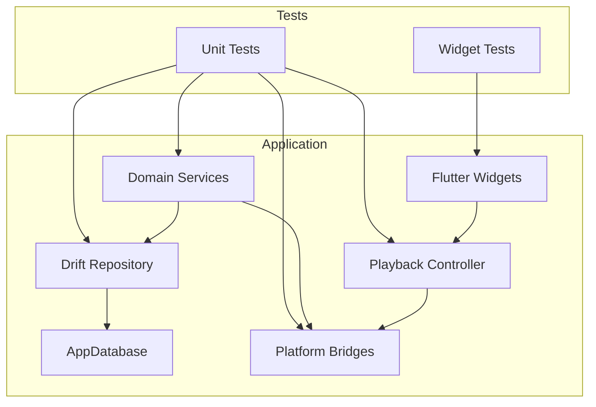

This diagram shows how unit tests exercise domain services, repositories, platform bridges, and playback controllers, while widget tests exercise the Flutter UI layer. Platform interactions are isolated through bridges and channel mocks.

**Diagram sources**
- [availability_check_service_test.dart:1-469](file://test/unit/domain/availability_check_service_test.dart#L1-L469)
- [media_store_bridge_impl_test.dart:1-251](file://test/unit/platform/media_store_bridge_impl_test.dart#L1-L251)
- [app_playback_controller_test.dart:1-624](file://test/unit/playback/app_playback_controller_test.dart#L1-L624)
- [video_player_handle_test.dart:1-426](file://test/unit/playback/video_player_handle_test.dart#L1-L426)
- [library_screen_test.dart:1-321](file://test/widget/library_screen_test.dart#L1-L321)
- [playback_controls_test.dart:1-396](file://test/widget/playback_controls_test.dart#L1-L396)
- [main_scaffold_test.dart:1-123](file://test/widget/main_scaffold_test.dart#L1-L123)

## Detailed Component Analysis

### Unit Testing Patterns

#### Domain Logic Testing
The availability check service tests demonstrate a comprehensive pattern:
- Fakes implement domain interfaces (`VideoSourceAdapter`, `SafBridge`, `MediaStoreBridge`).
- An in-memory Drift database is created per test group.
- A helper inserts `VideoItem` and `SourceLocation` pairs to simulate realistic database state.
- Tests assert both returned results and persisted database changes.
- Cancellation, cross-provider isolation, adapter errors, and user metadata preservation are explicitly covered.

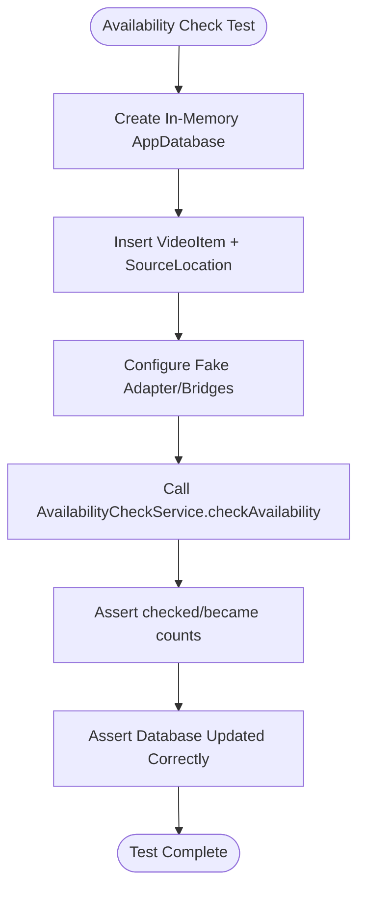

**Diagram sources**
- [availability_check_service_test.dart:142-168](file://test/unit/domain/availability_check_service_test.dart#L142-L168)
- [availability_check_service_test.dart:170-467](file://test/unit/domain/availability_check_service_test.dart#L170-L467)

**Section sources**
- [availability_check_service_test.dart:14-94](file://test/unit/domain/availability_check_service_test.dart#L14-L94)
- [availability_check_service_test.dart:100-136](file://test/unit/domain/availability_check_service_test.dart#L100-L136)
- [availability_check_service_test.dart:142-467](file://test/unit/domain/availability_check_service_test.dart#L142-L467)

#### Drift Database Testing
Database tests focus on:
- Opening an in-memory database.
- Verifying schema version.
- Ensuring clean close behavior.
- Repository-level assertions for insert-on-conflict-update behavior and user field preservation.
- Provider wiring validation using Riverpod overrides.

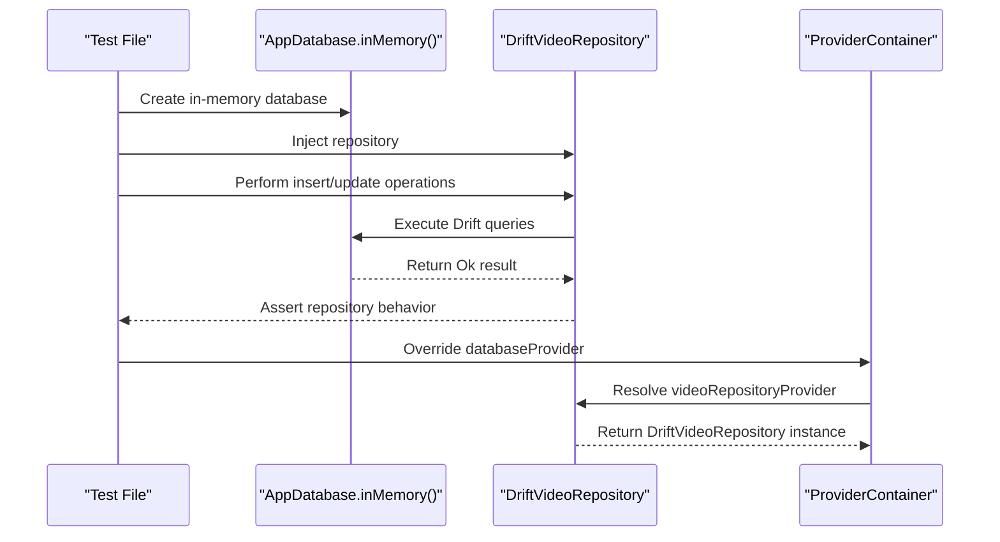

**Diagram sources**
- [app_database_test.dart:4-34](file://test/unit/database/app_database_test.dart#L4-L34)
- [drift_video_repository_test.dart:35-212](file://test/unit/database/drift_video_repository_test.dart#L35-L212)
- [database_provider.dart:1-17](file://lib/data/database/database_provider.dart#L1-L17)
- [repository_providers.dart:1-24](file://lib/data/repositories/repository_providers.dart#L1-L24)

**Section sources**
- [app_database_test.dart:4-34](file://test/unit/database/app_database_test.dart#L4-L34)
- [drift_video_repository_test.dart:35-212](file://test/unit/database/drift_video_repository_test.dart#L35-L212)
- [database_provider.dart:1-17](file://lib/data/database/database_provider.dart#L1-L17)
- [repository_providers.dart:1-24](file://lib/data/repositories/repository_providers.dart#L1-L24)

#### Platform Channel Communication Testing
Platform bridge tests use `TestDefaultBinaryMessengerBinding` to mock method channels:
- A `MethodChannel` is defined with the expected platform name.
- `setHandler` configures responses for specific method calls.
- `tearDown` clears the mock handler to avoid cross-test pollution.
- Success, empty list, permission-denied, and unexpected error paths are tested.
- Permission status strings are mapped to typed enums.

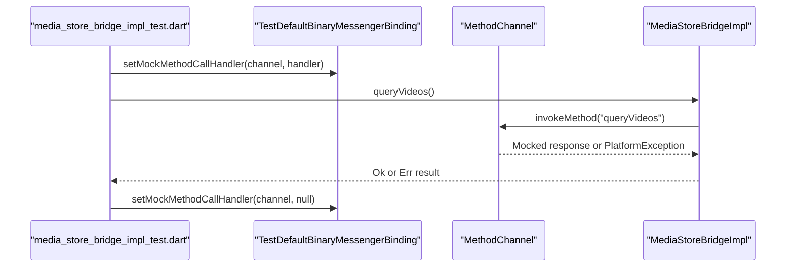

**Diagram sources**
- [media_store_bridge_impl_test.dart:8-21](file://test/unit/platform/media_store_bridge_impl_test.dart#L8-L21)
- [media_store_bridge_impl_test.dart:28-130](file://test/unit/platform/media_store_bridge_impl_test.dart#L28-L130)
- [media_store_bridge_impl_test.dart:136-249](file://test/unit/platform/media_store_bridge_impl_test.dart#L136-L249)

**Section sources**
- [media_store_bridge_impl_test.dart:8-21](file://test/unit/platform/media_store_bridge_impl_test.dart#L8-L21)
- [media_store_bridge_impl_test.dart:28-130](file://test/unit/platform/media_store_bridge_impl_test.dart#L28-L130)
- [media_store_bridge_impl_test.dart:136-249](file://test/unit/platform/media_store_bridge_impl_test.dart#L136-L249)

#### Video Source Adapter Testing
Local media adapter tests validate:
- Capability flags.
- Listing videos from Media Store and SAF.
- Deduplication when the same URI appears in both sources.
- Cancellation before work begins.
- Permission revocation handling.
- Error propagation versus safe null returns.
- Playback resolution and download eligibility.

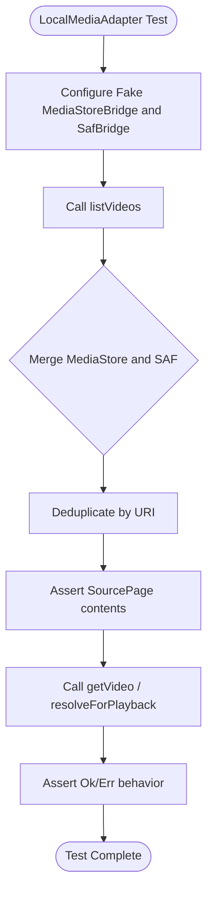

**Diagram sources**
- [local_media_adapter_test.dart:100-112](file://test/unit/sources/local_media_adapter_test.dart#L100-L112)
- [local_media_adapter_test.dart:114-260](file://test/unit/sources/local_media_adapter_test.dart#L114-L260)
- [local_media_adapter_test.dart:262-426](file://test/unit/sources/local_media_adapter_test.dart#L262-L426)

**Section sources**
- [local_media_adapter_test.dart:100-112](file://test/unit/sources/local_media_adapter_test.dart#L100-L112)
- [local_media_adapter_test.dart:114-260](file://test/unit/sources/local_media_adapter_test.dart#L114-L260)
- [local_media_adapter_test.dart:262-426](file://test/unit/sources/local_media_adapter_test.dart#L262-L426)

#### Playback Controller Testing
Playback controller tests are extensive and demonstrate advanced testing techniques:
- A manual `FakePlayerHandle` implements `PlayerHandle` without external mocking libraries.
- Tests drive engine snapshots and change streams to simulate real player events.
- Stale load handling is verified using a `Completer` gate.
- Command idempotency, clamping, preference carryover, and lifecycle disposal are validated.
- Riverpod provider disposal is tested using `ProviderContainer`.

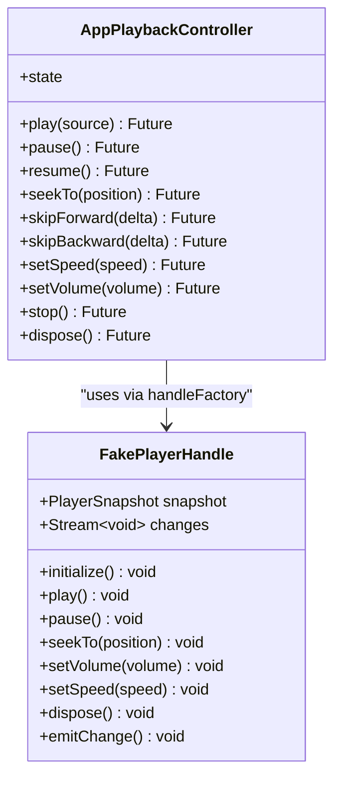

**Diagram sources**
- [app_playback_controller_test.dart:13-96](file://test/unit/playback/app_playback_controller_test.dart#L13-L96)
- [app_playback_controller_test.dart:129-624](file://test/unit/playback/app_playback_controller_test.dart#L129-L624)

**Section sources**
- [app_playback_controller_test.dart:13-96](file://test/unit/playback/app_playback_controller_test.dart#L13-L96)
- [app_playback_controller_test.dart:129-624](file://test/unit/playback/app_playback_controller_test.dart#L129-L624)

#### Video Player Handle Testing
Video player handle tests demonstrate platform abstraction testing patterns:
- A manual `FakeVideoPlayerPlatform` implements `VideoPlayerPlatform` without external mocking libraries.
- Tests verify scheme routing for content://, https://, and file:// URIs.
- Snapshot mapping validates initialization, buffering, playing state, and completion events.
- Command forwarding and lifecycle management are thoroughly tested.
- Event stream emission and disposal behavior are validated.

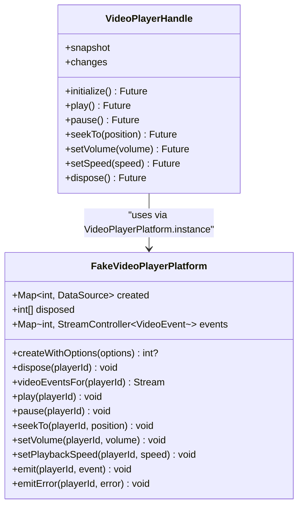

**Diagram sources**
- [video_player_handle_test.dart:15-89](file://test/unit/playback/video_player_handle_test.dart#L15-L89)
- [video_player_handle_test.dart:98-426](file://test/unit/playback/video_player_handle_test.dart#L98-L426)

**Section sources**
- [video_player_handle_test.dart:15-89](file://test/unit/playback/video_player_handle_test.dart#L15-L89)
- [video_player_handle_test.dart:98-426](file://test/unit/playback/video_player_handle_test.dart#L98-L426)

### Widget Testing Patterns

#### Navigation and Scaffold Testing
The main scaffold tests verify:
- Rendering of a `NavigationBar` with five destinations.
- Default launch tab behavior.
- Tab selection through taps.
- Back navigation to Discover.
- `IndexedStack` keeping all screens in the tree.
- Constant tab index values matching their positions.

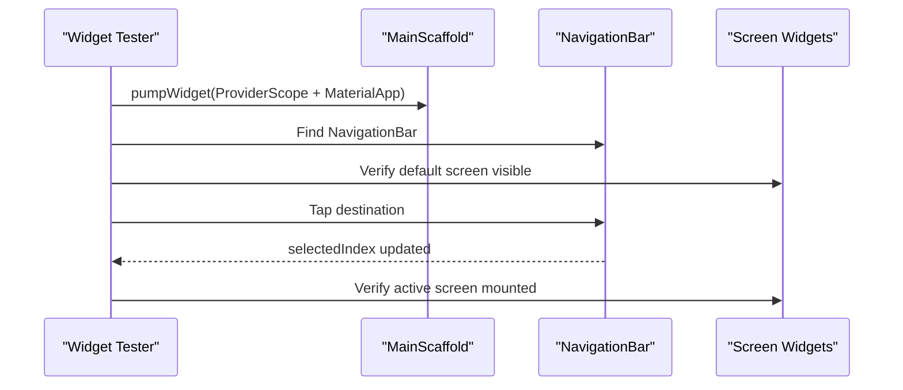

**Diagram sources**
- [main_scaffold_test.dart:11-13](file://test/widget/main_scaffold_test.dart#L11-L13)
- [main_scaffold_test.dart:15-123](file://test/widget/main_scaffold_test.dart#L15-L123)

**Section sources**
- [main_scaffold_test.dart:11-13](file://test/widget/main_scaffold_test.dart#L11-L13)
- [main_scaffold_test.dart:15-123](file://test/widget/main_scaffold_test.dart#L15-L123)

#### Shared State Widget Testing
State widget tests validate:
- Loading indicator rendering and optional messages.
- Empty state title, message, action button, icon fallback, and custom icons.
- Error state message, retry button behavior, and error icon presence.
- `AsyncValueWidget` routing between loading, data, and error states.
- Sensitive URL parameters are not leaked into user-facing messages.
- Custom loading and error widgets can be provided.

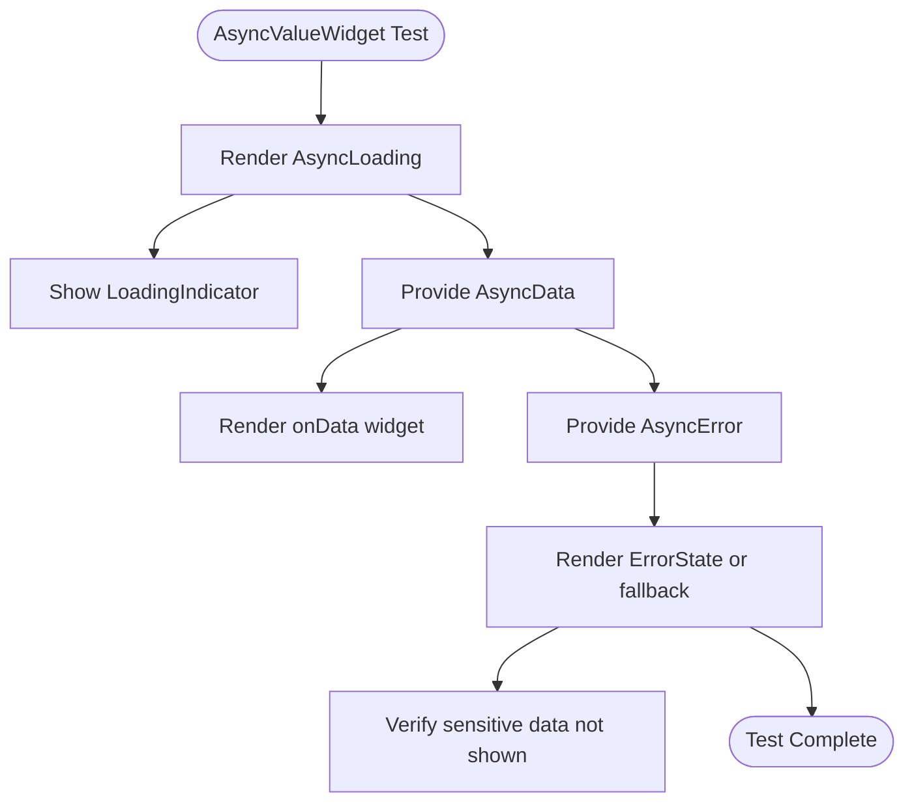

**Diagram sources**
- [state_widgets_test.dart:14-37](file://test/widget/state_widgets_test.dart#L14-L37)
- [state_widgets_test.dart:39-104](file://test/widget/state_widgets_test.dart#L39-L104)
- [state_widgets_test.dart:106-140](file://test/widget/state_widgets_test.dart#L106-L140)
- [state_widgets_test.dart:142-289](file://test/widget/state_widgets_test.dart#L142-L289)

**Section sources**
- [state_widgets_test.dart:14-37](file://test/widget/state_widgets_test.dart#L14-L37)
- [state_widgets_test.dart:39-104](file://test/widget/state_widgets_test.dart#L39-L104)
- [state_widgets_test.dart:106-140](file://test/widget/state_widgets_test.dart#L106-L140)
- [state_widgets_test.dart:142-289](file://test/widget/state_widgets_test.dart#L142-L289)

#### Library Screen Testing
Library screen tests demonstrate comprehensive UI testing patterns:
- Empty state rendering with appropriate messaging and icons.
- Video list display with proper card count verification.
- Error state handling with error component rendering.
- Search button presence validation.
- Fake repository implementations provide controlled data scenarios.

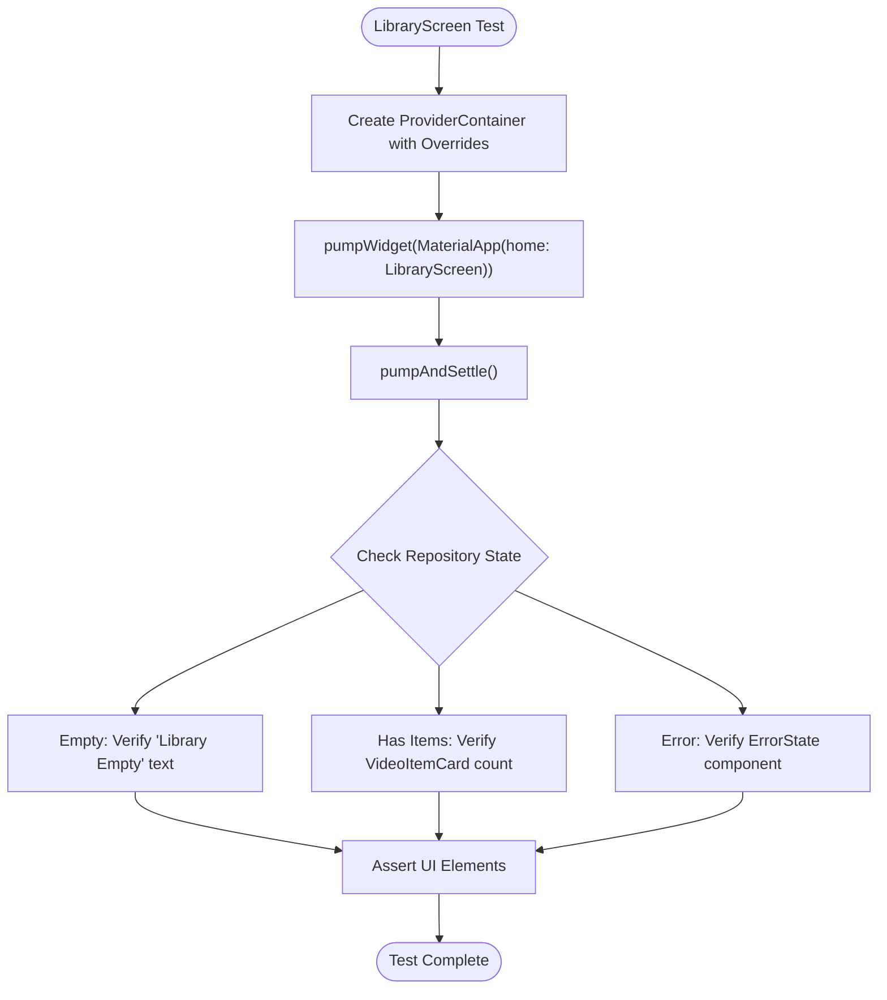

**Diagram sources**
- [library_screen_test.dart:14-33](file://test/widget/library_screen_test.dart#L14-L33)
- [library_screen_test.dart:35-75](file://test/widget/library_screen_test.dart#L35-L75)
- [library_screen_test.dart:77-94](file://test/widget/library_screen_test.dart#L77-L94)
- [library_screen_test.dart:96-113](file://test/widget/library_screen_test.dart#L96-L113)

**Section sources**
- [library_screen_test.dart:14-33](file://test/widget/library_screen_test.dart#L14-L33)
- [library_screen_test.dart:35-75](file://test/widget/library_screen_test.dart#L35-L75)
- [library_screen_test.dart:77-94](file://test/widget/library_screen_test.dart#L77-L94)
- [library_screen_test.dart:96-113](file://test/widget/library_screen_test.dart#L96-L113)

#### Playback Controls Testing
Playback controls tests validate comprehensive UI interaction patterns:
- Idle state disables transport controls and seeking.
- Playing state shows position, duration, and pause button.
- Error state displays user-safe messages and disables controls.
- Play/pause button interactions work correctly.
- Slider dragging updates position labels and triggers seeks.
- Skip buttons respect canSeek constraints and apply clamping.
- Volume and speed controls update both UI and underlying state.

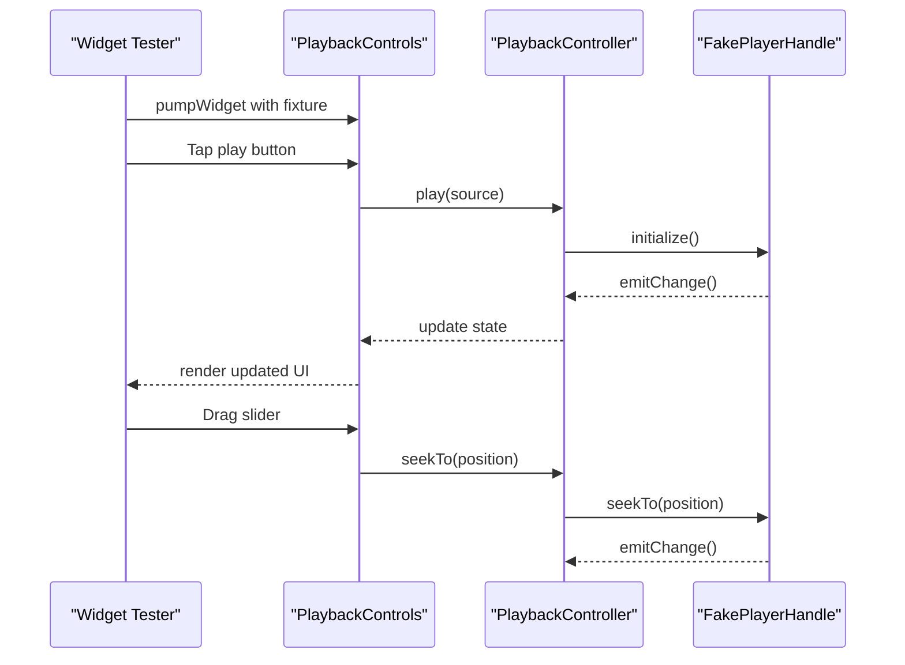

**Diagram sources**
- [playback_controls_test.dart:121-146](file://test/widget/playback_controls_test.dart#L121-L146)
- [playback_controls_test.dart:148-171](file://test/widget/playback_controls_test.dart#L148-L171)
- [playback_controls_test.dart:183-241](file://test/widget/playback_controls_test.dart#L183-L241)
- [playback_controls_test.dart:243-396](file://test/widget/playback_controls_test.dart#L243-L396)

**Section sources**
- [playback_controls_test.dart:121-146](file://test/widget/playback_controls_test.dart#L121-L146)
- [playback_controls_test.dart:148-171](file://test/widget/playback_controls_test.dart#L148-L171)
- [playback_controls_test.dart:183-241](file://test/widget/playback_controls_test.dart#L183-L241)
- [playback_controls_test.dart:243-396](file://test/widget/playback_controls_test.dart#L243-L396)

#### Video Item Card Testing
Video item card tests validate display and interaction patterns:
- Title display verification.
- Duration formatting for short videos (m:ss).
- Duration formatting for long videos (h:mm:ss).
- Conditional duration display when null.
- Favorite icon visibility based on boolean state.
- Tap callback invocation verification.

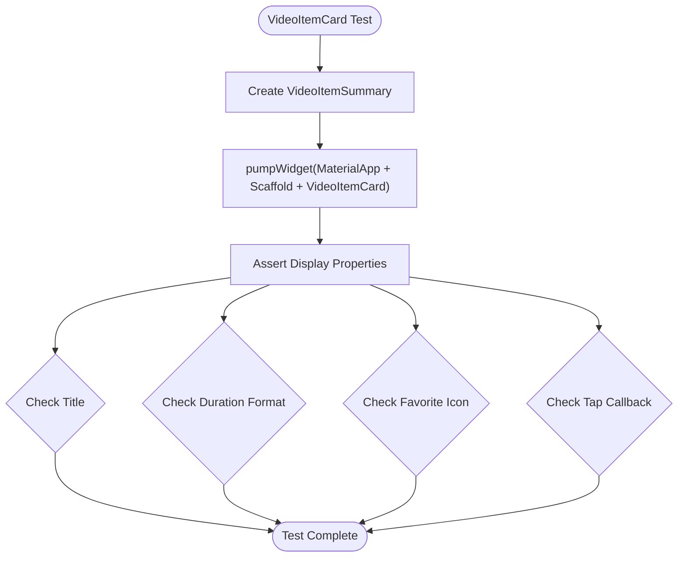

**Diagram sources**
- [video_item_card_test.dart:7-27](file://test/widget/video_item_card_test.dart#L7-L27)
- [video_item_card_test.dart:29-48](file://test/widget/video_item_card_test.dart#L29-L48)
- [video_item_card_test.dart:50-71](file://test/widget/video_item_card_test.dart#L50-L71)
- [video_item_card_test.dart:73-92](file://test/widget/video_item_card_test.dart#L73-L92)
- [video_item_card_test.dart:94-113](file://test/widget/video_item_card_test.dart#L94-L113)
- [video_item_card_test.dart:115-136](file://test/widget/video_item_card_test.dart#L115-L136)
- [video_item_card_test.dart:138-160](file://test/widget/video_item_card_test.dart#L138-L160)

**Section sources**
- [video_item_card_test.dart:7-27](file://test/widget/video_item_card_test.dart#L7-L27)
- [video_item_card_test.dart:29-48](file://test/widget/video_item_card_test.dart#L29-L48)
- [video_item_card_test.dart:50-71](file://test/widget/video_item_card_test.dart#L50-L71)
- [video_item_card_test.dart:73-92](file://test/widget/video_item_card_test.dart#L73-L92)
- [video_item_card_test.dart:94-113](file://test/widget/video_item_card_test.dart#L94-L113)
- [video_item_card_test.dart:115-136](file://test/widget/video_item_card_test.dart#L115-L136)
- [video_item_card_test.dart:138-160](file://test/widget/video_item_card_test.dart#L138-L160)

## Dependency Analysis
Riverpod providers play a central role in testability:
- `databaseProvider` creates and disposes `AppDatabase`.
- `videoRepositoryProvider` depends on `databaseProvider` and returns a `DriftVideoRepository`.
- Tests override these providers to inject in-memory databases and fake dependencies.

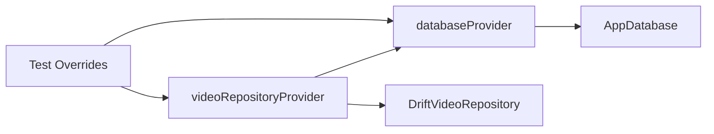

**Diagram sources**
- [database_provider.dart:1-17](file://lib/data/database/database_provider.dart#L1-L17)
- [repository_providers.dart:1-24](file://lib/data/repositories/repository_providers.dart#L1-L24)
- [drift_video_repository_test.dart:191-212](file://test/unit/database/drift_video_repository_test.dart#L191-L212)

**Section sources**
- [database_provider.dart:1-17](file://lib/data/database/database_provider.dart#L1-L17)
- [repository_providers.dart:1-24](file://lib/data/repositories/repository_providers.dart#L1-L24)
- [drift_video_repository_test.dart:191-212](file://test/unit/database/drift_video_repository_test.dart#L191-L212)

## Performance Considerations
- In-memory Drift databases keep unit tests fast and deterministic.
- Manual fakes avoid the overhead of reflection-based mocking libraries.
- Widget tests use minimal wrappers like `MaterialApp(home: Scaffold(body: child))` to reduce test surface area.
- Platform channel mocks avoid launching real Android processes during unit tests.
- Playback controller tests use event queue pumping and gates to control asynchronous timing without relying on real timers.
- Fake repositories in widget tests provide lightweight data sources without database overhead.
- Video player handle tests use a simple fake platform implementation instead of complex mocking frameworks.

[No sources needed since this section provides general guidance]

## Troubleshooting Guide

### Common Testing Issues and Solutions

| Issue | Symptom | Solution |
|---|---|---|
| Platform channel leaks between tests | Mock handlers affect unrelated tests | Clear `TestDefaultBinaryMessengerBinding` handler in `tearDown`. |
| Database not closed | Resource warnings or flaky tests | Close `AppDatabase` in `tearDown` after each test group. |
| Riverpod container not disposed | Fake resources remain alive | Use `addTearDown(container.dispose)` and await event queue if teardown is asynchronous. |
| Player handle not released | Engine resources leak | Ensure `FakePlayerHandle.dispose` closes streams and increment disposal counters. |
| Sensitive data in error messages | User-facing logs contain URLs or tokens | Assert that generic messages replace raw engine details. |
| Integration tests missing | CI only runs unit and widget tests | Follow the project decision to defer `test/integration/` until a device harness exists. |
| Widget test setup complexity | Tedious ProviderContainer configuration | Use fixture helpers like `_fixture()` to encapsulate common setup patterns. |
| Fake repository boilerplate | Repetitive interface implementations | Create focused fake classes for specific test scenarios (empty, data, error). |

**Section sources**
- [media_store_bridge_impl_test.dart:18-21](file://test/unit/platform/media_store_bridge_impl_test.dart#L18-L21)
- [app_database_test.dart:8-14](file://test/unit/database/app_database_test.dart#L8-L14)
- [app_playback_controller_test.dart:543-624](file://test/unit/playback/app_playback_controller_test.dart#L543-L624)
- [playback_controls_test.dart:121-146](file://test/widget/playback_controls_test.dart#L121-L146)
- [library_screen_test.dart:121-321](file://test/widget/library_screen_test.dart#L121-L321)
- [device_testing_p3.md:101-107](file://docs/device_testing_p3.md#L101-L107)

## Conclusion
MyTube's testing strategy is well-structured around a clear pyramid:
- Unit tests isolate domain logic, database operations, platform bridges, source adapters, playback controllers, and video player handles.
- Widget tests validate navigation, rendering, shared state behavior, library screen interactions, playback controls, and video item cards.
- Integration testing is deferred until a device harness is established, with manual device checks covering platform-only scenarios.

The codebase demonstrates strong testing practices:
- Manual fakes for external dependencies.
- Constructor injection for testable design.
- Riverpod provider overrides for database and player wiring.
- Platform channel mocking for Android integrations.
- Explicit assertions for both return values and observable side effects.
- Comprehensive UI interaction testing with realistic user flows.
- Fixture patterns for reducing widget test setup complexity.

New tests should follow these patterns:
- Place unit tests under `test/unit/<area>/`.
- Place widget tests under `test/widget/`.
- Use constructor injection and manual fakes instead of global singletons.
- Wrap platform channel tests with proper setup and teardown.
- Prefer in-memory databases and fake bridges over real platform dependencies.
- Assert both return values and observable side effects.
- Create focused fake repositories for widget testing scenarios.
- Use fixture helpers to reduce widget test setup boilerplate.
- Test both positive and negative user interaction flows.

[No sources needed since this section summarizes without analyzing specific files]

## Appendices

### Naming Conventions
- Test files mirror production structure where applicable, e.g., `local_media_adapter_test.dart` for `LocalMediaAdapter`.
- Group names describe the component under test, e.g., `AvailabilityCheckService (P3-06)`.
- Individual tests use descriptive names indicating scenario and expectation.
- Widget test groups include feature identifiers like `(P5-01)` for library screen tests.
- Playback controls tests include feature identifiers like `(P4-05)` for UI testing.

**Section sources**
- [availability_check_service_test.dart:142-143](file://test/unit/domain/availability_check_service_test.dart#L142-L143)
- [local_media_adapter_test.dart:103-104](file://test/unit/sources/local_media_adapter_test.dart#L103-L104)
- [media_store_bridge_impl_test.dart:23-24](file://test/unit/platform/media_store_bridge_impl_test.dart#L23-L24)
- [library_screen_test.dart:14-15](file://test/widget/library_screen_test.dart#L14-L15)
- [playback_controls_test.dart:183-184](file://test/widget/playback_controls_test.dart#L183-L184)

### Assertion Patterns
- Use `expect(result.isOk, isTrue)` and `expect(result.isErr, isTrue)` for `Result` types.
- Cast results to `Ok<T>` or `Err<T>` before asserting inner values.
- Assert database state after service calls to verify side effects.
- Assert widget visibility, tap callbacks, and finder counts in widget tests.
- Assert call counts, lists, and state fields in playback controller tests.
- Use fixture helpers to encapsulate common widget test setup patterns.
- Verify both UI state and underlying controller behavior in widget tests.

**Section sources**
- [availability_check_service_test.dart:170-467](file://test/unit/domain/availability_check_service_test.dart#L170-L467)
- [local_media_adapter_test.dart:114-426](file://test/unit/sources/local_media_adapter_test.dart#L114-L426)
- [main_scaffold_test.dart:15-123](file://test/widget/main_scaffold_test.dart#L15-L123)
- [state_widgets_test.dart:14-289](file://test/widget/state_widgets_test.dart#L14-L289)
- [playback_controls_test.dart:183-396](file://test/widget/playback_controls_test.dart#L183-L396)
- [video_item_card_test.dart:7-160](file://test/widget/video_item_card_test.dart#L7-L160)

### Continuous Integration Guidance
- Run `flutter test` to execute both unit and widget tests.
- Coverage expectations should prioritize unit tests for domain, database, platform bridges, playback logic, and video player handling.
- Widget tests should cover critical navigation, state rendering, library screen interactions, playback controls, and video item display.
- Integration tests should be added once a device harness is available, following the project's deferred integration plan.
- Focus on testing complex user flows that involve multiple components working together.

**Section sources**
- [pubspec.yaml:19-25](file://pubspec.yaml#L19-L25)
- [device_testing_p3.md:101-107](file://docs/device_testing_p3.md#L101-L107)