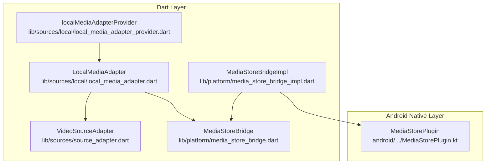
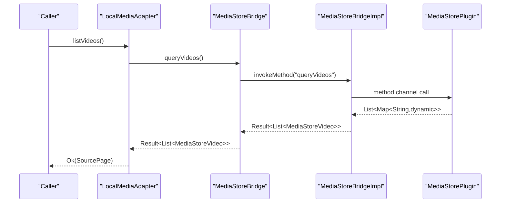
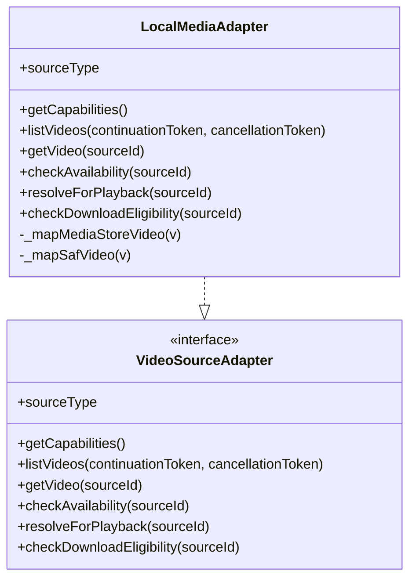
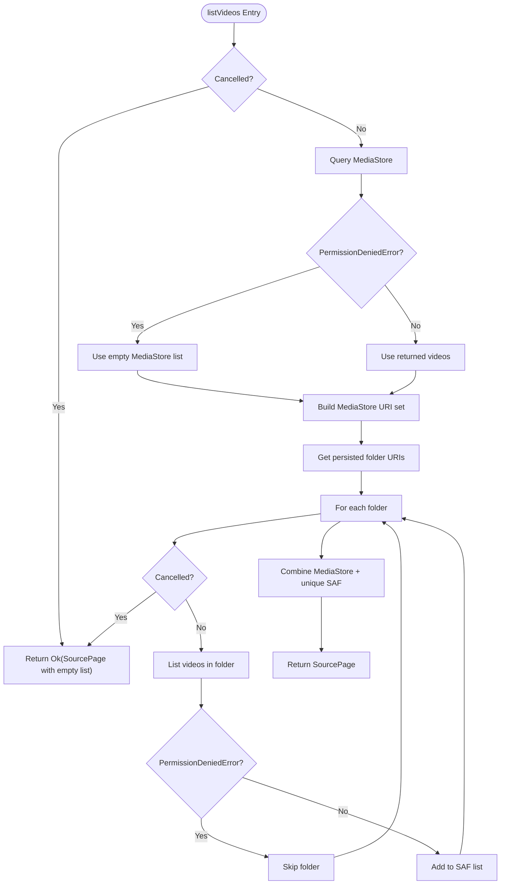
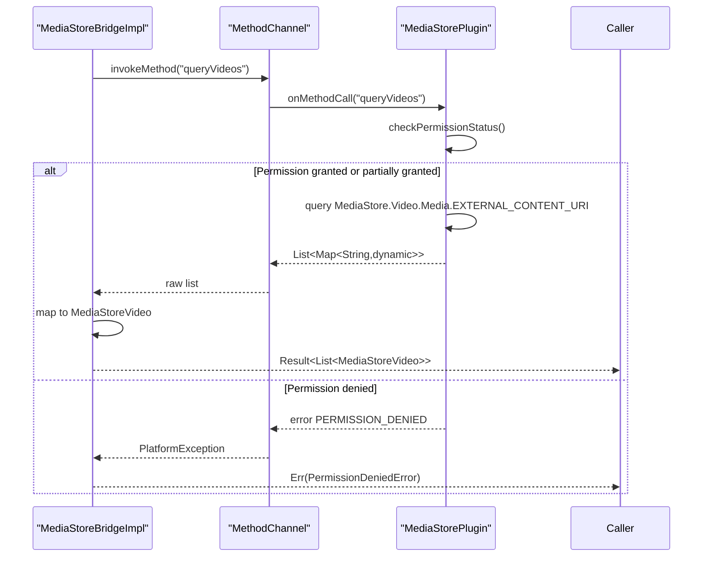
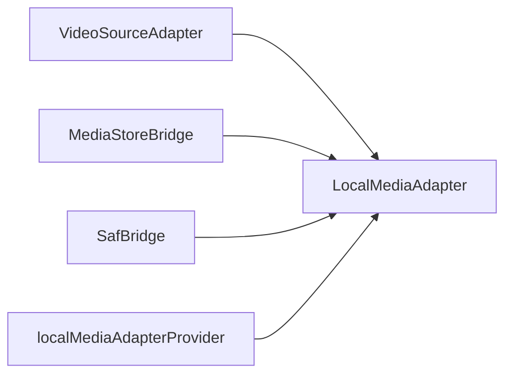

# Local Media Adapter

<cite>
**Referenced Files in This Document**
- [local_media_adapter.dart](file://lib/sources/local/local_media_adapter.dart)
- [source_adapter.dart](file://lib/sources/source_adapter.dart)
- [media_store_bridge.dart](file://lib/platform/media_store_bridge.dart)
- [media_store_bridge_impl.dart](file://lib/platform/media_store_bridge_impl.dart)
- [MediaStorePlugin.kt](file://android/app/src/main/kotlin/com/example/mytube/MediaStorePlugin.kt)
- [local_media_adapter_provider.dart](file://lib/sources/local/local_media_adapter_provider.dart)
- [ARCHITECTURE.md](file://ARCHITECTURE.md)
- [p3-03-plan.md](file://.agents/tasks/p3-03-plan.md)
- [local_media_adapter_test.dart](file://test/unit/sources/local_media_adapter_test.dart)
</cite>

## Table of Contents
1. [Introduction](#introduction)
2. [Project Structure](#project-structure)
3. [Core Components](#core-components)
4. [Architecture Overview](#architecture-overview)
5. [Detailed Component Analysis](#detailed-component-analysis)
6. [Dependency Analysis](#dependency-analysis)
7. [Performance Considerations](#performance-considerations)
8. [Troubleshooting Guide](#troubleshooting-guide)
9. [Conclusion](#conclusion)

## Introduction
This document explains the LocalMediaAdapter implementation that provides access to device videos through Android’s MediaStore API and selected folders via the Storage Access Framework (SAF). It shows how LocalMediaAdapter implements the VideoSourceAdapter interface, how it integrates with MediaStoreBridge for system video metadata, how pagination is modeled, how thumbnails are represented, and how errors such as permission issues, corrupted files, or unavailable media are handled. It also documents current performance characteristics and recommended optimizations for handling large video libraries efficiently.

## Project Structure
LocalMediaAdapter lives under the sources layer and depends on platform bridges rather than Flutter UI code. The adapter combines:
- MediaStore discovery for local device videos.
- SAF-persisted folder enumeration for user-selected directories.
- A shared deduplication strategy so the same logical video is not shown twice.

**Diagram sources**
- [local_media_adapter.dart:20-46](file://lib/sources/local/local_media_adapter.dart#L20-L46)
- [source_adapter.dart:23-57](file://lib/sources/source_adapter.dart#L23-L57)
- [media_store_bridge.dart:13-32](file://lib/platform/media_store_bridge.dart#L13-L32)
- [media_store_bridge_impl.dart:9-31](file://lib/platform/media_store_bridge_impl.dart#L9-L31)
- [MediaStorePlugin.kt:16-36](file://android/app/src/main/kotlin/com/example/mytube/MediaStorePlugin.kt#L16-L36)
- [local_media_adapter_provider.dart:11-16](file://lib/sources/local/local_media_adapter_provider.dart#L11-L16)

**Section sources**
- [local_media_adapter.dart:1-28](file://lib/sources/local/local_media_adapter.dart#L1-L28)
- [source_adapter.dart:1-22](file://lib/sources/source_adapter.dart#L1-L22)
- [media_store_bridge.dart:1-12](file://lib/platform/media_store_bridge.dart#L1-L12)
- [local_media_adapter_provider.dart:1-17](file://lib/sources/local/local_media_adapter_provider.dart#L1-L17)

## Core Components
- LocalMediaAdapter: Implements VideoSourceAdapter and merges MediaStore and SAF results.
- VideoSourceAdapter: Defines the contract for listing, availability, playback resolution, and capabilities.
- MediaStoreBridge: Abstracts Android MediaStore queries and permissions.
- MediaStoreBridgeImpl: MethodChannel bridge to Kotlin MediaStorePlugin.
- MediaStorePlugin: Kotlin plugin that queries MediaStore.Video.Media and returns structured rows.

Key responsibilities:
- Enumerate local videos from MediaStore and SAF folders.
- Map native metadata into SourceVideo objects.
- Provide availability checks and playable source resolution.
- Enforce download prohibition for local originals.

**Section sources**
- [local_media_adapter.dart:20-46](file://lib/sources/local/local_media_adapter.dart#L20-L46)
- [source_adapter.dart:23-57](file://lib/sources/source_adapter.dart#L23-L57)
- [media_store_bridge.dart:13-32](file://lib/platform/media_store_bridge.dart#L13-L32)
- [media_store_bridge_impl.dart:9-31](file://lib/platform/media_store_bridge_impl.dart#L9-L31)
- [MediaStorePlugin.kt:214-283](file://android/app/src/main/kotlin/com/example/mytube/MediaStorePlugin.kt#L214-L283)

## Architecture Overview
The adapter does not call Android APIs directly. Instead, it uses constructor-injected bridges. This keeps the adapter testable and free of Flutter dependencies.

**Diagram sources**
- [local_media_adapter.dart:52-123](file://lib/sources/local/local_media_adapter.dart#L52-L123)
- [media_store_bridge_impl.dart:13-31](file://lib/platform/media_store_bridge_impl.dart#L13-L31)
- [MediaStorePlugin.kt:71-78](file://android/app/src/main/kotlin/com/example/mytube/MediaStorePlugin.kt#L71-L78)
- [MediaStorePlugin.kt:214-283](file://android/app/src/main/kotlin/com/example/mytube/MediaStorePlugin.kt#L214-L283)

## Detailed Component Analysis

### LocalMediaAdapter Implementation
LocalMediaAdapter implements VideoSourceAdapter and supports both ProviderType.localMediaStore and ProviderType.selectedFolder within a single class. It:
- Declares capabilities indicating streaming, seeking, and thumbnail support, but no search, download, or built-in pagination.
- Merges MediaStore and SAF results, preferring MediaStore entries when exact URI matches occur.
- Routes getVideo and checkAvailability by detecting the content://media/ prefix.
- Resolves PlayableSource using the original content URI and detected MIME type.
- Prohibits downloads because local files are originals.

**Diagram sources**
- [local_media_adapter.dart:20-321](file://lib/sources/local/local_media_adapter.dart#L20-L321)
- [source_adapter.dart:23-57](file://lib/sources/source_adapter.dart#L23-L57)

#### listVideos Flow
The listing flow:
1. Check cancellation.
2. Query MediaStore; treat PermissionDeniedError as an empty list.
3. Build a set of MediaStore content URIs for deduplication.
4. Enumerate persisted SAF folders and list videos per folder.
5. Skip folders with PermissionDeniedError; propagate other errors.
6. Combine MediaStore first, then non-duplicate SAF entries.
7. Return SourcePage without a continuation token.

**Diagram sources**
- [local_media_adapter.dart:52-123](file://lib/sources/local/local_media_adapter.dart#L52-L123)

**Section sources**
- [local_media_adapter.dart:52-123](file://lib/sources/local/local_media_adapter.dart#L52-L123)

#### getVideo and Routing Logic
Routing rule:
- If sourceId starts with content://media/, route to MediaStore.
- Otherwise, iterate persisted SAF folders and find the matching URI.

Behavior:
- Returns Ok(null) if not found.
- Treats PermissionDeniedError as soft state (returns null instead of error).
- Propagates unexpected errors.

**Section sources**
- [local_media_adapter.dart:129-176](file://lib/sources/local/local_media_adapter.dart#L129-L176)

#### checkAvailability Logic
Behavior:
- For MediaStore URIs: presence means available; absence means missing; permission denied means permissionRevoked.
- For SAF URIs: searches all accessible folders; if every folder denies permission and item is not found, returns permissionRevoked; otherwise missing.

**Section sources**
- [local_media_adapter.dart:182-236](file://lib/sources/local/local_media_adapter.dart#L182-L236)

#### resolveForPlayback Logic
Behavior:
- Calls getVideo to obtain mimeType.
- Returns PlayableSource with the original sourceId URI, correct sourceType, canSeek true, and mimeType where available.
- Returns NotFoundError if the video is absent.
- Propagates errors from getVideo.

**Section sources**
- [local_media_adapter.dart:242-272](file://lib/sources/local/local_media_adapter.dart#L242-L272)

#### Mapping Helpers
- _mapMediaStoreVideo maps MediaStoreVideo to SourceVideo with full metadata including durationMs, widthPx, heightPx, mimeType, sizeBytes, and availability.
- _mapSafVideo maps SafVideo to SourceVideo; durationMs, widthPx, and heightPx are null because SAF does not expose them.

**Section sources**
- [local_media_adapter.dart:291-320](file://lib/sources/local/local_media_adapter.dart#L291-L320)

### VideoSourceAdapter Contract
The contract defines:
- sourceType: identifies the provider type.
- getCapabilities: declares supported operations.
- listVideos: lists pages with optional continuationToken and cancellation support.
- getVideo: fetches metadata for a single item.
- checkAvailability: reports reachability.
- resolveForPlayback: resolves an ephemeral playable source.
- checkDownloadEligibility: determines whether offline download is allowed.

Important types:
- SourceCapabilities: flags for streaming, seeking, thumbnails, search, download, pagination.
- SourcePage: page of SourceVideo plus nextContinuationToken.
- SourceVideo: metadata model used across adapters.
- PlayableSource: ephemeral playback target.
- CancellationToken: lightweight cancellation mechanism.

**Section sources**
- [source_adapter.dart:23-57](file://lib/sources/source_adapter.dart#L23-L57)
- [source_adapter.dart:63-90](file://lib/sources/source_adapter.dart#L63-L90)
- [source_adapter.dart:92-117](file://lib/sources/source_adapter.dart#L92-L117)
- [source_adapter.dart:119-137](file://lib/sources/source_adapter.dart#L119-L137)
- [source_adapter.dart:139-164](file://lib/sources/source_adapter.dart#L139-L164)

### MediaStoreBridge Integration
MediaStoreBridge abstracts:
- queryVideos: returns a typed list of MediaStoreVideo or a PermissionDeniedError.
- checkPermission and requestPermission: return MediaStorePermissionStatus.

MediaStoreBridgeImpl:
- Uses MethodChannel com.example.mytube/media_store.
- Parses platform exceptions into PermissionDeniedError or UnexpectedError.
- Maps native status strings to MediaStorePermissionStatus.

Kotlin MediaStorePlugin:
- Handles method calls: queryVideos, checkPermission, requestPermission.
- Checks OS-level permissions for API levels 24–32, 33, and 34+.
- Queries MediaStore.Video.Media.EXTERNAL_CONTENT_URI and projects fields such as id, display name, duration, width, height, MIME type, size, and timestamps.
- Builds a list of maps passed back to Dart.

**Diagram sources**
- [media_store_bridge_impl.dart:13-55](file://lib/platform/media_store_bridge_impl.dart#L13-L55)
- [MediaStorePlugin.kt:71-78](file://android/app/src/main/kotlin/com/example/mytube/MediaStorePlugin.kt#L71-L78)
- [MediaStorePlugin.kt:95-169](file://android/app/src/main/kotlin/com/example/mytube/MediaStorePlugin.kt#L95-L169)
- [MediaStorePlugin.kt:214-283](file://android/app/src/main/kotlin/com/example/mytube/MediaStorePlugin.kt#L214-L283)

**Section sources**
- [media_store_bridge.dart:13-32](file://lib/platform/media_store_bridge.dart#L13-L32)
- [media_store_bridge.dart:38-76](file://lib/platform/media_store_bridge.dart#L38-L76)
- [media_store_bridge_impl.dart:9-84](file://lib/platform/media_store_bridge_impl.dart#L9-L84)
- [MediaStorePlugin.kt:16-36](file://android/app/src/main/kotlin/com/example/mytube/MediaStorePlugin.kt#L16-L36)
- [MediaStorePlugin.kt:71-78](file://android/app/src/main/kotlin/com/example/mytube/MediaStorePlugin.kt#L71-L78)
- [MediaStorePlugin.kt:95-169](file://android/app/src/main/kotlin/com/example/mytube/MediaStorePlugin.kt#L95-L169)
- [MediaStorePlugin.kt:214-283](file://android/app/src/main/kotlin/com/example/mytube/MediaStorePlugin.kt#L214-L283)

### Pagination Strategy Using Continuation Tokens
Current behavior:
- VideoSourceAdapter.listVideos accepts a continuationToken parameter.
- LocalMediaAdapter.getCapabilities reports supportsPagination as false.
- LocalMediaAdapter.listVideos returns SourcePage without a nextContinuationToken.

Implication:
- The adapter currently loads all combined results into one page.
- Consumers should still pass CancellationToken to allow cancellation during scanning.
- Future pagination would require returning a token and splitting scans into chunks.

**Section sources**
- [source_adapter.dart:30-38](file://lib/sources/source_adapter.dart#L30-L38)
- [source_adapter.dart:82-90](file://lib/sources/source_adapter.dart#L82-L90)
- [local_media_adapter.dart:36-46](file://lib/sources/local/local_media_adapter.dart#L36-L46)
- [local_media_adapter.dart:52-123](file://lib/sources/local/local_media_adapter.dart#L52-L123)

### Thumbnail Generation and Caching
Current behavior:
- getCapabilities indicates canProvideThumbnail is true.
- SourceVideo.thumbnailUri is null in mapping helpers.
- No thumbnail generation or caching logic is implemented in LocalMediaAdapter.

Recommendation:
- Use Android native thumbnails or MediaStore thumbnails where available.
- Cache thumbnails in an app-managed cache directory separate from downloads.
- Evict least-recently-used thumbnails under a configured budget.
- Avoid blocking the main thread; use background workers.

[No sources needed since this section provides general guidance]

### Error Handling
Permission issues:
- MediaStoreBridgeImpl converts PERMISSION_DENIED into PermissionDeniedError.
- LocalMediaAdapter treats PermissionDeniedError as soft state:
  - In listVideos: skips MediaStore or specific SAF folders and continues.
  - In getVideo: returns Ok(null) instead of propagating the error.
  - In checkAvailability: returns AvailabilityState.permissionRevoked.

Unexpected errors:
- Non-permission errors from MediaStoreBridgeImpl are wrapped as UnexpectedError and propagated up.

Unavailable or missing media:
- checkAvailability returns AvailabilityState.missing when the item is not found.
- resolveForPlayback returns NotFoundError when getVideo returns null.

Corrupted files:
- Not explicitly handled at this layer; downstream player or availability checks should surface format or read failures.

**Section sources**
- [media_store_bridge_impl.dart:32-54](file://lib/platform/media_store_bridge_impl.dart#L32-L54)
- [local_media_adapter.dart:62-76](file://lib/sources/local/local_media_adapter.dart#L62-L76)
- [local_media_adapter.dart:95-113](file://lib/sources/local/local_media_adapter.dart#L95-L113)
- [local_media_adapter.dart:139-147](file://lib/sources/local/local_media_adapter.dart#L139-L147)
- [local_media_adapter.dart:193-197](file://lib/sources/local/local_media_adapter.dart#L193-L197)
- [local_media_adapter.dart:222-233](file://lib/sources/local/local_media_adapter.dart#L222-L233)
- [local_media_adapter.dart:251-257](file://lib/sources/local/local_media_adapter.dart#L251-L257)

### Performance Optimization Techniques
Current optimizations:
- Background scanning: callers must supply CancellationToken and check it between async steps.
- Lazy loading: thumbnails are not generated here; they can be loaded on demand.
- Deduplication: uses a fast URI set to avoid duplicate entries.
- Minimal memory pressure: avoids unnecessary object creation beyond mapped SourceVideo instances.

Recommended optimizations for large libraries:
- Implement server-side or database-backed pagination with continuation tokens.
- Stream cursor results from MediaStore instead of building a full in-memory list.
- Batch SAF folder enumeration and limit concurrent folder scans.
- Use background isolators or work managers for indexing.
- Apply memory budgets for metadata and thumbnails.
- Defer heavy metadata extraction until items are viewed.

[No sources needed since this section provides general guidance]

## Dependency Analysis
LocalMediaAdapter depends on:
- VideoSourceAdapter interface for contract compliance.
- MediaStoreBridge for system video metadata.
- SafBridge for selected folder enumeration.
- Riverpod provider wires bridges into the adapter.

**Diagram sources**
- [local_media_adapter.dart:20-28](file://lib/sources/local/local_media_adapter.dart#L20-L28)
- [source_adapter.dart:23-57](file://lib/sources/source_adapter.dart#L23-L57)
- [local_media_adapter_provider.dart:11-16](file://lib/sources/local/local_media_adapter_provider.dart#L11-L16)

**Section sources**
- [local_media_adapter.dart:1-8](file://lib/sources/local/local_media_adapter.dart#L1-L8)
- [local_media_adapter_provider.dart:1-17](file://lib/sources/local/local_media_adapter_provider.dart#L1-L17)

## Performance Considerations
- The adapter currently returns a single page without continuation tokens.
- Large device libraries may cause memory and latency spikes.
- Introduce pagination, streaming, and background processing to scale to thousands of videos.
- Separate cache and downloads directories; evict LRU thumbnails under a budget.
- Keep UI responsive by checking cancellation frequently.

[No sources needed since this section provides general guidance]

## Troubleshooting Guide
Common issues and resolutions:
- Permission denied:
  - Verify MediaStoreBridge.checkPermission and requestPermission flows.
  - On API 34+, ensure READ_MEDIA_VIDEO and READ_MEDIA_VISUAL_USER_SELECTED are considered.
  - Handle permanentlyDenied by directing users to Settings.
- Missing videos:
  - checkAvailability returns missing when the item is not present.
  - Ensure MediaStore indexes have updated after file changes.
- Corrupted or unsupported files:
  - Downstream player should handle unsupported formats.
  - Surface user-friendly errors and offer retry or alternative sources.
- Slow library scan:
  - Enable pagination and background scanning.
  - Limit concurrent SAF folder scans.
  - Defer expensive metadata extraction.

**Section sources**
- [media_store_bridge_impl.dart:57-84](file://lib/platform/media_store_bridge_impl.dart#L57-L84)
- [MediaStorePlugin.kt:95-169](file://android/app/src/main/kotlin/com/example/mytube/MediaStorePlugin.kt#L95-L169)
- [local_media_adapter.dart:182-236](file://lib/sources/local/local_media_adapter.dart#L182-L236)

## Conclusion
LocalMediaAdapter provides a clean, testable abstraction over Android MediaStore and SAF to enumerate local videos. It implements VideoSourceAdapter, integrates with MediaStoreBridge for rich metadata, and handles permission and availability states robustly. While it currently does not implement pagination or thumbnail caching, its design allows straightforward extension. For production-scale libraries, adopt continuation-token pagination, background scanning, lazy loading, and memory-aware caching to maintain responsiveness and stability.