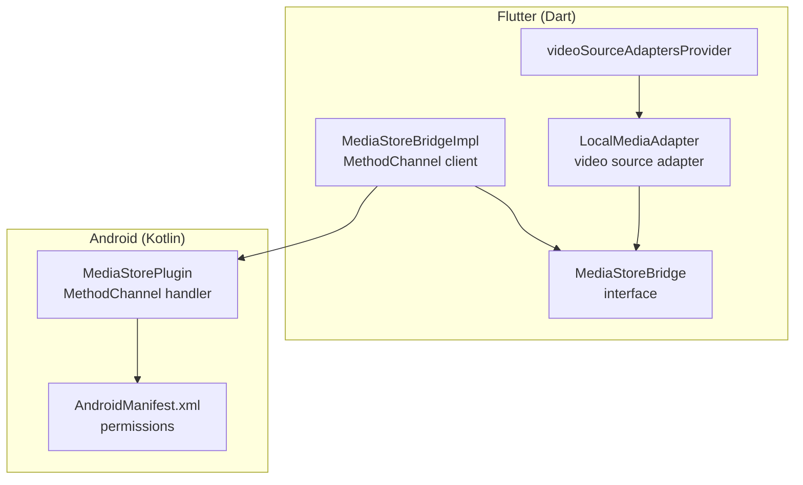
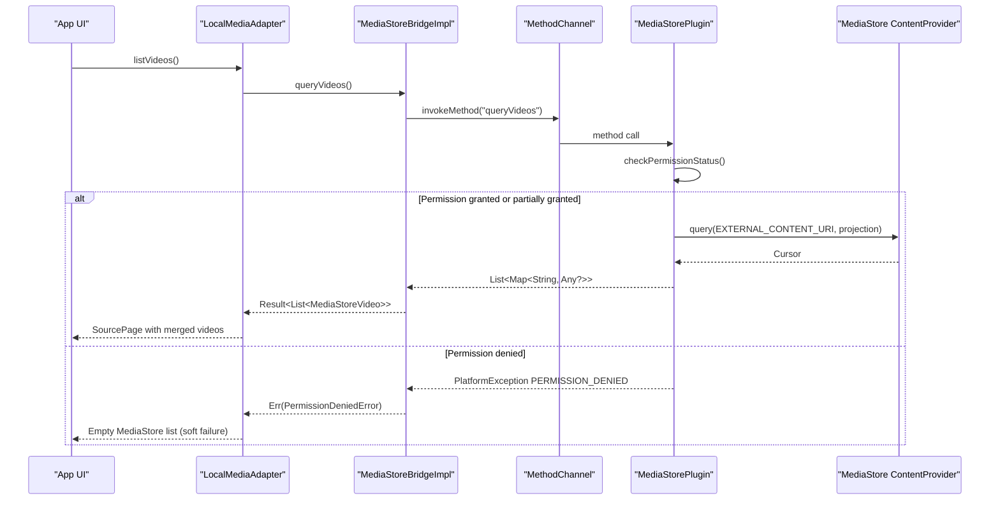
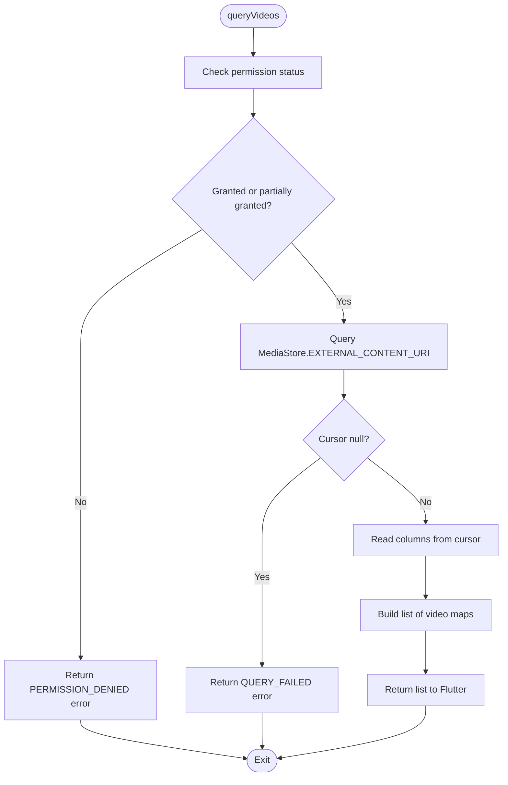
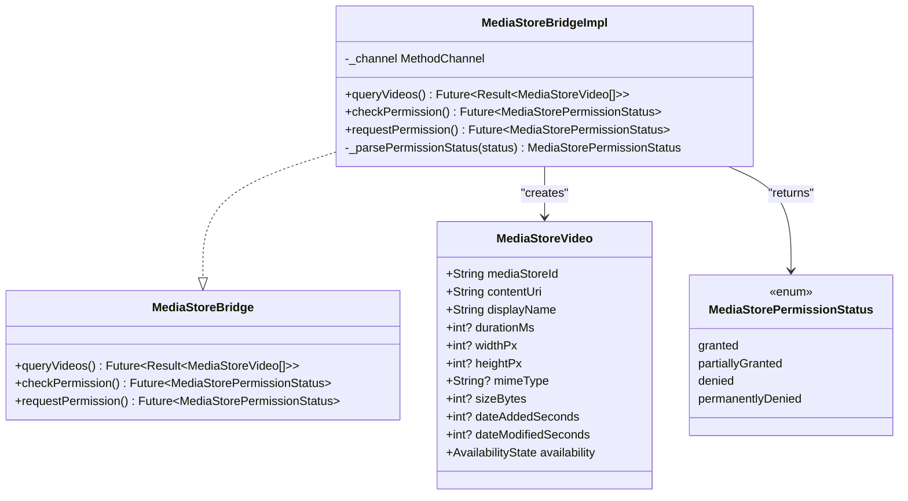
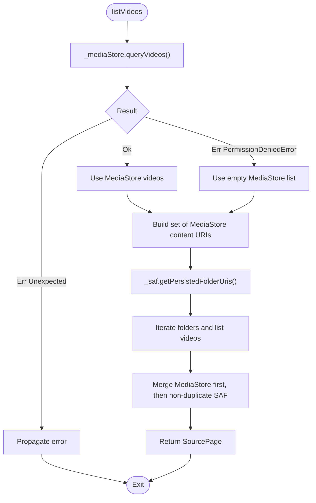
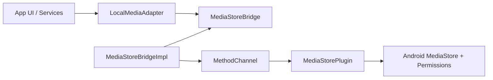

# MediaStore Bridge

<cite>
**Referenced Files in This Document**
- [MediaStorePlugin.kt](file://android/app/src/main/kotlin/com/example/mytube/MediaStorePlugin.kt)
- [AndroidManifest.xml](file://android/app/src/main/AndroidManifest.xml)
- [media_store_bridge.dart](file://lib/platform/media_store_bridge.dart)
- [media_store_bridge_impl.dart](file://lib/platform/media_store_bridge_impl.dart)
- [local_media_adapter.dart](file://lib/sources/local/local_media_adapter.dart)
- [source_registry.dart](file://lib/sources/source_registry.dart)
- [media_store_bridge_impl_test.dart](file://test/unit/platform/media_store_bridge_impl_test.dart)
</cite>

## Table of Contents
1. [Introduction](#introduction)
2. [Project Structure](#project-structure)
3. [Core Components](#core-components)
4. [Architecture Overview](#architecture-overview)
5. [Detailed Component Analysis](#detailed-component-analysis)
6. [Dependency Analysis](#dependency-analysis)
7. [Performance Considerations](#performance-considerations)
8. [Troubleshooting Guide](#troubleshooting-guide)
9. [Conclusion](#conclusion)

## Introduction
This document explains the MediaStore bridge that provides Flutter with access to Android’s system video library. It covers how the Kotlin plugin queries `MediaStore.Video.Media.EXTERNAL_CONTENT_URI`, how Flutter maps native results into structured domain data, and how permissions, errors, and integration with the local source adapter work together.

The implementation is split across:
- A Kotlin `MethodChannel` plugin on Android.
- A Dart bridge interface and its concrete implementation.
- A local media adapter that merges MediaStore results with SAF-selected folders.

## Project Structure
The MediaStore bridge spans both platforms:

**Diagram sources**
- [media_store_bridge.dart:5-32](file://lib/platform/media_store_bridge.dart#L5-L32)
- [media_store_bridge_impl.dart:7-10](file://lib/platform/media_store_bridge_impl.dart#L7-L10)
- [local_media_adapter.dart:9-34](file://lib/sources/local/local_media_adapter.dart#L9-L34)
- [source_registry.dart:5-10](file://lib/sources/source_registry.dart#L5-L10)
- [MediaStorePlugin.kt:16-36](file://android/app/src/main/kotlin/com/example/mytube/MediaStorePlugin.kt#L16-L36)
- [AndroidManifest.xml:4-8](file://android/app/src/main/AndroidManifest.xml#L4-L8)

**Section sources**
- [media_store_bridge.dart:5-32](file://lib/platform/media_store_bridge.dart#L5-L32)
- [media_store_bridge_impl.dart:7-10](file://lib/platform/media_store_bridge_impl.dart#L7-L10)
- [local_media_adapter.dart:9-34](file://lib/sources/local/local_media_adapter.dart#L9-L34)
- [source_registry.dart:5-10](file://lib/sources/source_registry.dart#L5-L10)
- [MediaStorePlugin.kt:16-36](file://android/app/src/main/kotlin/com/example/mytube/MediaStorePlugin.kt#L16-L36)
- [AndroidManifest.xml:4-8](file://android/app/src/main/AndroidManifest.xml#L4-L8)

## Core Components
- **MediaStoreBridge**: The Dart contract for querying videos and checking/requesting permissions.
- **MediaStoreBridgeImpl**: The Dart implementation that calls the Kotlin plugin via a `MethodChannel`.
- **MediaStorePlugin**: The Kotlin plugin that handles permission checks, permission requests, and `queryVideos`.
- **LocalMediaAdapter**: The source adapter that merges MediaStore and SAF results and exposes them through the app’s source abstraction.
- **AndroidManifest.xml**: Declares required read permissions for different API levels.

Key responsibilities:
- Querying `MediaStore.Video.Media.EXTERNAL_CONTENT_URI` for display name, duration, width, height, MIME type, size, timestamps, and content URI.
- Handling per-API-level permissions (`READ_EXTERNAL_STORAGE`, `READ_MEDIA_VIDEO`, `READ_MEDIA_VISUAL_USER_SELECTED`).
- Returning structured `MediaStoreVideo` objects to Flutter.
- Integrating with the source adapter so higher layers do not call the platform bridge directly.

**Section sources**
- [media_store_bridge.dart:13-32](file://lib/platform/media_store_bridge.dart#L13-L32)
- [media_store_bridge.dart:38-93](file://lib/platform/media_store_bridge.dart#L38-L93)
- [media_store_bridge_impl.dart:7-84](file://lib/platform/media_store_bridge_impl.dart#L7-L84)
- [MediaStorePlugin.kt:16-78](file://android/app/src/main/kotlin/com/example/mytube/MediaStorePlugin.kt#L16-L78)
- [local_media_adapter.dart:9-46](file://lib/sources/local/local_media_adapter.dart#L9-L46)
- [AndroidManifest.xml:4-8](file://android/app/src/main/AndroidManifest.xml#L4-L8)

## Architecture Overview
The bridge follows a layered approach:
- Flutter widgets use the source adapter layer.
- The source adapter uses the platform bridge interface.
- The concrete bridge implementation communicates with the Kotlin plugin.
- The Kotlin plugin performs OS-level permission checks and queries `MediaStore`.

**Diagram sources**
- [local_media_adapter.dart:52-123](file://lib/sources/local/local_media_adapter.dart#L52-L123)
- [media_store_bridge_impl.dart:12-55](file://lib/platform/media_store_bridge_impl.dart#L12-L55)
- [MediaStorePlugin.kt:71-78](file://android/app/src/main/kotlin/com/example/mytube/MediaStorePlugin.kt#L71-L78)
- [MediaStorePlugin.kt:95-169](file://android/app/src/main/kotlin/com/example/mytube/MediaStorePlugin.kt#L95-L169)
- [MediaStorePlugin.kt:214-283](file://android/app/src/main/kotlin/com/example/mytube/MediaStorePlugin.kt#L214-L283)

## Detailed Component Analysis

### Kotlin Plugin: MediaStorePlugin
The plugin registers a `MethodChannel` named `com.example.mytube/media_store` and handles three methods:
- `checkPermission`: returns a string status used by Flutter to map to an enum.
- `requestPermission`: asks for the correct permission(s) based on API level.
- `queryVideos`: queries `MediaStore.Video.Media.EXTERNAL_CONTENT_URI` and returns a list of video metadata maps.

#### Permission handling
- API 34+: requires `READ_MEDIA_VIDEO` and optionally `READ_MEDIA_VISUAL_USER_SELECTED`.
- API 33: requires `READ_MEDIA_VIDEO`.
- API 24–32: requires `READ_EXTERNAL_STORAGE`.

The plugin returns one of:
- `granted`
- `partiallyGranted`
- `denied`
- `permanentlyDenied`

If no activity is attached when requesting permissions, it returns an error to Flutter.

#### Video query flow
- Checks permission before querying.
- Queries `MediaStore.Video.Media.EXTERNAL_CONTENT_URI` with a projection including ID, display name, duration, width, height, MIME type, size, date added, and date modified.
- Converts each cursor row into a map containing:
  - `mediaStoreId`
  - `contentUri`
  - `displayName`
  - `durationMs`
  - `widthPx`
  - `heightPx`
  - `mimeType`
  - `sizeBytes`
  - `dateAddedSeconds`
  - `dateModifiedSeconds`
- Returns the list to Flutter or an error if the query fails or the cursor is null.

**Diagram sources**
- [MediaStorePlugin.kt:214-283](file://android/app/src/main/kotlin/com/example/mytube/MediaStorePlugin.kt#L214-L283)

**Section sources**
- [MediaStorePlugin.kt:16-36](file://android/app/src/main/kotlin/com/example/mytube/MediaStorePlugin.kt#L16-L36)
- [MediaStorePlugin.kt:71-78](file://android/app/src/main/kotlin/com/example/mytube/MediaStorePlugin.kt#L71-L78)
- [MediaStorePlugin.kt:95-169](file://android/app/src/main/kotlin/com/example/mytube/MediaStorePlugin.kt#L95-L169)
- [MediaStorePlugin.kt:171-208](file://android/app/src/main/kotlin/com/example/mytube/MediaStorePlugin.kt#L171-L208)
- [MediaStorePlugin.kt:214-283](file://android/app/src/main/kotlin/com/example/mytube/MediaStorePlugin.kt#L214-L283)

### Dart Bridge Interface: MediaStoreBridge
The interface defines:
- `queryVideos()`: returns `Result<List<MediaStoreVideo>>`.
- `checkPermission()`: returns current permission status without triggering dialogs.
- `requestPermission()`: requests the appropriate permission and returns the resulting status.

It also defines:
- `MediaStoreVideo`: a value object representing a single MediaStore video row.
- `MediaStorePermissionStatus`: an enum for `granted`, `partiallyGranted`, `denied`, and `permanentlyDenied`.

Important design notes:
- Widgets must not call this bridge directly; they should use the local source adapter.
- Permission denial is modeled as an error result rather than throwing exceptions.

**Section sources**
- [media_store_bridge.dart:5-32](file://lib/platform/media_store_bridge.dart#L5-L32)
- [media_store_bridge.dart:38-93](file://lib/platform/media_store_bridge.dart#L38-L93)

### Dart Implementation: MediaStoreBridgeImpl
This class:
- Uses a `MethodChannel` named `com.example.mytube/media_store`.
- Calls `queryVideos`, `checkPermission`, and `requestPermission`.
- Parses the raw map list into `MediaStoreVideo` objects.
- Converts `PlatformException` codes:
  - `PERMISSION_DENIED` becomes `PermissionDeniedError`.
  - Other platform errors become `UnexpectedError`.
- Maps string statuses to `MediaStorePermissionStatus`.

**Diagram sources**
- [media_store_bridge.dart:13-32](file://lib/platform/media_store_bridge.dart#L13-L32)
- [media_store_bridge.dart:38-93](file://lib/platform/media_store_bridge.dart#L38-L93)
- [media_store_bridge_impl.dart:7-84](file://lib/platform/media_store_bridge_impl.dart#L7-L84)

**Section sources**
- [media_store_bridge_impl.dart:7-84](file://lib/platform/media_store_bridge_impl.dart#L7-L84)

### Local Source Adapter Integration: LocalMediaAdapter
The adapter:
- Implements `VideoSourceAdapter`.
- Merges MediaStore results with SAF-persisted folder results.
- Deduplicates entries where a SAF document URI exactly matches a MediaStore `contentUri`.
- Treats `PermissionDeniedError` from MediaStore as a soft failure: it continues with an empty MediaStore list instead of failing the entire scan.
- Routes lookups and availability checks based on whether the source ID starts with `content://media/`.

**Diagram sources**
- [local_media_adapter.dart:52-123](file://lib/sources/local/local_media_adapter.dart#L52-L123)

**Section sources**
- [local_media_adapter.dart:9-46](file://lib/sources/local/local_media_adapter.dart#L9-L46)
- [local_media_adapter.dart:52-123](file://lib/sources/local/local_media_adapter.dart#L52-L123)
- [local_media_adapter.dart:129-176](file://lib/sources/local/local_media_adapter.dart#L129-L176)
- [local_media_adapter.dart:182-236](file://lib/sources/local/local_media_adapter.dart#L182-L236)
- [local_media_adapter.dart:291-320](file://lib/sources/local/local_media_adapter.dart#L291-L320)

### Permission Requirements
The manifest declares:
- `INTERNET` for direct URL streams.
- `READ_EXTERNAL_STORAGE` with `maxSdkVersion="32"` for older devices.
- `READ_MEDIA_VIDEO` for API 33+.
- `READ_MEDIA_VISUAL_USER_SELECTED` for API 34+ partial access.

At runtime:
- `checkPermission()` returns the current state.
- `requestPermission()` requests the correct permission(s).
- If no activity is attached, the plugin returns an error.

**Section sources**
- [AndroidManifest.xml:1-8](file://android/app/src/main/AndroidManifest.xml#L1-L8)
- [media_store_bridge.dart:14-31](file://lib/platform/media_store_bridge.dart#L14-L31)
- [MediaStorePlugin.kt:95-169](file://android/app/src/main/kotlin/com/example/mytube/MediaStorePlugin.kt#L95-L169)
- [MediaStorePlugin.kt:171-208](file://android/app/src/main/kotlin/com/example/mytube/MediaStorePlugin.kt#L171-L208)

## Dependency Analysis
The dependency chain is intentionally shallow:
- Higher layers depend on the bridge interface, not the Kotlin implementation.
- The adapter depends on the bridge interface and SAF bridge.
- The Kotlin plugin depends on Android APIs and Flutter plugin infrastructure.

**Diagram sources**
- [source_registry.dart:5-10](file://lib/sources/source_registry.dart#L5-L10)
- [local_media_adapter.dart:20-28](file://lib/sources/local/local_media_adapter.dart#L20-L28)
- [media_store_bridge.dart:5-32](file://lib/platform/media_store_bridge.dart#L5-L32)
- [media_store_bridge_impl.dart:7-10](file://lib/platform/media_store_bridge_impl.dart#L7-L10)
- [MediaStorePlugin.kt:16-36](file://android/app/src/main/kotlin/com/example/mytube/MediaStorePlugin.kt#L16-L36)

**Section sources**
- [source_registry.dart:5-10](file://lib/sources/source_registry.dart#L5-L10)
- [local_media_adapter.dart:20-28](file://lib/sources/local/local_media_adapter.dart#L20-L28)
- [media_store_bridge.dart:5-32](file://lib/platform/media_store_bridge.dart#L5-L32)
- [media_store_bridge_impl.dart:7-10](file://lib/platform/media_store_bridge_impl.dart#L7-L10)
- [MediaStorePlugin.kt:16-36](file://android/app/src/main/kotlin/com/example/mytube/MediaStorePlugin.kt#L16-L36)

## Performance Considerations
Current behavior:
- The Kotlin plugin queries all accessible videos in one pass over `MediaStore.Video.Media.EXTERNAL_CONTENT_URI`.
- No server-side or in-memory caching is implemented in the plugin or bridge.
- The adapter does not cache results between calls.

Recommended optimizations for large libraries:
- Pagination or incremental scanning:
  - Add pagination parameters to the bridge interface and plugin.
  - Use `LIMIT`/`OFFSET` or cursor-based pagination if supported by the provider.
- Caching:
  - Cache `MediaStoreVideo` metadata keyed by `mediaStoreId` and `contentUri`.
  - Invalidate cache when permission changes or when the user explicitly refreshes.
- Projection optimization:
  - Only request fields needed by the current UI layer.
- Background scanning:
  - Perform scans off the main thread and stream results to Flutter.
- Throttling repeated scans:
  - Debounce rapid refresh triggers.
- Avoid redundant lookups:
  - Reuse already-fetched lists in the adapter when possible.

[No sources needed since this section provides general guidance]

## Troubleshooting Guide

### Denied permissions
Symptoms:
- `queryVideos()` returns `PermissionDeniedError`.
- UI shows an empty MediaStore list while other sources may still work.

What happens:
- The Kotlin plugin returns `PERMISSION_DENIED` when permission is not granted or partially granted.
- The Dart bridge converts this to `PermissionDeniedError`.
- The adapter treats it as a soft failure and continues with an empty MediaStore list.

Resolution steps:
- Call `checkPermission()` to determine current status.
- Call `requestPermission()` to trigger the system dialog.
- If status is `permanentlyDenied`, guide the user to app settings.

**Section sources**
- [MediaStorePlugin.kt:214-220](file://android/app/src/main/kotlin/com/example/mytube/MediaStorePlugin.kt#L214-L220)
- [media_store_bridge_impl.dart:32-46](file://lib/platform/media_store_bridge_impl.dart#L32-L46)
- [local_media_adapter.dart:62-76](file://lib/sources/local/local_media_adapter.dart#L62-L76)

### Empty library
Symptoms:
- `queryVideos()` returns an empty list.
- No error is thrown.

Causes:
- User has no videos.
- Permission is granted but the device library is empty.
- SAF folders are empty or inaccessible.

Behavior:
- The bridge returns `Result.ok([])`.
- The adapter can merge with SAF results; if none exist, the final page is empty.

**Section sources**
- [media_store_bridge_impl.dart:13-31](file://lib/platform/media_store_bridge_impl.dart#L13-L31)
- [local_media_adapter.dart:115-123](file://lib/sources/local/local_media_adapter.dart#L115-L123)

### Corrupted database entries or invalid cursor data
Symptoms:
- `QUERY_FAILED` error from the plugin.
- Null cursor returned by `ContentResolver`.
- Exceptions while reading cursor columns.

Handling:
- The plugin catches query failures and returns `QUERY_FAILED`.
- The Dart bridge wraps these as `UnexpectedError`.
- The adapter propagates unexpected errors rather than silently ignoring them.

Mitigation:
- Retry after permission recovery.
- Clear app storage or repair MediaStore index at the OS level if corruption persists.
- Log diagnostic messages for support.

**Section sources**
- [MediaStorePlugin.kt:235-245](file://android/app/src/main/kotlin/com/example/mytube/MediaStorePlugin.kt#L235-L245)
- [MediaStorePlugin.kt:247-283](file://android/app/src/main/kotlin/com/example/mytube/MediaStorePlugin.kt#L247-L283)
- [media_store_bridge_impl.dart:40-54](file://lib/platform/media_store_bridge_impl.dart#L40-L54)

### Unit test coverage highlights
- Success parsing of `MediaStoreVideo` fields.
- Empty list handling.
- `PERMISSION_DENIED` mapping to `PermissionDeniedError`.
- Other platform exceptions mapped to `UnexpectedError`.
- Permission status mapping for `granted`, `partiallyGranted`, `denied`, and `permanentlyDenied`.

**Section sources**
- [media_store_bridge_impl_test.dart:28-119](file://test/unit/platform/media_store_bridge_impl_test.dart#L28-L119)

## Conclusion
The MediaStore bridge cleanly separates platform concerns from Flutter logic:
- The Kotlin plugin encapsulates Android permission and `MediaStore` access.
- The Dart bridge translates native results into typed domain models.
- The local adapter integrates MediaStore with SAF and presents a unified source interface.

For production-scale libraries, consider adding pagination, caching, background scanning, and projection tuning to improve responsiveness and reduce memory pressure.

[No sources needed since this section summarizes without analyzing specific files]