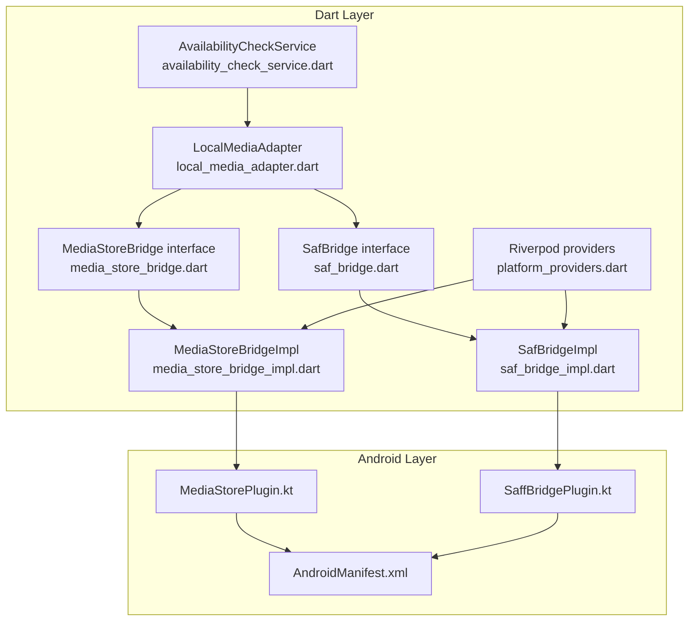
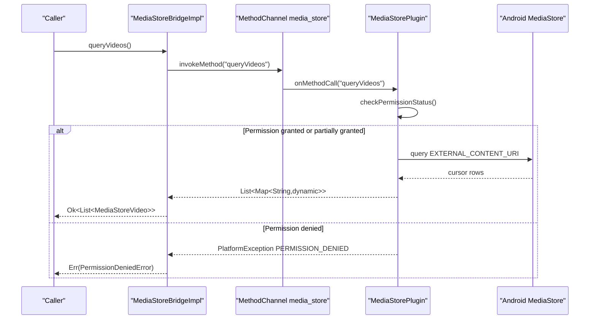
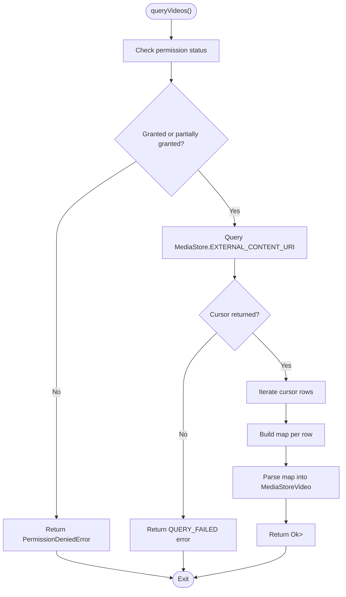
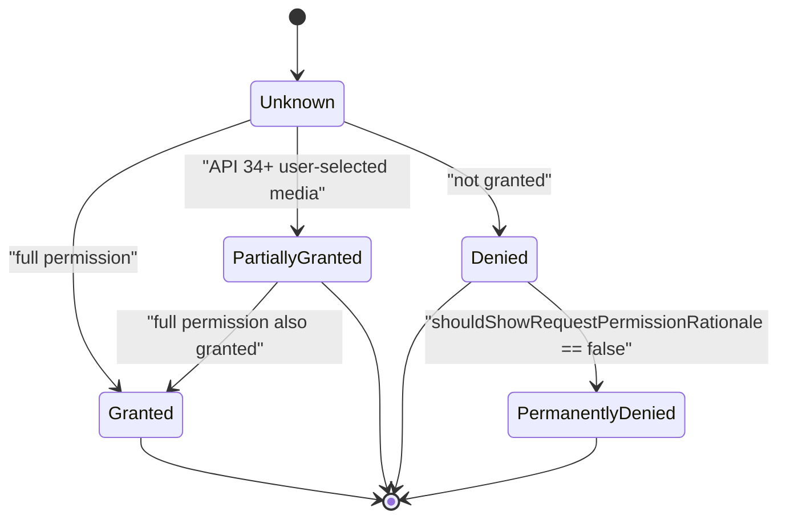
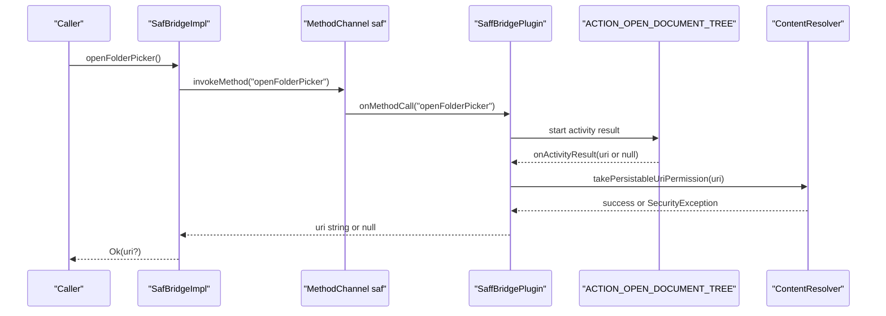
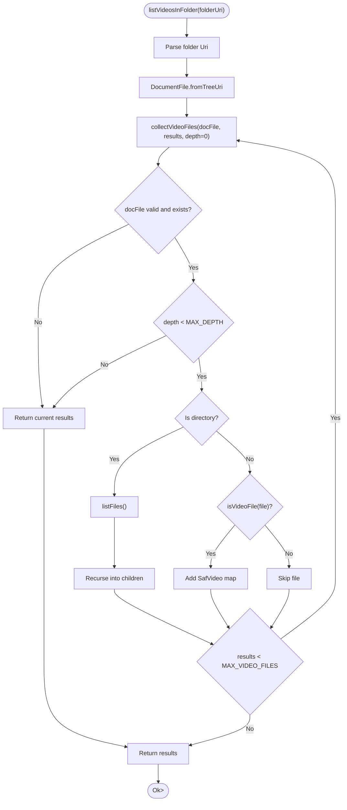
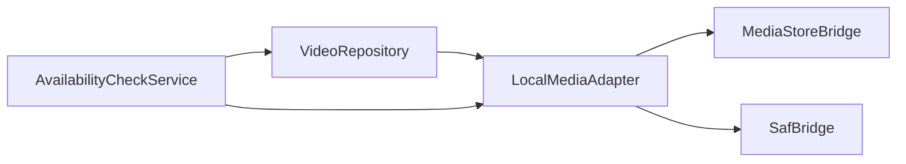
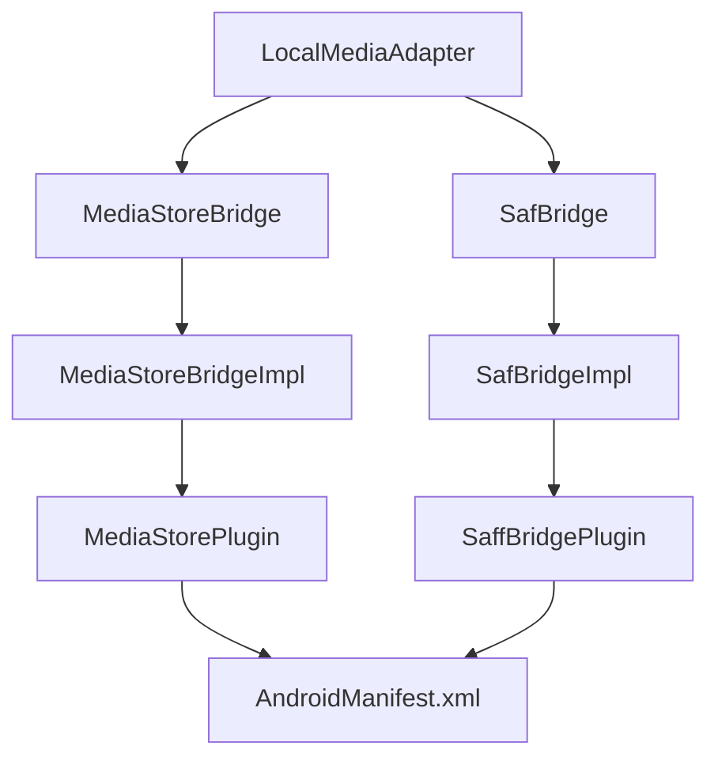

# Platform Bridges

<cite>
**Referenced Files in This Document**   
- [MediaStorePlugin.kt](file://android/app/src/main/kotlin/com/example/mytube/MediaStorePlugin.kt)
- [SaffBridgePlugin.kt](file://android/app/src/main/kotlin/com/example/mytube/SaffBridgePlugin.kt)
- [AndroidManifest.xml](file://android/app/src/main/AndroidManifest.xml)
- [media_store_bridge.dart](file://lib/platform/media_store_bridge.dart)
- [media_store_bridge_impl.dart](file://lib/platform/media_store_bridge_impl.dart)
- [saf_bridge.dart](file://lib/platform/saf_bridge.dart)
- [saf_bridge_impl.dart](file://lib/platform/saf_bridge_impl.dart)
- [platform_providers.dart](file://lib/platform/platform_providers.dart)
- [local_media_adapter.dart](file://lib/sources/local/local_media_adapter.dart)
- [availability_check_service.dart](file://lib/domain/services/availability_check_service.dart)
- [media_store_bridge_impl_test.dart](file://test/unit/platform/media_store_bridge_impl_test.dart)
- [saf_bridge_impl_test.dart](file://test/unit/platform/saf_bridge_impl_test.dart)
</cite>

## Table of Contents
1. [Introduction](#introduction)
2. [Project Structure](#project-structure)
3. [Core Components](#core-components)
4. [Architecture Overview](#architecture-overview)
5. [Detailed Component Analysis](#detailed-component-analysis)
6. [Dependency Analysis](#dependency-analysis)
7. [Performance Considerations](#performance-considerations)
8. [Troubleshooting Guide](#troubleshooting-guide)
9. [Conclusion](#conclusion)

## Introduction
This document explains the platform bridge layer that abstracts Android-specific functionality for local video discovery. It covers two complementary access paths:

- **MediaStore bridge**: queries device-wide video metadata through Android’s `MediaStore` ContentProvider and handles legacy and scoped storage permissions (`READ_EXTERNAL_STORAGE`, `READ_MEDIA_VIDEO`, `READ_MEDIA_VISUAL_USER_SELECTED`).
- **SAF bridge**: uses the Storage Access Framework to let users select a folder, persist read access to that folder tree, and recursively list video files inside it.

The Dart side defines stable interfaces and data models, while Kotlin plugins implement native behavior via Flutter MethodChannels. Errors are modeled with a `Result<T>` pattern so callers can distinguish permission revocation from unexpected failures.

## Project Structure
The platform bridge is split across Android Kotlin code and Dart platform abstractions:

**Diagram sources**
- [media_store_bridge.dart:13-32](file://lib/platform/media_store_bridge.dart#L13-L32)
- [media_store_bridge_impl.dart:9-84](file://lib/platform/media_store_bridge_impl.dart#L9-L84)
- [saf_bridge.dart:12-32](file://lib/platform/saf_bridge.dart#L12-L32)
- [saf_bridge_impl.dart:8-150](file://lib/platform/saf_bridge_impl.dart#L8-L150)
- [platform_providers.dart:11-19](file://lib/platform/platform_providers.dart#L11-L19)
- [local_media_adapter.dart:9-28](file://lib/sources/local/local_media_adapter.dart#L9-L28)
- [availability_check_service.dart:38-169](file://lib/domain/services/availability_check_service.dart#L38-L169)
- [MediaStorePlugin.kt:16-78](file://android/app/src/main/kotlin/com/example/mytube/MediaStorePlugin.kt#L16-L78)
- [SaffBridgePlugin.kt:20-95](file://android/app/src/main/kotlin/com/example/mytube/SaffBridgePlugin.kt#L20-L95)
- [AndroidManifest.xml:4-8](file://android/app/src/main/AndroidManifest.xml#L4-L8)

**Section sources**
- [media_store_bridge.dart:1-98](file://lib/platform/media_store_bridge.dart#L1-L98)
- [saf_bridge.dart:1-58](file://lib/platform/saf_bridge.dart#L1-L58)
- [MediaStorePlugin.kt:1-285](file://android/app/src/main/kotlin/com/example/mytube/MediaStorePlugin.kt#L1-L285)
- [SaffBridgePlugin.kt:1-255](file://android/app/src/main/kotlin/com/example/mytube/SaffBridgePlugin.kt#L1-L255)
- [AndroidManifest.xml:1-53](file://android/app/src/main/AndroidManifest.xml#L1-L53)

## Core Components
The bridge layer has two main responsibilities:

| Component | Responsibility | Key Methods |
|---|---|---|
| `MediaStoreBridge` (interface) | Declares the contract for querying device videos and managing MediaStore permissions | `queryVideos()`, `checkPermission()`, `requestPermission()` |
| `MediaStoreBridgeImpl` | Dart implementation using a MethodChannel; maps platform errors to `PermissionDeniedError` or `UnexpectedError` | Same as interface |
| `MediaStorePlugin` | Kotlin plugin handling API-level permission checks, permission requests, and `MediaStore` queries | `queryVideos`, `checkPermission`, `requestPermission` |
| `SafBridge` (interface) | Declares the contract for SAF folder selection, persisted grants, and recursive video listing | `openFolderPicker()`, `getPersistedFolderUris()`, `releasePersistedUri()`, `listVideosInFolder()`, `checkFolderAccess()` |
| `SafBridgeImpl` | Dart implementation using a MethodChannel; wraps SAF results into `SafVideo` objects | Same as interface |
| `SaffBridgePlugin` | Kotlin plugin handling `ACTION_OPEN_DOCUMENT_TREE`, persisted URI permissions, and recursive traversal | Same methods as interface |

**Section sources**
- [media_store_bridge.dart:13-93](file://lib/platform/media_store_bridge.dart#L13-L93)
- [media_store_bridge_impl.dart:9-84](file://lib/platform/media_store_bridge_impl.dart#L9-L84)
- [saf_bridge.dart:12-57](file://lib/platform/saf_bridge.dart#L12-L57)
- [saf_bridge_impl.dart:8-150](file://lib/platform/saf_bridge_impl.dart#L8-L150)
- [MediaStorePlugin.kt:16-284](file://android/app/src/main/kotlin/com/example/mytube/MediaStorePlugin.kt#L16-L284)
- [SaffBridgePlugin.kt:20-254](file://android/app/src/main/kotlin/com/example/mytube/SaffBridgePlugin.kt#L20-L254)

## Architecture Overview
The platform bridges follow a layered architecture:

1. **Domain and UI layers** depend on Dart bridge interfaces.
2. **Bridge implementations** call Android through Flutter MethodChannels.
3. **Kotlin plugins** perform OS operations:
   - MediaStore queries for system video metadata.
   - SAF folder picker and document traversal for user-selected storage locations.
4. **Permissions** are handled at the platform boundary, returning structured status or error types rather than throwing directly.

**Diagram sources**
- [media_store_bridge_impl.dart:12-54](file://lib/platform/media_store_bridge_impl.dart#L12-L54)
- [MediaStorePlugin.kt:71-78](file://android/app/src/main/kotlin/com/example/mytube/MediaStorePlugin.kt#L71-L78)
- [MediaStorePlugin.kt:95-169](file://android/app/src/main/kotlin/com/example/mytube/MediaStorePlugin.kt#L95-L169)
- [MediaStorePlugin.kt:214-283](file://android/app/src/main/kotlin/com/example/mytube/MediaStorePlugin.kt#L214-L283)

## Detailed Component Analysis

### MediaStore Bridge
The MediaStore bridge provides device-wide video discovery. The Dart interface defines `MediaStoreVideo`, which represents one row from `MediaStore.Video.Media`. The concrete implementation calls the Kotlin plugin over the channel named `com.example.mytube/media_store`.

#### Data Model Transformation
The Kotlin plugin builds a list of maps containing fields such as `mediaStoreId`, `contentUri`, `displayName`, `durationMs`, dimensions, MIME type, size, and timestamps. The Dart implementation converts these maps into strongly typed `MediaStoreVideo` objects.

**Diagram sources**
- [MediaStorePlugin.kt:214-283](file://android/app/src/main/kotlin/com/example/mytube/MediaStorePlugin.kt#L214-L283)
- [media_store_bridge_impl.dart:12-54](file://lib/platform/media_store_bridge_impl.dart#L12-L54)

#### Permission Model
The Kotlin plugin supports three permission regimes:

| Android API Level | Required Permission(s) | Status Meaning |
|---|---|---|
| 24–32 | `READ_EXTERNAL_STORAGE` | Legacy broad external storage read access |
| 33+ | `READ_MEDIA_VIDEO` | Scoped media permission for videos |
| 34+ | `READ_MEDIA_VIDEO` + `READ_MEDIA_VISUAL_USER_SELECTED` | Full access plus partial access when the user selected specific items |

The plugin returns one of four string statuses:

| Status | Meaning |
|---|---|
| `granted` | Full video-read permission |
| `partiallyGranted` | API 34+ partial access through visual user-selected media |
| `denied` | Permission not granted but may still be requested |
| `permanentlyDenied` | User chose “Don’t ask again”; caller should open Settings |

The Dart implementation parses these strings into `MediaStorePermissionStatus`.

**Diagram sources**
- [MediaStorePlugin.kt:95-169](file://android/app/src/main/kotlin/com/example/mytube/MediaStorePlugin.kt#L95-L169)
- [media_store_bridge_impl.dart:77-84](file://lib/platform/media_store_bridge_impl.dart#L77-L84)

**Section sources**
- [media_store_bridge.dart:13-93](file://lib/platform/media_store_bridge.dart#L13-L93)
- [media_store_bridge_impl.dart:1-91](file://lib/platform/media_store_bridge_impl.dart#L1-L91)
- [MediaStorePlugin.kt:16-284](file://android/app/src/main/kotlin/com/example/mytube/MediaStorePlugin.kt#L16-L284)
- [media_store_bridge_impl_test.dart:28-69](file://test/unit/platform/media_store_bridge_impl_test.dart#L28-L69)
- [media_store_bridge_impl_test.dart:164-250](file://test/unit/platform/media_store_bridge_impl_test.dart#L164-L250)

### SAF Bridge
The SAF bridge lets users pick a folder and grants the app persistent read access to that folder tree. Unlike MediaStore, SAF does not require broad storage permissions; instead, it relies on a user-driven picker and persisted URI permissions.

#### SAF Workflow

**Diagram sources**
- [saf_bridge_impl.dart:11-32](file://lib/platform/saf_bridge_impl.dart#L11-L32)
- [SaffBridgePlugin.kt:101-136](file://android/app/src/main/kotlin/com/example/mytube/SaffBridgePlugin.kt#L101-L136)

#### Folder Listing Algorithm
The Kotlin plugin performs a recursive traversal of the selected folder tree:

- Uses `DocumentFile.fromTreeUri` to access the persisted folder.
- Limits recursion depth to avoid extremely deep directory trees.
- Caps the number of returned video files to prevent unbounded memory growth.
- Filters files by MIME type starting with `video/`, then falls back to common video extensions.
- Runs traversal on `Dispatchers.IO` to avoid blocking the main thread.

**Diagram sources**
- [SaffBridgePlugin.kt:172-234](file://android/app/src/main/kotlin/com/example/mytube/SaffBridgePlugin.kt#L172-L234)

#### Data Model Transformation
The Kotlin plugin returns maps with fields like `uri`, `displayName`, `mimeType`, `sizeBytes`, and `lastModifiedMs`. The Dart implementation converts them into `SafVideo` objects.

| Field | Source | Dart Type | Notes |
|---|---|---|---|
| `uri` | `DocumentFile.uri` | `String` | SAF document URI; must be paired with persisted folder grant |
| `displayName` | `DocumentFile.name` | `String` | File name shown to the user |
| `mimeType` | `DocumentFile.type` | `String?` | May be null if provider does not expose MIME type |
| `sizeBytes` | `DocumentFile.length()` | `Int?` | Only included when greater than zero |
| `lastModifiedMs` | `DocumentFile.lastModified()` | `Int?` | Milliseconds since epoch; only included when greater than zero |

**Section sources**
- [saf_bridge.dart:12-57](file://lib/platform/saf_bridge.dart#L12-L57)
- [saf_bridge_impl.dart:8-150](file://lib/platform/saf_bridge_impl.dart#L8-L150)
- [SaffBridgePlugin.kt:20-254](file://android/app/src/main/kotlin/com/example/mytube/SaffBridgePlugin.kt#L20-L254)
- [saf_bridge_impl_test.dart:38-47](file://test/unit/platform/saf_bridge_impl_test.dart#L38-L47)
- [saf_bridge_impl_test.dart:81-115](file://test/unit/platform/saf_bridge_impl_test.dart#L81-L115)
- [saf_bridge_impl_test.dart:166-203](file://test/unit/platform/saf_bridge_impl_test.dart#L166-L203)
- [saf_bridge_impl_test.dart:289-328](file://test/unit/platform/saf_bridge_impl_test.dart#L289-L328)

### Native Kotlin Plugins

#### MediaStorePlugin
`MediaStorePlugin` implements:

- Flutter plugin lifecycle registration.
- Activity binding for permission callbacks.
- MethodChannel routing for `queryVideos`, `checkPermission`, and `requestPermission`.
- API-level branching for permission constants.
- Safe cursor iteration and conversion to Dart-compatible maps.

Key behaviors:

- If no activity is attached during permission request, it returns an error.
- If permission is missing, `queryVideos` returns `PERMISSION_DENIED`.
- If `MediaStore` query fails or returns null, it returns `QUERY_FAILED`.
- On API 34+, both full and partial permissions are considered usable for querying.

**Section sources**
- [MediaStorePlugin.kt:16-78](file://android/app/src/main/kotlin/com/example/mytube/MediaStorePlugin.kt#L16-L78)
- [MediaStorePlugin.kt:95-193](file://android/app/src/main/kotlin/com/example/mytube/MediaStorePlugin.kt#L95-L193)
- [MediaStorePlugin.kt:199-283](file://android/app/src/main/kotlin/com/example/mytube/MediaStorePlugin.kt#L199-L283)

#### SaffBridgePlugin
`SaffBridgePlugin` implements:

- Flutter plugin lifecycle registration.
- Activity result listener for the folder picker.
- Persisted URI permission management.
- Recursive video listing with safety limits.
- Folder access checking.

Key behaviors:

- `openFolderPicker` starts `ACTION_OPEN_DOCUMENT_TREE`.
- On successful selection, it attempts to persist read permission.
- If persistence fails due to `SecurityException`, it returns `null` so the caller can retry.
- `getPersistedFolderUris` lists all persisted read-only folder URIs.
- `releasePersistedUri` is idempotent; releasing an already released URI is treated as success.
- `listVideosInFolder` runs off the main thread and caps results.
- `checkFolderAccess` returns `false` if the folder cannot be accessed.

**Section sources**
- [SaffBridgePlugin.kt:20-95](file://android/app/src/main/kotlin/com/example/mytube/SaffBridgePlugin.kt#L20-L95)
- [SaffBridgePlugin.kt:101-166](file://android/app/src/main/kotlin/com/example/mytube/SaffBridgePlugin.kt#L101-L166)
- [SaffBridgePlugin.kt:172-254](file://android/app/src/main/kotlin/com/example/mytube/SaffBridgePlugin.kt#L172-L254)

### Dart Bridge Implementations
Both Dart implementations use Flutter’s `MethodChannel` and wrap results in `Result<T>`.

| Implementation | Channel Name | Main Responsibilities |
|---|---|---|
| `MediaStoreBridgeImpl` | `com.example.mytube/media_store` | Calls `queryVideos`, `checkPermission`, `requestPermission`; maps `PERMISSION_DENIED` to `PermissionDeniedError` |
| `SafBridgeImpl` | `com.example.mytube/saf` | Calls SAF methods; maps `PERMISSION_DENIED` from folder listing to `PermissionDeniedError` |

Riverpod providers expose these implementations for dependency injection, allowing tests to override them with fake implementations.

**Section sources**
- [media_store_bridge_impl.dart:1-91](file://lib/platform/media_store_bridge_impl.dart#L1-L91)
- [saf_bridge_impl.dart:1-152](file://lib/platform/saf_bridge_impl.dart#L1-L152)
- [platform_providers.dart:1-19](file://lib/platform/platform_providers.dart#L1-L19)

### Integration with Local Media Adapter and Availability Checking
The `LocalMediaAdapter` combines results from both bridges. It merges MediaStore entries and SAF-persisted folder entries, deduplicating exact matches between SAF document URIs and MediaStore content URIs.

The `AvailabilityCheckService` iterates stored source locations, asks the adapter whether each location is available, missing, or permission-revoked, and updates the database accordingly.

**Diagram sources**
- [local_media_adapter.dart:9-28](file://lib/sources/local/local_media_adapter.dart#L9-L28)
- [availability_check_service.dart:38-169](file://lib/domain/services/availability_check_service.dart#L38-L169)

**Section sources**
- [local_media_adapter.dart:9-28](file://lib/sources/local/local_media_adapter.dart#L9-L28)
- [availability_check_service.dart:38-169](file://lib/domain/services/availability_check_service.dart#L38-L169)

## Dependency Analysis
The bridge layer has clear separation between Dart contracts and Android implementations.

**Diagram sources**
- [media_store_bridge.dart:13-32](file://lib/platform/media_store_bridge.dart#L13-L32)
- [media_store_bridge_impl.dart:9-10](file://lib/platform/media_store_bridge_impl.dart#L9-L10)
- [saf_bridge.dart:12-32](file://lib/platform/saf_bridge.dart#L12-L32)
- [saf_bridge_impl.dart:8-9](file://lib/platform/saf_bridge_impl.dart#L8-L9)
- [MediaStorePlugin.kt:32-36](file://android/app/src/main/kotlin/com/example/mytube/MediaStorePlugin.kt#L32-L36)
- [SaffBridgePlugin.kt:45-49](file://android/app/src/main/kotlin/com/example/mytube/SaffBridgePlugin.kt#L45-L49)
- [AndroidManifest.xml:4-8](file://android/app/src/main/AndroidManifest.xml#L4-L8)
- [local_media_adapter.dart:9-28](file://lib/sources/local/local_media_adapter.dart#L9-L28)

**Section sources**
- [media_store_bridge.dart:1-98](file://lib/platform/media_store_bridge.dart#L1-L98)
- [saf_bridge.dart:1-58](file://lib/platform/saf_bridge.dart#L1-L58)
- [media_store_bridge_impl.dart:1-91](file://lib/platform/media_store_bridge_impl.dart#L1-L91)
- [saf_bridge_impl.dart:1-152](file://lib/platform/saf_bridge_impl.dart#L1-L152)
- [MediaStorePlugin.kt:1-285](file://android/app/src/main/kotlin/com/example/mytube/MediaStorePlugin.kt#L1-L285)
- [SaffBridgePlugin.kt:1-255](file://android/app/src/main/kotlin/com/example/mytube/SaffBridgePlugin.kt#L1-L255)
- [AndroidManifest.xml:1-53](file://android/app/src/main/AndroidManifest.xml#L1-L53)
- [local_media_adapter.dart:9-28](file://lib/sources/local/local_media_adapter.dart#L9-L28)

## Performance Considerations
- **MediaStore queries** iterate a cursor and build a list of maps before returning to Dart. Large devices may have many video entries, so callers should avoid unnecessary repeated scans.
- **SAF traversal** is intentionally bounded:
  - Maximum video file count: 5,000.
  - Maximum directory depth: 20.
  - Traversal runs on `Dispatchers.IO`.
- **Channel communication** crosses process boundaries; expensive operations should remain on the Android side, which this design follows.
- **URI parsing and DocumentFile operations** can be slow on large or deeply nested trees; the SAF plugin avoids blocking the main thread and returns structured errors when access is revoked.

[No sources needed since this section provides general guidance]

## Troubleshooting Guide

### Common Permission Issues
| Symptom | Likely Cause | Resolution |
|---|---|---|
| `queryVideos` returns `PERMISSION_DENIED` | Missing video-read permission on the current API level | Call `requestPermission()` and handle `denied` vs `permanentlyDenied` |
| `checkPermission` returns `denied` even though the user previously denied permanently | Called without an attached Activity | Ensure `checkPermission` runs after the plugin attaches to an Activity |
| SAF folder picker returns `null` | User cancelled or permission could not be persisted | Retry `openFolderPicker`; if persistence fails, treat as user cancellation |
| `listVideosInFolder` returns `PERMISSION_DENIED` | Persisted folder grant was revoked | Prompt the user to reselect the folder |
| SAF folder listing returns empty list | Folder is empty, inaccessible, or traversal hit a limit | Use `checkFolderAccess` to distinguish access issues from empty folders |

### Error Mapping
| Platform Code | Dart Result | Meaning |
|---|---|---|
| `PERMISSION_DENIED` | `PermissionDeniedError` | Permission or persisted grant is missing/revoked |
| `NO_ACTIVITY` | `UnexpectedError` | Plugin called without an attached Activity |
| `INVALID_ARGUMENT` | `UnexpectedError` | Missing required argument, such as folder URI |
| `QUERY_FAILED` | `UnexpectedError` | MediaStore query failed |
| `LIST_FAILED` | `UnexpectedError` | SAF traversal failed |

### Security and Privacy Considerations
- **Do not log sensitive URIs.** SAF folder URIs and MediaStore content URIs can identify private user files.
- **Prefer scoped access.** SAF is preferred when the user explicitly selects a folder because it limits access to that tree.
- **Avoid broad permissions where possible.** The manifest declares `READ_EXTERNAL_STORAGE` only for older APIs; newer APIs use `READ_MEDIA_VIDEO` and `READ_MEDIA_VISUAL_USER_SELECTED`.
- **Respect user choices.** A `partiallyGranted` state means the user allowed access only to selected media; do not assume full library access.
- **Release unused permissions.** Use `releasePersistedUri` when a folder is removed or no longer needed.
- **Treat `permanentlyDenied` as a settings redirect.** Do not repeatedly prompt the user; guide them to system settings.

**Section sources**
- [media_store_bridge_impl.dart:32-54](file://lib/platform/media_store_bridge_impl.dart#L32-L54)
- [saf_bridge_impl.dart:101-123](file://lib/platform/saf_bridge_impl.dart#L101-L123)
- [MediaStorePlugin.kt:84-94](file://android/app/src/main/kotlin/com/example/mytube/MediaStorePlugin.kt#L84-L94)
- [MediaStorePlugin.kt:171-193](file://android/app/src/main/kotlin/com/example/mytube/MediaStorePlugin.kt#L171-L193)
- [SaffBridgePlugin.kt:121-136](file://android/app/src/main/kotlin/com/example/mytube/SaffBridgePlugin.kt#L121-L136)
- [SaffBridgePlugin.kt:150-166](file://android/app/src/main/kotlin/com/example/mytube/SaffBridgePlugin.kt#L150-L166)
- [AndroidManifest.xml:4-8](file://android/app/src/main/AndroidManifest.xml#L4-L8)

## Conclusion
The platform bridge layer cleanly separates Dart contracts from Android-specific behavior. `MediaStorePlugin` handles system-wide video metadata and API-level permission changes, while `SaffBridgePlugin` handles user-selected folder access through SAF. Both bridges return structured results, making it easier for higher layers to handle permission revocation, missing files, and unexpected errors without leaking platform details.

For future maintenance:

- Keep URI values out of logs.
- Prefer SAF for user-scoped access.
- Handle `permanentlyDenied` by directing users to settings.
- Preserve the bounded traversal limits in SAF to avoid performance regressions.
- Extend permission checks carefully when adding new media types or storage backends.

[No sources needed since this section summarizes without analyzing specific files]