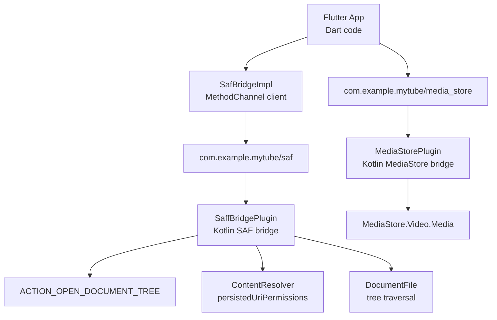
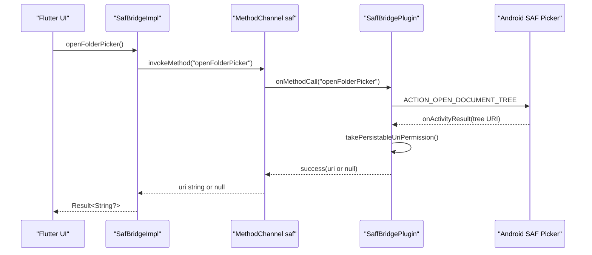
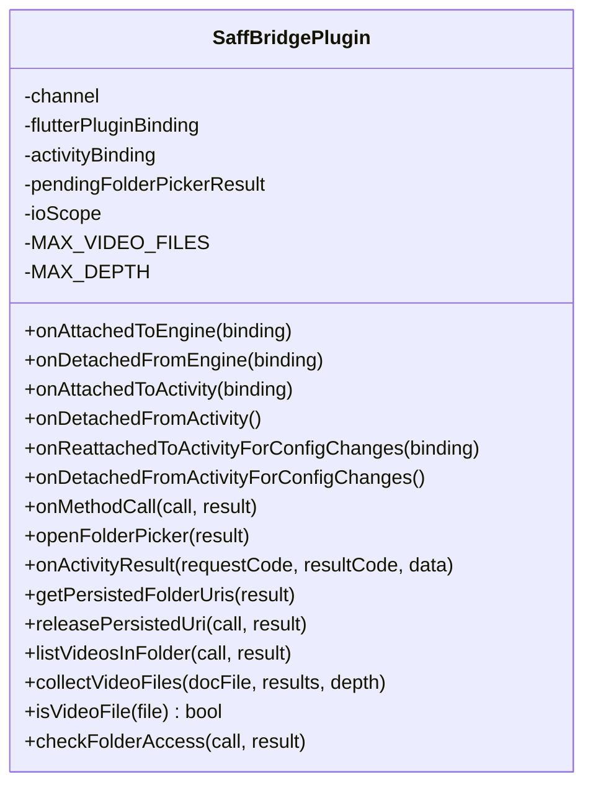
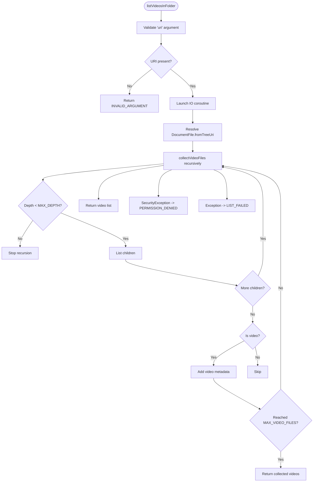
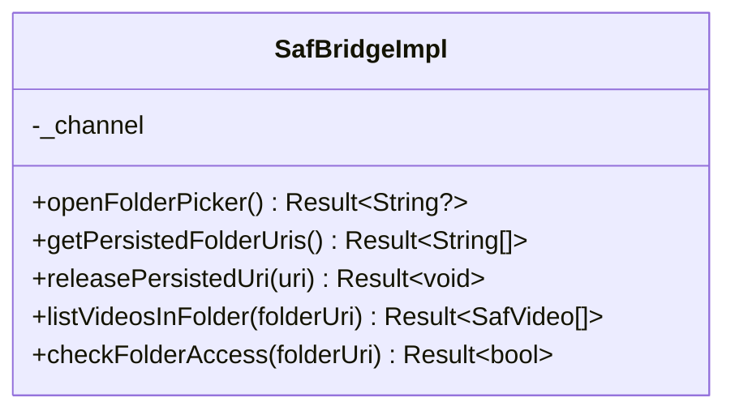
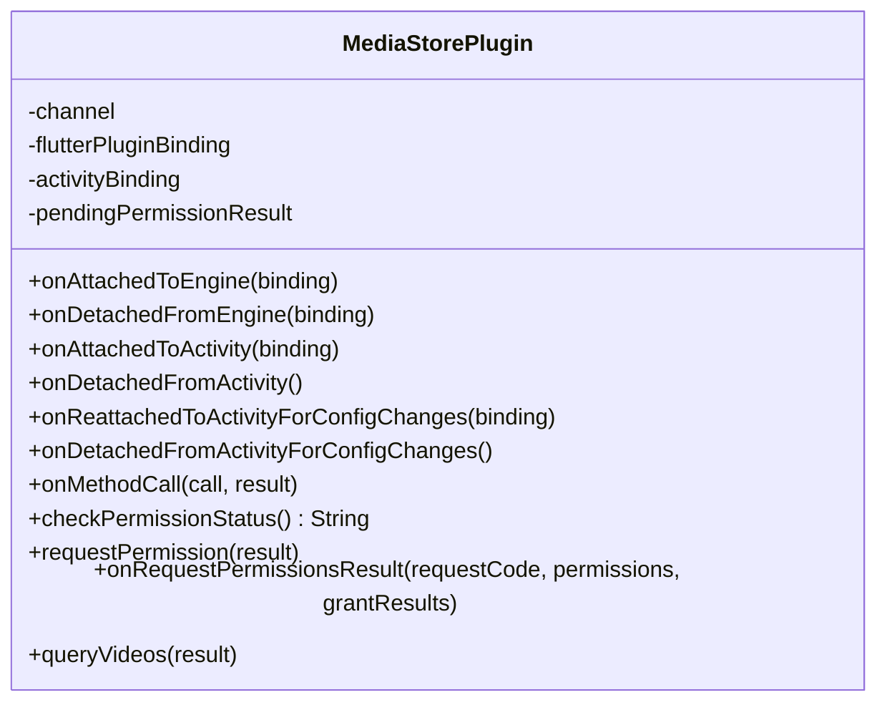
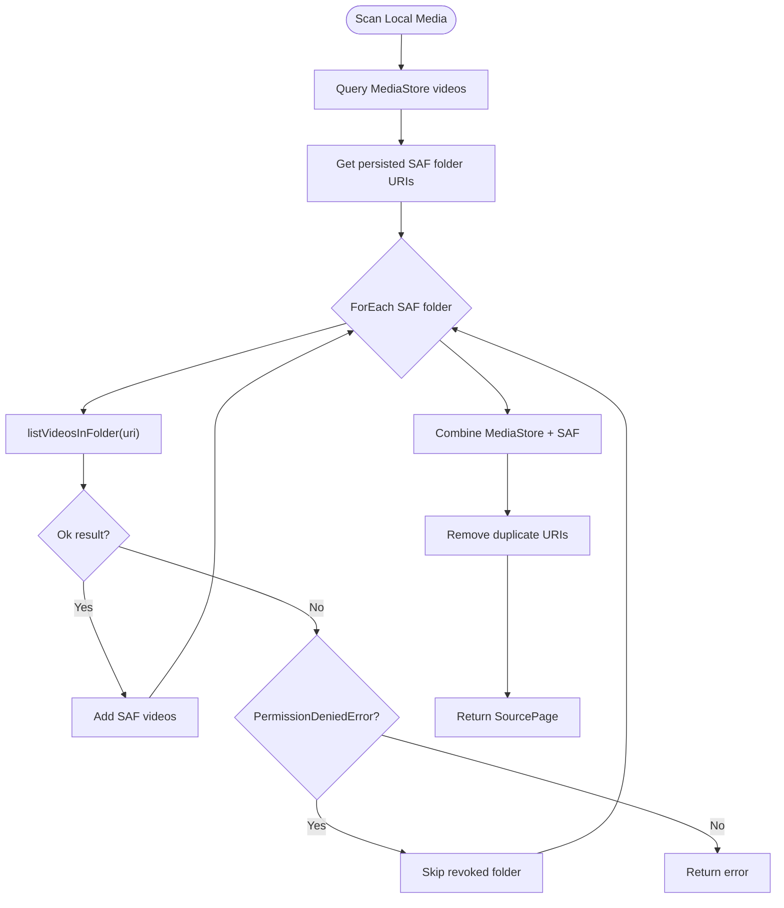
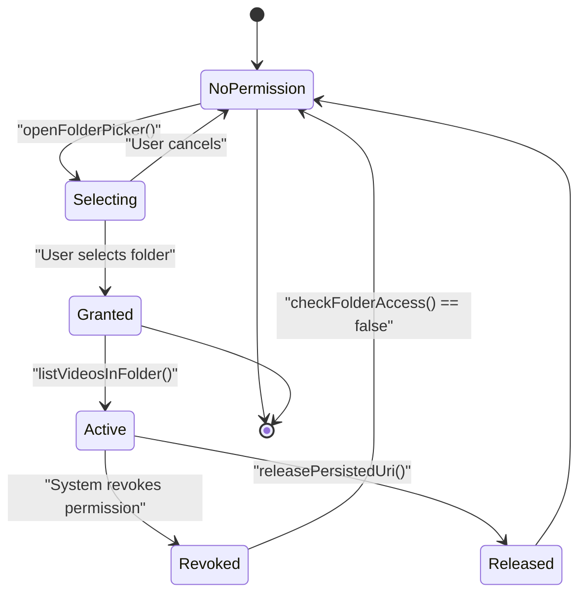
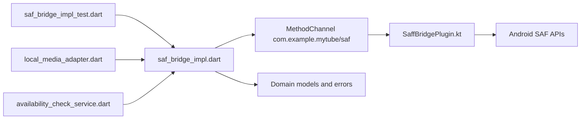

# SAF Bridge

<cite>
**Referenced Files in This Document**   
- [SaffBridgePlugin.kt](file://android/app/src/main/kotlin/com/example/mytube/SaffBridgePlugin.kt)
- [MediaStorePlugin.kt](file://android/app/src/main/kotlin/com/example/mytube/MediaStorePlugin.kt)
- [saf_bridge_impl.dart](file://lib/platform/saf_bridge_impl.dart)
- [AndroidManifest.xml](file://android/app/src/main/AndroidManifest.xml)
- [local_media_adapter.dart](file://lib/sources/local/local_media_adapter.dart)
- [availability_check_service.dart](file://lib/domain/services/availability_check_service.dart)
- [saf_bridge_impl_test.dart](file://test/unit/platform/saf_bridge_impl_test.dart)
</cite>

## Table of Contents
1. [Introduction](#introduction)
2. [Project Structure](#project-structure)
3. [Core Components](#core-components)
4. [Architecture Overview](#architecture-overview)
5. [Detailed Component Analysis](#detailed-component-analysis)
6. [Permission Lifecycle](#permission-lifecycle)
7. [SAF vs Direct File System Access](#saf-vs-direct-file-system-access)
8. [Dependency Analysis](#dependency-analysis)
9. [Performance Considerations](#performance-considerations)
10. [Troubleshooting Guide](#troubleshooting-guide)
11. [Conclusion](#conclusion)

## Introduction
This document explains the Storage Access Framework bridge used by the application to let users select a folder and grant persistent read access to its contents. It covers:

- How the Android plugin launches the system folder picker and persists the selected directory URI.
- How the Kotlin plugin enumerates video files under the selected tree using `DocumentFile`.
- How Flutter calls into the native layer through a method channel.
- The permission lifecycle for both SAF tree permissions and MediaStore video permissions.
- Security and performance differences between SAF and direct file system access.
- Troubleshooting guidance for common permission and traversal issues.

The implementation is split between an Android Kotlin plugin and a Dart platform bridge, with additional integration points in the local media adapter and availability checker.

## Project Structure
The SAF bridge spans two layers:

| Layer | Responsibility | Key Files |
|---|---|---|
| Android native | Folder picker, persisted URI management, SAF tree traversal, MediaStore queries | `SaffBridgePlugin.kt`, `MediaStorePlugin.kt`, `AndroidManifest.xml` |
| Flutter/Dart | Method channel client, error mapping, model conversion | `saf_bridge_impl.dart` |
| Application logic | Combines SAF and MediaStore results, handles revocation | `local_media_adapter.dart`, `availability_check_service.dart` |
| Tests | Validates Dart-side behavior for SAF methods | `saf_bridge_impl_test.dart` |

**Diagram sources**
- [saf_bridge_impl.dart:9-151](file://lib/platform/saf_bridge_impl.dart#L9-L151)
- [SaffBridgePlugin.kt:45-94](file://android/app/src/main/kotlin/com/example/mytube/SaffBridgePlugin.kt#L45-L94)
- [MediaStorePlugin.kt:32-78](file://android/app/src/main/kotlin/com/example/mytube/MediaStorePlugin.kt#L32-L78)

**Section sources**
- [SaffBridgePlugin.kt:1-255](file://android/app/src/main/kotlin/com/example/mytube/SaffBridgePlugin.kt#L1-L255)
- [MediaStorePlugin.kt:1-285](file://android/app/src/main/kotlin/com/example/mytube/MediaStorePlugin.kt#L1-L285)
- [saf_bridge_impl.dart:1-152](file://lib/platform/saf_bridge_impl.dart#L1-L152)
- [AndroidManifest.xml:1-53](file://android/app/src/main/AndroidManifest.xml#L1-L53)

## Core Components
The SAF bridge has two main responsibilities:

1. **Folder selection and persistence:** Launch the system folder picker, persist the returned tree URI, list previously granted folders, release permissions, and check whether a folder is still accessible.
2. **Video enumeration:** Recursively walk the selected SAF tree and return video metadata such as URI, display name, MIME type, size, and last modified time.

The Dart side exposes these operations through `SafBridgeImpl`, which communicates with the Kotlin plugin via the method channel named `com.example.mytube/saf`.

Key capabilities:

| Capability | Dart API | Native Behavior |
|---|---|---|
| Open folder picker | `openFolderPicker()` | Starts `ACTION_OPEN_DOCUMENT_TREE` and persists the result URI |
| List persisted folders | `getPersistedFolderUris()` | Reads `persistedUriPermissions` and returns read-only URIs |
| Release folder permission | `releasePersistedUri(uri)` | Calls `releasePersistableUriPermission` |
| List videos in folder | `listVideosInFolder(folderUri)` | Traverses `DocumentFile` tree and filters video MIME types or extensions |
| Check folder access | `checkFolderAccess(folderUri)` | Attempts to resolve the tree and checks existence |

**Section sources**
- [saf_bridge_impl.dart:11-151](file://lib/platform/saf_bridge_impl.dart#L11-L151)
- [SaffBridgePlugin.kt:86-94](file://android/app/src/main/kotlin/com/example/mytube/SaffBridgePlugin.kt#L86-L94)

## Architecture Overview
The SAF bridge follows a layered architecture:

- **Flutter layer:** Uses `SafBridgeImpl` to call native methods and convert platform exceptions into domain errors.
- **Native layer:** `SaffBridgePlugin` handles SAF-specific operations, while `MediaStorePlugin` handles system-wide video scanning when full media permissions are available.
- **System layer:** Android’s Storage Access Framework provides user-controlled directory access; MediaStore provides indexed media content.

**Diagram sources**
- [saf_bridge_impl.dart:11-32](file://lib/platform/saf_bridge_impl.dart#L11-L32)
- [SaffBridgePlugin.kt:101-136](file://android/app/src/main/kotlin/com/example/mytube/SaffBridgePlugin.kt#L101-L136)

## Detailed Component Analysis

### SaffBridgePlugin
`SaffBridgePlugin` is the Android-side implementation of the SAF bridge. It implements Flutter plugin interfaces, manages activity lifecycle, handles method channel calls, and performs SAF operations.

Important behaviors:

- Registers a method channel named `com.example.mytube/saf`.
- Handles five methods: `openFolderPicker`, `getPersistedFolderUris`, `releasePersistedUri`, `listVideosInFolder`, and `checkFolderAccess`.
- Uses `Intent.ACTION_OPEN_DOCUMENT_TREE` to launch the system folder picker.
- Persists the selected URI with read permission using `takePersistableUriPermission`.
- Enumerates video files recursively up to a maximum depth and file count.
- Returns structured video metadata including URI, display name, MIME type, size, and last modified timestamp.
- Treats missing arguments as invalid input and maps security exceptions to permission-denied responses.

**Diagram sources**
- [SaffBridgePlugin.kt:20-254](file://android/app/src/main/kotlin/com/example/mytube/SaffBridgePlugin.kt#L20-L254)

#### Video Enumeration Flow
The video listing operation runs off the main thread to avoid blocking the UI during large directory scans.

**Diagram sources**
- [SaffBridgePlugin.kt:172-234](file://android/app/src/main/kotlin/com/example/mytube/SaffBridgePlugin.kt#L172-L234)

**Section sources**
- [SaffBridgePlugin.kt:45-94](file://android/app/src/main/kotlin/com/example/mytube/SaffBridgePlugin.kt#L45-L94)
- [SaffBridgePlugin.kt:101-136](file://android/app/src/main/kotlin/com/example/mytube/SaffBridgePlugin.kt#L101-L136)
- [SaffBridgePlugin.kt:142-166](file://android/app/src/main/kotlin/com/example/mytube/SaffBridgePlugin.kt#L142-L166)
- [SaffBridgePlugin.kt:172-234](file://android/app/src/main/kotlin/com/example/mytube/SaffBridgePlugin.kt#L172-L234)
- [SaffBridgePlugin.kt:240-253](file://android/app/src/main/kotlin/com/example/mytube/SaffBridgePlugin.kt#L240-L253)

### SafBridgeImpl
`SafBridgeImpl` is the Dart-side implementation of the SAF bridge. It wraps method channel calls and converts platform exceptions into domain errors.

Key design points:

- Uses a single method channel instance for all SAF operations.
- Wraps each call in try/catch and maps `PlatformException` to `UnexpectedError`.
- Maps `PERMISSION_DENIED` from `listVideosInFolder` to `PermissionDeniedError`.
- Converts raw map results into typed `SafVideo` objects.
- Normalizes nullable numeric fields such as size and last modified time.

**Diagram sources**
- [saf_bridge_impl.dart:8-151](file://lib/platform/saf_bridge_impl.dart#L8-L151)

**Section sources**
- [saf_bridge_impl.dart:1-152](file://lib/platform/saf_bridge_impl.dart#L1-L152)

### MediaStorePlugin
`MediaStorePlugin` handles system-level video scanning through MediaStore. It is relevant because the application combines SAF-selected folders with MediaStore-indexed videos.

Key behaviors:

- Exposes `queryVideos`, `checkPermission`, and `requestPermission`.
- Determines permission status based on Android version:
  - API 34+: `READ_MEDIA_VIDEO` and `READ_MEDIA_VISUAL_USER_SELECTED`
  - API 33: `READ_MEDIA_VIDEO`
  - API 24–32: `READ_EXTERNAL_STORAGE`
- Returns permission states: `granted`, `partiallyGranted`, `denied`, `permanentlyDenied`.
- Queries `MediaStore.Video.Media.EXTERNAL_CONTENT_URI` and builds a list of video entries.

**Diagram sources**
- [MediaStorePlugin.kt:16-284](file://android/app/src/main/kotlin/com/example/mytube/MediaStorePlugin.kt#L16-L284)

**Section sources**
- [MediaStorePlugin.kt:32-78](file://android/app/src/main/kotlin/com/example/mytube/MediaStorePlugin.kt#L32-L78)
- [MediaStorePlugin.kt:95-169](file://android/app/src/main/kotlin/com/example/mytube/MediaStorePlugin.kt#L95-L169)
- [MediaStorePlugin.kt:171-208](file://android/app/src/main/kotlin/com/example/mytube/MediaStorePlugin.kt#L171-L208)
- [MediaStorePlugin.kt:214-283](file://android/app/src/main/kotlin/com/example/mytube/MediaStorePlugin.kt#L214-L283)

### Integration Points
The local media adapter combines SAF and MediaStore results and handles permission revocation gracefully.

- It calls `listVideosInFolder` for each persisted SAF folder.
- If a folder returns `PermissionDeniedError`, it skips that folder and continues scanning others.
- It merges MediaStore videos with non-duplicate SAF videos.

**Diagram sources**
- [local_media_adapter.dart:101-122](file://lib/sources/local/local_media_adapter.dart#L101-L122)

**Section sources**
- [local_media_adapter.dart:101-122](file://lib/sources/local/local_media_adapter.dart#L101-L122)

## Permission Lifecycle
The SAF bridge manages two distinct permission models:

1. **SAF tree permissions:** User-selected directory grants that persist across app restarts until explicitly released or revoked by the system.
2. **MediaStore video permissions:** Android runtime permissions required to scan the system media library.

### SAF Tree Permission Lifecycle

| Stage | Behavior |
|---|---|
| Initial request | Flutter calls `openFolderPicker()`, which starts `ACTION_OPEN_DOCUMENT_TREE`. |
| User selects folder | Android returns a tree URI. |
| Persistence | The plugin calls `takePersistableUriPermission` with read access. |
| Resume after restart | Flutter calls `getPersistedFolderUris()` to recover previously granted folders. |
| Access validation | `checkFolderAccess()` attempts to resolve the tree and reports accessibility. |
| Revocation handling | If traversal throws `SecurityException`, the Dart layer maps it to `PermissionDeniedError`. |
| Explicit release | `releasePersistedUri()` removes the persisted permission idempotently. |

**Diagram sources**
- [SaffBridgePlugin.kt:101-136](file://android/app/src/main/kotlin/com/example/mytube/SaffBridgePlugin.kt#L101-L136)
- [SaffBridgePlugin.kt:142-166](file://android/app/src/main/kotlin/com/example/mytube/SaffBridgePlugin.kt#L142-L166)
- [SaffBridgePlugin.kt:172-199](file://android/app/src/main/kotlin/com/example/mytube/SaffBridgePlugin.kt#L172-L199)
- [SaffBridgePlugin.kt:240-253](file://android/app/src/main/kotlin/com/example/mytube/SaffBridgePlugin.kt#L240-L253)
- [saf_bridge_impl.dart:84-124](file://lib/platform/saf_bridge_impl.dart#L84-L124)

### MediaStore Permission Lifecycle
`MediaStorePlugin` handles runtime permissions differently depending on the Android version.

| Android Version | Permissions | Status Mapping |
|---|---|---|
| API 34+ | `READ_MEDIA_VIDEO`, `READ_MEDIA_VISUAL_USER_SELECTED` | Full grant → `granted`; partial grant → `partiallyGranted`; denied → `denied`; permanently denied → `permanentlyDenied` |
| API 33 | `READ_MEDIA_VIDEO` | Same status mapping as above |
| API 24–32 | `READ_EXTERNAL_STORAGE` | Same status mapping as above |

**Section sources**
- [MediaStorePlugin.kt:95-169](file://android/app/src/main/kotlin/com/example/mytube/MediaStorePlugin.kt#L95-L169)
- [MediaStorePlugin.kt:171-208](file://android/app/src/main/kotlin/com/example/mytube/MediaStorePlugin.kt#L171-L208)

## SAF vs Direct File System Access
The application uses SAF instead of direct file system access for important security and compatibility reasons.

| Aspect | SAF | Direct File System Access |
|---|---|---|
| User control | Users explicitly select directories. | Requires broad storage permissions. |
| Permission model | Per-directory URI grants. | Broad app-level permissions. |
| Modern Android support | Recommended for scoped storage. | Restricted on newer Android versions. |
| Security | Least-privilege access to chosen folders. | Higher risk due to wide access. |
| Performance | Slower traversal due to content provider overhead. | Faster direct I/O where allowed. |
| Reliability | Works across device storage, SD cards, and cloud-backed providers. | Limited by OS restrictions and app sandboxing. |
| Use case here | Scanning user-selected video folders. | Not suitable for modern scoped storage. |

The SAF bridge intentionally avoids direct file paths and instead works with `content://` URIs through `DocumentFile`. This ensures compliance with Android’s scoped storage model while still allowing recursive video scanning.

[No sources needed since this section provides general guidance]

## Dependency Analysis
The SAF bridge depends on several components:

- **Flutter method channel:** Bridges Dart and Kotlin.
- **Android SAF APIs:** `ACTION_OPEN_DOCUMENT_TREE`, `DocumentFile`, `ContentResolver.persistedUriPermissions`.
- **Application logic:** Local media adapter and availability checker consume SAF results.
- **Tests:** Validate Dart-side behavior for persisted URIs and access checks.

**Diagram sources**
- [saf_bridge_impl_test.dart:81-115](file://test/unit/platform/saf_bridge_impl_test.dart#L81-L115)
- [saf_bridge_impl.dart:34-81](file://lib/platform/saf_bridge_impl.dart#L34-L81)
- [SaffBridgePlugin.kt:45-94](file://android/app/src/main/kotlin/com/example/mytube/SaffBridgePlugin.kt#L45-L94)
- [local_media_adapter.dart:101-122](file://lib/sources/local/local_media_adapter.dart#L101-L122)
- [availability_check_service.dart:18-19](file://lib/domain/services/availability_check_service.dart#L18-L19)

**Section sources**
- [saf_bridge_impl_test.dart:81-115](file://test/unit/platform/saf_bridge_impl_test.dart#L81-L115)
- [saf_bridge_impl.dart:34-81](file://lib/platform/saf_bridge_impl.dart#L34-L81)
- [SaffBridgePlugin.kt:45-94](file://android/app/src/main/kotlin/com/example/mytube/SaffBridgePlugin.kt#L45-L94)
- [local_media_adapter.dart:101-122](file://lib/sources/local/local_media_adapter.dart#L101-L122)
- [availability_check_service.dart:18-19](file://lib/domain/services/availability_check_service.dart#L18-L19)

## Performance Considerations
The SAF bridge includes several safeguards against slow or expensive operations:

- **Background traversal:** Video enumeration runs on an IO coroutine scope, not the main thread.
- **Maximum file limit:** Stops collecting after `MAX_VIDEO_FILES` (5,000).
- **Maximum depth limit:** Stops recursion at `MAX_DEPTH` (20 levels).
- **Early exit:** Checks file count limits during child iteration.
- **MIME-based filtering:** Prefers MIME type detection over extension fallback.
- **Idempotent permission release:** `releasePersistedUri` treats already-released URIs as success.

Potential optimization opportunities:

- Consider pagination for very large libraries instead of returning all videos at once.
- Cache recently scanned folder metadata to reduce repeated traversal.
- Debounce repeated `listVideosInFolder` calls for the same folder.
- Surface progress updates for long-running scans if the UI requires feedback.

[No sources needed since this section provides general guidance]

## Troubleshooting Guide

### Common SAF Permission Issues

| Symptom | Likely Cause | Resolution |
|---|---|---|
| `openFolderPicker()` returns null | User canceled picker or no activity attached | Ensure an Activity is attached before calling; prompt user to retry. |
| Persisted URI becomes inaccessible later | System revoked SAF permission | Call `checkFolderAccess()`; if false, call `releasePersistedUri()` and ask user to reselect. |
| `listVideosInFolder()` returns `PERMISSION_DENIED` | Permission revoked during traversal | Handle `PermissionDeniedError` in the caller and skip the folder. |
| `INVALID_ARGUMENT` error | Missing `uri` argument | Verify the Dart caller passes a valid URI string. |
| `NO_ACTIVITY` error | Plugin called without attached Activity | Defer calls until `onAttachedToActivity` has occurred. |

### Directory Traversal Problems

| Symptom | Likely Cause | Resolution |
|---|---|---|
| Empty video list | No video files or unsupported MIME/type | Verify folder contains supported formats; check MIME detection. |
| Very slow scan | Large directory tree or deep nesting | Rely on built-in depth and file limits; consider limiting user-selected roots. |
| Missing files | Files outside selected tree | SAF only accesses the selected tree; ensure correct root was chosen. |
| Duplicate videos | SAF and MediaStore overlap | Use deduplication logic based on URI or identifier. |

### Debugging Steps

1. Check persisted URIs with `getPersistedFolderUris()`.
2. Validate folder access with `checkFolderAccess()`.
3. Inspect `listVideosInFolder()` error codes:
   - `PERMISSION_DENIED`: permission revoked.
   - `LIST_FAILED`: unexpected traversal error.
   - `INVALID_ARGUMENT`: missing URI.
4. Review Dart tests for expected behavior around persisted URIs and access checks.
5. Confirm manifest declares required permissions for MediaStore scanning.

**Section sources**
- [SaffBridgePlugin.kt:101-136](file://android/app/src/main/kotlin/com/example/mytube/SaffBridgePlugin.kt#L101-L136)
- [SaffBridgePlugin.kt:172-199](file://android/app/src/main/kotlin/com/example/mytube/SaffBridgePlugin.kt#L172-L199)
- [saf_bridge_impl.dart:84-124](file://lib/platform/saf_bridge_impl.dart#L84-L124)
- [saf_bridge_impl_test.dart:81-115](file://test/unit/platform/saf_bridge_impl_test.dart#L81-L115)
- [AndroidManifest.xml:4-8](file://android/app/src/main/AndroidManifest.xml#L4-L8)

## Conclusion
The SAF bridge provides a secure, user-controlled way to access video folders on Android. It replaces risky direct file system access with explicit directory selection and persistent URI grants. The Kotlin plugin handles SAF intents, permission persistence, and recursive video enumeration, while the Dart bridge translates platform interactions into typed results and domain errors.

For robust behavior:

- Always handle permission revocation gracefully.
- Use `checkFolderAccess()` before relying on persisted URIs.
- Respect the built-in traversal limits to avoid UI freezes.
- Combine SAF and MediaStore sources carefully, deduplicating where appropriate.
- Keep the manifest updated for modern Android permission requirements.

[No sources needed since this section summarizes without analyzing specific files]