# Source Adapter Interface

<cite>
**Referenced Files in This Document**
- [source_adapter.dart](file://lib/sources/source_adapter.dart)
- [local_media_adapter.dart](file://lib/sources/local/local_media_adapter.dart)
- [video_repository.dart](file://lib/domain/repositories/video_repository.dart)
- [availability_state.dart](file://lib/domain/models/availability_state.dart)
- [source_registry.dart](file://lib/sources/source_registry.dart)
</cite>

## Table of Contents
1. [Introduction](#introduction)
2. [Project Structure](#project-structure)
3. [Core Components](#core-components)
4. [Architecture Overview](#architecture-overview)
5. [Detailed Component Analysis](#detailed-component-analysis)
6. [Dependency Analysis](#dependency-analysis)
7. [Performance Considerations](#performance-considerations)
8. [Troubleshooting Guide](#troubleshooting-guide)
9. [Conclusion](#conclusion)

## Introduction
This document explains the source adapter contract that enables pluggable video providers in the application. The central abstraction is the VideoSourceAdapter interface, which standardizes how different sources are listed, inspected, made available for playback, and evaluated for offline download eligibility. It also documents the supporting data models and cancellation mechanism used by all adapters.

The design follows a clear adapter pattern:
- Each provider type (local media, selected folders, direct URLs, OneDrive, Google Drive, Cloudflare R2) implements VideoSourceAdapter.
- Adapters expose capabilities so callers can avoid unsupported operations.
- A registry aggregates adapters so higher layers can iterate over them without knowing concrete types.

## Project Structure
The source adapter system lives under lib/sources and depends on domain models and repository abstractions.

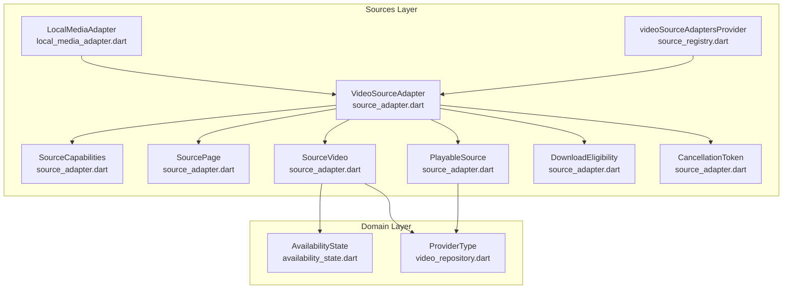

**Diagram sources**
- [source_adapter.dart:23-164](file://lib/sources/source_adapter.dart#L23-L164)
- [local_media_adapter.dart:20-46](file://lib/sources/local/local_media_adapter.dart#L20-L46)
- [source_registry.dart:9-10](file://lib/sources/source_registry.dart#L9-L10)
- [video_repository.dart:110-117](file://lib/domain/repositories/video_repository.dart#L110-L117)
- [availability_state.dart:8-31](file://lib/domain/models/availability_state.dart#L8-L31)

**Section sources**
- [source_adapter.dart:1-28](file://lib/sources/source_adapter.dart#L1-L28)
- [source_registry.dart:1-11](file://lib/sources/source_registry.dart#L1-L11)

## Core Components
This section summarizes the core concepts exposed by the source adapter layer.

- VideoSourceAdapter: The abstract contract every video provider must implement. It defines listing, metadata retrieval, availability checks, playback resolution, and download eligibility.
- SourceCapabilities: Declares optional features such as streaming, seeking, thumbnails, search, downloads, and pagination.
- SourcePage: Paginated result returned by listVideos, including a continuation token when more pages exist.
- SourceVideo: Metadata representation for a single video item from a source.
- PlayableSource: Ephemeral playback URI plus metadata; never persisted as a durable identity.
- DownloadEligibility: Enum indicating whether an app-managed offline download is allowed.
- CancellationToken: Lightweight mechanism to cancel long-running operations without errors.

**Section sources**
- [source_adapter.dart:23-57](file://lib/sources/source_adapter.dart#L23-L57)
- [source_adapter.dart:63-80](file://lib/sources/source_adapter.dart#L63-L80)
- [source_adapter.dart:82-90](file://lib/sources/source_adapter.dart#L82-L90)
- [source_adapter.dart:92-117](file://lib/sources/source_adapter.dart#L92-L117)
- [source_adapter.dart:119-137](file://lib/sources/source_adapter.dart#L119-L137)
- [source_adapter.dart:139-150](file://lib/sources/source_adapter.dart#L139-L150)
- [source_adapter.dart:152-164](file://lib/sources/source_adapter.dart#L152-L164)

## Architecture Overview
The adapter pattern decouples the rest of the application from provider-specific details. Higher layers request capabilities, list items, check availability, resolve playable URIs, and query download eligibility through the same interface regardless of whether the source is local, cloud-based, or a direct URL.

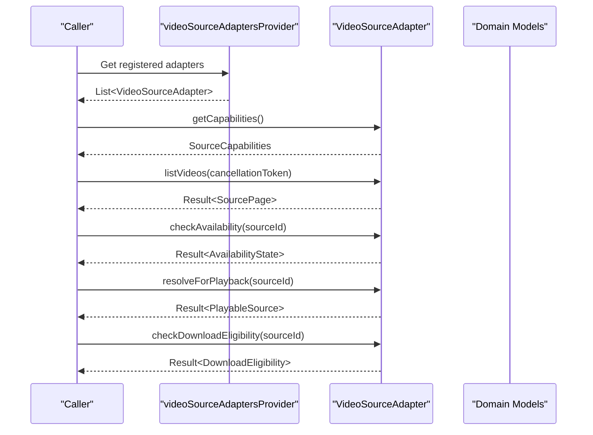

**Diagram sources**
- [source_registry.dart:9-10](file://lib/sources/source_registry.dart#L9-L10)
- [source_adapter.dart:23-57](file://lib/sources/source_adapter.dart#L23-L57)
- [availability_state.dart:8-31](file://lib/domain/models/availability_state.dart#L8-L31)

## Detailed Component Analysis

### VideoSourceAdapter Interface
VideoSourceAdapter is the central contract for all video providers. It exposes:
- sourceType: Identifies the provider type this adapter handles.
- getCapabilities(): Returns SourceCapabilities describing supported operations.
- listVideos(): Lists videos with optional pagination via continuationToken and supports cancellation via CancellationToken.
- getVideo(): Fetches current metadata for a single item; returns null wrapped in Ok if the item no longer exists.
- checkAvailability(): Checks reachability and returns AvailabilityState.
- resolveForPlayback(): Resolves a short-lived PlayableSource for immediate playback; its URI must not be persisted as a durable identity.
- checkDownloadEligibility(): Reports whether app-managed offline download is permitted.

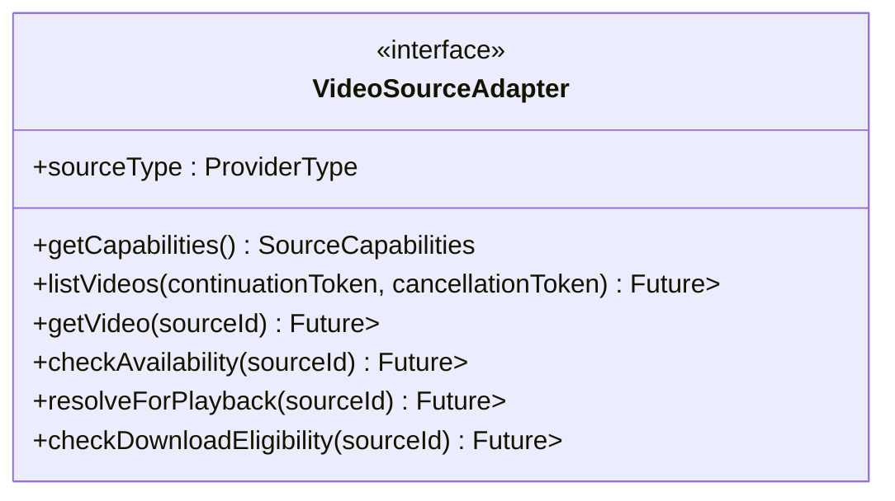

**Diagram sources**
- [source_adapter.dart:23-57](file://lib/sources/source_adapter.dart#L23-L57)
- [video_repository.dart:110-117](file://lib/domain/repositories/video_repository.dart#L110-L117)

**Section sources**
- [source_adapter.dart:23-57](file://lib/sources/source_adapter.dart#L23-L57)

### SourceCapabilities
SourceCapabilities declares what operations each provider supports:
- canStream: Whether streaming is supported.
- canSeek: Whether seeking is supported.
- canProvideThumbnail: Whether thumbnails can be provided.
- canSearch: Whether searching within the source is supported.
- canDownload: Whether app-managed downloads are supported.
- supportsPagination: Whether listVideos supports pagination via continuation tokens.

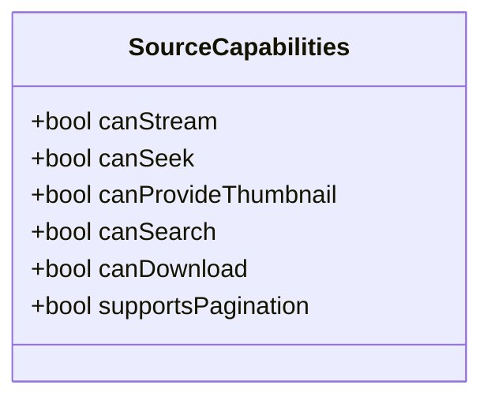

**Diagram sources**
- [source_adapter.dart:63-80](file://lib/sources/source_adapter.dart#L63-L80)

**Section sources**
- [source_adapter.dart:63-80](file://lib/sources/source_adapter.dart#L63-L80)

### Data Models

#### SourcePage
SourcePage represents a page of results from listVideos:
- videos: List of SourceVideo entries.
- nextContinuationToken: Non-null when more pages are available.

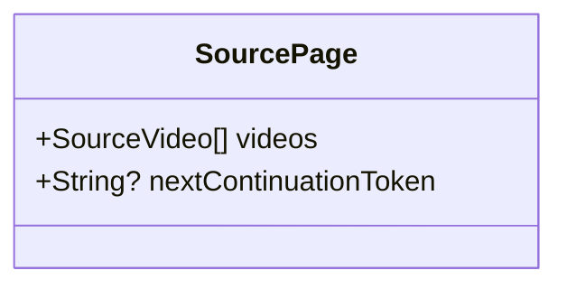

**Diagram sources**
- [source_adapter.dart:82-90](file://lib/sources/source_adapter.dart#L82-L90)

**Section sources**
- [source_adapter.dart:82-90](file://lib/sources/source_adapter.dart#L82-L90)

#### SourceVideo
SourceVideo is the metadata representation for a single video item:
- sourceId: Stable identifier for the source item.
- sourceType: ProviderType identifying the origin.
- displayName: Human-readable name.
- durationMs, widthPx, heightPx: Optional media dimensions and duration.
- mimeType, sizeBytes: Optional format and size information.
- thumbnailUri: Optional thumbnail link.
- availability: Current AvailabilityState.

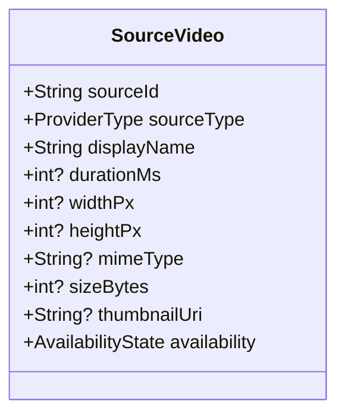

**Diagram sources**
- [source_adapter.dart:92-117](file://lib/sources/source_adapter.dart#L92-L117)
- [video_repository.dart:110-117](file://lib/domain/repositories/video_repository.dart#L110-L117)
- [availability_state.dart:8-31](file://lib/domain/models/availability_state.dart#L8-L31)

**Section sources**
- [source_adapter.dart:92-117](file://lib/sources/source_adapter.dart#L92-L117)

#### PlayableSource
PlayableSource represents an ephemeral, immediately-playable source:
- uri: The playable URI/URL; may be short-lived and must not be persisted as a durable identity.
- sourceId: Original stable source identifier.
- sourceType: ProviderType of the original source.
- mimeType: Optional MIME type.
- canSeek: Whether seeking is supported for this playable source.

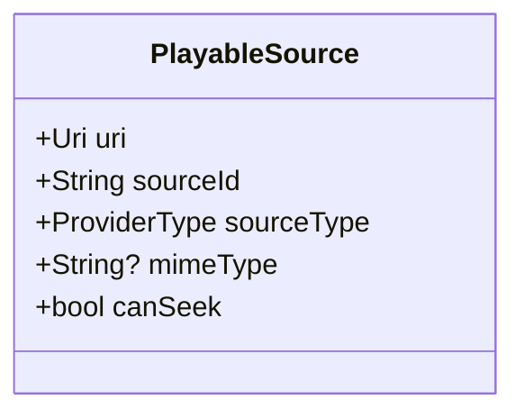

**Diagram sources**
- [source_adapter.dart:119-137](file://lib/sources/source_adapter.dart#L119-L137)
- [video_repository.dart:110-117](file://lib/domain/repositories/video_repository.dart#L110-L117)

**Section sources**
- [source_adapter.dart:119-137](file://lib/sources/source_adapter.dart#L119-L137)

#### DownloadEligibility
DownloadEligibility indicates whether an app-managed offline download is allowed:
- eligible: Allowed by provider terms and capabilities.
- prohibited: Prohibited by provider terms or DRM.
- unknown: Cannot determine without further checks (e.g., token refresh).

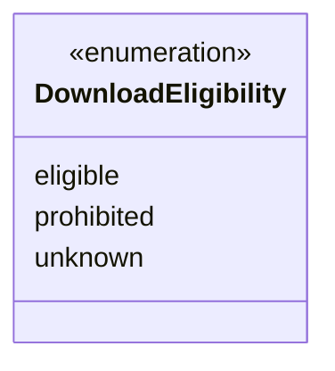

**Diagram sources**
- [source_adapter.dart:139-150](file://lib/sources/source_adapter.dart#L139-L150)

**Section sources**
- [source_adapter.dart:139-150](file://lib/sources/source_adapter.dart#L139-L150)

#### CancellationToken
CancellationToken provides a simple cancellation mechanism for long-running operations:
- cancel(): Marks the token as cancelled.
- isCancelled: True once cancel has been called.

Adapters must check isCancelled between items/pages and abort work without emitting an error when true.

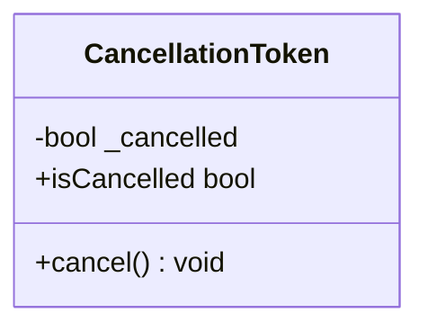

**Diagram sources**
- [source_adapter.dart:152-164](file://lib/sources/source_adapter.dart#L152-L164)

**Section sources**
- [source_adapter.dart:152-164](file://lib/sources/source_adapter.dart#L152-L164)

### Example Implementation: LocalMediaAdapter
LocalMediaAdapter demonstrates how a concrete adapter implements VideoSourceAdapter for local sources:
- sourceType: localMediaStore.
- getCapabilities(): Enables streaming, seeking, and thumbnails; disables search, download, and pagination.
- listVideos(): Merges MediaStore and SAF folder results, deduplicates exact matches, respects cancellation, and handles permission-denied gracefully.
- getVideo(): Routes to MediaStore or SAF based on sourceId prefix.
- checkAvailability(): Determines availability across MediaStore and SAF, mapping permission issues to permissionRevoked.
- resolveForPlayback(): Builds a PlayableSource using the stable sourceId and appropriate sourceType; marks canSeek appropriately.
- checkDownloadEligibility(): Returns prohibited for local files.

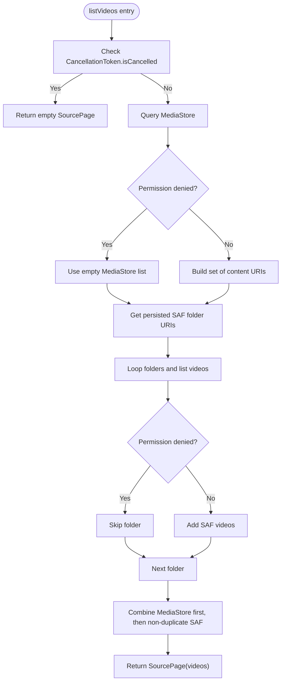

**Diagram sources**
- [local_media_adapter.dart:52-123](file://lib/sources/local/local_media_adapter.dart#L52-L123)

**Section sources**
- [local_media_adapter.dart:20-46](file://lib/sources/local/local_media_adapter.dart#L20-L46)
- [local_media_adapter.dart:52-123](file://lib/sources/local/local_media_adapter.dart#L52-L123)
- [local_media_adapter.dart:129-176](file://lib/sources/local/local_media_adapter.dart#L129-L176)
- [local_media_adapter.dart:182-236](file://lib/sources/local/local_media_adapter.dart#L182-L236)
- [local_media_adapter.dart:242-272](file://lib/sources/local/local_media_adapter.dart#L242-L272)
- [local_media_adapter.dart:278-285](file://lib/sources/local/local_media_adapter.dart#L278-L285)

### How Different Providers Are Abstracted
- Local media and selected folders: Implemented by LocalMediaAdapter, merging Android MediaStore and SAF results into a unified view.
- Direct URLs: Planned adapter type for direct video links.
- Cloud providers: OneDrive, Google Drive, and Cloudflare R2 are planned adapter types, following the same contract.

The registry aggregates adapters so higher layers can iterate over all available sources without knowing their concrete types.

**Section sources**
- [source_adapter.dart:13-22](file://lib/sources/source_adapter.dart#L13-L22)
- [source_registry.dart:5-10](file://lib/sources/source_registry.dart#L5-L10)

## Dependency Analysis
The adapter layer depends on domain models and repository abstractions but remains independent of UI and platform specifics.

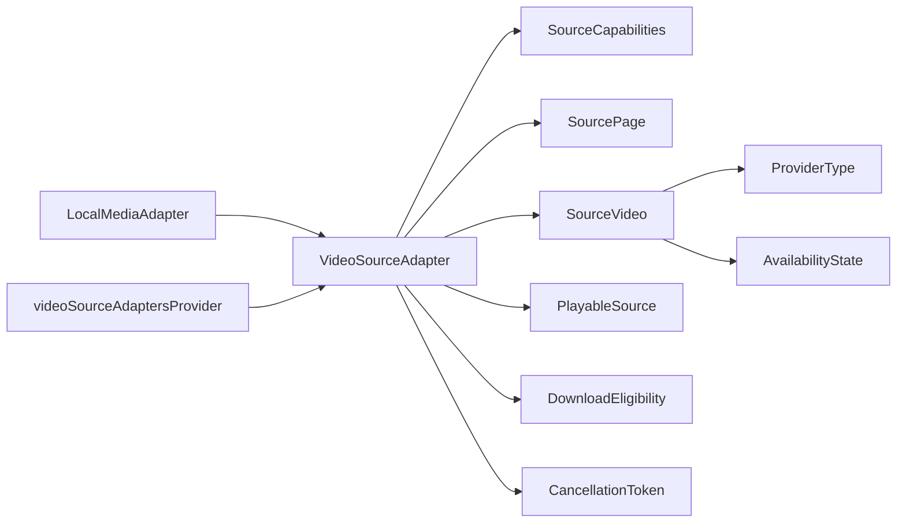

**Diagram sources**
- [local_media_adapter.dart:20-46](file://lib/sources/local/local_media_adapter.dart#L20-L46)
- [source_adapter.dart:23-164](file://lib/sources/source_adapter.dart#L23-L164)
- [video_repository.dart:110-117](file://lib/domain/repositories/video_repository.dart#L110-L117)
- [availability_state.dart:8-31](file://lib/domain/models/availability_state.dart#L8-L31)
- [source_registry.dart:9-10](file://lib/sources/source_registry.dart#L9-L10)

**Section sources**
- [source_adapter.dart:23-164](file://lib/sources/source_adapter.dart#L23-L164)
- [video_repository.dart:110-117](file://lib/domain/repositories/video_repository.dart#L110-L117)
- [availability_state.dart:8-31](file://lib/domain/models/availability_state.dart#L8-L31)
- [source_registry.dart:9-10](file://lib/sources/source_registry.dart#L9-L10)

## Performance Considerations
- Pagination: Use continuationToken to avoid loading entire libraries at once.
- Cancellation: Always check CancellationToken.isCancelled between iterations to prevent wasted work during navigation or background scans.
- Deduplication: Avoid redundant network or I/O calls by deduplicating identifiers where possible.
- Capability gating: Use SourceCapabilities to skip unsupported operations early.

[No sources needed since this section provides general guidance]

## Troubleshooting Guide
Common issues and strategies:
- PermissionDeniedError: Some adapters treat permission denial as a soft state rather than a hard error. For example, local adapters may return empty lists or map to permissionRevoked availability.
- Missing items: getVideo returns null wrapped in Ok when an item no longer exists; handle this gracefully in consumers.
- Ephemeral URIs: Never persist PlayableSource.uri as a durable identity; it may be a short-lived signed URL.
- Cancellation behavior: If a long-running operation is cancelled, adapters should return early without errors.

**Section sources**
- [local_media_adapter.dart:62-76](file://lib/sources/local/local_media_adapter.dart#L62-L76)
- [local_media_adapter.dart:130-176](file://lib/sources/local/local_media_adapter.dart#L130-L176)
- [source_adapter.dart:48-52](file://lib/sources/source_adapter.dart#L48-L52)
- [source_adapter.dart:152-164](file://lib/sources/source_adapter.dart#L152-L164)

## Conclusion
The VideoSourceAdapter interface provides a clean, extensible contract for integrating diverse video sources behind a uniform API. By combining capability declarations, standardized data models, and cancellation support, the system allows new providers to be added with minimal friction while keeping the rest of the application consistent and testable.

[No sources needed since this section summarizes without analyzing specific files]