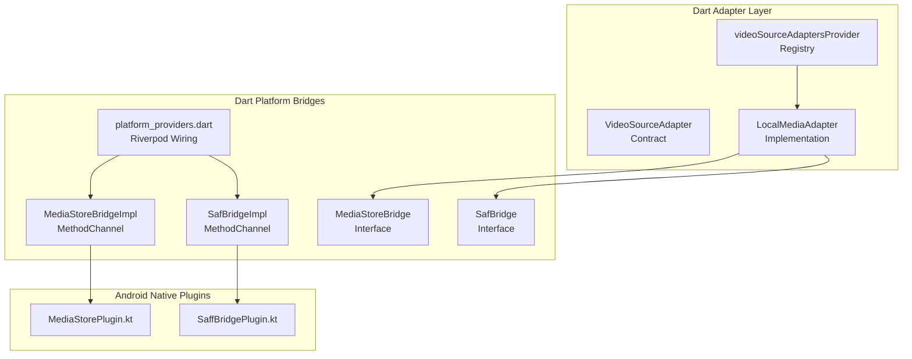
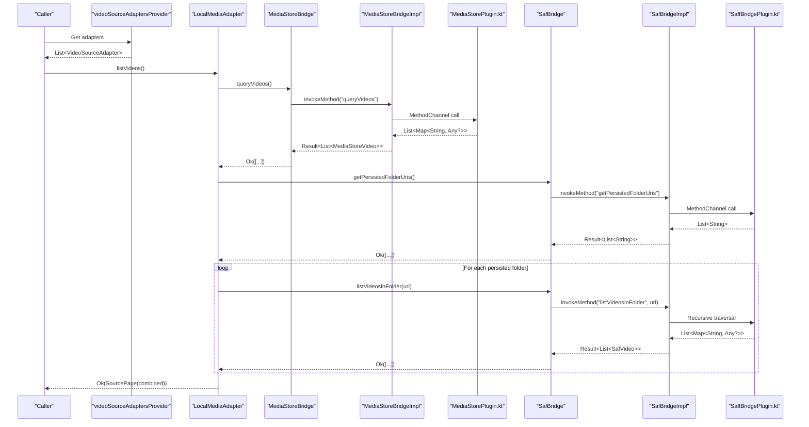
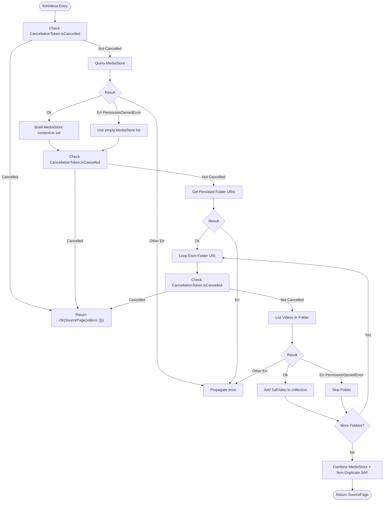
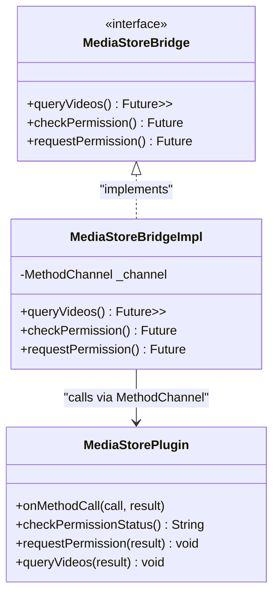
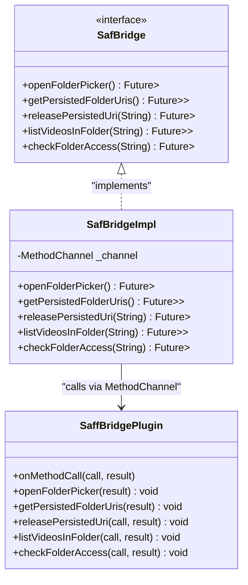
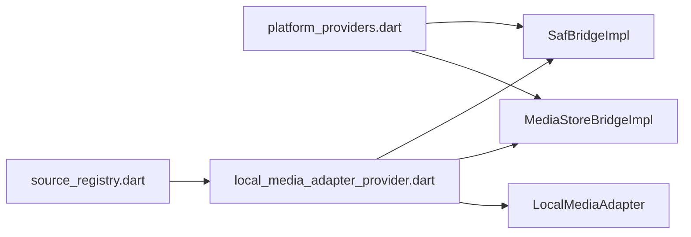
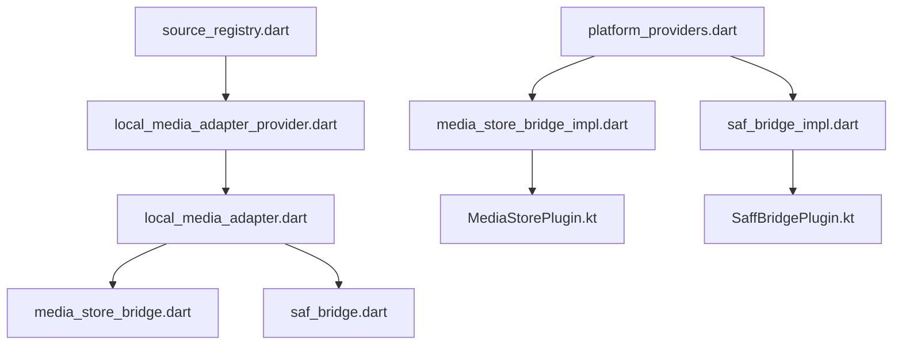
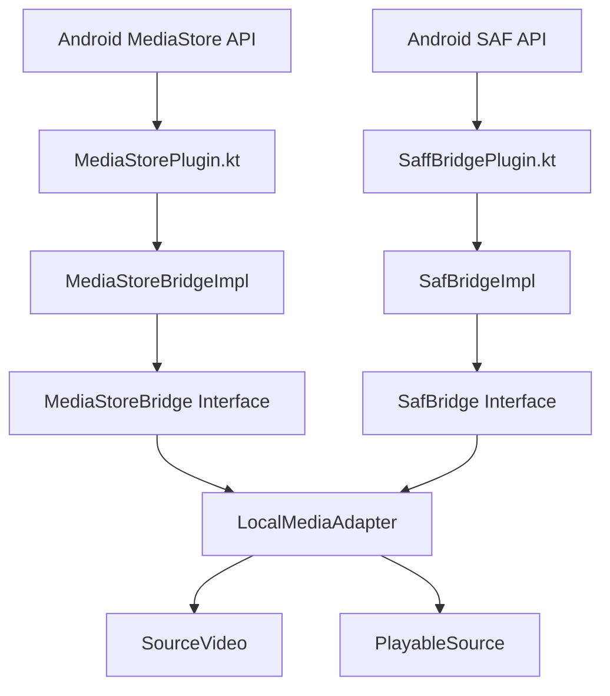

# Video Source System

<cite>
**Referenced Files in This Document**
- [source_adapter.dart](file://lib/sources/source_adapter.dart)
- [source_registry.dart](file://lib/sources/source_registry.dart)
- [local_media_adapter.dart](file://lib/sources/local/local_media_adapter.dart)
- [local_media_adapter_provider.dart](file://lib/sources/local/local_media_adapter_provider.dart)
- [media_store_bridge.dart](file://lib/platform/media_store_bridge.dart)
- [media_store_bridge_impl.dart](file://lib/platform/media_store_bridge_impl.dart)
- [saf_bridge.dart](file://lib/platform/saf_bridge.dart)
- [saf_bridge_impl.dart](file://lib/platform/saf_bridge_impl.dart)
- [platform_providers.dart](file://lib/platform/platform_providers.dart)
- [MediaStorePlugin.kt](file://android/app/src/main/kotlin/com/example/mytube/MediaStorePlugin.kt)
- [SaffBridgePlugin.kt](file://android/app/src/main/kotlin/com/example/mytube/SaffBridgePlugin.kt)
</cite>

## Table of Contents
1. [Introduction](#introduction)
2. [Project Structure](#project-structure)
3. [Core Components](#core-components)
4. [Architecture Overview](#architecture-overview)
5. [Detailed Component Analysis](#detailed-component-analysis)
6. [Dependency Analysis](#dependency-analysis)
7. [Performance Considerations](#performance-considerations)
8. [Troubleshooting Guide](#troubleshooting-guide)
9. [Conclusion](#conclusion)
10. [Appendices](#appendices)

## Introduction
This document explains the video source system that lets the app discover and play videos from local Android storage. The design centers on a pluggable adapter pattern: Dart-side adapters implement a common `VideoSourceAdapter` contract, while platform-specific behavior is hidden behind bridge interfaces. For local media, the current implementation combines:

- Android MediaStore discovery through a Kotlin plugin and Dart bridge.
- Storage Access Framework (SAF) folder access for user-selected directories.
- A unified `SourceVideo` model used by higher layers regardless of where the video came from.

The architecture supports future extensions such as cloud providers or direct URL sources without changing existing code paths.

## Project Structure
The video source system spans three main areas:

- Dart adapter layer: defines the adapter contract and the local adapter implementation.
- Dart platform bridges: define contracts and MethodChannel implementations for MediaStore and SAF.
- Android native plugins: expose MediaStore queries and SAF folder operations to Flutter via MethodChannel.

**Diagram sources**
- [source_adapter.dart:23-57](file://lib/sources/source_adapter.dart#L23-L57)
- [local_media_adapter.dart:20-46](file://lib/sources/local/local_media_adapter.dart#L20-L46)
- [source_registry.dart:9-11](file://lib/sources/source_registry.dart#L9-L11)
- [media_store_bridge.dart:13-32](file://lib/platform/media_store_bridge.dart#L13-L32)
- [media_store_bridge_impl.dart:9-10](file://lib/platform/media_store_bridge_impl.dart#L9-L10)
- [saf_bridge.dart:12-32](file://lib/platform/saf_bridge.dart#L12-L32)
- [saf_bridge_impl.dart:8-9](file://lib/platform/saf_bridge_impl.dart#L8-L9)
- [platform_providers.dart:11-19](file://lib/platform/platform_providers.dart#L11-L19)
- [MediaStorePlugin.kt:16-36](file://android/app/src/main/kotlin/com/example/mytube/MediaStorePlugin.kt#L16-L36)
- [SaffBridgePlugin.kt:20-50](file://android/app/src/main/kotlin/com/example/mytube/SaffBridgePlugin.kt#L20-L50)

**Section sources**
- [source_adapter.dart:23-57](file://lib/sources/source_adapter.dart#L23-L57)
- [local_media_adapter.dart:20-46](file://lib/sources/local/local_media_adapter.dart#L20-L46)
- [source_registry.dart:9-11](file://lib/sources/source_registry.dart#L9-L11)
- [media_store_bridge.dart:13-32](file://lib/platform/media_store_bridge.dart#L13-L32)
- [saf_bridge.dart:12-32](file://lib/platform/saf_bridge.dart#L12-L32)
- [platform_providers.dart:11-19](file://lib/platform/platform_providers.dart#L11-L19)
- [MediaStorePlugin.kt:16-36](file://android/app/src/main/kotlin/com/example/mytube/MediaStorePlugin.kt#L16-L36)
- [SaffBridgePlugin.kt:20-50](file://android/app/src/main/kotlin/com/example/mytube/SaffBridgePlugin.kt#L20-L50)

## Core Components
This section summarizes the key types and responsibilities.

- `VideoSourceAdapter`: Defines the contract every video provider must implement, including listing, metadata retrieval, availability checks, playback resolution, download eligibility, capability reporting, and cancellation support.
- `SourceCapabilities`: Declares optional features such as streaming, seeking, thumbnails, search, downloads, and pagination.
- `SourcePage`: Paginated result returned by `listVideos`, with an optional continuation token.
- `SourceVideo`: Unified metadata model for any source item, including identity, display name, dimensions, MIME type, size, thumbnail URI, and availability state.
- `PlayableSource`: Ephemeral playback target containing a URI, durable source identity, provider type, MIME type, and seek capability.
- `DownloadEligibility`: Enum describing whether offline download is allowed.
- `CancellationToken`: Lightweight cancellation token that adapters must check between items or pages.

For local media, `LocalMediaAdapter` implements this contract and merges results from MediaStore and SAF folders. It exposes `ProviderType.localMediaStore` as its primary adapter type, while SAF-originated items are tagged with `ProviderType.selectedFolder`.

**Section sources**
- [source_adapter.dart:23-57](file://lib/sources/source_adapter.dart#L23-L57)
- [source_adapter.dart:63-80](file://lib/sources/source_adapter.dart#L63-L80)
- [source_adapter.dart:82-90](file://lib/sources/source_adapter.dart#L82-L90)
- [source_adapter.dart:92-117](file://lib/sources/source_adapter.dart#L92-L117)
- [source_adapter.dart:119-137](file://lib/sources/source_adapter.dart#L119-L137)
- [source_adapter.dart:139-150](file://lib/sources/source_adapter.dart#L139-L150)
- [source_adapter.dart:152-164](file://lib/sources/source_adapter.dart#L152-L164)
- [local_media_adapter.dart:20-46](file://lib/sources/local/local_media_adapter.dart#L20-L46)

## Architecture Overview
The system uses the adapter pattern to isolate provider-specific logic behind a stable interface. Higher layers iterate over registered adapters without knowing their concrete types. Local media is currently implemented by merging two Android data sources:

1. MediaStore provides device-wide video metadata and content URIs.
2. SAF provides user-granted folder access and recursive file traversal.
3. `LocalMediaAdapter` deduplicates SAF entries whose document URI matches a MediaStore content URI.
4. Bridges translate Dart calls into Android method-channel calls.
5. Kotlin plugins perform OS-level permission handling, MediaStore queries, and SAF tree walks.

**Diagram sources**
- [source_registry.dart:9-11](file://lib/sources/source_registry.dart#L9-L11)
- [local_media_adapter.dart:52-123](file://lib/sources/local/local_media_adapter.dart#L52-L123)
- [media_store_bridge.dart:13-32](file://lib/platform/media_store_bridge.dart#L13-L32)
- [media_store_bridge_impl.dart:13-55](file://lib/platform/media_store_bridge_impl.dart#L13-L55)
- [MediaStorePlugin.kt:71-78](file://android/app/src/main/kotlin/com/example/mytube/MediaStorePlugin.kt#L71-L78)
- [MediaStorePlugin.kt:214-283](file://android/app/src/main/kotlin/com/example/mytube/MediaStorePlugin.kt#L214-L283)
- [saf_bridge.dart:12-32](file://lib/platform/saf_bridge.dart#L12-L32)
- [saf_bridge_impl.dart:35-58](file://lib/platform/saf_bridge_impl.dart#L35-L58)
- [saf_bridge_impl.dart:84-124](file://lib/platform/saf_bridge_impl.dart#L84-L124)
- [SaffBridgePlugin.kt:86-95](file://android/app/src/main/kotlin/com/example/mytube/SaffBridgePlugin.kt#L86-L95)
- [SaffBridgePlugin.kt:172-200](file://android/app/src/main/kotlin/com/example/mytube/SaffBridgePlugin.kt#L172-L200)

## Detailed Component Analysis

### VideoSourceAdapter Contract
`VideoSourceAdapter` is the central abstraction for all video providers. Its responsibilities include:

- Declaring the provider type.
- Reporting capabilities so callers avoid unsupported operations.
- Listing videos with pagination and cancellation.
- Fetching metadata for a single item.
- Checking reachability.
- Resolving a playable source for immediate playback.
- Determining download eligibility.

The contract also defines shared value types:

| Type | Purpose | Key Fields / Behavior |
|---|---|---|
| `SourceCapabilities` | Declares supported operations | `canStream`, `canSeek`, `canProvideThumbnail`, `canSearch`, `canDownload`, `supportsPagination` |
| `SourcePage` | Paginated listing result | `videos`, `nextContinuationToken` |
| `SourceVideo` | Unified video metadata | `sourceId`, `sourceType`, `displayName`, optional dimensions, MIME, size, thumbnail, availability |
| `PlayableSource` | Ephemeral playback target | `uri`, durable `sourceId`, `sourceType`, optional MIME, `canSeek` |
| `DownloadEligibility` | Download policy | `eligible`, `prohibited`, `unknown` |
| `CancellationToken` | Long-running operation control | `cancel()`, `isCancelled` |

The adapter comment documents the intended implementation order: local MediaStore/selected folder first, then direct URL, then cloud providers. Adapters must not own global favorites, history, or collections; token handling belongs to the adapter.

**Section sources**
- [source_adapter.dart:5-22](file://lib/sources/source_adapter.dart#L5-L22)
- [source_adapter.dart:23-57](file://lib/sources/source_adapter.dart#L23-L57)
- [source_adapter.dart:63-80](file://lib/sources/source_adapter.dart#L63-L80)
- [source_adapter.dart:82-90](file://lib/sources/source_adapter.dart#L82-L90)
- [source_adapter.dart:92-117](file://lib/sources/source_adapter.dart#L92-L117)
- [source_adapter.dart:119-137](file://lib/sources/source_adapter.dart#L119-L137)
- [source_adapter.dart:139-150](file://lib/sources/source_adapter.dart#L139-L150)
- [source_adapter.dart:152-164](file://lib/sources/source_adapter.dart#L152-L164)

### LocalMediaAdapter Implementation
`LocalMediaAdapter` implements `VideoSourceAdapter` for local Android storage. It combines:

- MediaStore videos identified by `content://media/...` URIs.
- SAF-persisted folder videos identified by SAF document URIs.

Key behaviors:

- **Primary adapter type**: `ProviderType.localMediaStore`.
- **Capabilities**: streaming, seeking, and thumbnails enabled; search, downloads, and pagination disabled.
- **Listing flow**:
  - Check cancellation before starting.
  - Query MediaStore; treat `PermissionDeniedError` as an empty list rather than failing the entire scan.
  - Build a set of MediaStore content URIs for deduplication.
  - Iterate persisted SAF folders; skip folders with revoked permissions but propagate other errors.
  - Combine MediaStore videos first, then SAF videos that do not duplicate a MediaStore content URI.
- **Single-item lookup**: routes by URI prefix to either MediaStore or SAF.
- **Availability**: returns `available`, `missing`, or `permissionRevoked` depending on whether the item exists and whether grants are present.
- **Playback resolution**: wraps the original source ID as a `PlayableSource`; MediaStore URIs use `ProviderType.localMediaStore`, SAF URIs use `ProviderType.selectedFolder`.
- **Download eligibility**: always prohibited because local files are originals.

**Diagram sources**
- [local_media_adapter.dart:52-123](file://lib/sources/local/local_media_adapter.dart#L52-L123)

**Section sources**
- [local_media_adapter.dart:20-46](file://lib/sources/local/local_media_adapter.dart#L20-L46)
- [local_media_adapter.dart:52-123](file://lib/sources/local/local_media_adapter.dart#L52-L123)
- [local_media_adapter.dart:129-176](file://lib/sources/local/local_media_adapter.dart#L129-L176)
- [local_media_adapter.dart:182-236](file://lib/sources/local/local_media_adapter.dart#L182-L236)
- [local_media_adapter.dart:242-285](file://lib/sources/local/local_media_adapter.dart#L242-L285)
- [local_media_adapter.dart:291-320](file://lib/sources/local/local_media_adapter.dart#L291-L320)

### MediaStore Bridge and Plugin
The MediaStore path connects Dart to Android:

- Dart interface `MediaStoreBridge` declares methods for querying videos and checking/requesting permissions.
- `MediaStoreBridgeImpl` communicates with the Android plugin via `MethodChannel('com.example.mytube/media_store')`.
- `MediaStorePlugin.kt` handles permission status, permission requests, and video queries against `MediaStore.Video.Media.EXTERNAL_CONTENT_URI`.

Important details:

- Permissions vary by API level: `READ_EXTERNAL_STORAGE` on older versions, `READ_MEDIA_VIDEO` on API 33+, and both `READ_MEDIA_VIDEO` and `READ_MEDIA_VISUAL_USER_SELECTED` on API 34+.
- Partial access maps to `partiallyGranted`.
- Query results are converted to `MediaStoreVideo` objects with fields such as `mediaStoreId`, `contentUri`, `displayName`, duration, dimensions, MIME type, size, and timestamps.
- Permission denial is surfaced as `PermissionDeniedError`, while unexpected platform exceptions become `UnexpectedError`.

**Diagram sources**
- [media_store_bridge.dart:13-32](file://lib/platform/media_store_bridge.dart#L13-L32)
- [media_store_bridge_impl.dart:9-84](file://lib/platform/media_store_bridge_impl.dart#L9-L84)
- [MediaStorePlugin.kt:16-78](file://android/app/src/main/kotlin/com/example/mytube/MediaStorePlugin.kt#L16-L78)
- [MediaStorePlugin.kt:95-193](file://android/app/src/main/kotlin/com/example/mytube/MediaStorePlugin.kt#L95-L193)
- [MediaStorePlugin.kt:214-283](file://android/app/src/main/kotlin/com/example/mytube/MediaStorePlugin.kt#L214-L283)

**Section sources**
- [media_store_bridge.dart:13-32](file://lib/platform/media_store_bridge.dart#L13-L32)
- [media_store_bridge.dart:38-76](file://lib/platform/media_store_bridge.dart#L38-L76)
- [media_store_bridge.dart:78-93](file://lib/platform/media_store_bridge.dart#L78-L93)
- [media_store_bridge_impl.dart:9-84](file://lib/platform/media_store_bridge_impl.dart#L9-L84)
- [MediaStorePlugin.kt:71-78](file://android/app/src/main/kotlin/com/example/mytube/MediaStorePlugin.kt#L71-L78)
- [MediaStorePlugin.kt:95-193](file://android/app/src/main/kotlin/com/example/mytube/MediaStorePlugin.kt#L95-L193)
- [MediaStorePlugin.kt:214-283](file://android/app/src/main/kotlin/com/example/mytube/MediaStorePlugin.kt#L214-L283)

### SAF Bridge and Plugin
The SAF path enables access to user-selected folders:

- Dart interface `SafBridge` defines folder picker, persisted folder management, recursive listing, and access checks.
- `SafBridgeImpl` communicates with `SaffBridgePlugin.kt` via `MethodChannel('com.example.mytube/saf')`.
- `SaffBridgePlugin.kt` opens the system folder picker, persists read permissions, lists video files recursively, and checks folder accessibility.

Important details:

- The plugin runs recursive traversal on a background coroutine scope to avoid blocking the UI thread.
- It limits recursion depth and caps the number of collected video files.
- Video detection uses MIME type prefixes and a fallback extension list.
- Permission revocation is reported as `PERMISSION_DENIED`.

**Diagram sources**
- [saf_bridge.dart:12-32](file://lib/platform/saf_bridge.dart#L12-L32)
- [saf_bridge.dart:34-57](file://lib/platform/saf_bridge.dart#L34-L57)
- [saf_bridge_impl.dart:8-152](file://lib/platform/saf_bridge_impl.dart#L8-L152)
- [SaffBridgePlugin.kt:20-95](file://android/app/src/main/kotlin/com/example/mytube/SaffBridgePlugin.kt#L20-L95)
- [SaffBridgePlugin.kt:101-136](file://android/app/src/main/kotlin/com/example/mytube/SaffBridgePlugin.kt#L101-L136)
- [SaffBridgePlugin.kt:142-166](file://android/app/src/main/kotlin/com/example/mytube/SaffBridgePlugin.kt#L142-L166)
- [SaffBridgePlugin.kt:172-234](file://android/app/src/main/kotlin/com/example/mytube/SaffBridgePlugin.kt#L172-L234)
- [SaffBridgePlugin.kt:240-253](file://android/app/src/main/kotlin/com/example/mytube/SaffBridgePlugin.kt#L240-L253)

**Section sources**
- [saf_bridge.dart:12-32](file://lib/platform/saf_bridge.dart#L12-L32)
- [saf_bridge.dart:34-57](file://lib/platform/saf_bridge.dart#L34-L57)
- [saf_bridge_impl.dart:8-152](file://lib/platform/saf_bridge_impl.dart#L8-L152)
- [SaffBridgePlugin.kt:20-95](file://android/app/src/main/kotlin/com/example/mytube/SaffBridgePlugin.kt#L20-L95)
- [SaffBridgePlugin.kt:101-136](file://android/app/src/main/kotlin/com/example/mytube/SaffBridgePlugin.kt#L101-L136)
- [SaffBridgePlugin.kt:142-166](file://android/app/src/main/kotlin/com/example/mytube/SaffBridgePlugin.kt#L142-L166)
- [SaffBridgePlugin.kt:172-234](file://android/app/src/main/kotlin/com/example/mytube/SaffBridgePlugin.kt#L172-L234)
- [SaffBridgePlugin.kt:240-253](file://android/app/src/main/kotlin/com/example/mytube/SaffBridgePlugin.kt#L240-L253)

### Provider Registration and Dependency Wiring
Higher layers obtain adapters through a registry provider. Currently, only `LocalMediaAdapter` is registered. The adapter itself is constructed by a Riverpod provider that injects the MediaStore and SAF bridges.

**Diagram sources**
- [platform_providers.dart:11-19](file://lib/platform/platform_providers.dart#L11-L19)
- [local_media_adapter_provider.dart:11-16](file://lib/sources/local/local_media_adapter_provider.dart#L11-L16)
- [source_registry.dart:9-11](file://lib/sources/source_registry.dart#L9-L11)

**Section sources**
- [source_registry.dart:5-11](file://lib/sources/source_registry.dart#L5-L11)
- [local_media_adapter_provider.dart:5-16](file://lib/sources/local/local_media_adapter_provider.dart#L5-L16)
- [platform_providers.dart:7-19](file://lib/platform/platform_providers.dart#L7-L19)

## Dependency Analysis
The dependency graph shows clear separation between adapter logic, platform contracts, and native plugins.

**Diagram sources**
- [source_registry.dart:9-11](file://lib/sources/source_registry.dart#L9-L11)
- [local_media_adapter_provider.dart:11-16](file://lib/sources/local/local_media_adapter_provider.dart#L11-L16)
- [local_media_adapter.dart:20-28](file://lib/sources/local/local_media_adapter.dart#L20-L28)
- [media_store_bridge.dart:13-32](file://lib/platform/media_store_bridge.dart#L13-L32)
- [saf_bridge.dart:12-32](file://lib/platform/saf_bridge.dart#L12-L32)
- [media_store_bridge_impl.dart:9-10](file://lib/platform/media_store_bridge_impl.dart#L9-L10)
- [saf_bridge_impl.dart:8-9](file://lib/platform/saf_bridge_impl.dart#L8-L9)
- [platform_providers.dart:11-19](file://lib/platform/platform_providers.dart#L11-L19)
- [MediaStorePlugin.kt:16-36](file://android/app/src/main/kotlin/com/example/mytube/MediaStorePlugin.kt#L16-L36)
- [SaffBridgePlugin.kt:20-50](file://android/app/src/main/kotlin/com/example/mytube/SaffBridgePlugin.kt#L20-L50)

**Section sources**
- [source_registry.dart:9-11](file://lib/sources/source_registry.dart#L9-L11)
- [local_media_adapter_provider.dart:11-16](file://lib/sources/local/local_media_adapter_provider.dart#L11-L16)
- [local_media_adapter.dart:20-28](file://lib/sources/local/local_media_adapter.dart#L20-L28)
- [media_store_bridge.dart:13-32](file://lib/platform/media_store_bridge.dart#L13-L32)
- [saf_bridge.dart:12-32](file://lib/platform/saf_bridge.dart#L12-L32)
- [media_store_bridge_impl.dart:9-10](file://lib/platform/media_store_bridge_impl.dart#L9-L10)
- [saf_bridge_impl.dart:8-9](file://lib/platform/saf_bridge_impl.dart#L8-L9)
- [platform_providers.dart:11-19](file://lib/platform/platform_providers.dart#L11-L19)
- [MediaStorePlugin.kt:16-36](file://android/app/src/main/kotlin/com/example/mytube/MediaStorePlugin.kt#L16-L36)
- [SaffBridgePlugin.kt:20-50](file://android/app/src/main/kotlin/com/example/mytube/SaffBridgePlugin.kt#L20-L50)

## Performance Considerations
Large video libraries require careful handling across the stack:

- **Cancellation**: `VideoSourceAdapter.listVideos` accepts a `CancellationToken`. `LocalMediaAdapter` checks it at entry, after MediaStore query, and between SAF folder iterations. Implementers should continue checking between items or pages.
- **Platform traversal cost**: `SaffBridgePlugin` runs recursive directory traversal on a background coroutine scope and limits recursion depth and maximum collected files. This avoids long UI-thread stalls on large SD cards or deeply nested trees.
- **Memory usage**: Avoid holding full video buffers in memory. Use streaming-capable players when possible. Keep only lightweight metadata in `SourceVideo`.
- **Deduplication strategy**: `LocalMediaAdapter` deduplicates SAF entries by exact match against MediaStore content URIs. This prevents duplicate rows while keeping ambiguous matches separate.
- **Capability signaling**: Use `SourceCapabilities` to avoid unnecessary work. For example, if `canSearch` is false, skip search UI or backend calls.
- **Ephemeral playback URIs**: `PlayableSource.uri` may be short-lived; never persist it as a durable identity. Persist only `sourceId` and `sourceType`.
- **Permission-sensitive scans**: Treat `PermissionDeniedError` as soft state. For MediaStore, skip the MediaStore portion; for SAF, skip the affected folder. Report `permissionRevoked` availability where appropriate.

[No sources needed since this section provides general guidance]

## Troubleshooting Guide
Common issues and how the system responds:

| Symptom | Likely Cause | System Behavior | Recommended Action |
|---|---|---|---|
| Local library appears empty | Missing or revoked video-read permission | MediaStore query returns `PermissionDeniedError`; adapter treats it as an empty list | Request permission; handle `permanentlyDenied` by directing user to settings |
| SAF folder disappears after reboot | Persisted grant lost or revoked | `listVideosInFolder` returns `PERMISSION_DENIED`; adapter skips folder | Reopen folder picker and re-persist URI |
| Playback fails for a specific item | Item no longer exists or path changed | `getVideo` returns null; `resolveForPlayback` returns not found | Refresh library and remove stale references |
| Scan takes too long | Large SAF tree or many folders | Background traversal still bounded by depth and file count limits | Limit scanned folders; rely on pagination/cancellation if extended |
| Thumbnails missing | Thumbnail support not available for source | `canProvideThumbnail` may be false; `SourceVideo.thumbnailUri` may be null | Fall back to placeholder or generate on demand |

**Section sources**
- [local_media_adapter.dart:62-76](file://lib/sources/local/local_media_adapter.dart#L62-L76)
- [local_media_adapter.dart:96-113](file://lib/sources/local/local_media_adapter.dart#L96-L113)
- [local_media_adapter.dart:129-176](file://lib/sources/local/local_media_adapter.dart#L129-L176)
- [local_media_adapter.dart:182-236](file://lib/sources/local/local_media_adapter.dart#L182-L236)
- [media_store_bridge_impl.dart:32-54](file://lib/platform/media_store_bridge_impl.dart#L32-L54)
- [saf_bridge_impl.dart:101-124](file://lib/platform/saf_bridge_impl.dart#L101-L124)
- [MediaStorePlugin.kt:214-283](file://android/app/src/main/kotlin/com/example/mytube/MediaStorePlugin.kt#L214-L283)
- [SaffBridgePlugin.kt:172-200](file://android/app/src/main/kotlin/com/example/mytube/SaffBridgePlugin.kt#L172-L200)

## Conclusion
The video source system cleanly separates provider logic from platform specifics. `VideoSourceAdapter` provides a stable contract, `LocalMediaAdapter` implements local Android storage by combining MediaStore and SAF, and the bridge/plugin layer isolates Android APIs. This design makes it straightforward to add new providers, test adapters with fakes, and evolve the platform integration without breaking higher layers.

[No sources needed since this section summarizes without analyzing specific files]

## Appendices

### Data Flow Summary: Native Android APIs to Unified Models

**Diagram sources**
- [MediaStorePlugin.kt:214-283](file://android/app/src/main/kotlin/com/example/mytube/MediaStorePlugin.kt#L214-L283)
- [SaffBridgePlugin.kt:172-234](file://android/app/src/main/kotlin/com/example/mytube/SaffBridgePlugin.kt#L172-L234)
- [media_store_bridge_impl.dart:13-55](file://lib/platform/media_store_bridge_impl.dart#L13-L55)
- [saf_bridge_impl.dart:84-124](file://lib/platform/saf_bridge_impl.dart#L84-L124)
- [media_store_bridge.dart:13-32](file://lib/platform/media_store_bridge.dart#L13-L32)
- [saf_bridge.dart:12-32](file://lib/platform/saf_bridge.dart#L12-L32)
- [local_media_adapter.dart:291-320](file://lib/sources/local/local_media_adapter.dart#L291-L320)
- [source_adapter.dart:92-117](file://lib/sources/source_adapter.dart#L92-L117)
- [source_adapter.dart:119-137](file://lib/sources/source_adapter.dart#L119-L137)

### Extending the System: Custom Video Source Adapters
To add a new provider, follow these steps:

1. Create a new Dart adapter implementing `VideoSourceAdapter`.
2. Decide the provider type and capabilities.
3. Implement `listVideos` with proper pagination and cancellation.
4. Implement `getVideo`, `checkAvailability`, and `resolveForPlayback`.
5. Implement `checkDownloadEligibility` according to provider terms.
6. Register the adapter in `videoSourceAdaptersProvider`.
7. Write unit tests using fake dependencies.

Examples:

- **Cloud provider adapter**: Resolve signed URLs in `resolveForPlayback`, refresh tokens inside the adapter, mark downloads as eligible only when permitted by provider terms.
- **Direct URL adapter**: Accept external URLs, validate them, report streaming and seeking based on server support, and prohibit downloads unless explicitly allowed.

**Section sources**
- [source_adapter.dart:5-22](file://lib/sources/source_adapter.dart#L5-L22)
- [source_adapter.dart:23-57](file://lib/sources/source_adapter.dart#L23-L57)
- [source_registry.dart:5-11](file://lib/sources/source_registry.dart#L5-L11)